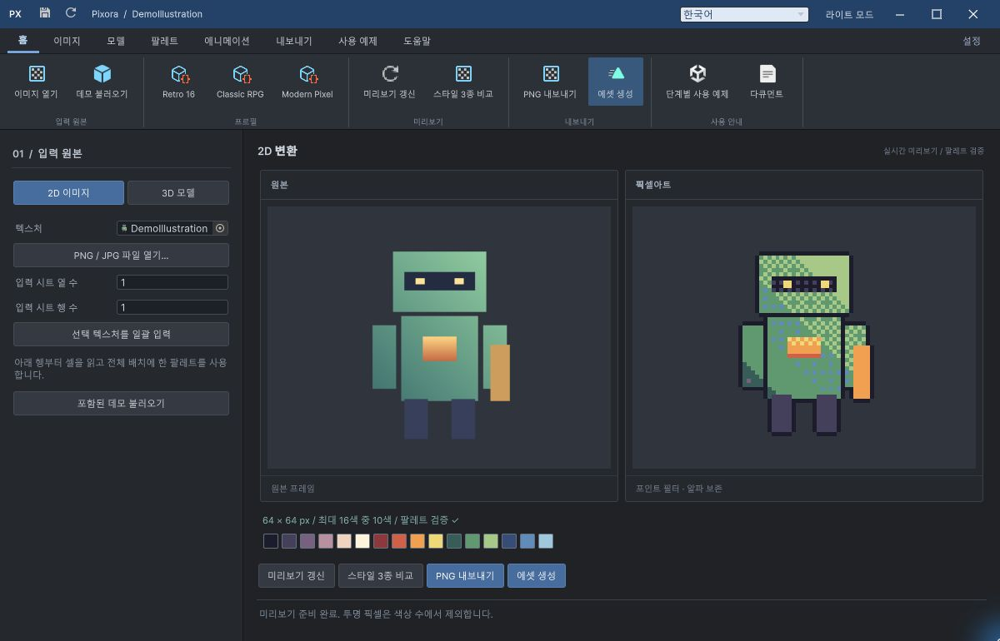
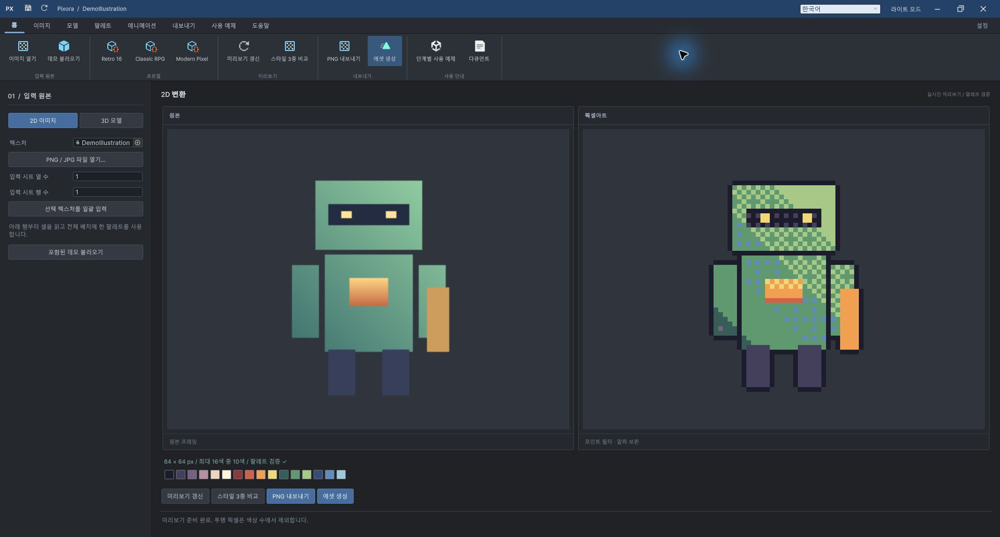
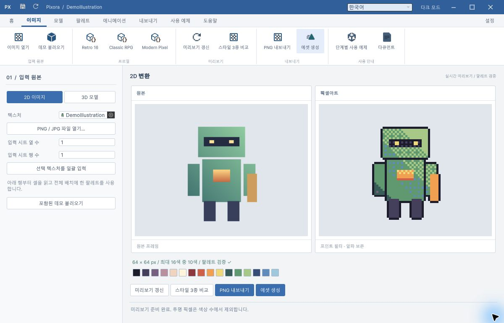
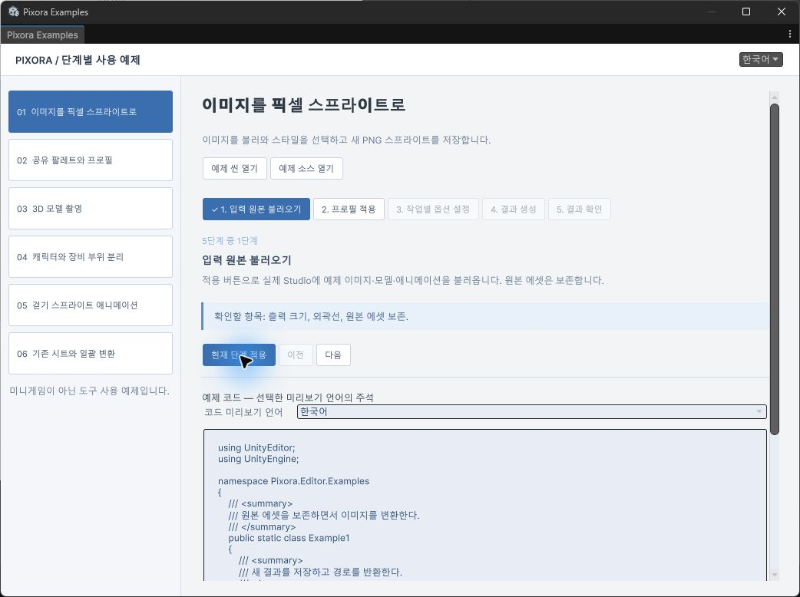
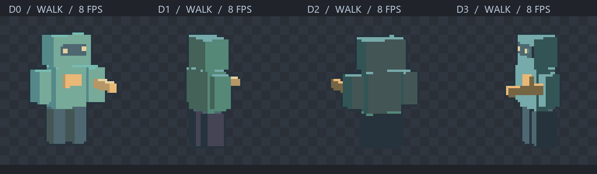

# Pixora 사용 예제와 창 프레임 결과

**Studio의 최소화·최대화·복원·닫기를 구현하고 실제 Windows Unity 창에서 확인했습니다.** 여섯 사용 예제 씬, 다섯 단계 가이드, 시작 설정 팝업과 9개 언어 지원도 구현·실행 검증했습니다. GitHub main에 코드를 반영했습니다.

- 작성 시각: 2026-10-29T19:26:46+09:00 / Asia/Seoul, KST UTC+09:00
- 버전: v1.1.0 / 상태: 구현·필수 검증 완료
- 프로젝트: [MDJ0126/Pixora](https://github.com/MDJ0126/Pixora)
- 확인한 프로젝트 커밋: [c8e46e7](https://github.com/MDJ0126/Pixora/commit/c8e46e71d332b14a9f83f5621eb64f638bbde38f)

## 창 오른쪽 위 버튼

DesignDataTable의 WorkbookViewerChrome·WorkbookNativeWindow 소스를 읽고 독립 창 구성을 참고했습니다. Studio 제목줄 오른쪽에 최소화, 최대화/복원, 닫기를 배치했습니다. 최대화 상태에는 겹친 사각형 복원 아이콘이 표시되고 닫기 버튼은 호버 시 빨간색으로 바뀝니다. 제목줄 드래그와 여덟 방향 가장자리 크기 조절도 지원합니다.

- 최대화 → 화면을 채우고 복원 아이콘 표시 → 원래 크기로 복원을 실제 확인했습니다.
- 최소화 → Studio가 숨겨지고 Unity 메인 창은 유지되는 것을 확인했습니다.
- Window → Pixora → Pixel Art Studio 또는 Ctrl+Shift+F5로 최소화한 창을 복원했습니다.
- 제목줄 이동으로 위치가 100,80에서 150,110으로 바뀌고 모서리 조절로 1280×820에서 1200×770으로 바뀌는 것을 확인했습니다.
- 닫기 후 다른 인스턴스로 다시 열어 원본 이미지, 변환 설정과 창 위치·크기가 유지되는 것을 확인했습니다.

Unity 팝업 컨테이너의 Minimize 호출만으로는 실제 최소화가 되지 않는 것을 확인했습니다. Windows에서는 현재 Unity 프로세스와 정확한 Pixora Studio 제목이 모두 일치하는 유일한 창에만 최소화·복원을 적용하도록 수정했습니다. 최대화는 Unity 컨테이너 API를 사용합니다. [Unity 6000.0 ContainerWindow 공식 소스](https://github.com/Unity-Technologies/UnityCsReference/blob/6000.0/Editor/Mono/ContainerWindow.bindings.cs)를 확인했습니다.

UI는 기존 USS와 UI Toolkit 코드를 직접 편집했습니다. Affinity로 만든 이미지 시안이 아니라 실제 Unity 창입니다. 최종 수정에서는 라이트 리본 아이콘과 가이드 입력 라벨의 대비를 보완했습니다.

## 게임이 아닌 여섯 사용 예제

Window → Pixora → Step-by-step Examples에서 시작합니다. 각 예제는 **입력 → 프로필 → 옵션 → 결과 생성 → 결과 확인**의 다섯 단계를 갖습니다. 적용 버튼은 실제 Studio 값을 바꾸고 생성 단계는 사용자가 편집한 설정으로 내보냅니다. 완료한 단계 다음으로 이동하며 씬은 기존 씬에 추가로 열립니다.

- 01 Image: 이미지를 축소·팔레트 변환하여 Sprite PNG로 저장합니다.
- 02 Palette: 공유 팔레트와 프로필을 적용합니다.
- 03 Model: 3D 모델을 직교 촬영합니다.
- 04 Parts: Renderer별 부위와 전체 합본을 같은 카메라·팔레트로 만듭니다.
- 05 Animation: 걷기 클립을 4방향×8프레임으로 촬영하고 실제 Unity 애니메이션 에셋을 만듭니다.
- 06 Sheet: 기존 2×2 입력 시트를 분할하여 일괄 변환합니다. 이 입력은 분할 동작을 설명하는 정적 이미지 예제입니다.

씬은 Assets/Pixora/Samples/Tutorials에 여섯 개 저장되어 있고 대응하는 Tutorial 정의와 원본·카메라·조명을 포함합니다. 게임 로직 MonoBehaviour가 없는 것을 검사했습니다. Assets/Pixora/Samples/Examples/Editor/Example1.cs~Example6.cs는 모두 실제로 컴파일·실행한 짧은 예제입니다. asmref를 통해 도구와 같은 에디터 어셈블리에서 실행합니다.

## 설정·언어·코드 주석

DesignDataTable의 시작 설정·언어 테이블·CodeCommentLocalization·CodeComments 문서를 확인했습니다. 화면 언어와 예제 코드 주석 언어를 독립적으로 선택하는 방식을 적용했습니다.

- 지원 언어: 영어, 한국어, 일본어, 중국어 간체·번체, 스페인어, 프랑스어, 독일어, 브라질 포르투갈어.
- 첫 실행과 설정 팝업에서 언어·테마·실제 소스 주석 변경·복원을 제공합니다.
- 가이드의 코드 미리보기 언어를 바꾸면 표시된 주석만 바뀝니다. 파일은 쓰지 않습니다.
- 설정의 실제 소스 주석 변경은 여섯 예제 파일의 등록된 주석만 바꿉니다. 식별자·로직·문자열·사용자 주석은 보존합니다.
- Library/Pixora/CommentBackups에 원본과 해시를 기록합니다. 변환 후 사용자가 편집한 파일은 복원 과정에서 덮어쓰지 않습니다.
- 오프라인 사용 문서도 9개 언어이며 각각 6개 장과 실제 예제 코드 6개를 포함합니다. 언어를 바꿀 때 현재 장을 유지합니다.

## 움직이는 스프라이트와 출력

기존 자체 제작 로봇의 64×64, 4방향·방향별 8프레임 출력과 Sprite 자동 격자를 유지했습니다. PNG 개별 Sprite, 시트, .anim, Animator Controller, 프리팹과 확인 씬을 실제로 생성합니다. GIF는 기존 실제 출력 프레임을 표시한 자료이며 이번 UI 화면 녹화는 아닙니다. 새 사용 예제의 애니메이션 출력도 별도로 실행 검증했습니다.

## 검증 근거

- Unity 6000.0.83f1 / Windows / 실제 에디터 컴파일 및 실행.
- 사용 예제 검사: **2,308개 통과**, 실행 시각 2026-10-29T19:24:22.2741785+09:00. 씬 실제 로드, 단계별 설정·내보내기, 컴파일된 예제 6개 실행, 9개 언어 카탈로그·자리표시자, UI 트리·창 제어 버튼, 코드 언어 드롭다운 콜백, 주석 왕복과 파일 백업·충돌 복원, 리사이즈 기하 검사를 포함합니다.
- 기존 변환·팔레트·스프라이트·애니메이션 회귀 검사: **88개 통과**. Artifacts/Verification.json에 기록했습니다.
- 9개 HTML 사용 가이드: 54개 장의 렌더링 코드 실행, 54개 예제 코드 표시, 언어 전환 시 장 유지 검사를 통과했습니다. Node VM의 최소 DOM 검사입니다.
- 기존 개발 문서: 10개 장, 5개 로컬 이미지 링크, 해시 이동 검사를 통과했습니다.
- 창 프레임은 위 버튼들을 실제 마우스로 조작하고 결과 스크린샷을 확인했습니다. 예제 씬 추가 열기와 단계 적용·다음 버튼 활성화도 실제 UI에서 확인했습니다.
- 근거 파일: Artifacts/TutorialVerification.json, WindowVerification.json, Verification.json, LocalizedGuideVerification.json, DocumentationVerification.json.

## 미확인과 한계

- 다른 운영체제·다른 Unity 버전의 창 제어는 미확인입니다. Unity 내부 컨테이너 API를 사용하므로 버전 변경 시 다시 실행 검증해야 합니다.
- 9개 언어의 UI 구성과 코드 선택 콜백은 자동 검사했습니다. 모든 언어의 전체 화면 배치를 사람이 하나씩 시각 검사한 것은 아닙니다.
- HTML은 링크·내용·스크립트 동작을 검사했습니다. 브라우저 레이아웃의 시각 검증은 미확인입니다.
- 번역은 등록된 예제 주석에 대한 오프라인 치환입니다. 임의의 사용자 코드 전체를 자동 번역하지 않습니다.
- AI 형태 재해석·의미 기반 배경 제거·상용 에셋과의 품질 비교는 기존 시제품의 미구현 범위로 유지됩니다.
- 보고서는 로컬 HTML 아카이브와 Git 저장소에 저장했습니다. 별도 웹 호스팅에 배포한 것으로 보고하지 않습니다.

## 시간과 검색 도구

- **제안 시간: 40~70분.** 여섯 사용 예제·설정 팝업·9개 언어·문서·코드를 구현하고 Unity에서 동작을 검증하는 기준으로 제시했습니다.
- 시작 시각: 2026-10-29T18:31:15.9299754+09:00.
- **실제로 완료된 시간: 55분 30초. 완료 시각 2026-10-29T19:26:46+09:00 (Asia/Seoul, KST UTC+09:00).** 구현·검증·프로젝트 푸시 완료 후 보고서 생성 시점 기준입니다.
- **XERJ: 사용 — DesignDataTable 검색 결과의 localization 후보를 현재 소스에서 확인했습니다. 인덱스 갱신은 replaced or deleted content remains live 오류로 실패했고 관련 누락·오래된 결과는 rg와 직접 소스 읽기로 보완했습니다.**
