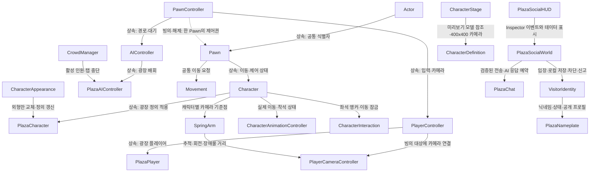

# 오후의 틈 — 캐릭터와 TPS 구조

기준은 `C:/Projects/SampleProjectForUnity`의 AGENTS.md, 캐릭터 문서(22/23), 실제 Actor·PawnController·Movement·PlayerCameraController 소스입니다. 기존 샘플 저장소는 수정하지 않았습니다.

## 구조

## 파일 분류

| 폴더 | 역할 |
| --- | --- |
| Assets/Scripts/InGame/Object | Actor·PawnController·플레이어 입력 |
| Assets/Scripts/InGame/Object/Pawn | 공통 이동·Pawn |
| Assets/Scripts/InGame/Object/Pawn/Character | 캐릭터·정의·애니메이션·착석 |
| Assets/Scripts/InGame/Object/AI | NavMesh 배회 제어 |
| Assets/Scripts/Common | SpringArm·TPS 카메라 |
| Assets/Scripts/Management | 세션·군중·실행 상태 측정 |
| Assets/Scripts/UI | 씬에 저장한 HUD의 상태 연결 |
| Assets/Prefabs/Characters | 프로젝트 캐릭터 프리팹 4종 |
| Assets/Settings/Characters | 외형 프리팹 참조·공유 Animator·속도 정의 |
| Assets/Settings/Plaza | 공유 애니메이션·머티리얼·저장한 NavMesh |

## 캐릭터 관리

- 플레이어는 `PlayerVisitor.prefab`입니다. 씬의 별도 `PlayerController` 오브젝트가 `defaultPawn`으로 해당 캐릭터에 빙의합니다.
- AI는 `NpcBusiness`, `NpcCasual`, `NpcOffice` 프리팹입니다. 같은 Pawn·Movement·애니메이션 구성을 쓰고 AIController가 경로 입력을 제공합니다.
- 외형은 프리팹의 `Model`, 카메라 기준 높이는 `SpringArm`, 기본 속도와 공유 Animator는 `Assets/Settings/Characters`에서 관리합니다. 새 선택 카탈로그는 `Catalog` 폴더의 16개 `CharacterDefinition`입니다. `modelPrefab`은 제어·충돌 컴포넌트를 제거한 외형이며 `CharacterAppearance.Apply`가 실제 교체합니다. `characterPrefab`은 기존 전체 Pawn 참조용 필드입니다.
- 외형을 교체할 때 Pawn·Controller·이름표·좌석 점유는 유지하고 `PlazaCharacter.Definition`과 Animator 캐시·성능 측정기 렌더러 목록을 갱신합니다.
- 외형은 같은 `Visitor.controller`와 Idle·Walk·Run·Sit·Waving·Texting·HardDay·Action 상태를 공유합니다. `AllActions.asset`의 147개 휴머노이드 클립은 전용 ActionPlaceholder만 AnimatorOverrideController로 교체합니다. 기본 이동·착석 클립은 유지하고 루트 이동은 차단합니다. 원본 polyperfect 에셋은 변경하지 않았습니다.
- Runtime과 Editor는 별도 asmdef입니다. UI 생성 코드는 런타임에 없고, 버튼은 씬의 Inspector 영구 이벤트로 연결합니다.

## TPS 조작·좌석

- WASD·방향키: 카메라 수평 방향 기준 이동. 바닥 클릭 이동도 유지합니다.
- Shift를 누른 동안 달립니다(걷기 2.8m/s, 달리기 5.2m/s). 텍스트 입력·모달·착석·중단 상태에서는 이동하지 않습니다.
- Enter: 채팅 입력 선택. 다시 Enter: 전송하고 이동으로 복귀. Esc: 입력 해제. 동일 프레임 중복 전송을 차단합니다.
- 설치된 Input System 1.19의 정규화 휠 설정에서는 1단계당 0.65m입니다. 설정의 비정규화 Windows 입력은 120으로 나눕니다.
- 내 캐릭터의 원형은 씬의 LineRenderer(64점·반경0.44m)입니다. 별도 데칼 렌더러나 텍스처 없이 실제 지면을 검사하며 벤치는 제외합니다. AI·미리보기에는 생성하지 않습니다.
- 오른쪽 드래그: 시점 회전. 휠: 카메라 거리 2.5~8m. 카메라는 SpringArm을 따라가며 Default 레이어의 환경 장애물을 SphereCast로 검사합니다.
- 좌석 근처에서 E 또는 버튼: 착석·기립. 착석·숨겨진 탭에서는 이동 입력을 중단합니다.
- 벤치마다 `PlazaSeat.Slots`에 좌우·가운데 3개 앵커와 출구가 있습니다. 상호작용하는 시점의 위치로 가장 가까운 빈자리를 고릅니다. 점유는 기립·비활성화 시 반환합니다.
- 보정은 기존 앵커에서 위 0.25m·벤치 정면 0.7m, 자리 간격 0.72m입니다. 사용자 기준 벤치의 가운데 Visitor 위치는 `(4, 0.25, 1.30)`입니다. 실제 Play 착석 화면과 점유·반환을 검사했습니다.
- 좌석의 앵커·출구, 모든 UI·Inspector 이벤트, 경로 지점, 광장 배치는 모두 씬 오브젝트로 편집합니다. 앉아 CharacterController가 꺼져도 프로필을 선택할 수 있도록 별도 트리거를 사용합니다.

## AI와 맵

- 광장은 24×19에서 48×38로 확장했습니다. 바닥 면적은 4배지만 같은 바닥 메시의 스케일 변경이며, 배경 오브젝트와 캐릭터 비용은 별도로 측정해야 합니다.
- 기본 6명, 최대 배치 12명입니다. `Crowd`의 활성 인원과 컨트롤러 배열에서 관리합니다. 웹의 `?crowd=0`, `?crowd=6`, `?crowd=12`는 비교 조건을 고정하기 위한 입력입니다.
- 경로는 에디터에서 저장한 NavMesh를 사용합니다. AI는 도착·대기·정체 때 경로를 선택하고 매 프레임 전체 탐색을 요청하지 않습니다. 지점 배열이 없으면 배치 원점 주변에서 후보를 찾습니다.
- AI는 배회 외에 빈 벤치 접근·착석·휴식·인사·휴대폰 확인·피곤한 하루 동작을 선택합니다. 벤치에 도착한 뒤 가까운 빈자리를 다시 검사하여 접근 중 다른 방문자가 차지한 자리를 피합니다.
- AI의 Animator는 보이지 않을 때 갱신을 중단하도록 설정했습니다. 숨겨진 탭에서는 AI의 이동·애니메이션·경로 이동을 함께 중단합니다.
- NavMesh의 갱신은 맵을 편집한 뒤 Unity Navigation Inspector에서 다시 굽습니다. 런타임에 광장 전체를 다시 굽지 않습니다.

## 검증 상태

2026-11-04 현재: 화면 사용 재허용 후 Unity 6000.0.83f1에서 입장·채팅·상태·프로필·16종 외형 교체·착석·147개 클립 샘플 재생을 실제 Play 검사했습니다. 상세 결과는 `QA/Controls`에 보존합니다. 애니메이션 전체 길이의 미술 품질과 새 웹 빌드·성능·장시간 브라우저 동작은 미확인입니다. 자세한 범위는 [기능 상태](feature-status.md)를 참고하세요.

이전 기록: 2026-11-04 00:15경에는 NavMeshPath 초기화 오류 수정 후 구버전 TPS에서 약39초 Play·AI 6명·착석·기립을 검사했습니다. 해당 결과는 이후 추가한 소셜 기능의 실행 검증을 대신하지 않습니다. `Builds/Web`와 `Builds/WebBaseline`은 이전 등각 시점 빌드입니다.

반복 옵션은 비루프 클립도 끝에서 Action 재생 시간을 다시 0으로 돌립니다. 최종 Play에서 두 번째 주기를 확인했습니다.
