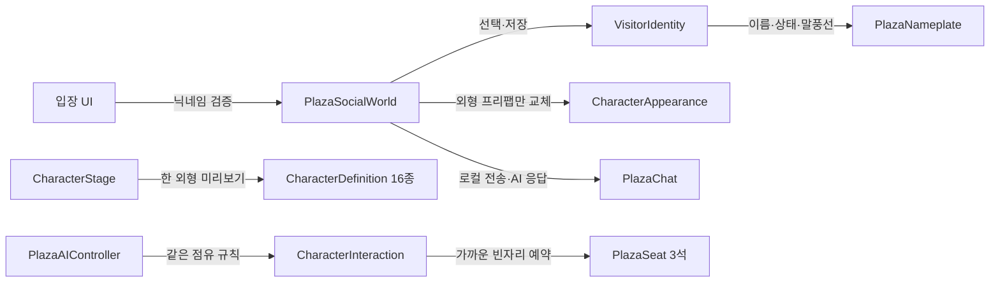

# 오후의 틈 — 로컬 소셜 기능과 확인 범위

## 프로젝트 구조

PC 웹 1인 광장을 대상으로 합니다. 멀티플레이·계정 서버·외부 AI API는 연결하지 않습니다. 모든 다른 방문자는 표시된 로컬 AI이며, 게스트 프로필·차단·신고 기록은 기기 내 PlayerPrefs에 저장하도록 작성했습니다.

| 기능 | 파일 구현 | 실행 확인 |
| --- | --- | --- |
| 벤치 3인 착석 | 6개 벤치·18석, 최근접 빈자리 예약·반환, 높이·앞뒤 보정 | 좌표·참조 검사 통과. 실제 자세·점유 동작 미확인 |
| 입장·닉네임 | 2~16자 닉네임·첫 입장 랜덤 외형·저장값 재사용·머리 위 이름표 | 입력 정책 검사 통과. UI·저장 복원 미확인 |
| 캐릭터 선택 | 일상형 16종 목록·페이지·미리보기 스테이지·외형만 교체 | 프리팹·버튼 참조·컴파일 통과. 화면·교체 동작 미확인 |
| 텍스트 대화 | 기록 최대80건·말풍선·정해진 AI 응답·Enter 전송 | 전송 정책 검사 통과. 전달·표시·응답 타이밍 미확인 |
| 상태 | 대화 가능·일하는 중·자리 비움·탭 복귀 시 이전 상태 복원 | 컴파일 통과. 실제 전환 미확인 |
| 프로필 | 캐릭터 클릭·자기소개·대표 이미지·HTTPS 링크 최대3건·선택 공개 | 링크·이미지 헤더 정책 검사 통과. 편집·디코딩·외부 열기 미확인 |
| 동작 목록 | 손 흔들기·휴대폰 확인·피곤한 하루·가만히 쉬기·멈추기 | 실제 FBX 클립·Animator 상태 참조 확인. 재생 미확인 |
| AI 다양화 | 배회·벤치 접근/착석/기립·인사·휴대폰·휴식·짧은 대화 | 컴파일·참조 검사 통과. 새 행동 전이 미확인 |
| 기본 운영 | 차단/해제·신고 사유 로컬 기록·2초 간격·10초당4건·같은 내용30초 제한 | 전송 제한 정책 검사 통과. UI·저장·말풍선 차단 미확인 |
| 한국어 입력 | 한글 완성형11,172자 포함 OFL 폰트 | cmap 검사 통과. 실제 입력 렌더링 미확인 |
| 웹·성능 | 기존 탭 숨김 중단·계측 코드 유지, 미리보기 카메라는 패널을 열 때만 활성화 | 새 웹 빌드·성능·장시간·배경 탭 검증 미실행 |

화면 사용은 사용자가 나중으로 지정했습니다. 컴파일과 파일 구조 검사를 실제 Play 검증으로 표시하지 않습니다. 이전 빌드의 성능 수치는 이번 버전의 수치가 아닙니다.

## 기능 연결

## 편집 위치

- 씬: `Assets/Scenes/AfternoonPlaza.unity`. `소셜 UI`에서 패널·문구·배치·버튼 이벤트를 편집합니다. `Social Services`에는 World·Chat·HUD·프로필 이미지 수신 컴포넌트가 있습니다.
- 좌석: 벤치의 `PlazaSeat.Slots`에서 세 자리의 앵커·출구를 편집합니다. 기존 `anchor`·`exit`은 가운데 자리의 호환 참조입니다.
- 캐릭터: `Assets/Settings/Characters/Catalog`의 정의와 `Assets/Prefabs/Characters/Models`의 외형을 편집합니다. 공통 Pawn과 컨트롤러는 교체하지 않습니다.
- 닉네임·말풍선: `Assets/Prefabs/UI/VisitorNameplate.prefab`입니다. 폰트는 `Assets/Fonts/PlazaKorean.ttf`입니다. 사용자 입력이 있으므로 UI 문구만 남기도록 폰트를 축소하지 않습니다.
- 스테이지: 씬의 `Character Stage`, Layer9 `CharacterStage`, `Assets/Settings/Plaza/CharacterStage.renderTexture`입니다. 원본 에셋과 런타임 UI 생성 스크립트를 수정할 필요가 없습니다.

## 실행 확인 순서

화면 사용이 가능해진 뒤 **AfternoonPlaza 씬을 디스크에서 다시 열어** 확인합니다. 현재 열린 에디터가 새 씬 데이터를 읽었다고 가정하지 않습니다. 저장하지 않은 사용자 변경이 있으면 먼저 보존해야 합니다.

1. Play에서 입장 폼을 확인하고 닉네임 오류·정상 입장·이름표를 확인합니다.
2. 벤치 좌우·가운데에서 상호작용해 가까운 빈자리로 들어가는지 확인합니다. AI와3석 동시 점유·가득 찬 벤치·기립·AI 비활성 후 반환을 반복합니다.
3. 앉은 상태를 포함해 캐릭터를 여러 번 교체하고 Pawn·위치·이름·점유 유지와 Console 오류를 확인합니다.
4. 대화·AI 응답·말풍선·기록·연속 전송·반복 메시지·차단/해제·신고 저장을 확인합니다. 텍스트 입력 중 WASD와 E가 캐릭터에 전달되면 실패입니다.
5. 상태 변경·탭 이탈/복귀, 공개/비공개 프로필·소개·이미지·링크·저장 후 재입장을 확인합니다. 외부 링크 열기는 이용자가 직접 선택합니다.
6. 동작 목록·이동 취소·착석 잠금과 AI의 배회·착석·인사·휴대폰·휴식 전이를 확인합니다.
7. 웹 실행을 승인한 뒤 고정 산출물로0/6/12명·FPS·CPU·메모리·빌드 용량·장시간·백그라운드 복귀를 측정합니다. 현재 `Builds/Web`은 새 버전이 아닙니다.

신고는 실제 운영자에게 전달되지 않습니다. 음성·온라인 계정·멀티플레이·유료 광고·홍보 게시판·전시 공간은 이 로컬 시제품에 포함하지 않습니다.
