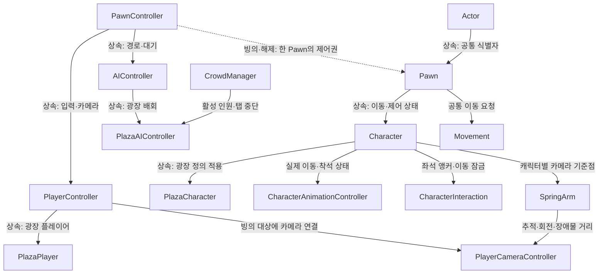

# 오후의 틈 — 캐릭터와 TPS 구조

기준은 `C:/Projects/SampleProjectForUnity`의 AGENTS.md, 캐릭터 문서(22/23), 실제 Actor·PawnController·Movement·PlayerCameraController 소스입니다. 기존 샘플 저장소는 수정하지 않았습니다.

## 구조

## 파일 분류

| 폴더 | 역할 |
| --- | --- |
| Assets/Scripts/InGame/Object | Actor·PawnController·플레이어 입력 |
| Assets/Scripts/InGame/Object/Pawn | 공통 이동·Pawn |
| Assets/Scripts/InGame/Object/Pawn/Character | 캐릭터·정의·애니메이션·착석 |
| Assets/Scripts/InGame/Object/AI | NavMesh 배회 제어 |
| Assets/Scripts/Common | SpringArm·TPS 카메라 |
| Assets/Scripts/Management | 세션·군중·실행 상태 측정 |
| Assets/Scripts/UI | 씬에 저장한 HUD의 상태 연결 |
| Assets/Prefabs/Characters | 프로젝트 캐릭터 프리팹 4종 |
| Assets/Settings/Characters | 외형 프리팹 참조·공유 Animator·속도 정의 |
| Assets/Settings/Plaza | 공유 애니메이션·머티리얼·저장한 NavMesh |

## 캐릭터 관리

- 플레이어는 `PlayerVisitor.prefab`입니다. 씬의 별도 `PlayerController` 오브젝트가 `defaultPawn`으로 해당 캐릭터에 빙의합니다.
- AI는 `NpcBusiness`, `NpcCasual`, `NpcOffice` 프리팹입니다. 같은 Pawn·Movement·애니메이션 구성을 쓰고 AIController가 경로 입력을 제공합니다.
- 외형은 프리팹의 `Model`, 카메라 기준 높이는 `SpringArm`, 기본 속도와 공유 Animator는 `Assets/Settings/Characters`에서 관리합니다. `characterPrefab`은 카탈로그 참조이며, 정의를 교체하는 것만으로 기존 Model을 자동 교체하지는 않습니다.
- 세 외형은 같은 `Visitor.controller`와 Idle·Walk·Sit 클립을 공유합니다. 원본 polyperfect 프리팹은 변경하지 않았고 원본 배회·전투 스크립트는 프로젝트 캐릭터에 남기지 않았습니다.
- Runtime과 Editor는 별도 asmdef입니다. UI 생성 코드는 런타임에 없고, 버튼은 씬의 Inspector 영구 이벤트로 연결합니다.

## TPS 조작·좌석

- WASD·방향키: 카메라 수평 방향 기준 이동. 바닥 클릭 이동도 유지합니다.
- 오른쪽 드래그: 시점 회전. 휠: 카메라 거리 2.5~8m. 카메라는 SpringArm을 따라가며 Default 레이어의 환경 장애물을 SphereCast로 검사합니다.
- 좌석 근처에서 E 또는 버튼: 착석·기립. 착석·숨겨진 탭에서는 이동 입력을 중단합니다.
- 좌석의 앵커·출구, HUD, 경로 지점, 광장 배치는 모두 씬 오브젝트로 편집합니다.

## AI와 맵

- 광장은 24×19에서 48×38로 확장했습니다. 바닥 면적은 4배지만 같은 바닥 메시의 스케일 변경이며, 배경 오브젝트와 캐릭터 비용은 별도로 측정해야 합니다.
- 기본 6명, 최대 배치 12명입니다. `Crowd`의 활성 인원과 컨트롤러 배열에서 관리합니다. 웹의 `?crowd=0`, `?crowd=6`, `?crowd=12`는 비교 조건을 고정하기 위한 입력입니다.
- 경로는 에디터에서 저장한 NavMesh를 사용합니다. AI는 도착·대기·정체 때 경로를 선택하고 매 프레임 전체 탐색을 요청하지 않습니다. 지점 배열이 없으면 배치 원점 주변에서 후보를 찾습니다.
- AI의 Animator는 보이지 않을 때 갱신을 중단하도록 설정했습니다. 숨겨진 탭에서는 AI의 이동·애니메이션·경로 이동을 함께 중단합니다.
- NavMesh의 갱신은 맵을 편집한 뒤 Unity Navigation Inspector에서 다시 굽습니다. 런타임에 광장 전체를 다시 굽지 않습니다.

## 검증 상태

2026-11-03: 씬·프리팹 저장과 독립 C# 정적 컴파일을 확인했습니다. 실제 TPS 플레이·AI 배회·새 Web 빌드·인원별 성능은 **미실행**입니다. 사용자가 화면을 사용 중이므로 GUI 조작·새 실행을 중단했습니다. 기존 등각 시점 웹 빌드는 `Builds/WebBaseline`에 보존했습니다.
