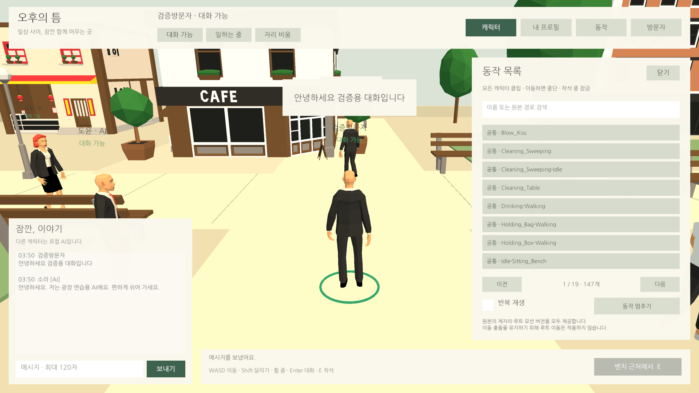

## 작업 결과

동일한 이동 재현에서 직접 답장이 전달되고 오류 없이 종료됐습니다.

## 변경 내용

### 재현 조건

Unity6000.0.83f1, AfternoonPlaza, 로컬 AI6명

### 재현 순서

입장→안녕하세요 전송→응답 대상 예약 확인→광장의 반대편으로 이동→4초 뒤 예약 대상의 정확한 응답 확인

### 기대 동작

말을 건 뒤 이동해도 정상 예약된 직접 답장은 유지됩니다.

### 실제 동작

수정 전 동일 재현에서 직접 답장이 나타나지 않았습니다. reply-before-result.json의 마지막 검사 실패, 게임 예외0건입니다.

### 원인

PlazaChat의 예약 응답 경로가 일상 발화용 TryAISay를 호출해18m 거리와8초 쿨다운 제한을 다시 적용했습니다. 소스와 수정 전/후 동일 재현 결과로 확인했습니다.

### 적용 내용

직접 응답 전용 CanReply로 활성·대화 가능·입장·차단·자리 비움 상태를 검사합니다. 예약 응답에는 거리/일상 발화 쿨다운을 적용하지 않으며, 응답 대기 중 해당 AI의 일상 발화를 뒤로 미룹니다. 일상 발화 자체의 제한은 유지합니다.

## 검증

[수정 전 실제 실패](../assets/controls-20261104/reply-before-result.json) → [수정 후 동일 재현 통과](../assets/controls-20261104/reply-after-result.json). 이후 [회귀513개 통과](../assets/controls-20261104/full-result.json), 오류0·경고0. QA 종료 후 사용자 프로필·신고 원래 값 복원.

수정 전 동일 장면의 화면은 확보하지 못했으며, 실패 JSON을 원본 근거로 사용합니다. 이 버그의 시각적 전후 대조를 완료했다고 표시하지 않습니다. 교훈: 직접 응답과 일상 발화의 조건 차이를 프로젝트 문서에 기록했습니다. 기존 전역 근거 확인 지침과 중복되므로 전역 추가·통합·변경 없음.

## 남은 사항

이 재현의 남은 오류는 없습니다. 온라인 AI·멀티플레이는 구현 범위가 아닙니다. 새 웹 빌드 검사는 미실행입니다.

## 작업 시간

- 제안 시간: 전체 조작·동작·QA 요청40~70분 내 추가 수정
- 실제로 완료된 시간: 전체 작업03:11:28 KST 시작. 이 버그 수정·동일 재현 QA는 reply-before/after의 실제 시각에 기록. 독립 타이머를 두지 않아 버그만의 소요 시간은 미측정.
- XERJ: 미사용 — XERJ MCP 미제공. 현재 PlazaChat 소스와 실제 Unity 재현 결과로 대조.
