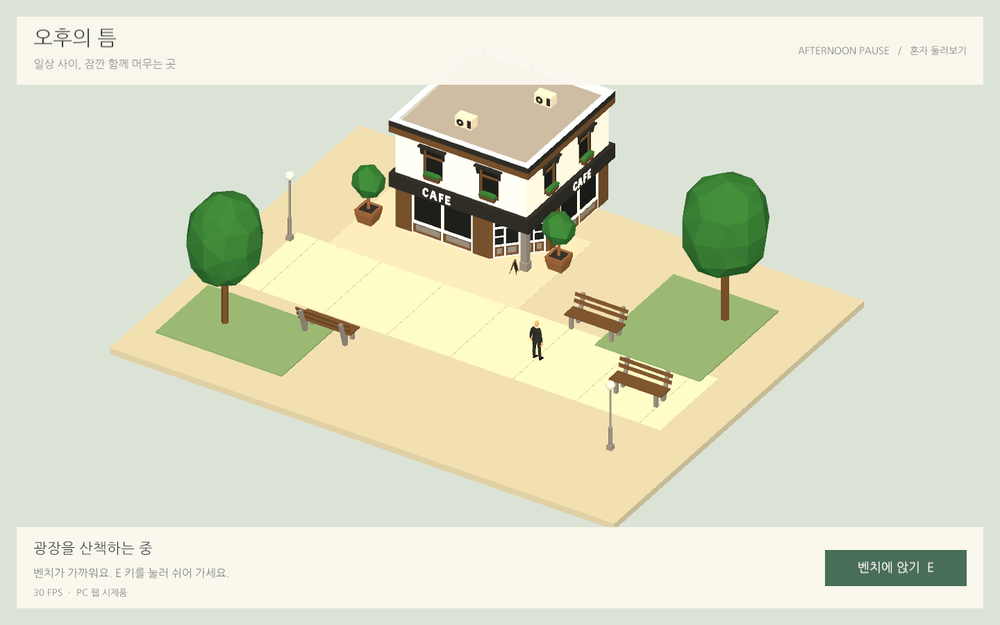
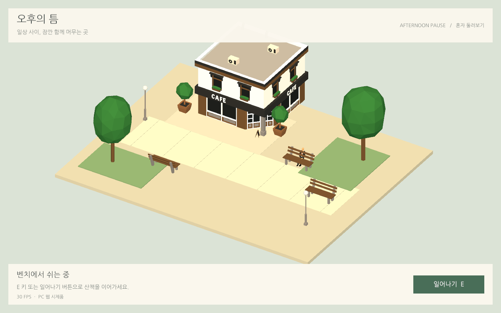
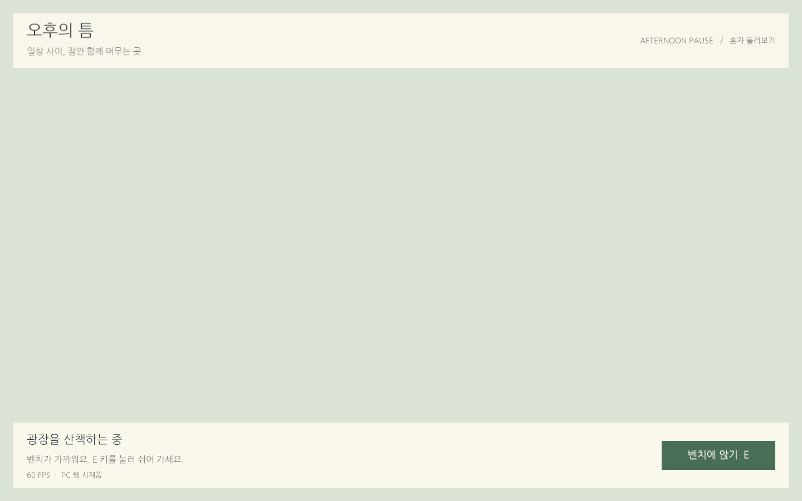

## 작업 결과

PC 웹용 1인 광장을 구현하고 실제 브라우저 QA를 완료했습니다. WASD·방향키·바닥 클릭으로 이동하고, 벤치 근처에서 E 키나 버튼으로 착석·기립할 수 있습니다.

Chrome에서 실행한 실제 광장입니다. 카페·나무·벤치는 Low Poly Epic City, 방문자는 Low Poly Animated People 에셋입니다.

E 키로 착석한 상태입니다. 착석 중 이동은 제한되며 기립하면 이동할 수 있습니다.

## 변경 내용

### 적용 내용

작은 광장·카페·벤치 3개만 선별했으며 씬·UI·버튼 이벤트를 편집 가능한 Unity 오브젝트로 저장했습니다. 원본 에셋과 데모 씬은 보존했습니다. Runtime과 Editor 코드는 어셈블리를 분리했습니다.

첫 웹 빌드에서 UI만 보이고 WebGL sampler mismatch가 발생했습니다. 실시간 그림자를 제외한 설정으로 재빌드한 뒤 3D 표시와 그리기 오류 해소를 확인했습니다. 엔진 내부의 근본 원인은 단정하지 않습니다.

수정 전에는 UI만 표시되었습니다. 위의 수정 후 화면과 같은 1440×900 브라우저 캡처입니다.

한글 UI 폰트는 Nanum Gothic OFL 원본 2,054,744바이트에서 사용하는 글리프 73,616바이트로 줄였습니다. 최종 파일 전체는 17,505,239바이트입니다. 자산별 해시는 첨부에 보존했습니다.

## 검증

Unity 6000.0.83f1 / URP 17.0.4, Windows PC, NVIDIA GTX 970 / D3D11에서 실제 웹 빌드를 실행했습니다.

| 브라우저 | 실제 버전 | 중앙 FPS | p95 프레임 시간 |
| --- | --- | --- | --- |
| Chrome | 156.0.8078.80 | 30.01 | 34.00 ms |
| Edge | 156.0.4314.58 | 30.01 | 34.00 ms |

실제 키보드·마우스로 이동, 먼 곳에서 착석 방지, 벤치 3곳의 착석·기립, 착석 중 이동 방지, 버튼 연결을 검사했습니다. 브라우저 예외·WebGL 그리기 오류는 없었습니다. 엔진 초기화 경고는 원본 QA에 보존했으며 경고가 전혀 없다고 보고하지 않습니다.

Playwright의 기본 포커스 에뮬레이션이 가시성 검증에 개입하는 것을 설치 소스에서 확인하여, 실제 탭 숨김·복귀 검증은 포커스 강제가 없는 별도 Chrome CDP 연결로 실행했습니다. document.visibilityState=hidden, 런타임 hidden=true, 목표 5 FPS와 복귀 후 30 FPS·이동을 확인했습니다. 해당 측정 뷰포트는 1424×905, DPR 1입니다.

렌더러 작업 CPU는 전경 11.60% → 숨김 0.08%입니다. 이는 한 코어 기준 Chromium TaskDuration 측정이며 전체 PC·GPU 사용률과 다릅니다. WebAssembly 힙은 96,665,600바이트였습니다.

[Chrome QA](../assets/chrome-qa.json) · [Edge QA](../assets/edge-qa.json) · [실제 탭·CPU·메모리 측정](../assets/visibility-qa.json) · [최종 빌드·소스 해시](../assets/build-manifest.json)

## 남은 사항

서버 배포·다중 접속·채팅·프로필은 이후 단계입니다. 이번 시제품은 로컬 HTTP 서버에서 확인했습니다. 단기 성능 측정이며 수 시간 이상의 안정성·모바일·다른 GPU는 미검증입니다. 실시간 그림자는 사용하지 않습니다.

Affinity MCP 연결이 ECONNREFUSED여서 캡처 편집·압축과 GIF 변환은 실행하지 않았습니다. 실제 브라우저 원본 PNG를 첨부했습니다. 공식 프로젝트 로고는 미등록(null)입니다.

교훈 검토: 전역 지침 변경 없음. 기존의 실제 실행·설정 검증 원칙을 적용했으며, Playwright 포커스 강제와 Unity 웹 초기화 시점에 관한 구체적인 근거는 이 프로젝트에 보존합니다.

## 작업 시간

- 제안 시간: 30~60분
- 실제로 완료된 시간: 구현·웹 QA: 66분 49초, 2026-11-03 22:37:42 KST 완료. 공개 배포·외부 접근 확인은 게시 후 별도 검증합니다.
- XERJ: 미사용 — XERJ 연결 도구·프로젝트 검색 스크립트 미제공. rg 검색 결과를 현재 소스·설정·실제 웹 실행으로 대조했습니다.
