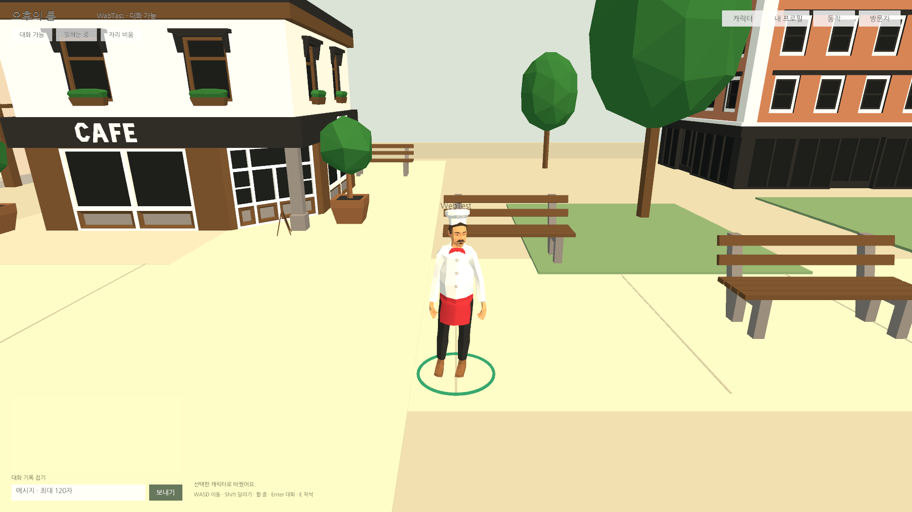
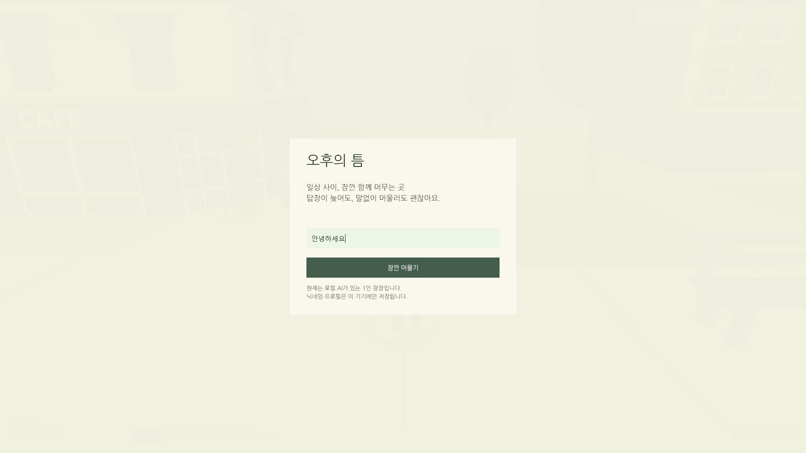
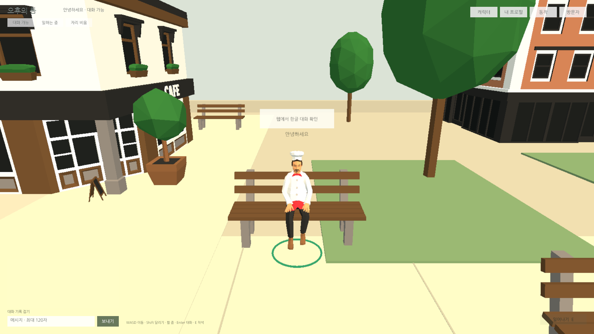

## 작업 결과

코드 크기 최적화·Medium stripping·웹 전용 HDR 비활성·HTML IME 입력 브리지를 적용했습니다. 외부 에셋·패키지·엔진 원본은 수정하지 않았습니다. 최신 빌드의 실제 기능·성능 수치와 제한을 아래에 기록했습니다.

## 변경 내용

### 적용 내용

- WebGL DiskSize 코드 최적화, Managed Stripping Medium. Inspector/JSON/SendMessage에 사용하는 자체 Runtime을 link.xml로 보존.
- 원본 Mobile/PC 파이프라인을 보존하고 자체 Web_RPAsset을 만들어 HDR을 끕니다.
- Unity6000.0 Web IME 제한에 대응해 자체 .jslib와 정적 HTML input/textarea를 연결했습니다. 한글 조합 중 Enter 전송을 막고 완료 후 기존 Inspector 동작으로 전달합니다. 닉네임·채팅·프로필 InputField가 공통으로 사용합니다.
- 템플릿에 자동 영구 저장 동기화, 호스팅 MIME/gzip 설정 예제를 추가했습니다. 임시 Editor 빌드/설정 도구는 제거했습니다.

추가 작업: 요청한 최적화 외에 확인된 웹 한글 입력 제한을 보완하고 호스팅 설정·라이선스 확인 문서를 작성했습니다.

## 검증

|구분|AI|FPS 중앙값|프레임 p95 ms|전경 CPU 1코어 %|배경 CPU %|로드 초|
|---|---:|---:|---:|---:|---:|---:|
|base-0|0|30.01|34.0|7.55|0.028|3.29|
|base-6|6|30.01|34.0|9.05|0.024|3.19|
|base-12|12|30.01|34.0|11.68|0.020|3.17|
|opt-functional|0|30.01|34.0|7.11|0.309|3.10|
|opt-6|6|30.01|34.0|10.29|0.026|3.19|
|opt-12-long|12|30.01|34.0|10.14|0.018|3.48|
|edge-6|6|30.01|34.0|11.19|0.382|3.49|

Chrome/Edge 실제 브라우저,1920×1080, GTX970/D3D11 WebGL2. CPU는 renderer TaskDuration/경과 시간의 단일 코어 비율이며 전체 PC CPU가 아닙니다. 짧은 구간은 비교 자료이며 작은 차이를 개선으로 단정하지 않습니다.

- 빌드 총26307796→24143127바이트,2164669바이트(8.23%) 감소. WASM 메모리 크기는 모든 검사에서115998720바이트로 유지됐습니다. [고정 산출물·소스 SHA256](../assets/web-optimization-20261104/frozen-manifest.json).
- 실제 compositionstart/update/end와 한글 최종값, 입장·WASD·Enter 채팅·말풍선·착석·기립을 확인했습니다. 첫 착석 검사는 도착 전 상호작용으로 실패했고 대기 조건 수정 후 재검사했습니다.
- 모든 실행에서 별도 실제 탭을 활성화해 document.visibilityState=hidden,5FPS,AI 정지 및 복귀30FPS를 검사했습니다. Playwright focus emulation 결과를 숨김 검증으로 사용하지 않았습니다.
- 최적화12명은120초 연속 측정했습니다. 이는 수시간 안정성을 입증하지 않습니다. 각 JSON에 프레임·메모리·AI 경로 요청/완료·표시 캐릭터·브라우저 경고가 포함됩니다.
- [최종 컴파일](../assets/web-optimization-20261104/compile-result.json):Runtime/RuntimeEditor/Editor 모두0. 임시 도구 삭제 후 검사.

[실행 원자료](../assets/web-optimization-20261104/opt-12-long.json) · [공개 준비·호스팅·라이선스 근거](../assets/web-optimization-20261104/web-readiness.md).

교훈 검토: 포커스 에뮬레이션과 실제 탭 숨김을 구분하는 검사와 도착 확인을 프로젝트 QA에 기록했습니다. 기존 근거 확인·외부 원본 보존 지침과 중복되므로 전역 추가·통합·변경 없음.

## 남은 사항

12명120초에서 최대 프레임287ms가 기록됐고 Managed 메모리2920448→4849664바이트 증가가 관찰됐습니다. 원인과 장기 수렴은 미확인입니다. 수시간 장기 접속·다양한 GPU/브라우저 버전·모든 상세 UI의 웹 회귀는 미실행입니다. 기존 Unity Play555개 결과를 웹 전체 통과로 대체하지 않았습니다. 시작 시 WebGL INVALID_ENUM 경고가 남아 있으면 각 원자료 warnings에 보존하며 오류0과 구분합니다. 에셋 구매 증빙·상표/도메인 권리 판단은 미확인이고 실제 게임 공개 배포는 하지 않았습니다. 모바일·멀티플레이 제외.

## 작업 시간

- 제안 시간: 최초60~100분. 사용자 재지정20분(11:49:19~12:09:19 KST)
- 실제로 완료된 시간: 최초 시작 2026-11-04 05:25:17 KST, 중간 장시간 미진행으로 최초 예상 초과. 실제 경과 6시간37분. 재개 11:49:19 KST → 구현·측정 종료 2026-11-04 12:02:42 KST (13분24초). 공개 배포는 별도 확인.
- XERJ: 미사용 — XERJ MCP/검색 스크립트 미제공. rg·현재 소스·공식 Unity문서·실제 raw CDP 브라우저 검사로 대체.
