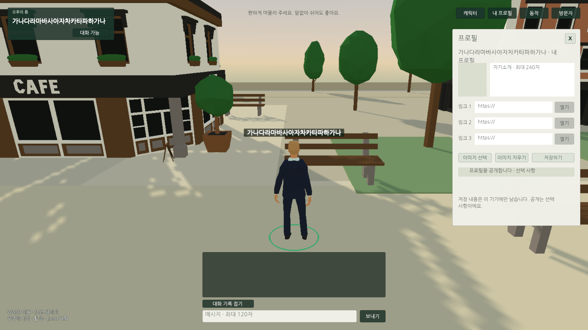
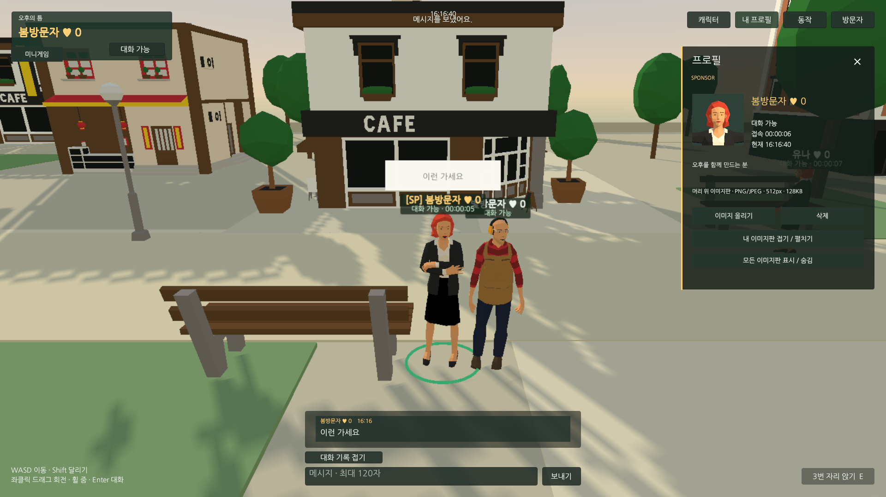
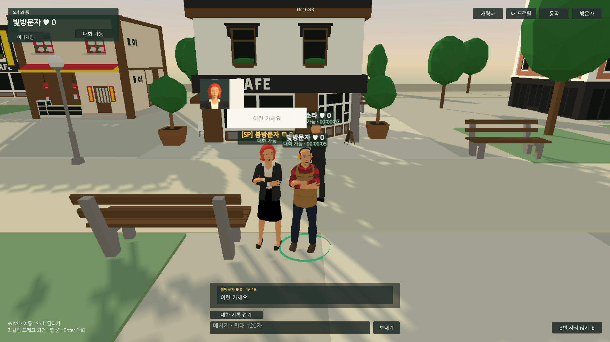
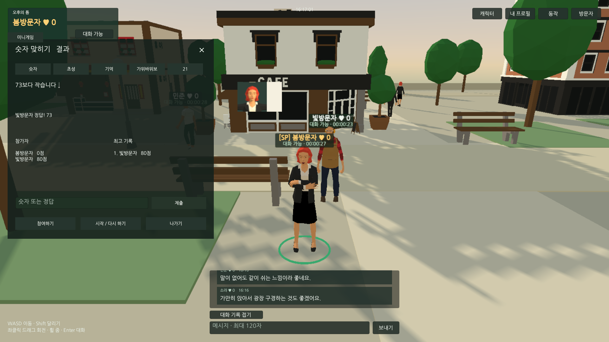

## 작업 결과

이동/UI·멀티플레이·공동 미니게임5종·좋아요·스폰서·이미지판을 구현하고 기존 범위 웹 동작을 확인했습니다. 가판대 상인3명은 코드와 저작 도구를 저장했으나 아직 씬 적용·실행 검증 전입니다. 전체 요청 완료로 표시하지 않습니다.

## 변경 내용

### 적용 내용

- 즉시 이동/정지, 도착까지 달리기, 좌클릭 드래그 회전과 릴리즈 클릭, 벤치 자동 접근·착석.
- 1초 상태 갱신·1초 채팅·중복 탭 무로딩·서버 신고/좋아요 저장.
- 캐릭터 얼굴16종 사전 촬영, 간편 프로필·별도 신고 팝업·가는 선 닫기.
- 숫자·초성·기억·가위바위보·21 공동 게임과 서버 최고기록.
- 서버 지정 스폰서 금색 닉네임/프로필, PNG/JPEG512px·128KB 이미지판과 거리/최대4개 표시 제한. 이미지 원본은 매초 보내지 않습니다.
- 옥상 아래 외벽/결합 창문·간헐 비행·이름표 접속 시간과 현재 시각.
- 사용자 예시 기반 순화표와 8개 재사용 메시지 카드. 메이플 공식 전체 순화어 목록과 동일함은 미확인입니다.

변경 전: 소개·링크·개인 사진이 있던 실제 웹 프로필입니다.

변경 후: 같은1920×1080 웹에서 스폰서 금색 프로필과 캐릭터 얼굴을 확인했습니다. 카메라/캐릭터 상태가 달라 픽셀 단위 동일 장면 비교는 아닙니다.

본인 업로드 이미지를 상대 Edge 화면의 머리 위에서 확인했습니다. 이 캡처 이후 이미지 정렬 보완 코드를 저장했으며 그 변경은 재검증 전입니다.

두 참가자의 숫자 게임과 서버 최고기록입니다.

## 검증

- Unity6000.0.83f1 실제 Play86개 통과, 오류0, 기존 PlayerPrefs 복원.
- Chrome156.0.8078.80 / Edge156.0.4314.58 실제 두 접속 검사29개 통과(16:18:13 KST). 게임5종·파일 업로드 공유/접기·좋아요·신고 서버 접수·클릭 착석·중복 탭 무로딩 포함.
- 측정 중앙값30.01FPS, 프레임p95 34ms·최대35ms, 브라우저 CPU10.42%/한 코어. 최소 틱 간격1025ms, 업로드약574B/s·다운로드약3602B/s. 실제2명+각 클라이언트 AI3명 조건이며 상인3명 추가 후 성능은 미확인입니다.
- 기존 범위 NodeHTTP/게임 검사11개 통과. 권한 위조·크기/해상도·중복 좋아요·재시작 보존·서버 게임 판정 확인. 이후 상인 endpoint 추가의 HTTP 재검사는 아직 하지 않았습니다.
- 16:15:19 웹 빌드24,953,593bytes 성공. 이후 상인과 일부 보완 코드는 이 빌드에 포함되지 않습니다. 현재 추가 코드는 Runtime/Editor 컴파일 통과까지 확인했습니다.
- Esc 입력으로 화면 조작을 중단하고 자동 드라이버와 대기 요청을 취소했습니다. 두 QA 브라우저는 정상 종료했고 전용 QA 서버도 종료했습니다. 기존 사용자 Unity·Chrome·사용 중이던 서비스는 보존했습니다.
- 프로젝트 교훈: 주변 AI 발화가 있는 QA에서 전체 로그 개수 대신 대상 메시지 중복을 확인합니다. Canvas 연결·실행 시 목록 색·채팅 실제 화면 좌표를 확인합니다. 기존 전역 규칙과 중복되어 전역 지침 변경 없음.
- 이미지 캡처 원본 PNG를 보존했습니다. 가독성 보존을 위해 약300~425KB 원본을 첨부했고 이미지 편집·GIF 제작은 수행하지 않았습니다.
- 참고한 공식 채팅 안내: https://gi.maplestory.nexon.com/Guide/GameInformation/Community/ChattingSystem

## 남은 사항

화면 사용 중단으로 가판대3구역/상주 상인의 씬 적용·실제 수령 검사, 최근 얼굴/이미지 정렬/비행 경로 보완 재검사, 최종 웹 빌드·상인 추가 성능·백그라운드 회귀와 임시 Editor 도구 정리가 남았습니다. 상인 상품은 무료 체험이며 실결제·유료 판매·계정 시스템은 구현하지 않았습니다. 외부 호스팅/도메인과 실제 인터넷 서비스 배포도 하지 않았습니다. 파일 저장과 중간 검증을 전체 완료로 간주하지 않습니다.

## 작업 시간

- 제안 시간: 최초90~150분. 후속 기능 추가로16:15~16:30, 스폰서/이미지판 추가20~30분, 가판대/상인 추가15~25분 반영 최종16:35~16:50 KST 예상으로 안내했습니다.
- 실제로 완료된 시간: 2026-11-04 14:17:28 KST 시작. 화면 조작 중단16:23:38 KST까지2시간6분10초. 전체 작업은 미완료이며 완료 시각은 없습니다. 보고서는 중단 상태를 기록합니다.
- XERJ: 미사용 — XERJ MCP/검색 스크립트 미제공. rg·현재 소스·실제 실행으로 검증.
