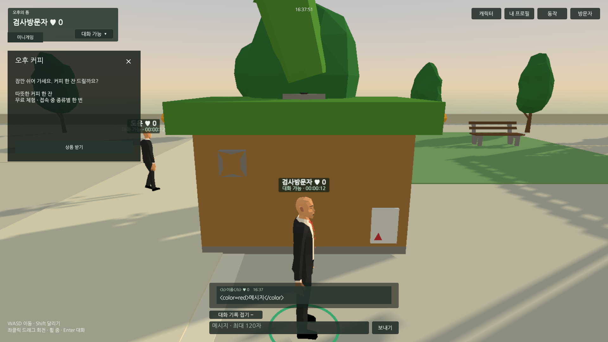
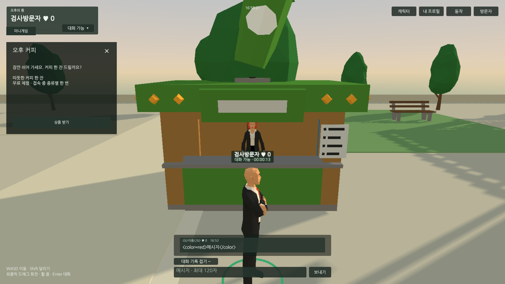
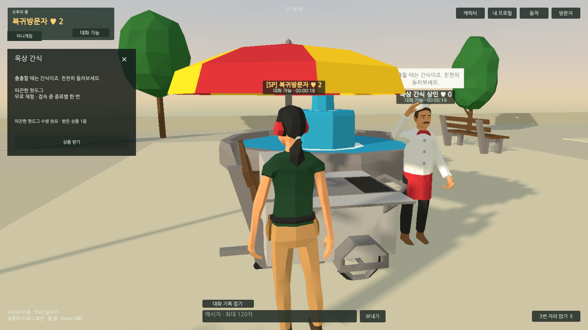
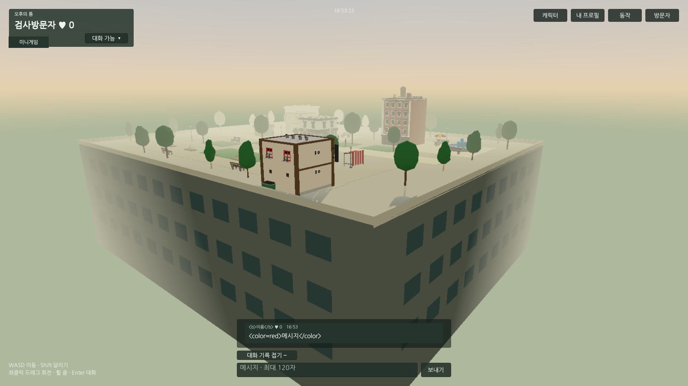

## 작업 결과

가판대3곳의 클릭 접근·고정 상인·무료 상품 수령을 구현했습니다. Play107개, 서버11개, 두 브라우저 기능37개 및 재접속/가판대/성능28개 검사를 확인했습니다. 최종 로컬 서버가 검증한 웹 산출물을 제공하며 실제 파일 해시도 대조했습니다.

## 변경 내용

### 적용 내용

- 커피·꽃·핫도그 매대와 고정 상인3명. 배회 보충 인원과 별도이며 이동 경로 컨트롤러가 없습니다. 매대/상인 클릭 접근 후 상품 창과 서버 수령을 연결했습니다. 상품은 무료 체험이며 접속 중 종류별1회입니다.
- 원본 polyperfect를 수정하지 않고 프로젝트 씬 인스턴스·공유 URP 머티리얼·기존 Character 계층을 사용했습니다.
- 기존 이동/TPS·벤치·멀티·대화/차단/신고·좋아요·간편 프로필·스폰서·이미지판·공동 게임5종을 유지했습니다.
- 추가 QA 수정: 빙의 전 UI null 방어, 개인 사진/소개/링크의 잔여 DTO/API 제거, 성능 비교 인원 유지/자동 복귀. 빌드 메뉴와 기본 서버의 출력 폴더도 통일했습니다.

적용 중 발견한 매대 역방향을 수정했습니다. 같은 Unity1920×1080·같은 카메라 위치에서 상인이 가려지던 전·후입니다.

최신 실제 Chrome에서 핫도그 상품 수령을 확인했습니다.

옥상 아래에는 외벽과 창문을 결합 메시로 추가했습니다. 아래는 실제 게임 카메라의 QA 관찰 시점입니다.

## 검증

- Unity6000.0.83f1 실제 Play107개 통과, 오류/경고0, 사용자 저장값 복원. 상인 고정·3구역 접근 지점·상품 창·카메라/착석·얼굴16종·비행·숨김/복귀 포함.
- Node 실제 HTTP/게임 검사11개 통과. 상품 종류별 수령·중복/연속 제한·신고 저장·좋아요/이미지 재시작 보존·권한 위조·1초 경계·서버 점수 판정 확인.
- Chrome156 / Edge156 두 실제 접속에서37개 기능 검사가 통과했습니다. 마지막 재접속 카운터를 첫 스냅샷 전에 읽던 검사는 대기 조건을 보완하고 후속28개 검사에서 비영점 좋아요 보존까지 재검증했습니다. 이전 실패 JSON을 보존했습니다.
- 후속 웹28개: 3가판대 실제 마우스 접근/수령, 비영점 좋아요 재접속, 인원 비교, 실제 탭 숨김/복귀, 비행, 예외0 통과. 멀리 가려진 매대는 통로 접근 후 확인했습니다. QA 투영의60도 가정을 실제 씬55도로 수정한 근거도 보존했습니다.

아래는 실제1명·고정 상인3명·명시한 배회 AI 조건에서 각12초 측정한 값입니다. 목표는30FPS·p95 55ms 이하였습니다.

| 배회 AI | 중앙 FPS | p95 프레임 | CPU/한 코어 | 관리 메모리 | 경로 요청 |
| --- | --- | --- | --- | --- | --- |
| 0 | 30.0 | 34ms | 9.67% | 3.21MiB | 0.00/s |
| 4 | 30.0 | 34ms | 10.78% | 3.17MiB | 0.26/s |
| 6 | 30.0 | 34ms | 11.42% | 3.25MiB | 0.52/s |
| 12 | 30.0 | 34ms | 13.12% | 3.75MiB | 0.60/s |

전용 Chrome 프로세스군 합산 작업 집합은 약861~931MiB, private 합계는 약662~671MiB였습니다. 공유 페이지 중복이 가능한 브라우저군 합산값이며 관리 메모리나 게임 단독 메모리와 구분합니다. 실제 숨김8초 구간 CPU는 0.29%/한 코어였고, AI 중단·이동 정지·복귀 재개를 확인했습니다. GPU 전용 메모리는 측정하지 않았습니다.

- 최종 웹 빌드25,060,667bytes 성공. 제공 서버의6개 파일 SHA256이 확정 산출물과 모두 일치합니다. 최신 Runtime46개 파일 해시도 정리 전후 동일합니다.
- 씬 저장됨(dirty=false), 누락 스크립트0·버튼 연결 오류0·상인3명·버튼76개 검사 통과. 임시 Editor5개와 meta는 QA 보관본 후 제거했고 Runtime/Editor 컴파일을 다시 통과했습니다. 실제 Unity Console 오류0·저장 표시도 확인했습니다.
- 전용 QA 브라우저·4191/9398/9399·자동 드라이버 종료, QA 프로필 정리. 사용자가 열어 둔 앱은 보존하고 플레이용4190 서비스만 유지했습니다.
- 교훈: 좌표 투영은 실제 FOV 근거를 확인하고, 비동기 상태는 도착 조건으로 검사합니다. 프로젝트 지침에 빙의 전 null 방어·인원 비교 복귀·고정 상인/프로필 정책을 반영했습니다. 기존 공통 검증/생명주기 규칙과 중복되어 전역 지침 변경은 없습니다. 이미지 편집은 하지 않고 실제 원본 PNG를 보존했습니다.

공개 검증: https://mdj0126.github.io/codex-config/projects/afternoon-pause/reports/2026-11-04-result-20261104082603516-v1.0.0.html (17:28:51 KST, HTTP200·첨부4개 동일·목록 포함). 이전 중단/실패 기록과 중간 보고서는 보존했습니다.

## 남은 사항

요청한 기능 적용과 위 범위의 최종 QA는 완료했습니다. 외부 인터넷 호스팅·동시24명 부하·장기간 내구성·유료 결제/인증 계정·Docker 실행은 이번 로컬 시제품 검증 범위 밖이며 검증 완료로 표시하지 않습니다. 채팅 순화는 사용자 예시 기반 편집 표이며 메이플 공식 전체 사전과 동일함은 미확인입니다. 개별 공개 보고서200·첨부4개 해시·목록과 GitHub Pages 배포 성공을 확인했습니다. 전체 완료 메뉴얼도 등록했습니다.

## 작업 시간

- 제안 시간: 이번 재개25~40분. 가판대 시야/좌표·재접속 QA 보완으로 추가5~10분 안내. 앞선 작업 최초90~150분 후 기능 추가에 따른 예상 변경은 이전 기록에 보존.
- 실제로 완료된 시간: 재개16:35:18 KST, 구현·QA·정리17:24:44 KST(49분26초), 공개 보고1차 확인17:28:51 KST(53분33초). 최종 메뉴얼/보고서 배포 확인은 별도 검증 JSON에 기록. 최초25~40분 예상보다 검증/정리에 추가 시간이 들었습니다.
- XERJ: 미사용 — XERJ MCP/검색 스크립트 미제공. rg·현재 소스/설정·실제 실행으로 검증.
