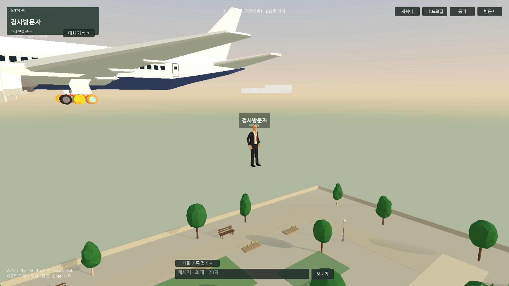

## 작업 결과

스카이다이빙→8m 낙하산 전개→활강→착지, 점프 상승/낙하/착지와 인기도0 빈 공간 접기를 파일에 구현했습니다. 실제 화면 품질과 물리 동작은 검증하지 않았습니다.

## 변경 내용

### 적용 내용

- 기존 코드는 공중 동안 Jump 상태 하나를 재생했습니다. AirborneState/AirbornePhase로 상승·낙하·착지·스카이다이빙·낙하산을 분리하고 별도 프로젝트 Humanoid 포즈5개를 작성했습니다. 제공 클립 검색에서 확인된 공중 이름은 Standing-Jump/Running-Jump이며, 전체 FBX 서브클립의 완전한 목록과 새 포즈의 시각 품질은 실행 재개 시 확인해야 합니다. 제공 에셋에 스카이다이빙/낙하산 동작이 들어 있다고 가정하지 않았습니다.
- 낙하산 프리팹은 캐노피·줄을 합친136삼각형/3재질이며 물리 천 시뮬레이션과 충돌이 없습니다. PlayerVisitor/RemoteVisitor에 연결하고 전개/수납을 공중 단계와 연동했습니다. 입장은 비행0.9초·자유낙하1.4초·8m부터 활강2.5초로 설정했습니다.
- 수직 속도로 점프 상승/낙하를 구분하고0.18초 착지 자세를 적용했습니다. 수평 이동은 착지 자세보다 우선합니다. 입장 단계는 기존1Hz 상태에 포함하고 서버8초/24m 입장 제한을 유지합니다.
- 인기도0은 이름표 배경20px, 좌상단/프로필 행·배경16px를 접도록 설정했습니다. 양수이면 원래 Inspector 배치로 복원하며 반복 갱신 시 위치를 누적 이동하지 않습니다. PopularityLayout의 연결과 간격은 프리팹에서 편집합니다. 수치는 설정값이며 실제 화면 검증은 대기입니다.

이전 회차의 실제 기준 화면입니다. 새 스카이다이빙/낙하산 화면은 사용자 요청으로 캡처하지 않았으므로 전후 시각 검증을 완료로 표시하지 않습니다.

## 검증

- GUI 실행 없이 Runtime/RuntimeEditor/Editor C# 컴파일 통과. 실제 AirborneState 소스를 .NET에서 실행한13개 상태 검사 통과: 상승/하강·빠른 낙하·착지 유지/복귀·스카이다이빙/전개·초기화. CharacterController 물리 검증을 대신하지 않습니다.
- 실제 HTTP 서버12개 통과: 전개/자유낙하 단계 전달·위조 단계 제한·1Hz·8초 높이 제한 및 기존 채팅/좌석/신고/이미지/인기도 경계.
- 정적 에셋20개 검사 통과: UI 행/배경 참조·중복 ID·5상태 모션 참조·136삼각형·로컬/원격 낙하산 참조·입장 설정·자동 요청 취소·임시 Editor 제거. Unity의 실제 로드/재생 검사는 아닙니다.
- 초반 저작 도구가 에디터에서 Player.Character를 참조해 예외가 발생했습니다. 생성된 에셋을 보존하고 파일 연결을 검사했으며 해당 임시 도구와 meta는 QA 보관 후 Assets에서 제거했습니다. 사용자 화면 중단 이후 추가 조작·자동 적용/Play/빌드 요청은 취소했습니다.
- 새 웹 빌드·브라우저·성능·수정 후 스크린샷은 미실행입니다. 기존 실행 서버4190은 이전 검증 빌드를 유지합니다. 사용자가 열어 둔 Unity는 보존했으며 현재 메모리의 씬 저장/더티 상태는 화면 제한 때문에 확인하지 않았습니다.
- 교훈은 프로젝트 AGENTS의 인기도0 규칙에 빈 행/배경 접기로 통합했습니다. 공통 화면 중단/생명주기 검증 규칙과 중복되어 전역 지침 변경은 없습니다.

## 남은 사항

실제 Unity 자세/낙하산·점프 물리·인기도 레이아웃 전환·최신 웹/두 접속·성능·수정 후 캡처. 열린 Unity 씬 저장 상태는 화면 중단 이후 미확인으로 재개 시 먼저 보존/대조합니다. 현재 플레이 서버는 이전 검증 빌드를 유지합니다.

## 작업 시간

- 제안 시간: 이번 후속20~30분 예상. 진행 중 사용자 화면 중단과 인기도 빈 공간 접기 요청을 반영했습니다.
- 실제로 완료된 시간: 시작2026-11-04 18:57:15 KST → 파일 구현/부분검사 2026-11-04 19:21:57 KST, 24분42초. Unity/웹 검증을 포함한 전체 완료 시각은 미기록(보류).
- XERJ: 미사용 — XERJ MCP/검색 스크립트 미제공. rg·현재 소스/에셋·.NET/HTTP 검사로 대체.
