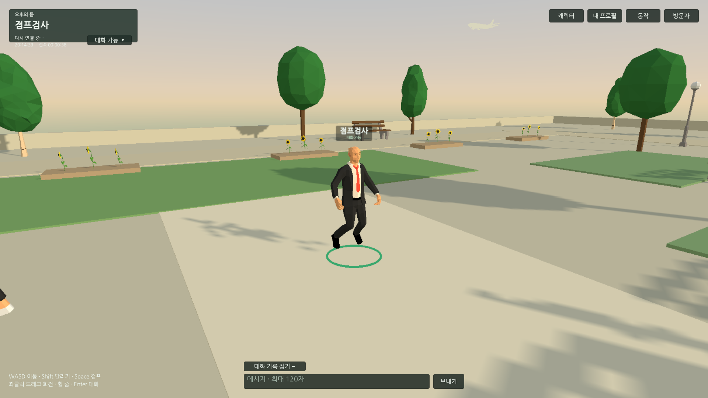
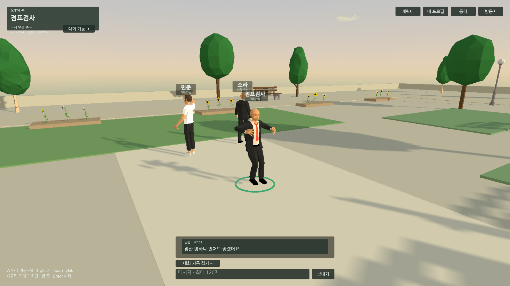
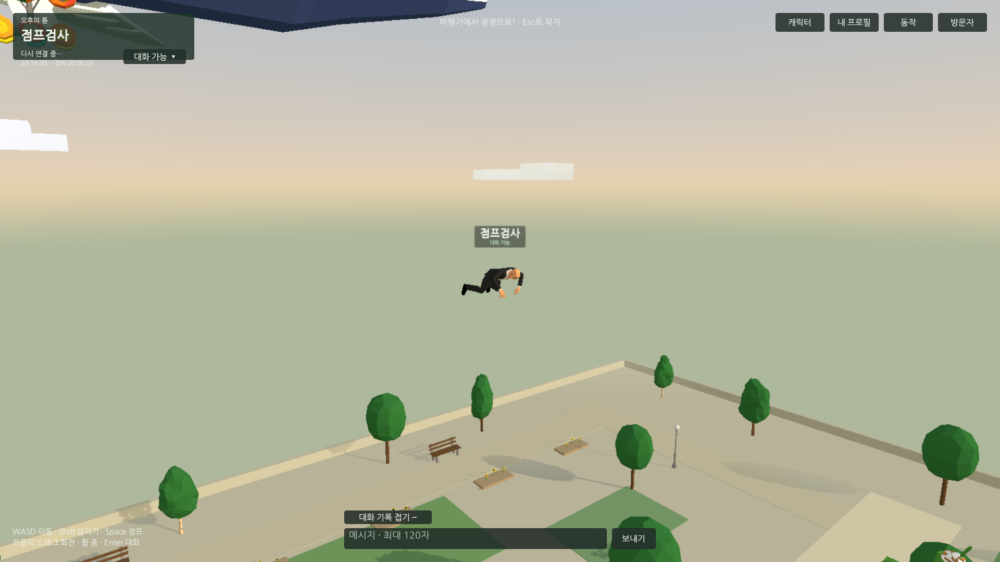
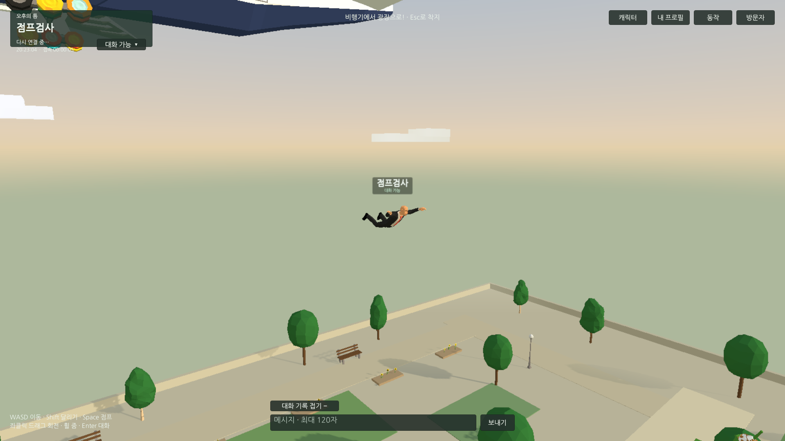
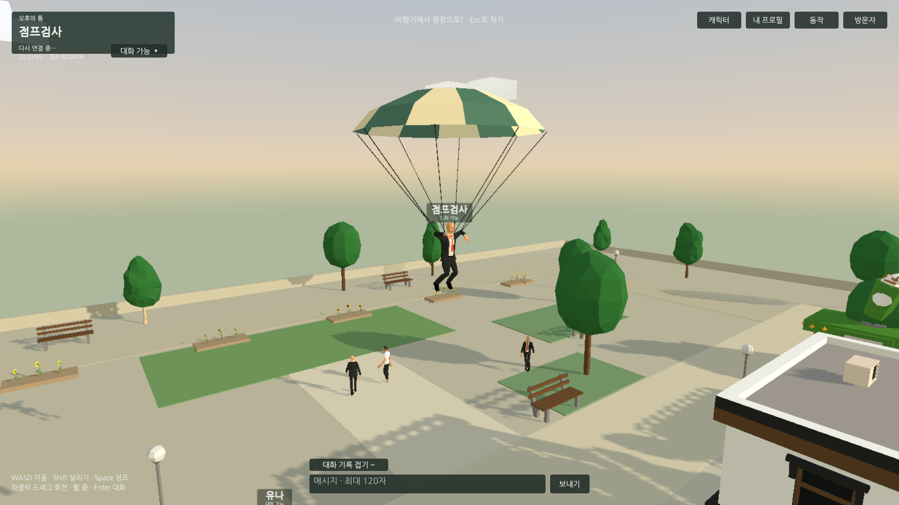
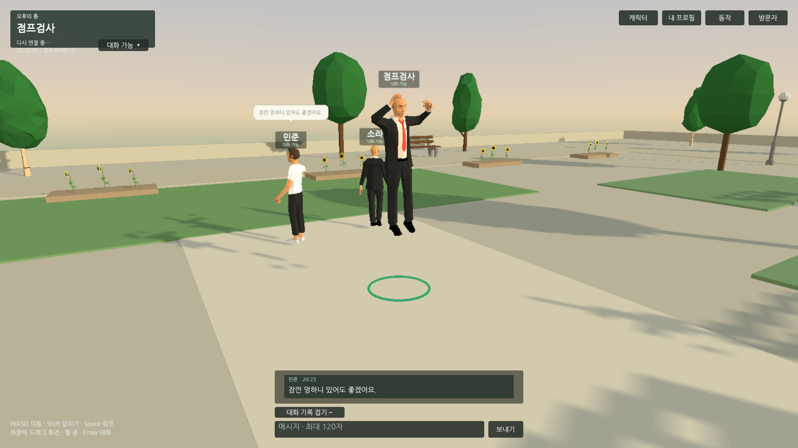

## 작업 결과

정점/착지를 Unity에서 직접 관찰하고 수정 전후를 캡처했습니다. 물리는 착지했지만 추가 Land 포즈가 발을 다시 올리는 현상을 제거하고 낙하의 몸/팔/머리 방향을 보정했습니다.

## 변경 내용

### 적용 내용

- 제공 Standing-Jump 전체2.2917초 중 도약 구간0.7535~1.4606초(0.7071초)의 관절 동작을 프로젝트 사본에 유지했습니다. 본체 물리 상승에 더해지는 양의 RootT.y 이동을 제한하고 준비/대기 구간과 루프를 제거했습니다. 원본 외부 에셋은 수정하지 않았습니다.
- 일반 점프 착지에 별도 합성 Land가 겹치지 않도록 점프 꼬리 동작을 유지합니다. 일반 낙하/낙하산 착지는 제공 점프의 착지 구간으로 대체했습니다.
- 스카이다이빙을 실제 Humanoid 리그의 상완/전완/허벅지/종아리 방향으로 작성했습니다. 머리를 앞으로 들고 팔을 옆으로 펴며, 활강 전환은0.32초로 연결합니다.

같은 카메라의 착지 전후입니다.

같은 카메라의 비행기 낙하 전후입니다.

## 검증

- Unity6000.0.83f1 실제 Play11개 통과. 입장 착지·제자리/이동/연속 점프·착지 재상승 제한·인기도0 행 접기/양수 복원/프로필·이름표 배경 접기·실행 오류0, 개인 설정 복원을 확인했습니다. 컴퓨터 유즈로 점프 중 일시정지 화면을 실제 관찰하고 재개했습니다.
- 같은 제자리 점프의 착지 표본에서 정지 자세 대비 발뼈 높이 추가 상승은 수정 전0.314517m, 수정 후0.000408m였습니다. 한 캐릭터/한 검사 구간의 측정이며 모든 자세의 보편 오차로 확대하지 않습니다.
- 실제 원본 PNG를 편집 없이 보존합니다. 글자/자세 판독을 위해1920×1080 원본 크기를 유지합니다. 새로운 웹 빌드·원격·성능·정리는 아직 진행 중이며 완료로 표시하지 않습니다.

## 남은 사항

최신 웹 빌드·두 브라우저 원격 점프/낙하산·성능·임시 도구/설정 정리·플레이 서버 적용 및 공개 최종 확인.

## 작업 시간

- 제안 시간: 이번 재개15~25분. 비행기 낙하 자세 점검을 함께 포함.
- 실제로 완료된 시간: 2026-11-04 20:10:22 KST 시작. Play 수정/검증20:23:58 KST, 웹/정리/공개 진행 중.
- XERJ: 미사용 — XERJ 미제공. rg·현재 소스/클립·실제 Unity/컴퓨터 유즈 표본으로 검증.
