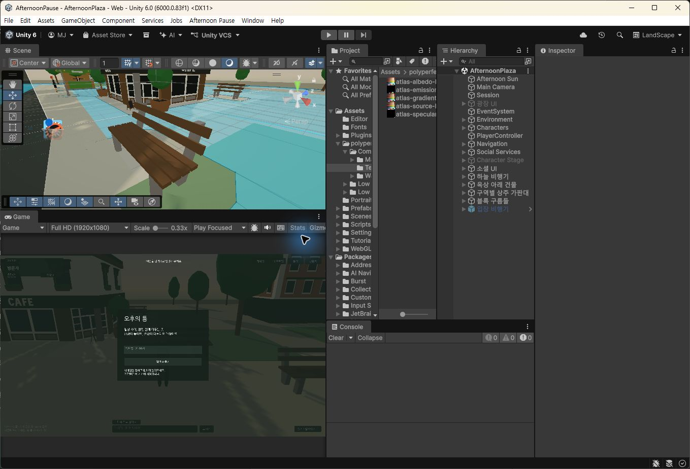

## 작업 결과

씬 나무10개의 BoxCollider를 비활성화하고 NavMesh를 다시 구웠습니다.

## 변경 내용

### 적용 내용

- tree-round/tree-pot 씬 인스턴스10개만 Collider를 해제했습니다. 외부 에셋 원본과137개 다른 콜라이더 설정은 유지했습니다.
- PhysicsColliders 기준 NavMesh를 재베이크하고 기존 프로젝트 NavMesh 에셋 GUID를 유지했습니다.
- 임시 Editor 도구는 검사 후 원본/메타를 제거하고 QA 사본만 보존했습니다.

## 검증

실제 Unity CharacterController를 각 나무 중심으로4m 이동시킨 격리 검사10/10 통과. 주변 충돌을 유지한 실제 장면에서는8/10 통과, 나머지2곳은 카페 건물/커피 가판대 중첩을 OverlapSphere로 확인했습니다. 나무 중심 NavMesh8/10, 다른 장애물 중첩2곳은 보존했습니다. 첫 검사 실패 기록을 보존하고 나무와 다른 장애물을 분리 검증했습니다. 화면 변화가 없는 충돌 설정 변경으로 전후 외형 비교는 완료로 표시하지 않습니다. 전 씬 YAML 보존. 교훈: 관통 검사 실패 시 대상 충돌과 주변 장애물을 분리해 검증하며, 기존 전역 근거 검증 규칙에 포함되어 전역 변경 없음.

## 남은 사항

기존 웹 빌드는 재빌드하지 않아 변경 미포함. 겹친 카페/가판대의 충돌은 유지.

## 작업 시간

- 제안 시간: 2–5분
- 실제로 완료된 시간: 2026-11-04 21:16:05 시작, 21:19:42 KST Unity 수정/검사 완료(3분37초), 공개 보고 정리 중
- XERJ: 미사용 — XERJ 미제공. rg·현재 소스/클립·실제 Unity/컴퓨터 유즈 표본으로 검증.
