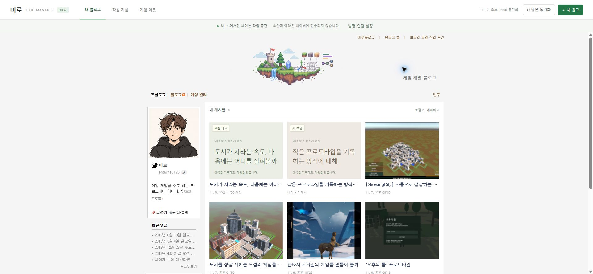
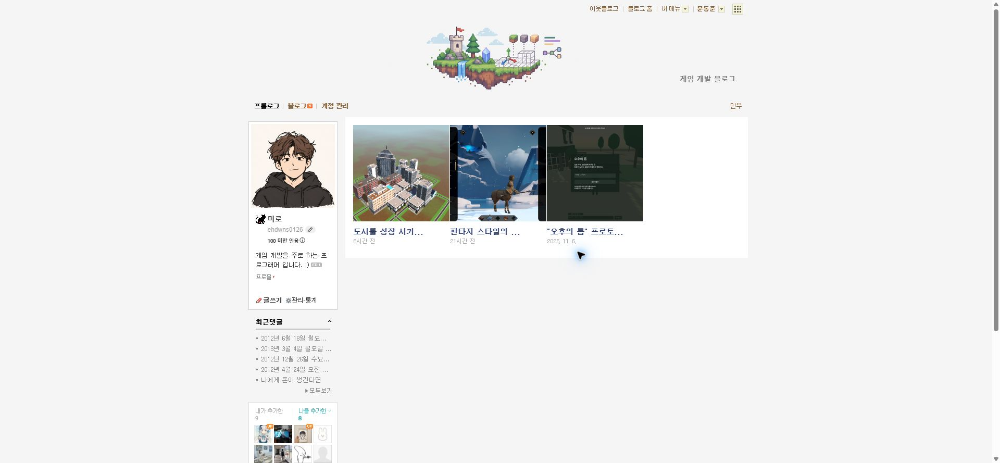
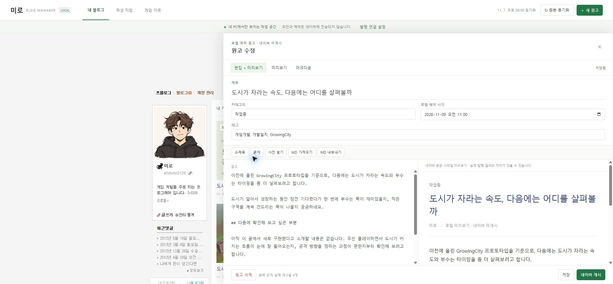
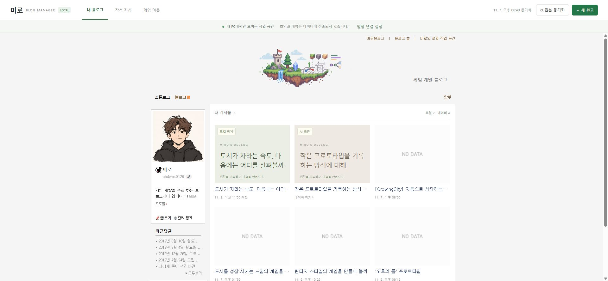
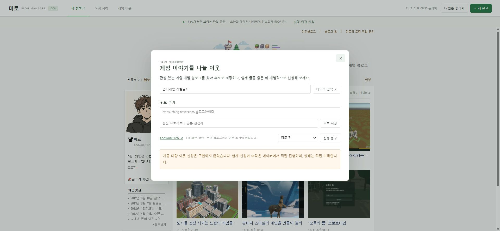

## 작업 결과

원본 배너·프로필·메뉴·이웃 위젯과 공개 글을 가져온 로컬 작업 공간에서 AI 원고와 로컬 예약을 실제 게시글보다 앞에 표시합니다. 본문 수정·사진·파일 저장·재열기와 최신 글 기반 문체 갱신을 확인했습니다. 네이버 실제 발행 연결은 아직 검증 중이며 전체 완료로 보고하지 않습니다.

## 변경 내용

### 적용 내용

- 실제 공개 프롤로그 HTML·CSS와 게시글 4개 본문을 동기화합니다. 첨부 화면 이후 게시된 GrowingCity 글까지 포함했습니다.
- 로컬 AI 원고 2개, 로컬 예약, 제목·본문·태그·카테고리 수정, 마크다운 가져오기·내보내기, 사진 원본 보존, 자동 저장과 수정·삭제 전 백업을 구현했습니다.
- 최신 실제 글 최대 10개의 표현·문단 통계와 원문 근거로 문체 지침을 다시 만들며, 동일 규칙 ID를 누적하지 않습니다. 추가 지침은 공백·문장 부호만 다른 중복을 통합합니다. 의미가 비슷한 다른 문장을 AI가 자동 삭제하는 기능은 아닙니다.
- 디자인과 초안 데이터를 분리했습니다. 원본 디자인을 갱신해도 초안·예약을 유지합니다. 동적 위젯 갱신은 확장 연결이 필요하며 연결 전에는 실제 최초 캡처를 사용합니다.
- 게임 분야 이웃 검색·후보·메모·개별 신청 문구를 제공합니다. 자동 이웃 신청은 구현하지 않았고 상태는 직접 기록합니다.
- 확장 프로그램의 네이버 입력·최종 확인 후 발행 코드를 구현했습니다. 실제 발행 설정의 버튼·공개 범위·태그 필드를 직접 확인했습니다.

새 프로젝트이므로 이전 로컬 프로그램 화면은 없습니다. 위 이미지는 수정 전 로컬 프로그램이 아니라 사용자가 지정한 실제 블로그의 참조 화면입니다.

## 검증

- 실제 공개 RSS 4개 글의 본문 추출과 최신 순서를 확인했습니다. 원본 배너·프로필·메뉴·기존 이미지·이웃 위젯을 실제 화면과 대조했습니다.
- 실제 브라우저에서 테스트 원고 작성 → 수정 → 저장 → 새로고침 → 재열기 후 본문 보존을 확인했습니다. 이미지 업로드 후 원고 문법·목록 썸네일·미리보기 이미지 naturalWidth 365를 확인했습니다.
- 이웃 후보 저장·닫기·재열기 후 메모와 상태 보존을 확인하고 QA 후보를 백업 후 삭제했습니다.
- node --test tests/core.test.mjs tests/http.test.mjs tests/extension.test.mjs: 13개 통과. 확장 보안 테스트는 대역을 사용하며 실제 Chrome 발행 성공을 뜻하지 않습니다.
- 네이버 실제 편집기에서 제목·서식 있는 본문 입력과 공개 설정 화면을 확인했습니다. HTML data URL 이미지는 입력되지 않았습니다(se-image 0개). 정식 사진 업로드 코드로 수정했으나 실제 실행은 아직 검증하지 않았습니다.
- 원본 img src 대신 onerror 대체 주소를 잡던 문제를 수정하고 회귀 테스트를 추가했습니다. debugger는 선택 권한으로 지원되지 않는다는 공식 문서를 확인해 필수 권한으로 수정했습니다.

## 남은 사항

- 확장 프로그램 설치·권한 허용·0.1.1 갱신 완료는 사용자 응답으로 확인했지만, 현재 관리자 문서에는 확장 스크립트 주입 표시와 연결 응답이 없습니다. 정확한 팝업 상태 확인을 요청한 상태입니다. 원인은 미확인입니다.
- 브라우저 보안 정책이 chrome://extensions 접근을 차단하고 우회를 금지해 AI가 설치 화면을 대신 조작할 수 없었습니다. 사용자에게 직접 설치를 요청했습니다.
- 실제 네이버 사진 업로드, 최종 발행과 공개 결과 URL·본문 검증은 미완료입니다. 테스트 글을 공개 발행하지 않았습니다. 로컬 예약은 실제 네이버 예약이 아닙니다.
- RSS에 없는 전체 과거 글·비공개 글을 가져왔다고 주장하지 않습니다. 원본 네이버 스크립트는 로컬 미러에서 실행하지 않으므로 모든 네이버 상호작용이 복제되는 것은 아닙니다.
- 앱 자체의 자동 AI 생성 API는 연결하지 않았습니다. 기본 원고는 실제 AI가 작성했으며 이후 AI 작성 요청문·MD 가져오기 또는 프로젝트에서 AI에게 직접 원고 작성을 요청하는 흐름을 제공합니다.
- 보고용 화면은 실제 프로그램 캡처 원본입니다. Affinity CLI doctor/status가 ECONNREFUSED라 이미지 재편집·GIF 제작을 하지 않았습니다. 캡처가 200KB 미만이므로 다른 이미지 도구로 가공하지 않았습니다.
- 교훈 검토: 전역 변경 없음. 기존 공식 기능 확인·실제 실행 검증 의무를 유지하고, Chrome 권한 제한과 업로드 검증 근거는 프로젝트 문서와 테스트에 기록했습니다.
- 로컬 원고는 파일에 저장되며 작업용 테스트 글·후보는 백업 후 정리했습니다. 서버·관리자 탭은 사용자 확인용으로 유지 중입니다.

## 작업 시간

- 제안 시간: 초기 구현·로컬 검증 25~45분. 실제 발행 연결은 로그인된 편집기에서 별도 검증. 추가 예상 10~20분(이미지 파일 선택 도구 호출 반환에 23분 지연 확인 후 안내).
- 실제로 완료된 시간: 시작: 2026-11-07 20:03:59 Asia/Seoul. 기록 시각: 2026-11-07 21:00:09 Asia/Seoul. 56분 경과. 전체 작업은 진행 중이며 완료 시각은 없습니다.
- XERJ: 미사용 — XERJ 연결 도구가 제공되지 않아 rg·현재 소스·실제 DOM·실행 결과로 확인했습니다.
