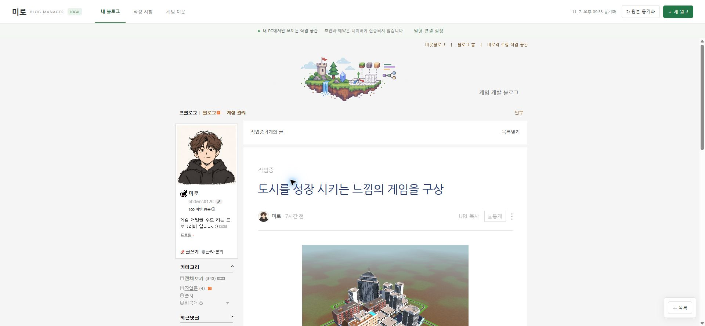
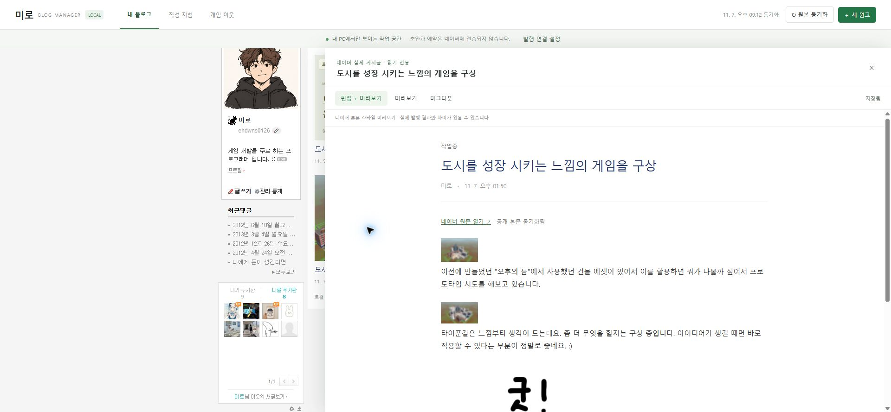
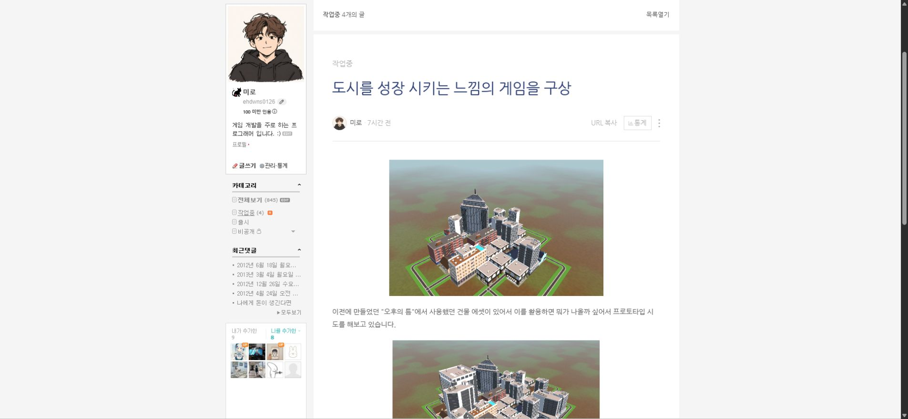
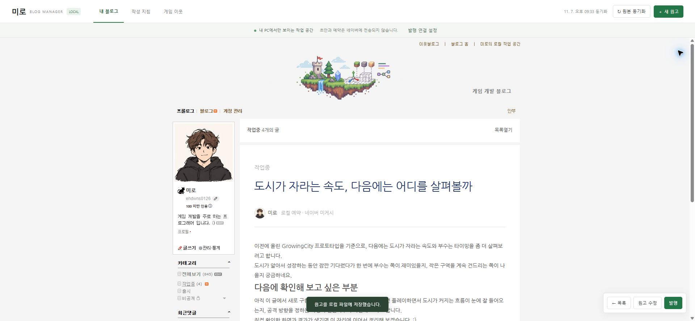

## 작업 결과

게시물을 누르면 별도 편집 패널 대신 실제 네이버 원문의 제목·작성자·본문·사진·사이드바·태그·하단 목록 틀로 열립니다. 관리자 전체와 확장 단독 압축본을 프로젝트 releases 폴더에 보관하고 다른 경로 실행까지 확인했습니다. 실제 네이버 게시 성공은 아직 검증하지 않았습니다.

## 변경 내용

### 적용 내용

- 본문만 꺼내 별도 패널로 표시하던 경로를 제거하고 원본 PostView·스마트에디터 뷰어 CSS를 사용했습니다. 흐림 이미지 주소 대신 선명한 원본 지연 로딩 주소를 사용합니다.
- 공개 글 4개의 동적 작성자 영역·태그·하단 목록을 실제 DOM에서 보관했습니다. 본문이 변경되면 이전 캡처를 적용하지 않으며 디자인 CSS는 최신 공개 원문에서 읽습니다.
- 로컬 초안도 같은 원본 틀에서 열고 원고 수정 버튼에서 편집합니다.
- 다른 PC의 폴더 경로를 지원하도록 업로드 경로 하드코딩을 제거하고 설치·실행 안내를 보관했습니다. 로그인 정보는 복사하지 않습니다.
- 발행 확인 뒤 원고·사진 전송 → 설정 적용 → 실제 제출 → 공개 결과 검증을 연속 호출하도록 구현했습니다. 기존 원고 복구 안내가 있으면 덮어쓰지 않고 중단합니다.
- 실제 DOM 대조 중 본문 추출에 제목이 섞이던 문제를 확인해 본문 컨테이너로 범위를 제한하고 지침을 재생성했습니다.

## 검증

- 대표 원문과 로컬의 본문 폭 773px, 제목 영역 693px, 제목 32px, 본문 15px·줄간격 27px, 첫 사진 453×289px와 상대 위치가 일치했습니다. [실측 JSON](../assets/article-metrics-v0.2.0.json)
- 공개 게시물 4개 모두 본문 폭·제목 폰트·동적 태그·하단 목록 4행·선명한 사진 주소를 실제 실행에서 확인했습니다. [게시물별 확인값](../assets/article-checks-v0.2.0.json)
- 원고 수정 → 저장 → 원본 틀 읽기 화면에서 변경 반영을 확인하고 검증 문장을 제거해 원문을 복원했습니다.
- 자동 검사 15개 통과. 첫 HTTP 검사는 서버 파일 변경 직후 재시작 중 연결 거부로 실패했고, 준비 상태를 확인한 뒤 전부 재통과했습니다.
- 실제 ZIP을 독립 tar 도구로 해제하고 208개 파일의 SHA-256을 대조했습니다. 공백·한글 경로에서 서버 실행, 초안 2개·공개 글 4개와 동적 확장 경로 보존을 확인한 뒤 검증용 서버를 종료했습니다.
- 압축본: blog-manager-portable-v0.2.0.zip (9192229 bytes), SHA-256 7f7dbc9a11fd6b939d46bc34714e54b43bfba87a536a57f6d025fb30bd0728e3
- naver-bridge-v0.2.0.zip (8817 bytes), SHA-256 77d15b38f0c4a03d4dd5ab2d7b201624c73643c5eef27ae9cd12c3033336edf7

| 게시물 | 실제 원문 | 로컬 수정 후 |
| --- | --- |
| 224467902147 | [원문 화면](../assets/post-224467902147-reference.png) | [로컬 화면](../assets/post-224467902147-after.png) |
| 224468309596 | [원문 화면](../assets/post-224468309596-reference.png) | [로컬 화면](../assets/post-224468309596-after.png) |
| 224467714426 | [원문 화면](../assets/post-224467714426-reference.png) | [로컬 화면](../assets/post-224467714426-after.png) |
| 224467487002 | [원문 화면](../assets/post-224467487002-reference.png) | [로컬 화면](../assets/post-224467487002-after.png) |

## 남은 사항

- 실제 네이버 확장 연결·사진 업로드·최종 게시 성공은 미확인입니다. 기존 작성 중인 원고의 복구·열람 확인 클릭을 자동 승인 검토가 차단했고, 해당 원고를 읽거나 덮어쓰지 않았습니다. 별도 복구·열람 승인 여부를 요청했습니다. 공개 발행은 하지 않았습니다.
- 서로이웃 자동 추가는 이번 요청대로 설계만 설명·보관했습니다. 게임 분야 후보 수집 → 기존 이웃·중복 신청 제외 → 대상·문구 검토 → 선택 목록 순차 신청 → 성공·제한 상태 기록 → 수락 상태 확인 순서이며, 인증이나 제한이 나오면 중단합니다. 실제 신청 UI·한도는 미확인이고 신청을 전송하지 않았습니다.
- 이동용 ZIP은 로컬 초안과 사진을 포함하므로 공개 업로드하지 않았습니다. releases 폴더에 보관했습니다.
- 캡처는 실제 실행 화면 원본이며 이미지 편집·GIF 제작은 하지 않았습니다. 별도 신규 로고는 확정하지 않아 중앙 등록 logo:null을 유지했습니다.
- 교훈 검토: 프로젝트 지침에 원본 게시물 틀 사용·이동 경로 하드코딩 금지를 추가했습니다. 전역은 기존 검증·원본 보존 규칙과 중복되어 변경하지 않았습니다.
- 네이버 검증용 새 탭은 기존 원고를 복구하지 않은 상태로 보존하거나 정상 종료하며, 사용자 원래 탭은 보존합니다. 원본 관리자 서버와 화면은 사용자 확인용으로 유지합니다.

## 작업 시간

- 제안 시간: 이번 후속 작업 15~25분. 최초 작업 예상 25~45분은 이전 버전에 보존합니다.
- 실제로 완료된 시간: 후속 시작: 2026-11-07 21:15:21 Asia/Seoul. 기록: 2026-11-07 21:39:16 Asia/Seoul. 24분 경과. 실제 게시까지의 전체 완료 시각은 없습니다.
- XERJ: 미사용 — XERJ가 제공되지 않아 현재 소스·rg·실제 DOM 및 실행 결과로 대조했습니다.
