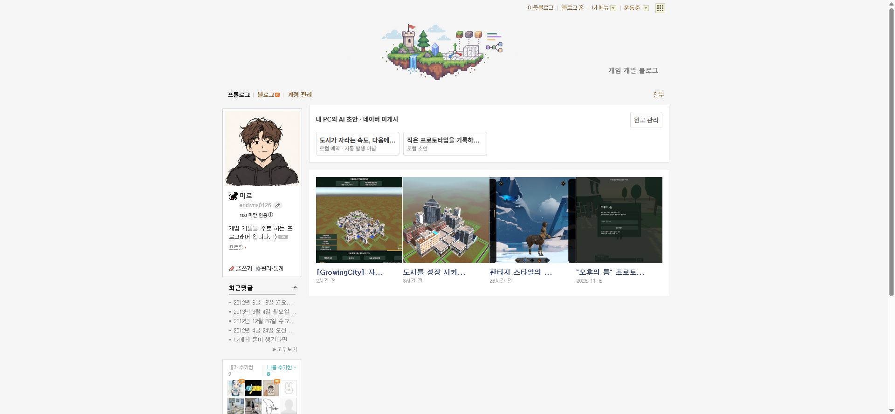

## 작업 결과

초안을 별도 영역에서 관리 패널로 열던 구현을 수정했습니다. 실제 네이버 카드 목록 앞에 원본 카드 구조로 삽입하며 클릭은 같은 탭의 읽기 화면으로 이동합니다. 실제 설치 버전 갱신 후 화면 확인은 남아 있습니다.

## 변경 내용

### 적용 내용

- 실제 #prologue dl.p_post_top의 dd.p_photo_d를 복제해 초안을 앞에 삽입하고 같은 4열로 배치합니다.
- 카드 클릭 명령을 open-panel에서 read-draft로 변경했습니다. 읽기 화면에는 목록과 원고 수정 버튼을 제공합니다.
- 원고 제목·본문은 네이버 실제 참조 글의 틀에 로컬로 표시하며 댓글·공감·참조 태그는 숨깁니다. 공개 원문을 수정하거나 게시하지 않습니다.
- 확장 0.3.1과 전체 이동 패키지를 releases에 보관했습니다.

## 검증

- 실제 네이버 목록 HTML에서 초안 2개 → 기존 글 4개 순서, 기존 카드 마크업 보존, 4열 CSS, 클릭 시 read-draft와 패널 미실행을 검사했습니다. [실행 근거](../assets/native-card-verification-v0.3.1.json)
- 기존 자동 검사 18개 통과.
- ZIP 독립 해제 235개 파일 해시·다른 경로 서버 실행을 검증하고 검증 서버를 종료했습니다.
- 수정 전 실제 화면: 

## 남은 사항

- 설치된 확장의 0.3.1 갱신 이후 실제 목록·클릭·읽기 화면 검증 대기.
- 실제 네이버 발행 검증은 사용자 요청대로 보류합니다. 기존 원고는 복구·수정하지 않았습니다.
- 교훈 검토: 같은 목록과 같은 클릭 흐름을 사용한다는 사용자 요구를 프로젝트 AGENTS.md에 반영했습니다. 전역은 기존 원본 대조·검증 규칙과 중복되어 변경하지 않았습니다.
- XERJ 연결 도구가 제공되지 않아 rg·현재 소스·원본 DOM 및 실행 검사로 검증했습니다.

## 작업 시간

- 제안 시간: 이번 수정 5~10분
- 실제로 완료된 시간: 시작 2026-11-07 22:15:44 Asia/Seoul. 기록 2026-11-07 22:19:42 Asia/Seoul. 실제 확장 검증 완료 시각은 아직 없습니다.
- XERJ: 미사용 — XERJ 도구 미제공. 현재 소스와 실제 원본 DOM으로 검사했습니다.
