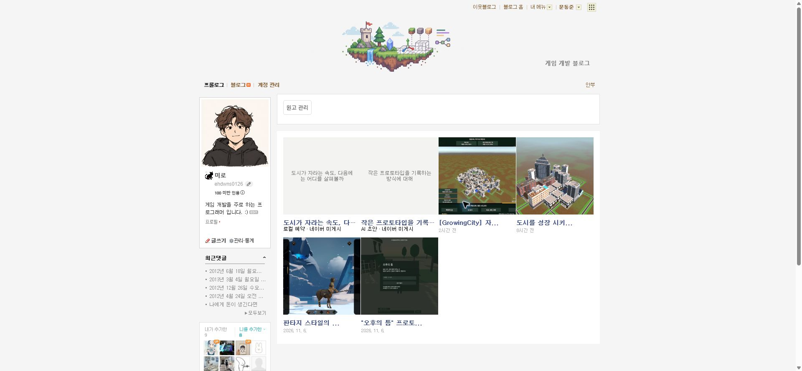
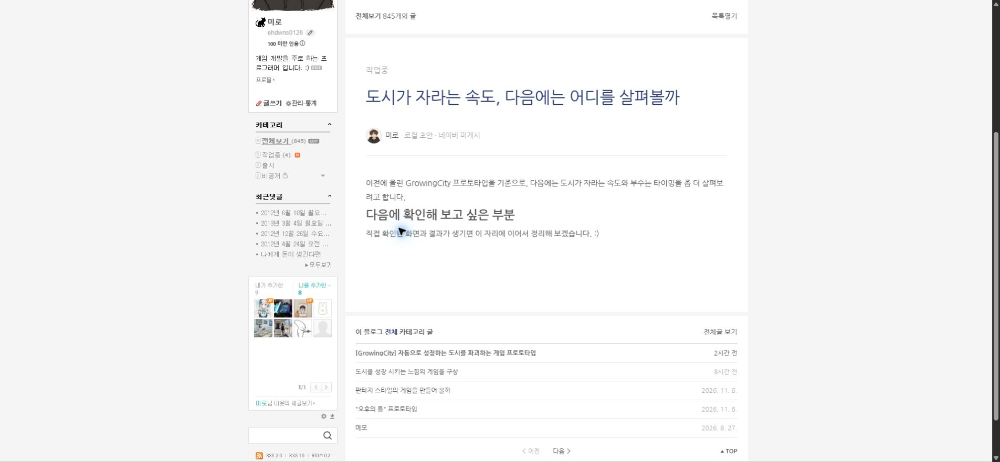
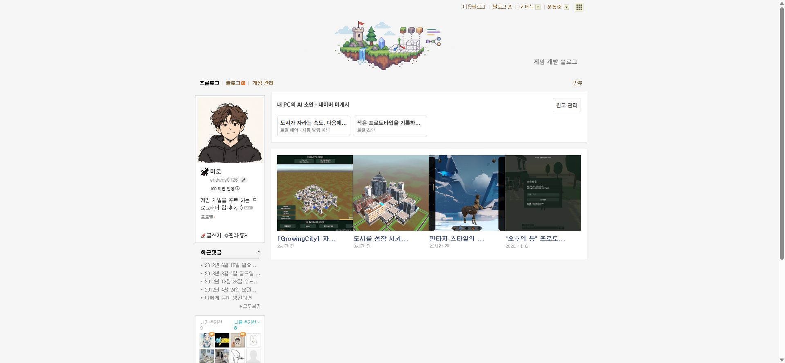
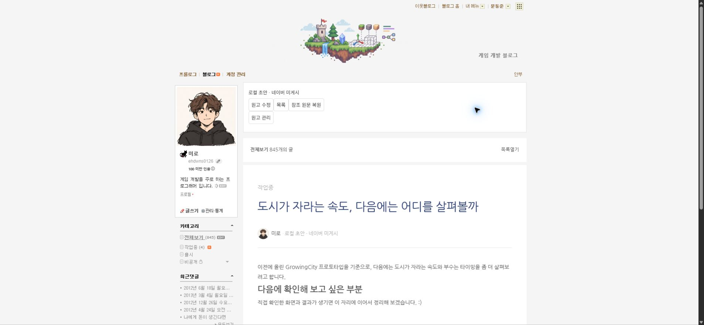

## 작업 결과

실제 크롬 0.3.1에서 초안 2개와 기존 글 4개가 첫 줄 4개·둘째 줄 2개로 배치됐고 폭은 모두 186px입니다. 초안 클릭 후 같은 탭의 실제 네이버 틀에서 제목·본문·미게시 표시와 773px 본문 폭을 확인했습니다.

## 변경 내용

### 적용 내용

- 실제 #prologue dl.p_post_top의 dd.p_photo_d를 복제해 초안을 앞에 삽입하고 같은 4열로 배치합니다.
- 카드 클릭 명령을 open-panel에서 read-draft로 변경했습니다. 읽기 화면에는 목록과 원고 수정 버튼을 제공합니다.
- 원고 제목·본문은 네이버 실제 참조 글의 틀에 로컬로 표시하며 댓글·공감·참조 태그는 숨깁니다. 공개 원문을 수정하거나 게시하지 않습니다.
- 확장 0.3.1과 전체 이동 패키지를 releases에 보관했습니다.

## 검증

- 실제 네이버 목록 HTML에서 초안 2개 → 기존 글 4개 순서, 기존 카드 마크업 보존, 4열 CSS, 클릭 시 read-draft와 패널 미실행을 검사했습니다. [실행 근거](../assets/native-card-verification-v0.3.1.json)
- 기존 자동 검사 18개 통과.
- ZIP 독립 해제 235개 파일 해시·다른 경로 서버 실행을 검증하고 검증 서버를 종료했습니다.
- 수정 전 실제 화면: 
- 실제 크롬 DOM 실측: 6개 카드 폭 186px, 첫 줄 y329의 4개와 다음 줄 y569의 2개.
- 실제 초안 제목과 3개 본문 블록 및 미게시 표시를 확인했습니다. 본문 폭은 773px입니다.
- 읽기 화면의 원고 수정·목록 버튼 표시를 확인했습니다. 원고 수정 클릭·저장 왕복은 이번 회차에 실행하지 않았습니다.

## 남은 사항

- 초안 카드 목록과 글 읽기는 이번 회차에서 실제 검증했습니다. 발행 검증은 사용자 요청대로 보류하며 원고 수정 패널의 저장 왕복은 이번 회차 검증 범위에 포함하지 않았습니다.
- 사용자가 확인하도록 기존 네이버 탭에 초안 읽기 화면을 유지했습니다. 공개 게시와 기존 원고 복구는 하지 않았습니다.
- 교훈 검토: 원본 목록에 통합하고 클릭은 읽기로 연결한다는 요구를 프로젝트 AGENTS.md에 반영했습니다. 전역 지침은 기존 검증·원본 대조 원칙과 중복되어 변경하지 않았습니다.
- 이전 구현·DOM 검증 단계 보고서는 이력을 보존했습니다.

## 작업 시간

- 제안 시간: 이번 수정 5~10분
- 실제로 완료된 시간: 시작 2026-11-07 22:15:44 Asia/Seoul. 실제 목록·읽기 검증 2026-11-07 22:24:53 Asia/Seoul. 경과 549초. 공개 보고서 배포 확인은 별도입니다.
- XERJ: 미사용 — XERJ 도구 미제공. 현재 소스와 실제 원본 DOM으로 검사했습니다.
