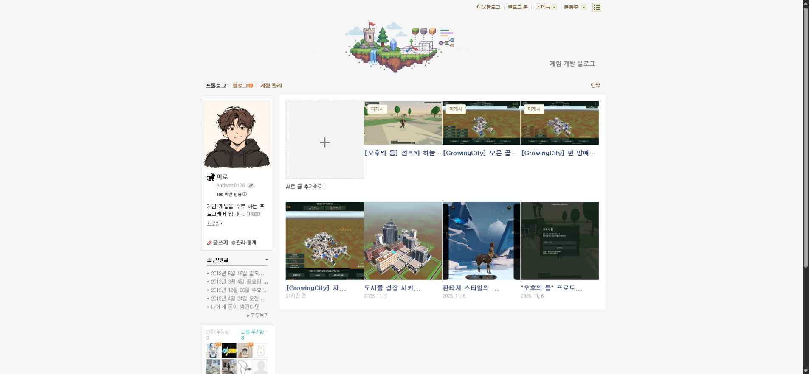

## 작업 결과

원인 확인·코드 수정·설치 앱 사본 반영·GitHub푸시 완료. 크롬은 이전 content script를 사용 중이어서 사용자 확장 새로고침을 요청한 상태입니다. 실제 수정 후 표시 확인은 아직 하지 않았습니다.

## 변경 내용

### 재현 조건

Chrome 네이버블로그·블로그 매니저 확장0.7.0

### 재현 순서

가로1920×1080 게임 이미지를 포함한 로컬 원고3개의 목록을 열고 기존 네이버 게시글과 대조합니다.

### 기대 동작

로컬 원고도 기존 네이버 썸네일과 같은185×185 크기와 중앙 잘림으로 표시됩니다.

### 실제 동작

실제 DOM측정에서 로컬3개185×104, 기존4개185×185를 확인했습니다.

### 원인

복제한 카드의 이미지URL만 원본 가로 이미지로 교체했고, 네이버 서버가 제공하는 정사각 썸네일의 크기를 로컬 이미지에 적용하지 않았습니다. 실제 DOM에style없음·원본비율표시를 확인했습니다.

### 적용 내용

원본 카드의 실제 이미지 너비·높이를 읽어 로컬 이미지에 적용하고 object-fit:cover·object-position:center를 설정했습니다. 이미지 원본 바이트는 수정하지 않았습니다. GitHub af0f9bd에 수정본을푸시하고 설치 앱 사본에도 복사했습니다.

## 검증

소스DOM 검사에서185×185·cover와 원본4카드보존·4열·읽기·편집저장/취소·모의발행검사 통과. 테스트의 native-config 모의응답 누락으로 최초실패했으며 현재메시지계약에 맞춰 보완한 후 통과했습니다. 이는 실제 Chrome 적용 완료 검증과 다릅니다.

대화: 사용자 “예제 썸네일이 기존 게시물이랑 다르게 나오니 빨리 고쳐”. AI는2~4분 예상과 실제크기 대조후수정을 안내했고, 실제185×104/185×185를 확인했습니다. 확장관리화면은 앞서도구보안정책으로차단되어 사용자에게새로고침1회를요청했습니다. 발언시각은미기록입니다.

## 남은 사항

사용자 확장새로고침 후 실제 화면185×185와전후캡처 확인 필요. 구버전 배포설치파일은재생성하지않았습니다. 신규설치용재포장은별도남음. 전역교훈은기존실제치수대조·원본보존규칙과중복되어변경없음. 새작업탭/보조프로세스를만들지않았고기존사용자탭보존.

## 작업 시간

- 제안 시간: 2~4분
- 실제로 완료된 시간: 시작2026-11-08 18:32:48 KST. 소스 수정·푸시18:34:54 KST확인. 실제설치갱신후화면검증은사용자확장새로고침대기.
- XERJ: 미사용 — XERJ연결도구미제공. rg·실제DOM치수·소스DOM검사사용.
