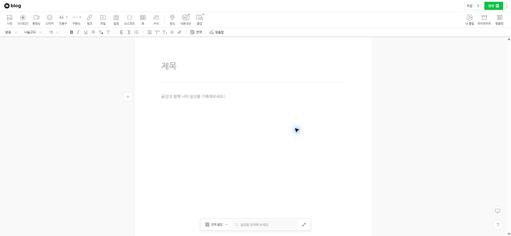

## 작업 결과

첨부와실제화면에서제목·본문이비어있음을확인했습니다. 전송코드를수정했지만실제원고가네이버에입력되는재검증은아직실행하지못했습니다. 해결완료로표시하지않습니다.

## 변경 내용

### 재현 조건

Chrome 네이버 SmartEditor·확장0.7.0에서발생,수정설치0.8.0

### 재현 순서

로컬초안읽기→게시하기→확인후열린네이버편집기를확인

### 기대 동작

제목·본문·사진입력을검증한후발행설정으로진행

### 실제 동작

제목/본문.__se-node빈문자열.원래초안status에네이버화면준비타임아웃.기존코드는여러대기단계에동일오류를사용.

### 원인

최초실패단계와근본원인은미확인입니다. 실제DOM은입력셀렉터와일치하지만기존오류만으로준비대기와제목입력후확인을구분할수없었습니다.

### 적용 내용

scripting즉시실행옵션·준비90초·제목15초·클릭후포커스대기·실패단계표시와편집기오류안내를추가했습니다. 공개발행없이원고전송을검토하는네이버편집기로버튼도추가했습니다. 실제카테고리작업/기존원고작업중불일치는별도로대조수정했습니다.

## 검증

실제원래초안오류문구·빈편집기DOM·스크린샷확인. 전체33검사·원고읽기/편집DOM검사통과. 실제Chrome의새전송코드실행은확장갱신응답대기. [공식 scripting 실행 시점](https://developer.chrome.com/docs/extensions/reference/api/scripting). API문서만으로네이버전송성공을판단하지않았습니다.

## 남은 사항

확장갱신후입력전용버튼으로실제제목/본문/사진확인→카테고리/태그·발행설정검증필요. 기존작성중원고복구와공개발행은임의진행하지않습니다. 수정후실제전송화면미확보. [대화기록](../assets/stock-conversation.json)

## 작업 시간

- 제안 시간: 15~25분
- 실제로 완료된 시간: 시작2026-11-08 19:06:01 KST. 19:18설치48파일·원고보존검사,19:21GitChunk복원확인. 실제네이버입력검증은사용자확장갱신대기.
- XERJ: 미사용 — XERJ연결도구미제공. rg·실제DOM/HTTP/실AI/파일·공식Chrome문서·회귀검사사용.
