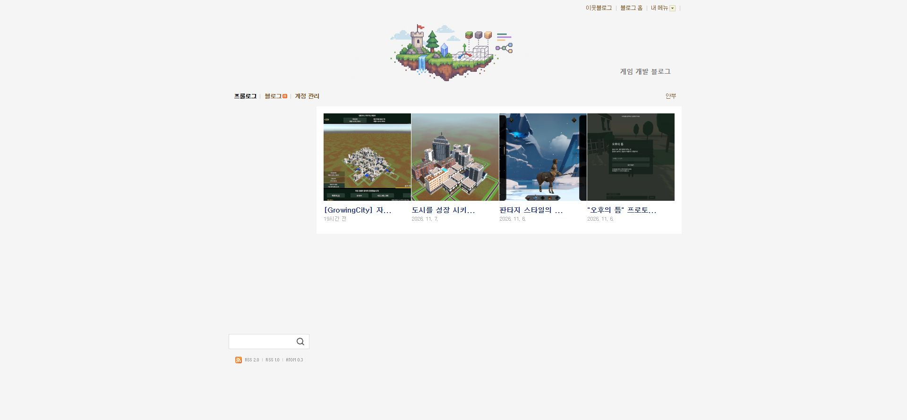
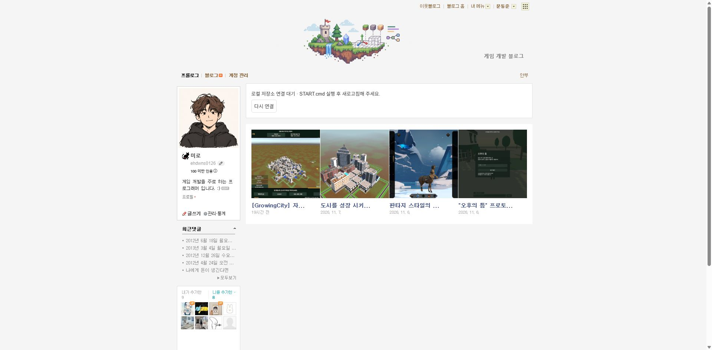
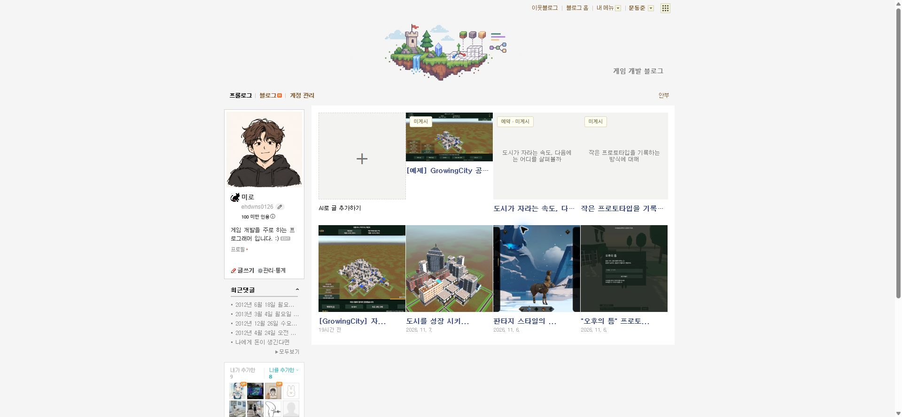
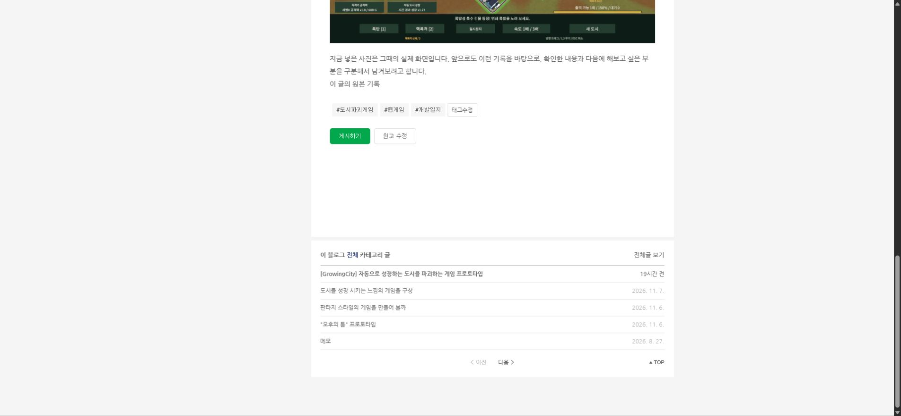
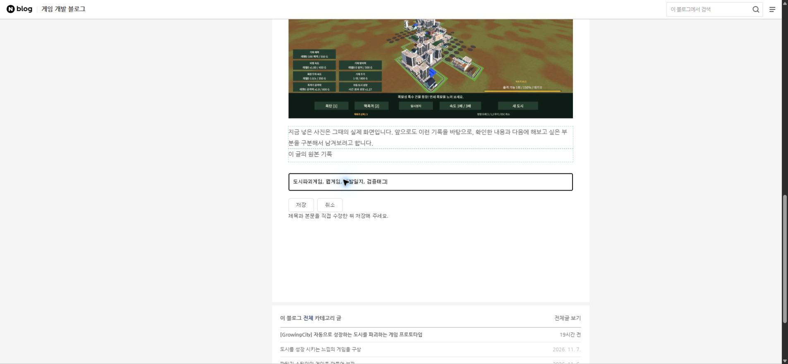
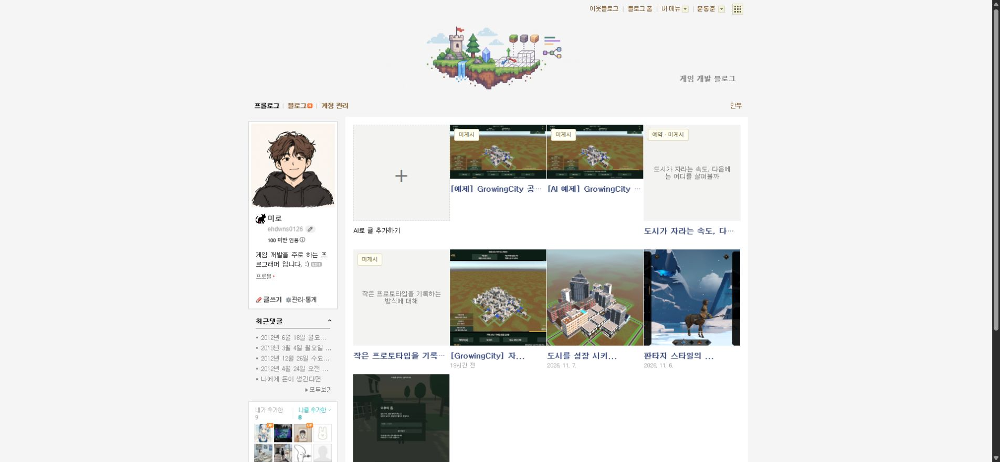
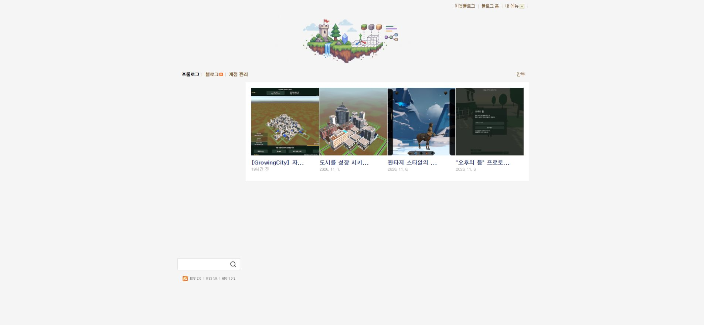
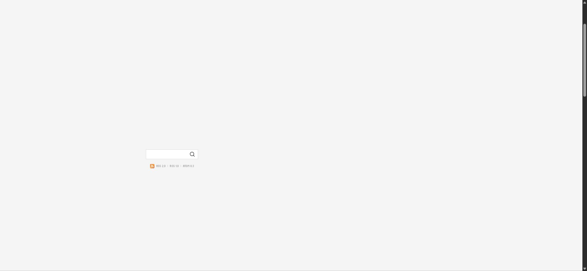

## 작업 결과

0.4.1 목록·직접 편집·태그·이미지·AI 작성·Git 푸시 검증을 마쳤습니다. 실제 네이버 공개 발행은 사용자 요청대로 보류합니다.

[프로젝트 소스](https://github.com/MDJ0126/blog-manager) · [검증한 커밋](https://github.com/MDJ0126/blog-manager/commit/3a9b00513469555f3bf4123c2569355eba12aeeb)

## 변경 내용

### 적용 내용

- 목록 상단 연결/원고 관리 박스와 게시물 하단 목록 버튼 제거. + AI 작성 카드와 썸네일 한 곳의 미게시/예약 배지 적용.
- 실제 네이버 .post_footer_contents .wrap_tag 및 item/pcol2/itemTagfont/ell/pcol2b 구조를 사용해 태그 박스와 태그수정을 표시합니다.
- 중앙 아카이브 GrowingCity 보고서의 실제 사진 2장을 편집 없이 복사하고 출처·SHA-256을 examples/sources.json에 보존했습니다.
- Codex CLI read-only 작성 에이전트의 하트비트·생존을 확인하며 요청이 있을 때만 모델을 실행합니다.
- 저장소가 꺼져 있으면 마지막 초안/작은 이미지 캐시로 읽기를 유지하고 + 클릭에서만 AI 꺼짐을 안내합니다. 저장·새 AI 작성에는 로컬 저장소가 필요합니다.
- 0.4.1 소스 53개 파일을 지정한 GitHub에 공개했습니다. 개인 data·로그·로그인 정보·전체 이동 ZIP은 제외했습니다.

## 검증

- 실제 Chrome 0.4.1: + 카드 1개, 초안 4개, 미게시 배지 한 곳, 하단 목록 버튼 0개. 편집 취소 시 제목·본문 HTML·글꼴 일치(15px/27px), 직접 저장·새로고침 유지, 이미지 2장 693px 표시와 원본 링크 보존. 저장소 종료 후 캐시 초안 4개·사진 2장 읽기와 연결 박스 없음 확인.
- Codex 실제 작성 요청 1회가 17.631초에 완료되어 이미지 1장 포함 로컬 초안 생성. 대기 에이전트 종료 및 + 클릭의 꺼짐 안내 확인. 게임 예제 사진 2장 원본 해시 보존. 250개 ZIP 해제 파일과 이동 실행 확인. 공개 소스 53개 파일을 3a9b005로 MDJ0126/blog-manager main에 푸시하고 원격 SHA 일치 확인.
- 자동 회귀 23개 통과. 블록 보존 도우미 추가 후 VM 테스트의 누락된 도우미를 보완하고 재통과했습니다.
- 실제 저장한 제목·본문·태그의 새로고침 유지, 사진 2장과 출처 링크 보존 후 검증 문장을 제거하고 예제 원문을 정확히 복원했습니다.
- [실제 실행 값](../assets/nov8-live-verification.json) · [DOM 검사](../assets/native-card-verification-v0.4.1.json) · [이동 보관본 검사](../assets/portable-verification-v0.4.1.json)

## 남은 사항

- 실제 네이버 공개 발행 검증은 사용자 요청에 따라 계속 보류합니다. 기존 복구 원고는 읽거나 덮어쓰지 않았습니다.
- 작업용 AI 에이전트와 이동 검증 서버는 종료했고, 저장소 서버와 확인용 블로그 탭은 사용자 확인을 위해 유지했습니다.
- 교훈: AI 상태와 저장소 상태를 구분하고 원본 UI 구조를 재사용한다는 요구를 프로젝트 AGENTS.md에 통합했습니다. 전역은 기존 실행 대조 원칙과 중복되어 변경하지 않았습니다.
- 캡처는 실제 화면 원본이며 편집/GIF 제작을 하지 않았습니다. 글꼴 버그의 동일 배율 전 화면은 확보하지 못해 사용자 신고와 취소 전후 실제 DOM/폰트 대조를 근거로 사용했습니다.

## 작업 시간

- 제안 시간: 2026-11-08 후속 요청 15~25분
- 실제로 완료된 시간: 시작 2026-11-08 15:23:03 Asia/Seoul. 구현·실행 기록 2026-11-08 15:44:04 Asia/Seoul. 공개 보고서 배포 확인은 별도입니다.
- XERJ: 미사용 — XERJ 도구 미제공. rg·현재 소스·실제 DOM·CLI 실행으로 대조했습니다.
