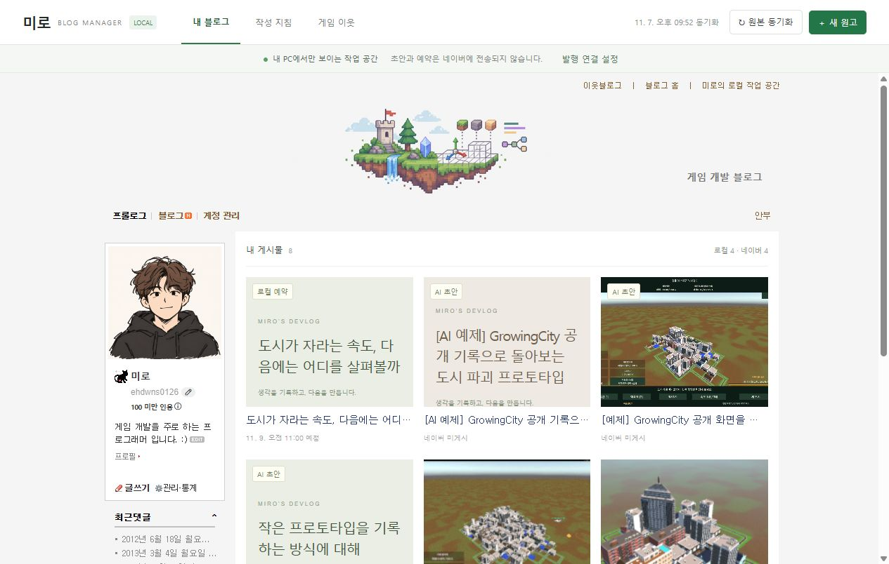
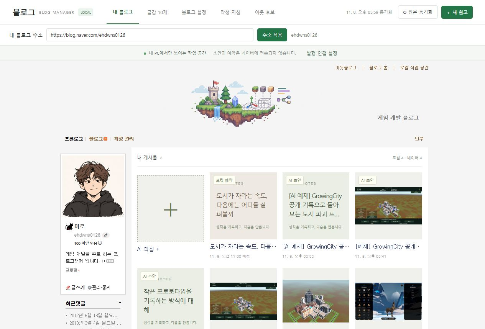
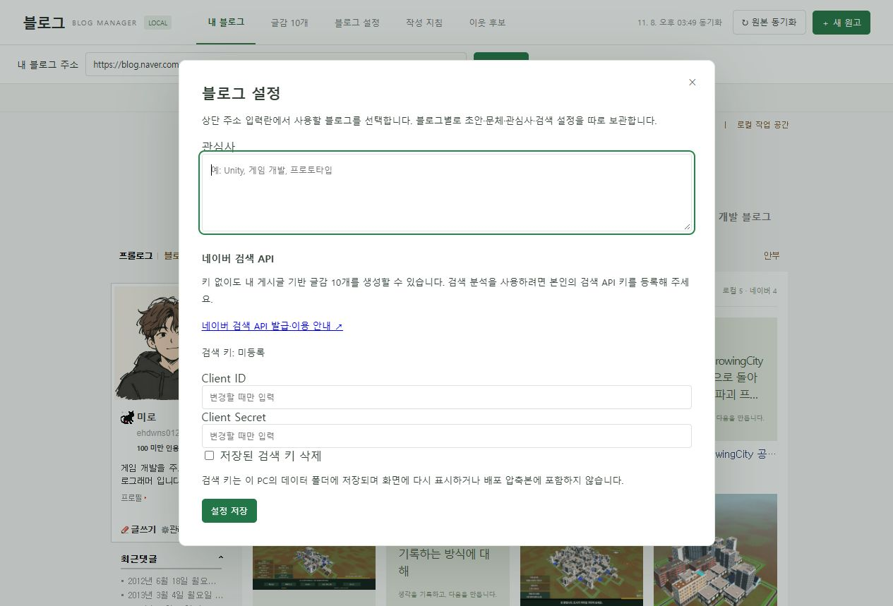
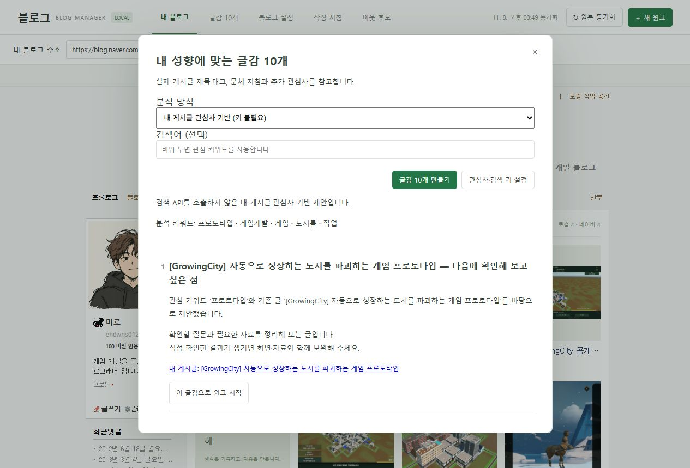
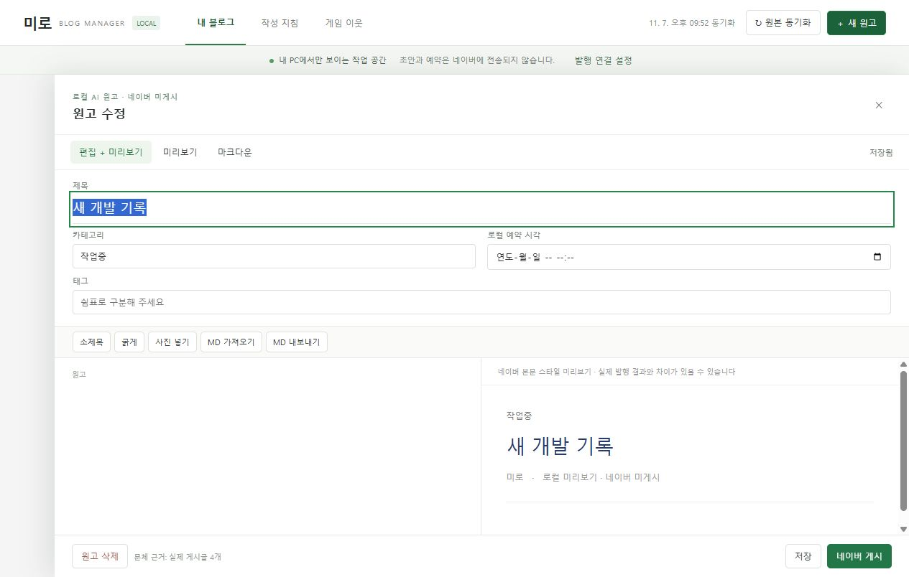
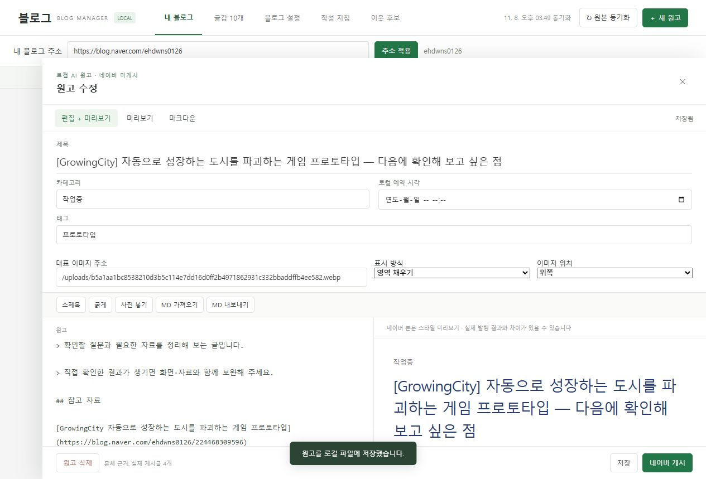

## 작업 결과

블로그별 데이터 분리와 글감 10개 생성·원고 시작, 썸네일 설정 저장·재열기를 실제 실행했습니다. 네이버 검색 모드는 구현했으며 실제 API 호출은 사용자 키 등록 후 확인이 필요합니다.

## 변경 내용

### 적용 내용

- 상단에 블로그 주소 입력란을 추가하고 서버·확장의 고정 작성자 ID를 제거했습니다. 주소별 초안·문체·검색 설정을 분리하며 새 설치에는 개인 블로그 데이터를 넣지 않습니다.
- 실제 게시글 제목·태그와 관심사를 분석해 서로 다른 접근법의 글감 10개를 제안합니다. 근거 링크·추가 문체 지침을 보존하고 선택한 글감으로 로컬 원고를 시작합니다. 이는 키워드 통계와 접근법 조합이며 의미 전체를 해석하는 생성형 AI 분석은 아닙니다.
- 검색 API 키는 로컬에서만 읽고 화면·상태 API·일반 배포본에 반환하지 않습니다. 네이버 검색 결과는 참고 자료로만 표시합니다. [네이버 공식 API 문서](https://developers.naver.com/docs/serviceapi/search/blog/blog.md)의 인증 헤더와 요청 형식을 적용했습니다.
- 목록 4열·정사각 이미지 영역, 전체 보이기/영역 채우기와 위/가운데/아래 위치 저장을 적용했습니다. 공개 글은 본문에 있는 선명한 실제 이미지 주소를 우선 사용하고 원본 이미지 파일은 수정하지 않습니다.

변경 전: 작성자 이름이 고정되어 있고 주소·글감 메뉴가 없으며 목록은 3열입니다.

변경 후: 주소 입력과 글감 메뉴, 4열 썸네일과 원본 비율 유지 표시입니다.

신규 설정 화면: 관심사와 API 키 입력란입니다. 변경 전에는 해당 설정 화면이 없어 위의 변경 전 목록과 비교합니다.

신규 글감 화면: 10개 제안과 기존 게시글의 실제 근거 링크가 생성됩니다. 변경 전에는 글감 기능이 없어 별도 동일 화면은 존재하지 않습니다.

보존된 0.4.1 실제 실행에서 재촬영한 편집기에는 대표 이미지 구성 옵션이 없습니다.

대표 이미지 주소와 표시 방식·위치를 저장합니다. 같은 브라우저 배율의 비교이며 본문은 검증용 원고입니다.

## 검증

- 자동 회귀 24개 통과, 기존 라이브 통합 1개는 해당 실행에서 미선택했습니다. 별도 실제 HTTP 검증에서 주소 전환/복원·키 비노출·10개 생성·키 없는 검색 거부를 확인했습니다.
- 실제 브라우저에서 10개 제안 → 원고 시작 → 대표 이미지 cover/top 저장 → 새로고침·재열기의 값 유지 → 테스트 원고 백업 삭제를 확인했습니다.
- 실제 네이버 원문 DOM 재생에서는 원본 카드 4개 보존·로컬 초안 2개 삽입·4열·본문 읽기·직접 편집 저장/취소·발행 확인 분기를 검증했습니다. 발행 호출은 모의이며 실제 게시하지 않았습니다.
- 일반 배포 ZIP 해시·57개 해제 파일·공백 포함 다른 경로 실행에서 초안/게시물 0개를 확인했습니다.
- 원본 PNG 6개는 각 200KB 미만입니다. Affinity doctor/status는 ECONNREFUSED여서 편집·재압축·GIF를 만들지 않고 실제 캡처 원본을 첨부했습니다.

[HTTP 실행 근거](../assets/personalization-personalization-http-qa.json) · [이미지 실측](../assets/personalization-thumbnail-browser-qa.json) · [배포본 검증](../assets/personalization-portable-verification.json) · [확장 DOM 회귀](../assets/personalization-native-card-verification.json)

## 남은 사항

- 네이버 검색 실서비스는 API 키 미등록으로 미실행입니다. 키 없이도 내 게시글·관심사 기반 글감 10개는 동작합니다. 실제 검색 결과를 확인했다고 보고하지 않습니다.
- 확장 변경은 소스·DOM 실행으로 확인했으며 이번 수정본의 설치된 Chrome 확장 재로드 검증은 미실행입니다. 설치형 패키지 작업은 별도 대화에서 진행 중이므로 이번 보고는 기능 변경과 검증한 일반 ZIP 범위입니다.
- 교훈 검토: 전역 지침 변경 없음. 고정 사용자 정보 제거·데이터 보존·실제 실행 검증은 기존 지침과 중복되므로 추가 규칙을 만들지 않았습니다.

## 작업 시간

- 제안 시간: 15~25분
- 실제로 완료된 시간: 시작 2026-11-08 15:47:35 Asia/Seoul. 구현·로컬 검증 기록 시점 2026-11-08T07:04:23.840Z (1009초). 공개 게시 확인은 후속 QA와 최종 채팅에 기록합니다.
- XERJ: 미사용 — XERJ 도구/검색 스크립트 미제공. rg·현재 소스·실제 HTTP/브라우저·DOM 실행으로 검증했습니다.
