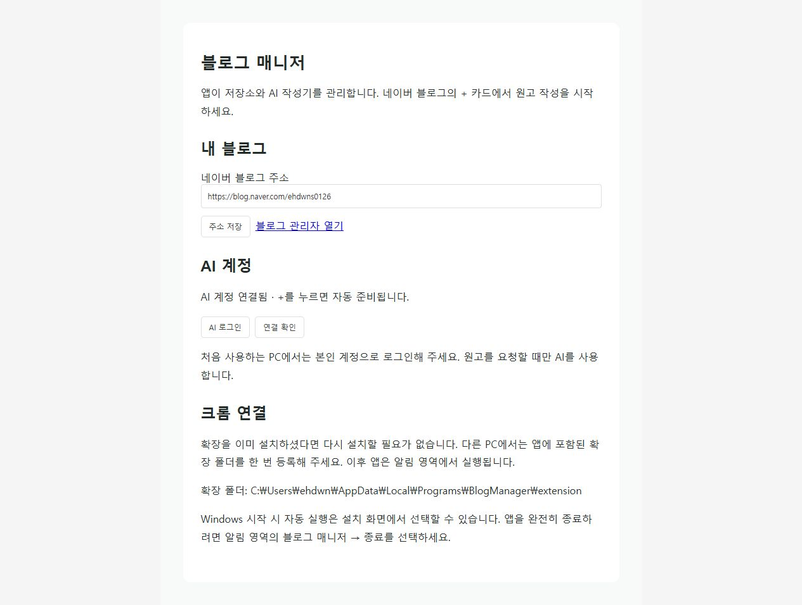

## 작업 결과

Windows 사용자 프로그램 경로에 설치했고 기존 초안 4개·게시글 4개를 보존했습니다. 실제 네이버 +에서 CMD 안내 대신 주제 입력창이 열렸고 설치 앱이 실제 AI 초안 1개를 생성했습니다.

## 변경 내용

### 적용 내용

- Node.js·공식 Codex CLI 포함 Windows x64 설치 EXE(159,834,412바이트). 개인 원고·로그인 정보는 포함하지 않습니다.
- 알림 영역 실행·중복 시작 방지·Windows 로그인 자동 실행. + 요청 때 AI 작성기를 자동 준비합니다.
- 프로그램 설치 경로와 사용자 원고 경로를 분리하고 기존 원고를 복사 보존했습니다.
- 블로그 주소·AI 계정 설정. 아카이브 URL은 특정 사용자 대신 GitHub Pages의 동일 프로젝트 보고서·자산 경로를 검증합니다.
- 설치 파일은 Git Chunk로 복원 가능하게 보관했습니다.

기존: 실제 작성기 수동 실행 안내.

변경 후: 설치 앱 연결 목록. + 주제 입력창을 확인한 뒤 빈 주제로 취소했습니다. 서로 다른 상태의 화면이므로 동일 화면 픽셀 비교로 주장하지 않습니다.

## 검증

- 전체 실행 회귀 검사 27/27 통과.
- 설치 파일 46개 해시 일치, Git 커밋의 런타임 파일39개가 설치 매니페스트와 일치.
- 중복 준비·초안 생성·잘못된 종료 토큰 거부·소유 작성기 종료: 모형 CLI로 실제 프로세스 연결 검증. 공식 CLI의 새 계정 경로에서는 미로그인 안내·작성기 미실행 확인.
- 설치된 공식 CLI의 기존 계정 연결 판별과 실제 예제 원고 생성 확인. 네이버 제출 없음.
- 사용자 초안4/게시글4 유지. 검증용 앱·작성기는 종료하고 사용자용 앱과 결과 탭은 유지.
- [자동 준비 검증](../assets/desktop-verification.json) · [설치 검증](../assets/installed-verification.json) · [Git 소스 일치](../assets/desktop-source-verification.json)
- SHA-256: 6C0AAB8BD3C5CCACD1D203166631FFD47F97D600575236A89AC671681DB8328C
- [소스 75fea07](https://github.com/MDJ0126/blog-manager/commit/75fea07c406306cf867fb9a2599bd4a0e1339b9e). 서버 파일의 최초 커밋 누락을 후속 커밋에서 보완한 뒤 전체 런타임 내용을 대조했습니다.

## 남은 사항

Chrome 확장은 개발용 배포이며 다른 PC에서 최초 한 번 등록해야 합니다. Chrome Web Store 배포·자동 업데이트는 등록하지 않았고 브라우저 설치 정책을 우회하지 않습니다. 신규 PC의 AI 로그인은 사용자가 앱 설정에서 진행합니다. 실제 네이버 공개 발행은 기존 원고 유지·검증 보류 요청대로 실행하지 않았습니다.

교훈 검토: 설치형 기능은 수동 CMD를 정상 사용 절차로 요구하지 않도록 프로젝트 AGENTS에 반영했습니다. 전역 지침은 기존 설치·검증 규칙과 중복되어 변경하지 않았습니다.

## 작업 시간

- 제안 시간: 20~35분
- 실제로 완료된 시간: 시작 2026-11-08 15:50:34 Asia/Seoul. 설치·실행·소스 확인 종료 2026-11-08 16:13:43 Asia/Seoul. 공개 배포 확인 소요는 최종 결과에서 구분합니다.
- XERJ: 미사용 — XERJ 도구 미제공. rg·소스·실제 HTTP/CLI·브라우저 화면으로 검증했습니다.
