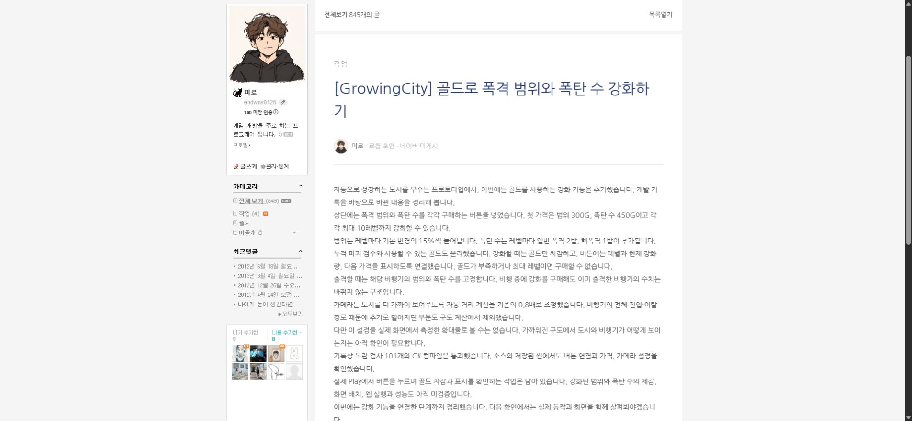
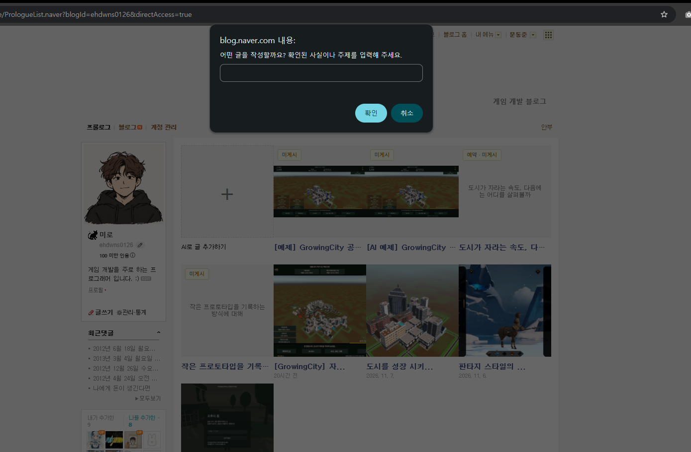

## 작업 결과

0.6.1을 실제 설치했고 아카이브 추천·AI 초안·네이버 읽기를 검증했습니다. 이전 설치본의 폐기 파일5개도 삭제·차단했습니다.

대화 요약: 사용자는 연속 팝업 대신 단일 작성 폼과 아카이브·게임 추천을 요청했고 확장 갱신·폼 확인을 알려주셨습니다. 확장 내부 제어 제한은 공개하고, 별도로 실제 API·초안 읽기를 검증했습니다. 추가 갱신 문제를 재현·수정한 뒤 최종본을 만들었습니다. [발언 순서·원문 인용·요약 기록](../assets/compose-conversation.json)

[이전0.6.0 보고](2026-11-08-result-20261108074227330-v1.0.0.html)

## 변경 내용

### 적용 내용

- 연속 prompt를 제거하고 Chrome 확장 compose.html에 주소·게임 검색어·추천 선택·추가 요청·생성 진행·초안 읽기를 한 화면으로 배치했습니다. 폐기한 웹 관리자는 복원하지 않았습니다.
- GitHub Pages 아카이브 홈과 공개 보고서 목록을 읽어 실제 출처·요약을 추천합니다. 주소 저장 후 재진입 시 자동 추천합니다. 외부·인증 포함·로컬 주소를 거부합니다.
- 게임 검색은 네이버 블로그 검색 API의 실제 제목·요약·출처를 사용합니다. 키는 사용자 데이터에만 저장하고 응답·설치 파일에 노출하지 않습니다. 전문·직접 경험으로 바꾸어 주장하지 않습니다.
- 선택한 아카이브 본문·이미지 목록을 기존 AI 작성기에 전달하고 결과의 출처 링크를 보존합니다.
- 0.6.1 설치본으로 갱신했고 기존 원고를 보존했습니다. 새 검증 원고가 추가되어 로컬 초안은5개입니다.

변경 전: 사용자가 제공한 실제 화면. 새 확장 폼 내부는 브라우저 도구 정책으로 열람·캡처가 차단되어 직접 촬영하지 못했습니다. 생성 결과 화면을 폼의 화면 비교로 대체했다고 주장하지 않습니다.
- 0.6.0 갱신 뒤 남았던 폐기 파일5개를 0.6.1 설치 삭제 규칙으로 정리하고 서버에서 이전 URL을404로 차단했습니다. 원고는 보존합니다.

## 검증

- 전체 회귀26/26 통과(실제 HTTP 검사 포함).
- 실제 아카이브 홈페이지에서 추천10개. 설치 앱에서 추천 선택→실제 자료 읽기→AI 원고 저장→네이버 미게시 읽기 화면 확인. 선택 보고서에 대응하는 출처 보존. 해당 생성 원고는 이미지가 없는 텍스트 원고입니다.
- 단일 폼의 설정·추천 렌더·선택·생성·폴링·읽기 연결은 분리된 소스 DOM 테스트로 통과했습니다. 이는 실제 Chrome 내부 화면 자동 검증과 구분합니다.
- 사용자는 새 폼의 추천·초안 생성 완료를 확인했습니다. 별도로 직접 API 연결과 실제 생성 결과를 검증했습니다.
- 검색 API 인증·오류·비밀키 비노출·마크업 제거는 모의 응답 검사. 실제 검색 호출은 키 미등록으로 미실행.
- 설치44파일·스테이징 런타임37파일 SHA-256 일치, Git Chunk 복원 EXE 동일.
- [실제 아카이브 추천](../assets/compose-archive-live.json) · [실제 생성](../assets/compose-real-result.json) · [소스 DOM 검사](../assets/compose-ui-verification.json) · [설치본 검사](../assets/compose-061-verification.json)
- 소스 커밋 fff9ff2. 설치 SHA-256: 121A7156BE90B930DC573D2CA070A92DB660546EE96446FB7E34C186125974BA.
- 최종0.6.1: 설치44파일 해시 일치, 회귀26/26, 잔여파일0개·5개 URL404·초안5/게시글4. [갱신 전 재현](../assets/compose-upgrade-check.json) · [갱신 후 검증](../assets/compose-061-verification.json).
- 최종 커밋fff9ff2. 설치 SHA-256: 121A7156BE90B930DC573D2CA070A92DB660546EE96446FB7E34C186125974BA. 이전0.6.0 검증은 당시 수행한 항목의 관찰이며 폐기 파일 제거 검증을 포함하지 않았습니다. 추가 회귀 실패와 수정 기록을 보존했습니다.

## 남은 사항

게임 검색은 실제 네이버 API 키 연결 후 사용할 수 있으며 이번에는 실검색을 실행하지 않았습니다. 현재 아카이브 지원 주소는 GitHub Pages의 Tracefolio 홈 구조입니다. 확장 폼 내부 직접 화면 캡처·제어는 도구 보안 정책으로 미실행이며 이를 우회하지 않았습니다. 공개 네이버 발행은 기존 사용자 요청대로 보류했습니다.

교훈 검토: + 작성은 확장의 단일 폼에 배치하고 폐기한 관리 UI를 복원하지 않도록 프로젝트 AGENTS에 통합했습니다. 전역 지침은 기존 실제 진입 흐름 검증 규칙과 중복되어 변경하지 않았습니다.
교훈 추가: 프로젝트 설치 검증 지침에 갱신 시 폐기 파일·이전 URL 검사와 원고 보존을 통합했습니다. 전역은 기존 실행·산출물 검증 지침과 중복되어 추가하지 않았습니다.

## 작업 시간

- 제안 시간: 15~25분
- 실제로 완료된 시간: 제안15~25분. 시작2026-11-08 16:25:54 Asia/Seoul. 추가 갱신 문제 재현·0.6.1 설치 검증2026-11-08 16:48:06 Asia/Seoul. 최종 보고 배포 확인 진행 중
- XERJ: 미사용 — XERJ 연결 도구 미제공. 현재 소스·rg·실제 HTTP/CLI·네이버 읽기 화면·분리 DOM 검사 사용.
