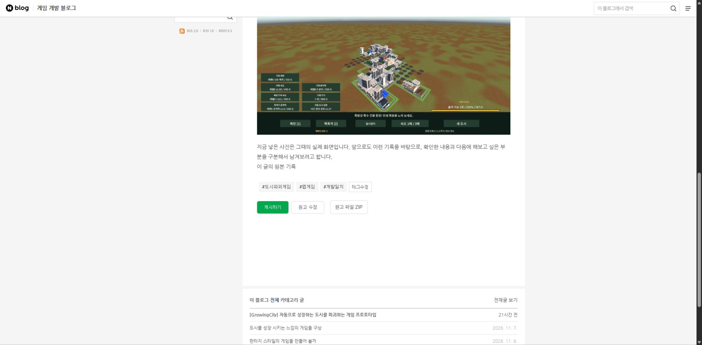

## 작업 결과

구현과0.7.0 설치를 마쳤습니다. 작성 요청 후 자동으로 파일을 보관하고 네이버에서 ZIP으로 받을 수 있습니다. 네이버 글감10개·게임 이웃 추천의 실제 호출은 사용자가 API키가 없다고 알려주셔서 연결 대기입니다.

대화 요약: 사용자는 검색 글감10개·자동 파일 보관·서로이웃 추천을 요청했고 API키가 없다고 확인했습니다. 확장 갱신 후 파일버튼을 확인했으며 실제 API 결과와 모의 검증을 구분했습니다. [순서·원문 인용 기록](../assets/recommend-conversation.json)

## 변경 내용

### 적용 내용

- 네이버 블로그 검색 API100개 결과에서 중복을 제외한 글감10개를 추천합니다. 실제 결과가 부족하면 발견한 수만 표시합니다. 같은 검색어는2분 동안 공유 캐시하여 이웃 추천에 재사용합니다.
- 작성 요청의 저장 경로에 Markdown·메타데이터·원본 이미지 묶음을 추가했습니다. 수정 전 파일은 이력에 남기고 이미지 보관 실패는 부분 저장으로 표시합니다. 게시 요청을 자동 실행하지 않습니다.
- 게임 공개 글의 키워드·근거로 최대10명의 이웃 후보를 추천합니다. 본인·중복·신청/서로이웃/제외로 표시한 후보를 거르고 검토 후보를 저장할 수 있습니다. 관계 상태는 사용자 표시이며 실제 네이버 관계로 확정하지 않습니다.
- 작성 폼과 실제 네이버 읽기 화면에 ZIP 받기를 추가했습니다. 폐기한 웹 관리자는 복원하지 않았습니다.

## 검증

- 전체 회귀30/30 통과. 검색 인증·오류·10개 중복 제거·후보 근거/제외는 모의 응답·단위 검사입니다.
- 실제 AI 작성 요청1건이 별도 저장 조작 없이 MD/JSON2파일 보관 완료. [실제 생성 기록](../assets/recommend-live-file-job.json).
- 기존 이미지 예제 원고를 ZIP4파일로 내려받아 독립Windows tar로 해제했습니다. Markdown·사진2장 SHA일치와 상대 이미지경로를 확인했습니다. [파일HTTP](../assets/recommend-files-http.json) · [독립 복원](../assets/recommend-zip-verification.json).
- 실제 네이버 ZIP링크1개·정확한원고ID 연결을 확인했습니다. 설치47파일 해시와 기존데이터 보존도 확인했습니다. [설치 검증](../assets/recommend-install-verification.json).
- 글감 선택·진행·이웃카드 렌더·발행호출없음은 분리된 소스DOM 검사입니다. [DOM검사](../assets/recommend-ui-verification.json). 확장 내부 화면은 앞서 도구 정책으로 차단되어 이 검사를 실제Chrome화면 검증이라고 보고하지 않습니다.
- 새 ZIP버튼의 동일 상태 전 화면은 확보하지 못했습니다. 기존화면에서 링크0개 관찰 후 갱신화면에서1개를 확인했으나, 정확한 전후 이미지 비교 완료로 표시하지 않습니다.

## 남은 사항

네이버API키등록 후 실제 글감10개와 실제 이웃후보 추천을 확인해야 합니다. 검색API를 호출하지 않은 상태를 실제 추천 성공으로 표시하지 않았습니다. 발행과 이웃신청은 자동 전송하지 않았습니다.

교훈: 자동 보관은 실제 파일·이미지·복원으로 검증하고 이웃 관계와 모의 결과를 확정하지 않도록 프로젝트AGENTS에 통합했습니다. 전역은 기존 사실·검증 구분 규칙과 중복되어 변경하지 않았습니다. [공식 API 발급 안내](https://developers.naver.com/docs/serviceapi/search/blog/blog.md)

## 작업 시간

- 제안 시간: 15~25분
- 실제로 완료된 시간: 시작2026-11-08 16:59:18 Asia/Seoul. 설치·실행 검사 완료, 공개 배포 확인 중
- XERJ: 미사용 — XERJ 연결 도구 미제공. 현재소스·실제HTTP/AI/파일·독립해제·네이버화면·소스DOM 검사 사용.
