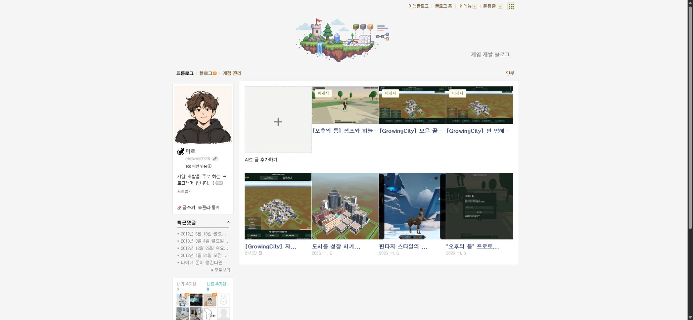
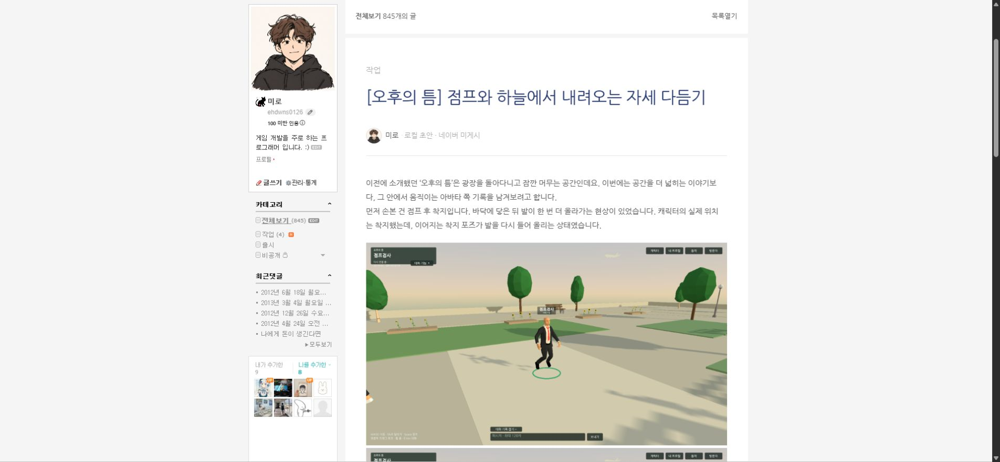
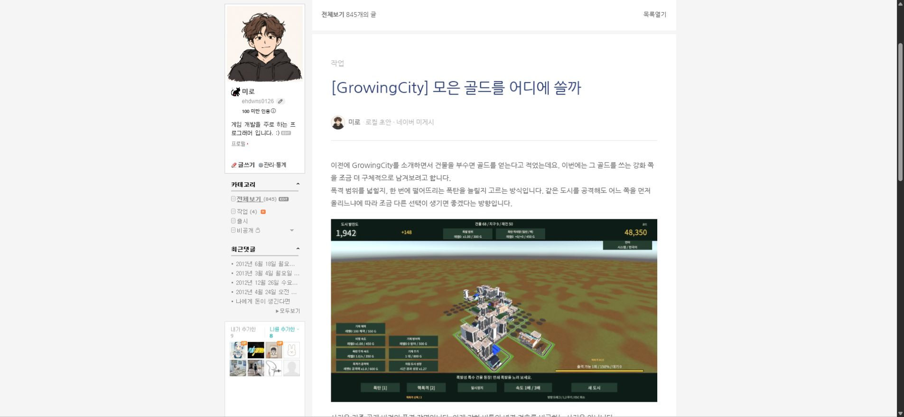
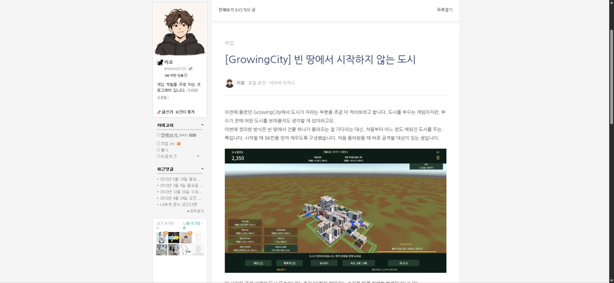

## 작업 결과

기존 로컬 예제·시험 원고6개를 백업 후 목록에서 제거했습니다. 새 원고3편을 실제 게시글의 문체에 맞춰 작성하고 이미지·태그·파일 보관과 네이버 읽기 표시를 확인했습니다. 공개 발행은 하지 않았습니다.

대화 요약: 사용자는 “예제 다 지우고 제대로 작성해봐 3개”를 요청했습니다. 실제 게시글 보존·로컬 저장 범위로 진행했습니다. [대화 기록](../assets/three-posts-conversation.json)

## 변경 내용

### 적용 내용

- GrowingCity: 빈 땅에서 시작하지 않는 도시 — 초기 채움·분산 성장·유한 지도와 재건.
- GrowingCity: 모은 골드를 어디에 쓸까 — 범위/폭탄 수 강화·지갑과 점수·출격 시 적용 규칙.
- 오후의 틈: 점프와 하늘에서 내려오는 자세 다듬기 — 실제 착지·낙하 전후4장.
- 원고별 실제 개발 기록 출처를 연결하고 기존 공개 사진을 변경 후 증거로 오인하지 않도록 설명했습니다. 실제 플레이 미검증 세부 규칙은 본문에서 구분했습니다.
- 원고 전문과 삭제 백업은 사용자PC에만 보관했습니다. 앱 코드·설치본 변경은 없습니다.

## 검증

- 실제 저장 상태: 원고3개·ready=true, 원본 이미지8개 SHA일치, ZIP3개 정상 다운로드. 삭제 백업6개 확인, 실제 게시글4개 데이터 불변. [파일 검증](../assets/three-posts-verification.json)
- 실제 네이버 목록에서 예제 제목 제거와 +카드/신규3개 확인. 읽기3편의 이미지4+2+2개 모두 로드 확인. 골드/도시 태그 표시도 확인. [읽기 검사](../assets/three-posts-ui.json)
- 정리 전 목록은 접근성 내용으로 확인했지만 전 스크린샷을 저장하지 못했습니다. 정확한 전후 캡처 비교 완료로 보고하지 않습니다.

## 남은 사항

새 원고는 미게시이며 내용 검토 후 게시 버튼에서 진행할 수 있습니다. 기존 실제 발행 검증 보류·검색API키 미보유 상태는 유지합니다.

전역 교훈 검토: 실제 기록과 미검증 상태 구분·원본 보존은 기존 규칙과 중복되어 전역 변경 없음. 이번 콘텐츠 작업에 새로운 전역 규칙은 추가하지 않았습니다.

브라우저 원고3탭은 사용자 검토용 결과로 유지하고 기존 사용자 탭을 보존했습니다. 임시 보조 프로세스를 신규 실행하지 않았습니다. 이미지 편집·압축은 하지 않고 실제 원본 캡처를 사용했습니다.

## 작업 시간

- 제안 시간: 8~15분
- 실제로 완료된 시간: 시작2026-11-08 17:31:31 KST. 원고 작성·백업·파일/네이버 표시 검증 완료, 공개 결과 보고 배포 확인 중.
- XERJ: 미사용 — XERJ 연결 도구 미제공. 실제 공개 원문·현재 API/파일·네이버 표시 대조로 검증.
