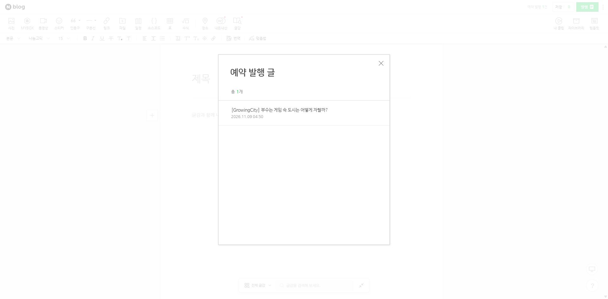
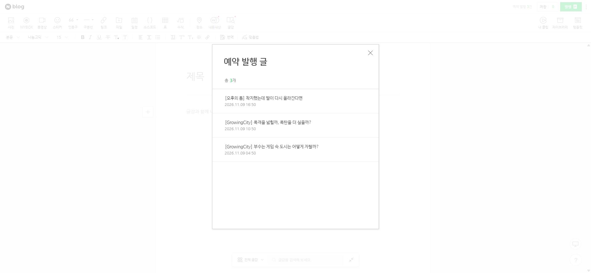
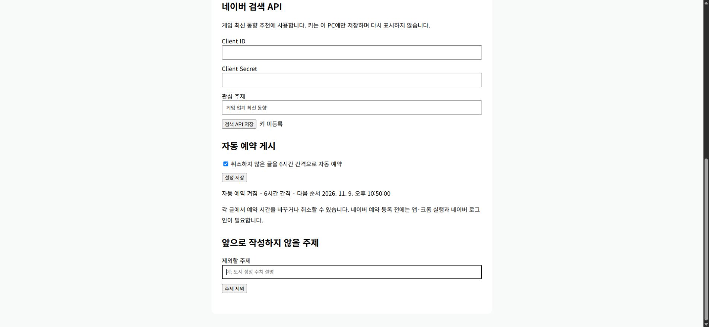

## 작업 결과

실제 네이버 예약 3건: 2026-11-09 04:50·10:50·16:50 KST. 각각 부수는 게임 속 도시, 폭격 범위와 폭탄 수, 착지 점프 보정 글입니다. 로컬 예약 표시만 만든 것이 아니라 네이버 최종 제출 후 예약 목록에서 제목·시각을 대조했습니다. 아직 예약 시각 전이므로 공개 게시 완료와 구분합니다.

## 변경 내용

### 적용 내용

- 기존 원고 3개를 짧은 도입·소제목·관련 이미지 중심으로 재작성. 원본 보고서의 구현 사실과 미검증 플레이 경험을 구분했습니다. 사진은 각각 2·2·4장입니다.
- 자동 예약 정책을 켰고 기본 간격은 6시간, 다음 순서는 11월 9일 22:50 KST입니다. 이미 등록된 예약은 PC가 꺼져도 네이버가 처리합니다. 새 예약 등록에는 실행 중인 앱·크롬·로그인이 필요합니다.
- 개별 시각·카운트다운·예약 취소·주제 제외 코드, 삭제 묘비 기록, 제외 주제의 추천·작성 필터를 추가했습니다. 유사 주제는 AI 지침과 문자열/토큰 비교로 제한하며 완전한 의미 판별은 보장하지 않습니다.
- 앱 설정에 네이버 검색 API Client ID·Client Secret 입력과 자동 예약 상태를 표시합니다.
- 이미 예약·게시·취소된 글의 새 글 재전송을 서버에서 거부해 이전 확장 코드의 중복 등록을 차단합니다.

## 검증

0.10.2 설치 57파일 SHA 일치, 실제 앱 대상 검사 57/57 통과. 설치본 159837350바이트, SHA256 0521CA0AA7E3AF7E75EA25B88320460F767A1D03FB4699D08ADDA6F8B47EDC1E. 소스 커밋 bb08631bcd927b24e1fb0bbc05bf66b7bdc39ecd 원격 main 일치. 네이버 예약 logNo 224469589119·224469601387·224469605609와 목록 3건을 확인했습니다. 원본 사진 바이트 보존, 동시 claim·불확실 제출 재시도 금지·삭제/수정/정책 해제 시 제출 거부·예약 원고 재전송 HTTP400을 검사했습니다.

진행 중 1건 화면입니다. 최초 0건의 전 화면은 확보하지 못했습니다.

동일 네이버 예약 목록에서 최종 3건과 각 시각을 확인했습니다.

실제 설치 앱의 키 미등록·자동 예약 켜짐·다음 순서 화면입니다. 이전 설정 화면은 로컬 경로가 포함돼 공개하지 않았습니다. 원본 캡처는 편집 없이 보존했습니다.

## 남은 사항

현재 크롬 초안 화면에서 새 타이머·취소 버튼이 아직 없는 것을 직접 확인했습니다. 디스크 설치와 실제 브라우저 활성화를 구분하며, 자동 새 예약 등록의 지속 실행 및 네이버 원본 취소·시각 변경은 실제 실행 검증이 남았습니다. 검색 키가 없어 최신 동향 실검색·새 검색 글 작성은 미검증입니다. 현재 등록한 3개는 중앙 아카이브 기반 개발 글입니다. 예약 시각 이후 공개 본문 확인과 성공 후 원고 보충도 아직 실행되지 않았습니다.

대화 요약(개별 발언 시각 미기록): 사용자 “글 좀 이쁘게 적어봐…6시간 간격으로” → 사용자 자동 게시·거부 주제 반영·API 입력·개별 타이머 요청 → 사용자 “예약글 형태로 넣어놔 자동 게시는” → AI가 실제 예약 3건 등록과 설치·검사 결과를 확인하고 브라우저 미반영 제한을 보고했습니다. 앞선 게시 보류는 최신 자동 예약 지시로 변경됐습니다.

교훈 검토: 최신 명시적 사용자 권한과 실제 원격 예약 영수증을 구분하는 프로젝트 지침을 갱신했습니다. 전역은 기존 검증·중복 정리 원칙으로 충분해 변경하지 않았습니다. 임시 QA 서버와 비교 탭은 종료했고 사용자 기존 탭은 보존했습니다. 예약 목록과 API 설정 탭은 결과 확인용으로 유지했습니다.

## 작업 시간

- 제안 시간: 최초 10~20분. 추가 범위 15~25분, 23:13에 마무리 5~10분 예상으로 수정했습니다.
- 실제로 완료된 시간: 시작 2026-11-08 22:41:20 KST. 설치·57파일 검증 23:23:47 KST까지 42분27초. 보고서 작성 시점 23:33 KST에 약52분 경과로 예상 초과. 브라우저 활성화 등 전체 완료시각은 없으며 공개 보고서 배포 시각은 채팅 최종 결과에 별도 기록합니다.
- XERJ: 미사용 — 연결 도구 미제공. rg·실제 소스·네이버 DOM·앱 실행 상태를 대조했습니다.
