> 보관 기록입니다. 아래 결과는 원문 작성 시점의 내용이며, 이번 편집에서 제품 테스트를 다시 실행하지 않았습니다.

108개 고정 분모 검증

## 108개 고정 분모 검증

**확인된 대표 결과 일치 6/108 (5.56%) · 차이 1/108 · 미검증 101/108**

검증 판정 진행률 6.48% (7/108). 목록 집계 108/108은 실행 검증률이 아닙니다. 확인된 부분의 하한 현황이며, 실제 제품이 5.56%만 구현됐다는 뜻이 아닙니다. 포괄 기능 인증은 0/108이며 전체 실제 유사도를 추정하지 않습니다.

새 실제 키·버퍼·커서·선택·요청된 Undo 검사: 7/7. 기본 단축키 수신: 21/22. VA는 기존 실제 실행 증거, CA는 0.0.94 검사 프로필의 이번 실행입니다. 버전·환경 범위를 혼합해 일치로 승격하지 않았습니다.

집계 JSON · 108개 CSV · 상세 JSON · 증거 해시

VA-F001 Find by Context — 미검증

대표 기능 결과를 비교하는 실행 어댑터·기대 결과가 없음

다음 작업: 동일 입력/문맥의 대표 동작 실행 어댑터와 원본 기대 결과 확보

기존 프로브: {'scope': 'options-page-only', 'observation': 'dialog-observed-and-cancelled', 'error': None, 'countsAsFunctionalPass': False}

- 동명 지역/멤버/중첩 scope 비교

- 첫/마지막 참조의 경계 및 선택 방향 비교

VA-F002 Find References — 미검증

대표 기능 결과를 비교하는 실행 어댑터·기대 결과가 없음

다음 작업: 동일 입력/문맥의 대표 동작 실행 어댑터와 원본 기대 결과 확보

기존 프로브: {'scope': 'options-page-only', 'observation': 'dialog-observed-and-cancelled', 'error': None, 'countsAsFunctionalPass': False}

VA-F003 Find Symbol in Solution — 미검증

대표 기능 결과를 비교하는 실행 어댑터·기대 결과가 없음

다음 작업: 동일 입력/문맥의 대표 동작 실행 어댑터와 원본 기대 결과 확보

기존 프로브: {'scope': 'dialog-cancel-or-direct-command', 'observation': 'dialog-observed-and-cancelled', 'error': None, 'countsAsFunctionalPass': False}

- prefix/contains·대소문자·부정/경계 조합 비교

- 선택 초기화·이전 필터 복원 및 system 범위 비교

VA-F004 GoTo Implementation — 미검증

대표 기능 결과를 비교하는 실행 어댑터·기대 결과가 없음

다음 작업: 동일 입력/문맥의 대표 동작 실행 어댑터와 원본 기대 결과 확보

기존 프로브: {'scope': 'options-page-only', 'observation': 'dialog-observed-and-cancelled', 'error': None, 'countsAsFunctionalPass': False}

- 단일/복수/overload 및 주석 scope 비교

- project 제한·system 예외·후보 없음 fallback 비교

VA-F005 GoTo Member — 미검증

대표 기능 결과를 비교하는 실행 어댑터·기대 결과가 없음

다음 작업: 동일 입력/문맥의 대표 동작 실행 어댑터와 원본 기대 결과 확보

기존 프로브: {'scope': 'dialog-cancel-or-direct-command', 'observation': 'dialog-observed-and-cancelled', 'error': None, 'countsAsFunctionalPass': False}

- 각 구조종류·inherited toggle·동명member·type/name sort

VA-F006 GoTo Related — 미검증

대표 기능 결과를 비교하는 실행 어댑터·기대 결과가 없음

다음 작업: 동일 입력/문맥의 대표 동작 실행 어댑터와 원본 기대 결과 확보

기존 프로브: {'scope': 'dialog-cancel-or-direct-command', 'observation': 'dialog-observed-and-cancelled', 'error': None, 'countsAsFunctionalPass': False}

- 다이아몬드 상속·override·overload 메뉴 비교

- include 역방향 의존성·주석 후보 비교

VA-F007 Highlight Current Line — 미검증

대표 기능 결과를 비교하는 실행 어댑터·기대 결과가 없음

다음 작업: 동일 입력/문맥의 대표 동작 실행 어댑터와 원본 기대 결과 확보

기존 프로브: {'scope': 'options-page-only', 'observation': 'dialog-observed-and-cancelled', 'error': None, 'countsAsFunctionalPass': False}

- theme·포커스·색·표시방식 비교

VA-F008 List Methods in File — 미검증

대표 기능 결과를 비교하는 실행 어댑터·기대 결과가 없음

다음 작업: 동일 입력/문맥의 대표 동작 실행 어댑터와 원본 기대 결과 확보

기존 프로브: {'scope': 'options-page-only', 'observation': 'dialog-observed-and-cancelled', 'error': None, 'countsAsFunctionalPass': False}

- macro 메서드·namespace·parameter 표시 조합 비교

- 편집 revision 갱신 및 ESC/포커스 종료 비교

VA-F009 Move Scope — 대표 결과 일치

대표 시나리오의 실제 결과 일치; 기능 전체 인증 아님

다음 작업: 추가 경계·설정·지원 범위 검증

기존 프로브: {'scope': 'editor-command-sample', 'observation': None, 'error': None, 'countsAsFunctionalPass': False}

- 괄호와 brace 혼합 중첩 및 global 이동 비교

- 문자열/주석 내 delimiter와 불완전 코드 비교

```
{
  "state": "representative-match",
  "reason": "대표 시나리오의 실제 결과 일치; 기능 전체 인증 아님",
  "observedOutputState": "representative-match",
  "scenarioId": "scope-next",
  "CA": "docs\\validation\\fixed-108-097-final\\live\\behavior.json",
  "VA": ".local\\parity-runs\\20261018-015759-745\\VA.results.json",
  "before": {
    "zoom": 100,
    "text": "void First() {}\r\nvoid Second() {}\r\n",
    "caret": 0,
    "selectionStart": 0,
    "selectionLength": 0,
    "selectedText": ""
  },
  "expected": {
    "text": "void First() {}\r\nvoid Second() {}\r\n",
    "caret": 17,
    "selectionStart": 17,
    "selectionLength": 0,
    "selectedText": "",
    "zoom": 100,
    "activeFile": "C:\\Projects\\CodeAssist\\.local\\parity-runs\\20261018-015759-745\\VA\\epoch-18976\\scope-next.cpp"
  },
  "after": {
    "zoom": 100,
    "text": "void First() {}\r\nvoid Second() {}\r\n",
    "caret": 17,
    "selectionStart": 17,
    "selectionLength": 0,
    "selectedText": ""
  },
  "undo": null,
  "undoRequired": false
}
```

before

[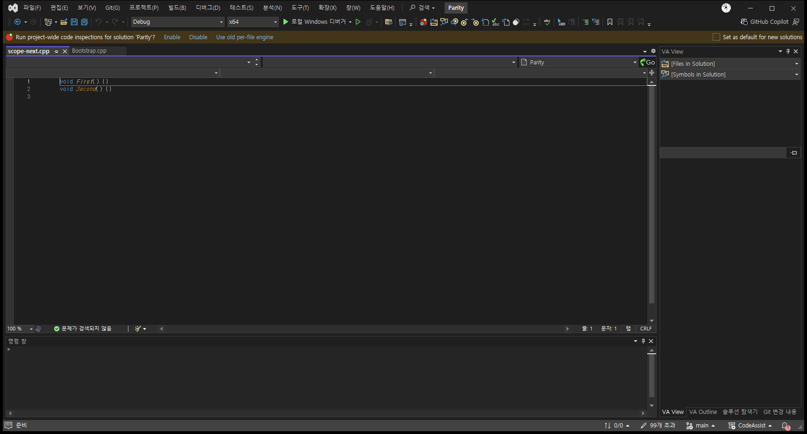](../assets/imports/docs/validation/fixed-108-097-final/screenshots/VA-scope-next-before.png)[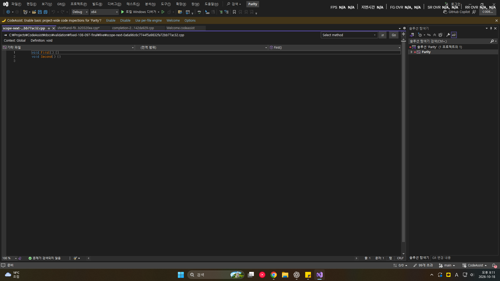](../assets/imports/docs/validation/fixed-108-097-final/screenshots/CA-scope-next-before.png)

after

[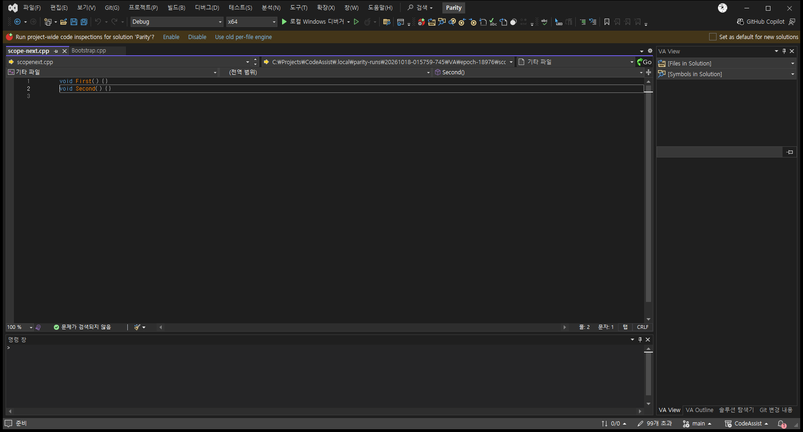](../assets/imports/docs/validation/fixed-108-097-final/screenshots/VA-scope-next-after.png)[](../assets/imports/docs/validation/fixed-108-097-final/screenshots/CA-scope-next-after.png)

VA-F010 Navigate Back and Forward — 미검증

대표 기능 결과를 비교하는 실행 어댑터·기대 결과가 없음

다음 작업: 동일 입력/문맥의 대표 동작 실행 어댑터와 원본 기대 결과 확보

기존 프로브: {'scope': 'options-page-only', 'observation': 'dialog-observed-and-cancelled', 'error': None, 'countsAsFunctionalPass': False}

- 편집/파일전환/Find reference waypoint와 cursor column 복원

- keyboard conflict·history branch·닫힌문서

VA-F011 Open Corresponding File — 미검증

대표 기능 결과를 비교하는 실행 어댑터·기대 결과가 없음

다음 작업: 동일 입력/문맥의 대표 동작 실행 어댑터와 원본 기대 결과 확보

기존 프로브: {'scope': 'options-page-only', 'observation': 'dialog-observed-and-cancelled', 'error': None, 'countsAsFunctionalPass': False}

- 다중 대응·project외·이름접두사·경로동명 후보

VA-F012 Open File in Solution — 미검증

대표 기능 결과를 비교하는 실행 어댑터·기대 결과가 없음

다음 작업: 동일 입력/문맥의 대표 동작 실행 어댑터와 원본 기대 결과 확보

기존 프로브: {'scope': 'dialog-cancel-or-direct-command', 'observation': 'dialog-observed-and-cancelled', 'error': None, 'countsAsFunctionalPass': False}

- 다중 project 중복/결합·공급원 변경 및 취소 비교

- persistent filter 숨김/해제·line/column 조건 비교

- fuzzy·case·prefix·다중 선택 비교

VA-F013 VA Hashtags — 미검증

대표 기능 결과를 비교하는 실행 어댑터·기대 결과가 없음

다음 작업: 동일 입력/문맥의 대표 동작 실행 어댑터와 원본 기대 결과 확보

기존 프로브: {'scope': 'options-page-only', 'observation': 'dialog-observed-and-cancelled', 'error': None, 'countsAsFunctionalPass': False}

- 주석/전처리·case·편집갱신·숨김범위

- 외부변경·read-only·solution/global 전환

VA-F014 VA Navigation Bar — 미검증

대표 기능 결과를 비교하는 실행 어댑터·기대 결과가 없음

다음 작업: 동일 입력/문맥의 대표 동작 실행 어댑터와 원본 기대 결과 확보

기존 프로브: {'scope': 'options-page-only', 'observation': 'dialog-observed-and-cancelled', 'error': None, 'countsAsFunctionalPass': False}

- 문서·theme·namespace·Go설정·project 전환

VA-F015 Access to Refactoring Commands — 미검증

대표 기능 결과를 비교하는 실행 어댑터·기대 결과가 없음

다음 작업: 동일 입력/문맥의 대표 동작 실행 어댑터와 원본 기대 결과 확보

기존 프로브: {'scope': 'options-page-only', 'observation': 'dialog-observed-and-cancelled', 'error': None, 'countsAsFunctionalPass': False}

VA-F016 Change Signature — 미검증

대표 기능 결과를 비교하는 실행 어댑터·기대 결과가 없음

다음 작업: 동일 입력/문맥의 대표 동작 실행 어댑터와 원본 기대 결과 확보

기존 프로브: {'scope': 'dialog-cancel-or-direct-command', 'observation': 'product-error-dialog', 'error': None, 'countsAsFunctionalPass': False}

- 기본 인수 추가와 필수 인수 추가의 호출부 차이

- 여러 인수 이름 변경+재정렬 모호성

- 파생 클래스·외부 헤더·선택 호출부·Undo

VA-F017 Convert Between Pointer and Instance — 미검증

대표 기능 결과를 비교하는 실행 어댑터·기대 결과가 없음

다음 작업: 동일 입력/문맥의 대표 동작 실행 어댑터와 원본 기대 결과 확보

기존 프로브: {'scope': 'dialog-cancel-or-direct-command', 'observation': 'product-error-dialog', 'error': None, 'countsAsFunctionalPass': False}

- new/delete와 address/dereference 혼합

- raw/unique/shared/custom 및 explicit type

- 지원 불가 변수·escape하는 참조

VA-F018 Encapsulate Field — 미검증

대표 기능 결과를 비교하는 실행 어댑터·기대 결과가 없음

다음 작업: 동일 입력/문맥의 대표 동작 실행 어댑터와 원본 기대 결과 확보

기존 프로브: {'scope': 'dialog-cancel-or-direct-command', 'observation': 'dialog-closed-without-cancel-control', 'error': None, 'countsAsFunctionalPass': False}

- m_nItemsCount·hWindow·밑줄 이름

- getter/setter 한쪽 생략·복합 참조

- 배열/char pointer 제한과 선택 참조 범위

VA-F019 Extract Method — 미검증

대표 기능 결과를 비교하는 실행 어댑터·기대 결과가 없음

다음 작업: 동일 입력/문맥의 대표 동작 실행 어댑터와 원본 기대 결과 확보

기존 프로브: {'scope': 'dialog-cancel-or-direct-command', 'observation': 'dialog-closed-without-cancel-control', 'error': None, 'countsAsFunctionalPass': False}

- read/write 혼합·멤버·로컬·단일 반환값

- 단일문/다중문·early return·매크로 선택 경계

VA-F020 Introduce Variable — 미검증

대표 기능 결과를 비교하는 실행 어댑터·기대 결과가 없음

다음 작업: 동일 입력/문맥의 대표 동작 실행 어댑터와 원본 기대 결과 확보

기존 프로브: {'scope': 'dialog-cancel-or-direct-command', 'observation': 'no-modal-observed', 'error': None, 'countsAsFunctionalPass': False}

- 동일 표현식의 선택 전/후와 다른 scope

- 단일문 while/if·부작용 표현식

- 반환값 capture와 residual parentheses

VA-F021 Move Implementation to Header File — 미검증

대표 기능 결과를 비교하는 실행 어댑터·기대 결과가 없음

다음 작업: 동일 입력/문맥의 대표 동작 실행 어댑터와 원본 기대 결과 확보

기존 프로브: {'scope': 'dialog-cancel-or-direct-command', 'observation': 'no-modal-observed', 'error': None, 'countsAsFunctionalPass': False}

- 선언없음·default이름차이·전처리·주석·선택복원

VA-F022 Move Implementation to Source File — 미검증

대표 기능 결과를 비교하는 실행 어댑터·기대 결과가 없음

다음 작업: 동일 입력/문맥의 대표 동작 실행 어댑터와 원본 기대 결과 확보

기존 프로브: {'scope': 'dialog-cancel-or-direct-command', 'observation': 'no-modal-observed', 'error': None, 'countsAsFunctionalPass': False}

- template 두단계·overload·EOF·snippet·Undo

VA-F023 Move Method Implementations to Source File — 미검증

대표 기능 결과를 비교하는 실행 어댑터·기대 결과가 없음

다음 작업: 동일 입력/문맥의 대표 동작 실행 어댑터와 원본 기대 결과 확보

기존 프로브: {'scope': 'dialog-cancel-or-direct-command', 'observation': 'product-error-dialog', 'error': None, 'countsAsFunctionalPass': False}

- 중첩class·선택subset·template·Undo

VA-F024 Move Selection to New File — 미검증

대표 기능 결과를 비교하는 실행 어댑터·기대 결과가 없음

다음 작업: 동일 입력/문맥의 대표 동작 실행 어댑터와 원본 기대 결과 확보

기존 프로브: {'scope': 'dialog-cancel-or-direct-command', 'observation': 'dialog-observed-and-cancelled', 'error': None, 'countsAsFunctionalPass': False}

- 부분줄·기존destination·언어template·include·Undo

VA-F025 Rename — 차이 확인

이름 바꾸기 기본 키 Alt+Shift+R 명령 미수신; 기능 결과 비교 완료 아님

다음 작업: 기본 키 수신 경로 조사·수정·재검사

기존 프로브: {'scope': 'dialog-cancel-or-direct-command', 'observation': 'dialog-observed-and-cancelled', 'error': None, 'countsAsFunctionalPass': False}

- 상속·주석proximity·범위/제외·취소

- 다중project·중단검색·preview focus·Undo

VA-F026 Rename Files — 미검증

대표 기능 결과를 비교하는 실행 어댑터·기대 결과가 없음

다음 작업: 동일 입력/문맥의 대표 동작 실행 어댑터와 원본 기대 결과 확보

기존 프로브: {'scope': 'dialog-cancel-or-direct-command', 'observation': 'dialog-closed-without-cancel-control', 'error': None, 'countsAsFunctionalPass': False}

- related files·include·SCC·충돌·read-only·save/Undo

VA-F027 Simplify Instance Declaration — 미검증

대표 기능 결과를 비교하는 실행 어댑터·기대 결과가 없음

다음 작업: 동일 입력/문맥의 대표 동작 실행 어댑터와 원본 기대 결과 확보

기존 프로브: {'scope': 'dialog-cancel-or-direct-command', 'observation': 'product-error-dialog', 'error': None, 'countsAsFunctionalPass': False}

- local/nonlocal·타입/initializer·주석·Undo

VA-F028 Add Forward Declaration — 미검증

대표 기능 결과를 비교하는 실행 어댑터·기대 결과가 없음

다음 작업: 동일 입력/문맥의 대표 동작 실행 어댑터와 원본 기대 결과 확보

기존 프로브: {'scope': 'dialog-cancel-or-direct-command', 'observation': 'dialog-closed-without-cancel-control', 'error': None, 'countsAsFunctionalPass': False}

- pointer와 by-value 다른 사용 혼재

- namespace/template·include group·커서 유지

VA-F029 Add Member — 미검증

대표 기능 결과를 비교하는 실행 어댑터·기대 결과가 없음

다음 작업: 동일 입력/문맥의 대표 동작 실행 어댑터와 원본 기대 결과 확보

기존 프로브: {'scope': 'dialog-cancel-or-direct-command', 'observation': 'dialog-closed-without-cancel-control', 'error': None, 'countsAsFunctionalPass': False}

- reference·method/field·systemdir·snippet·Undo

VA-F030 Add Missing Case Statements — 미검증

대표 기능 결과를 비교하는 실행 어댑터·기대 결과가 없음

다음 작업: 동일 입력/문맥의 대표 동작 실행 어댑터와 원본 기대 결과 확보

기존 프로브: {'scope': 'dialog-cancel-or-direct-command', 'observation': 'dialog-closed-without-cancel-control', 'error': None, 'countsAsFunctionalPass': False}

- 일부/all enum 누락·default 존재

- 같은 값 alias·scoped enum·중첩 switch

VA-F031 Add Similar Member — 미검증

대표 기능 결과를 비교하는 실행 어댑터·기대 결과가 없음

다음 작업: 동일 입력/문맥의 대표 동작 실행 어댑터와 원본 기대 결과 확보

기존 프로브: {'scope': 'dialog-cancel-or-direct-command', 'observation': 'dialog-closed-without-cancel-control', 'error': None, 'countsAsFunctionalPass': False}

- base/derived·stub/body·배치·systemdir·Undo

VA-F032 Add Using Directive — 미검증

대표 기능 결과를 비교하는 실행 어댑터·기대 결과가 없음

다음 작업: 동일 입력/문맥의 대표 동작 실행 어댑터와 원본 기대 결과 확보

기존 프로브: {'scope': 'dialog-cancel-or-direct-command', 'observation': 'dialog-closed-without-cancel-control', 'error': None, 'countsAsFunctionalPass': False}

- C#listbox설정·동명namespace·기존using·caret·Undo

VA-F033 Add include Directive — 미검증

대표 기능 결과를 비교하는 실행 어댑터·기대 결과가 없음

다음 작업: 동일 입력/문맥의 대표 동작 실행 어댑터와 원본 기대 결과 확보

기존 프로브: {'scope': 'dialog-cancel-or-direct-command', 'observation': 'dialog-closed-without-cancel-control', 'error': None, 'countsAsFunctionalPass': False}

- ifdef 속 include·중복·umbrella·generated header

- 여러 include roots와 경로 스타일 옵션

- 설정별 후보 부재·커서 유지

VA-F034 Add/Remove Braces — 미검증

대표 기능 결과를 비교하는 실행 어댑터·기대 결과가 없음

다음 작업: 동일 입력/문맥의 대표 동작 실행 어댑터와 원본 기대 결과 확보

기존 프로브: {'scope': 'dialog-cancel-or-direct-command', 'observation': 'product-error-dialog', 'error': None, 'countsAsFunctionalPass': False}

- dangling else·nested·복수macro·toggle·Undo

VA-F035 Create Declaration — 미검증

대표 기능 결과를 비교하는 실행 어댑터·기대 결과가 없음

다음 작업: 동일 입력/문맥의 대표 동작 실행 어댑터와 원본 기대 결과 확보

기존 프로브: {'scope': 'dialog-cancel-or-direct-command', 'observation': 'dialog-closed-without-cancel-control', 'error': None, 'countsAsFunctionalPass': False}

- 헤더 존재/없음·이웃 순서

- 기본 인수 주석·static/const/template

VA-F036 Create File — 미검증

대표 기능 결과를 비교하는 실행 어댑터·기대 결과가 없음

다음 작업: 동일 입력/문맥의 대표 동작 실행 어댑터와 원본 기대 결과 확보

기존 프로브: {'scope': 'dialog-cancel-or-direct-command', 'observation': 'dialog-observed-and-cancelled', 'error': None, 'countsAsFunctionalPass': False}

- 짝없는파일·언어별·project외·include·caret

VA-F037 Create from Usage — 미검증

대표 기능 결과를 비교하는 실행 어댑터·기대 결과가 없음

다음 작업: 동일 입력/문맥의 대표 동작 실행 어댑터와 원본 기대 결과 확보

기존 프로브: {'scope': 'dialog-cancel-or-direct-command', 'observation': 'no-modal-observed', 'error': None, 'countsAsFunctionalPass': False}

- new Foo와 new Foo()·상수 생성자 인수

- 클래스 멤버/지역/전역/인수/enum 선택

- 추론 실패 UnknownType 및 snippet customizations

VA-F038 Create Implementation — 미검증

대표 기능 결과를 비교하는 실행 어댑터·기대 결과가 없음

다음 작업: 동일 입력/문맥의 대표 동작 실행 어댑터와 원본 기대 결과 확보

기존 프로브: {'scope': 'dialog-cancel-or-direct-command', 'observation': 'dialog-closed-without-cancel-control', 'error': None, 'countsAsFunctionalPass': False}

- source 존재/없음·EOF/이웃 배치

- default 인수 옵션·정적 멤버·snippet 삭제

VA-F039 Create Method Implementations — 미검증

대표 기능 결과를 비교하는 실행 어댑터·기대 결과가 없음

다음 작업: 동일 입력/문맥의 대표 동작 실행 어댑터와 원본 기대 결과 확보

기존 프로브: {'scope': 'dialog-cancel-or-direct-command', 'observation': 'dialog-closed-without-cancel-control', 'error': None, 'countsAsFunctionalPass': False}

- 일부기구현·대응없음·overload·배치·Undo

VA-F040 Document Method — 미검증

대표 기능 결과를 비교하는 실행 어댑터·기대 결과가 없음

다음 작업: 동일 입력/문맥의 대표 동작 실행 어댑터와 원본 기대 결과 확보

기존 프로브: {'scope': 'dialog-cancel-or-direct-command', 'observation': 'no-modal-observed', 'error': None, 'countsAsFunctionalPass': False}

- declaration/definition·return/parameter·snippet·Undo

VA-F041 Implement Interface / Virtual Methods — 미검증

대표 기능 결과를 비교하는 실행 어댑터·기대 결과가 없음

다음 작업: 동일 입력/문맥의 대표 동작 실행 어댑터와 원본 기대 결과 확보

기존 프로브: {'scope': 'dialog-cancel-or-direct-command', 'observation': 'dialog-closed-without-cancel-control', 'error': None, 'countsAsFunctionalPass': False}

- 다중/diamond 상속·이미 구현한 메서드

- 필터 반복 후 체크 유지·정렬 전환

- 추상/구체 혼합과 virtual/override 설정

VA-F042 Acronyms — 미검증

대표 기능 결과를 비교하는 실행 어댑터·기대 결과가 없음

다음 작업: 동일 입력/문맥의 대표 동작 실행 어댑터와 원본 기대 결과 확보

기존 프로브: {'scope': 'editor-command-sample', 'observation': None, 'error': None, 'countsAsFunctionalPass': False}

- camel/Pascal/underscore·중복 약어·최근 사용·목록별 가용성

VA-F043 Auto-Extend Multi-Line Comments — 미검증

대표 기능 결과를 비교하는 실행 어댑터·기대 결과가 없음

다음 작업: 동일 입력/문맥의 대표 동작 실행 어댑터와 원본 기대 결과 확보

기존 프로브: {'scope': 'editor-command-sample', 'observation': None, 'error': None, 'countsAsFunctionalPass': False}

- block·single-line·끝줄·선두공백 비교

VA-F044 Enhanced Listboxes — 대표 결과 일치

대표 시나리오의 실제 결과 일치; 기능 전체 인증 아님

다음 작업: 추가 경계·설정·지원 범위 검증

기존 프로브: {'scope': 'editor-command-sample', 'observation': None, 'error': None, 'countsAsFunctionalPass': False}

- member/completion/suggestion 전환 및 필터 조합 비교

- commit 설정·우측 텍스트 overwrite·취소 비교

- C++/C#·::·include·주석 데이터 공급원 비교

```
{
  "state": "representative-match",
  "reason": "대표 시나리오의 실제 결과 일치; 기능 전체 인증 아님",
  "observedOutputState": "representative-match",
  "scenarioId": "completion",
  "CA": "docs\\validation\\fixed-108-097-final\\live\\behavior.json",
  "VA": ".local\\parity-runs\\20261018-015759-745\\VA.results.json",
  "before": {
    "zoom": 100,
    "text": "struct AuditLongTypeName {};\r\nvoid Probe() { AuditLongTypeN }\r\n",
    "caret": 59,
    "selectionStart": 59,
    "selectionLength": 0,
    "selectedText": ""
  },
  "expected": {
    "text": "struct AuditLongTypeName {};\r\nvoid Probe() { AuditLongTypeName }\r\n",
    "caret": 62,
    "selectionStart": 62,
    "selectionLength": 0,
    "selectedText": "",
    "zoom": 100,
    "activeFile": "C:\\Projects\\CodeAssist\\.local\\parity-runs\\20261018-015759-745\\VA\\epoch-18976\\completion.cpp"
  },
  "after": {
    "zoom": 100,
    "text": "struct AuditLongTypeName {};\r\nvoid Probe() { AuditLongTypeName }\r\n",
    "caret": 62,
    "selectionStart": 62,
    "selectionLength": 0,
    "selectedText": ""
  },
  "undo": null,
  "undoRequired": false
}
```

before

[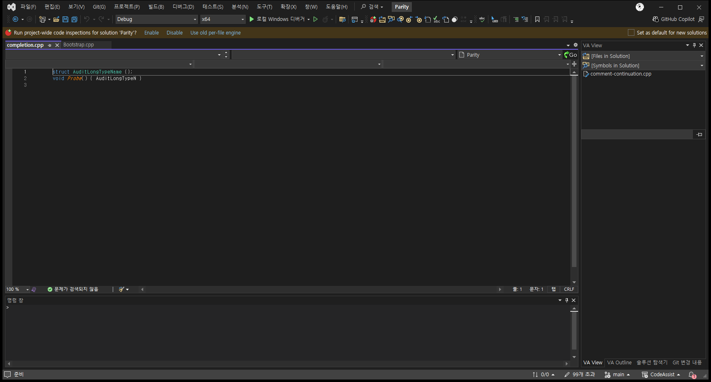](../assets/imports/docs/validation/fixed-108-097-final/screenshots/VA-completion-before.png)[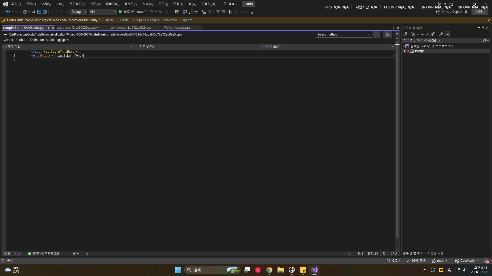](../assets/imports/docs/validation/fixed-108-097-final/screenshots/CA-completion-before.png)

after

[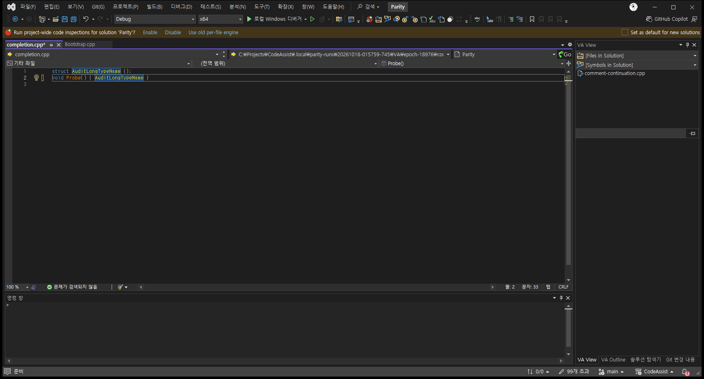](../assets/imports/docs/validation/fixed-108-097-final/screenshots/VA-completion-after.png)[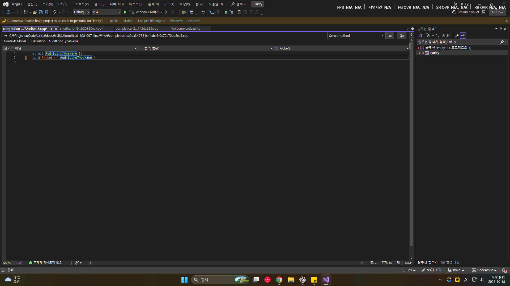](../assets/imports/docs/validation/fixed-108-097-final/screenshots/CA-completion-after.png)

VA-F045 Format After Paste — 미검증

대표 기능 결과를 비교하는 실행 어댑터·기대 결과가 없음

다음 작업: 동일 입력/문맥의 대표 동작 실행 어댑터와 원본 기대 결과 확보

기존 프로브: {'scope': 'options-page-only', 'observation': 'dialog-observed-and-cancelled', 'error': None, 'countsAsFunctionalPass': False}

- 단일/다중 줄 paste 및 Undo 단계 비교

VA-F046 Insert () and Closing Brackets and Quotes — 대표 결과 일치

대표 시나리오의 실제 결과 일치; 기능 전체 인증 아님

다음 작업: 추가 경계·설정·지원 범위 검증

기존 프로브: {'scope': 'editor-command-sample', 'observation': None, 'error': None, 'countsAsFunctionalPass': False}

- typing 중단·중복닫힘·commit·brace 위치 비교

```
{
  "state": "representative-match",
  "reason": "대표 시나리오의 실제 결과 일치; 기능 전체 인증 아님",
  "observedOutputState": "representative-match",
  "scenarioId": "pair-insert",
  "CA": "docs\\validation\\fixed-108-097-final\\live\\behavior.json",
  "VA": ".local\\parity-runs\\20261018-015759-745\\VA.results.json",
  "before": {
    "zoom": 100,
    "text": "",
    "caret": 0,
    "selectionStart": 0,
    "selectionLength": 0,
    "selectedText": ""
  },
  "expected": {
    "text": "()",
    "caret": 1,
    "selectionStart": 1,
    "selectionLength": 0,
    "selectedText": "",
    "zoom": 100,
    "activeFile": "C:\\Projects\\CodeAssist\\.local\\parity-runs\\20261018-015759-745\\VA\\epoch-18976\\pair-insert.cpp"
  },
  "after": {
    "zoom": 100,
    "text": "()",
    "caret": 1,
    "selectionStart": 1,
    "selectionLength": 0,
    "selectedText": ""
  },
  "undo": null,
  "undoRequired": false
}
```

before

[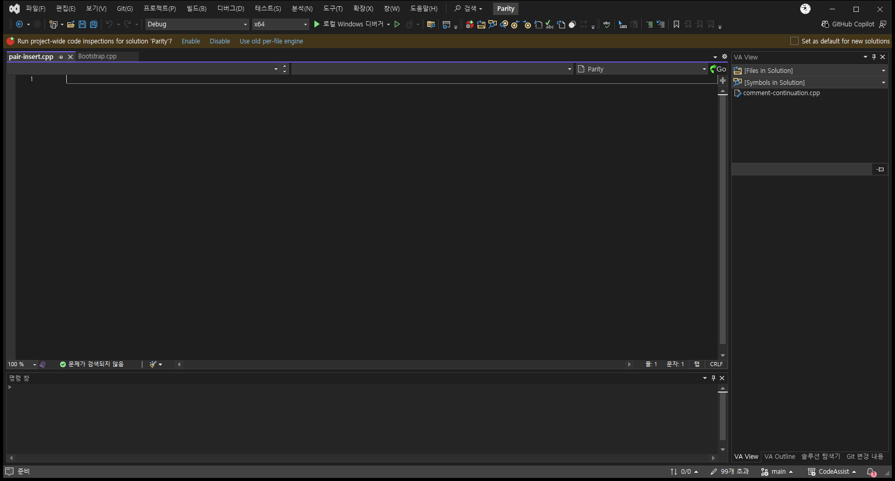](../assets/imports/docs/validation/fixed-108-097-final/screenshots/VA-pair-insert-before.png)[](../assets/imports/docs/validation/fixed-108-097-final/screenshots/CA-pair-insert-before.png)

after

[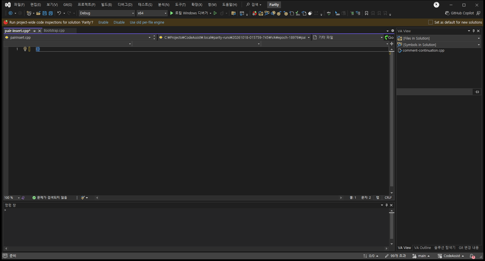](../assets/imports/docs/validation/fixed-108-097-final/screenshots/VA-pair-insert-after.png)[](../assets/imports/docs/validation/fixed-108-097-final/screenshots/CA-pair-insert-after.png)

VA-F047 Insert _ After m and Shift — 미검증

대표 기능 결과를 비교하는 실행 어댑터·기대 결과가 없음

다음 작업: 동일 입력/문맥의 대표 동작 실행 어댑터와 원본 기대 결과 확보

기존 프로브: {'scope': 'options-page-only', 'observation': 'dialog-observed-and-cancelled', 'error': None, 'countsAsFunctionalPass': False}

- Shift 타이밍·연속입력·IME 비교

VA-F048 Multiple Clipboards — 미검증

대표 기능 결과를 비교하는 실행 어댑터·기대 결과가 없음

다음 작업: 동일 입력/문맥의 대표 동작 실행 어댑터와 원본 기대 결과 확보

기존 프로브: {'scope': 'dialog-cancel-or-direct-command', 'observation': 'dialog-closed-without-cancel-control', 'error': None, 'countsAsFunctionalPass': False}

- capacity·중복·선택·표준paste·Undo 비교

VA-F049 Reset Editor Zoom — 대표 결과 일치

대표 시나리오의 실제 결과 일치; 기능 전체 인증 아님

다음 작업: 추가 경계·설정·지원 범위 검증

기존 프로브: {'scope': 'editor-command-sample', 'observation': None, 'error': None, 'countsAsFunctionalPass': False}

- 추천키 충돌·창별/global zoom·focus

```
{
  "state": "representative-match",
  "reason": "대표 시나리오의 실제 결과 일치; 기능 전체 인증 아님",
  "observedOutputState": "representative-match",
  "scenarioId": "reset-zoom",
  "CA": "docs\\validation\\fixed-108-097-final\\live\\behavior.json",
  "VA": ".local\\parity-runs\\20261018-015759-745\\VA.results.json",
  "before": {
    "zoom": 140,
    "text": "void Sample() {}\r\n",
    "caret": 0,
    "selectionStart": 0,
    "selectionLength": 0,
    "selectedText": ""
  },
  "expected": {
    "text": "void Sample() {}\r\n",
    "caret": 0,
    "selectionStart": 0,
    "selectionLength": 0,
    "selectedText": "",
    "zoom": 100,
    "activeFile": "C:\\Projects\\CodeAssist\\.local\\parity-runs\\20261018-015759-745\\VA\\epoch-18976\\reset-zoom.cpp"
  },
  "after": {
    "zoom": 100,
    "text": "void Sample() {}\r\n",
    "caret": 0,
    "selectionStart": 0,
    "selectionLength": 0,
    "selectedText": ""
  },
  "undo": null,
  "undoRequired": false
}
```

before

[](../assets/imports/docs/validation/fixed-108-097-final/screenshots/VA-reset-zoom-before.png)[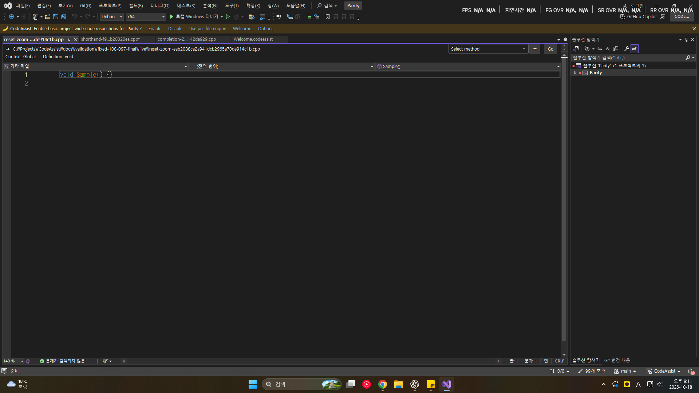](../assets/imports/docs/validation/fixed-108-097-final/screenshots/CA-reset-zoom-before.png)

after

[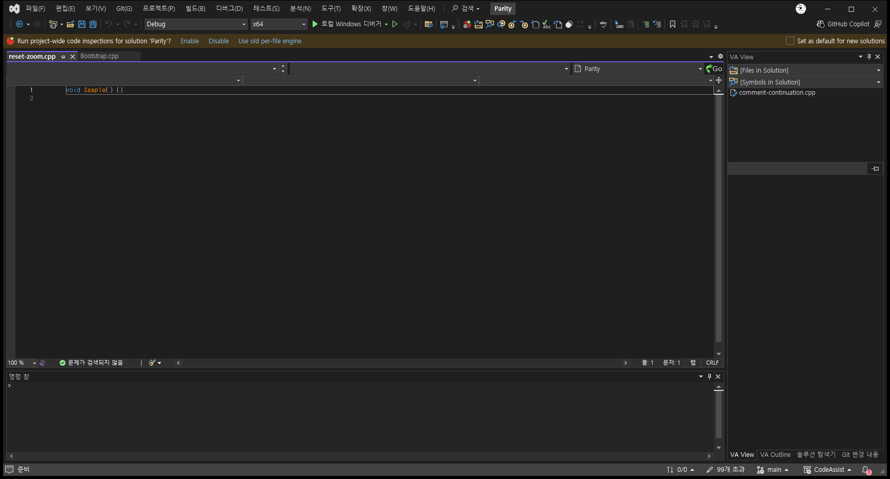](../assets/imports/docs/validation/fixed-108-097-final/screenshots/VA-reset-zoom-after.png)[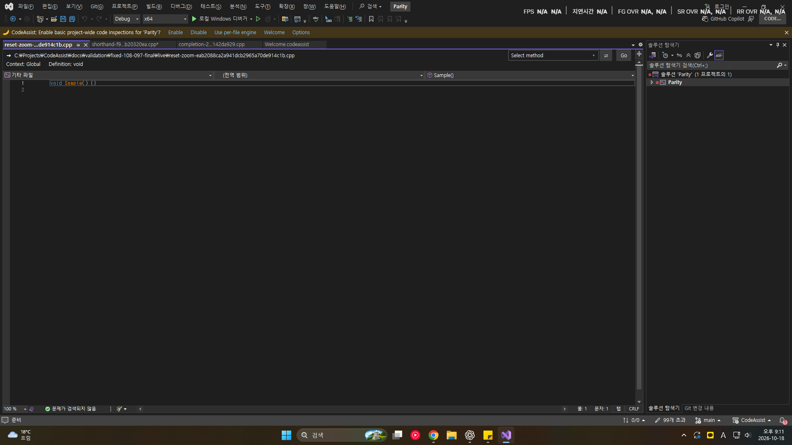](../assets/imports/docs/validation/fixed-108-097-final/screenshots/CA-reset-zoom-after.png)

VA-F050 Shorthand — 미검증

현재 입력 AuditLong은 일반 prefix 완성과 구분되지 않아 부분 문자열 Shorthand 기능을 판정할 수 없음

다음 작업: 동일 입력/문맥의 대표 동작 실행 어댑터와 원본 기대 결과 확보

기존 프로브: {'scope': 'editor-command-sample', 'observation': None, 'error': None, 'countsAsFunctionalPass': False}

- 부분 문자열·prefix 제한·약어 충돌·우선 선택

```
{
  "state": "unverified",
  "reason": "현재 입력 AuditLong은 일반 prefix 완성과 구분되지 않아 부분 문자열 Shorthand 기능을 판정할 수 없음",
  "observedOutputState": "representative-match",
  "scenarioId": "shorthand",
  "CA": "docs\\validation\\fixed-108-097-final\\live\\behavior.json",
  "VA": ".local\\parity-runs\\20261018-015759-745\\VA.results.json",
  "before": {
    "zoom": 100,
    "text": "struct AuditLongTypeName {};\r\nvoid Probe() { AuditLong }\r\n",
    "caret": 54,
    "selectionStart": 54,
    "selectionLength": 0,
    "selectedText": ""
  },
  "expected": {
    "text": "struct AuditLongTypeName {};\r\nvoid Probe() { AuditLongTypeName }\r\n",
    "caret": 62,
    "selectionStart": 62,
    "selectionLength": 0,
    "selectedText": "",
    "zoom": 100,
    "activeFile": "C:\\Projects\\CodeAssist\\.local\\parity-runs\\20261018-015759-745\\VA\\epoch-18976\\shorthand.cpp"
  },
  "after": {
    "zoom": 100,
    "text": "struct AuditLongTypeName {};\r\nvoid Probe() { AuditLongTypeName }\r\n",
    "caret": 62,
    "selectionStart": 62,
    "selectionLength": 0,
    "selectedText": ""
  },
  "undo": null,
  "undoRequired": false
}
```

before

[](../assets/imports/docs/validation/fixed-108-097-final/screenshots/VA-shorthand-before.png)[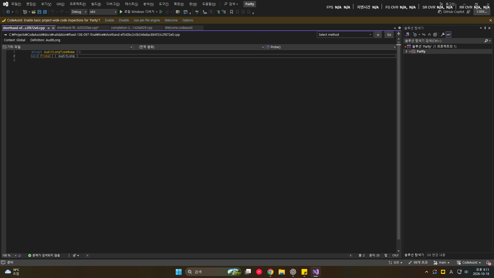](../assets/imports/docs/validation/fixed-108-097-final/screenshots/CA-shorthand-before.png)

after

[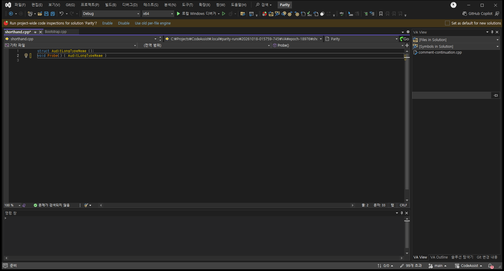](../assets/imports/docs/validation/fixed-108-097-final/screenshots/VA-shorthand-after.png)[](../assets/imports/docs/validation/fixed-108-097-final/screenshots/CA-shorthand-after.png)

VA-F051 Smart Select — 대표 결과 일치

대표 시나리오의 실제 결과 일치; 기능 전체 인증 아님

다음 작업: 추가 경계·설정·지원 범위 검증

기존 프로브: {'scope': 'editor-command-sample', 'observation': None, 'error': None, 'countsAsFunctionalPass': False}

- 네 명령의 교차 사용 및 외부 선택 후 shrink 비교

- leading whitespace·문자열/주석·case/underscore 옵션 비교

```
{
  "state": "representative-match",
  "reason": "대표 시나리오의 실제 결과 일치; 기능 전체 인증 아님",
  "observedOutputState": "representative-match",
  "scenarioId": "smart-select",
  "CA": "docs\\validation\\fixed-108-097-final\\live\\behavior.json",
  "VA": ".local\\parity-runs\\20261018-015759-745\\VA.results.json",
  "before": {
    "zoom": 100,
    "text": "void Sample() { int value = 1; }\r\n",
    "caret": 25,
    "selectionStart": 20,
    "selectionLength": 5,
    "selectedText": "value"
  },
  "expected": {
    "text": "void Sample() { int value = 1; }\r\n",
    "caret": 30,
    "selectionStart": 16,
    "selectionLength": 14,
    "selectedText": "int value = 1;",
    "zoom": 100,
    "activeFile": "C:\\Projects\\CodeAssist\\.local\\parity-runs\\20261018-015759-745\\VA\\epoch-18976\\smart-select.cpp"
  },
  "after": {
    "zoom": 100,
    "text": "void Sample() { int value = 1; }\r\n",
    "caret": 30,
    "selectionStart": 16,
    "selectionLength": 14,
    "selectedText": "int value = 1;"
  },
  "undo": null,
  "undoRequired": false
}
```

before

[](../assets/imports/docs/validation/fixed-108-097-final/screenshots/VA-smart-select-before.png)[](../assets/imports/docs/validation/fixed-108-097-final/screenshots/CA-smart-select-before.png)

after

[](../assets/imports/docs/validation/fixed-108-097-final/screenshots/VA-smart-select-after.png)[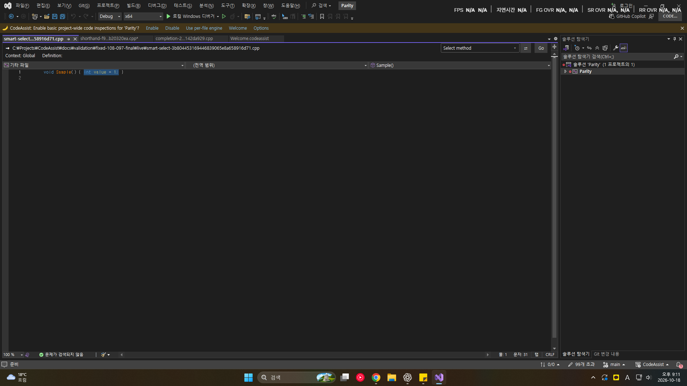](../assets/imports/docs/validation/fixed-108-097-final/screenshots/CA-smart-select-after.png)

VA-F052 Smart Suggestions — 미검증

대표 기능 결과를 비교하는 실행 어댑터·기대 결과가 없음

다음 작업: 동일 입력/문맥의 대표 동작 실행 어댑터와 원본 기대 결과 확보

기존 프로브: {'scope': 'options-page-only', 'observation': 'dialog-observed-and-cancelled', 'error': None, 'countsAsFunctionalPass': False}

- 타입/overload·enum·사용자 snippet·comma 입력

VA-F053 Sort Selected Lines — 미검증

대표 기능 결과를 비교하는 실행 어댑터·기대 결과가 없음

다음 작업: 동일 입력/문맥의 대표 동작 실행 어댑터와 원본 기대 결과 확보

기존 프로브: {'scope': 'dialog-cancel-or-direct-command', 'observation': 'dialog-closed-without-cancel-control', 'error': None, 'countsAsFunctionalPass': False}

VA-F054 Suggestion Lists — 미검증

대표 기능 결과를 비교하는 실행 어댑터·기대 결과가 없음

다음 작업: 동일 입력/문맥의 대표 동작 실행 어댑터와 원본 기대 결과 확보

기존 프로브: {'scope': 'options-page-only', 'observation': 'dialog-observed-and-cancelled', 'error': None, 'countsAsFunctionalPass': False}

- 정의/참조 문맥·C# 공급원·commit·우측 문자열

VA-F055 Surround Selection — 대표 결과 일치

대표 시나리오의 실제 결과 일치; 기능 전체 인증 아님

다음 작업: 추가 경계·설정·지원 범위 검증

기존 프로브: {'scope': 'editor-command-sample', 'observation': None, 'error': None, 'countsAsFunctionalPass': False}

- 부분/전체/복수 줄·기존주석·snippet·Undo 비교

```
{
  "state": "representative-match",
  "reason": "대표 시나리오의 실제 결과 일치; 기능 전체 인증 아님",
  "observedOutputState": "representative-match",
  "scenarioId": "surround-word",
  "CA": "docs\\validation\\fixed-108-097-final\\live\\behavior.json",
  "VA": ".local\\parity-runs\\20261018-015759-745\\VA.results.json",
  "before": {
    "zoom": 100,
    "text": "int value;",
    "caret": 9,
    "selectionStart": 4,
    "selectionLength": 5,
    "selectedText": "value"
  },
  "expected": {
    "text": "int(value);",
    "caret": 10,
    "selectionStart": 10,
    "selectionLength": 0,
    "selectedText": "",
    "zoom": 100,
    "activeFile": "C:\\Projects\\CodeAssist\\.local\\parity-runs\\20261018-015759-745\\VA\\epoch-18976\\surround-word.cpp"
  },
  "after": {
    "zoom": 100,
    "text": "int(value);",
    "caret": 10,
    "selectionStart": 10,
    "selectionLength": 0,
    "selectedText": ""
  },
  "undo": {
    "zoom": 100,
    "text": "int value;",
    "caret": 9,
    "selectionStart": 4,
    "selectionLength": 5,
    "selectedText": "value"
  },
  "undoRequired": true
}
```

before

[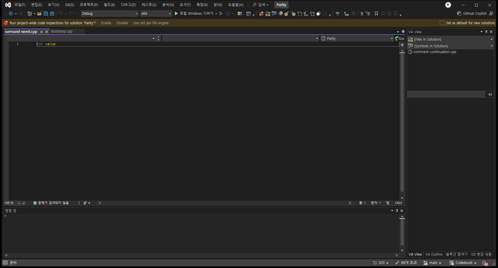](../assets/imports/docs/validation/fixed-108-097-final/screenshots/VA-surround-word-before.png)[](../assets/imports/docs/validation/fixed-108-097-final/screenshots/CA-surround-word-before.png)

after

[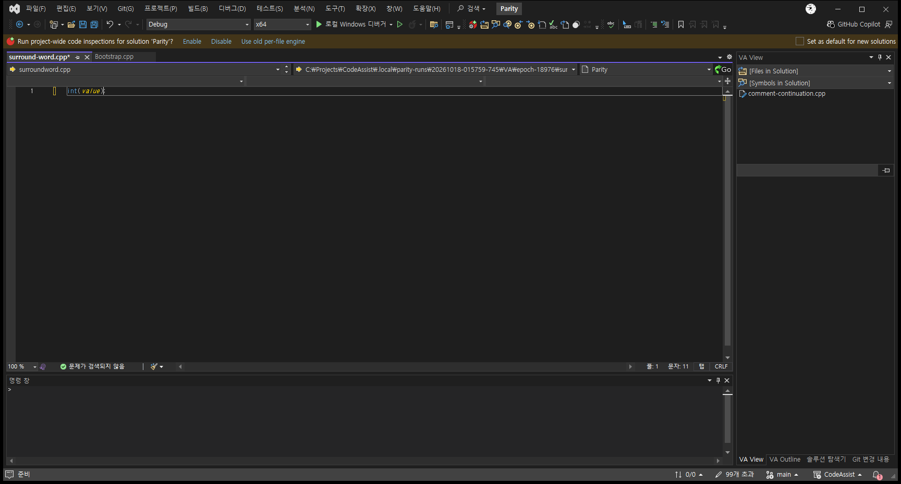](../assets/imports/docs/validation/fixed-108-097-final/screenshots/VA-surround-word-after.png)[](../assets/imports/docs/validation/fixed-108-097-final/screenshots/CA-surround-word-after.png)

undo

[](../assets/imports/docs/validation/fixed-108-097-final/screenshots/CA-surround-word-undo.png)

VA-F056 Surround With — 미검증

대표 기능 결과를 비교하는 실행 어댑터·기대 결과가 없음

다음 작업: 동일 입력/문맥의 대표 동작 실행 어댑터와 원본 기대 결과 확보

기존 프로브: {'scope': 'dialog-cancel-or-direct-command', 'observation': 'dialog-closed-without-cancel-control', 'error': None, 'countsAsFunctionalPass': False}

- 문자·메뉴·다중 snippet·선택/Undo

VA-F057 Column Indicator — 미검증

대표 기능 결과를 비교하는 실행 어댑터·기대 결과가 없음

다음 작업: 동일 입력/문맥의 대표 동작 실행 어댑터와 원본 기대 결과 확보

기존 프로브: {'scope': 'options-page-only', 'observation': 'dialog-observed-and-cancelled', 'error': None, 'countsAsFunctionalPass': False}

- 가변/고정폭·zoom·theme·가로 스크롤

VA-F058 Context Field — 미검증

대표 기능 결과를 비교하는 실행 어댑터·기대 결과가 없음

다음 작업: 동일 입력/문맥의 대표 동작 실행 어댑터와 원본 기대 결과 확보

기존 프로브: {'scope': 'options-page-only', 'observation': 'dialog-observed-and-cancelled', 'error': None, 'countsAsFunctionalPass': False}

- 동명 scope·unknown·global·resize·IME/Unicode

VA-F059 Definition Field — 미검증

대표 기능 결과를 비교하는 실행 어댑터·기대 결과가 없음

다음 작업: 동일 입력/문맥의 대표 동작 실행 어댑터와 원본 기대 결과 확보

기존 프로브: {'scope': 'options-page-only', 'observation': 'dialog-observed-and-cancelled', 'error': None, 'countsAsFunctionalPass': False}

- 복수 정의·include 경로·macro/typedef·복사

VA-F060 Enhanced Syntax Coloring — 미검증

대표 기능 결과를 비교하는 실행 어댑터·기대 결과가 없음

다음 작업: 동일 입력/문맥의 대표 동작 실행 어댑터와 원본 기대 결과 확보

기존 프로브: {'scope': 'options-page-only', 'observation': 'dialog-observed-and-cancelled', 'error': None, 'countsAsFunctionalPass': False}

- light/dark·unknown theme·contrast fallback 비교

- IDE reset·추가 요소·창별 적용 비교

- 동명 다른 종류 심볼 및 include 없는 macro 색 비교

VA-F061 Local Symbols in Bold — 미검증

대표 기능 결과를 비교하는 실행 어댑터·기대 결과가 없음

다음 작업: 동일 입력/문맥의 대표 동작 실행 어댑터와 원본 기대 결과 확보

기존 프로브: {'scope': 'options-page-only', 'observation': 'dialog-observed-and-cancelled', 'error': None, 'countsAsFunctionalPass': False}

- 동명 다른 scope·다른 파일의 class member·theme

VA-F062 Highlight Find Results — 미검증

대표 기능 결과를 비교하는 실행 어댑터·기대 결과가 없음

다음 작업: 동일 입력/문맥의 대표 동작 실행 어댑터와 원본 기대 결과 확보

기존 프로브: {'scope': 'options-page-only', 'observation': 'dialog-observed-and-cancelled', 'error': None, 'countsAsFunctionalPass': False}

- 새검색·ESC·문서전환·theme 비교

VA-F063 Highlight Matching Words — 미검증

대표 기능 결과를 비교하는 실행 어댑터·기대 결과가 없음

다음 작업: 동일 입력/문맥의 대표 동작 실행 어댑터와 원본 기대 결과 확보

기존 프로브: {'scope': 'options-page-only', 'observation': 'dialog-observed-and-cancelled', 'error': None, 'countsAsFunctionalPass': False}

- 주석/문자열에서 동명 다른 scope·대소문자·부분 단어 비교

- code로 이동 및 선택·ESC 수명 비교

VA-F064 Highlight References to Symbol Under Cursor — 미검증

대표 기능 결과를 비교하는 실행 어댑터·기대 결과가 없음

다음 작업: 동일 입력/문맥의 대표 동작 실행 어댑터와 원본 기대 결과 확보

기존 프로브: {'scope': 'options-page-only', 'observation': 'dialog-observed-and-cancelled', 'error': None, 'countsAsFunctionalPass': False}

- 동명 shadowing·read/write·공백·ESC 비교

- IDE 중복 표시·테마 및 프로젝트 외 파일 비교

VA-F065 Parameter Info — 미검증

대표 기능 결과를 비교하는 실행 어댑터·기대 결과가 없음

다음 작업: 동일 입력/문맥의 대표 동작 실행 어댑터와 원본 기대 결과 확보

기존 프로브: {'scope': 'options-page-only', 'observation': 'dialog-observed-and-cancelled', 'error': None, 'countsAsFunctionalPass': False}

- 중간 인자 복귀·overload·macro·C#·재시작

VA-F066 Print in Color — 미검증

대표 기능 결과를 비교하는 실행 어댑터·기대 결과가 없음

다음 작업: 동일 입력/문맥의 대표 동작 실행 어댑터와 원본 기대 결과 확보

기존 프로브: {'scope': 'dialog-cancel-or-direct-command', 'observation': 'dialog-observed-and-cancelled', 'error': None, 'countsAsFunctionalPass': False}

- 전체/일부 출력·theme·VS버전·context

VA-F067 Quick Info — 미검증

대표 기능 결과를 비교하는 실행 어댑터·기대 결과가 없음

다음 작업: 동일 입력/문맥의 대표 동작 실행 어댑터와 원본 기대 결과 확보

기존 프로브: {'scope': 'options-page-only', 'observation': 'dialog-observed-and-cancelled', 'error': None, 'countsAsFunctionalPass': False}

- VS버전·IDE 병합/대체·source/header 주석·macro·ESC

VA-F068 System Symbols in Italics — 미검증

대표 기능 결과를 비교하는 실행 어댑터·기대 결과가 없음

다음 작업: 동일 입력/문맥의 대표 동작 실행 어댑터와 원본 기대 결과 확보

기존 프로브: {'scope': 'options-page-only', 'observation': 'dialog-observed-and-cancelled', 'error': None, 'countsAsFunctionalPass': False}

- 동명 override·NuGet/Vcpkg·ProgramFiles·재파싱

VA-F069 Convert Dot to -> — 미검증

대표 기능 결과를 비교하는 실행 어댑터·기대 결과가 없음

다음 작업: 동일 입력/문맥의 대표 동작 실행 어댑터와 원본 기대 결과 확보

기존 프로브: {'scope': 'editor-command-sample', 'observation': None, 'error': None, 'countsAsFunctionalPass': False}

- pointer·instance·smart object·철회 비교

VA-F070 Highlight Files in Output Window — 미검증

대표 기능 결과를 비교하는 실행 어댑터·기대 결과가 없음

다음 작업: 동일 입력/문맥의 대표 동작 실행 어댑터와 원본 기대 결과 확보

기존 프로브: {'scope': 'options-page-only', 'observation': 'dialog-observed-and-cancelled', 'error': None, 'countsAsFunctionalPass': False}

- solution 내부/외부·상대/절대경로·출력갱신 비교

VA-F071 Highlight Matching Braces and Parentheses — 미검증

대표 기능 결과를 비교하는 실행 어댑터·기대 결과가 없음

다음 작업: 동일 입력/문맥의 대표 동작 실행 어댑터와 원본 기대 결과 확보

기존 프로브: {'scope': 'options-page-only', 'observation': 'dialog-observed-and-cancelled', 'error': None, 'countsAsFunctionalPass': False}

- 중첩·문자열/주석 delimiter·caret 경계 비교

VA-F072 Highlight Mismatching Braces and Parentheses — 미검증

대표 기능 결과를 비교하는 실행 어댑터·기대 결과가 없음

다음 작업: 동일 입력/문맥의 대표 동작 실행 어댑터와 원본 기대 결과 확보

기존 프로브: {'scope': 'options-page-only', 'observation': 'dialog-observed-and-cancelled', 'error': None, 'countsAsFunctionalPass': False}

- 불완전코드·여는/닫는짝·macro 비교

VA-F073 Repair Case — 미검증

대표 기능 결과를 비교하는 실행 어댑터·기대 결과가 없음

다음 작업: 동일 입력/문맥의 대표 동작 실행 어댑터와 원본 기대 결과 확보

기존 프로브: {'scope': 'editor-command-sample', 'observation': None, 'error': None, 'countsAsFunctionalPass': False}

- 단일/복수 후보·C# 조건·Undo 비교

VA-F074 Underline Spelling Errors — 미검증

대표 기능 결과를 비교하는 실행 어댑터·기대 결과가 없음

다음 작업: 동일 입력/문맥의 대표 동작 실행 어댑터와 원본 기대 결과 확보

기존 프로브: {'scope': 'options-page-only', 'observation': 'dialog-observed-and-cancelled', 'error': None, 'countsAsFunctionalPass': False}

- 언어사전·주석/문자열·사전수명·Undo 비교

VA-F075 Underline Unknown Symbols — 미검증

대표 기능 결과를 비교하는 실행 어댑터·기대 결과가 없음

다음 작업: 동일 입력/문맥의 대표 동작 실행 어댑터와 원본 기대 결과 확보

기존 프로브: {'scope': 'options-page-only', 'observation': 'dialog-observed-and-cancelled', 'error': None, 'countsAsFunctionalPass': False}

- IDE표시 토글·정의중·include/macro·취소 비교

VA-F076 Code Inspection Settings — 미검증

대표 기능 결과를 비교하는 실행 어댑터·기대 결과가 없음

다음 작업: 동일 입력/문맥의 대표 동작 실행 어댑터와 원본 기대 결과 확보

기존 프로브: {'scope': 'options-page-only', 'observation': 'dialog-observed-and-cancelled', 'error': None, 'countsAsFunctionalPass': False}

- checker/level·설정 reset·조정·source suppression

VA-F077 Code Issues in the Editor — 미검증

대표 기능 결과를 비교하는 실행 어댑터·기대 결과가 없음

다음 작업: 동일 입력/문맥의 대표 동작 실행 어댑터와 원본 기대 결과 확보

기존 프로브: {'scope': 'options-page-only', 'observation': 'dialog-observed-and-cancelled', 'error': None, 'countsAsFunctionalPass': False}

- 표시 토글·겹친 issue·level5·tracking

VA-F078 Quick Fixes in the Editor — 미검증

대표 기능 결과를 비교하는 실행 어댑터·기대 결과가 없음

다음 작업: 동일 입력/문맥의 대표 동작 실행 어댑터와 원본 기대 결과 확보

기존 프로브: {'scope': 'options-page-only', 'observation': 'dialog-observed-and-cancelled', 'error': None, 'countsAsFunctionalPass': False}

- 다중 fix·겹침·stale span·취소·Undo

VA-F079 Quick Fixes in a Tool Window — 미검증

대표 기능 결과를 비교하는 실행 어댑터·기대 결과가 없음

다음 작업: 동일 입력/문맥의 대표 동작 실행 어댑터와 원본 기대 결과 확보

기존 프로브: {'scope': 'options-page-only', 'observation': 'dialog-observed-and-cancelled', 'error': None, 'countsAsFunctionalPass': False}

- 그룹/복수 선택·sort·tracking·Undo

VA-F080 VA Snippets — 미검증

대표 기능 결과를 비교하는 실행 어댑터·기대 결과가 없음

다음 작업: 동일 입력/문맥의 대표 동작 실행 어댑터와 원본 기대 결과 확보

기존 프로브: {'scope': 'dialog-cancel-or-direct-command', 'observation': 'dialog-closed-without-cancel-control', 'error': None, 'countsAsFunctionalPass': False}

- 유형별 메뉴·수정 반영·언어·직렬화·caret

VA-F081 for Refactoring — 미검증

대표 기능 결과를 비교하는 실행 어댑터·기대 결과가 없음

다음 작업: 동일 입력/문맥의 대표 동작 실행 어댑터와 원본 기대 결과 확보

기존 프로브: {'scope': 'options-page-only', 'observation': 'dialog-observed-and-cancelled', 'error': None, 'countsAsFunctionalPass': False}

- title 변경/삭제·언어별 필수값·reserved 문맥

VA-F082 for Smart Suggestions — 미검증

대표 기능 결과를 비교하는 실행 어댑터·기대 결과가 없음

다음 작업: 동일 입력/문맥의 대표 동작 실행 어댑터와 원본 기대 결과 확보

기존 프로브: {'scope': 'options-page-only', 'observation': 'dialog-observed-and-cancelled', 'error': None, 'countsAsFunctionalPass': False}

- 타입/typedef·빈 제안·삭제와 재생성·정렬

VA-F083 for Surround With — 미검증

대표 기능 결과를 비교하는 실행 어댑터·기대 결과가 없음

다음 작업: 동일 입력/문맥의 대표 동작 실행 어댑터와 원본 기대 결과 확보

기존 프로브: {'scope': 'dialog-cancel-or-direct-command', 'observation': 'dialog-closed-without-cancel-control', 'error': None, 'countsAsFunctionalPass': False}

- 선택 없음·부분/전체 줄·문자 충돌·accelerator

VA-F084 with Shortcuts — 미검증

대표 기능 결과를 비교하는 실행 어댑터·기대 결과가 없음

다음 작업: 동일 입력/문맥의 대표 동작 실행 어댑터와 원본 기대 결과 확보

기존 프로브: {'scope': 'options-page-only', 'observation': 'dialog-observed-and-cancelled', 'error': None, 'countsAsFunctionalPass': False}

- case·중복 쌍·language·commit·Undo

VA-F085 Create from Selection — 미검증

대표 기능 결과를 비교하는 실행 어댑터·기대 결과가 없음

다음 작업: 동일 입력/문맥의 대표 동작 실행 어댑터와 원본 기대 결과 확보

기존 프로브: {'scope': 'dialog-cancel-or-direct-command', 'observation': 'dialog-closed-without-cancel-control', 'error': None, 'countsAsFunctionalPass': False}

- 여러 줄·공백·문자 escape·입력·caret

VA-F086 Environment Placeholders — 미검증

대표 기능 결과를 비교하는 실행 어댑터·기대 결과가 없음

다음 작업: 동일 입력/문맥의 대표 동작 실행 어댑터와 원본 기대 결과 확보

기존 프로브: {'scope': 'options-page-only', 'observation': 'dialog-observed-and-cancelled', 'error': None, 'countsAsFunctionalPass': False}

VA-F087 Input Placeholders — 미검증

대표 기능 결과를 비교하는 실행 어댑터·기대 결과가 없음

다음 작업: 동일 입력/문맥의 대표 동작 실행 어댑터와 원본 기대 결과 확보

기존 프로브: {'scope': 'options-page-only', 'observation': 'dialog-observed-and-cancelled', 'error': None, 'countsAsFunctionalPass': False}

VA-F088 Reserved Strings — 미검증

대표 기능 결과를 비교하는 실행 어댑터·기대 결과가 없음

다음 작업: 동일 입력/문맥의 대표 동작 실행 어댑터와 원본 기대 결과 확보

기존 프로브: {'scope': 'options-page-only', 'observation': 'dialog-observed-and-cancelled', 'error': None, 'countsAsFunctionalPass': False}

VA-F089 Address Resolver — 미검증

대표 기능 결과를 비교하는 실행 어댑터·기대 결과가 없음

다음 작업: 동일 입력/문맥의 대표 동작 실행 어댑터와 원본 기대 결과 확보

기존 프로브: {'scope': 'dialog-cancel-or-direct-command', 'observation': 'dialog-observed-and-cancelled', 'error': None, 'countsAsFunctionalPass': False}

- base/ASLR·PDB 불일치·여러 모듈·입력 형식·실패

VA-F090 PDB Explorer — 미검증

대표 기능 결과를 비교하는 실행 어댑터·기대 결과가 없음

다음 작업: 동일 입력/문맥의 대표 동작 실행 어댑터와 원본 기대 결과 확보

기존 프로브: {'scope': 'dialog-cancel-or-direct-command', 'observation': 'dialog-observed-and-cancelled', 'error': None, 'countsAsFunctionalPass': False}

- release/debug PDB·base·중복주소·module refresh·disassembly 이동

VA-F091 VA Memory View — 미검증

대표 기능 결과를 비교하는 실행 어댑터·기대 결과가 없음

다음 작업: 동일 입력/문맥의 대표 동작 실행 어댑터와 원본 기대 결과 확보

기존 프로브: {'scope': 'dialog-cancel-or-direct-command', 'observation': 'product-error-dialog', 'error': None, 'countsAsFunctionalPass': False}

- 세션전/중 토글·재시작·debugger state 비교

VA-F092 VA Step Filter — 미검증

대표 기능 결과를 비교하는 실행 어댑터·기대 결과가 없음

다음 작업: 동일 입력/문맥의 대표 동작 실행 어댑터와 원본 기대 결과 확보

기존 프로브: {'scope': 'options-page-only', 'observation': 'dialog-observed-and-cancelled', 'error': None, 'countsAsFunctionalPass': False}

- global/solution 우선순위·창숨김·권한·세션수명 비교

VA-F093 VA Outline — 미검증

대표 기능 결과를 비교하는 실행 어댑터·기대 결과가 없음

다음 작업: 동일 입력/문맥의 대표 동작 실행 어댑터와 원본 기대 결과 확보

기존 프로브: {'scope': 'options-page-only', 'observation': 'dialog-observed-and-cancelled', 'error': None, 'countsAsFunctionalPass': False}

- 편집/선택/Undo·comment 포함·자동갱신·다중노드

VA-F094 VA View — 미검증

대표 기능 결과를 비교하는 실행 어댑터·기대 결과가 없음

다음 작업: 동일 입력/문맥의 대표 동작 실행 어댑터와 원본 기대 결과 확보

기존 프로브: {'scope': 'options-page-only', 'observation': 'dialog-observed-and-cancelled', 'error': None, 'countsAsFunctionalPass': False}

- MRU 수명·다중 IDE·overload·include hierarchy·focus

VA-F095 Simple Link Patterns — 미검증

대표 기능 결과를 비교하는 실행 어댑터·기대 결과가 없음

다음 작업: 동일 입력/문맥의 대표 동작 실행 어댑터와 원본 기대 결과 확보

기존 프로브: {'scope': 'options-page-only', 'observation': 'dialog-observed-and-cancelled', 'error': None, 'countsAsFunctionalPass': False}

- keyword/suffix 공백·quote·타입 불일치

- 동일 줄 edit/재배치·plain text gate·comment classification

VA-F096 Complex Link Patterns — 미검증

대표 기능 결과를 비교하는 실행 어댑터·기대 결과가 없음

다음 작업: 동일 입력/문맥의 대표 동작 실행 어댑터와 원본 기대 결과 확보

기존 프로브: {'scope': 'options-page-only', 'observation': 'dialog-observed-and-cancelled', 'error': None, 'countsAsFunctionalPass': False}

- RE= 대소문자·빈/잘못된pattern·group

- timeout 생성 실패fallback·긴match·재활성화 수명

VA-F097 Connect to FogBugz and GitHub — 미검증

대표 기능 결과를 비교하는 실행 어댑터·기대 결과가 없음

다음 작업: 동일 입력/문맥의 대표 동작 실행 어댑터와 원본 기대 결과 확보

기존 프로브: {'scope': 'options-page-only', 'observation': 'dialog-observed-and-cancelled', 'error': None, 'countsAsFunctionalPass': False}

- 공유/사용자 설정·권한 실패·tooltip 취소·browser login

VA-F098 Preview Files — 미검증

대표 기능 결과를 비교하는 실행 어댑터·기대 결과가 없음

다음 작업: 동일 입력/문맥의 대표 동작 실행 어댑터와 원본 기대 결과 확보

기존 프로브: {'scope': 'dialog-cancel-or-direct-command', 'observation': 'dialog-observed-and-cancelled', 'error': None, 'countsAsFunctionalPass': False}

- 로컬/network·경로공백·환경값·미존재파일·형식별 preview

VA-F099 Open Hyperlinks in an External Browser — 미검증

대표 기능 결과를 비교하는 실행 어댑터·기대 결과가 없음

다음 작업: 동일 입력/문맥의 대표 동작 실행 어댑터와 원본 기대 결과 확보

기존 프로브: {'scope': 'options-page-only', 'observation': 'dialog-observed-and-cancelled', 'error': None, 'countsAsFunctionalPass': False}

- plugin override·internal/external·URL expansion

- 실행실패·keyboard/mouse/QuickInfo·선택 URI

VA-F100 Custom Plug-ins — 미검증

대표 기능 결과를 비교하는 실행 어댑터·기대 결과가 없음

다음 작업: 동일 입력/문맥의 대표 동작 실행 어댑터와 원본 기대 결과 확보

기존 프로브: {'scope': 'options-page-only', 'observation': 'dialog-observed-and-cancelled', 'error': None, 'countsAsFunctionalPass': False}

- 올바른/잘못된 type·의존성 누락·validation 예외

- plugin settings scope·설정변경·dispose·reload

VA-F101 Context Menus — 미검증

대표 기능 결과를 비교하는 실행 어댑터·기대 결과가 없음

다음 작업: 동일 입력/문맥의 대표 동작 실행 어댑터와 원본 기대 결과 확보

기존 프로브: {'scope': 'options-page-only', 'observation': 'dialog-observed-and-cancelled', 'error': None, 'countsAsFunctionalPass': False}

- symbol/selection/file 문맥·focus·modified mouse

VA-F102 Custom File Extensions — 미검증

대표 기능 결과를 비교하는 실행 어댑터·기대 결과가 없음

다음 작업: 동일 입력/문맥의 대표 동작 실행 어댑터와 원본 기대 결과 확보

기존 프로브: {'scope': 'options-page-only', 'observation': 'dialog-observed-and-cancelled', 'error': None, 'countsAsFunctionalPass': False}

- ignore/reopen·extensionless·custom 언어·VS버전

VA-F103 Keyboard Shortcuts — 미검증

대표 기능 결과를 비교하는 실행 어댑터·기대 결과가 없음

다음 작업: 동일 입력/문맥의 대표 동작 실행 어댑터와 원본 기대 결과 확보

기존 프로브: {'scope': 'options-page-only', 'observation': 'dialog-observed-and-cancelled', 'error': None, 'countsAsFunctionalPass': False}

- 기존키 충돌·추천 수락·scope·locale·다중 shortcut

VA-F104 Mouse — 미검증

대표 기능 결과를 비교하는 실행 어댑터·기대 결과가 없음

다음 작업: 동일 입력/문맥의 대표 동작 실행 어댑터와 원본 기대 결과 확보

기존 프로브: {'scope': 'options-page-only', 'observation': 'dialog-observed-and-cancelled', 'error': None, 'countsAsFunctionalPass': False}

- click 조합·wheel 방향·selection·IDE 충돌

VA-F105 Multiple Platforms — 미검증

대표 기능 결과를 비교하는 실행 어댑터·기대 결과가 없음

다음 작업: 동일 입력/문맥의 대표 동작 실행 어댑터와 원본 기대 결과 확보

기존 프로브: {'scope': 'options-page-only', 'observation': 'dialog-observed-and-cancelled', 'error': None, 'countsAsFunctionalPass': False}

- Win32/x64/custom·build/edit 차이·재시작

VA-F106 Non-Microsoft Build Processes — 미검증

대표 기능 결과를 비교하는 실행 어댑터·기대 결과가 없음

다음 작업: 동일 입력/문맥의 대표 동작 실행 어댑터와 원본 기대 결과 확보

기존 프로브: {'scope': 'options-page-only', 'observation': 'dialog-observed-and-cancelled', 'error': None, 'countsAsFunctionalPass': False}

- solution없음·custom 경로순서·환경값·Rebuild

VA-F107 Parse Concurrency — 미검증

대표 기능 결과를 비교하는 실행 어댑터·기대 결과가 없음

다음 작업: 동일 입력/문맥의 대표 동작 실행 어댑터와 원본 기대 결과 확보

기존 프로브: {'scope': 'options-page-only', 'observation': 'dialog-observed-and-cancelled', 'error': None, 'countsAsFunctionalPass': False}

- 설정/재시작·프로젝트 시작/편집·검사동시성·실제CPU

VA-F108 Options Dialog — 미검증

대표 기능 결과를 비교하는 실행 어댑터·기대 결과가 없음

다음 작업: 동일 입력/문맥의 대표 동작 실행 어댑터와 원본 기대 결과 확보

기존 프로브: {'scope': 'options-page-only', 'observation': 'dialog-observed-and-cancelled', 'error': None, 'countsAsFunctionalPass': False}

## 이번 실행에서 확장한 검사

일반 자동 완성, 축약 완성 표본, 배율 초기화 3개를 추가해 실제 출력 비교 7/7이 통과했습니다. 축약 표본은 일반 prefix 완성과 구분되지 않아 Shorthand 기능의 일치로 승격하지 않았습니다. 기능별 대표 결과 일치는 4→6, 미검증은 103→101입니다.

CRLF 줄바꿈의 버퍼 오프셋과 DTE 문자 이동 차이를 수정했습니다. 배율은 140%→100% 실제 변경을 검사하며, 두 값이 같기만 한 무반응은 통과시키지 않습니다. 비교 필드 생략·줌 차이 반례까지 자체 검사했습니다.

검사 인스턴스가 종료돼 있었으므로 별도 CA 검사 프로필을 다시 실행하고 새 소유 솔루션을 만들었습니다. 원본 VA는 기존 실제 실행 기록을 사용했습니다. 제품 코드는 이번에 변경하지 않았으며, 이 보고서의 097은 설치 버전이 아닙니다.

## 원문과 편집 이력

[보존된 원문 열기](../assets/imports/docs/validation/fixed-108-097-final/index.html)

- 원문 SHA-256: `5661c5b6b47fe6286bda0507d65d42a07807d3f762d58695696326f53cc485c8`
- 표시 날짜는 원본 파일의 수정 시각입니다. 작업 완료 시각은 원문에 있는 값을 기준으로 확인합니다.
