> 보관 기록입니다. 아래 결과는 원문 작성 시점의 내용이며, 이번 편집에서 제품 테스트를 다시 실행하지 않았습니다.

VA 단독 / CA 단독 실제 추가 검증

## VA·CA 실제 추가 검증

108개 고정 목록: 대표 결과 일치 4/108 (3.7%) · 차이 6/108 · 미검증 98/108. 판정 근거 확보 10/108 (9.26%). 제품 전체 유사도 값이 아닙니다.

이번 신규 실제 입력 시나리오 13개. VA 단독 새 프로필과 CA 0.0.94 단독 프로필을 실제 실행했습니다. 이전 기록의 다음 이동·선택 확장만 일치했던 기능도 반대 방향에서 차이가 나오면 차이로 재분류했습니다. 무반응·사용할 수 없는 명령·단순 팝업 열기는 통과하지 않습니다. 101개 전체 검증은 미완료입니다.

확장 분리 근거 · 원본 실제 출력 · 108개 상태 · 집계

sort-lines · 기능 53 · different

동일 입력의 실제 버퍼·커서·선택 결과 차이

```
{
  "id": "sort-lines",
  "feature": 53,
  "state": "different",
  "reason": "동일 입력의 실제 버퍼·커서·선택 결과 차이",
  "VA": {
    "id": "sort-lines",
    "feature": 53,
    "before": {
      "zoom": 100,
      "text": "charlie\r\nalpha\r\nbravo\r\n",
      "caret": 23,
      "selectionStart": 0,
      "selectionLength": 23,
      "selectedText": "charlie\r\nalpha\r\nbravo\r\n"
    },
    "after": {
      "zoom": 100,
      "text": "alpha\r\nbravo\r\ncharlie\r\n",
      "caret": 23,
      "selectionStart": 23,
      "selectionLength": 0,
      "selectedText": ""
    },
    "undo": {
      "zoom": 100,
      "text": "charlie\r\nalpha\r\nbravo\r\n",
      "caret": 23,
      "selectionStart": 23,
      "selectionLength": 0,
      "selectedText": ""
    },
    "error": null,
    "executed": true
  },
  "CA": {
    "id": "sort-lines",
    "feature": 53,
    "before": {
      "zoom": 140,
      "text": "charlie\r\nalpha\r\nbravo\r\n",
      "caret": 23,
      "selectionStart": 0,
      "selectionLength": 23,
      "selectedText": "charlie\r\nalpha\r\nbravo\r\n"
    },
    "after": {
      "zoom": 140,
      "text": "charlie\r\nalpha\r\nbravo\r\n",
      "caret": 23,
      "selectionStart": 0,
      "selectionLength": 23,
      "selectedText": "charlie\r\nalpha\r\nbravo\r\n"
    },
    "undo": null,
    "error": "System.Runtime.InteropServices.COMException (0x80004005): \"Edit.Undo\" 명령은 사용할 수 없습니다.\r\n   위치: EnvDTE._DTE.ExecuteCommand(String CommandName, String CommandArgs)\r\n   위치: ShortcutProbe.RunPaired(DTE d, Int32 pid, String role, String root, String planFile)",
    "executed": true
  }
}
```

[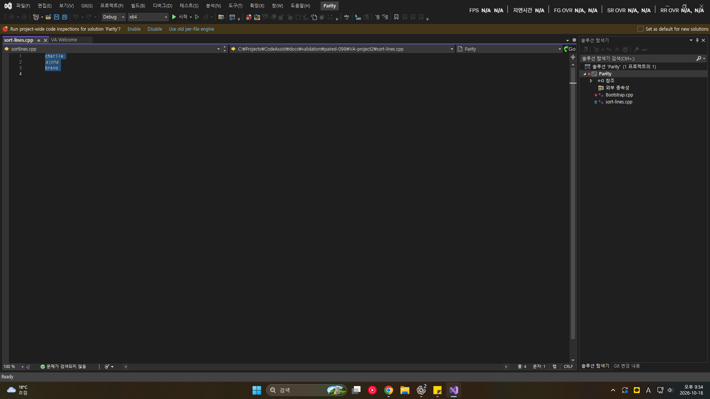](../assets/imports/docs/validation/paired-098/VA-project2/sort-lines-before.png)[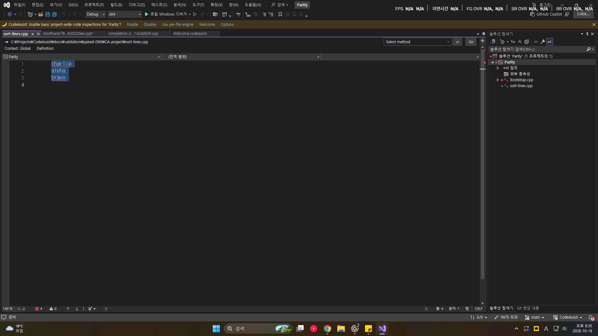](../assets/imports/docs/validation/paired-098/CA-project/sort-lines-before.png)

[](../assets/imports/docs/validation/paired-098/VA-project2/sort-lines-after.png)[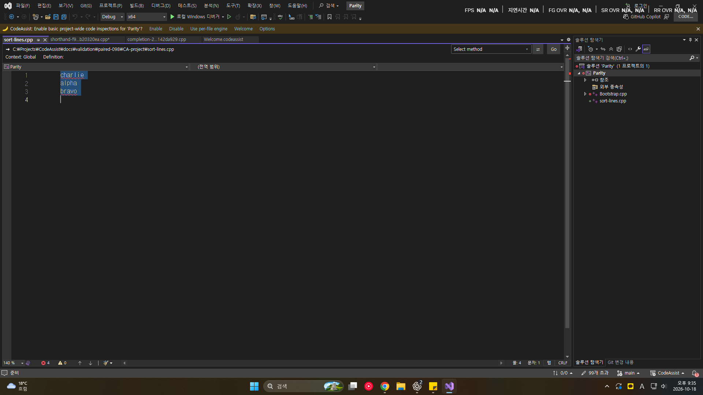](../assets/imports/docs/validation/paired-098/CA-project/sort-lines-after.png)

[](../assets/imports/docs/validation/paired-098/VA-project2/sort-lines-undo.png)

smart-extend · 기능 51 · representative-match

실제 대표 출력 일치

```
{
  "id": "smart-extend",
  "feature": 51,
  "state": "representative-match",
  "reason": "실제 대표 출력 일치",
  "VA": {
    "id": "smart-extend",
    "feature": 51,
    "before": {
      "zoom": 100,
      "text": "void Sample() { int value = 1; }\r\n",
      "caret": 25,
      "selectionStart": 20,
      "selectionLength": 5,
      "selectedText": "value"
    },
    "after": {
      "zoom": 100,
      "text": "void Sample() { int value = 1; }\r\n",
      "caret": 30,
      "selectionStart": 16,
      "selectionLength": 14,
      "selectedText": "int value = 1;"
    },
    "undo": null,
    "error": null,
    "executed": true
  },
  "CA": {
    "id": "smart-extend",
    "feature": 51,
    "before": {
      "zoom": 140,
      "text": "void Sample() { int value = 1; }\r\n",
      "caret": 25,
      "selectionStart": 20,
      "selectionLength": 5,
      "selectedText": "value"
    },
    "after": {
      "zoom": 140,
      "text": "void Sample() { int value = 1; }\r\n",
      "caret": 30,
      "selectionStart": 16,
      "selectionLength": 14,
      "selectedText": "int value = 1;"
    },
    "undo": null,
    "error": null,
    "executed": true
  }
}
```

[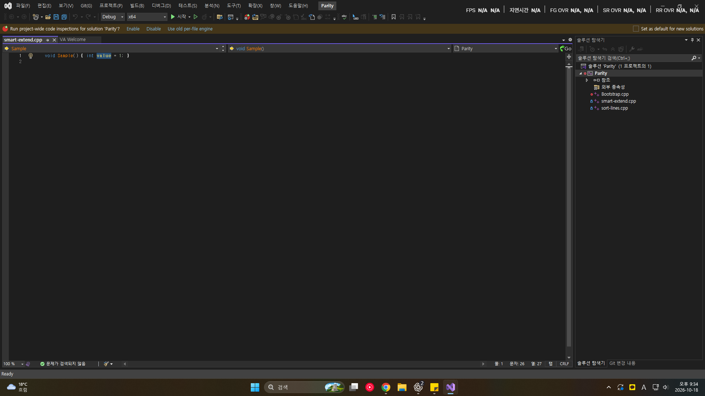](../assets/imports/docs/validation/paired-098/VA-project2/smart-extend-before.png)[](../assets/imports/docs/validation/paired-098/CA-project/smart-extend-before.png)

[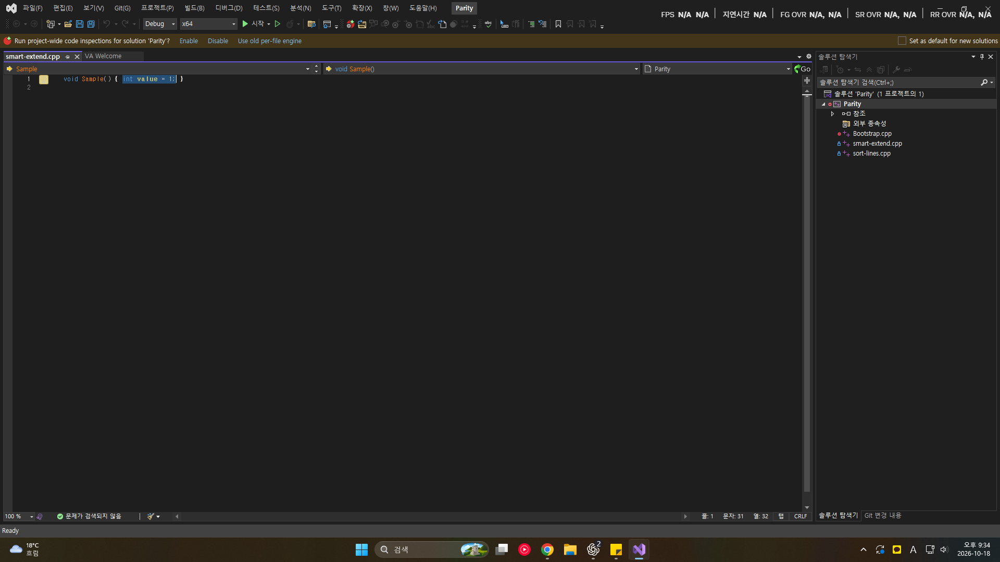](../assets/imports/docs/validation/paired-098/VA-project2/smart-extend-after.png)[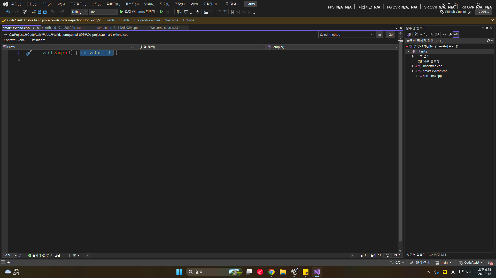](../assets/imports/docs/validation/paired-098/CA-project/smart-extend-after.png)

smart-shrink · 기능 51 · different

동일 입력의 실제 버퍼·커서·선택 결과 차이

```
{
  "id": "smart-shrink",
  "feature": 51,
  "state": "different",
  "reason": "동일 입력의 실제 버퍼·커서·선택 결과 차이",
  "VA": {
    "id": "smart-shrink",
    "feature": 51,
    "before": {
      "zoom": 100,
      "text": "void Sample() { int value = 1; }\r\n",
      "caret": 30,
      "selectionStart": 16,
      "selectionLength": 14,
      "selectedText": "int value = 1;"
    },
    "after": {
      "zoom": 100,
      "text": "void Sample() { int value = 1; }\r\n",
      "caret": 25,
      "selectionStart": 20,
      "selectionLength": 5,
      "selectedText": "value"
    },
    "undo": null,
    "error": null,
    "executed": true
  },
  "CA": {
    "id": "smart-shrink",
    "feature": 51,
    "before": {
      "zoom": 140,
      "text": "void Sample() { int value = 1; }\r\n",
      "caret": 30,
      "selectionStart": 16,
      "selectionLength": 14,
      "selectedText": "int value = 1;"
    },
    "after": {
      "zoom": 140,
      "text": "void Sample() { int value = 1; }\r\n",
      "caret": 30,
      "selectionStart": 16,
      "selectionLength": 14,
      "selectedText": "int value = 1;"
    },
    "undo": null,
    "error": null,
    "executed": true
  }
}
```

[](../assets/imports/docs/validation/paired-098/VA-project2/smart-shrink-before.png)[](../assets/imports/docs/validation/paired-098/CA-project/smart-shrink-before.png)

[](../assets/imports/docs/validation/paired-098/VA-project2/smart-shrink-after.png)[](../assets/imports/docs/validation/paired-098/CA-project/smart-shrink-after.png)

scope-next · 기능 9 · representative-match

실제 대표 출력 일치

```
{
  "id": "scope-next",
  "feature": 9,
  "state": "representative-match",
  "reason": "실제 대표 출력 일치",
  "VA": {
    "id": "scope-next",
    "feature": 9,
    "before": {
      "zoom": 100,
      "text": "void First() {}\r\nvoid Second() {}\r\n",
      "caret": 0,
      "selectionStart": 0,
      "selectionLength": 0,
      "selectedText": ""
    },
    "after": {
      "zoom": 100,
      "text": "void First() {}\r\nvoid Second() {}\r\n",
      "caret": 17,
      "selectionStart": 17,
      "selectionLength": 0,
      "selectedText": ""
    },
    "undo": null,
    "error": null,
    "executed": true
  },
  "CA": {
    "id": "scope-next",
    "feature": 9,
    "before": {
      "zoom": 140,
      "text": "void First() {}\r\nvoid Second() {}\r\n",
      "caret": 0,
      "selectionStart": 0,
      "selectionLength": 0,
      "selectedText": ""
    },
    "after": {
      "zoom": 140,
      "text": "void First() {}\r\nvoid Second() {}\r\n",
      "caret": 17,
      "selectionStart": 17,
      "selectionLength": 0,
      "selectedText": ""
    },
    "undo": null,
    "error": null,
    "executed": true
  }
}
```

[](../assets/imports/docs/validation/paired-098/VA-project2/scope-next-before.png)[](../assets/imports/docs/validation/paired-098/CA-project/scope-next-before.png)

[](../assets/imports/docs/validation/paired-098/VA-project2/scope-next-after.png)[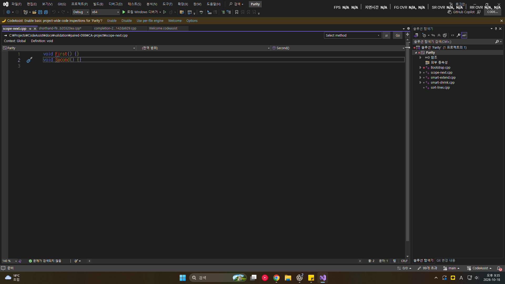](../assets/imports/docs/validation/paired-098/CA-project/scope-next-after.png)

scope-prev · 기능 9 · different

동일 입력의 실제 버퍼·커서·선택 결과 차이

```
{
  "id": "scope-prev",
  "feature": 9,
  "state": "different",
  "reason": "동일 입력의 실제 버퍼·커서·선택 결과 차이",
  "VA": {
    "id": "scope-prev",
    "feature": 9,
    "before": {
      "zoom": 100,
      "text": "void First() {}\r\nvoid Second() {}\r\n",
      "caret": 33,
      "selectionStart": 33,
      "selectionLength": 0,
      "selectedText": ""
    },
    "after": {
      "zoom": 100,
      "text": "void First() {}\r\nvoid Second() {}\r\n",
      "caret": 0,
      "selectionStart": 0,
      "selectionLength": 0,
      "selectedText": ""
    },
    "undo": null,
    "error": null,
    "executed": true
  },
  "CA": {
    "id": "scope-prev",
    "feature": 9,
    "before": {
      "zoom": 140,
      "text": "void First() {}\r\nvoid Second() {}\r\n",
      "caret": 33,
      "selectionStart": 33,
      "selectionLength": 0,
      "selectedText": ""
    },
    "after": {
      "zoom": 140,
      "text": "void First() {}\r\nvoid Second() {}\r\n",
      "caret": 17,
      "selectionStart": 17,
      "selectionLength": 0,
      "selectedText": ""
    },
    "undo": null,
    "error": null,
    "executed": true
  }
}
```

[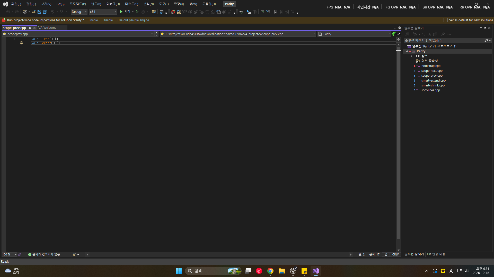](../assets/imports/docs/validation/paired-098/VA-project2/scope-prev-before.png)[](../assets/imports/docs/validation/paired-098/CA-project/scope-prev-before.png)

[](../assets/imports/docs/validation/paired-098/VA-project2/scope-prev-after.png)[](../assets/imports/docs/validation/paired-098/CA-project/scope-prev-after.png)

toggle-braces · 기능 34 · unverified

명령 비활성·실행 실패

```
{
  "id": "toggle-braces",
  "feature": 34,
  "state": "unverified",
  "reason": "명령 비활성·실행 실패",
  "VA": {
    "id": "toggle-braces",
    "feature": 34,
    "before": {
      "zoom": 100,
      "text": "void Probe() { if (true) Call(); }\r\n",
      "caret": 32,
      "selectionStart": 25,
      "selectionLength": 7,
      "selectedText": "Call();"
    },
    "after": null,
    "undo": null,
    "error": "System.Runtime.InteropServices.COMException (0x80004005): \"VAssistX.BracesToggle\" 명령은 사용할 수 없습니다.\r\n   위치: EnvDTE._DTE.ExecuteCommand(String CommandName, String CommandArgs)\r\n   위치: ShortcutProbe.RunPaired(DTE d, Int32 pid, String role, String root, String planFile)",
    "executed": false
  },
  "CA": {
    "id": "toggle-braces",
    "feature": 34,
    "before": {
      "zoom": 140,
      "text": "void Probe() { if (true) Call(); }\r\n",
      "caret": 32,
      "selectionStart": 25,
      "selectionLength": 7,
      "selectedText": "Call();"
    },
    "after": {
      "zoom": 140,
      "text": "void Probe() { if (true) { Call(); } }\r\n",
      "caret": 36,
      "selectionStart": 25,
      "selectionLength": 11,
      "selectedText": "{ Call(); }"
    },
    "undo": {
      "zoom": 140,
      "text": "void Probe() { if (true) Call(); }\r\n",
      "caret": 32,
      "selectionStart": 25,
      "selectionLength": 7,
      "selectedText": "Call();"
    },
    "error": null,
    "executed": true
  }
}
```

[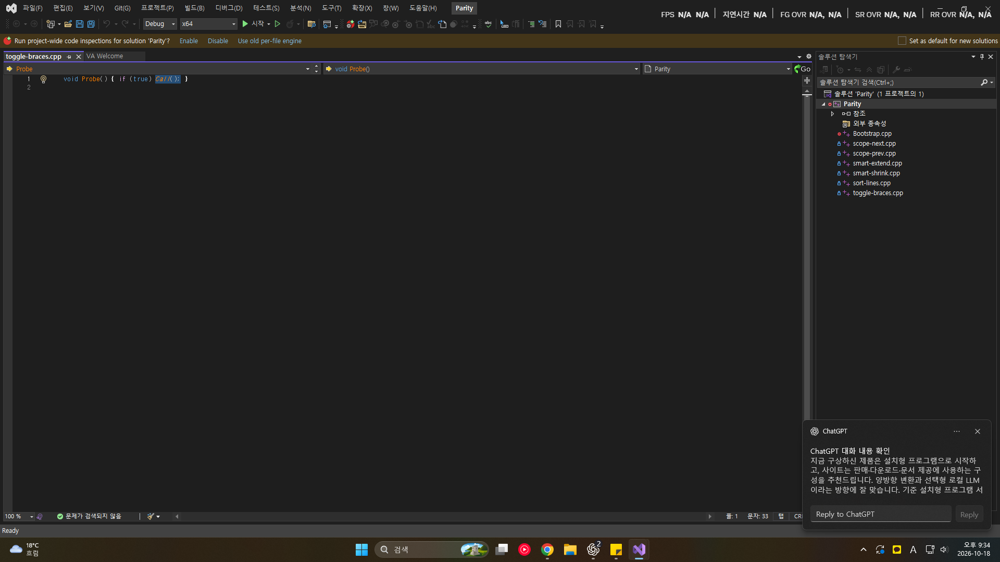](../assets/imports/docs/validation/paired-098/VA-project2/toggle-braces-before.png)[](../assets/imports/docs/validation/paired-098/CA-project/toggle-braces-before.png)

[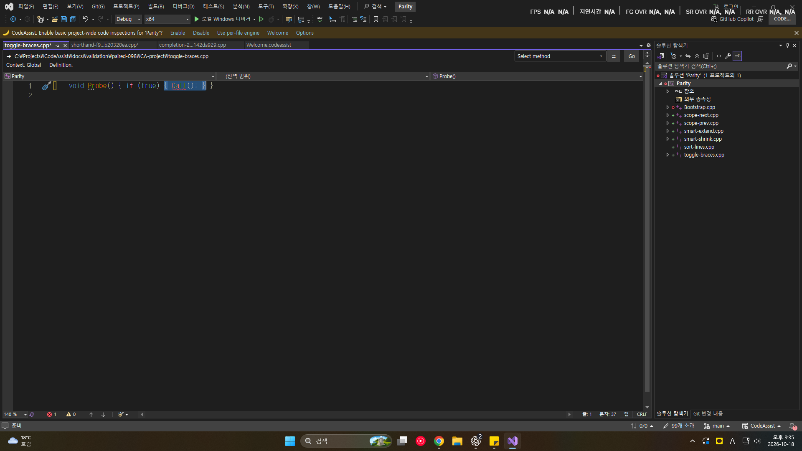](../assets/imports/docs/validation/paired-098/CA-project/toggle-braces-after.png)

[](../assets/imports/docs/validation/paired-098/CA-project/toggle-braces-undo.png)

document-method · 기능 40 · unverified

명령 비활성·실행 실패

```
{
  "id": "document-method",
  "feature": 40,
  "state": "unverified",
  "reason": "명령 비활성·실행 실패",
  "VA": {
    "id": "document-method",
    "feature": 40,
    "before": {
      "zoom": 100,
      "text": "int Sum(int left, int right);\r\n",
      "caret": 29,
      "selectionStart": 0,
      "selectionLength": 29,
      "selectedText": "int Sum(int left, int right);"
    },
    "after": null,
    "undo": null,
    "error": "System.Runtime.InteropServices.COMException (0x80004005): \"VAssistX.RefactorDocumentMethod\" 명령은 사용할 수 없습니다.\r\n   위치: EnvDTE._DTE.ExecuteCommand(String CommandName, String CommandArgs)\r\n   위치: ShortcutProbe.RunPaired(DTE d, Int32 pid, String role, String root, String planFile)",
    "executed": false
  },
  "CA": {
    "id": "document-method",
    "feature": 40,
    "before": {
      "zoom": 140,
      "text": "int Sum(int left, int right);\r\n",
      "caret": 29,
      "selectionStart": 0,
      "selectionLength": 29,
      "selectedText": "int Sum(int left, int right);"
    },
    "after": {
      "zoom": 140,
      "text": "/**\r\n * @brief \r\n * @param left \r\n * @param right \r\n * @return \r\n */\r\nint Sum(int left, int right);\r\n",
      "caret": 70,
      "selectionStart": 70,
      "selectionLength": 0,
      "selectedText": ""
    },
    "undo": {
      "zoom": 140,
      "text": "int Sum(int left, int right);\r\n",
      "caret": 29,
      "selectionStart": 0,
      "selectionLength": 29,
      "selectedText": "int Sum(int left, int right);"
    },
    "error": null,
    "executed": true
  }
}
```

[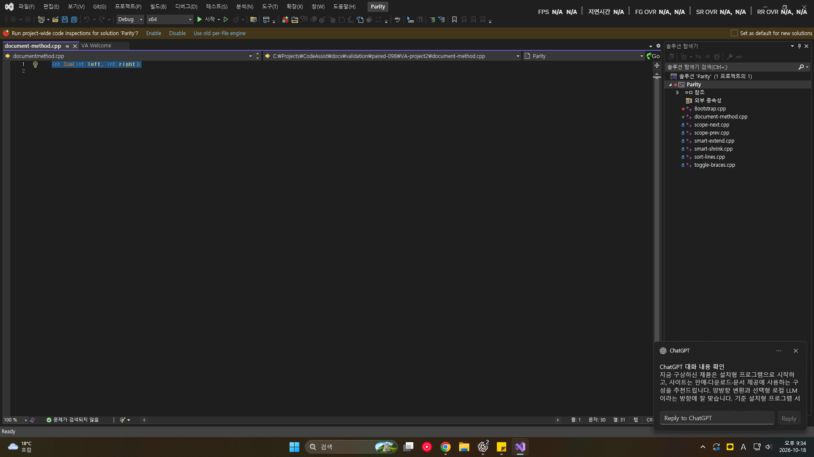](../assets/imports/docs/validation/paired-098/VA-project2/document-method-before.png)[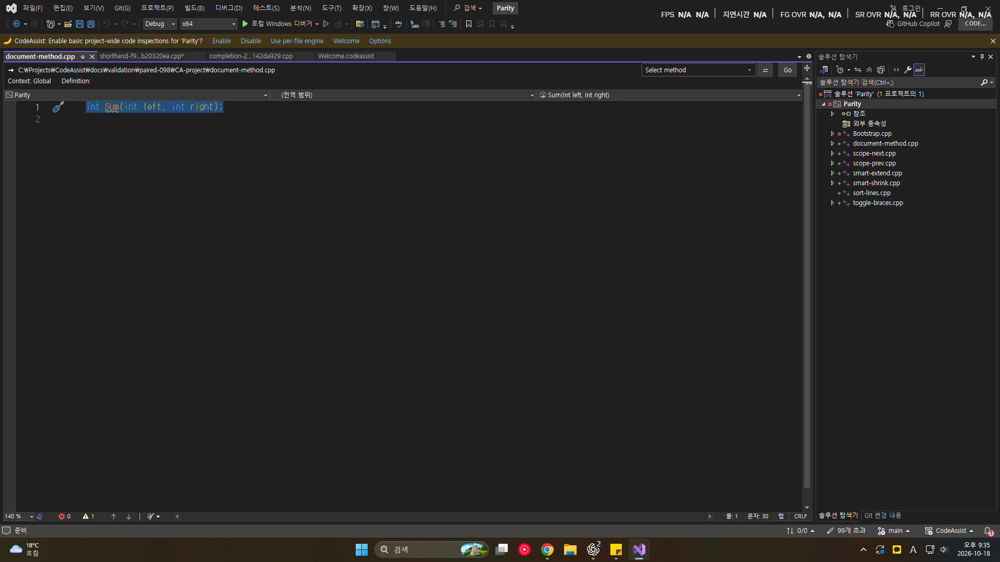](../assets/imports/docs/validation/paired-098/CA-project/document-method-before.png)

[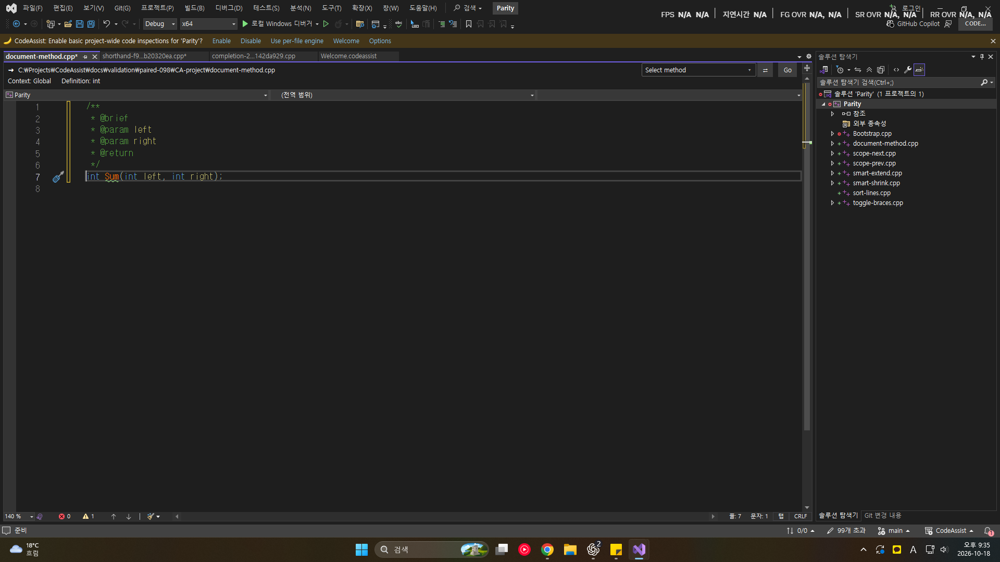](../assets/imports/docs/validation/paired-098/CA-project/document-method-after.png)

[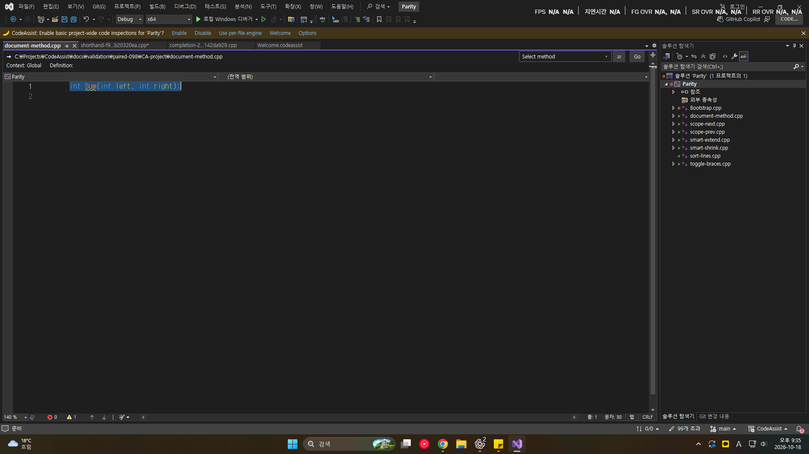](../assets/imports/docs/validation/paired-098/CA-project/document-method-undo.png)

create-implementation · 기능 38 · unverified

명령 비활성·실행 실패

```
{
  "id": "create-implementation",
  "feature": 38,
  "state": "unverified",
  "reason": "명령 비활성·실행 실패",
  "VA": {
    "id": "create-implementation",
    "feature": 38,
    "before": {
      "zoom": 100,
      "text": "class Audit { public: void Update(); };\r\n",
      "caret": 36,
      "selectionStart": 22,
      "selectionLength": 14,
      "selectedText": "void Update();"
    },
    "after": null,
    "undo": null,
    "error": "System.Runtime.InteropServices.COMException (0x80004005): \"VAssistX.RefactorCreateImplementation\" 명령은 사용할 수 없습니다.\r\n   위치: EnvDTE._DTE.ExecuteCommand(String CommandName, String CommandArgs)\r\n   위치: ShortcutProbe.RunPaired(DTE d, Int32 pid, String role, String root, String planFile)",
    "executed": false
  },
  "CA": {
    "id": "create-implementation",
    "feature": 38,
    "before": {
      "zoom": 140,
      "text": "class Audit { public: void Update(); };\r\n",
      "caret": 36,
      "selectionStart": 22,
      "selectionLength": 14,
      "selectedText": "void Update();"
    },
    "after": {
      "zoom": 140,
      "text": "class Audit { public: void Update(); };\r\n\r\nvoid Audit::Update()\r\n{\r\n    throw \"Not implemented\";\r\n}\r\n",
      "caret": 101,
      "selectionStart": 41,
      "selectionLength": 60,
      "selectedText": "\r\nvoid Audit::Update()\r\n{\r\n    throw \"Not implemented\";\r\n}\r\n"
    },
    "undo": {
      "zoom": 140,
      "text": "class Audit { public: void Update(); };\r\n",
      "caret": 36,
      "selectionStart": 22,
      "selectionLength": 14,
      "selectedText": "void Update();"
    },
    "error": null,
    "executed": true
  }
}
```

[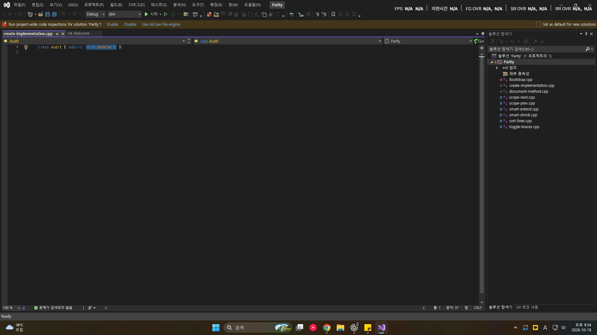](../assets/imports/docs/validation/paired-098/VA-project2/create-implementation-before.png)[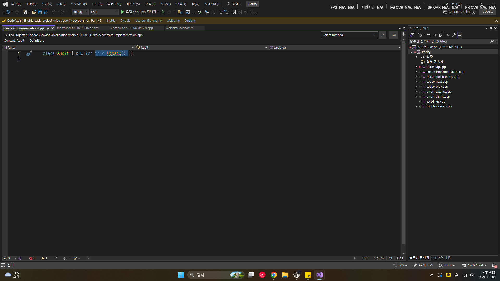](../assets/imports/docs/validation/paired-098/CA-project/create-implementation-before.png)

[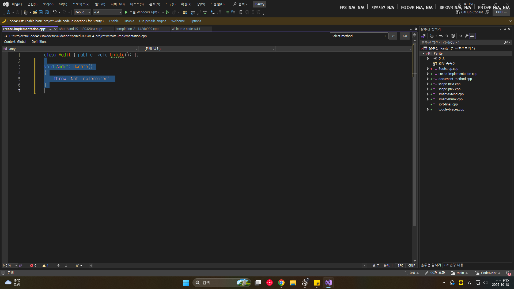](../assets/imports/docs/validation/paired-098/CA-project/create-implementation-after.png)

[](../assets/imports/docs/validation/paired-098/CA-project/create-implementation-undo.png)

comment-continuation · 기능 43 · different

동일 입력의 실제 버퍼·커서·선택 결과 차이

```
{
  "id": "comment-continuation",
  "feature": 43,
  "state": "different",
  "reason": "동일 입력의 실제 버퍼·커서·선택 결과 차이",
  "VA": {
    "id": "comment-continuation",
    "feature": 43,
    "before": {
      "zoom": 100,
      "text": "// note",
      "caret": 7,
      "selectionStart": 7,
      "selectionLength": 0,
      "selectedText": ""
    },
    "after": {
      "zoom": 100,
      "text": "// note",
      "caret": 7,
      "selectionStart": 7,
      "selectionLength": 0,
      "selectedText": ""
    },
    "undo": null,
    "error": "System.Runtime.InteropServices.COMException (0x80004005): \"Edit.Undo\" 명령은 사용할 수 없습니다.\r\n   위치: EnvDTE._DTE.ExecuteCommand(String CommandName, String CommandArgs)\r\n   위치: ShortcutProbe.RunPaired(DTE d, Int32 pid, String role, String root, String planFile)",
    "executed": true
  },
  "CA": {
    "id": "comment-continuation",
    "feature": 43,
    "before": {
      "zoom": 140,
      "text": "// note",
      "caret": 7,
      "selectionStart": 7,
      "selectionLength": 0,
      "selectedText": ""
    },
    "after": {
      "zoom": 140,
      "text": "// note\r\n",
      "caret": 9,
      "selectionStart": 9,
      "selectionLength": 0,
      "selectedText": ""
    },
    "undo": {
      "zoom": 140,
      "text": "// note",
      "caret": 7,
      "selectionStart": 7,
      "selectionLength": 0,
      "selectedText": ""
    },
    "error": null,
    "executed": true
  }
}
```

[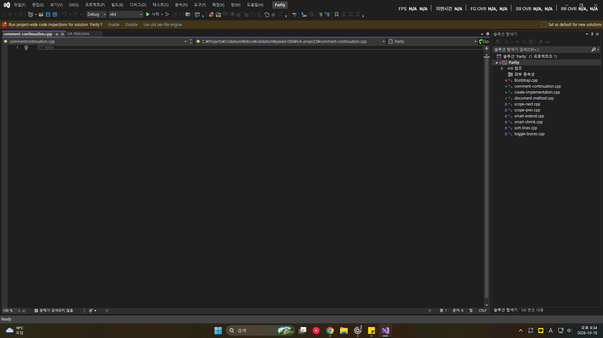](../assets/imports/docs/validation/paired-098/VA-project2/comment-continuation-before.png)[](../assets/imports/docs/validation/paired-098/CA-project/comment-continuation-before.png)

[](../assets/imports/docs/validation/paired-098/VA-project2/comment-continuation-after.png)[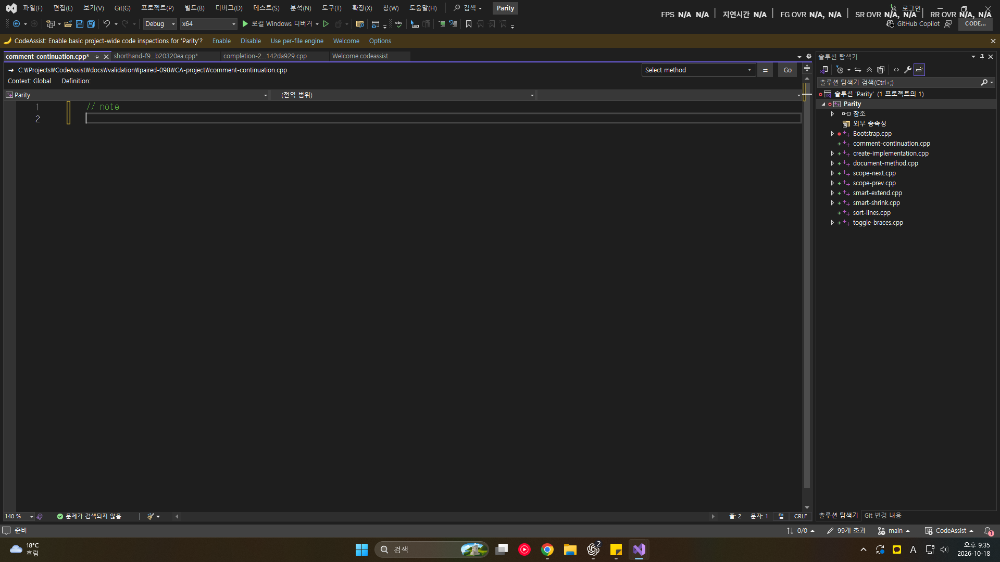](../assets/imports/docs/validation/paired-098/CA-project/comment-continuation-after.png)

[](../assets/imports/docs/validation/paired-098/CA-project/comment-continuation-undo.png)

acronym · 기능 42 · unverified

양쪽 무반응은 통과 아님

```
{
  "id": "acronym",
  "feature": 42,
  "state": "unverified",
  "reason": "양쪽 무반응은 통과 아님",
  "VA": {
    "id": "acronym",
    "feature": 42,
    "before": {
      "zoom": 100,
      "text": "struct AuditLongTypeName {};\r\nvoid Probe() { ALTN }\r\n",
      "caret": 49,
      "selectionStart": 49,
      "selectionLength": 0,
      "selectedText": ""
    },
    "after": {
      "zoom": 100,
      "text": "struct AuditLongTypeName {};\r\nvoid Probe() { ALTN }\r\n",
      "caret": 49,
      "selectionStart": 49,
      "selectionLength": 0,
      "selectedText": ""
    },
    "undo": null,
    "error": null,
    "executed": true
  },
  "CA": {
    "id": "acronym",
    "feature": 42,
    "before": {
      "zoom": 140,
      "text": "struct AuditLongTypeName {};\r\nvoid Probe() { ALTN }\r\n",
      "caret": 49,
      "selectionStart": 49,
      "selectionLength": 0,
      "selectedText": ""
    },
    "after": {
      "zoom": 140,
      "text": "struct AuditLongTypeName {};\r\nvoid Probe() { ALTN }\r\n",
      "caret": 49,
      "selectionStart": 49,
      "selectionLength": 0,
      "selectedText": ""
    },
    "undo": null,
    "error": null,
    "executed": true
  }
}
```

[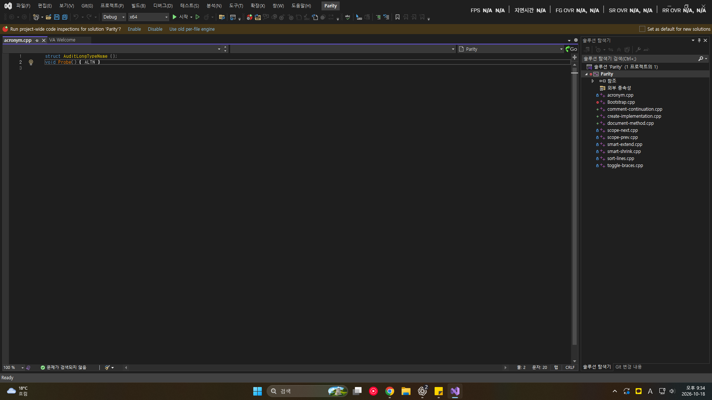](../assets/imports/docs/validation/paired-098/VA-project2/acronym-before.png)[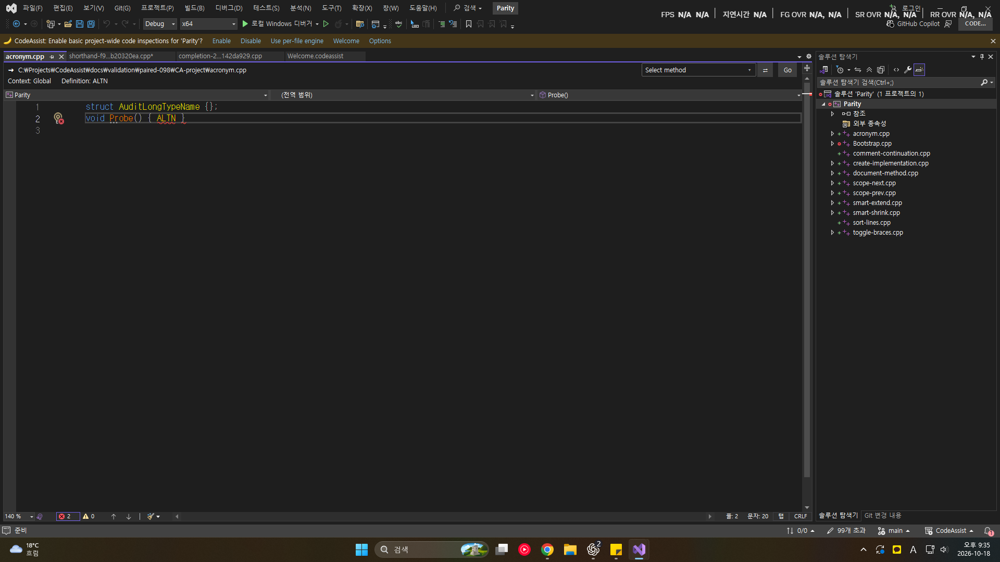](../assets/imports/docs/validation/paired-098/CA-project/acronym-before.png)

[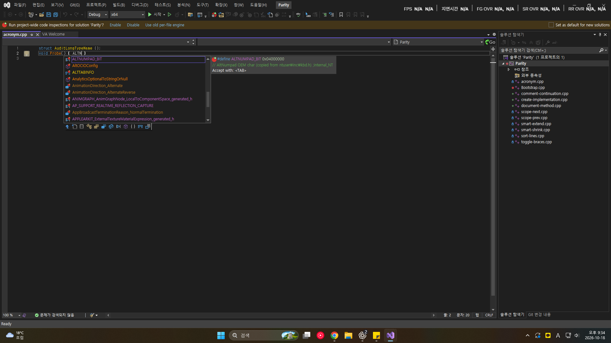](../assets/imports/docs/validation/paired-098/VA-project2/acronym-after.png)[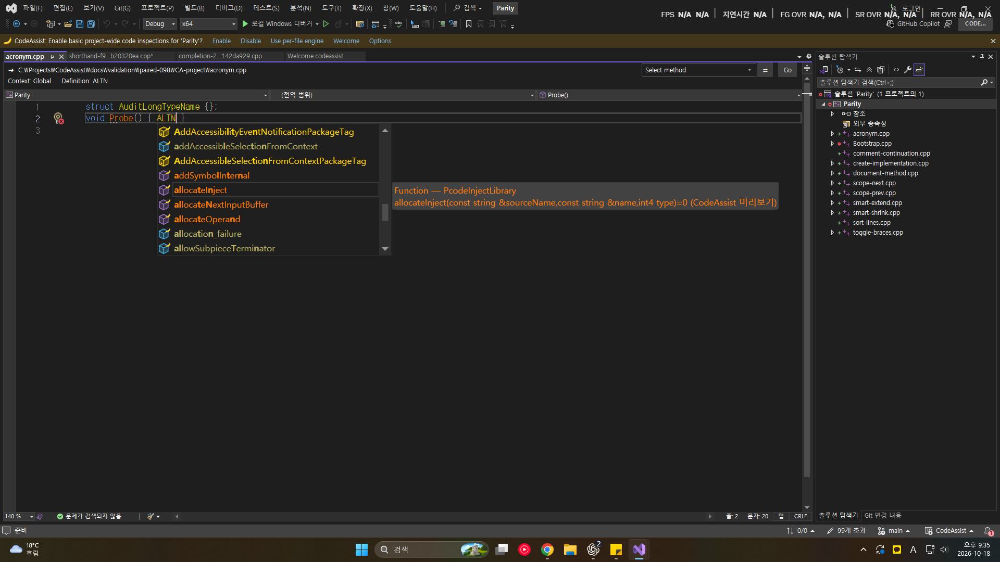](../assets/imports/docs/validation/paired-098/CA-project/acronym-after.png)

substring-shorthand · 기능 50 · unverified

양쪽 무반응은 통과 아님

```
{
  "id": "substring-shorthand",
  "feature": 50,
  "state": "unverified",
  "reason": "양쪽 무반응은 통과 아님",
  "VA": {
    "id": "substring-shorthand",
    "feature": 50,
    "before": {
      "zoom": 100,
      "text": "struct AuditLongTypeName {};\r\nvoid Probe() { LongType }\r\n",
      "caret": 53,
      "selectionStart": 53,
      "selectionLength": 0,
      "selectedText": ""
    },
    "after": {
      "zoom": 100,
      "text": "struct AuditLongTypeName {};\r\nvoid Probe() { LongType }\r\n",
      "caret": 53,
      "selectionStart": 53,
      "selectionLength": 0,
      "selectedText": ""
    },
    "undo": null,
    "error": null,
    "executed": true
  },
  "CA": {
    "id": "substring-shorthand",
    "feature": 50,
    "before": {
      "zoom": 140,
      "text": "struct AuditLongTypeName {};\r\nvoid Probe() { LongType }\r\n",
      "caret": 53,
      "selectionStart": 53,
      "selectionLength": 0,
      "selectedText": ""
    },
    "after": {
      "zoom": 140,
      "text": "struct AuditLongTypeName {};\r\nvoid Probe() { LongType }\r\n",
      "caret": 53,
      "selectionStart": 53,
      "selectionLength": 0,
      "selectedText": ""
    },
    "undo": null,
    "error": null,
    "executed": true
  }
}
```

[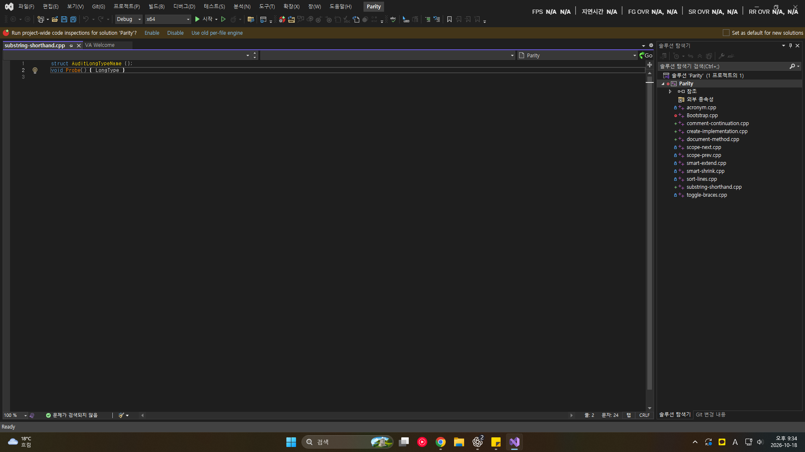](../assets/imports/docs/validation/paired-098/VA-project2/substring-shorthand-before.png)[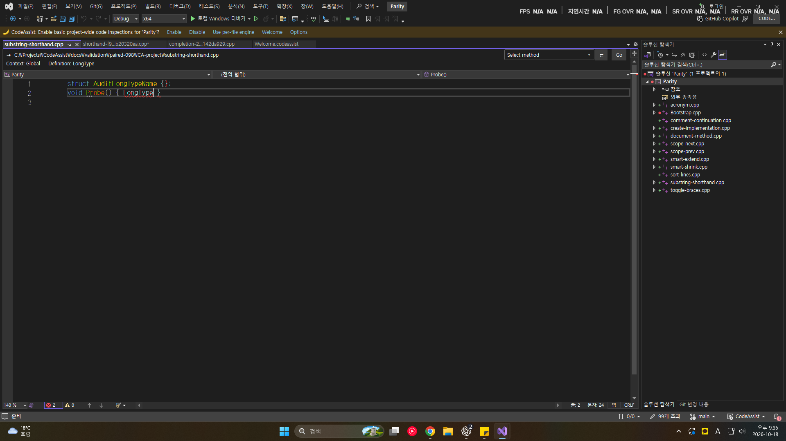](../assets/imports/docs/validation/paired-098/CA-project/substring-shorthand-before.png)

[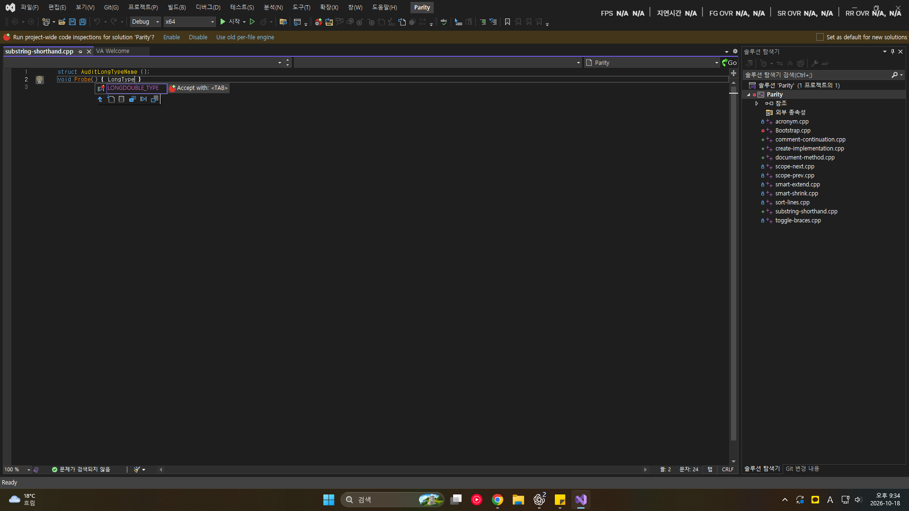](../assets/imports/docs/validation/paired-098/VA-project2/substring-shorthand-after.png)[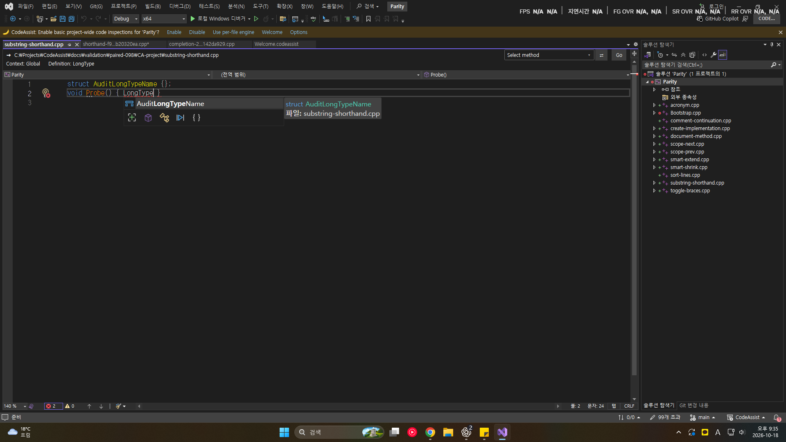](../assets/imports/docs/validation/paired-098/CA-project/substring-shorthand-after.png)

dot-to-arrow · 기능 69 · different

동일 입력의 실제 버퍼·커서·선택 결과 차이

```
{
  "id": "dot-to-arrow",
  "feature": 69,
  "state": "different",
  "reason": "동일 입력의 실제 버퍼·커서·선택 결과 차이",
  "VA": {
    "id": "dot-to-arrow",
    "feature": 69,
    "before": {
      "zoom": 100,
      "text": "struct AuditNode { int Value; };\r\nvoid Probe() { AuditNode* pointer = nullptr; pointer }\r\n",
      "caret": 86,
      "selectionStart": 86,
      "selectionLength": 0,
      "selectedText": ""
    },
    "after": {
      "zoom": 100,
      "text": "struct AuditNode { int Value; };\r\nvoid Probe() { AuditNode* pointer = nullptr; pointer-> }\r\n",
      "caret": 88,
      "selectionStart": 88,
      "selectionLength": 0,
      "selectedText": ""
    },
    "undo": null,
    "error": null,
    "executed": true
  },
  "CA": {
    "id": "dot-to-arrow",
    "feature": 69,
    "before": {
      "zoom": 140,
      "text": "struct AuditNode { int Value; };\r\nvoid Probe() { AuditNode* pointer = nullptr; pointer }\r\n",
      "caret": 86,
      "selectionStart": 86,
      "selectionLength": 0,
      "selectedText": ""
    },
    "after": {
      "zoom": 140,
      "text": "struct AuditNode { int Value; };\r\nvoid Probe() { AuditNode* pointer = nullptr; pointer. }\r\n",
      "caret": 87,
      "selectionStart": 87,
      "selectionLength": 0,
      "selectedText": ""
    },
    "undo": null,
    "error": null,
    "executed": true
  }
}
```

[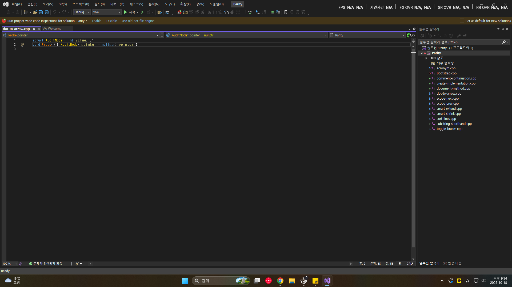](../assets/imports/docs/validation/paired-098/VA-project2/dot-to-arrow-before.png)[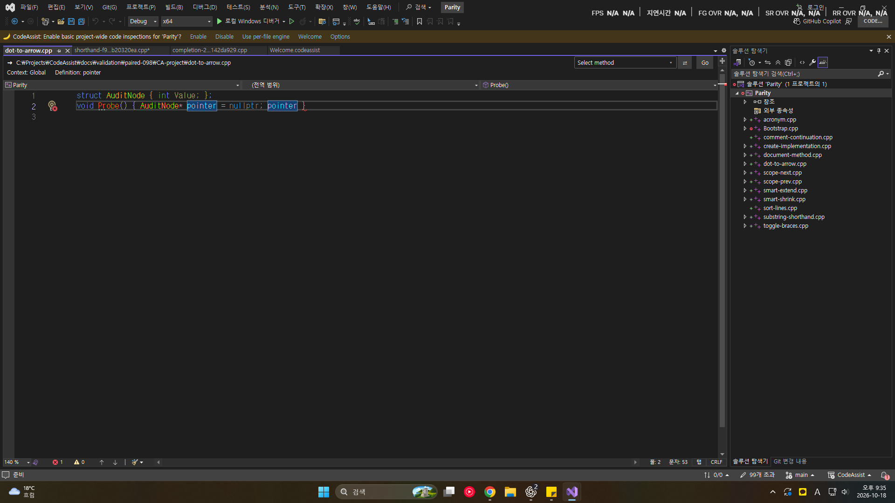](../assets/imports/docs/validation/paired-098/CA-project/dot-to-arrow-before.png)

[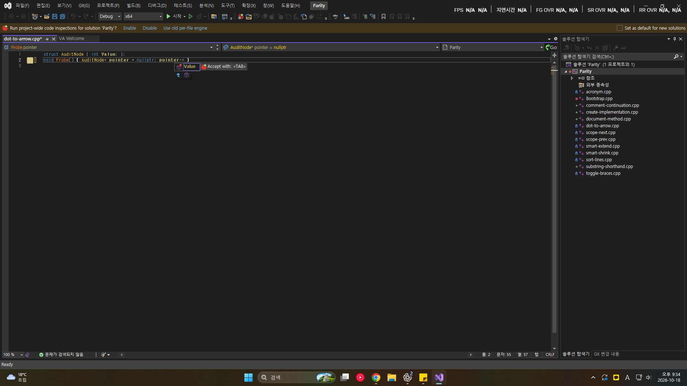](../assets/imports/docs/validation/paired-098/VA-project2/dot-to-arrow-after.png)[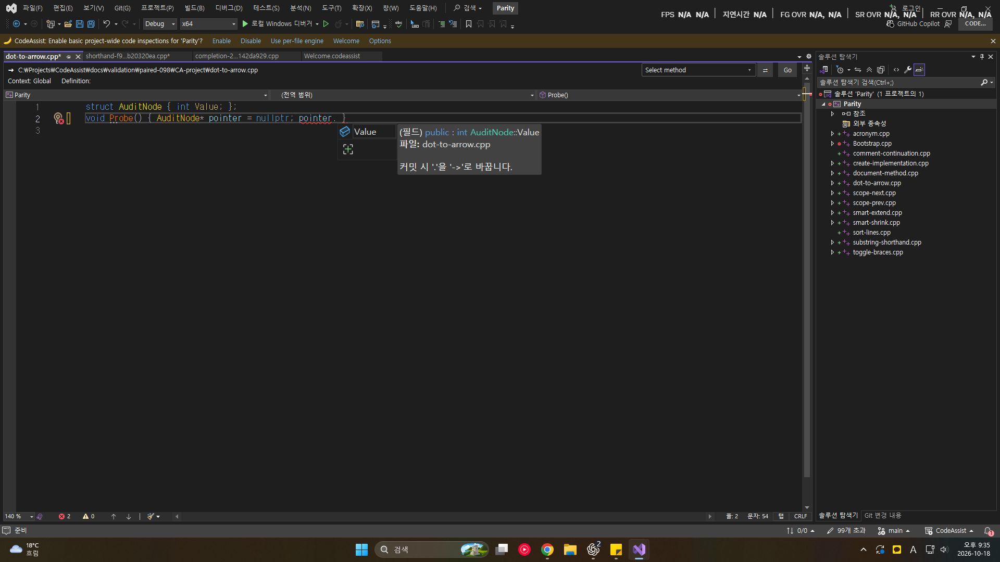](../assets/imports/docs/validation/paired-098/CA-project/dot-to-arrow-after.png)

repair-case · 기능 73 · unverified

대소문자 교정이 실제 발동하지 않음

```
{
  "id": "repair-case",
  "feature": 73,
  "state": "unverified",
  "reason": "대소문자 교정이 실제 발동하지 않음",
  "VA": {
    "id": "repair-case",
    "feature": 73,
    "before": {
      "zoom": 100,
      "text": "struct AuditWidget {};\r\nvoid Probe() { auditwidget }\r\n",
      "caret": 50,
      "selectionStart": 50,
      "selectionLength": 0,
      "selectedText": ""
    },
    "after": {
      "zoom": 100,
      "text": "struct AuditWidget {};\r\nvoid Probe() { auditwidget  }\r\n",
      "caret": 51,
      "selectionStart": 51,
      "selectionLength": 0,
      "selectedText": ""
    },
    "undo": null,
    "error": null,
    "executed": true
  },
  "CA": {
    "id": "repair-case",
    "feature": 73,
    "before": {
      "zoom": 140,
      "text": "struct AuditWidget {};\r\nvoid Probe() { auditwidget }\r\n",
      "caret": 50,
      "selectionStart": 50,
      "selectionLength": 0,
      "selectedText": ""
    },
    "after": {
      "zoom": 140,
      "text": "struct AuditWidget {};\r\nvoid Probe() { auditwidget  }\r\n",
      "caret": 51,
      "selectionStart": 51,
      "selectionLength": 0,
      "selectedText": ""
    },
    "undo": null,
    "error": null,
    "executed": true
  }
}
```

[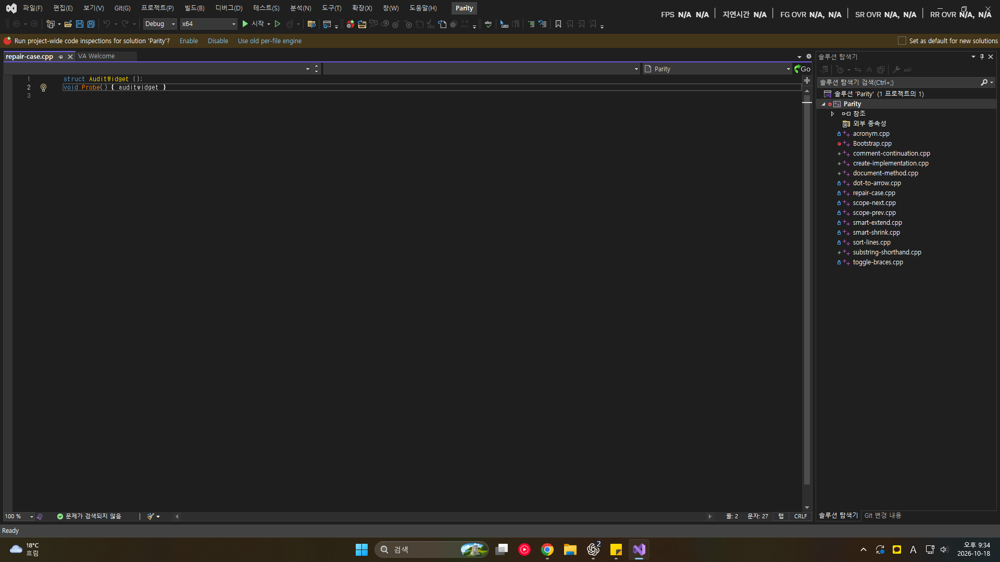](../assets/imports/docs/validation/paired-098/VA-project2/repair-case-before.png)[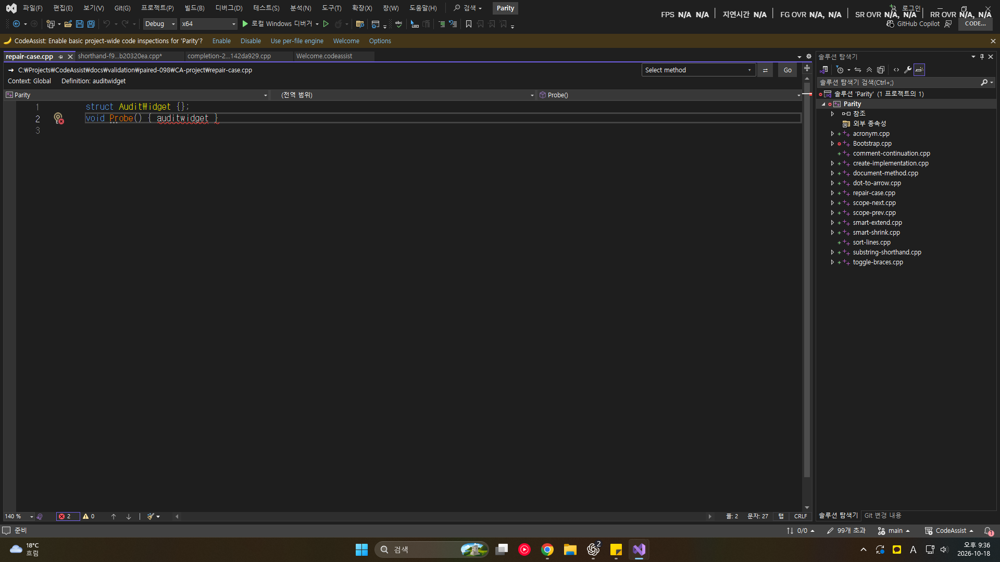](../assets/imports/docs/validation/paired-098/CA-project/repair-case-before.png)

[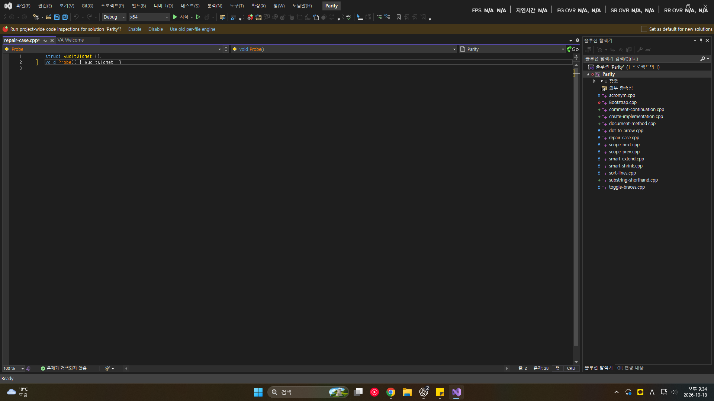](../assets/imports/docs/validation/paired-098/VA-project2/repair-case-after.png)[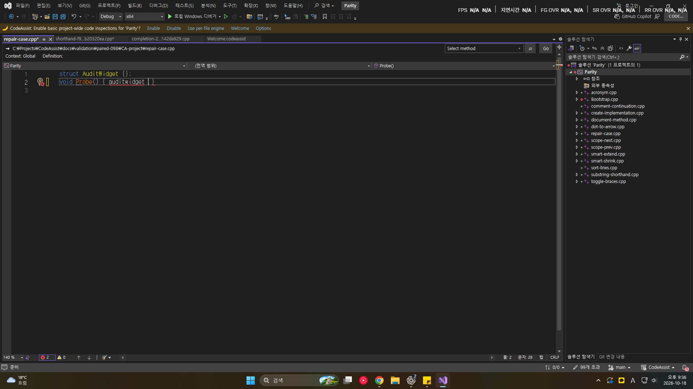](../assets/imports/docs/validation/paired-098/CA-project/repair-case-after.png)

## 전체 108개

VA-F001 Find by Context — unverified

VA-F002 Find References — unverified

VA-F003 Find Symbol in Solution — unverified

VA-F004 GoTo Implementation — unverified

VA-F005 GoTo Member — unverified

VA-F006 GoTo Related — unverified

VA-F007 Highlight Current Line — unverified

VA-F008 List Methods in File — unverified

VA-F009 Move Scope — different

VA-F010 Navigate Back and Forward — unverified

VA-F011 Open Corresponding File — unverified

VA-F012 Open File in Solution — unverified

VA-F013 VA Hashtags — unverified

VA-F014 VA Navigation Bar — unverified

VA-F015 Access to Refactoring Commands — unverified

VA-F016 Change Signature — unverified

VA-F017 Convert Between Pointer and Instance — unverified

VA-F018 Encapsulate Field — unverified

VA-F019 Extract Method — unverified

VA-F020 Introduce Variable — unverified

VA-F021 Move Implementation to Header File — unverified

VA-F022 Move Implementation to Source File — unverified

VA-F023 Move Method Implementations to Source File — unverified

VA-F024 Move Selection to New File — unverified

VA-F025 Rename — different

VA-F026 Rename Files — unverified

VA-F027 Simplify Instance Declaration — unverified

VA-F028 Add Forward Declaration — unverified

VA-F029 Add Member — unverified

VA-F030 Add Missing Case Statements — unverified

VA-F031 Add Similar Member — unverified

VA-F032 Add Using Directive — unverified

VA-F033 Add include Directive — unverified

VA-F034 Add/Remove Braces — unverified

VA-F035 Create Declaration — unverified

VA-F036 Create File — unverified

VA-F037 Create from Usage — unverified

VA-F038 Create Implementation — unverified

VA-F039 Create Method Implementations — unverified

VA-F040 Document Method — unverified

VA-F041 Implement Interface / Virtual Methods — unverified

VA-F042 Acronyms — unverified

VA-F043 Auto-Extend Multi-Line Comments — different

VA-F044 Enhanced Listboxes — representative-match

VA-F045 Format After Paste — unverified

VA-F046 Insert () and Closing Brackets and Quotes — representative-match

VA-F047 Insert _ After m and Shift — unverified

VA-F048 Multiple Clipboards — unverified

VA-F049 Reset Editor Zoom — representative-match

VA-F050 Shorthand — unverified

VA-F051 Smart Select — different

VA-F052 Smart Suggestions — unverified

VA-F053 Sort Selected Lines — different

VA-F054 Suggestion Lists — unverified

VA-F055 Surround Selection — representative-match

VA-F056 Surround With — unverified

VA-F057 Column Indicator — unverified

VA-F058 Context Field — unverified

VA-F059 Definition Field — unverified

VA-F060 Enhanced Syntax Coloring — unverified

VA-F061 Local Symbols in Bold — unverified

VA-F062 Highlight Find Results — unverified

VA-F063 Highlight Matching Words — unverified

VA-F064 Highlight References to Symbol Under Cursor — unverified

VA-F065 Parameter Info — unverified

VA-F066 Print in Color — unverified

VA-F067 Quick Info — unverified

VA-F068 System Symbols in Italics — unverified

VA-F069 Convert Dot to -> — different

VA-F070 Highlight Files in Output Window — unverified

VA-F071 Highlight Matching Braces and Parentheses — unverified

VA-F072 Highlight Mismatching Braces and Parentheses — unverified

VA-F073 Repair Case — unverified

VA-F074 Underline Spelling Errors — unverified

VA-F075 Underline Unknown Symbols — unverified

VA-F076 Code Inspection Settings — unverified

VA-F077 Code Issues in the Editor — unverified

VA-F078 Quick Fixes in the Editor — unverified

VA-F079 Quick Fixes in a Tool Window — unverified

VA-F080 VA Snippets — unverified

VA-F081 for Refactoring — unverified

VA-F082 for Smart Suggestions — unverified

VA-F083 for Surround With — unverified

VA-F084 with Shortcuts — unverified

VA-F085 Create from Selection — unverified

VA-F086 Environment Placeholders — unverified

VA-F087 Input Placeholders — unverified

VA-F088 Reserved Strings — unverified

VA-F089 Address Resolver — unverified

VA-F090 PDB Explorer — unverified

VA-F091 VA Memory View — unverified

VA-F092 VA Step Filter — unverified

VA-F093 VA Outline — unverified

VA-F094 VA View — unverified

VA-F095 Simple Link Patterns — unverified

VA-F096 Complex Link Patterns — unverified

VA-F097 Connect to FogBugz and GitHub — unverified

VA-F098 Preview Files — unverified

VA-F099 Open Hyperlinks in an External Browser — unverified

VA-F100 Custom Plug-ins — unverified

VA-F101 Context Menus — unverified

VA-F102 Custom File Extensions — unverified

VA-F103 Keyboard Shortcuts — unverified

VA-F104 Mouse — unverified

VA-F105 Multiple Platforms — unverified

VA-F106 Non-Microsoft Build Processes — unverified

VA-F107 Parse Concurrency — unverified

VA-F108 Options Dialog — unverified

제안 시간: 10분. 이번 배치 실제 소요: 1346초 · 2026-10-18T21:38:35.316232+09:00. 전체 요청은 미완료이며 98개 미검증이 남아 있습니다. XERJ: 사용 — 검색 후보가 부정확해 rg와 현재 소스를 대조했습니다. 문서 기반 부분 명세 108/108이며 전체 역분석 완료율과 다릅니다.

## 원문과 편집 이력

[보존된 원문 열기](../assets/imports/docs/validation/paired-098/index.html)

- 원문 SHA-256: `d4c2c9f599374d340ad1ceb5718a1b2713c8586ed30659ffb94dc973bcb3d746`
- 표시 날짜는 원본 파일의 수정 시각입니다. 작업 완료 시각은 원문에 있는 값을 기준으로 확인합니다.
