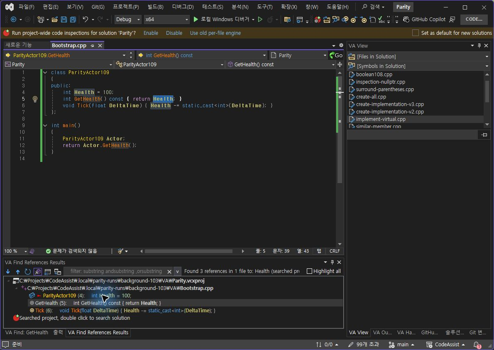
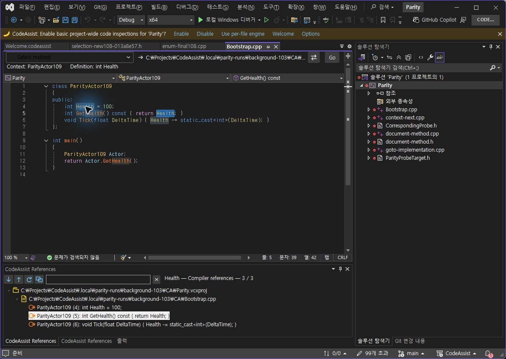
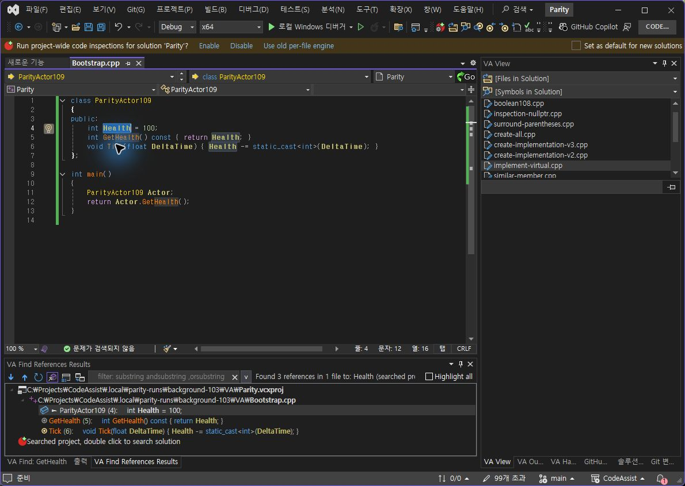
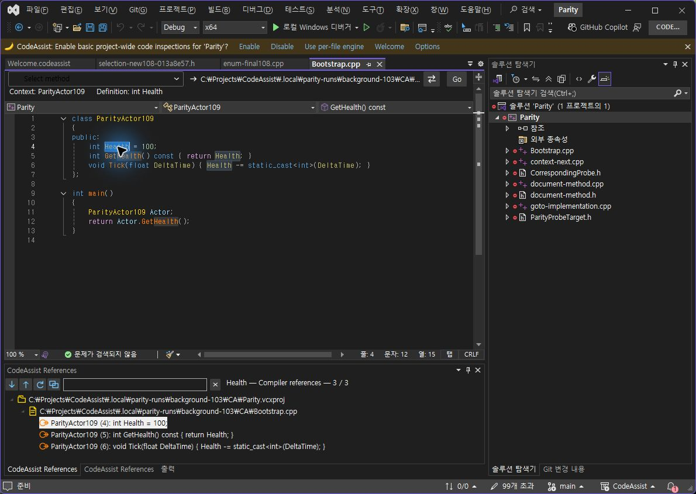

> 보관 기록입니다. 아래 결과는 원문 작성 시점의 내용이며, 이번 편집에서 제품 테스트를 다시 실행하지 않았습니다.

CA 0.0.125 — F8 참조 이동

## CA 0.0.125 — 실제 F8 / Shift+F8 대조

**지정한 두 이동 결과 일치: 2/2 (100%).** Health 참조 표본의 도착 파일·행·열·선택 문자열 기준입니다. 제품 전체 동기화율을 뜻하지 않습니다.

| 실제 입력 | VA | CA 0.0.125 | 판정 |
| --- | --- | --- | --- |
| F8 다음 참조 | Bootstrap.cpp 5행 33–39열 Health | Bootstrap.cpp 5행 33–39열 Health | 일치 |
| Shift+F8 이전 참조 | Bootstrap.cpp 4행 6–12열 Health | Bootstrap.cpp 4행 6–12열 Health | 일치 |

공식 Computer Use로 실제 키를 입력하고 읽기 전용 DTE로 선택 좌표와 편집기 본문을 확인했습니다. 양쪽 본문은 동일합니다. VA 첫 결과를 선택한 뒤 F8로 이동했고 CA는 선언 선택→새 참조 검색→F8 순서로 확인했습니다. 초기 선택 설정 방식은 다릅니다.

## F8 화면

### VA

### CA 0.0.125

## Shift+F8 화면

### VA

### CA 0.0.125

## 수정·검증 근거

기존 전역 다음/이전 위치 명령의 BeforeExecute를 수신해 보이는 CA 참조 목록이 있을 때만 이동합니다. 키 바인딩을 덮어쓰지 않습니다. 이벤트는 종료 시 해제합니다. 설치 바이너리 6/6 일치, 실제 CLR의 Extension 모듈 경로·해시도 확인했습니다. Core 회귀 353/353 통과(100%)는 CA 자체 검사입니다.

패키지 · 설치 · CLR 실제 로드 · Core TRX · VA F8 좌표 · CA F8 좌표 · VA 역방향 · CA 역방향

## 남은 범위와 실패 기록

0.0.122/123/124는 실제 F8 이동 실패로 기록했습니다. 이를 통과 개수에 합산하지 않습니다. 편집기 커서와 결과 목록 선택이 서로 다른 경우, CA는 커서 기준을 우선하고 VA는 목록 선택을 우선하는 차이가 남아 있습니다. 참조 창을 숨긴 상태의 기본 F8 경로와 다른 언어는 이번 실측 대상이 아닙니다. [이전 UI 차이 6개](../assets/imports/docs/validation/live-paired-121/index.html)도 미완료입니다.

문서 기반 부분 명세 확보 108/108 (100%). 전체 완전 동등성 인증 0/108 (0%, 구현률 아님). 제품 전체 유사도는 이번 2개 표본으로 산출하지 않습니다.

제안 시간: 5–10분. 시작 2026-10-23 16:16:20 KST. 상세 종료·실제 소요 시간은 측정 기록에 있습니다. 예상 시간을 초과했습니다.

XERJ: 사용 — F8 / ReferenceResults 검색 후보를 현재 소스와 대조했습니다.

## 원문과 편집 이력

[보존된 원문 열기](../assets/imports/docs/validation/reference-f8-122/index.html)

- 원문 SHA-256: `c8357d9fcb26a8336b61c4fef5241bf012181aab1b08df271e4497eab6d80c55`
- 표시 날짜는 원본 파일의 수정 시각입니다. 작업 완료 시각은 원문에 있는 값을 기준으로 확인합니다.
