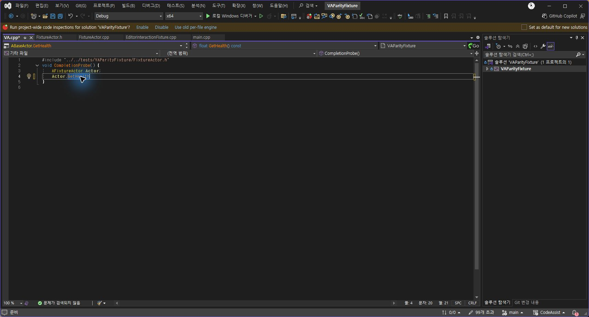
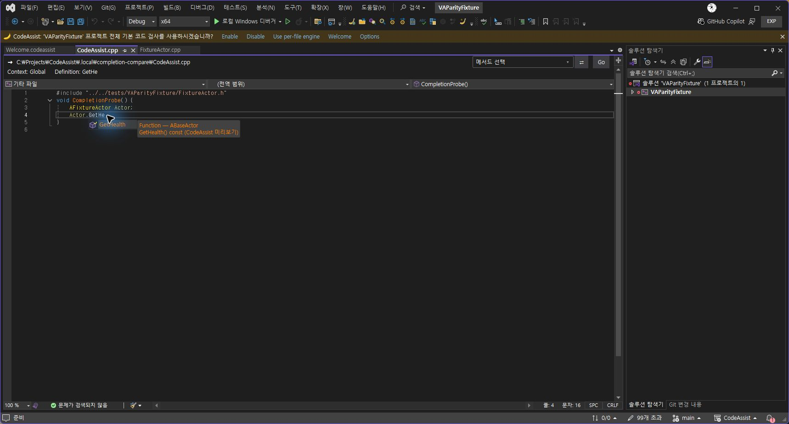
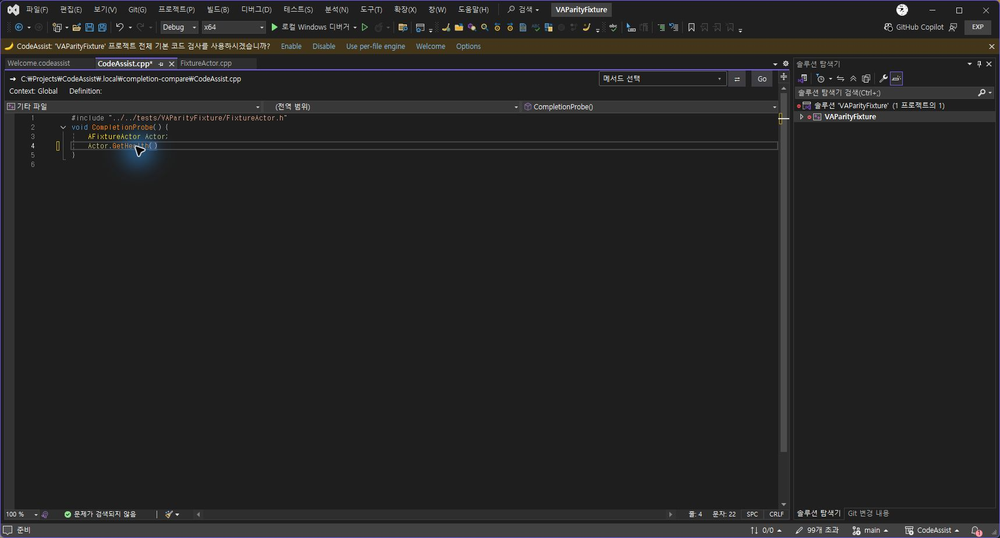
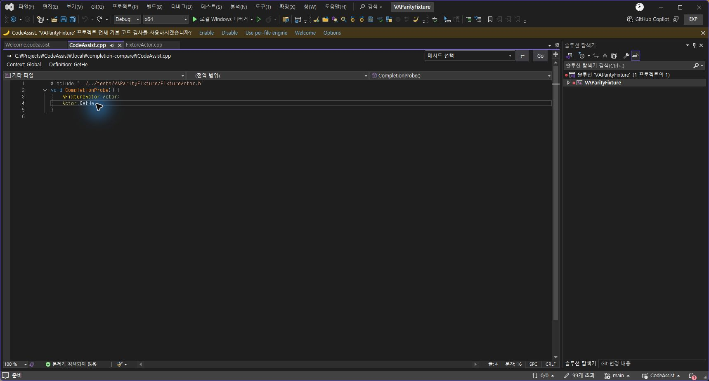

> 보관 기록입니다. 아래 결과는 원문 작성 시점의 내용이며, 이번 편집에서 제품 테스트를 다시 실행하지 않았습니다.

CodeAssist 0.0.83 · 자동 완성 실제 대조

## 0.0.83 자동 완성 실제 대조

설치된 VA 10.9.2630.0과 별도 CodeAssist 실험 인스턴스에서 같은 `Actor.GetHe` 입력을 비교했습니다. 사용자 파일 대신 별도 임시 C++ 파일을 사용했습니다.

## 수정·적용한 결과

| 항목 | 수정 전 | 수정 후 |
| --- | --- | --- |
| Ctrl+Space | 네이티브 확정 뒤 추천창이 다시 남음 | 유일 후보 GetHealth() 확정 후 목록 종료 |
| Undo | 괄호만 제거되고 완성된 이름이 남음 | 이름 치환과 괄호를 한 번에 취소, GetHe 복원 |
| 추천 색상 | 후보가 네이티브와 모두 겹치면 기본 목록으로 빠짐 | CodeAssist 색상 설정이면 겹치는 후보도 함수 색상 표시 |

## 원본 VA 실제 화면

## 최종 설치본 실제 화면

네이티브 후보와 겹치는 함수도 색상 표시:

Tab 확정:

Undo 한 번으로 원래 접두어 복원:

## 검증 근거

- 소스 회귀 260개 통과.

- 최종 설치 DLL의 MVID와 일치하는 실제 편집기 검사 14개 통과.

- 패키지·설치 바이너리 6개 해시 일치, 등록 단축키 24개 확인.

- Redo·Escape·Ctrl+Space 전체 흐름은 색상 추가 수정 직전 빌드에서 관찰했습니다. 최종 빌드는 색상·Tab·Undo와 편집기 14개를 다시 검사했습니다.

세부 실행 기록 · 최종 편집기 검사 · 패키지 · 설치 해시

## 남은 전체 작업

- 108개 기능 전체에 대한 동일 입력·설정·예외·Undo·성능 대조.

- 추천 Enter·기본 VS 색상 토글·양 테마·템플릿·오버로드·스니펫·입력 지연 전체 행렬.

- 리팩터링의 참조 갱신과 Undo 지원 범위 확대.

- 미지원 옵션·부동 빠른 작업 도구 모음과 나머지 UI.

- 실제 Unreal 프로젝트의 VA 대비 시작·엔진 분석·타이핑·검색 성능.

전체 유사도: 미측정. 부분 코드 대응 108/108, 전체 기준 완전 검증 0/108. 분석율: 문서 기반 부분 명세 108/108(100%), 전체 역분석 완료율 미확인.

[작업 인계](../assets/imports/docs/handoff.html)

## 원문과 편집 이력

[보존된 원문 열기](../assets/imports/docs/completion-0.0.83.html)

- 원문 SHA-256: `32094d72757c353f41ae7471f1d5d4e8b5cf334c4adc0c2b2780263b92b7fc16`
- 표시 날짜는 원본 파일의 수정 시각입니다. 작업 완료 시각은 원문에 있는 값을 기준으로 확인합니다.
