> 보관 기록입니다. 아래 결과는 원문 작성 시점의 내용이며, 이번 편집에서 제품 테스트를 다시 실행하지 않았습니다.

VA·CA 옵션 실행 대조160

## VA·CA 색상 On/Off 대조 및 옵션 배치 수정

**선정 옵션 누적 동작 표본10/12개(83.33%)**. 기존8개에 열거형·네임스페이스의 편집기 색상 On/Off 표본을 추가했습니다. 버전159 실행 근거이며 현재 제품 전체 동기화율 또는 모든 동작 인증이 아닙니다.

## 이번 실제 대조

동일 browser107.cpp에서 열거형 First/Second/사용 위치 및 namespace PaletteProbe142를 확인했습니다. 양쪽 설정 창에서 Text Editors를 끄고 저장한 후 같은 소스에서 기본 색상으로 바뀌는 것을 촬영했습니다. 다시 켠 상태도 촬영했습니다. **두 범주×On/Off=4/4상태(100%)**에서 색상 활성/비활성 동작을 확인했습니다. 현재 사용자 색상 RGB는 원래 양쪽이 달라 정확한 RGB 일치나 공장 기본값 일치를 주장하지 않습니다.

적용 시점 차이: CA는 저장 직후 반영됐고 VA는 저장 후 프로세스가 사라져 재실행한 화면에서 Off를 확인했습니다. 프로세스 종료 원인은 미확인입니다. 양쪽 Text Editors는 On으로 복원했습니다. VA에 CA 확장이 섞이지 않은 것은 읽기 전용 CLR 모듈 검사로 확인했습니다.

VA On

CA159 On

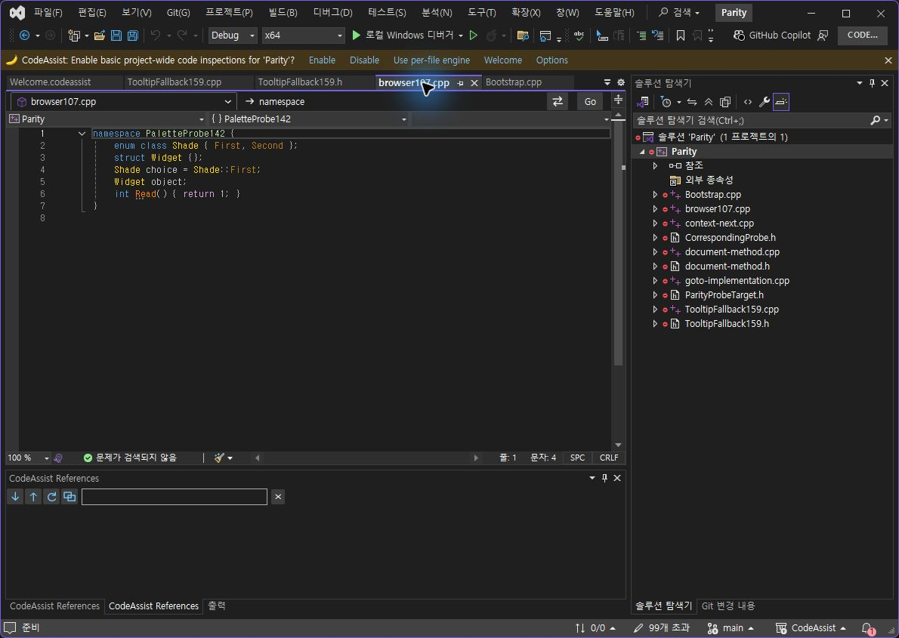

VA Off — 재시작 후

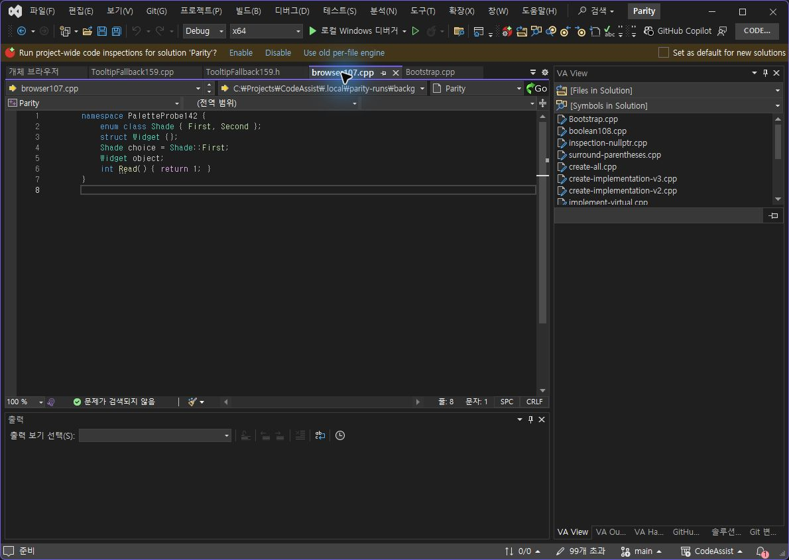

CA159 Off

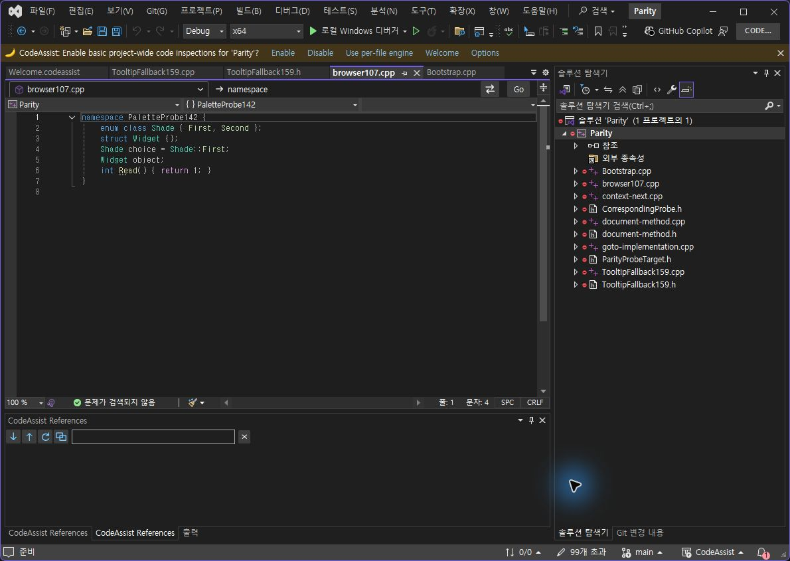

VA On 복원

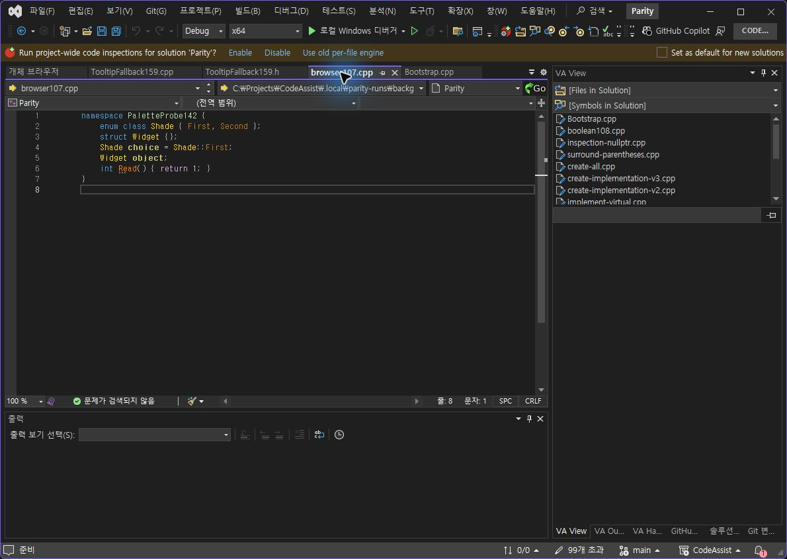

CA159 On 복원

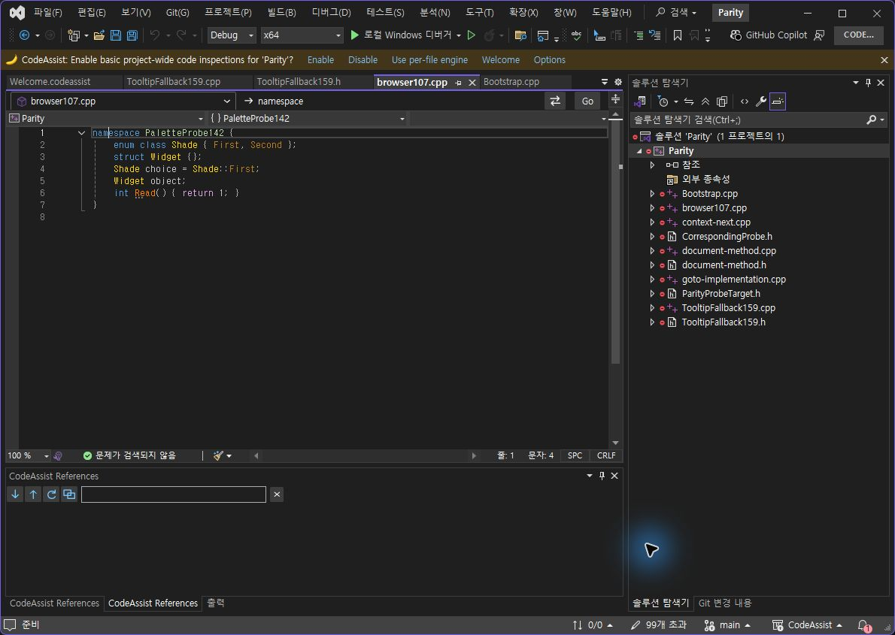

## 옵션 배치

CA의 색상 대상 세 열이 본문 전체 폭으로 벌어졌던 것을 첫 두 열132px, 마지막 열 내용 길이에 맞추는 Grid로 수정했습니다. 0.0.160 고정 폭 시안은 긴 문구가 잘려 채택하지 않고0.0.161로 수정했습니다. 최종 촬영은 아래에 연결합니다. 체크박스6개 위치는 VA 대비8px 이내6/6개(100%)이며 전체 UI 점수가 아닙니다. 이 항목 수정만으로 전체 레이아웃 유사도를 계산하지 않습니다.

VA 기준

CA161 최종

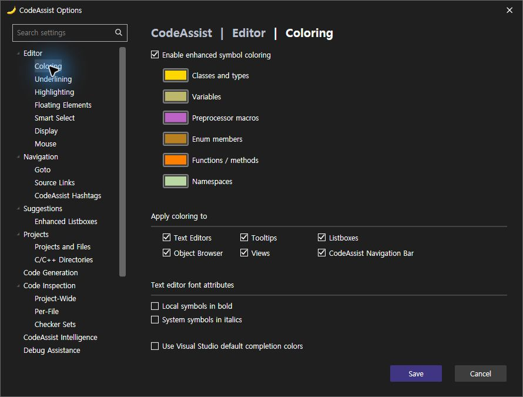

CA159 수정 전

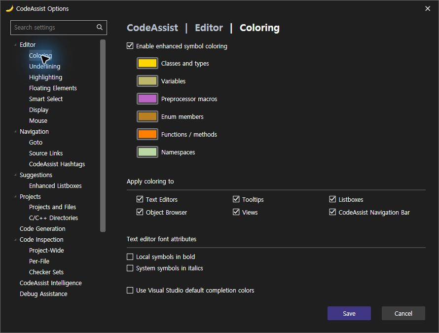

CA160 시안 — 긴 문구 잘림으로 재수정

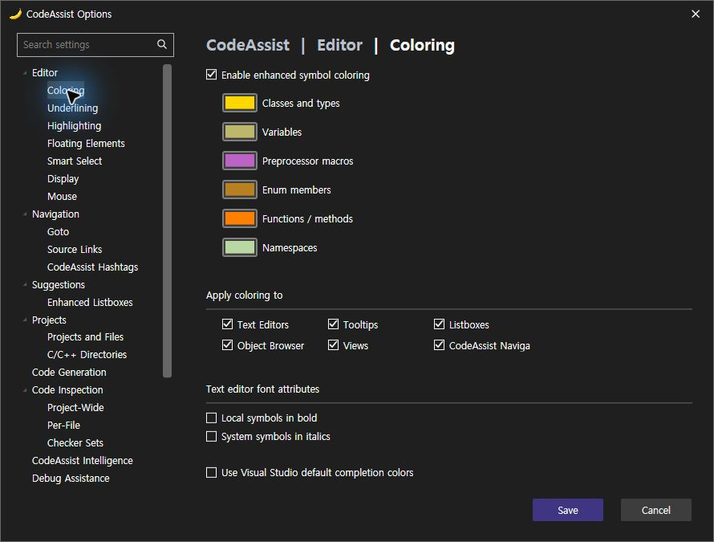

## 0.0.162 화살표 Undo 차이 수정

타이핑한 점과 자동 변환을 별도 Undo 단계로 분리했습니다. 실제 동일 스마트 포인터에서 pointer → pointer-> → pointer. → pointer 네 상태의 전체 문서와 커서가 VA·CA에서 정확히 같았습니다:4/4상태(100%). 원래 시험 소스와 CA ConvertDotToArrow=false 설정을 원복했습니다. CA와 VA 모두 미저장 문서0개입니다.

VA 첫 Undo

CA162 첫 Undo

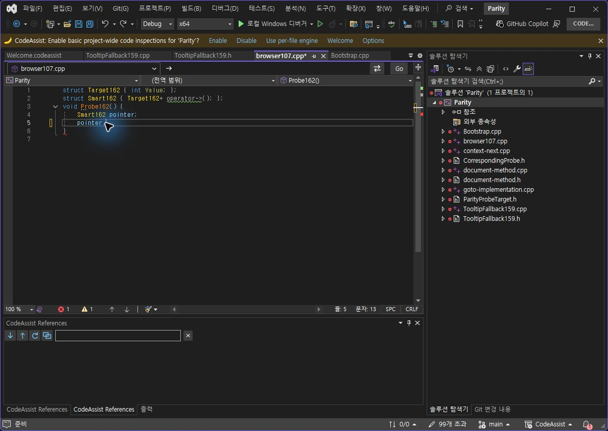

VA 두 번째 Undo

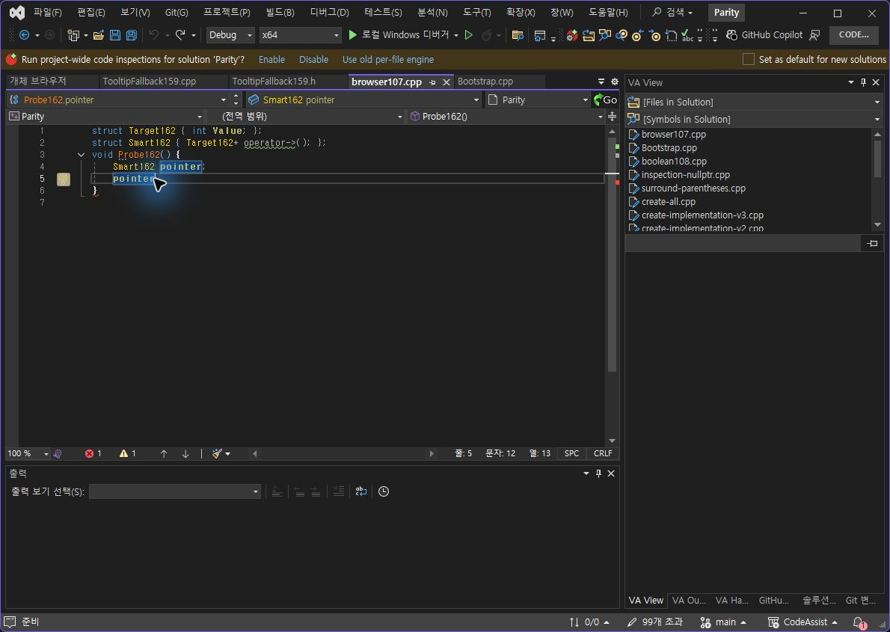

CA162 두 번째 Undo

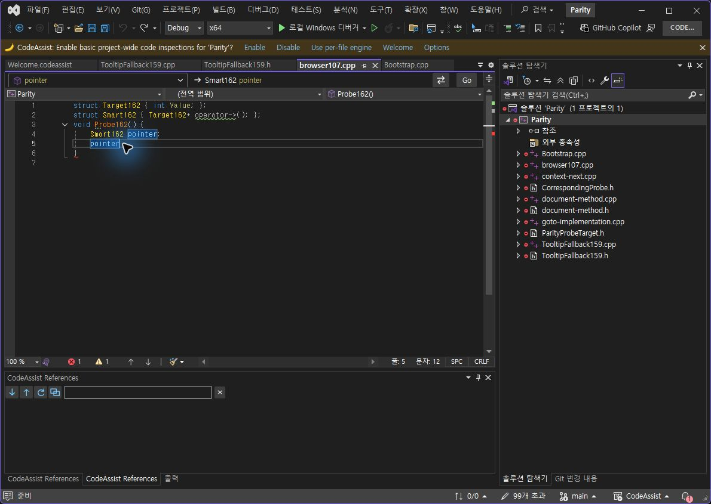

최신 설치0.0.162 · 실제 로드 DLL · 최신440/440 테스트

## 입력 문제 진단

VA를 정상 종료하고 CA만 실행한 상태에서 같은 색상 사용자 편집기를 열었습니다. Tab 후 포커스는 Hex에 남았고 UIA set_value는 cached app state 오류를 냈습니다. 따라서 두 VS 동시 실행이 원인이라는 가설은 입증되지 않았습니다. 원인은 계속 미확인입니다. 시도한 사용자 색상 변경은 취소했습니다.

## 검사와 남은 범위

Core 자동 테스트440/440(100%), 패키지 바이너리6개 및 단축키 등록48개 검사 통과. 문서·도움말 부분 명세108/108(100%)이며 전체 역분석 완료율과 다릅니다. 스니펫 VA 실행 대조, 실제 키 홀드 반복률, 추천 아이콘·설명과 전체108개 최신 실행 검증은 남아 있습니다. 전체 제품 유사도는 이 부분 표본으로 산출하지 않습니다.

판정 JSON · 자동 테스트 · 최종 설치 바이너리 · 최종 CLR 모듈 · VA 격리 근거

XERJ: 사용 — ColorSelectionPopup 검색은 오래된 비관련 결과여서 현재 소스를 rg로 대조했습니다.

제안 시간20~30분. 실제 작업 시간은 summary.json의 recordedAt·elapsedSeconds를 참조하십시오. 전체 목표는 진행 중입니다.

제안 시간:20~30분. 이번 수정·검증 기록 소요: 30.6분, 기록시각 2026-10-24T09:47:28.9274301+09:00 (KST). 전체 목표는 미완료이며 진행 중입니다.

## 원문과 편집 이력

[보존된 원문 열기](../assets/imports/docs/validation/options-160/index.html)

- 원문 SHA-256: `d5f18a61f8f422161b4513658eaf6cdfc9e5290ca7a2bdaa66613c045242a322`
- 표시 날짜는 원본 파일의 수정 시각입니다. 작업 완료 시각은 원문에 있는 값을 기준으로 확인합니다.
