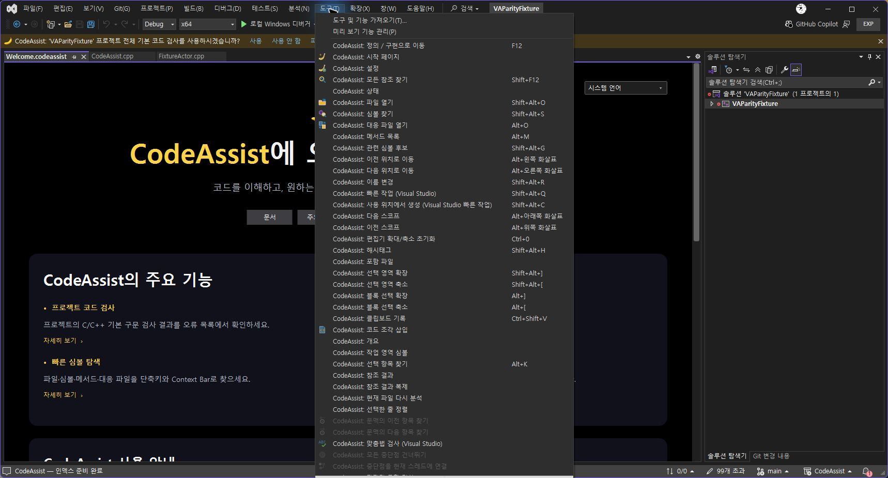
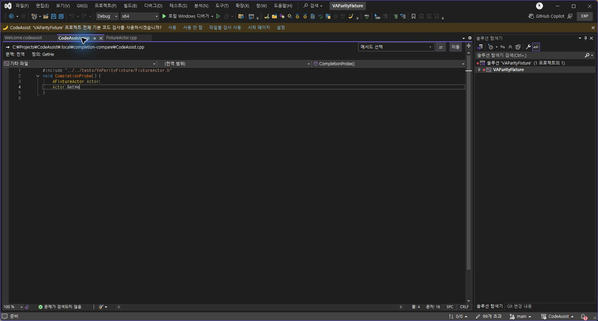

> 보관 기록입니다. 아래 결과는 원문 작성 시점의 내용이며, 이번 편집에서 제품 테스트를 다시 실행하지 않았습니다.

CodeAssist 0.0.84 · 시스템 언어 적용

## 0.0.84 시스템 언어 적용

언어 설정이 ‘시스템 언어(auto)’일 때 현재 UI 문화권을 사용합니다. 한국어 시스템에서는 한국어, 영어 시스템에서는 영어로 표시합니다. 명시적으로 선택한 언어는 시스템 언어보다 우선합니다. 번역은 CodeAssist.Core/Localization/ui.xml에서 관리합니다.

- 도구 메뉴와 동일 명령의 컨텍스트 메뉴: 74개 동적 번역 연결.

- 상단 안내바: 메시지와 사용·사용 안 함·파일별 검사 사용·시작 페이지·설정.

- 편집기 상단: 문맥·전역·정의·이동·메서드 선택·대응 파일 툴팁.

- 도구 모음 툴팁 12개: 번역된 메뉴 캡션도 인식하도록 연결 보완.

## 실제 한국어 설치본

## 검증

소스 테스트 267개 통과. ko/ko-KR/en/en-US 명령 테이블과 시스템 문화권 선택 검사 포함. 설치 DLL의 MVID와 일치하는 실제 편집기 검사 14개 통과. 설치 바이너리 6개 해시 일치. 실제 한국어 메뉴 74개 및 툴팁 12개 등록 기록을 확인했습니다. 영어 Visual Studio 실행 대조는 수행하지 않았습니다.

검증 기록 · 실제 편집기 검사 · 메뉴 번역 실행 기록

## 명령별 한국어 표시

| ID | 표시 문구 |
| --- | --- |
| 0x1c0 | CodeAssist: 시그니처 변경 (매개변수 순서 변경) |
| 0x1c1 | CodeAssist: 메서드 구현을 소스 파일로 이동 |
| 0x18b | CodeAssist: 지역 포인터 / 인스턴스 변환 |
| 0x18c | CodeAssist: 메서드 추출 |
| 0x196 | CodeAssist: 커서 위치의 빠른 수정 |
| 0x197 | CodeAssist: 빠른 수정 창 |
| 0x1b0 | CodeAssist: 플러그인 작업 |
| 0x190 | CodeAssist: PDB 탐색기 |
| 0x191 | CodeAssist: 주소 해석 (RVA) |
| 0x192 | CodeAssist: 메모리 보기 |
| 0x193 | CodeAssist: 파일 미리 보기 |
| 0x194 | CodeAssist: 컬러 인쇄 |
| 0x195 | CodeAssist: 매개변수 정보 |
| 0x180 | CodeAssist: 인스턴스 선언 간소화 |
| 0x181 | CodeAssist: 필드 캡슐화 |
| 0x182 | CodeAssist: 멤버 추가 |
| 0x183 | CodeAssist: 유사 멤버 추가 |
| 0x184 | CodeAssist: using 지시문 추가 |
| 0x185 | CodeAssist: 중괄호 추가 / 제거 |
| 0x186 | CodeAssist: 선언 생성 |
| 0x187 | CodeAssist: 구현 생성 |
| 0x188 | CodeAssist: 메서드 구현 생성 |
| 0x189 | CodeAssist: 가상 메서드 구현 |
| 0x18a | CodeAssist: 누락된 case 문 추가 |
| 0x17b | CodeAssist: 소스 링크 열기 |
| 0x171 | CodeAssist: 멤버로 이동 |
| 0x172 | CodeAssist: 파일 생성 |
| 0x173 | CodeAssist: 파일 이름 변경 |
| 0x174 | CodeAssist: 선택 영역을 새 파일로 이동 |
| 0x175 | CodeAssist: 코드 조각으로 감싸기 |
| 0x176 | CodeAssist: 선택 영역에서 코드 조각 생성 |
| 0x177 | CodeAssist: 하이퍼링크 열기 |
| 0x178 | CodeAssist: 메서드 문서화 |
| 0x179 | CodeAssist: include 추가 |
| 0x17a | CodeAssist: 전방 선언 추가 |
| 0x160 | CodeAssist: 편집기 통합 검사 |
| 0x140 | CodeAssist: 시작 페이지 |
| 0x141 | CodeAssist: 설정 |
| 0x11e | CodeAssist: 선택한 줄 정렬 |
| 0x11d | CodeAssist: 현재 파일 다시 분석 |
| 0x11b | CodeAssist: 참조 결과 |
| 0x11c | CodeAssist: 참조 결과 복제 |
| 0x11a | CodeAssist: 선택 항목 찾기 |
| 0x118 | CodeAssist: 개요 |
| 0x119 | CodeAssist: 작업 영역 심볼 |
| 0x117 | CodeAssist: 코드 조각 삽입 |
| 0x116 | CodeAssist: 클립보드 기록 |
| 0x110 | CodeAssist: 해시태그 |
| 0x111 | CodeAssist: 포함 파일 |
| 0x112 | CodeAssist: 선택 영역 확장 |
| 0x113 | CodeAssist: 선택 영역 축소 |
| 0x114 | CodeAssist: 블록 선택 확장 |
| 0x115 | CodeAssist: 블록 선택 축소 |
| 0x10f | CodeAssist: 편집기 확대/축소 초기화 |
| 0x103 | CodeAssist: 파일 열기 |
| 0x104 | CodeAssist: 심볼 찾기 |
| 0x105 | CodeAssist: 대응 파일 열기 |
| 0x106 | CodeAssist: 메서드 목록 |
| 0x107 | CodeAssist: 관련 심볼 후보 |
| 0x108 | CodeAssist: 이전 위치로 이동 |
| 0x109 | CodeAssist: 다음 위치로 이동 |
| 0x10a | CodeAssist: 이름 변경 |
| 0x10b | CodeAssist: 빠른 작업 (Visual Studio) |
| 0x10c | CodeAssist: 사용 위치에서 생성 (Visual Studio 빠른 작업) |
| 0x10d | CodeAssist: 다음 스코프 |
| 0x10e | CodeAssist: 이전 스코프 |
| 0x100 | CodeAssist: 정의 / 구현으로 이동 |
| 0x101 | CodeAssist: 상태 |
| 0x102 | CodeAssist: 모든 참조 찾기 |
| 0x150 | CodeAssist: 문맥의 이전 항목 찾기 |
| 0x151 | CodeAssist: 문맥의 다음 항목 찾기 |
| 0x152 | CodeAssist: 맞춤법 검사 (Visual Studio) |
| 0x153 | CodeAssist: 모든 중단점 건너뛰기 |
| 0x154 | CodeAssist: 중단점을 현재 스레드에 연결 |

전체 VA 유사도 미측정, 부분 대응108/108·완전 검증0/108. 문서 기반 부분 명세108/108, 전체 역분석 완료율 미확인. 전체 기능·미지원 옵션·리팩터링·성능 대조는 남아 있습니다.

[작업 인계](../assets/imports/docs/handoff.html)

## 원문과 편집 이력

[보존된 원문 열기](../assets/imports/docs/localization-0.0.84.html)

- 원문 SHA-256: `bd1d6932c4a096da3af16681c2a192950d0100eccee44b1816d47cab3d8a865d`
- 표시 날짜는 원본 파일의 수정 시각입니다. 작업 완료 시각은 원문에 있는 값을 기준으로 확인합니다.
