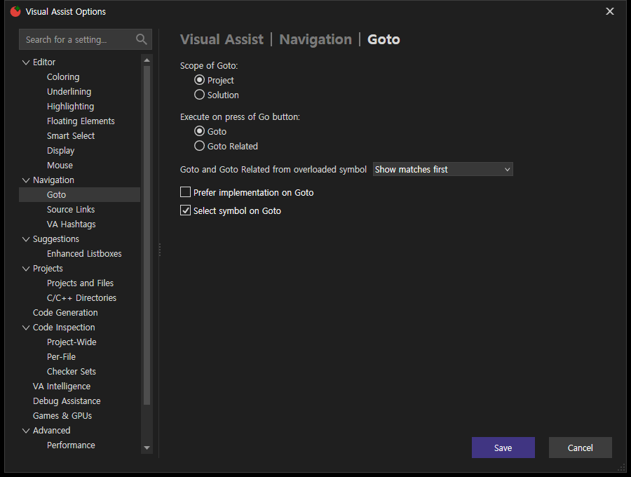
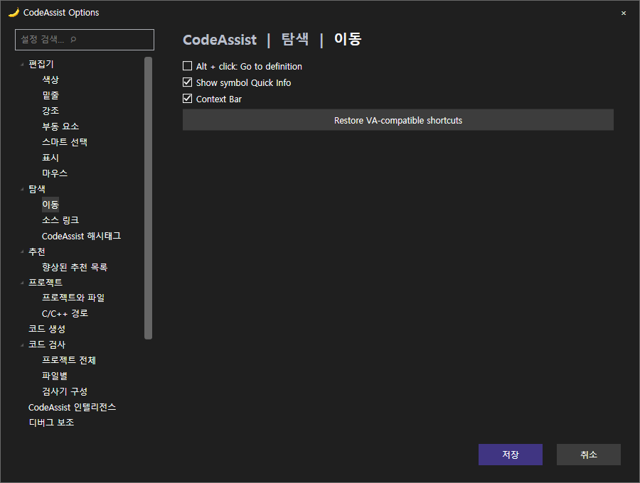
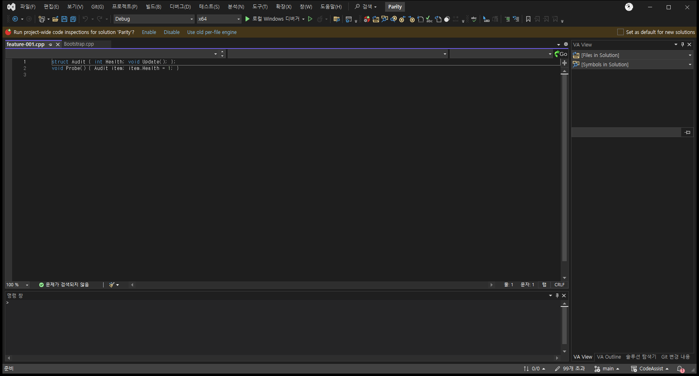
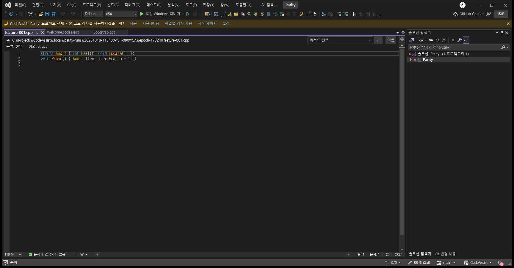
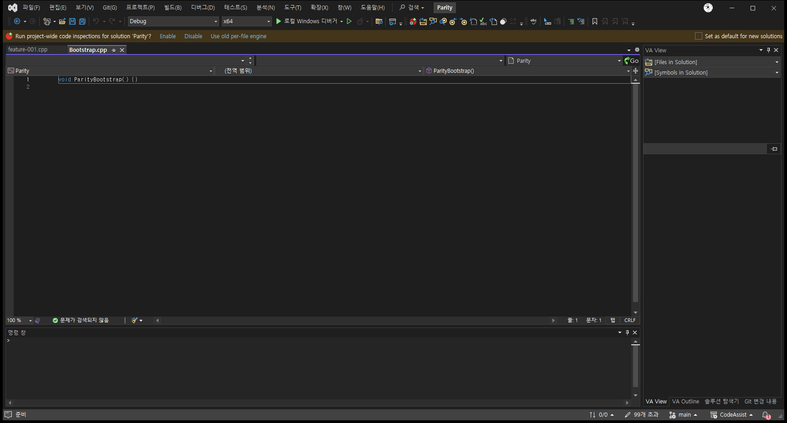
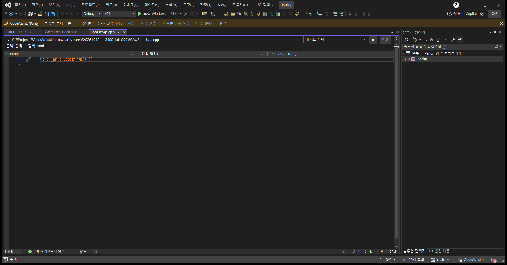

> 보관 기록입니다. 아래 결과는 원문 작성 시점의 내용이며, 이번 편집에서 제품 테스트를 다시 실행하지 않았습니다.

## feature-001 · Goto

동일 페이지 픽셀 비교 (동작 일치 판정 아님) · **76.59%**

VA 근거: 20261018-021854-OptionsVerified / feature-001 · CA: 20261018-113400-full-090 / PID 17324

dialog

VA · dialog

CA · dialog

before

VA · before

CA · before

after

VA · after

CA · after

## 원문과 편집 이력

[보존된 원문 열기](../assets/imports/docs/ui-comparison-0.0.90.html)

- 원문 SHA-256: `6e6653b8284ec4491cad1f97ef4e9164e87900e859c23695086329ba672b0c54`
- 표시 날짜는 원본 파일의 수정 시각입니다. 작업 완료 시각은 원문에 있는 값을 기준으로 확인합니다.
