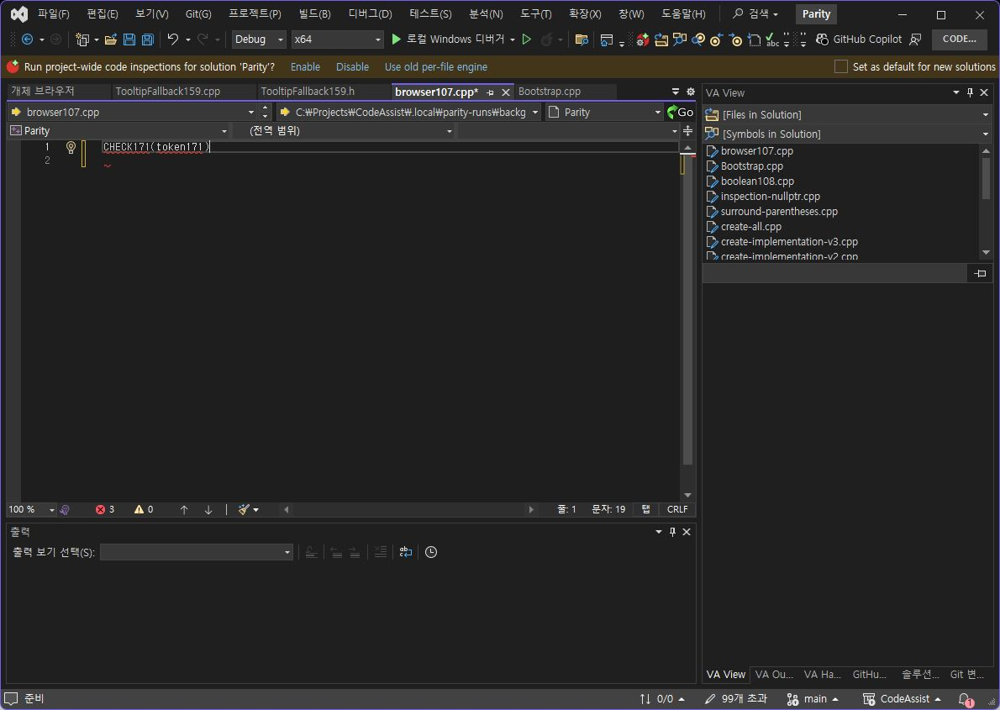
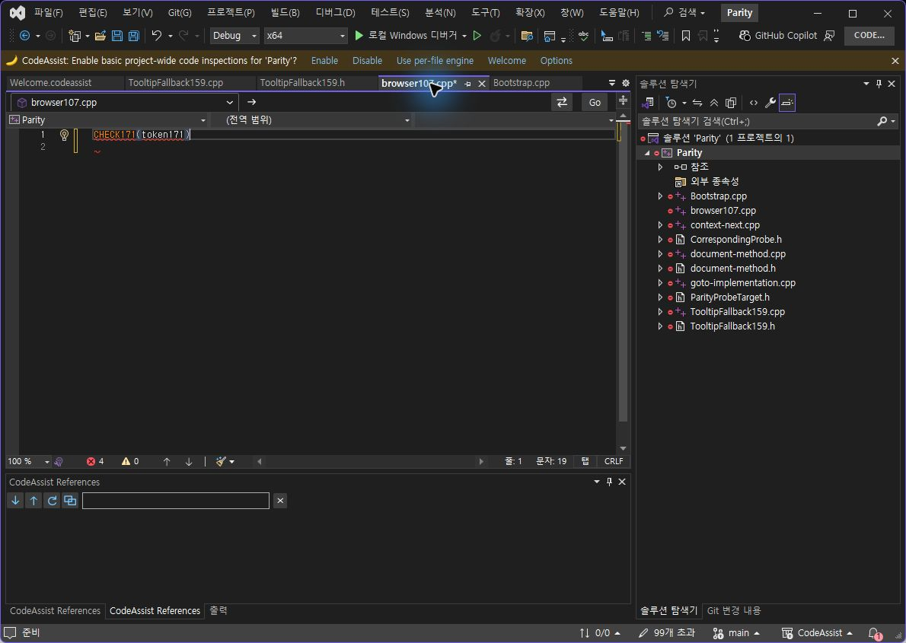
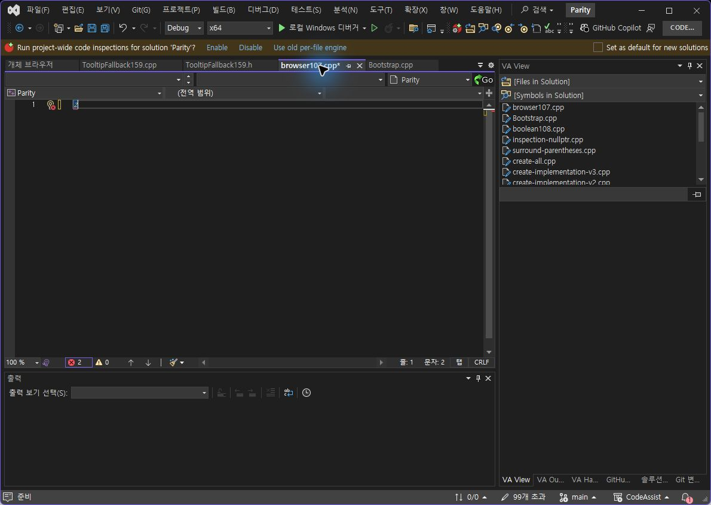
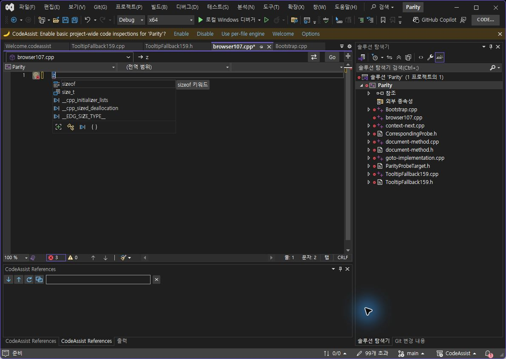

> 보관 기록입니다. 아래 결과는 원문 작성 시점의 내용이며, 이번 편집에서 제품 테스트를 다시 실행하지 않았습니다.

VA·CA 전체 집계와172 실제 검증

## 전체 카탈로그 집계와 최신172 검증

**마지막 전체108개 대표 동작 실측 일치율: 15.74% (17/108개)**. 차이 91/108개, 미판정 0/108개. 기준 시각: 10/19/2026 12:24:09. 현재172의 제품 전체 동기화율로 주장하지 않습니다. 108개 고유 ID와 분모를 실제 JSON에서 검산했습니다.

**최신 선정 옵션 누적 검증: 91.67% (11/12개)**. 기존10개 표본에 이번 With Snippets 켜짐·꺼짐 검증1개를 더했습니다. 전체108개 동기화율과 분모가 다릅니다. 문서·도움말 부분 명세108/108개(100%)이며 전체 역분석 완료율이 아닙니다.

## 이번 실제 실행

사용자가 허용한 임시 스니펫 하나로 token171 선택 후 z를 물리 입력했습니다. VA·CA 모두 켜짐은 CHECK171(token171)와 CRLF, 꺼짐은 z가 됐고 본문과 커서4/4개 기준(100%)이 일치했습니다. 초기171은 한 줄 문서에서 LF를 사용해 실패했습니다.172에서 편집기 NewLineCharacter 설정을 사용하도록 수정하고 동일 입력으로 재검증했습니다. 사용자 VA 스니펫 파일은 원래 바이트 해시로 복원했고 CA 검사 스니펫도 원복했습니다.

VA 켜짐

CA172 켜짐

VA 꺼짐

CA172 꺼짐

[VA 공식 스니펫 문서](https://www.wholetomato.com/documentation/code-snippets/va-snippets-for-surround-with)의 선택 영역·SurroundWith 문자 동작을 참고했습니다. 검사 스니펫에는 사용자 내용 대신 자체 CHECK171 문구만 사용했습니다.

## 미검증과 실행 실패

키 홀드 반복률과 Ctrl/Shift를 유지한 마우스 클릭은 현재 Computer Use API가 지원하지 않습니다. press_key는 한 번의 조합 입력이고 click에는 modifier 매개변수가 없습니다. 다른 입력 주입 프로그램으로 우회하지 않았으며 단위검사를 물리 대조로 계산하지 않았습니다. 이 둘은 아직 미검증입니다. 최신172 전체108개 재인증도 시행하지 않았습니다.

VA 옵션 저장 뒤 검사 프로세스가 종료돼 재시작했습니다. Windows 오류 이벤트를 로컬에 보관했으며 원인까지 단정하지 않습니다. 재시작 후 With Snippets 꺼짐 입력은 실제로 확인했고 원래 켜짐 값을 다시 저장했습니다. 사용자 스니펫과 검사 문서는 양쪽 원본 해시로 복원했습니다.

## 빌드·설치·푸시

전체 자동검사458/458개(100%), VS2019·Modern 빌드 성공, 검사 CA 설치 바이너리6개 일치, 단축키 등록48개 확인. 실제 실행한 CLR 모듈 경로·해시도172 설치본과 일치했습니다. 실제 UI 실행은 VS2022이며 VS2019 실행 인증은 아닙니다. 제품 소스161개 파일은8fdf90b로 GitHub main에 푸시했습니다. 사용자 스니펫·개인 파일·다운로드 바이너리는 커밋하지 않았습니다. 푸시 커밋만 새 폴더에 푼 재현 빌드에서 VS2019 Newtonsoft.Json 경로 의존성을 발견하여 Content 경로를 $(OutputPath) 기준으로 수정했습니다. 원래 실패 로그와 수정 후 빌드 로그를 구분해 보존했습니다.

집계 JSON · 과거108개 판정 · 자동검사 · 설치 · 실제 CLR 모듈

## 108개 과거 판정표

아래는 과거 실행 기록입니다. 최신 버전으로 재시험했다고 표시하지 않습니다.

| ID | 기능 | 과거 판정 | 근거 요약 |
| --- | --- | --- | --- |
| VA-F001 | Find by Context | representative-match | 같은 needle의 다음 참조로 이동: 텍스트·커서·선택 범위 일치 |
| VA-F002 | Find References | different | 코드 참조 2개 검색, 주석·문자열 제외, 두 번째 코드 참조 offset53으로 이동 모두 일치. VA는 이름 14자를 선택하며 CA는 커서만 이동. |
| VA-F003 | Find Symbol in Solution | different | 선택 심볼에서 실제 Find Symbol을 열었습니다. VA는 선택 이름을 초기 검색어로 채우고 CA는 빈 검색어로 시작했습니다. 이후 같은 SymbolFindProof107을 검색·선택해 양쪽 선언 파일로 이동하는 양성 동작까지 확인했습니다. Native 이름 선택 끝(24)과 CA 시작(6) 커서도 달랐습니다. |
| VA-F004 | GoTo Implementation | different | 양쪽 모두 정의로 이동. VA는 심볼 이름 16자를 선택하고 CA는 선택 없이 커서만 이동 |
| VA-F005 | GoTo Member | different | 두 번째 멤버 목적지는 일치. VA는 멤버 이름을 선택하고 CA는 커서만 이동 |
| VA-F006 | GoTo Related | different | 동일 파생 클래스에서 기반 클래스 RelBase103을 실제 선택했습니다. 양쪽 모두 같은 파일 첫 줄의 클래스 이름으로 이동하지만 VA는 이름을 선택하고 CA는 이름 앞에 커서만 둡니다. CA 인덱스에 해당 형식이 들어간 것을 먼저 확인했습니다. |
| VA-F007 | Highlight Current Line | representative-match | 동일 소스의 커서를 3행→2행으로 이동했을 때 현재 줄 테두리가 양쪽 모두 16px 위로 이동. VS 기본 표시를 포함한 구성 결과의 대표 비교이며 VA 고유 렌더러 인과 검증은 아님. |
| VA-F008 | List Methods in File | different | 두 번째 메서드 목적지는 일치. VA는 이름을 선택하고 CA는 커서만 이동 |
| VA-F009 | Move Scope | different | 이번 실제 OS 키 입력으로 대표 편집 시나리오 scope-next를 재실행했습니다. 전체 텍스트·커서·선택 범위를 양쪽 비교했습니다. 기능 전체·모든 경계의 인증은 아닙니다. |
| VA-F010 | Navigate Back and Forward | different | 같은 파일에서 정의 이동→뒤로→앞으로를 실제 명령으로 수행했습니다. 양쪽 모두 호출 위치(126)로 돌아오고 정의로 재이동하지만 정의 도착 커서는 VA 21, CA 5로 다릅니다. |
| VA-F011 | Open Corresponding File | representative-match | 프로젝트 포함·인덱스 준비 후 CorrespondingProbe.h → CorrespondingProbe.cpp 실제 경로와 전체 내용 일치 |
| VA-F012 | Open File in Solution | representative-match | 전용 Audit 테스트 솔루션에서 같은 ParityProbeTarget.h를 실제 검색·선택했습니다. 양쪽 모두 예상한 각자 테스트 경로와 파일 내용이 정확히 열렸습니다. 기존 결과 파일 링크만 있던 항목을 새 실행과 해시 연결로 보완했습니다. |
| VA-F013 | VA Hashtags | different | 태그가 있는 첫 줄로 양쪽 이동. VA는 태그를 선택하고 CA는 줄 시작으로 이동 |
| VA-F014 | VA Navigation Bar | different | 실제 편집기 탐색 표시에서 VA 문맥·정의 필드는 콤보박스이고 CA 대응 필드는 정적 텍스트입니다. 지역 변수의 문맥 계층과 초기화식 표시도 다릅니다. 이 판정은 해당 탐색 표시 구성의 차이이며 탐색 막대 전체 동작 인증은 아닙니다. |
| VA-F015 | Access to Refactoring Commands | different | 메서드 문맥에서 VA 전용 리팩터링 진입 항목은 실제 메뉴에 표시되지만 CA 전용 진입 항목은 없습니다. CA 개별 명령의 존재·실행과 문맥 메뉴를 통한 접근은 별개이며, 이 판정은 해당 접근 경로의 차이입니다. |
| VA-F016 | Change Signature | different | 두 매개변수 순서와 호출 인수 교체 후 전체 코드가 정확히 일치. 양쪽 컴파일·실행 반환값 5 유지, Undo 원문 복원. 적용 뒤 커서만 VA offset4/CA6으로 다름. |
| VA-F017 | Convert Between Pointer and Instance | different | VA는 동일 한 줄 지역 객체를 auto*와 -> 사용으로 변환. CA는 지원 구문 오류를 표시하고 원문 유지. CA 오류창 증거 별도 연결 |
| VA-F018 | Encapsulate Field | different | 동일 필드 커서에서 양쪽 캡슐화 적용·Undo 복원. VA setter 실행 후 getter=7 통과, CA는 매개변수 자기 대입(value=value)으로 getter=7 계약 실패. 양쪽 컴파일 성공. 기존 내부 참조의 getter 치환 여부도 다름. |
| VA-F019 | Extract Method | different | 동일 두 문장 선택·같은 MyMethod 시그니처로 추출 적용. 양쪽 컴파일·실행에서 StepOne→StepTwo 1회씩 유지, Undo 복원. 줄바꿈·들여쓰기·호출부 서식은 다름. |
| VA-F020 | Introduce Variable | different | 동일 상수 표현식 선택에서 VA는 subtotal 선언·표현식 교체 및 Undo 수행. CA 현재 런타임 74개 명령에 변수 도입 전용 명령이 없고, 대응 빠른 작업 실행 메뉴는 함수 추출만 제공. 이 fixture의 진입점/제공 작업 차이이며 모든 컴파일러 컨텍스트의 불가능 판정은 아님. |
| VA-F021 | Move Implementation to Header File | different | 양쪽 모두 CPP 구현을 헤더의 클래스 선언으로 이동하고 원래 CPP 정의를 제거했습니다. 실제 실행 Value()==7과 한 번의 Undo로 두 파일 복원에 통과했습니다. VA는 여러 줄·탭, CA는 한 줄·공백으로 구현을 배치해 서식이 다릅니다. 전용 미리보기 종료의 소유 창 포커스 복원을 적용했습니다. |
| VA-F022 | Move Implementation to Source File | different | 미리보기 종료 시 전용 소유 편집기의 포커스를 복원한 재검증에서는 양쪽 모두 헤더 본문을 CPP로 옮겼고 Value()==7 실제 컴파일·실행과 한 번의 Undo 복원에 통과했습니다. 남은 차이는 선언 들여쓰기·구현 줄바꿈 등 서식입니다. 이전 적용 실패는 비활성 검증 환경의 포커스 영향으로 구분해 이력에 보존했습니다. |
| VA-F023 | Move Method Implementations to Source File | different | 같은 클래스의 두 메서드 전체를 양쪽 모두 CPP로 옮겼고 First()+Second()==15 실제 실행에 통과했습니다. 원복에는 VA가 Undo 두 번, CA는 한 번이 필요하며 구현 서식도 다릅니다. Native 선택 창의 두 메서드 체크와 CA의 2개 구현 미리보기를 확인했습니다. |
| VA-F024 | Move Selection to New File | different | 선택한 함수가 양쪽에서 실제 새 파일로 이동하고 생성 헤더 단독 컴파일·실행은 성공했습니다. VA는 #pragma once를 추가하고 include 선택 항목을 제공하며, CA의 생성 파일과 형식·대화상자 구성이 다릅니다. VA 기본 include 체크는 꺼진 상태로 비교했으며 전체 호출 원본 빌드 성공으로 확대하지 않습니다. |
| VA-F025 | Rename | representative-match | 이전의 단축키 미수신 기록을 실제 이름 변경 결과로 대체했습니다. VA Rename과 CA가 호출한 VS Rename에서 같은 지역 변수 renameProbe107을 renamedProbe107로 바꾸었고 선언·참조 두 군데 및 최종 전체 텍스트가 일치했습니다. 단축키 배정은 F103으로 분리하며 다중 파일·충돌·오버로드 전체 인증은 아닙니다. |
| VA-F026 | Rename Files | different | 소유한 프로젝트의 h/cpp 한 쌍에서 실제 이름 변경: VA는 관련 헤더와 cpp 둘 다 새 이름으로 바꿨습니다. CA는 헤더만 바꾸고 cpp 이름을 유지했습니다. include의 미저장 버퍼 및 소스 제어 반영은 이 판정에 포함하지 않습니다. |
| VA-F027 | Simplify Instance Declaration | different | 코드 단순화 결과는 동일. 변경 후 선택 범위와 Undo 뒤 선택 상태가 다름 |
| VA-F028 | Add Forward Declaration | different | 공식 문서의 실제 VA Quick Action 메뉴에서 Add Forward Declaration을 실행하면 포함 클래스 바깥 파일 상단에 선언을 삽입합니다. CA 대응 명령은 커서 줄 앞에 삽입해 포함 클래스 안에 중첩 선언을 만듭니다. 이전 직접 명령 E_FAIL은 기능 부재로 판정하지 않고 실제 메뉴 실행으로 대체했습니다. |
| VA-F029 | Add Member | different | 동일 클래스 이름 커서에서 int addedField 생성: VA는 클래스 내부 public 멤버를 추가, CA는 클래스 밖 전역 변수 생성. 실제 멤버 접근 컴파일·실행 VA 통과, CA C2039. 양쪽 Undo 원문 복원. |
| VA-F030 | Add Missing Case Statements | different | 동일 switch 커서 조건에서 VA는 Running/Done/default case를 생성하고 Undo로 원문 복원. CA는 enum 입력 뒤 unsupported syntax 경고를 표시하며 실제 버퍼는 변경되지 않음. 완전한 switch 선택 조건의 추가 검증은 별도. |
| VA-F031 | Add Similar Member | different | 양쪽 secondField 멤버 생성 및 실제 멤버 접근·값 유지 실행 통과, Undo 원문 복원. 생성 코드/선택 상태에 차이. |
| VA-F032 | Add Using Directive | different | 공식 문서 조건대로 VA C# 추천을 켜고 StringBuilder를 실제 문자 메시지로 입력하자 using System.Text; 추천이 나왔습니다. 실제 수락 후 파일 상단에 using이 추가되고 C# 컴파일을 통과했습니다. CA 대응 명령은 C# 문서에 변경을 만들지 않았고 동일 원문은 미해결 StringBuilder로 컴파일 실패했습니다. 이 기능은 C++ using namespace와 구별했으며 VA C# 옵션은 원래 OFF로 복원했습니다. |
| VA-F033 | Add include Directive | different | include 추가 전체 텍스트는 동일. 적용 뒤 커서 위치가 다름 |
| VA-F034 | Add/Remove Braces | different | 양쪽 모두 괄호 추가 코드는 MSVC 구문 검사 통과. 줄바꿈·들여쓰기·선택 상태가 다름 |
| VA-F035 | Create Declaration | different | VA는 클래스 내부에 멤버 선언 생성. CA는 클래스 밖 전역 선언 생성. MSVC: VA 통과, CA C2039 오류 |
| VA-F036 | Create File | different | 짝 없는 동일 헤더에서 실제 cpp 생성: VA 기본 후보는 같은 이름의 cpp이며 생성 내용에 헤더 include를 넣습니다. CA 기본 후보는 NewFile.cpp이고 지정한 cpp를 빈 내용으로 생성합니다. 파일이 실제 생성·열린 결과로 확인했습니다. |
| VA-F037 | Create from Usage | different | 동일한 미정의 멤버 호출 MissingAction103(7)에서 VA는 int 인수를 추론하고 private 메서드 본문을 실제 삽입했습니다. CA의 등록된 Create From Usage 명령은 VS Quick Actions로 위임하지만 이 조건에서 코드 생성 없이 원본을 유지했습니다. 본문 생성 동작의 대표 시나리오이며 class·enum 등 전체 생성 종류를 검증한 것은 아닙니다. |
| VA-F038 | Create Implementation | different | 동일 헤더 멤버 선언에서 구현 생성: VA는 대응 cpp에 정의, CA는 헤더 끝에 non-inline 정의를 추가. 헤더를 두 번역 단위에서 사용하는 링크 검사: VA 통과, CA 중복 정의 LNK2005 실패. 양쪽 Undo 원문 복원. |
| VA-F039 | Create Method Implementations | different | 동일 클래스 이름 커서에서 VA는 선택된 First/Second 두 구현을 대응 cpp에 생성하고 두 함수 호출 링크·실행 통과. CA는 owner 입력 뒤 unsupported syntax 경고, 구현이 없어 링크 실패. VA는 대상 cpp에서 Undo 2회로 원문 복원(메서드별 Undo). |
| VA-F040 | Document Method | different | 동일 헤더 메서드에서 VA Method/FullName 주석과 CA Doxygen 주석 생성 형식이 다름. Undo 원문 복구 확인 |
| VA-F041 | Implement Interface / Virtual Methods | different | 동일 파생 클래스 이름 커서에서 구현 실행. VA는 클래스 내부 override 생성, CA는 클래스 이름 중간에 구현을 삽입해 문법 오류. VA 생성 템플릿 의존성 stdexcept를 테스트 하네스에 포함해 인스턴스화 검증: VA 통과, CA 컴파일 실패. 양쪽 Undo 복원. |
| VA-F042 | Acronyms | different | 약어 AALTN에서 VA는 전체 타입 이름을 완성. CA는 AcronymCompletionEnabled=true인데 Tab만 삽입 |
| VA-F043 | Auto-Extend Multi-Line Comments | representative-match | 기존 단일 행 주석 예제를 다중 행 주석으로 교체해 재검사했습니다. 양쪽 옵션을 켜고 /* 주석의 두 번째 줄 끝에서 실제 Enter를 입력하자 같은 새 줄과 별표 접두사가 생성됐습니다. VA의 VS 기능 비활성화 제안은 거절해 기존 VS 설정을 유지했고 양쪽 옵션은 false로 복원했습니다. 내장 VS와의 제공자 분리는 별도 범위입니다. |
| VA-F044 | Enhanced Listboxes | different | 이번 실제 OS 키 입력으로 대표 편집 시나리오 completion를 재실행했습니다. 전체 텍스트·커서·선택 범위를 양쪽 비교했습니다. 기능 전체·모든 경계의 인증은 아닙니다. |
| VA-F045 | Format After Paste | different | 실제 동일 다중 행 텍스트를 Ctrl+V로 붙여넣었습니다. VA는 탭 들여쓰기로 변환했고 CA는 공백 들여쓰기였습니다. 한 번의 Ctrl+Z 후에도 VA는 서식화된 선택 영역, CA는 서식 전 붙여넣은 텍스트가 남아 Undo 단위도 달랐습니다. 기본 VS 자동 서식의 영향과 제품 옵션 전체 동등성은 분리하며, 실제 출력 차이만 판정했습니다. |
| VA-F046 | Insert () and Closing Brackets and Quotes | representative-match | 이번 실제 OS 키 입력으로 대표 편집 시나리오 pair-insert를 재실행했습니다. 전체 텍스트·커서·선택 범위를 양쪽 비교했습니다. 기능 전체·모든 경계의 인증은 아닙니다. |
| VA-F047 | Insert _ After m and Shift | representative-match | 실제 옵션을 켠 상태에서 m 입력 후 일반 Shift down/up 메시지를 전용 편집기에 전달했습니다. 양쪽 모두 m_로 바뀌고 커서가 한 칸 이동했으며 한 번의 Undo로 m이 복원됐습니다. 로컬 UI 스레드 키 상태와 원래 옵션도 복원했습니다. 물리 키 입력 검증은 아니며 처음 사용한 LShift 전용 가상 키는 원본에서 반응하지 않아 정상 일반 Shift 메시지로 재검사했습니다. |
| VA-F048 | Multiple Clipboards | different | 동일한 Alpha→Beta 문자열을 실제 Ctrl+C로 복사한 뒤 실제 기록 메뉴에서 Enter로 붙여넣었습니다. VA는 이전 메뉴 선택 상태의 Alpha를, CA는 최신 Beta를 붙여넣었습니다. 둘 다 기록에서 붙여넣는 양성 동작을 확인했습니다. 현재 선택 상태를 포함한 대표 결과 차이이며 공장 초기 선택값 비교는 아닙니다. 재실행 직전 클립보드 복원은 확인했지만 초기 타임아웃의 원래 사용자 클립보드 복원은 확인하지 못했습니다. |
| VA-F049 | Reset Editor Zoom | different | 이번 실제 OS 키 입력으로 대표 편집 시나리오 reset-zoom를 재실행했습니다. 전체 텍스트·커서·선택 범위 및 140→100 줌를 양쪽 비교했습니다. 기능 전체·모든 경계의 인증은 아닙니다. |
| VA-F050 | Shorthand | different | 축약 ShALoTyNa에서 VA는 전체 타입 이름을 완성. CA는 ShorthandCompletionEnabled=true인데 Tab만 삽입 |
| VA-F051 | Smart Select | different | 이번 실제 OS 키 입력으로 대표 편집 시나리오 smart-select를 재실행했습니다. 전체 텍스트·커서·선택 범위를 양쪽 비교했습니다. 기능 전체·모든 경계의 인증은 아닙니다. |
| VA-F052 | Smart Suggestions | representative-match | bool 대입 문맥에 tru를 입력하고 양쪽 실제 추천의 true를 선택했습니다. VA 고유 목록은 촬영으로 true 한 행을 확인했고 CA 목록은 CodeAssist expected-type literal 출처를 확인했습니다. 삽입 본문·커서·선택 범위가 같고 컴파일·실행도 모두 성공했습니다. bool 대표 사례이며 enum·생성자·인자 전체 인증은 아닙니다. |
| VA-F053 | Sort Selected Lines | different | 같은 세 줄 전체를 선택해 실제 정렬 대화상자를 승인했습니다. VA는 alpha/bravo/charlie 순서로 정렬했고 CA는 승인 후에도 원래 charlie/alpha/bravo가 남았습니다. VA 정렬 Undo 복원도 확인했습니다. 양쪽 무반응을 일치로 처리하지 않았으며 소스에 보이는 중복 이벤트만으로 원인을 단정하지 않습니다. |
| VA-F054 | Suggestion Lists | representative-match | 동일 함수 안 최근 지역 변수 nearbyValue103을 원본의 실제 추천 이미지와 CA CodeAssistPreview 세션에서 확인하고 수락했습니다. 완성 본문·커서·선택이 일치하고 실행 결과 7도 같습니다. 최근 지역 변수 대표 사례이며 C# 병합·모든 선택 규칙 전체 인증은 아닙니다. |
| VA-F055 | Surround Selection | different | 이번 실제 OS 키 입력으로 대표 편집 시나리오 surround-word를 재실행했습니다. 전체 텍스트·커서·선택 범위를 양쪽 비교했습니다. 기능 전체·모든 경계의 인증은 아닙니다. |
| VA-F056 | Surround With | representative-match | 선택한 1 + 2에 괄호 문자를 입력하면 양쪽 모두 (1 + 2)로 감싸고 커서·선택 상태가 같습니다. Undo 후 원문과 원래 선택 영역도 일치합니다. 괄호 한 가지 표본이며 다른 감싸기·물리 입력 전체 인증은 아닙니다. |
| VA-F057 | Column Indicator | different | 같은40열 설정에서 두 제품의 가이드 위치는 1픽셀 범위 안입니다. VA는 x=282의 1픽셀 점선(5픽셀 간격), CA는 x=281~282의 연속선으로 나타납니다. 이전 70% 연속선 검출 기준이 VA 점선을 놓친 분석 오류를 수정했으며, 가이드 미표시로 판정하지 않았습니다. 설정은 원복했습니다. |
| VA-F058 | Context Field | different | 동일 멤버·지역 변수에서 VA는 네임스페이스·클래스·함수까지 문맥 경로를 표시하지만 CA는 클래스명만 표시합니다. 미해결 심볼에서 VA 문맥은 비고 CA는 클래스명을 유지합니다. |
| VA-F059 | Definition Field | different | 지역 변수에서 VA 정의 필드는 초기화식까지 표시하지만 CA는 형식과 이름만 표시합니다. 미해결 심볼에서 VA는 빈 필드이고 CA는 입력 이름을 표시합니다. |
| VA-F060 | Enhanced Syntax Coloring | different | 최종 렌더링에서 VA 매크로는 보라색이고 CA는 일반 식별자 색. 클래스·함수의 노랑/주황은 유사. VA 최종 색은 기본 분류 맵과 달라 실제 렌더링으로 판정 |
| VA-F061 | Local Symbols in Bold | different | CA 로컬 굵게 실제 켜기 전/후 비교: localCounter는 400→700이며 VA와 글리프가 정확히 일치. std::vector 변수 values의 선언부는 CA 400으로 남고 VA 굵게 렌더링과 다름. 같은 void 키워드 글리프는 전후 모두 일치. 원래 설정 복원. |
| VA-F062 | Highlight Find Results | representative-match | 주석 두 곳의 FindAudit103을 실제 IDE Find API로 검색했습니다. 양쪽 모두 첫 항목(3~15)을 선택하고 두 번째 항목(24~36)에 Matched Selected Text 태그를 표시했습니다. 이 대표 검색 동작은 같으며, IDE 공통 동작이 포함된 결과입니다. VA 고유 구현 전체·실제 Ctrl+F·ESC 및 Find in Files 전체 검증으로 확대하지 않았습니다. |
| VA-F063 | Highlight Matching Words | different | VA의 주석·문자열 matching words 옵션을 실제 켜고 주석 단어에 커서를 두면 다른 동일 단어가 노란색으로 강조되고 커서를 떠나면 원복됩니다. CA는 같은 자동 강조가 없으며 현재 줄 배경 변화만 보였습니다. 수동 Find Selected 명령과 구분했고 VA 설정은 원래 값으로 복원했습니다. |
| VA-F064 | Highlight References to Symbol Under Cursor | different | 양쪽 참조 강조를 실제 활성화하고 VA 추가 확인창을 아니요로 처리. 동일 value 두 곳(35,58)을 강조하나 VA 배경 RGB17/61/111, CA82/74/34로 다름. VS 기본 강조가 VA와 함께 켜진 구성 결과이며 VA 고유 마커 인과성은 별도. 양쪽 원래 꺼짐 설정 복원 확인. |
| VA-F065 | Parameter Info | different | 자체 경고가 없고 실제 편집기 파일·포커스가 맞는 새 실행에서 표준 Parameter Info 명령을 재검증했습니다. VA는 두 번째 인수를 선택한 함수 서명 도움말을 표시하지만 CA는 E_ABORT를 반환하고 서명 세션이 없습니다. 다른 트리거·언어 전체 인증은 아닙니다. |
| VA-F066 | Print in Color | different | 양쪽의 실제 인쇄 명령으로 Microsoft Print to PDF 출력을 만들고 PDF를 렌더링·분석했습니다. 두 프로그램 모두 색상 출력은 작동하지만 VA는 키워드 파랑·주석 초록·메서드 적갈색과 파일명/행 번호를 출력했고, CA는 키워드·주석 검정·클래스 노랑·메서드 주황이며 머리말/행 번호가 없습니다. 실제 사용자 전경 창과 입력 데스크톱은 유지되었습니다. 선택 영역의 문맥 제한까지 인증한 것은 아닙니다. |
| VA-F067 | Quick Info | different | 자체 경고가 없고 실제 편집기 파일·포커스가 맞는 새 실행에서 표준 Quick Info 명령을 재검증했습니다. VA는 클래스 정보 팝업을 표시하지만 CA는 같은 명령 후 세션·팝업이 없습니다. 마우스 hover 및 공급자 직접 호출과는 구분한 표준 명령 경로의 차이입니다. |
| VA-F068 | System Symbols in Italics | different | 양쪽 시스템 기울임 옵션을 켠 상태의 실제 std::vector 렌더링 대조. VA는 시스템 타입을 색상·기울임으로 표시, CA는 vector가 일반 identifier/Normal로 남아 표시가 다름. 원인은 이 fixture의 시스템 심볼 인식 단계까지 확인했으며 전체 헤더 범위는 미검증. CA 원래 옵션 복원. |
| VA-F069 | Convert Dot to -> | different | 이번 실제 OS 키 입력으로 대표 편집 시나리오 dot-to-arrow를 재실행했습니다. 전체 텍스트·커서·선택 범위를 양쪽 비교했습니다. 기능 전체·모든 경계의 인증은 아닙니다. |
| VA-F070 | Highlight Files in Output Window | different | 검증기의 분류 요청을 전체 버퍼에서 실제 줄 단위로 수정했습니다. 실제 Build Output에서 VA는 프로젝트 파일 경로 1개만 vax_type_build_output_alt로 강조했고, CA는 프로젝트 파일과 외부 경로 2개를 모두 강조했습니다. 원본 양성 대조와 실제 표시 분류를 확보했으며 외부 경로 처리에 차이가 있습니다. |
| VA-F071 | Highlight Matching Braces and Parentheses | representative-match | 실제 전경 편집기에서 OS 방향키로 같은 함수 중괄호에 이동했습니다. VA 고유 vax_type_brace_matching 태그와 CA 고유 Matched Brace 태그가 같은 두 범위(24,40)를 강조했습니다. IDE 진단 태그는 제외했습니다. 색상·중첩·주석·다른 괄호 전체 일치로 확대하지 않습니다. |
| VA-F072 | Highlight Mismatching Braces and Parentheses | different | 공식 문서처럼 불균형 괄호 쌍 내부에 커서를 두고 실제 방향키를 입력했습니다. VA는 {와 잘못된 ) 두 위치(35,55)에 고유 vax_type_brace_error 태그를 표시했습니다. 같은 커서의 CA는 대응 쌍 강조 없이 닫는 괄호의 별도 구문 진단만 표시했습니다. IDE 진단을 제품 강조로 세지 않았습니다. |
| VA-F073 | Repair Case | different | 실제 포커스·파일이 확인된 전용 WPF 창에 같은 WM_CHAR 입력을 보냈습니다. 형식 이름은 양쪽 모두 보정하지만 일반 변수 mixedvariableaudit103은 VA만 MixedVariableAudit103으로 보정합니다. 실제 컴파일·실행에서 VA는 RepairProbe()==4를 통과하고 CA는 미정의 식별자로 컴파일에 실패합니다. 설정은 원복했습니다. 물리 키 전체 인증은 아닙니다. |
| VA-F074 | Underline Spelling Errors | different | 같은 주석·문자열 파일에 실제 문자 메시지로 입력한 뒤 2초 대기했습니다. VA는 옵션 OFF에서 0개, ON에서 문자열의 mispellng·wrod에 VA Spelling Error 2개가 생겼습니다. CA는 OFF/ON 모두 오류 태그 0개였습니다. 교정 메뉴·사전 추가까지 검증한 것은 아니며 옵션은 원래 값으로 복원했습니다. |
| VA-F075 | Underline Unknown Symbols | different | 파일을 열기만 한 계약을 대조했습니다. 디스크와 같은 미수정 상태(saved=true)를 양쪽에서 확인했고, VA 밑줄 옵션을 켜고 IDE 오류 밑줄은 끈 상태였습니다. VA는 문서대로 기존 미인식 심볼을 표시하지 않았으나 CA는 같은 MissingBeforeEdit107에 자체 오류 태그를 즉시 표시했습니다. 이후 편집 시 VA 오타 밑줄의 양성 동작 전체를 검증한 것은 아닙니다. 모든 임시 옵션을 복원했습니다. |
| VA-F076 | Code Inspection Settings | different | VA의 readability-uniqueptr-delete-release 검사 수준을 3에서 5로 바꾸고 저장·재열기에서 5를 확인한 뒤 3으로 복원했습니다. CA Checker Sets 페이지에는 대응 검사기·수준 컨트롤이 없고 추가 검사기 미구현 안내를 표시합니다. 실제 검사 수준 설정 동작이 다르며 진단 엔진 전체 실행 검증으로 확대하지 않았습니다. |
| VA-F077 | Code Issues in the Editor | different | 동일 C++ 코드에서 원본 파일별 검사 엔진은 modernize-use-nullptr 2건과 redundant-void-arg 1건을 실제 생성했습니다. CA는 준비된 인덱스·컴파일 설정에서도 편집기 진단 태그가 0개였습니다. CA 컴파일러 빠른 수정 목록에는 진단이 나오므로 백엔드 기능 부재로 확대하지 않았습니다. 원본 엔진은 전용 프로세스 메모리에서만 활성화하고 복원했습니다. |
| VA-F078 | Quick Fixes in the Editor | representative-match | 원본의 실제 빠른 수정 액션과 CA의 실제 컴파일러 빠른 수정 명령으로 첫 return 0을 nullptr로 바꿨습니다. 결과 코드가 같고 양쪽 모두 컴파일·실행 및 한 번의 Undo 원문 복원을 통과했습니다. 원본 액션 API·CA 미리보기 명령 경로의 대표 코드 결과 비교이며, 인라인 메뉴 배치나 실제 키 입력 일치로 확대하지 않았습니다. |
| VA-F079 | Quick Fixes in a Tool Window | different | 양쪽 실제 빠른 수정 도구 창에서 nullptr 항목을 선택·적용하고 컴파일·실행·Undo까지 통과했습니다. 원본은 줄·파일·코드 이슈 표와 적용 명령을 제공하고 CA는 도구 탭의 액션 제목 목록과 별도 변경 미리보기를 제공합니다. 코드 결과는 같지만 도구 창 구성과 적용 흐름이 다릅니다. 검사 플래그가 달라 행 개수는 동기화 판정에 사용하지 않았습니다. |
| VA-F080 | VA Snippets | different | VA 고유 VaSnippetInsert 메뉴와 CA 스니펫 선택창에서 동일 본문을 실제 삽입. 양쪽 삽입 성공, 줄별 들여쓰기·추가 빈 줄과 선택 UI가 다름. |
| VA-F081 | for Refactoring | different | 실제 Refactor Create From Usage Method Body 스니펫에 고유 주석을 임시 추가하자 VA 생성 메서드에 해당 주석이 반영됐습니다. CA 동일 제목·본문 라이브러리는 대응 생성 명령에서 반영되지 않았습니다. 원본 cpp.tpl과 CA 라이브러리 모두 원래 바이트로 복원했습니다. 필수 제목 사용자화 대표 사례이며 삭제 재생성·모든 reserved 문맥은 별도입니다. |
| VA-F082 | for Smart Suggestions | different | 정확한 SuggestionsForType SmartTemplate103 제목으로 두 생성자 값을 등록했습니다. VA 실제 목록에 두 값이 표시됐고 103 값을 수락한 생성 코드는 컴파일·실행 결과 103이었습니다. CA의 동일 지정 템플릿은 실제 완료 후보에서 값 목록으로 확장되지 않았습니다. 원본·CA 라이브러리 모두 원복했습니다. |
| VA-F083 | for Surround With | different | 설치된 VA #if 0 스니펫 본문을 양쪽에 동일하게 사용해 선택한 value += 2 문장을 실제 감쌌습니다. 양쪽 컴파일·실행 결과가 5로 같아 선택 코드가 비활성화된 것을 확인했습니다. CA는 추가 빈 줄을 남겨 출력 형식이 다릅니다. surround 문자·모든 템플릿의 전체 검증은 아닙니다. |
| VA-F084 | with Shortcuts | different | 원본 고유 #ifn 축약어를 실제 입력하면 VA는 #ifndef ... #endif 스니펫을 제안하며 촬영한 해당 행을 선택하자 블록이 실제 삽입됐습니다. 같은 본문·축약어를 CA 테스트 라이브러리에 넣어도 CA 완료 세션이 생성되지 않았습니다. 선택 방식은 소유 팝업 메시지이며 물리 Tab 검증으로 확대하지 않습니다. 라이브러리는 복원했습니다. |
| VA-F085 | Create from Selection | different | 선택한 int example = 103 코드를 양쪽에서 제목·축약어와 함께 실제 저장하고, 다시 목록에서 삽입해 동일 본문·커서와 실행 결과 103을 확인했습니다. VA는 설명·본문 편집을 제공하는 Snippet Editor를 사용하지만 CA는 제목·축약어 두 프롬프트로 직접 저장하므로 생성 UI와 편집 기능이 다릅니다. 라이브러리는 모두 원복했습니다. |
| VA-F086 | Environment Placeholders | representative-match | 동일 본문의 %USERNAME%가 양쪽 실제 편집기에서 MDJ로 치환됨. 사용자 환경변수 1개 대표 검증이며 전체 환경변수 인증은 아님. |
| VA-F087 | Input Placeholders | different | 동일 Doxygen 본문의 YEAR에 VA는 실제 사용자 입력 대화상자를 표시하고 지정한 2037을 삽입했습니다. CA는 입력 없이 현재 연도 2026으로 치환했습니다. YEAR 토큰의 실제 입력 처리 차이를 검증한 대표 사례이며 모든 입력 이름·8필드 한도는 별도입니다. CA 스니펫 라이브러리는 복원했습니다. |
| VA-F088 | Reserved Strings | different | 동일 본문 FILE_BASE/FILE_EXT는 양쪽 snippet-menu.cpp로 치환. MONTHLONGNAME은 VA 실행 결과에 U+FFFD가 있고 CA는 10월. YEAR는 VA에서 입력창으로 지정, CA는 예약값으로 자동 치환. 원인은 미확인. |
| VA-F089 | Address Resolver | different | 자체 EXE/PDB의 RVA 0x1000을 양쪽 모두 PdbTarget103으로 해석했습니다. VA는 PdbAudit103+0x1000 형식도 해석하지만 CA는 같은 모듈 상대주소 문자열에 Invalid RVA를 표시합니다. 단일 함수 해석 성공과 입력 형식 범위 차이를 분리했습니다. |
| VA-F090 | PDB Explorer | different | 동일 SHA256의 자체 MSVC PDB에서 PdbTarget103을 양쪽 모두 읽었습니다. VA는 주소·이름·길이·형식·컴파일 단위의 구조화된 표와 실제 이름 필터를 제공하지만 CA는 LLVM 덤프를 읽기 전용 텍스트로 표시합니다. |
| VA-F091 | VA Memory View | different | 별도 데스크톱의 자체 실행 파일 두 개에만 실제 디버거를 연결해 main에서 중단하고 같은 전역 배열을 읽었습니다. VA는 7f70605040302010 값이 보이는 주소·내용·모듈·심볼 표를, CA는 64개 배열 원소의 문자 표현 텍스트를 표시했습니다. 첫 8바이트와 CA 64원소 읽기를 확인했으며 사용자 프로그램은 연결하지 않았습니다. |
| VA-F092 | VA Step Filter | different | 자체 실행 파일에서 필터 OFF 시 양쪽 모두 StepSkip103 내부에 멈췄고, ON 시 양쪽 모두 함수를 건너뛰고 main에 멈췄습니다. VA는 실제 디버그 이벤트 행 체크박스로 활성화했고 CA는 전용 프로세스의 실제 설정 객체로 활성화했습니다. 핵심 스텝 동작은 이 사례에서 같지만 VA의 이벤트·필터 표와 CA의 패턴 옵션 UI는 다릅니다. 실제 키 입력 및 CA 옵션 저장 경로는 이번 통과 범위에 포함하지 않았습니다. |
| VA-F093 | VA Outline | different | 동일 클래스·두 메서드 구조 표시 후 두 번째 메서드로 양쪽 실제 이동. VA는 4행 시작(offset64), CA는 4행 10열(이름 위치)로 이동. 초기 CA 검사기 실패는 모든 WPF 루트 탐색으로 해소. |
| VA-F094 | VA View | different | VA View의 실제 Files in Solution 입력에서 파일명을 검색하고 Enter를 보내면 소유 헤더가 열립니다. CA 작업공간에는 같은 파일 노드가 실제 존재하지만 파일 노드 더블클릭은 파일을 열지 않고 호출자 문서를 유지했습니다. 인덱스 준비 완료를 확인한 후 실행했으며 VA View 전체 동작 인증은 아닙니다. |
| VA-F095 | Simple Link Patterns | different | 단순 숫자 링크 규칙의 실제 호스트 실행: VA는 대소문자 무시와 구분자 공백을 허용해 4개 링크를 만들고 CA는 같은 입력에서 2개만 만듭니다. 공통 AUDIT-103/84의 URL 치환은 같습니다. 외부 브라우저/마우스 hover는 이 판정 범위가 아니며 사용자 설정은 저장하지 않고 원본 런타임 캐시는 복원했습니다. |
| VA-F096 | Complex Link Patterns | different | 같은 명명 그룹 정규식을 실제 호스트에서 실행: VA는 IgnoreCase/Singleline으로 3개 링크를 만들고 CA는 대소문자를 구분해 2개만 만듭니다. 공통 링크의 URL 치환은 같습니다. 외부 브라우저/마우스 hover는 이 판정 범위가 아니며 사용자 설정은 저장하지 않고 원본 런타임 캐시는 복원했습니다. |
| VA-F097 | Connect to FogBugz and GitHub | different | 실제 VA GitHub·FogBugz 플러그인을 자체 localhost API에 연결해 두 요청을 수신했고 제목·상태·담당자·댓글 툴팁을 실제 생성·렌더링했습니다. CA는 같은 두 URL을 만들었지만 실제 Quick Info 호출에서 이슈 정보가 나오지 않았고 추가 API 요청도 없었습니다. CA 규칙은 메모리에서만 교체 후 복원했습니다. 실제 SaaS 인증·계정·브라우저 실행은 이 검사 범위가 아닙니다. |
| VA-F098 | Preview Files | different | 양쪽 실제 파일 본문 미리보기를 확인했습니다. VA는 Source Links FilePlugin 뷰에서 본문·스크롤 안내를 표시하고 CA는 별도 Preview File 명령의 파일 선택 후 도구 창 탭에 색상 문서를 표시합니다. CA 기능 자체가 없는 것은 아니며 진입 방식·배치가 다릅니다. VA는 플러그인 뷰를 비공개 검사 창에 호스팅했고 마우스 hover 입력은 미검증입니다. |
| VA-F099 | Open Hyperlinks in an External Browser | representative-match | 설치된 VA Utils.OpenUrl의 OpenInExtBrowser 경로를 실제 VS UI 스레드에서 실행하고 CA 실제 Source Link 명령(0x17b)도 실행했습니다. 양쪽 고유 URL이 기본 외부 브라우저의 HTTP 요청으로 로컬 서버에 도착했습니다. CA 임시 링크 규칙은 원래 메모리 객체로 복원했습니다. 마우스·hover·다른 URI 전체 인증은 아닙니다. |
| VA-F100 | Custom Plug-ins | different | 소유한 무해한 Source Links 플러그인을 원본 IPluginFactory/IPlugin 계약으로 실제 빌드하고 VA 호스트에서 정규식·툴팁·URL 메서드를 실행했습니다. 같은 플러그인 타입은 CA의 ICodeAssistPlugin 계약과 호환되지 않으며 CA 계약은 텍스트 편집 액션용입니다. 원본의 설치 검색·분리 AppDomain 검증기까지 인증한 결과는 아니고 외부 실행은 호출하지 않았습니다. |
| VA-F101 | Context Menus | different | 같은 메서드에서 실제 편집기 문맥 메뉴를 열어 촬영했습니다. VA에는 전용 Quick Actions and Refactorings 및 Surround With 항목이 있지만 CA에는 CodeAssist 전용 메뉴가 표시되지 않습니다. IDE 기본 빠른 작업은 양쪽에 있어 제품 전용 항목 부재와 구분했습니다. |
| VA-F102 | Custom File Extensions | different | 공식 등록 절차로 .ca105를 추가한 VA는 실제 정의 이동에 성공했고, 무시 옵션 ON에서 이동 중단·OFF 복원 후 재이동까지 통과했습니다. CA는 실제 옵션 저장·재색인에서 정의 수 0→1→0을 확인했으나, 확장자 추가 상태에서도 정의 이동 명령은 원래 커서에 머물렀습니다. 현재 정의 이동 코드의 고정 확장자 허용 목록에 사용자 확장자가 포함되지 않는 차이와 일치합니다. 사용자 기본 파일 연결은 바꾸지 않았습니다. |
| VA-F103 | Keyboard Shortcuts | different | 현재 설치 프로필에서 실제 OS 키 입력을 대조했습니다. Alt+G는 양쪽 제품 명령으로 연결됐지만 Alt+K는 VA에서 기본 VS 명령, CA에서는 CA 명령으로 연결됐습니다. CA는 22개 입력 중 20개에서 예상 CA 명령 이벤트가 관찰됐습니다. 일부 VA 행은 포커스 오류라 유효 검사로 계산하지 않았으며, 전체 키 동작 일치로 보고하지 않습니다. |
| VA-F104 | Mouse | different | 실제 Alt+왼쪽 클릭 후 VA는 Definition 및 Goto Member 항목이 있는 심볼 메뉴를 열었고 CA는 현재 Alt+클릭 옵션이 꺼져 있어 메뉴를 열지 않았습니다. 편집기 소스 HWND와 가림 여부를 검증했고 이전 가려진 클릭은 제외했습니다. 사용자 설정 상태의 대표 동작 차이이며 모든 wheel/조합 인증은 아닙니다. |
| VA-F105 | Multiple Platforms | different | VA에서자체 Custom 경로 저장·재열기를 확인하고 실제 솔루션 빌드 플랫폼을 x64에서 Any CPU로 바꿔도 편집 플랫폼과 경로가 Custom으로 유지됨을 확인했습니다. CA C/C++ Directories 페이지는 사용자 경로·플랫폼 편집을 지원하지 않는다고 표시하고 대응 컨트롤이 없습니다. 원래 빈 Custom 경로, Project defined, Debug/x64까지 복원했습니다. 재시작 후 헤더 검색 전체 지원으로 확대하지 않았습니다. |
| VA-F106 | Non-Microsoft Build Processes | different | VA는 Custom의 System include·Source files 경로 설정과 재파싱 후, CA는 compile_flags.txt의 외부 -I 설정으로 같은 외부 헤더에 실제 도착했습니다. 외부 경로를 사용한 실제 명령줄 빌드·실행도 양쪽 통과했습니다. 설정 방식과 정의 커서 위치(VA 39, CA 20)가 달라 완전 일치로 세지 않았습니다. 테스트 경로 두 그룹과 CA 플래그는 원상복구했습니다. |
| VA-F107 | Parse Concurrency | representative-match | 동시성 제한의 대표 동작을 실제 실행했습니다. VA는 제한 1로 재시작한 뒤 새 심볼 정의 이동에 성공했고 해당 네이티브 작업 시작 주소의 스레드가 1개였습니다. 제한 8 복원 후 같은 주소의 작업 스레드가 5개로 늘었습니다(최대값이므로 8개 생성 보장은 아님). CA는 설치 DLL을 그대로 사용해 160파일을 1→4→1 설정에서 색인했고 추가 ThreadPool 작업자가 0→3→0개, 출력은 모두 정상입니다. 모든 최대값·전체 파서 호출 스택·처리량 동등성까지 인증한 것은 아닙니다. |
| VA-F108 | Options Dialog | different | 옵션 전체 트리 30개(VA)/32개(CA) 실제 순회·촬영, 검색 양성/음성·취소 실행. Coloring에서 VA의 enum/namespace 색상과 적용 대상 6개 토글이 CA 화면에 없음. 전체 설정 저장 동작의 인증은 아님. |

제안20~30분. 실제 작업 기록: 2026-10-24T14:40:49.0959286+09:00, 1686초. XERJ 사용, 누락은 rg로 보완. 작업 전체 완료로 표시하지 않습니다.

## 원문과 편집 이력

[보존된 원문 열기](../assets/imports/docs/validation/parity-171/index.html)

- 원문 SHA-256: `e501a74a9171623629faebeec21eb81912bb8a3bcf5e2dfe009a2cd51cbc96f4`
- 표시 날짜는 원본 파일의 수정 시각입니다. 작업 완료 시각은 원문에 있는 값을 기준으로 확인합니다.
