> 보관 기록입니다. 아래 결과는 원문 작성 시점의 내용이며, 이번 편집에서 제품 테스트를 다시 실행하지 않았습니다.

시나리오 화면 대조

## 자동 화면 수집·대조

{"expectedBeforeAfter": 68, "validBeforeAfter": 34, "captureCoveragePercent": 50.0, "counts": {"captured": 34, "missing": 34}, "featureSimilarity": null, "warning": "Capture coverage is not functional pass rate or visual similarity. Dialog images are additional and counted separately.", "dialogImageGroups": {"VA": {"uniqueImages": 17, "duplicateGroups": []}, "CA": {"uniqueImages": 0, "duplicateGroups": []}}, "validDialogImages": 17, "totalValidImages": 51}

전체 유사도 미확인. 화면별 원본 링크를 열어 확대할 수 있습니다. 스크린샷만으로 기능 통과를 인증하지 않습니다.

| 항목 | VA | CA |
| --- | --- | --- |
| feature-001 Feature 1 | VA / before / captured  [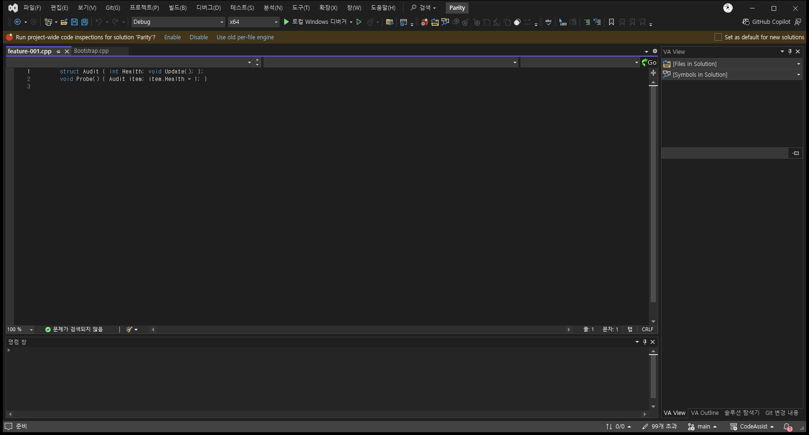](../assets/imports/docs/validation/automated-runner-20261018/20261018-021854-OptionsVerified/screenshots/VA-feature-001-before.png)    VA / dialog / captured      VA / after / captured  [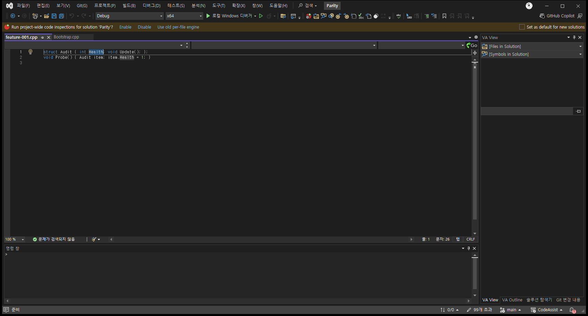](../assets/imports/docs/validation/automated-runner-20261018/20261018-021854-OptionsVerified/screenshots/VA-feature-001-after.png) | CA / before / missing    CA / dialog / missing    CA / after / missing |
| feature-002 Feature 2 | VA / before / captured  [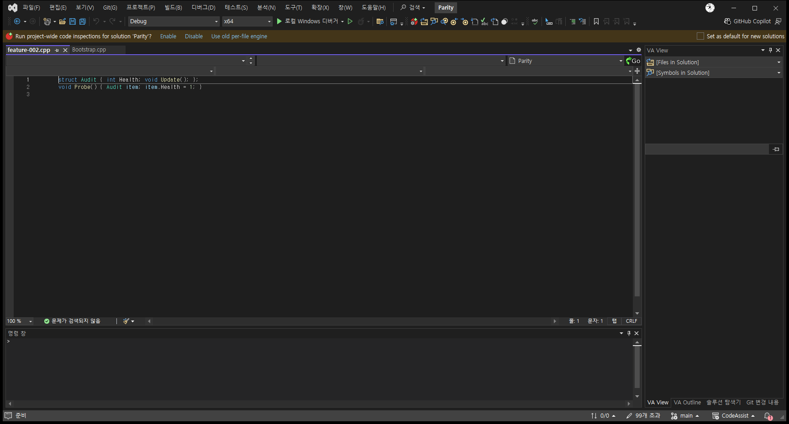](../assets/imports/docs/validation/automated-runner-20261018/20261018-021854-OptionsVerified/screenshots/VA-feature-002-before.png)    VA / dialog / captured  [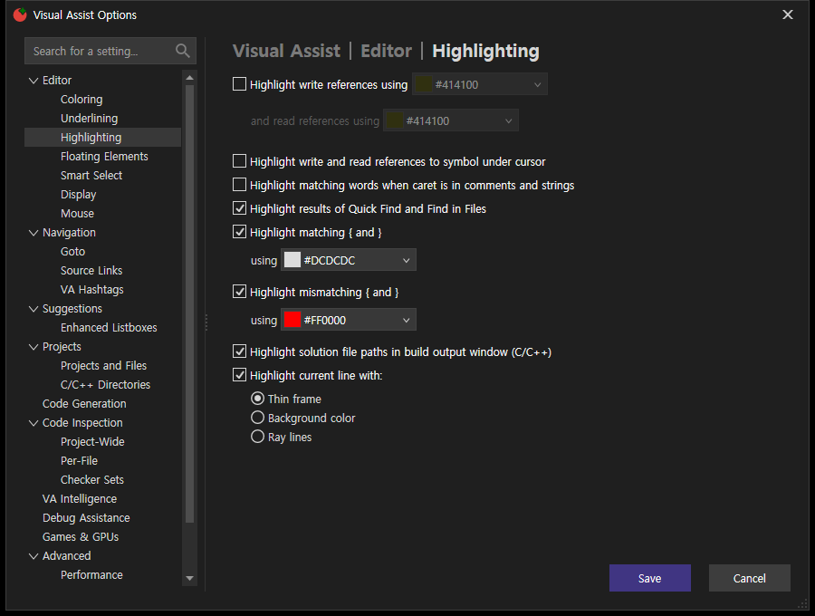](../assets/imports/docs/validation/automated-runner-20261018/20261018-021854-OptionsVerified/screenshots/VA-feature-002-dialog.png)    VA / after / captured   | CA / before / missing    CA / dialog / missing    CA / after / missing |
| feature-008 Feature 8 | VA / before / captured      VA / dialog / captured  [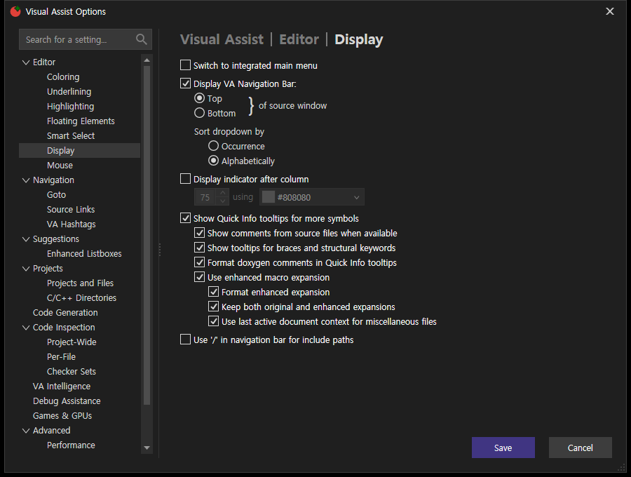](../assets/imports/docs/validation/automated-runner-20261018/20261018-021854-OptionsVerified/screenshots/VA-feature-008-dialog.png)    VA / after / captured  [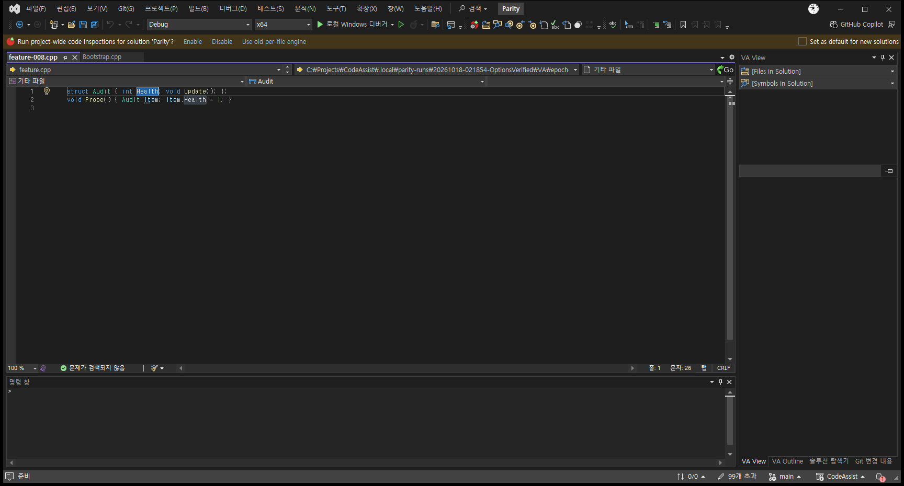](../assets/imports/docs/validation/automated-runner-20261018/20261018-021854-OptionsVerified/screenshots/VA-feature-008-after.png) | CA / before / missing    CA / dialog / missing    CA / after / missing |
| feature-013 Feature 13 | VA / before / captured      VA / dialog / captured  [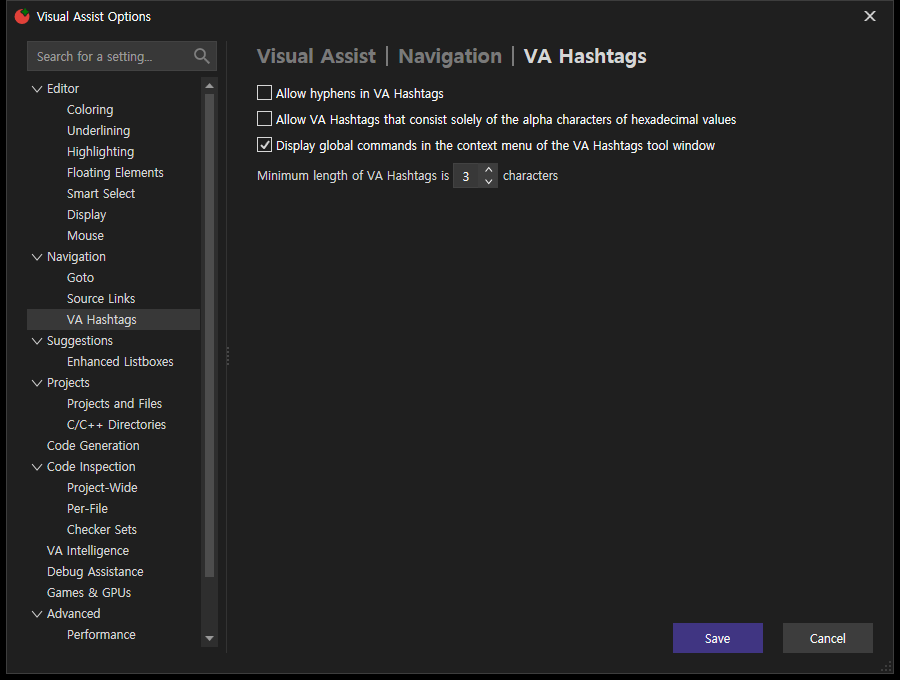](../assets/imports/docs/validation/automated-runner-20261018/20261018-021854-OptionsVerified/screenshots/VA-feature-013-dialog.png)    VA / after / captured  [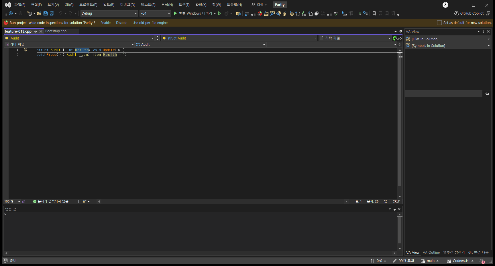](../assets/imports/docs/validation/automated-runner-20261018/20261018-021854-OptionsVerified/screenshots/VA-feature-013-after.png) | CA / before / missing    CA / dialog / missing    CA / after / missing |
| feature-045 Feature 45 | VA / before / captured      VA / dialog / captured  [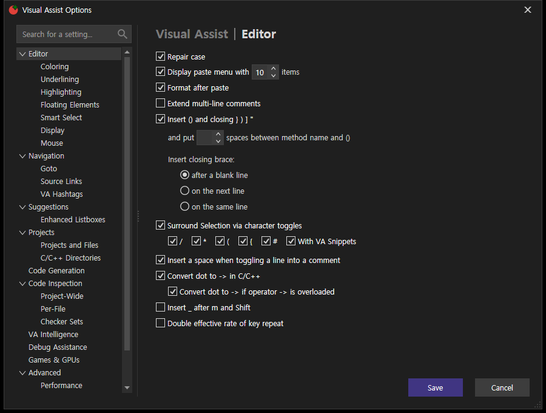](../assets/imports/docs/validation/automated-runner-20261018/20261018-021854-OptionsVerified/screenshots/VA-feature-045-dialog.png)    VA / after / captured   | CA / before / missing    CA / dialog / missing    CA / after / missing |
| feature-052 Feature 52 | VA / before / captured      VA / dialog / captured  [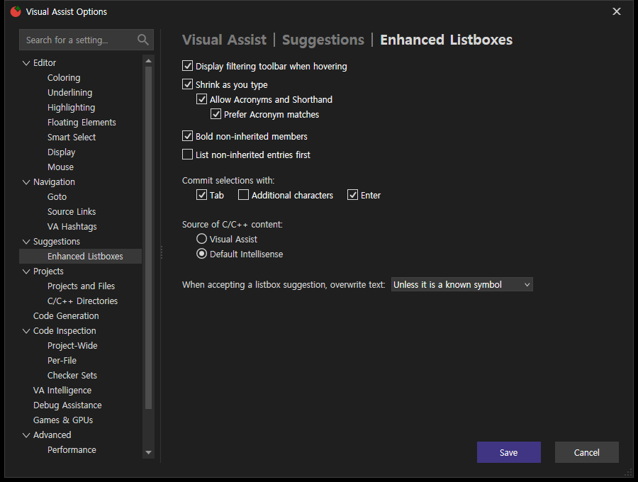](../assets/imports/docs/validation/automated-runner-20261018/20261018-021854-OptionsVerified/screenshots/VA-feature-052-dialog.png)    VA / after / captured  [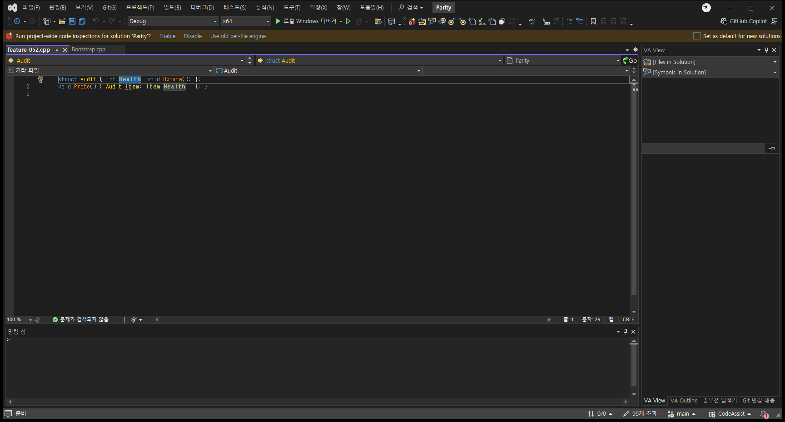](../assets/imports/docs/validation/automated-runner-20261018/20261018-021854-OptionsVerified/screenshots/VA-feature-052-after.png) | CA / before / missing    CA / dialog / missing    CA / after / missing |
| feature-060 Feature 60 | VA / before / captured      VA / dialog / captured      VA / after / captured   | CA / before / missing    CA / dialog / missing    CA / after / missing |
| feature-074 Feature 74 | VA / before / captured      VA / dialog / captured  [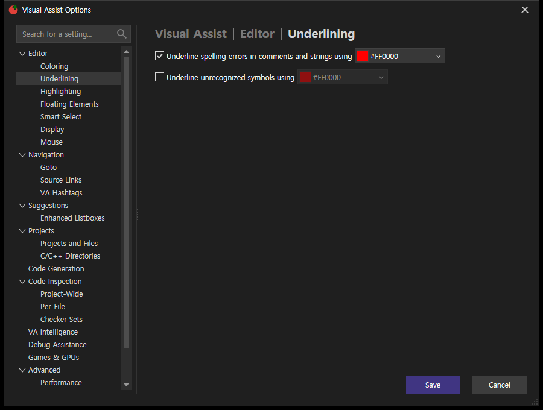](../assets/imports/docs/validation/automated-runner-20261018/20261018-021854-OptionsVerified/screenshots/VA-feature-074-dialog.png)    VA / after / captured   | CA / before / missing    CA / dialog / missing    CA / after / missing |
| feature-076 Feature 76 | VA / before / captured  [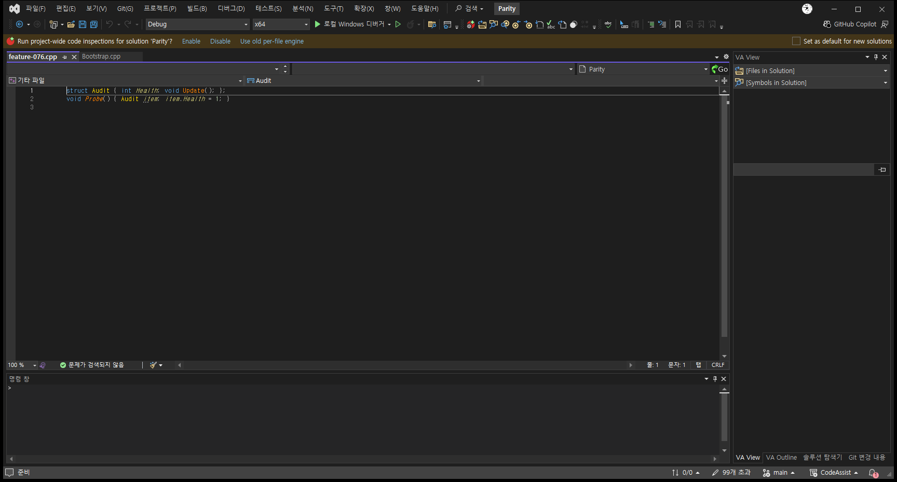](../assets/imports/docs/validation/automated-runner-20261018/20261018-021854-OptionsVerified/screenshots/VA-feature-076-before.png)    VA / dialog / captured  [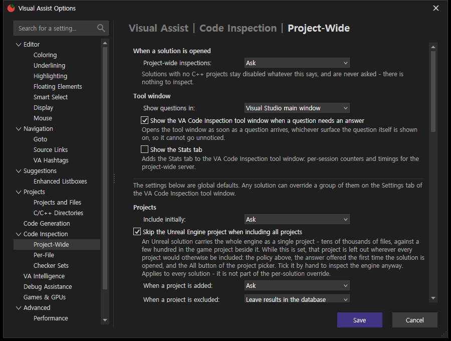](../assets/imports/docs/validation/automated-runner-20261018/20261018-021854-OptionsVerified/screenshots/VA-feature-076-dialog.png)    VA / after / captured   | CA / before / missing    CA / dialog / missing    CA / after / missing |
| feature-077 Feature 77 | VA / before / captured      VA / dialog / captured  [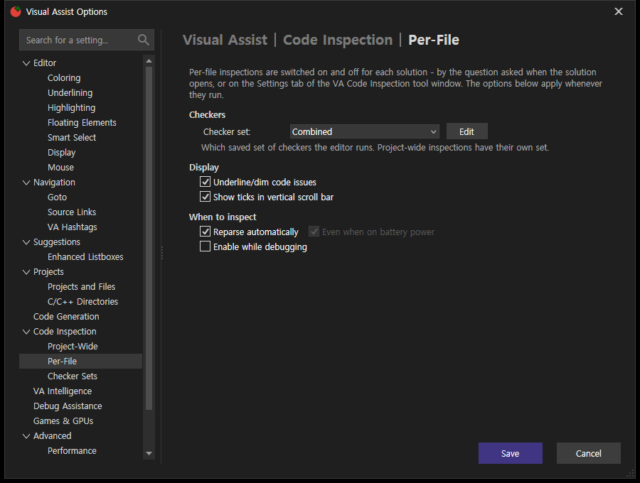](../assets/imports/docs/validation/automated-runner-20261018/20261018-021854-OptionsVerified/screenshots/VA-feature-077-dialog.png)    VA / after / captured   | CA / before / missing    CA / dialog / missing    CA / after / missing |
| feature-081 Feature 81 | VA / before / captured      VA / dialog / captured  [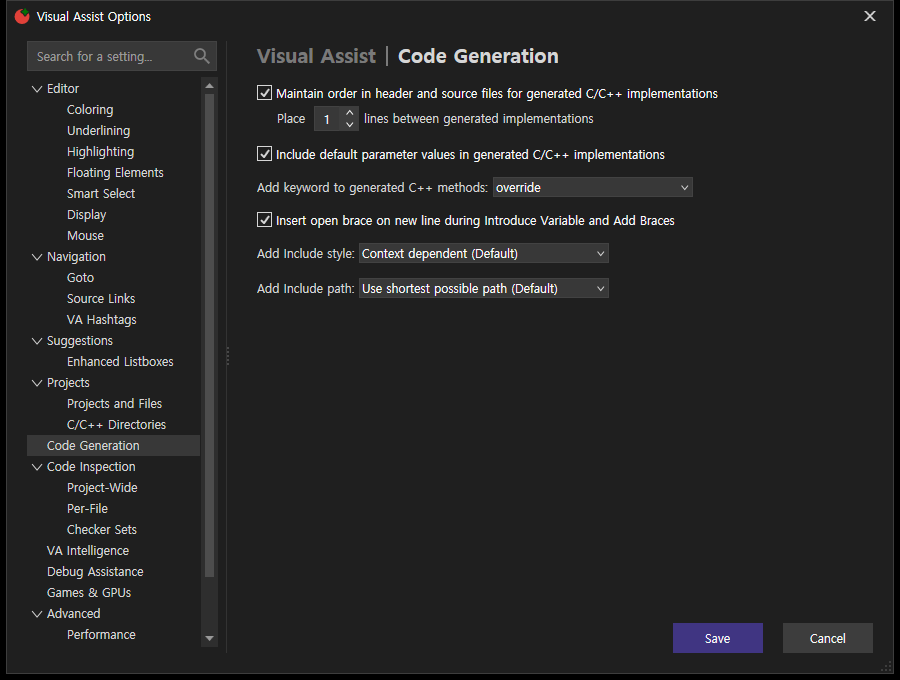](../assets/imports/docs/validation/automated-runner-20261018/20261018-021854-OptionsVerified/screenshots/VA-feature-081-dialog.png)    VA / after / captured   | CA / before / missing    CA / dialog / missing    CA / after / missing |
| feature-092 Feature 92 | VA / before / captured      VA / dialog / captured  [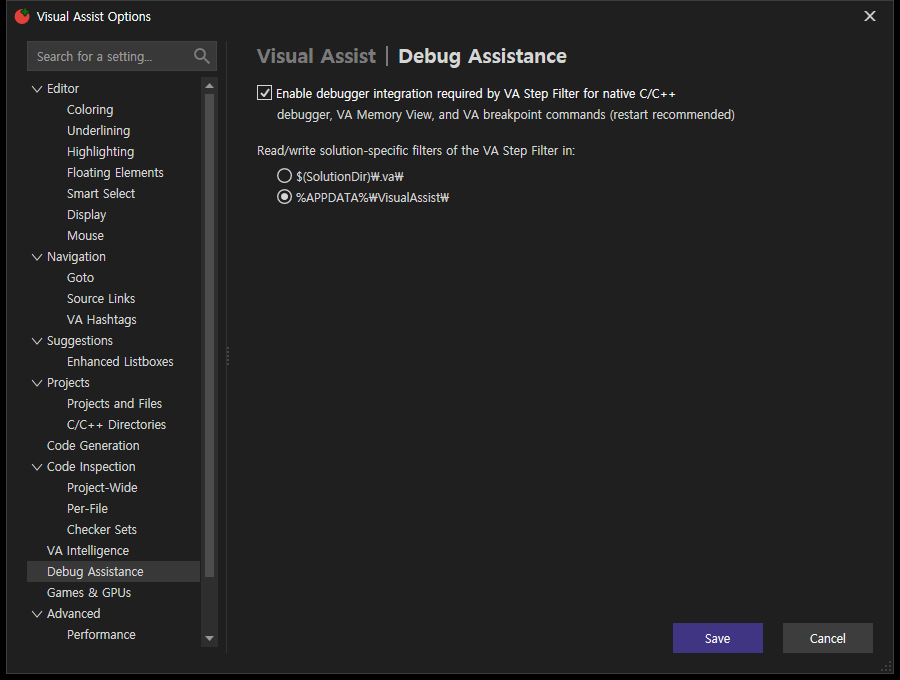](../assets/imports/docs/validation/automated-runner-20261018/20261018-021854-OptionsVerified/screenshots/VA-feature-092-dialog.png)    VA / after / captured   | CA / before / missing    CA / dialog / missing    CA / after / missing |
| feature-095 Feature 95 | VA / before / captured      VA / dialog / captured  [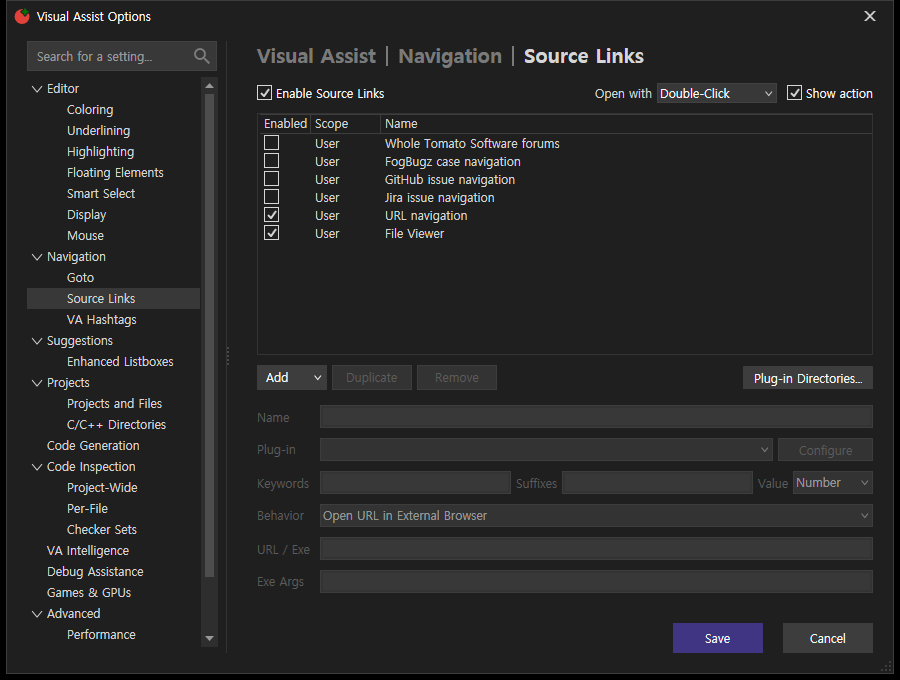](../assets/imports/docs/validation/automated-runner-20261018/20261018-021854-OptionsVerified/screenshots/VA-feature-095-dialog.png)    VA / after / captured  [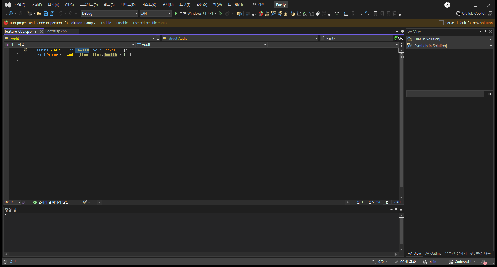](../assets/imports/docs/validation/automated-runner-20261018/20261018-021854-OptionsVerified/screenshots/VA-feature-095-after.png) | CA / before / missing    CA / dialog / missing    CA / after / missing |
| feature-102 Feature 102 | VA / before / captured  [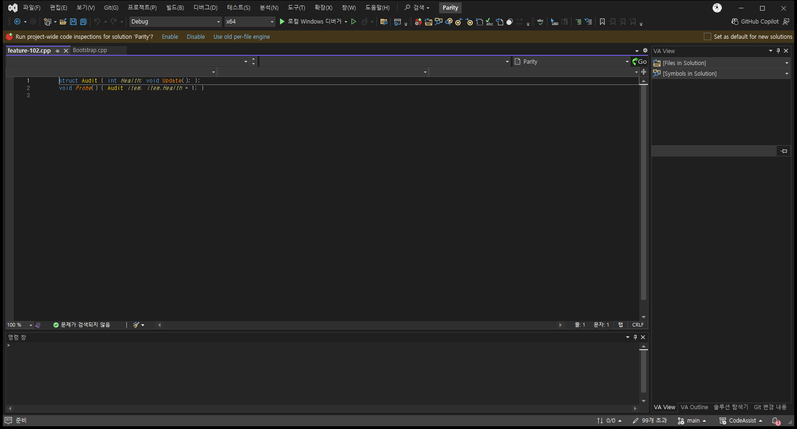](../assets/imports/docs/validation/automated-runner-20261018/20261018-021854-OptionsVerified/screenshots/VA-feature-102-before.png)    VA / dialog / captured  [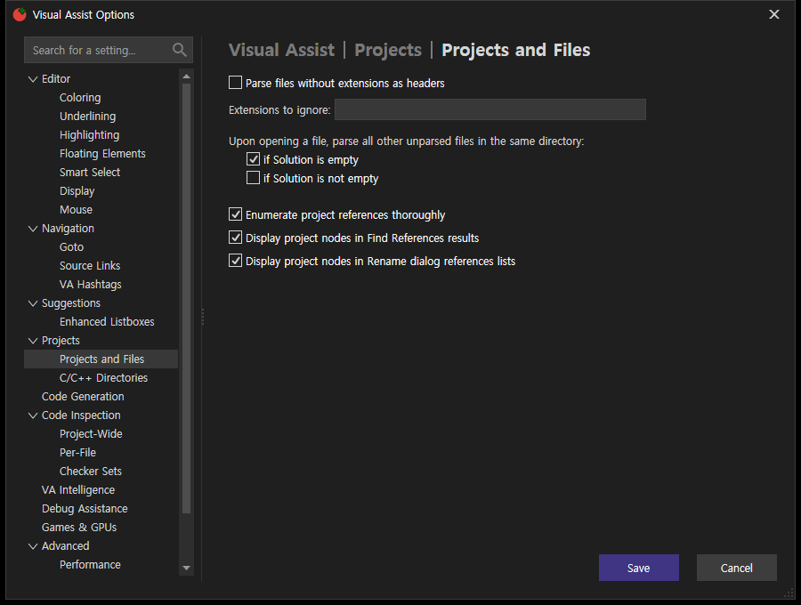](../assets/imports/docs/validation/automated-runner-20261018/20261018-021854-OptionsVerified/screenshots/VA-feature-102-dialog.png)    VA / after / captured   | CA / before / missing    CA / dialog / missing    CA / after / missing |
| feature-104 Feature 104 | VA / before / captured  [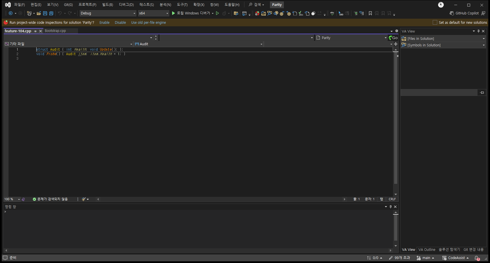](../assets/imports/docs/validation/automated-runner-20261018/20261018-021854-OptionsVerified/screenshots/VA-feature-104-before.png)    VA / dialog / captured  [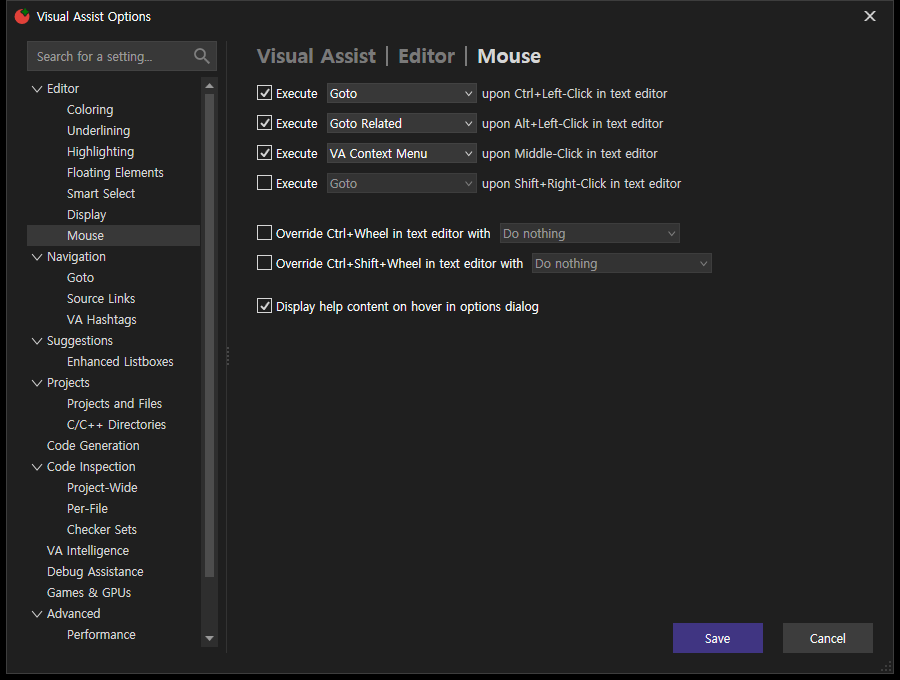](../assets/imports/docs/validation/automated-runner-20261018/20261018-021854-OptionsVerified/screenshots/VA-feature-104-dialog.png)    VA / after / captured   | CA / before / missing    CA / dialog / missing    CA / after / missing |
| feature-106 Feature 106 | VA / before / captured      VA / dialog / captured  [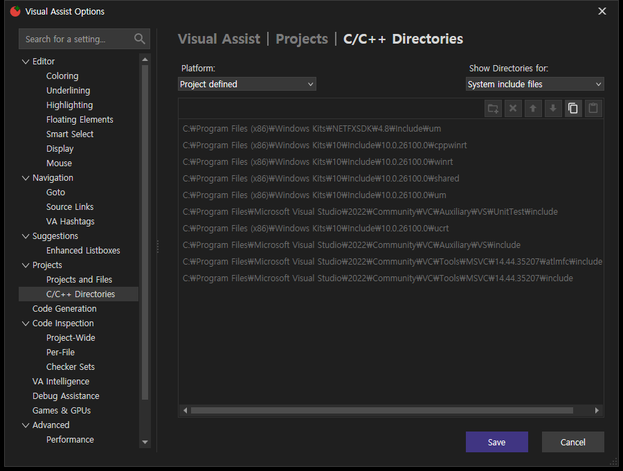](../assets/imports/docs/validation/automated-runner-20261018/20261018-021854-OptionsVerified/screenshots/VA-feature-106-dialog.png)    VA / after / captured   | CA / before / missing    CA / dialog / missing    CA / after / missing |
| feature-107 Feature 107 | VA / before / captured      VA / dialog / captured  [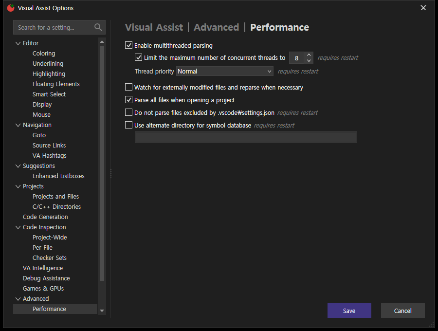](../assets/imports/docs/validation/automated-runner-20261018/20261018-021854-OptionsVerified/screenshots/VA-feature-107-dialog.png)    VA / after / captured   | CA / before / missing    CA / dialog / missing    CA / after / missing |

## 원문과 편집 이력

[보존된 원문 열기](../assets/imports/docs/validation/automated-runner-20261018/20261018-021854-OptionsVerified/screenshots.html)

- 원문 SHA-256: `4e3f2df3aa748c7b4217fb90f18575ca47dee3763d2bd0190b6a0183447c387a`
- 표시 날짜는 원본 파일의 수정 시각입니다. 작업 완료 시각은 원문에 있는 값을 기준으로 확인합니다.
