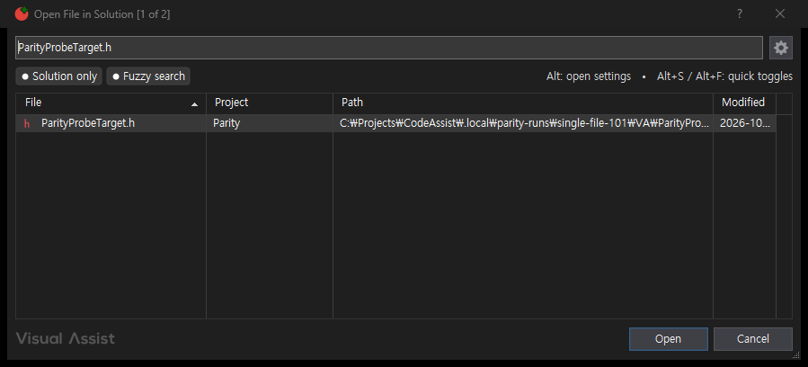
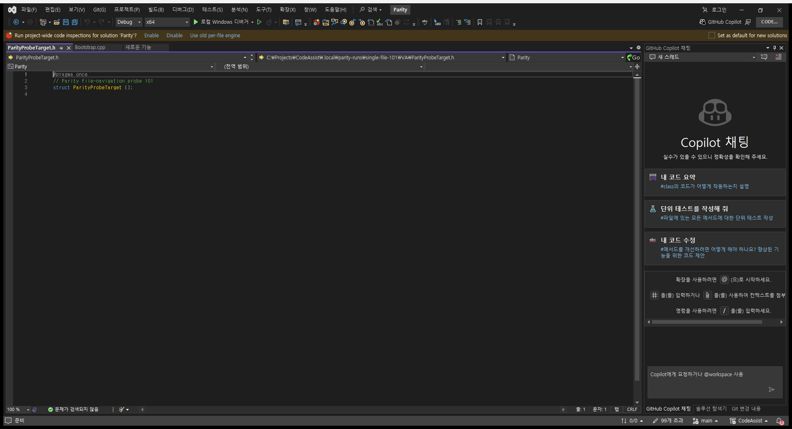
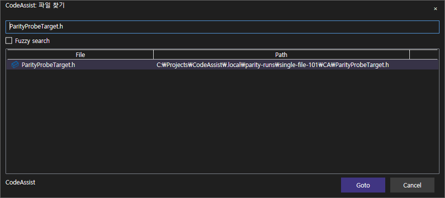
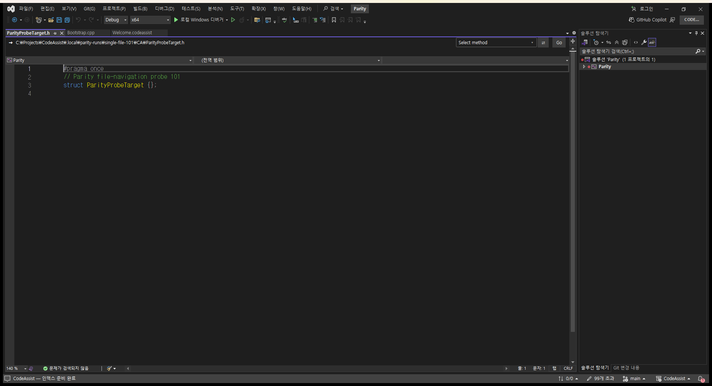

> 보관 기록입니다. 아래 결과는 원문 작성 시점의 내용이며, 이번 편집에서 제품 테스트를 다시 실행하지 않았습니다.

파일 찾기 1건 실제 결과 검증

## 파일 찾기 1건: 실제 결과 검증 통과

입력: ParityProbeTarget.h 검색 → Open/Goto 선택. 기대 결과: 각 전용 프로젝트의 목표 파일이 실제 편집기에 열리고 파일 내용도 같아야 함.

VA·CA 모두 전체 활성 문서 경로와 버퍼 내용이 기대값과 일치했습니다. 창 열기만으로 통과하지 않았습니다. 잘못된 파일 열림 및 실행 오류 판정의 음성 검사 2개도 통과했습니다. 이 한 시나리오의 일치이며 기능 전체·다른 검색 조건을 인증하지 않습니다.

실제 대조 실행 1813.39 ms. 전체 경로·버퍼 원본 · 집계 · 108개 상태

## VA

```
{
  "token": "73d0d637f60a4da6b9859fd6cf763ede",
  "role": "VA",
  "pid": 23468,
  "status": "complete",
  "hostUnsafe": false,
  "before": {
    "file": "C:\\Projects\\CodeAssist\\.local\\parity-runs\\single-file-101\\VA\\Bootstrap.cpp"
  },
  "after": {
    "file": "C:\\Projects\\CodeAssist\\.local\\parity-runs\\single-file-101\\VA\\ParityProbeTarget.h",
    "contents": "#pragma once\r\n// Parity file-navigation probe 101\r\nstruct ParityProbeTarget {};\r\n"
  },
  "expectedFile": "C:\\Projects\\CodeAssist\\.local\\parity-runs\\single-file-101\\VA\\ParityProbeTarget.h",
  "expectedFileOpen": true,
  "expectedContent": "#pragma once\r\n// Parity file-navigation probe 101\r\nstruct ParityProbeTarget {};\r\n",
  "driver": {
    "query": "ParityProbeTarget.h",
    "submitted": true,
    "button": "Open",
    "driver": "native HWND controls"
  },
  "error": null,
  "measuredActionMs": 503
}
```

[](../assets/imports/docs/validation/file-navigation-101/final-run/file-navigation/VA/searched-dialog.png)[](../assets/imports/docs/validation/file-navigation-101/final-run/file-navigation/VA/opened-editor.png)

## CA

```
{
  "token": "73d0d637f60a4da6b9859fd6cf763ede",
  "role": "CA",
  "pid": 31460,
  "status": "complete",
  "hostUnsafe": false,
  "before": {
    "file": "C:\\Projects\\CodeAssist\\.local\\parity-runs\\single-file-101\\CA\\Bootstrap.cpp"
  },
  "after": {
    "file": "C:\\Projects\\CodeAssist\\.local\\parity-runs\\single-file-101\\CA\\ParityProbeTarget.h",
    "contents": "#pragma once\r\n// Parity file-navigation probe 101\r\nstruct ParityProbeTarget {};\r\n"
  },
  "expectedFile": "C:\\Projects\\CodeAssist\\.local\\parity-runs\\single-file-101\\CA\\ParityProbeTarget.h",
  "expectedFileOpen": true,
  "expectedContent": "#pragma once\r\n// Parity file-navigation probe 101\r\nstruct ParityProbeTarget {};\r\n",
  "driver": {
    "query": "ParityProbeTarget.h",
    "submitted": true,
    "button": "Goto",
    "labels": [
      "×",
      "CodeAssist: 파일 찾기",
      "Fuzzy search",
      "Goto",
      "Cancel",
      "CodeAssist",
      "File",
      "Path",
      "ParityProbeTarget.h",
      "C:\\Projects\\CodeAssist\\.local\\parity-runs\\single-file-101\\CA\\ParityProbeTarget.h"
    ]
  },
  "error": null,
  "measuredActionMs": 747
}
```

[](../assets/imports/docs/validation/file-navigation-101/final-run/file-navigation/CA/searched-dialog.png)[](../assets/imports/docs/validation/file-navigation-101/final-run/file-navigation/CA/opened-editor.png)

```
{
  "featureId": "VA-F012",
  "scenario": "Search and actually open the expected solution file",
  "result": "representative-match",
  "expectedFile": "ParityProbeTarget.h",
  "checked": [
    "same input query",
    "Open/Goto submitted",
    "full active-document path",
    "editor buffer content"
  ],
  "VAActionMs": 503,
  "CAActionMs": 747,
  "pairedItemMs": 1813.39,
  "negativeChecksPassed": 2,
  "proposedSeconds": 300,
  "elapsedSeconds": 303,
  "finishedAt": "2026-10-18T22:21:25.367909+09:00",
  "overall": {
    "matches": 5,
    "differences": 7,
    "unverified": 96,
    "total": 108,
    "determinatePercent": 11.11,
    "confirmedRepresentativeMatchPercent": 4.63
  },
  "fullFeatureCertified": false
}
```

## 원문과 편집 이력

[보존된 원문 열기](../assets/imports/docs/validation/file-navigation-101/index.html)

- 원문 SHA-256: `08450e14450a4ab3093d4d5a0dc287c7c489d0d4259f65328abd37919688b86b`
- 표시 날짜는 원본 파일의 수정 시각입니다. 작업 완료 시각은 원문에 있는 값을 기준으로 확인합니다.
