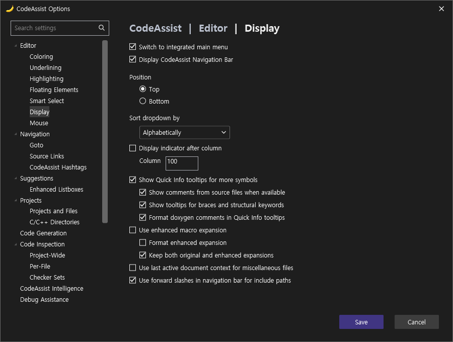
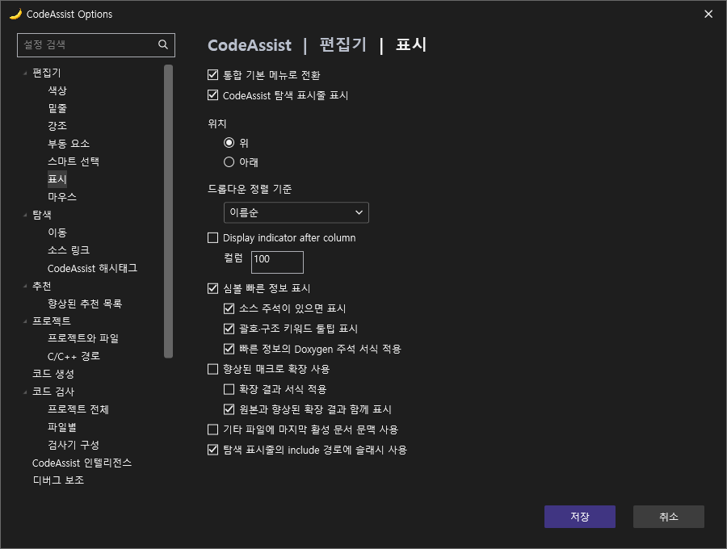
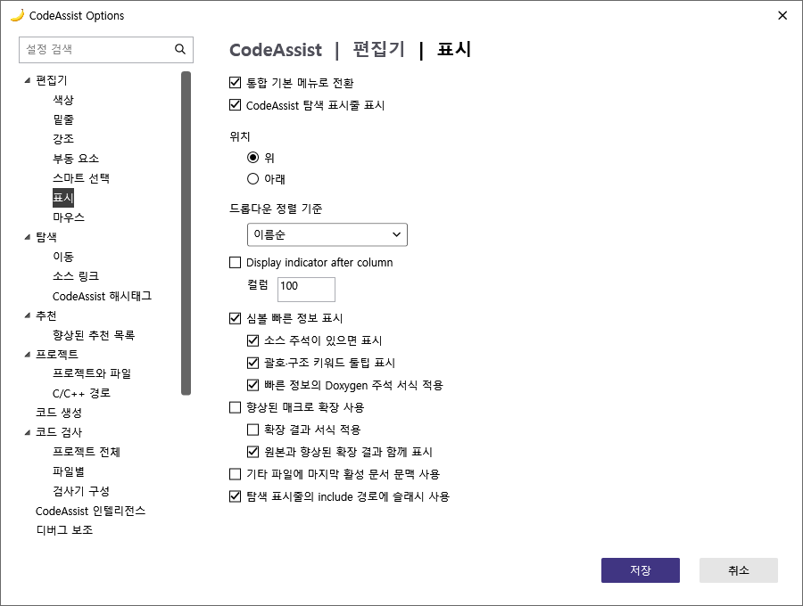
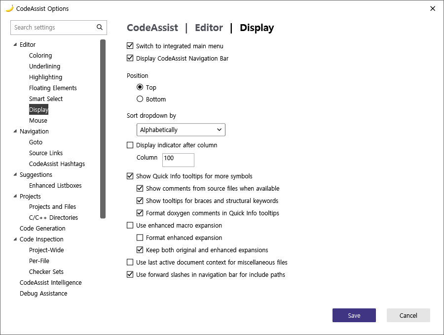
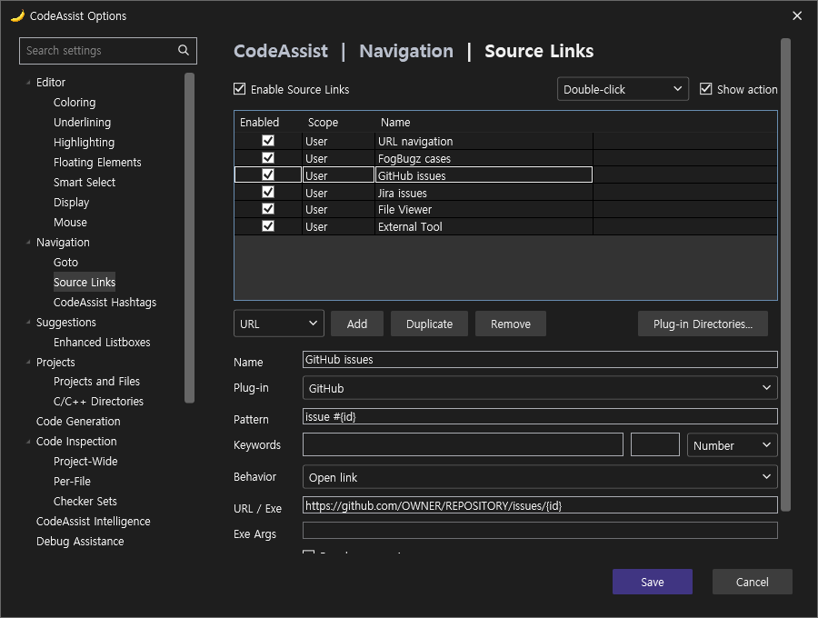
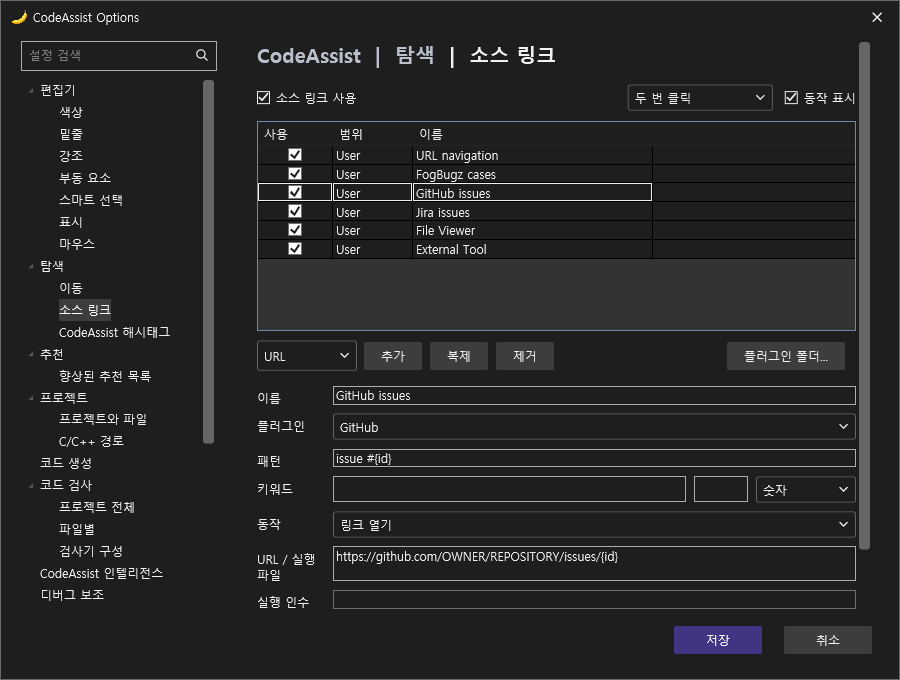
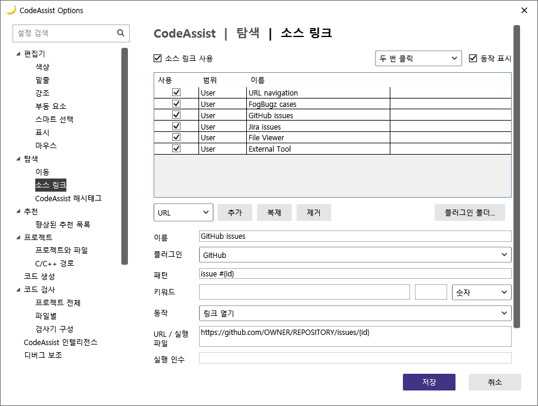
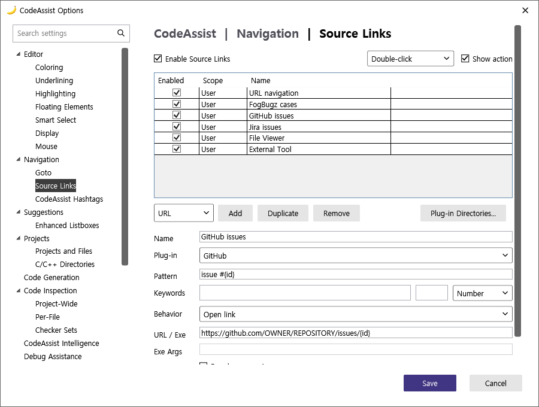
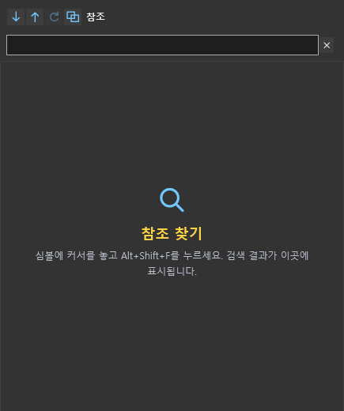

> 보관 기록입니다. 아래 결과는 원문 작성 시점의 내용이며, 이번 편집에서 제품 테스트를 다시 실행하지 않았습니다.

Display·Source Links 완료 ·0.0.175

## Display·Source Links 수정 ·0.0.175

**남은 2/2개 구성 보완 완료 ·100%**. 기존18개 항목도 18/18개 보완했습니다. 기존 체크표 기준 구성 유사도는 **100% ·96/96점** (이전98.96% ·95/96점). 남은 부분 대응0개·누락0개입니다.

이100%는 기존96개 구성 체크 범위입니다. 전체108개 기능의 VA 실행 동기화율이100%라는 뜻이 아닙니다. 픽셀·브랜드·문자열 길이의 정확한 동일성 대신 항목 종류·개수·위치·누락을 평가했습니다.

| 검증 | 결과 |
| --- | --- |
| 코어 회귀 검사 | 495/495 ·100% |
| 옵션 페이지 실제 WPF 이벤트 | 18/18 ·100% — 공급자6종 추가·복제·제거·대상 수정·잘못된 대상 저장 차단 포함 |
| 새 한영·다크라이트 렌더링 | 8/8 ·100% — 창 표시·키 입력 없이 생성 |
| 설치 파일 빌드 | Modern·VS2019 모두 성공. 설치·VS 재시작 없음. |
| Git 푸시 | 3066478 ·main 및v0.0.175 태그 푸시 성공 |

## 수정 내용

- Display: 통합 메뉴/도구 메뉴 전환을 실제 메뉴 표시 명령에 연결했습니다. 향상된 매크로 미리보기, 원본 동시 표시, 확장 서식, 주석·Doxygen·구조 키워드 정보를 연결했습니다.

- Source Links: URL·FogBugz·GitHub·Jira·파일 보기·외부 도구 예제와 공급자별 편집을 지원합니다. 파일은 편집기에서 열고, 외부 도구는 명시적인exe와 별도 인수로 셸 없이 실행합니다. URL 열기/복사와 두 번 클릭/Alt클릭도 연결했습니다.

- 플러그인 폴더에서 XML 공급자 정의를 가져올 수 있습니다. 가져오기만으로 외부 도구를 실행하지 않습니다.

## Display: 기존 VA와 현재 CA

VA 기존 실제 촬영


CA0.0.175 영어 다크 ·오프스크린



한국어 다크·라이트





영어 라이트



## Source Links: 기존 VA와 현재 CA

VA 기존 실제 촬영


CA0.0.175 영어 다크 ·오프스크린



한국어 다크·라이트





영어 라이트



Source Links 촬영은 예제 공급자6개를 메모리에만 넣은 테스트 상태입니다. 실제 사용자 설정이나 공장 기본값으로 보고하지 않습니다.

## 참조 창




## 공급자 정의 예제

XML 예제에서 주소를 수정한 뒤 해당 폴더를 Source Links → 플러그인 폴더에서 가져오세요.

```
<?xml version="1.0" encoding="utf-8"?>
<SourceLinks>
  <Rule>
    <Name>Team GitHub issues</Name><Enabled>true</Enabled><PluginId>GitHub</PluginId>
    <Provider>Url</Provider><Pattern>issue #{id}</Pattern>
    <Target>https://github.com/OWNER/REPOSITORY/issues/{id}</Target>
  </Rule>
</SourceLinks>
```

## 릴리즈

**릴리즈 게시 완료.** 두 VSIX를 다운로드해 SHA256·매니페스트0.0.175·Display/Source Links 구현 포함을 확인했습니다. 로컬 installers/0.0.175에도 동일한 게시 파일을 보관했습니다. 파일 검증 원자료

[릴리즈·설치 파일](https://github.com/MDJ0126/CodeAssist/releases/tag/v0.0.175) · [빌드 작업](https://github.com/MDJ0126/CodeAssist/actions/runs/40076296827)

## 범위와 원자료

- 새 VS 실행·물리 키 입력·설치 검증은 수행하지 않음

- 매크로 미리보기는 현재 문서의 object/function-like 정의를 처리하는 bounded preview이며 전체 컴파일러 전처리기를 대체하지 않음

- Source Links 플러그인 가져오기는 XML 공급자 정의 방식. 네이티브 VA DLL ABI 호환을 주장하지 않음

- 기존96개 구성 체크 밖의 AI·GPU·부동 툴바 등 전체 VA 제품의 완전 구현을 의미하지 않음

96개 구성 계산표 · WPF 이벤트 검사 · 495개 회귀 검사 로그 · 이전95/96점 기준

제안 시간:20–30분. 실제 소요:1618초 · 2026-10-24 17:05:07 KST 완료.

XERJ:사용. 문서 기반 부분 명세 분석:108/108 ·100%.

## 원문과 편집 이력

[보존된 원문 열기](../assets/imports/docs/validation/display-source-175/index.html)

- 원문 SHA-256: `865e8ee23e039920b99582f144a6bd27c9213bebcf0e4548a36127da3d62d314`
- 표시 날짜는 원본 파일의 수정 시각입니다. 작업 완료 시각은 원문에 있는 값을 기준으로 확인합니다.
