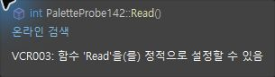
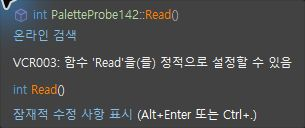
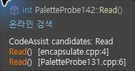

> 보관 기록입니다. 아래 결과는 원문 작성 시점의 내용이며, 이번 편집에서 제품 테스트를 다시 실행하지 않았습니다.

QuickInfo 실제 대조 0.0.156

## QuickInfo 실제 대조 — 0.0.156

작업 진행 중. 이번 툴팁 문제 해결 확인 **66.67% (2/3)**. 전체 VA 동기화율과 구분합니다. 기본 VS 서명 아래 CA 서명 한 줄이 아직 남아 있습니다.

| 기준 | 판정 | 근거 |
| --- | --- | --- |
| 현재 선언에 다른 파일 Read 후보를 섞지 않음 | 해결 확인 | QuickInfoQuery candidates=1 /430 회귀 /현재 화면 |
| CodeAssist candidates 제목과 파일 경로 행 제거 | 해결 확인 | 710과743 실제 화면 비교 |
| 기본 VS 서명과 CA 서명의 중복 제거 | 미해결 | 743에 int Read() 추가 행이 남음 |

## 원본 VA와 최신 CA

VA 현재 Read 툴팁

CA156 현재 — 추가 int Read()가 남음

## 수정 전

다른 파일의 Read 후보2개와 CodeAssist candidates 제목·파일 경로가 표시됐습니다. 최신에서는 현재 선언1개로 좁혀졌으나 기본 서명과의 중복은 미해결입니다.

두 browser107.cpp의 바이트 동일성: True. 같은 Read 심볼을 마우스로 관측했습니다. 물리 단축키 실행 일치로 계산하지 않습니다.

공통 회귀 **430/430 (100%)**, 설치 DLL **6/6 일치**. 선택 옵션 기존 양쪽 근거 확보 **10/12 (83.33%)**는 현재 버전의 완전 통과율이 아닙니다. 문서 부분 명세108/108 (100%)도 전체 역분석 완료율과 구분합니다.

## 남은 작업

추가 서명1행 제거 · 네이티브 툴팁 색상 On/Off 실제 결과 · 색상 팝업의 실제 Tab/Hex 입력 검증 · 스니펫과 실제 키 유지 반복 및 기존 Undo·전체108항목 재검증

공식 SDK의 합성 콘텐츠·표시 팩토리 구조를 확인하고 공개 API로 구현했습니다. 154의 메타데이터 이름 문제는 수정됐으나156에서도 중복이 남아 있어 완료로 처리하지 않습니다. 기본 링크 표시가 유지되는 것은 화면에서 확인했고 링크 클릭 기능은 이번에 별도 검사하지 않았습니다.

[Microsoft 표시 팩토리 설계](https://github.com/microsoft/vs-editor-api/wiki/Modern-ToolTip-API) · [QuickInfo 세션 API](https://learn.microsoft.com/en-us/dotnet/api/microsoft.visualstudio.language.intellisense.iasyncquickinfosession?view=visualstudiosdk-2022)

제안 시간20–30분 / 기록 시각 2026-10-24T08:05:35.625332+09:00 / 경과1704초. XERJ: 사용 — 검색 결과를 현재 소스로 확인.

원시 요약 · 실제 DLL 로드 · 430 회귀 결과 · 설치 검증

## 원문과 편집 이력

[보존된 원문 열기](../assets/imports/docs/validation/options-156/index.html)

- 원문 SHA-256: `f4b1f162d4b089425cbc163a58decc9580894532af0d157c80ec0c6e27816627`
- 표시 날짜는 원본 파일의 수정 시각입니다. 작업 완료 시각은 원문에 있는 값을 기준으로 확인합니다.
