> 보관 기록입니다. 아래 결과는 원문 작성 시점의 내용이며, 이번 편집에서 제품 테스트를 다시 실행하지 않았습니다.

0.0.102 실제 메서드 이동 대조

## 0.0.102 실제 Alt+M·메서드 이동 대조

제품 후보 버전 0.0.102를 검사 CA 프로필에 설치했습니다. 6/6 바이너리 해시 일치. Computer Use 실제 입력과 읽기 전용 DTE 선택 상태를 함께 확인했습니다.

동일 입력: 편집기 클릭 → Alt+M → End → Up → Enter. VA와 CA102 모두 GetHealth 선택, anchor 5:6 / active 5:15. CA101은 5:15에 커서만 놓았으므로 선택 범위를 맞추도록 수정했습니다.

현재 파일의 메서드 목록 이동 대상 일치: 4/4(100%) — GetHealth·Tick·main·클래스. 팝업 항목 이름·순서: 4/4(100%). 전체 제품 동기화율로 확대하지 않습니다.

## 원본 VA / CA102 팝업

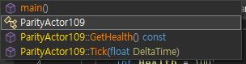

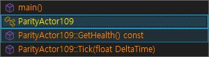

## 원본 VA / CA102 실행 후

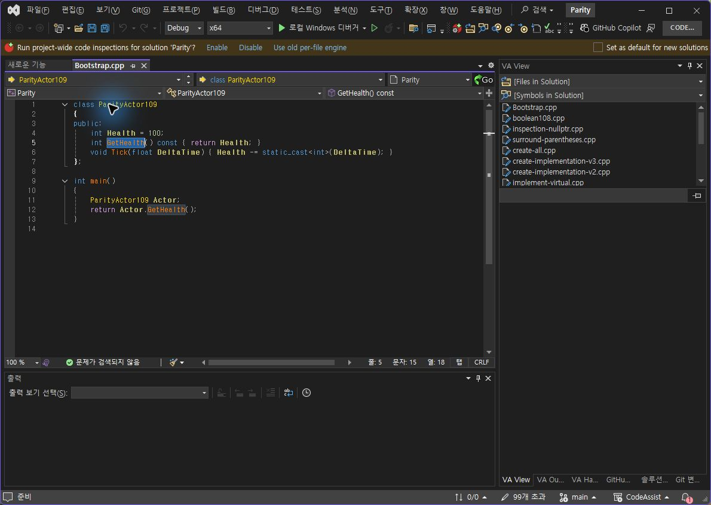

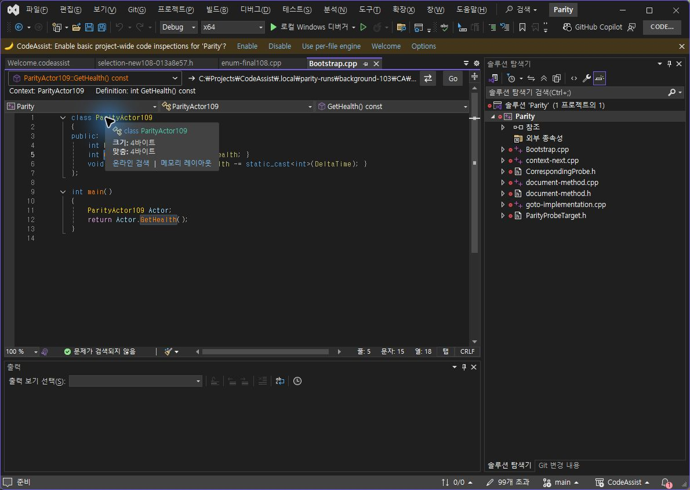

## 정정 및 미완료

앞선 Alt+M 팝업 미표시는 기록을 보존했습니다. 편집기를 실제 클릭한 후에는 수정 전 CA101에서도 열렸습니다. 접근성의 편집기 포커스 표시만으로 실제 입력 대상을 보장할 수 없었습니다. 단축키 결함 수정이라고 보고하지 않습니다.

VA 검사 프로세스가 옵션 취소 이후 종료됐고 같은 시각 APPCRASH 이벤트가 확인됐습니다. 앞선 “VA 옵션 dismiss”는 정상 취소 복귀 통과가 아닙니다. 원인은 미확인입니다. 이전 숫자 값 10→11→10의 촬영 결과와 이 종료 문제를 구분했습니다.

남은 작업: 팝업 색상, Editor/Suggestions 누락 옵션과 아래쪽 배치, 다른 파일·언어·복잡한 선언 및 전체 기능의 현재 버전 재대조. 전체 목표는 진행 중입니다.

정확한 결과·스크린샷 해시 · VA 선택 · CA102 선택 · 설치 검증 · 빌드 · 종료 이벤트

분석율: 문서 기반 부분 명세 108/108(100%), 전체 역분석 완료율 아님. XERJ: 사용 — ListMethods 후보 검색 후 소스·실행 바인딩 확인.

## 추가 실제 이동 검증

| 대상 | VA / CA 공통 선택 범위 |
| --- | --- |
| Tick | 6:7 → 6:11 |
| main | 9:5 → 9:9 |
| ParityActor109 | 1:7 → 1:21 |

각 대상은 양쪽 실제 Alt+M 및 Home/End/방향키/Enter를 입력한 후 DTE로 선택 문자열·앵커·활성 위치를 확인했습니다. 두 fixture의 SHA256도 동일합니다. 기존 기록을 새 실행으로 대신하지 않았습니다.

## 실제 선택 행 UI 차이

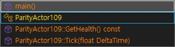

CA에는 이전 선택 행의 회색 채움이 남고 현재 키보드 포커스 행에 파란 테두리가 표시됩니다. VA는 현재 행만 회색 채움·흰 글자로 표시합니다. CA의 함수 글자는 주황색, VA는 금색입니다. 색상 설정 일치 여부는 별도 확인이 필요합니다.

### Tick / main / class 실행 후

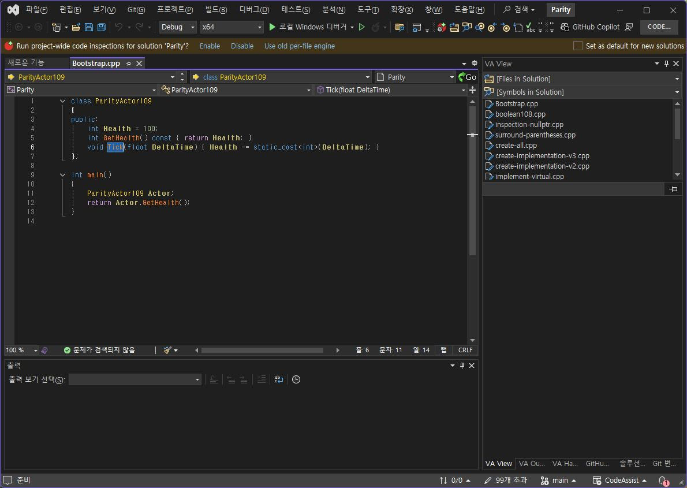

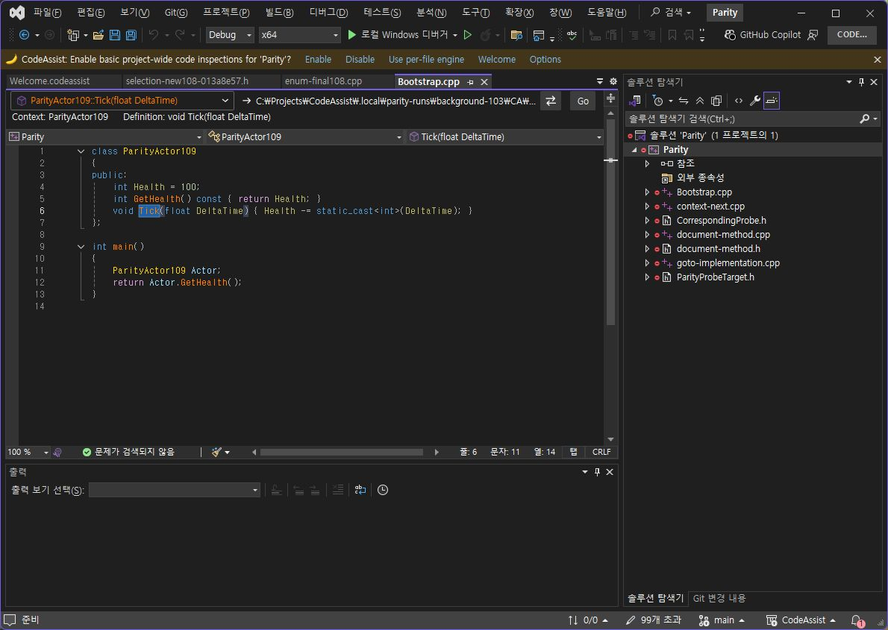

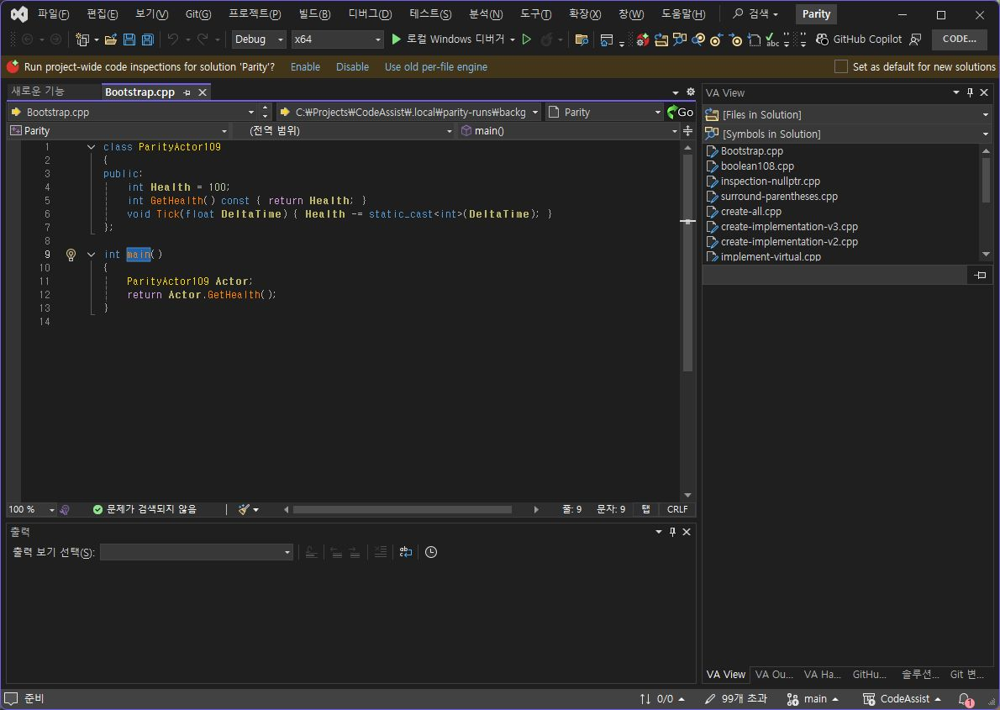

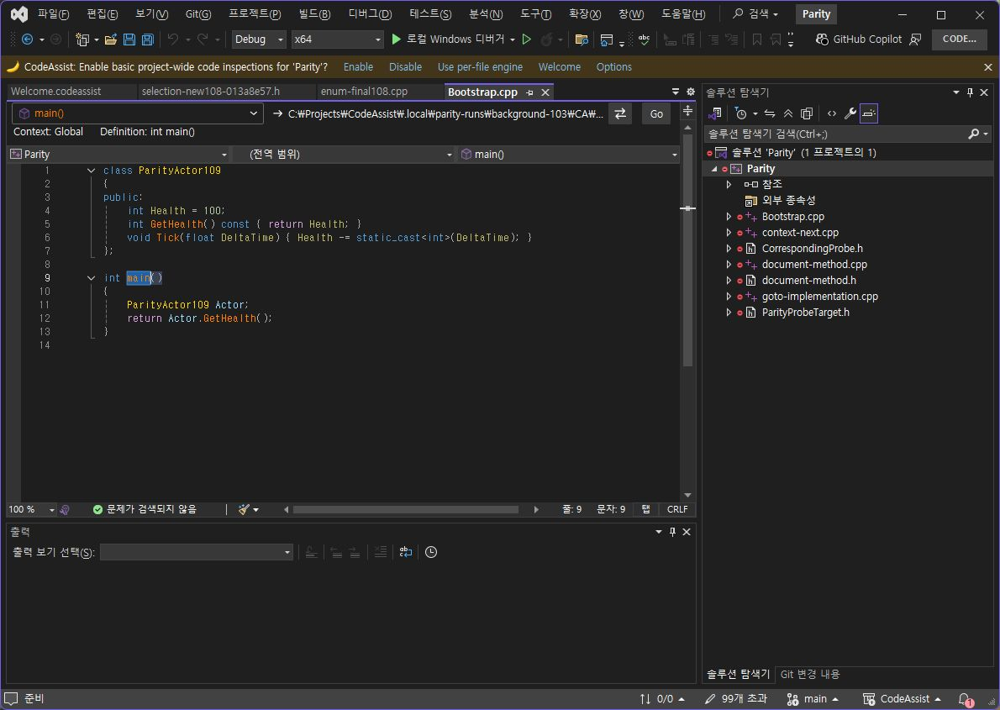

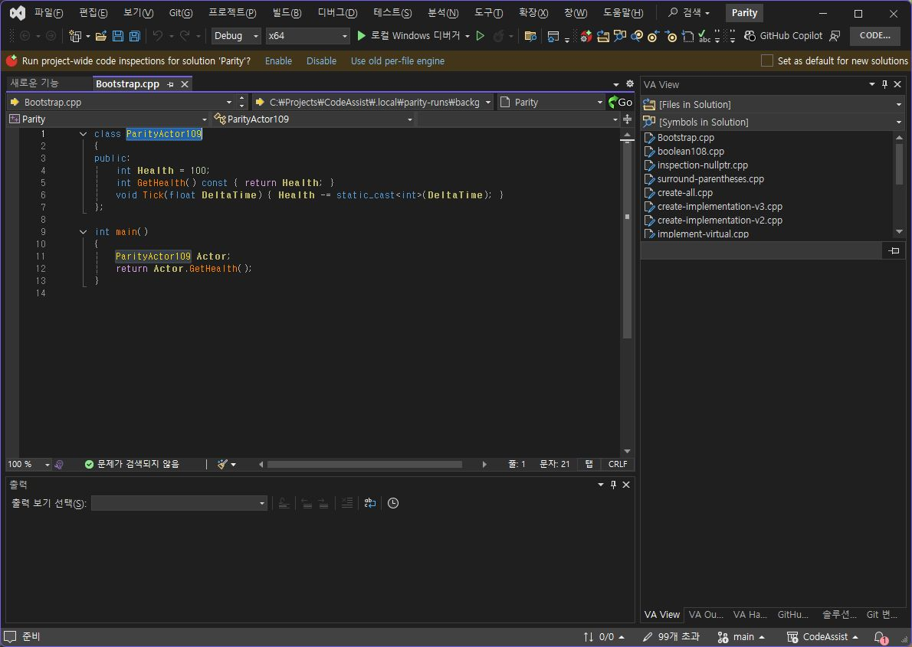

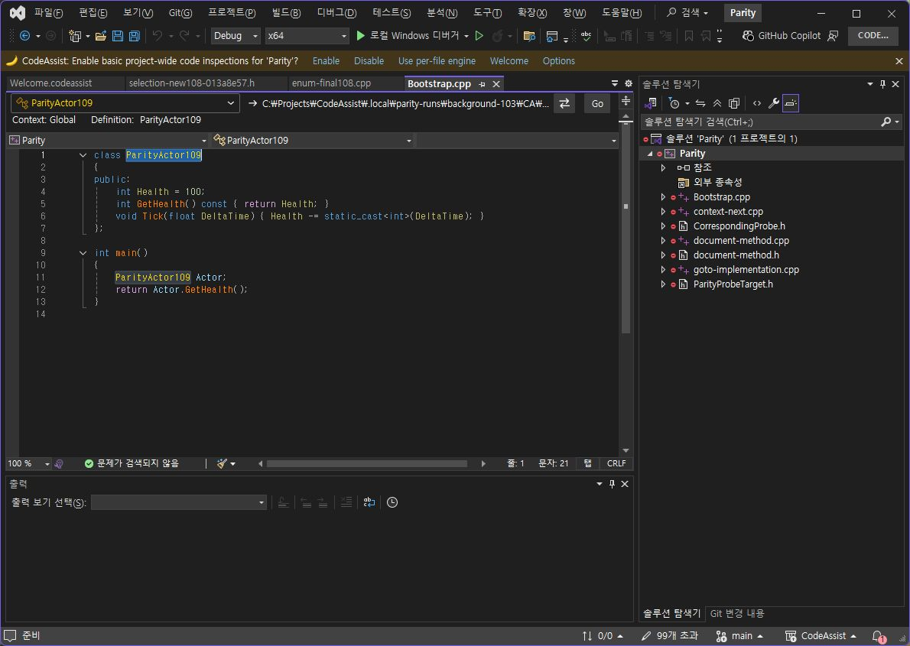

## 원문과 편집 이력

[보존된 원문 열기](../assets/imports/docs/validation/method-102/index.html)

- 원문 SHA-256: `fb34791388af7b9b7e2f42fc21cb3a987aa6bcc6d94945f7f85a167a07b6c5fe`
- 표시 날짜는 원본 파일의 수정 시각입니다. 작업 완료 시각은 원문에 있는 값을 기준으로 확인합니다.
