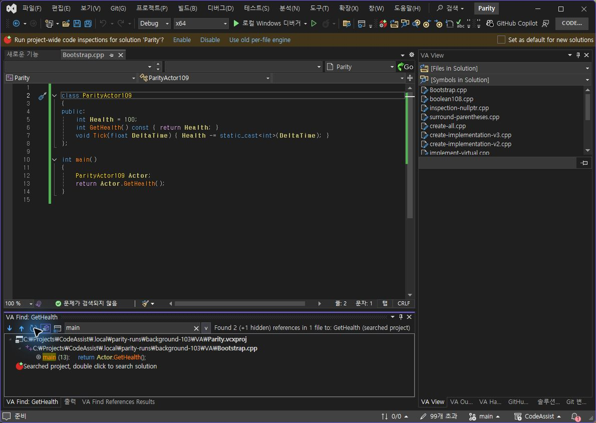
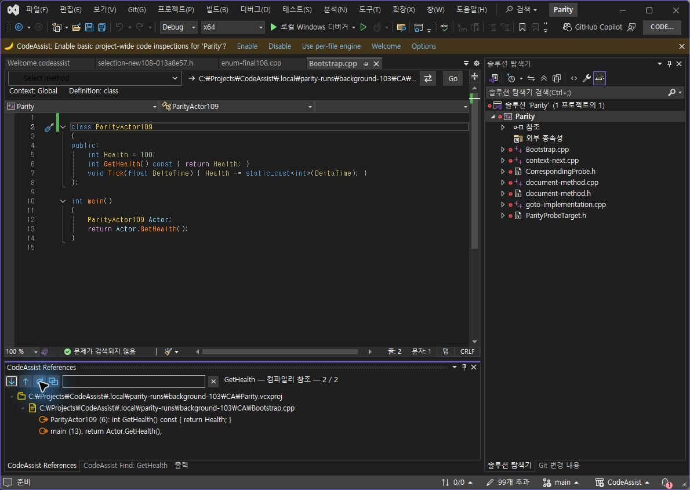
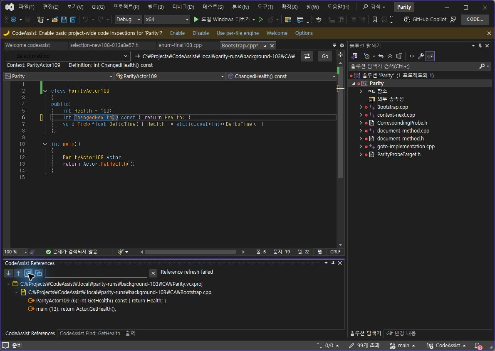
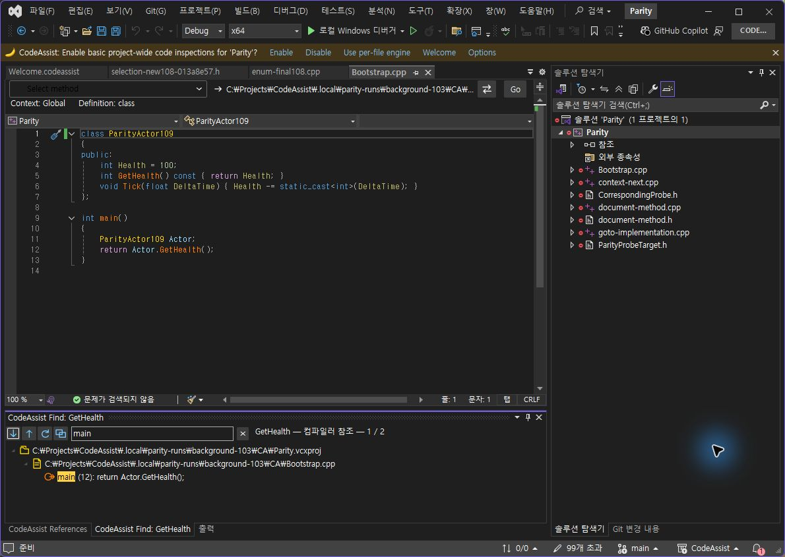

> 보관 기록입니다. 아래 결과는 원문 작성 시점의 내용이며, 이번 편집에서 제품 테스트를 다시 실행하지 않았습니다.

0.0.115 검색 위치 추적·오류·메뉴 복제

## CA 0.0.115 — 검색 위치 추적·실패 처리·메뉴 복제

## 실행 대조: 줄 삽입

같은 저장된 코드에서 GetHealth 검색 후 파일 첫 줄에 빈 줄 하나를 삽입했습니다. CA는 편집 추적 앵커로 검색 위치를 갱신합니다. 양쪽 새로 고침에서 호출이 12→13행으로 이동했습니다. CA의 정의 6행 표시는 추가 단독 관찰입니다. VA의 main 필터는 호출 13행만 표시하고 정의는 숨김 한 개로 계산합니다. CA는 필터를 비운 상태에서 두 위치를 표시합니다. 비교한 항목은 검색 위치 이동이며 필터·표시 상태 전체를 동일하다고 판정하지 않습니다.

VA — 호출 13행

CA — 정의 6행·호출 13행

## CA 단독 오류 및 복구

검색한 정의 이름을 ChangedHealth로 바꾼 뒤 새로 고침했습니다. “Reference refresh failed / Search location changed; find references again” 표시와 이전 결과 보존을 확인했습니다. 이름과 빈 줄을 복구·저장한 뒤 다시 실행하면 오류가 해제되고 정의 5행·호출 12행으로 돌아왔습니다. VA 오류 동작과의 일치율에는 포함하지 않습니다.

오류 표시 — 새 성공으로 계산하지 않음

원본 복구 후 재검색 성공

## 메뉴 복제 경로

도구 → CodeAssist → Clone Reference Results에서 별도 탭을 만들고 main 필터·표시 한 행을 유지했습니다. 기존 도구 모음 버튼뿐 아니라 메뉴도 창별 상태를 복제하도록 통합했습니다. 결과 창을 다시 여는 경로는 기존 필터를 유지하도록 수정했으나 별도 실행 판정은 아직 남았습니다.

## 제외한 입력

처음 CtrlHome/Return은 편집기에 전달되지 않아 본문이 바뀌지 않았으므로 제외했습니다. 커서 1:1을 직접 확인한 뒤 삽입했습니다. 첫 메뉴 클릭 역시 복제를 실행하지 않아 제외하고 새 관찰의 전체 창 좌표로 재시도했습니다.

## 보존·빌드·검색 도구

양쪽 본문·저장 상태·원본 SHA256 8A9D8AD69A16FB6813230BE6B2DB5A5717D5DEB55B426B092465777AF2884188 복구 확인. VS2019·Modern 빌드 성공, Core 317/317 통과, 설치 바이너리 6/6 해시 일치.

XERJ 기존 인덱스는 XML 스키마 충돌로 갱신에 실패했습니다. 새 codeassist-v3에서 코드 871/871개를 색인했고 최신 CloneResultsAsync 검색을 확인했습니다. 비코드 자료 제외로 종료 상태는 completed-with-junk(exit3)입니다. 자동 감시는 확인하지 않았습니다.

판정 데이터 · 테스트 · 설치 · XERJ 재구축 · 실제 검색

## 남은 작업

상속·전체 프로젝트 제어, 숨김·참조 종류 필터, 다른 언어·버전·생명주기와 제품 전체 검증은 계속 필요합니다. 전체 목표는 진행 중입니다.

## 원문과 편집 이력

[보존된 원문 열기](../assets/imports/docs/validation/references-115/index.html)

- 원문 SHA-256: `0df4f78afdac6fe4aa8f43910a678322681b9e702a6013a926730903382e4872`
- 표시 날짜는 원본 파일의 수정 시각입니다. 작업 완료 시각은 원문에 있는 값을 기준으로 확인합니다.
