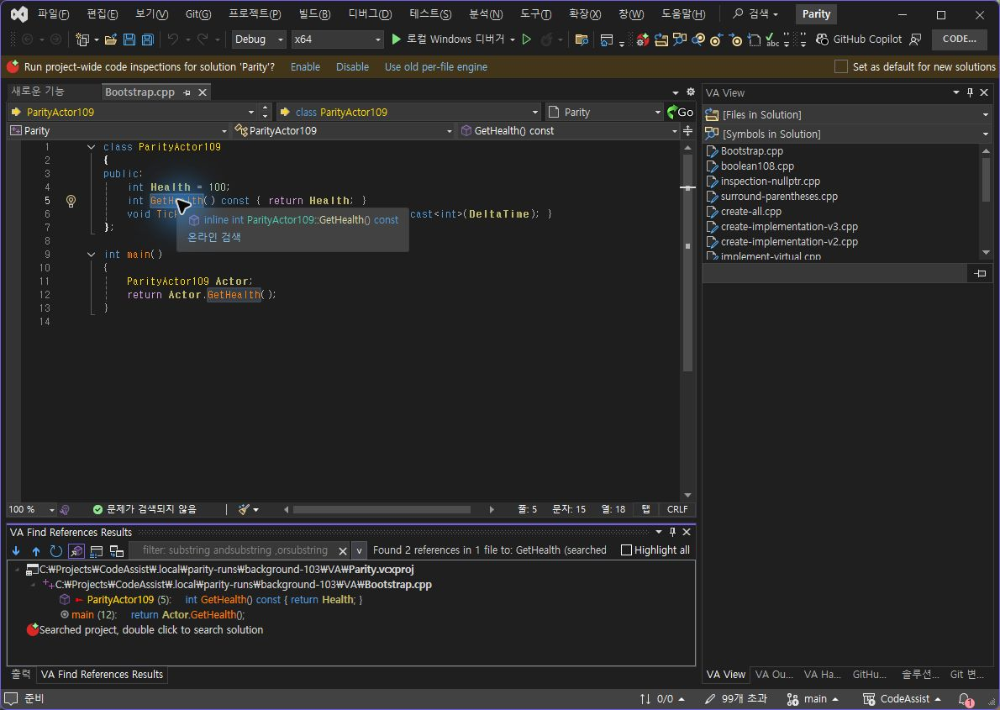
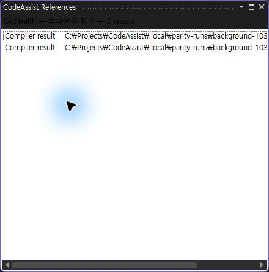
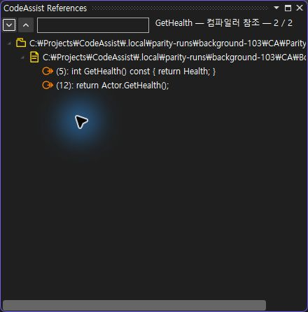
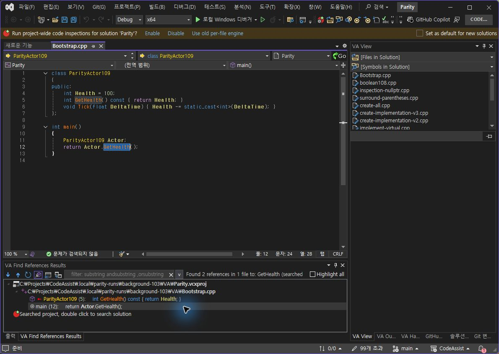
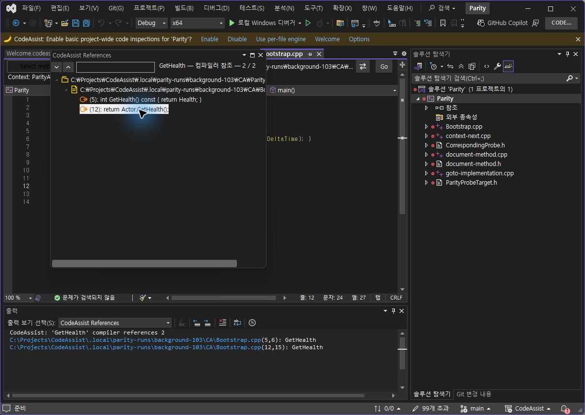
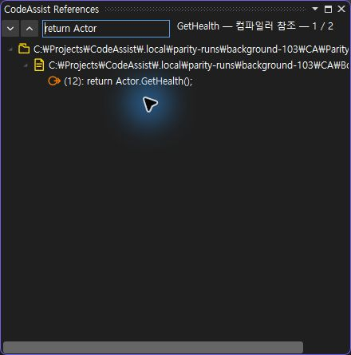
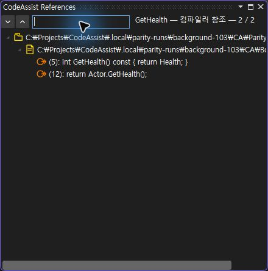

> 보관 기록입니다. 아래 결과는 원문 작성 시점의 내용이며, 이번 편집에서 제품 테스트를 다시 실행하지 않았습니다.

0.0.110 참조 찾기 실제 대조

## 0.0.110 참조 찾기 · 실제 단축키·이동 대조

같은 본문과 GetHealth 선택(5:6→5:15)을 확인한 뒤 양쪽 Alt+Shift+F 입력. VA와 CA 모두 2개 결과, 5행·12행. 호출 결과를 더블클릭한 뒤 양쪽 GetHealth 선택 12:15→12:24 및 전체 본문 일치. 대표 시나리오 2/2(100%) 일치이며 VA-F002 기능 전체 인증은 아닙니다.

## VA 원본 결과

## CA109 변경 전 / CA110 변경 후

흰 단순 목록을 다크 테마의 프로젝트·파일·참조 트리로 교체했습니다. 직접 그린 폴더·파일·참조 벡터 아이콘, 소스 미리보기, 필터·다음/이전 버튼을 추가했습니다. CA109의 커서만 놓는 이동을 이름 선택으로 수정했습니다.

## 실제 호출 이동

## CA 단독 필터·버튼 검증

return Actor 필터로 2→1, 해제하면 1→2. 다음·다음·이전 버튼으로 5행→12행→5행 이동과 각각의 GetHealth 선택을 DTE로 확인했습니다. VA의 해당 도구 동작 전체와 새로 비교한 것으로 합산하지 않습니다.

테스트 301/301, VS2019·Modern 빌드 및 설치 바이너리 6/6 일치.

## 남은 차이

CA의 부동 창과 VA 하단 도킹 배치, D/R/W·상속·프로젝트 필터, 새로고침·전체 강조 등은 아직 같지 않습니다. 동명 scope, 문자열·주석, 같은 행 중복 참조 등 전체 게이트도 남아 있습니다. 전체 목표는 진행 중이며 문서 부분 명세 확보 108/108(100%)는 전체 역분석 완료율이 아닙니다.

결과·해시 · VA 이동 · CA 이동 · 수정 전 불일치 · 테스트 · 설치

XERJ: 사용 — 참조 명령·출력 경로 검색 후 소스·실행 확인.

## 원문과 편집 이력

[보존된 원문 열기](../assets/imports/docs/validation/references-110/index.html)

- 원문 SHA-256: `630754b3c2db2d3c35e18ed7fe04807f8d0ea9cab87149772ae75f4a40c99d72`
- 표시 날짜는 원본 파일의 수정 시각입니다. 작업 완료 시각은 원문에 있는 값을 기준으로 확인합니다.
