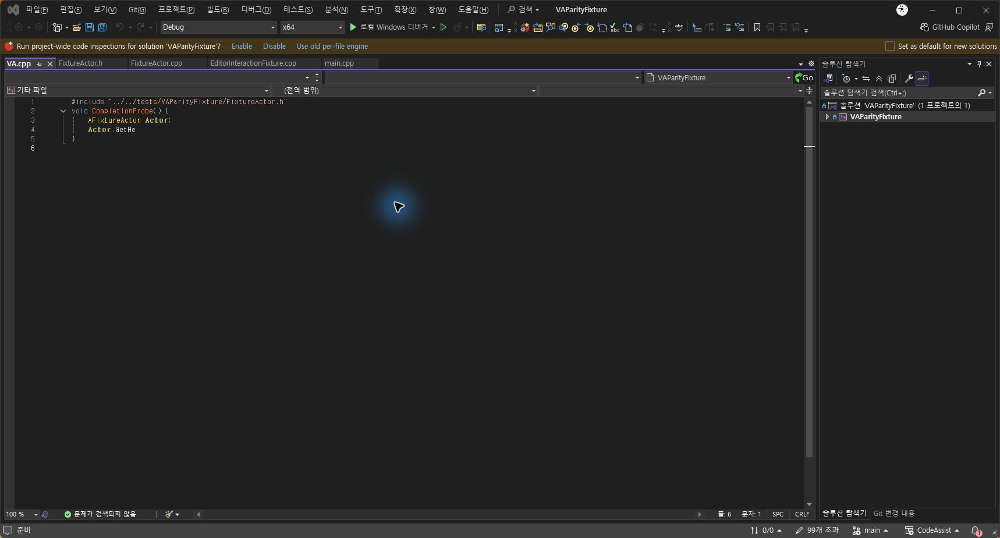
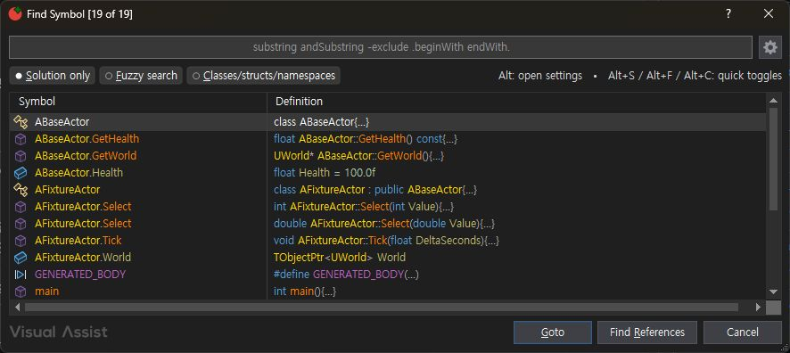

> 보관 기록입니다. 아래 결과는 원문 작성 시점의 내용이며, 이번 편집에서 제품 테스트를 다시 실행하지 않았습니다.

VA·CA 실제 대조 

## VA·CA 실제 대조 — 2026-10-17

서로 다른 Visual Studio 프로세스에서 동일한 3파일 fixture를 사용해 직접 실행했습니다. 전체 108개 기능의 동등성이나 성능을 보장하는 결과가 아닙니다.

이번 결과 집합 일치: 5/5 (100.0%). 실행 기능 범위: 4/108 (3.70%). 전체 유사도: 미확인.

| 기능 / 입력 | VA | CA | 결과 집합 |
| --- | --- | --- | --- |
| Open File in Solution / blank | FixtureActor.cpp, FixtureActor.h, main.cpp | FixtureActor.cpp, FixtureActor.h, main.cpp | 일치 |
| Open File in Solution / Fixture -cpp | FixtureActor.h | FixtureActor.h | 일치 |
| Find Symbol in Solution / blank | ABaseActor, ABaseActor.GetHealth, ABaseActor.GetWorld, ABaseActor.Health, AFixtureActor, AFixtureActor.Select, AFixtureActor.Select, AFixtureActor.Tick, AFixtureActor.World, GENERATED_BODY, main, TObjectPtr, TObjectPtr.->, TObjectPtr.Value, UCLASS, UFUNCTION, UPROPERTY, UWorld, UWorld.SpawnActor | ABaseActor, AFixtureActor, GENERATED_BODY, ABaseActor.GetHealth, ABaseActor.GetWorld, ABaseActor.Health, main, TObjectPtr.->, AFixtureActor.Select, AFixtureActor.Select, UWorld.SpawnActor, AFixtureActor.Tick, TObjectPtr, UCLASS, UFUNCTION, UPROPERTY, UWorld, TObjectPtr.Value, AFixtureActor.World | 일치 |

## 추가 실행 대조

메서드 목록 5개(오버로드 중복 포함), 도구 모음의 cpp→h 이동이 양쪽에서 일치했습니다. 메서드 목록 UI는 서로 다릅니다. Alt+O 키 경로는 이번 자동화에서 확인하지 못했습니다.

[108개 전체 문서 요구·현재 코드·차이·미검증 표](../assets/imports/docs/all-108-review-20261017.html)

참조 필터·시그니처 변경 범위·캡슐화 참조 치환에 기능 차이가 있습니다. 전체 동기화율은 산정하지 않았습니다.

## 실제 차이

- Open File: VA has Solution only; CA has no such toggle.

- Current observed Fuzzy state: VA selected, CA unselected; factory defaults unverified.

- File picker columns, button placement and selection icons differ.

- Symbol display punctuation: VA dot and ->, CA :: and operator->; result order differs.

- CA file picker title Korean but buttons/column labels English under current mixed language settings.

## 남은 검증

나머지 104개 기능, 편집·Undo·참조 변경 정확성, C# 등 언어별 동작, 양 테마·공장 기본값, 시작/증분 인덱싱 성능을 실행 대조해야 합니다. 기존 108개 부분 구현 매핑은 완전 구현 인증이 아닙니다.

[공식 문서와 같은 목차의 CA 비교 명세](../assets/imports/docs/va-documentation-comparison.html) · 원본 접근성 트리·결과 JSON

## 원문과 편집 이력

[보존된 원문 열기](../assets/imports/docs/live-comparison-20261017.html)

- 원문 SHA-256: `bf8d64673b5dee1093289e48098a8d07d4349cf465a4a78266c8f3ca91886ae2`
- 표시 날짜는 원본 파일의 수정 시각입니다. 작업 완료 시각은 원문에 있는 값을 기준으로 확인합니다.
