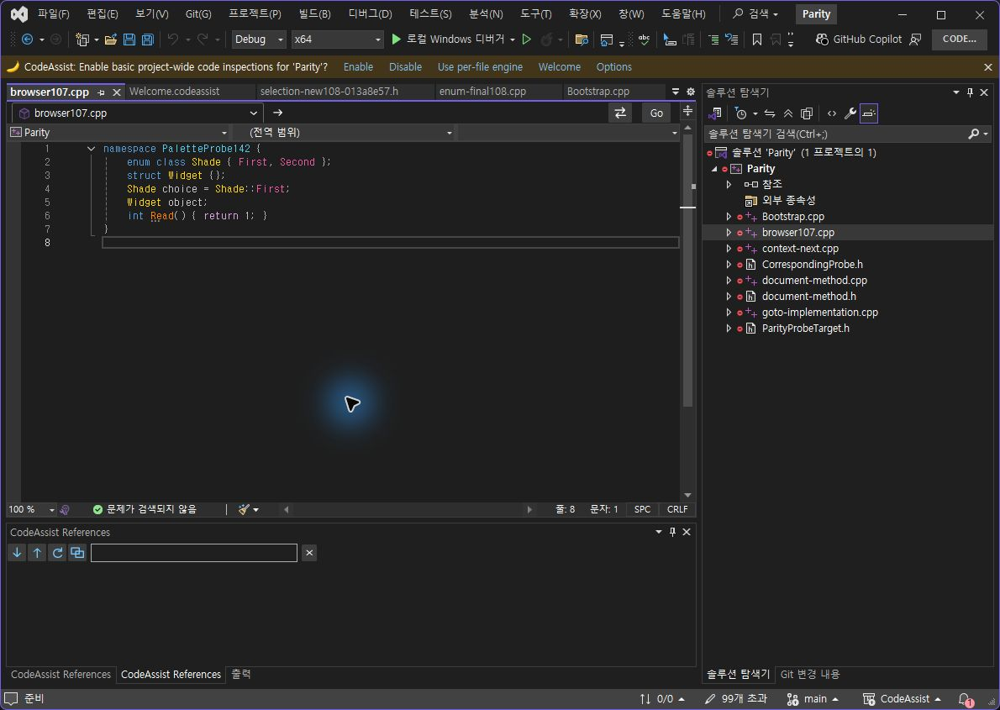
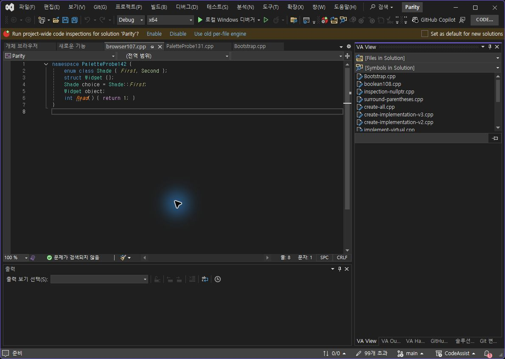
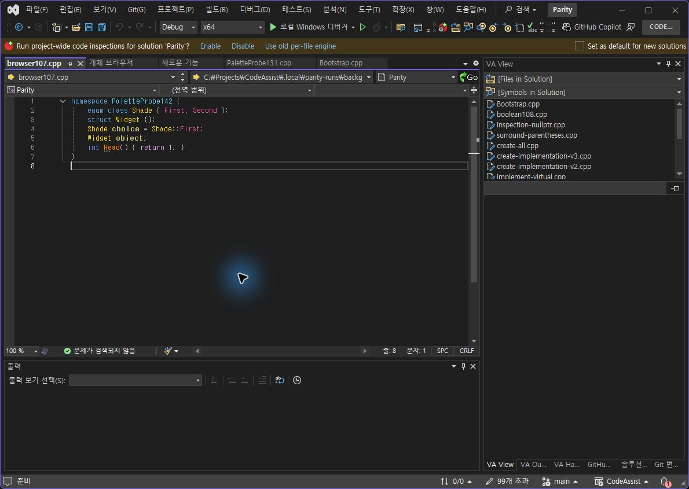
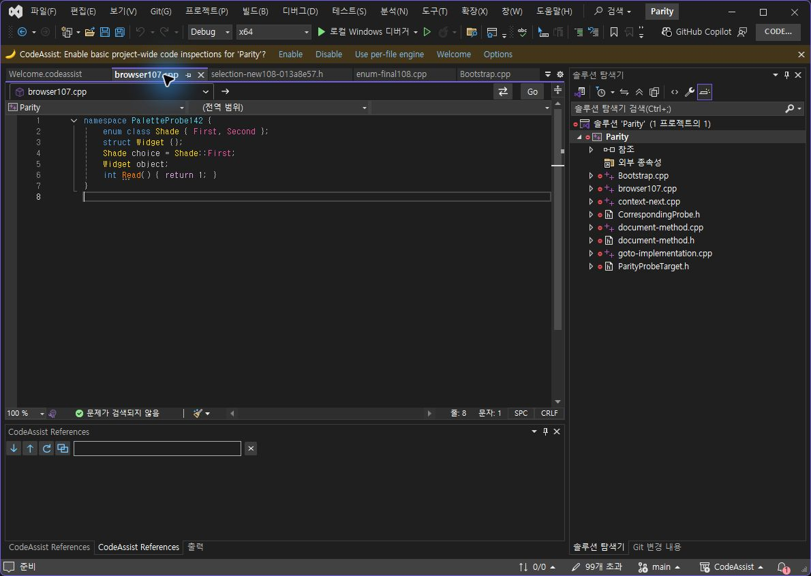
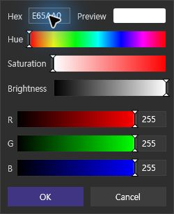
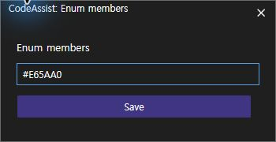
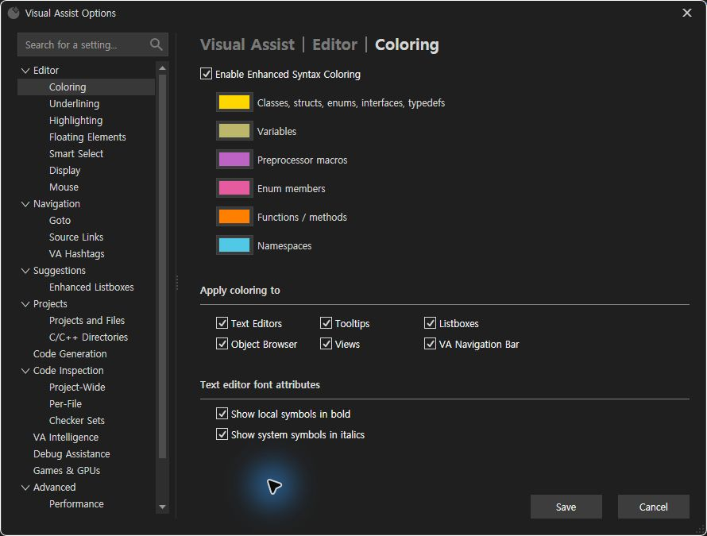
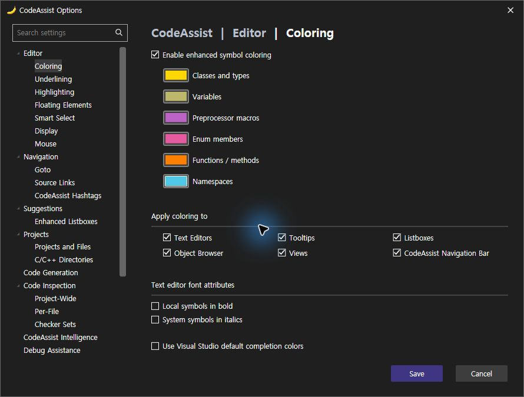
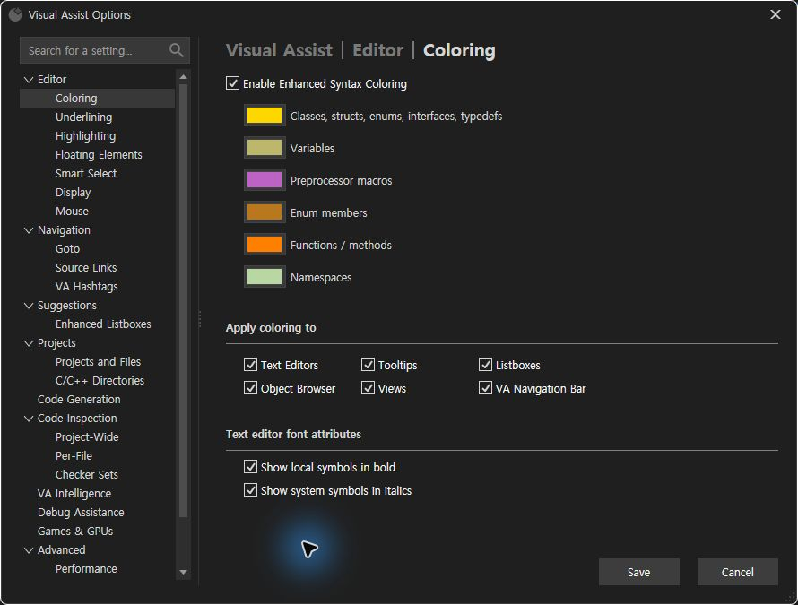
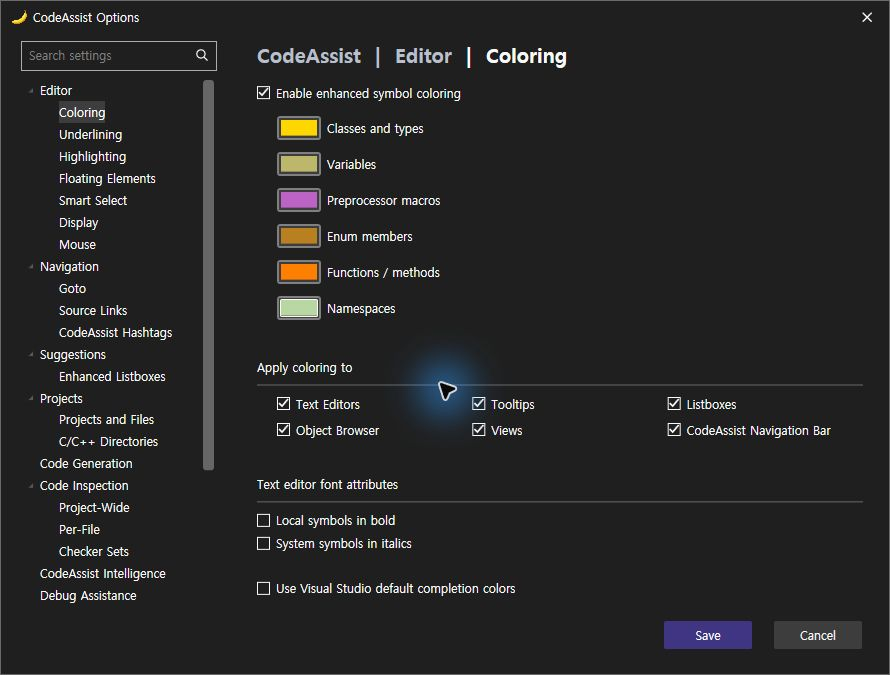

> 보관 기록입니다. 아래 결과는 원문 작성 시점의 내용이며, 이번 편집에서 제품 테스트를 다시 실행하지 않았습니다.

VA·CA 사용자 지정 색상 대조150

## enum·namespace 사용자 지정 색상 실행 대조

설치 CA0.0.149 · 기록 2026-10-24T06:43:29+09:00

**이번 표본4/4개(100%) 일치**: 두 종류의 사용자 색상 적용과 재시작 후 새 편집기 화면의 색상. **선정 옵션 대조 근거10/12개(83.33%)**. 여러 버전의 선정 근거이며 제품 전체 동기화율이 아닙니다. 선정 설정 변경 출력은9/12개(75%); 기존 On/Off 범위7/12는 색상 값 변경과 구분해 그대로 유지합니다.

## 동일 조건

양쪽 프로젝트에 포함된 동일 browser107.cpp, namespace PaletteProbe142, enum Shade의 First/Second 선언과 Shade::First 사용을 확인했습니다. 편집기 전체 소스가 정확히 같고 시험 중 수정하지 않았습니다.

| 설정 | 동일 시험값 | 관찰 |
| --- | --- | --- |
| Enum members | #E65AA0 / RGB230,90,160 | 선언·사용 위치에 분홍색 적용 |
| Namespaces | #50C8E6 / RGB80,200,230 | namespace 이름에 청록색 적용 |

VA와 CA 저장값을 각각 실제 레지스트리·설정 XML에서 읽어 정확한 RGB 일치를 확인했습니다. 화면은 색상 범주를 시각 확인했으며 JPEG 촬영본의 픽셀 완전 일치로 판정하지 않았습니다.

## 재시작의 한계

두 검사 프로필을 정상 종료·재실행했습니다. 양쪽 저장값은 유지됐고 CA는 다시 열린 파일에서 즉시 사용자 색상을 표시했습니다. VA의 자동 복원 화면은 처음 기본 색상으로 보였고, 같은 파일을 닫고 다시 열었을 때 사용자 색상이 표시됐습니다. 따라서 **저장 유지·새 화면의 결과를 확인**했으며 시작 직후 동작 시간까지 동일하다고 인증하지 않았습니다.

## 확인된 UI 차이

VA는 Palette/Web/System 탭과 사용자 슬롯 우클릭의 Hex·Hue·Saturation·Brightness·RGB 편집기를 제공합니다. CA는 별도 창에서 Hex만 입력합니다. 두 선택기의 레이아웃과 컨트롤은 다르며 수정 대상입니다. 사용한 VA 사용자 색상 입력 방법은 [공식 안내](https://www.wholetomato.com/en/documentation/code-understanding/enhanced-syntax-coloring)와 실제 실행으로 확인했습니다.

## 원복

VA의 원래 enum #B9771E·namespace #B8D7A3, CA의 원래 enum #B88020·namespace #B9D7A2로 각각 정확히 복원했습니다. 이는 현재 사용자 설정이며 공장 기본값으로 단정하지 않습니다. 기능 색상 외 사용자 팔레트 슬롯 이력까지 원복됐는지는 인증하지 않았습니다. 문서 저장 상태도 확인했습니다.

판정 JSON · 재시작 후 실제 저장값 · VA 소스/선택 · CA 소스/선택 · VA 복원값 · CA 복원값 · 실행 CA DLL · [직전 추천 색상 수정](../assets/imports/docs/validation/options-148/index.html)

## 화면 대조

va-immediate

ca-immediate

va-restored-view-after-restart

va-custom-after-reopen

ca-custom-after-restart

va-custom-picker

ca-custom-picker

va-test-options

ca-test-options

va-restored-options

ca-restored-options

## 남은 작업

스니펫 VA 대조(사용자 파일 시험 승인 대기), 실제 키 홀드 반복률, 색상 선택기 UI, 툴팁 추가 행, 추천 창 디자인·설명, 실행 취소 차이와 전체108항목의 현재 빌드 인증이 남습니다. 전체 목표는 계속 진행 중입니다.

분석율: 문서·도움말 기반 부분 명세108/108(100%). 전체 역분석 완료율과 다릅니다. XERJ 사용: EnumMemberColor 검색 후 현재 소스 대조.

제안 시간20~30분. 이번 검증·기록까지 21.0분. 전체 목표 미완료.

## 원문과 편집 이력

[보존된 원문 열기](../assets/imports/docs/validation/options-150/index.html)

- 원문 SHA-256: `4fc09e1f9fd371cbb8790ecc2e11d5e9c16f297d05859492670837592d4a4e15`
- 표시 날짜는 원본 파일의 수정 시각입니다. 작업 완료 시각은 원문에 있는 값을 기준으로 확인합니다.
