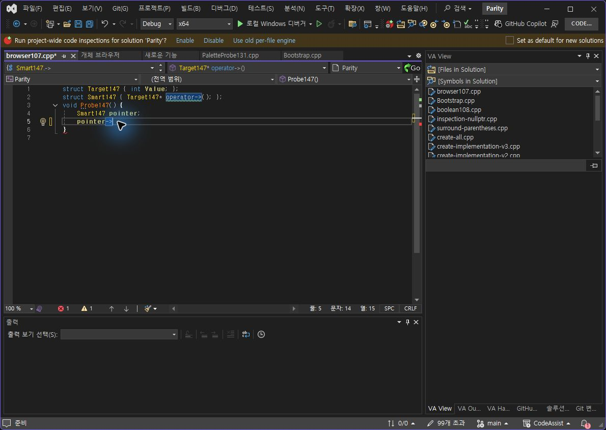
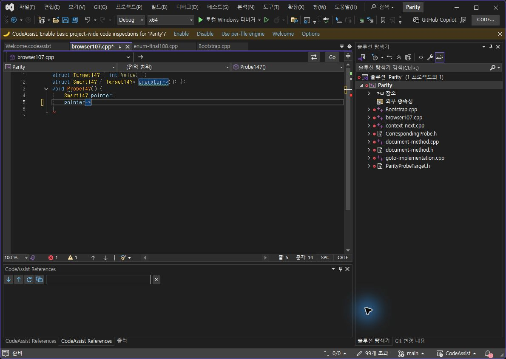
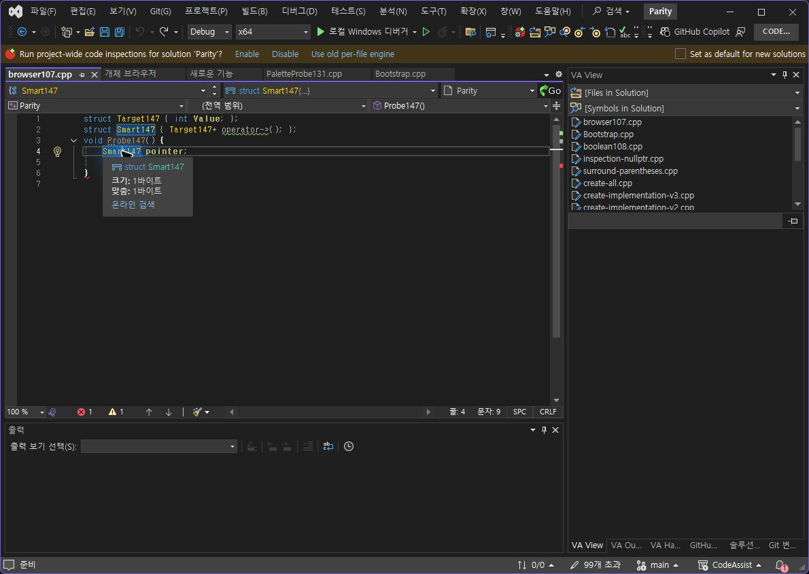
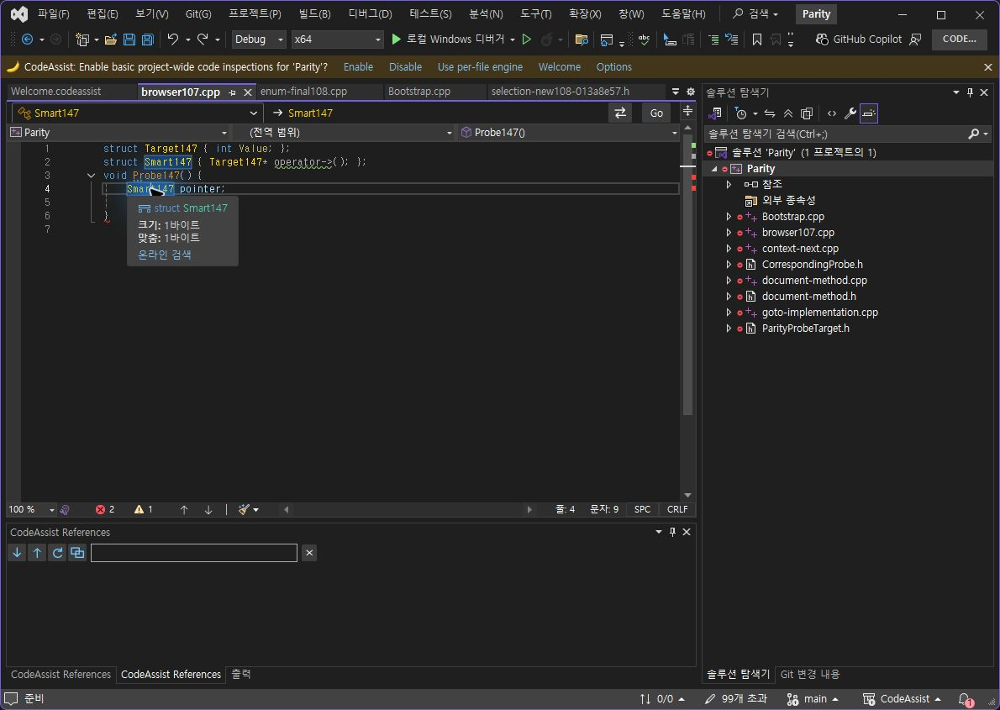
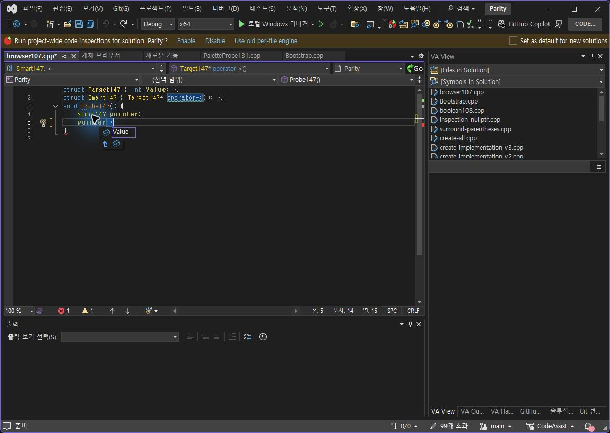
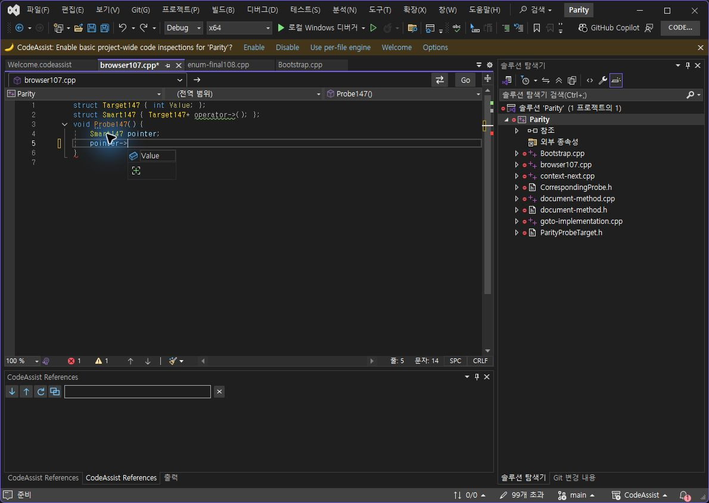
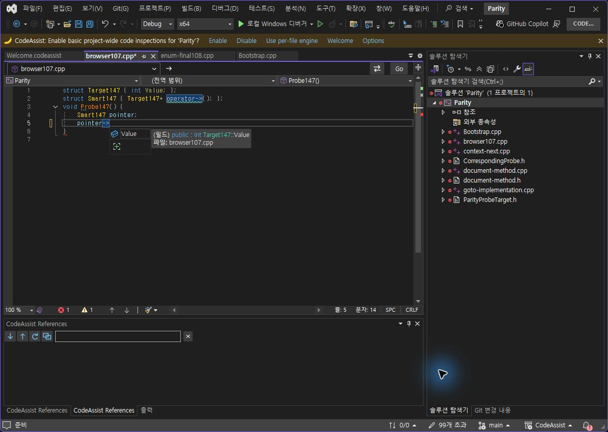
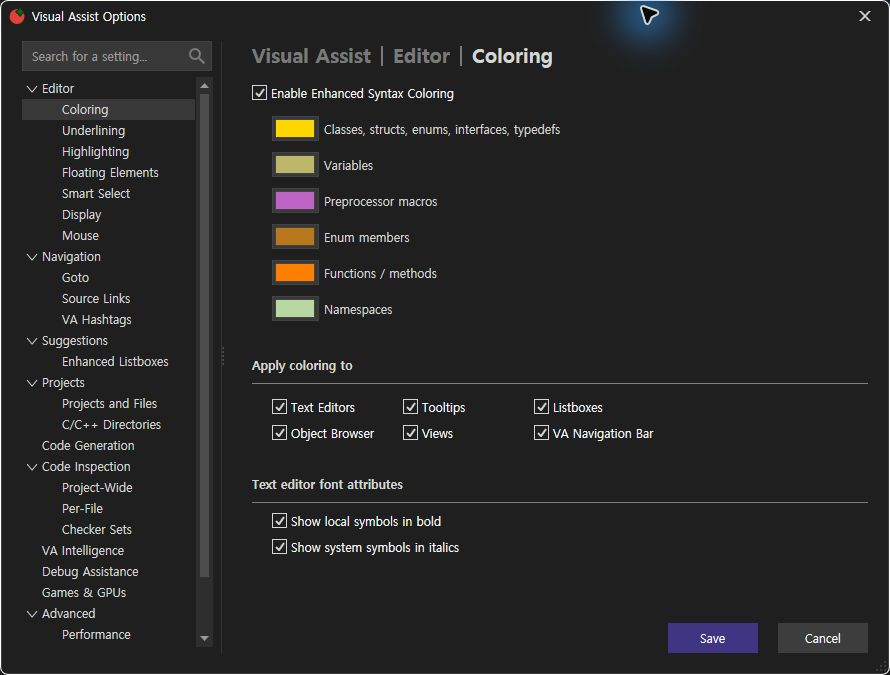

> 보관 기록입니다. 아래 결과는 원문 작성 시점의 내용이며, 이번 편집에서 제품 테스트를 다시 실행하지 않았습니다.

VA·CA 옵션 실제 입력 대조 147 — 설치 CA 0.0.146

## 실제 키 입력 대조 147

설치 CA 0.0.146 · 기록 2026-10-24T05:58:19+09:00

**과부하 화살표 변환: 2/2 상태 일치(100%)**. 같은 스마트 포인터에서 Off → pointer., On → pointer->. 전체 편집기 코드와 선택/커서 위치를 JSON으로 대조했습니다. 실행 취소는 VA 2회·CA 1회로 다릅니다.

**선정 옵션 대조 근거: 7/12개(58.33%)**. 선정 On/Off 출력 확보: 6/12개(50%). 제품 전체 동기화율로 해석하지 않습니다. 이전 범위의 명세/검증을 최신 전체 실행으로 재인증하지 않았습니다.

## 새로 확인한 차이와 한계

- CA의 Value 추천 후보는 색상 On에도 흰색입니다. 동일 VA On 상태 미촬영으로 해당 색상 일치는 미판정입니다.

- 기존 함수 툴팁의 CA 추가 행은 해결되지 않았습니다. 이번 타입 Off 표본은 양쪽 기본 VS 정보가 같지만 옵션 인과성 인증은 아닙니다.

- 네이티브 후보만 남는 추천 경로를 소스에서 확인했습니다. 해당 런타임 분기 추적과 수정·재검사가 남았습니다.

- 키 반복 실제 홀드·사용자 지정 색상·VA 사용자 스니펫 대조 등 전체 목표는 계속 진행 중입니다.

## 복원

시험 소스 두 개는 원본 해시 일치. CA 변경 설정은 원래 값, VA 색상 On 저장 후 재시작·옵션 화면으로 확인. 문서 저장 상태 확인. VA는 설정 저장 뒤 두 번 종료되어 검사 프로필만 복구했습니다.

정확한 판정 JSON · VA On 텍스트/커서 · CA On 텍스트/커서 · VA Off · CA Off · [이전 근거](../assets/imports/docs/validation/options-146/index.html)

## 화면

va-arrow-on

ca-arrow-on

va-tooltip-off

ca-tooltip-off

va-list-off

ca-list-off

ca-list-on

va-colors-restored

분석율: 문서·도움말 기반 부분 명세 108/108(100%). 전체 역분석 완료율과 다릅니다. XERJ 사용: SymbolQuickInfo·ColorListboxes 검색 후 현재 소스 확인.

제안 시간: 20~30분. 이번 기록까지 실제 20.7분. 전체 목표는 미완료입니다.

## 원문과 편집 이력

[보존된 원문 열기](../assets/imports/docs/validation/options-147/index.html)

- 원문 SHA-256: `b2688deaccd8c802e1981e48da6152668401c1f52d436d79b4e345c75aade770`
- 표시 날짜는 원본 파일의 수정 시각입니다. 작업 완료 시각은 원문에 있는 값을 기준으로 확인합니다.
