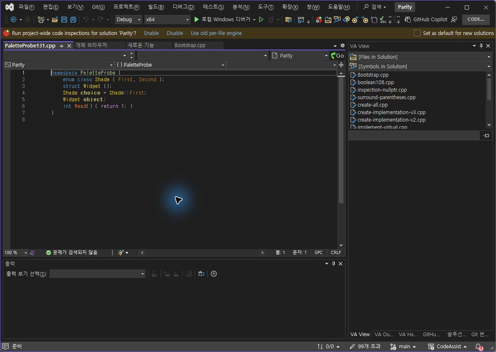
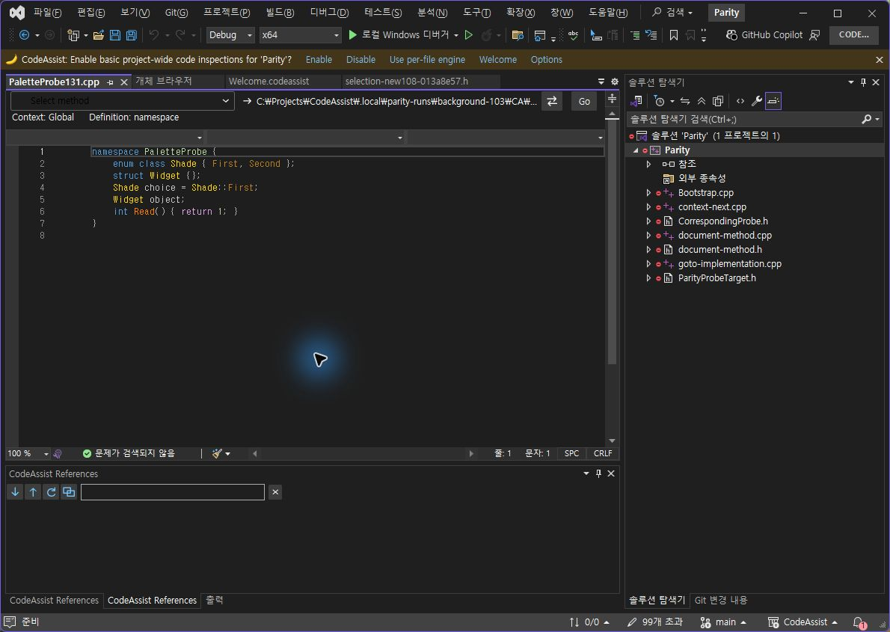

> 보관 기록입니다. 아래 결과는 원문 작성 시점의 내용이며, 이번 편집에서 제품 테스트를 다시 실행하지 않았습니다.

CA 0.0.132 색상 수정·자동 검사

## CodeAssist 0.0.132 — 색상 수정 묶음

전체 완수 아님. 자동 회귀 통과를 VA 동등성 통과로 계산하지 않았습니다.

## 이번 수정

- 탐색 목록: 고정 역할 색상 대신 사용자 지정 심볼 색상을 사용합니다.

- 참조 창: 프로젝트·파일명에 함수 색상을 적용하던 오류를 제거했습니다. 알려진 심볼 종류를 사용하고, 열려 있는 창에도 설정 저장을 반영합니다.

- 열거형: 함수 호출의 쉼표를 가짜 멤버로 읽는 오류와 중괄호 초기화식의 누락을 수정했습니다. 공백이 있는 중첩 네임스페이스도 처리합니다.

개체 브라우저의 LiteTreeView32 색상 적용 실패는 남아 있습니다. 표준 TreeView 클래스명만 바꾸어 해결된 것으로 처리하지 않았습니다.

## 검사 결과와 범위

| 기준 | 결과 | 한계 |
| --- | --- | --- |
| 현재 코어 자동 회귀 | 378/378 · 100% | VA 동기화율 아님 |
| 설치된 132 코어 실행 | 19/19 · 100% | 색상 계산·파서; 실제 VS 화면 입력 아님 |
| VS2019 / Modern 빌드 | 2/2 · 100% | 스레딩 분석 경고 존재; VS2019 실행 검증 아님 |
| 패키지·설치 파일 대조 | 6/6 바이너리 일치 | 실제 로드 모듈도 별도 확인 |
| 최근 옵션 VA 실제 대조 | 일치 1/12 · 8.33% | 130 보관 결과: 실패 1, 미검증 10. 132 새 통과 아님 |
| 동일 옵션 검사 진행률 | 2/12 · 16.67% | 일치율과 다름 |
| UI 항목 구비 | 32/32 · 100% | 130 표본; 레이아웃·디자인 점수 아님 |
| 문서 부분 명세 확보 | 108/108 · 100% | 전체 역분석·구현 완료 아님 |
| 전체 기능 완전 동등성 인증 | 0/108 · 0% | 구현률이 0%라는 뜻이 아님. 전체 제품 동기화율 미산출 |

## 보관된 동일 코드 화면 — 130, 이번 통과 수에 미포함

네임스페이스·열거형의 켜짐 상태 참고입니다. 꺼짐 및 복원까지 확인한 증거가 아니므로 새 옵션 통과로 계산하지 않았습니다.

VA

CA 130

## 실행 근거

378개 회귀 검사 · 설치본 19개 검사 · 두 대상 빌드 · 패키지 · 설치 해시 · 실제 CLR 로드 · 집계 JSON·시간

설치 파일은 installers/0.0.132/에 보관합니다. 다른 창이 검사 화면을 가린 뒤에는 화면 입력을 수행하지 않았습니다. 관련 없는 창 화면은 이 보고서에 싣지 않았습니다.

XERJ: 사용 — 후보 검색 후 현재 소스 확인. REA: 설치본 해시가 일치하는 VA의 읽기 전용 Ghidra 분석 근거 확보.

## 원문과 편집 이력

[보존된 원문 열기](../assets/imports/docs/validation/color-fixes-131/index.html)

- 원문 SHA-256: `075cbdf42ae5444aad38f0e47cfdb7fc375e13458da2765119d804ecfbe51b18`
- 표시 날짜는 원본 파일의 수정 시각입니다. 작업 완료 시각은 원문에 있는 값을 기준으로 확인합니다.
