> 보관 기록입니다. 아래 결과는 원문 작성 시점의 내용이며, 이번 편집에서 제품 테스트를 다시 실행하지 않았습니다.

남은 98개: 실행 시도와 검증 한계

## 남은 98개 자동 검사 결과

**98개 전체 기능 검증 완료가 아닙니다. 모든 항목에 대한 실행 결과·실패 기록을 모았지만, 창 열기/취소와 명령 호출을 기능 통과로 세지 않았습니다.**

```
{
  "requested": 98,
  "recordedBoth": 98,
  "actualInvokedBoth": 18,
  "roleStats": {
    "VA": {
      "rows": 98,
      "invoked": 73,
      "executionErrors": 25
    },
    "CA": {
      "rows": 98,
      "invoked": 43,
      "executionErrors": 56
    }
  },
  "newFunctionalPasses": 0,
  "newObservedDifferences": 1,
  "totalMatches": 4,
  "totalDifferences": 7,
  "totalUnverified": 97,
  "denominator": 108,
  "determinatePercent": 10.19,
  "fullProductSimilarity": null,
  "images": 414,
  "proposedSeconds": 600,
  "startedAt": "2026-10-18T21:43:01+09:00",
  "reportedAt": "2026-10-18T21:52:06.360683+09:00",
  "elapsedSeconds": 545,
  "all98FunctionallyVerified": false
}
```

CA 프로세스 종료 뒤의 RPC 실패는 실제 기능 실행으로 계산하지 않습니다. CA 종료 로그는 자동화 중복 닫기와 DialogResult 예외를 포함하며, 제품 원인으로 단정하지 않습니다. 재시작 시도 기록도 보존했습니다.

종료 이벤트 · 고정 98개 계획 · 항목별 원본 · 전체 108개

VA-F001 Find by Context — unverified

검사 실행 오류; 제품 불일치로 계산하지 않음

```
{
  "id": "VA-F001",
  "name": "Find by Context",
  "state": "unverified",
  "reason": "검사 실행 오류; 제품 불일치로 계산하지 않음",
  "VA": {
    "id": "remaining-001",
    "feature": 1,
    "action": "dialog-probe",
    "verificationScope": "options-page-only",
    "invoked": true,
    "before": {
      "zoom": 100,
      "text": "struct Audit { int Health; void Update(); };\r\nvoid Probe() { Audit item; item.Health = 1; }\r\n",
      "caret": 25,
      "selectionStart": 19,
      "selectionLength": 6,
      "selectedText": "Health"
    },
    "after": {
      "zoom": 100,
      "text": "struct Audit { int Health; void Update(); };\r\nvoid Probe() { Audit item; item.Health = 1; }\r\n",
      "caret": 25,
      "selectionStart": 19,
      "selectionLength": 6,
      "selectedText": "Health"
    },
    "probe": {
      "status": "dialog-closed-without-cancel-control",
      "title": "Visual Assist Options",
      "pageSelected": false,
      "controls": [
        {
          "name": "Visual Assist Options",
          "type": "ControlType.TitleBar",
          "value": null
        },
        {
          "name": "시스템 메뉴 모음",
          "type": "ControlType.MenuBar",
          "value": null
        },
        {
          "name": "시스템",
          "type": "ControlType.MenuItem",
          "value": null
        },
        {
          "name": "최소화",
          "type": "ControlType.Button",
          "value": null
        },
        {
          "name": "최대화",
          "type": "ControlType.Button",
          "value": null
        },
        {
          "name": "상황에 맞는 도움말",
          "type": "ControlType.Button",
          "value": null
        },
        {
          "name": "닫기",
          "type": "ControlType.Button",
          "value": null
        },
        {
          "name": "",
          "type": "ControlType.Custom",
          "value": null
        }
      ]
    },
    "error": null,
    "fullFunctionalPass": false
  },
  "CA": {
    "id": "remaining-001",
    "feature": 1,
    "action": "dialog-probe",
    "verificationScope": "options-page-only",
    "invoked": true,
    "before": {
      "zoom": 140,
      "text": "struct Audit { int Health; void Update(); };\r\nvoid Probe() { Audit item; item.Health = 1; }\r\n",
      "caret": 25,
      "selectionStart": 19,
      "selectionLength": 6,
      "selectedText": "Health"
    },
    "after": null,
    "probe": {
      "status": "dialog-observed-and-cancelled",
      "title": "CodeAssist Options",
      "pageSelected": true,
      "controls": [
        {
          "name": "Close",
          "type": "ControlType.Button",
          "value": null
        },
        {
          "name": "×",
          "type": "ControlType.Text",
          "value": null
        },
        {
          "name": "",
          "type": "ControlType.Image",
          "value": null
        },
        {
          "name": "CodeAssist Options",
          "type": "ControlType.Text",
          "value": null
        },
        {
          "name": "Save",
          "type": "ControlType.Button",
          "value": null
        },
        {
          "name": "Save",
          "type": "ControlType.Text",
          "value": null
        },
        {
          "name": "Cancel",
          "type": "ControlType.Button",
          "value": null
        },
        {
          "name": "Cancel",
          "type": "ControlType.Text",
          "value": null
        },
        {
          "name": "Search settings",
          "type": "ControlType.Edit",
          "value": ""
        },
        {
          "name": "Search settings…  ⌕",
          "type": "ControlType.Text",
          "value": null
        },
        {
          "name": "",
          "type": "ControlType.Tree",
          "value": null
        },
        {
          "name": "Editor",
          "type": "ControlType.TreeItem",
          "value": null
        },
        {
          "name": "",
          "type": "ControlType.Button",
          "value": "On"
        },
        {
          "name": "Editor",
          "type": "ControlType.Text",
          "value": null
        },
        {
          "name": "Coloring",
          "type": "ControlType.TreeItem",
          "value": null
        },
        {
          "name": "Coloring",
          "type": "ControlType.Text",
          "value": null
        },
        {
          "name": "Underlining",
          "type": "ControlType.TreeItem",
          "value": null
        },
        {
          "name": "Underlining",
          "type": "ControlType.Text",
          "value": null
        },
        {
          "name": "Highlighting",
          "type": "ControlType.TreeItem",
          "value": null
        },
        {
          "name": "Highlighting",
          "type": "ControlType.Text",
          "value": null
        },
        {
          "name": "Floating Elements",
          "type": "ControlType.TreeItem",
          "value": null
        },
        {
          "name": "Floating Elements",
          "type": "ControlType.Text",
          "value": null
        },
        {
          "name": "Smart Select",
          "type": "ControlType.TreeItem",
          "value": null
        },
        {
          "name": "Smart Select",
          "type": "ControlType.Text",
          "value": null
        },
        {
          "name": "Display",
          "type": "ControlType.TreeItem",
          "value": null
        },
        {
          "name": "Display",
          "type": "ControlType.Text",
          "value": null
        },
        {
          "name": "Mouse",
          "type": "ControlType.TreeItem",
          "value": null
        },
        {
          "name": "Mouse",
          "type": "ControlType.Text",
          "value": null
        },
        {
          "name": "Navigation",
          "type": "ControlType.TreeItem",
          "value": null
        },
        {
          "name": "",
          "type": "ControlType.Button",
          "value": "On"
        },
        {
          "name": "Navigation",
          "type": "ControlType.Text",
          "value": null
        },
        {
          "name": "Goto",
          "type": "ControlType.TreeItem",
          "value": null
        },
        {
          "name": "Goto",
          "type": "ControlType.Text",
          "value": null
        },
        {
          "name": "Source Links",
          "type": "ControlType.TreeItem",
          "value": null
        },
        {
          "name": "Source Links",
          "type": "ControlType.Text",
          "value": null
        },
        {
          "name": "CodeAssist Hashtags",
          "type": "ControlType.TreeItem",
          "value": null
        },
        {
          "name": "CodeAssist Hashtags",
          "type": "ControlType.Text",
          "value": null
        },
        {
          "name": "Suggestions",
          "type": "ControlType.TreeItem",
          "value": null
        },
        {
          "name": "",
          "type": "ControlType.Button",
          "value": "On"
        },
        {
          "name": "Suggestions",
          "type": "ControlType.Text",
          "value": null
        },
        {
          "name": "Enhanced Listboxes",
          "type": "ControlType.TreeItem",
          "value": null
        },
        {
          "name": "Enhanced Listboxes",
          "type": "ControlType.Text",
          "value": null
        },
        {
          "name": "Projects",
          "type": "ControlType.TreeItem",
          "value": null
        },
        {
          "name": "",
          "type": "ControlType.Button",
          "value": "On"
        },
        {
          "name": "Projects",
          "type": "ControlType.Text",
          "value": null
        },
        {
          "name": "Projects and Files",
          "type": "ControlType.TreeItem",
          "value": null
        },
        {
          "name": "Projects and Files",
          "type": "ControlType.Text",
          "value": null
        },
        {
          "name": "C/C++ Directories",
          "type": "ControlType.TreeItem",
          "value": null
        },
        {
          "name": "C/C++ Directories",
          "type": "ControlType.Text",
          "value": null
        },
        {
          "name": "Code Generation",
          "type": "ControlType.TreeItem",
          "value": null
        },
        {
          "name": "Code Generation",
          "type": "ControlType.Text",
          "value": null
        },
        {
          "name": "Code Inspection",
          "type": "ControlType.TreeItem",
          "value": null
        },
        {
          "name": "",
          "type": "ControlType.Button",
          "value": "On"
        },
        {
          "name": "Code Inspection",
          "type": "ControlType.Text",
          "value": null
        },
        {
          "name": "Project-Wide",
          "type": "ControlType.TreeItem",
          "value": null
        },
        {
          "name": "Project-Wide",
          "type": "ControlType.Text",
          "value": null
        },
        {
          "name": "Per-File",
          "type": "ControlType.TreeItem",
          "value": null
        },
        {
          "name": "Per-File",
          "type": "ControlType.Text",
          "value": null
        },
        {
          "name": "Checker Sets",
          "type": "ControlType.TreeItem",
          "value": null
        },
        {
          "name": "Checker Sets",
          "type": "ControlType.Text",
          "value": null
        },
        {
          "name": "CodeAssist Intelligence",
          "type": "ControlType.TreeItem",
          "value": null
        },
        {
          "name": "CodeAssist Intelligence",
          "type": "ControlType.Text",
          "value": null
        },
        {
          "name": "Debug Assistance",
          "type": "ControlType.TreeItem",
          "value": null
        },
        {
          "name": "Debug Assistance",
          "type": "ControlType.Text",
          "value": null
        },
        {
          "name": "Games & GPUs",
          "type": "ControlType.TreeItem",
          "value": null
        },
        {
          "name": "Games & GPUs",
          "type": "ControlType.Text",
          "value": null
        },
        {
          "name": "Advanced",
          "type": "ControlType.TreeItem",
          "value": null
        },
        {
          "name": "",
          "type": "ControlType.Button",
          "value": "On"
        },
        {
          "name": "Advanced",
          "type": "ControlType.Text",
          "value": null
        },
        {
          "name": "Language",
          "type": "ControlType.TreeItem",
          "value": null
        },
        {
          "name": "Language",
          "type": "ControlType.Text",
          "value": null
        },
        {
          "name": "Performance",
          "type": "ControlType.TreeItem",
          "value": null
        },
        {
          "name": "Performance",
          "type": "ControlType.Text",
          "value": null
        },
        {
          "name": "Guides",
          "type": "ControlType.TreeItem",
          "value": null
        },
        {
          "name": "Guides",
          "type": "ControlType.Text",
          "value": null
        },
        {
          "name": "File Extensions",
          "type": "ControlType.TreeItem",
          "value": null
        },
        {
          "name": "File Extensions",
          "type": "ControlType.Text",
          "value": null
        },
        {
          "name": "Compilation Database",
          "type": "ControlType.TreeItem",
          "value": null
        },
        {
          "name": "Compilation Database",
          "type": "ControlType.Text",
          "value": null
        },
        {
          "name": "Generation Templates",
          "type": "ControlType.TreeItem",
          "value": null
        },
        {
          "name": "Generation Templates",
          "type": "ControlType.Text",
          "value": null
        },
        {
          "name": "",
          "type": "ControlType.Pane",
          "value": null
        },
        {
          "name": "CodeAssist  |  Navigation  |  Goto",
          "type": "ControlType.Text",
          "value": null
        },
        {
          "name": "Alt + click: Go to definition",
          "type": "ControlType.CheckBox",
          "value": "Off"
        },
        {
          "name": "Alt + click: Go to definition",
          "type": "ControlType.Text",
          "value": null
        },
        {
          "name": "Show symbol Quick Info",
          "type": "ControlType.CheckBox",
          "value": "On"
        },
        {
          "name": "Show symbol Quick Info",
          "type": "ControlType.Text",
          "value": null
        },
        {
          "name": "Context Bar",
          "type": "ControlType.CheckBox",
          "value": "On"
        },
        {
          "name": "Context Bar",
          "type": "ControlType.Text",
          "value": null
        },
        {
          "name": "Restore VA-compatible shortcuts",
          "type": "ControlType.Button",
          "value": null
        },
        {
          "name": "Restore VA-compatible shortcuts",
          "type": "ControlType.Text",
          "value": null
        }
      ]
    },
    "error": "System.Runtime.InteropServices.COMException (0x800706BE): 원격 프로시저를 호출하지 못했습니다. (예외가 발생한 HRESULT: 0x800706BE)\r\n   위치: EnvDTE._DTE.get_ActiveDocument()\r\n   위치: ShortcutProbe.BufferSnapshot(DTE d, String file)\r\n   위치: ShortcutProbe.Remaining98(DTE d, Int32 pid, String role, String root, String planFile)",
    "fullFunctionalPass": false
  },
  "prefill": null,
  "fullFunctionalPass": false
}
```

[](../assets/imports/docs/validation/remaining-098-10min/VA/remaining-001-before.png)[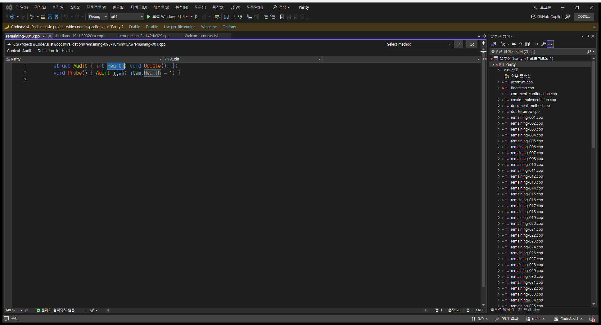](../assets/imports/docs/validation/remaining-098-10min/CA/remaining-001-before.png)

[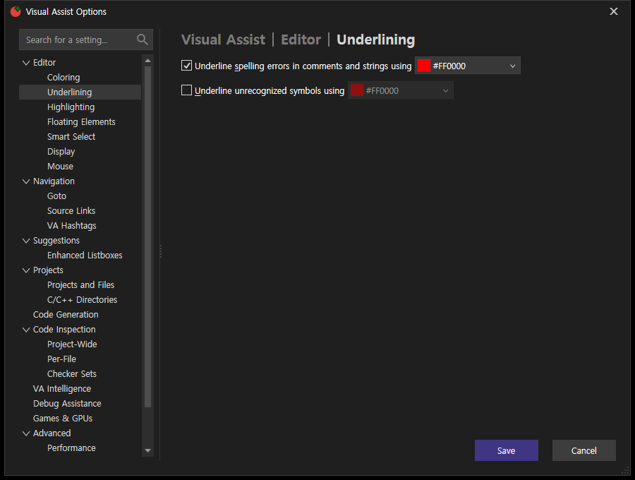](../assets/imports/docs/validation/remaining-098-10min/VA/remaining-001-dialog.png)

[](../assets/imports/docs/validation/remaining-098-10min/VA/remaining-001-after.png)

VA-F002 Find References — unverified

검사 실행 오류; 제품 불일치로 계산하지 않음

```
{
  "id": "VA-F002",
  "name": "Find References",
  "state": "unverified",
  "reason": "검사 실행 오류; 제품 불일치로 계산하지 않음",
  "VA": {
    "id": "remaining-002",
    "feature": 2,
    "action": "dialog-probe",
    "verificationScope": "options-page-only",
    "invoked": true,
    "before": {
      "zoom": 100,
      "text": "struct Audit { int Health; void Update(); };\r\nvoid Probe() { Audit item; item.Health = 1; }\r\n",
      "caret": 25,
      "selectionStart": 19,
      "selectionLength": 6,
      "selectedText": "Health"
    },
    "after": {
      "zoom": 100,
      "text": "struct Audit { int Health; void Update(); };\r\nvoid Probe() { Audit item; item.Health = 1; }\r\n",
      "caret": 25,
      "selectionStart": 19,
      "selectionLength": 6,
      "selectedText": "Health"
    },
    "probe": {
      "status": "dialog-closed-without-cancel-control",
      "title": "Visual Assist Options",
      "pageSelected": false,
      "controls": [
        {
          "name": "Visual Assist Options",
          "type": "ControlType.TitleBar",
          "value": null
        },
        {
          "name": "시스템 메뉴 모음",
          "type": "ControlType.MenuBar",
          "value": null
        },
        {
          "name": "시스템",
          "type": "ControlType.MenuItem",
          "value": null
        },
        {
          "name": "최소화",
          "type": "ControlType.Button",
          "value": null
        },
        {
          "name": "최대화",
          "type": "ControlType.Button",
          "value": null
        },
        {
          "name": "상황에 맞는 도움말",
          "type": "ControlType.Button",
          "value": null
        },
        {
          "name": "닫기",
          "type": "ControlType.Button",
          "value": null
        },
        {
          "name": "",
          "type": "ControlType.Custom",
          "value": null
        }
      ]
    },
    "error": null,
    "fullFunctionalPass": false
  },
  "CA": {
    "id": "remaining-002",
    "feature": 2,
    "action": "dialog-probe",
    "verificationScope": "options-page-only",
    "invoked": false,
    "before": null,
    "after": null,
    "probe": null,
    "error": "System.Runtime.InteropServices.COMException (0x800706BA): RPC 서버를 사용할 수 없습니다. (예외가 발생한 HRESULT: 0x800706BA)\r\n   위치: EnvDTE._DTE.get_Solution()\r\n   위치: ShortcutProbe.Remaining98(DTE d, Int32 pid, String role, String root, String planFile)",
    "fullFunctionalPass": false
  },
  "prefill": null,
  "fullFunctionalPass": false
}
```

[](../assets/imports/docs/validation/remaining-098-10min/VA/remaining-002-before.png)[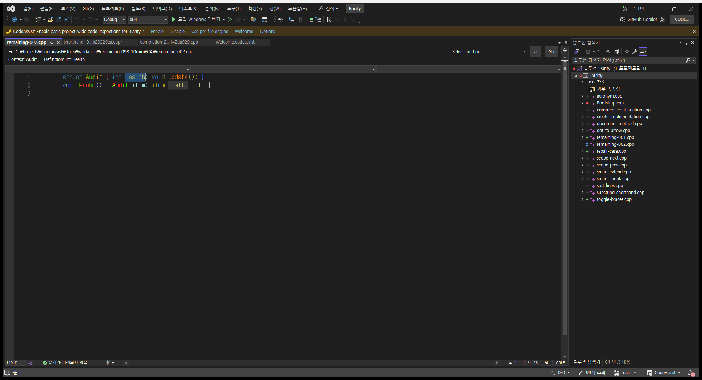](../assets/imports/docs/validation/remaining-098-10min/CA/remaining-002-before.png)

[](../assets/imports/docs/validation/remaining-098-10min/VA/remaining-002-dialog.png)

[](../assets/imports/docs/validation/remaining-098-10min/VA/remaining-002-after.png)

VA-F003 Find Symbol in Solution — different

선택 심볼에서 심볼 찾기 실행 시 초기 검색어 차이: VA는 선택값, CA는 빈 검색어

```
{
  "id": "VA-F003",
  "name": "Find Symbol in Solution",
  "state": "different",
  "reason": "선택 심볼에서 심볼 찾기 실행 시 초기 검색어 차이: VA는 선택값, CA는 빈 검색어",
  "VA": {
    "id": "remaining-003",
    "feature": 3,
    "action": "dialog-probe",
    "verificationScope": "dialog-cancel-or-direct-command",
    "invoked": true,
    "before": {
      "zoom": 100,
      "text": "struct Audit { int Health; void Update(); };\r\nvoid Probe() { Audit item; item.Health = 1; }\r\n",
      "caret": 25,
      "selectionStart": 19,
      "selectionLength": 6,
      "selectedText": "Health"
    },
    "after": {
      "zoom": 100,
      "text": "struct Audit { int Health; void Update(); };\r\nvoid Probe() { Audit item; item.Health = 1; }\r\n",
      "caret": 25,
      "selectionStart": 19,
      "selectionLength": 6,
      "selectedText": "Health"
    },
    "probe": {
      "status": "dialog-observed-and-cancelled",
      "title": "Find Symbol [3 of 41]",
      "pageSelected": true,
      "controls": [
        {
          "name": "Health",
          "type": "ControlType.Edit",
          "value": "Health"
        },
        {
          "name": "...",
          "type": "ControlType.Button",
          "value": null
        },
        {
          "name": "Alt: open settings   •   Alt+S / Alt+F / Alt+C: quick toggles",
          "type": "ControlType.Text",
          "value": null
        },
        {
          "name": "Alt: open settings   •   Alt+S / Alt+F / Alt+C: quick toggles",
          "type": "ControlType.Text",
          "value": null
        },
        {
          "name": "Goto",
          "type": "ControlType.Button",
          "value": null
        },
        {
          "name": "Find References",
          "type": "ControlType.Button",
          "value": null
        },
        {
          "name": "Cancel",
          "type": "ControlType.Button",
          "value": null
        },
        {
          "name": "Visual Assist",
          "type": "ControlType.Text",
          "value": null
        },
        {
          "name": "Visual Assist",
          "type": "ControlType.DataGrid",
          "value": null
        },
        {
          "name": "헤더",
          "type": "ControlType.Header",
          "value": null
        },
        {
          "name": "Symbol",
          "type": "ControlType.HeaderItem",
          "value": null
        },
        {
          "name": "Definition",
          "type": "ControlType.HeaderItem",
          "value": null
        },
        {
          "name": "Audit.Health",
          "type": "ControlType.DataItem",
          "value": null
        },
        {
          "name": "Audit.Health",
          "type": "ControlType.Text",
          "value": null
        },
        {
          "name": "int Health",
          "type": "ControlType.Text",
          "value": null
        },
        {
          "name": "Audit.Health",
          "type": "ControlType.DataItem",
          "value": null
        },
        {
          "name": "Audit.Health",
          "type": "ControlType.Text",
          "value": null
        },
        {
          "name": "int Health",
          "type": "ControlType.Text",
          "value": null
        },
        {
          "name": "Audit.Health",
          "type": "ControlType.DataItem",
          "value": null
        },
        {
          "name": "Audit.Health",
          "type": "ControlType.Text",
          "value": null
        },
        {
          "name": "int Health",
          "type": "ControlType.Text",
          "value": null
        },
        {
          "name": "Solution only",
          "type": "ControlType.CheckBox",
          "value": "On"
        },
        {
          "name": "Fuzzy search",
          "type": "ControlType.CheckBox",
          "value": "Off"
        },
        {
          "name": "Classes/structs/namespaces",
          "type": "ControlType.CheckBox",
          "value": "Off"
        },
        {
          "name": "Find Symbol [3 of 41]",
          "type": "ControlType.TitleBar",
          "value": null
        },
        {
          "name": "시스템 메뉴 모음",
          "type": "ControlType.MenuBar",
          "value": null
        },
        {
          "name": "시스템",
          "type": "ControlType.MenuItem",
          "value": null
        },
        {
          "name": "상황에 맞는 도움말",
          "type": "ControlType.Button",
          "value": null
        },
        {
          "name": "닫기",
          "type": "ControlType.Button",
          "value": null
        }
      ]
    },
    "error": null,
    "fullFunctionalPass": false
  },
  "CA": {
    "id": "remaining-003",
    "feature": 3,
    "action": "dialog-probe",
    "verificationScope": "dialog-cancel-or-direct-command",
    "invoked": true,
    "before": {
      "zoom": 140,
      "text": "struct Audit { int Health; void Update(); };\r\nvoid Probe() { Audit item; item.Health = 1; }\r\n",
      "caret": 25,
      "selectionStart": 19,
      "selectionLength": 6,
      "selectedText": "Health"
    },
    "after": {
      "zoom": 140,
      "text": "struct Audit { int Health; void Update(); };\r\nvoid Probe() { Audit item; item.Health = 1; }\r\n",
      "caret": 25,
      "selectionStart": 19,
      "selectionLength": 6,
      "selectedText": "Health"
    },
    "probe": {
      "status": "dialog-observed-and-cancelled",
      "title": "CodeAssist: 심볼 찾기 [1]",
      "pageSelected": true,
      "controls": [
        {
          "name": "×",
          "type": "ControlType.Button",
          "value": null
        },
        {
          "name": "×",
          "type": "ControlType.Text",
          "value": null
        },
        {
          "name": "CodeAssist: 심볼 찾기",
          "type": "ControlType.Text",
          "value": null
        },
        {
          "name": "Search",
          "type": "ControlType.Edit",
          "value": ""
        },
        {
          "name": "Solution only",
          "type": "ControlType.CheckBox",
          "value": "On"
        },
        {
          "name": "Solution only",
          "type": "ControlType.Text",
          "value": null
        },
        {
          "name": "Fuzzy search",
          "type": "ControlType.CheckBox",
          "value": "Off"
        },
        {
          "name": "Fuzzy search",
          "type": "ControlType.Text",
          "value": null
        },
        {
          "name": "Classes/structs/namespaces",
          "type": "ControlType.CheckBox",
          "value": "Off"
        },
        {
          "name": "Classes/structs/namespaces",
          "type": "ControlType.Text",
          "value": null
        },
        {
          "name": "Goto",
          "type": "ControlType.Button",
          "value": null
        },
        {
          "name": "Goto",
          "type": "ControlType.Text",
          "value": null
        },
        {
          "name": "Find References",
          "type": "ControlType.Button",
          "value": null
        },
        {
          "name": "Find References",
          "type": "ControlType.Text",
          "value": null
        },
        {
          "name": "Cancel",
          "type": "ControlType.Button",
          "value": null
        },
        {
          "name": "Cancel",
          "type": "ControlType.Text",
          "value": null
        },
        {
          "name": "CodeAssist",
          "type": "ControlType.Text",
          "value": null
        },
        {
          "name": "",
          "type": "ControlType.DataGrid",
          "value": null
        },
        {
          "name": "",
          "type": "ControlType.Header",
          "value": null
        },
        {
          "name": "Symbol",
          "type": "ControlType.HeaderItem",
          "value": null
        },
        {
          "name": "Symbol",
          "type": "ControlType.Text",
          "value": null
        },
        {
          "name": "",
          "type": "ControlType.Thumb",
          "value": null
        },
        {
          "name": "Definition",
          "type": "ControlType.HeaderItem",
          "value": null
        },
        {
          "name": "Definition",
          "type": "ControlType.Text",
          "value": null
        },
        {
          "name": "",
          "type": "ControlType.Thumb",
          "value": null
        },
        {
          "name": "ParityBootstrap    C:\\Projects\\CodeAssist\\.local\\parity-runs\\20261018-2105-functional-097\\CA\\Bootstrap.cpp",
          "type": "ControlType.DataItem",
          "value": null
        },
        {
          "name": "",
          "type": "ControlType.Custom",
          "value": null
        },
        {
          "name": "",
          "type": "ControlType.Image",
          "value": null
        },
        {
          "name": "ParityBootstrap",
          "type": "ControlType.Text",
          "value": null
        },
        {
          "name": "void ParityBootstrap()",
          "type": "ControlType.Text",
          "value": null
        }
      ]
    },
    "error": null,
    "fullFunctionalPass": false
  },
  "prefill": {
    "VA": "Health",
    "CA": ""
  },
  "fullFunctionalPass": false
}
```

[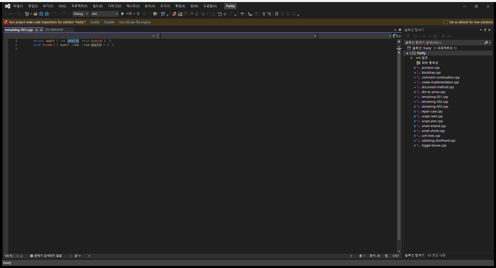](../assets/imports/docs/validation/remaining-098-10min/VA/remaining-003-before.png)[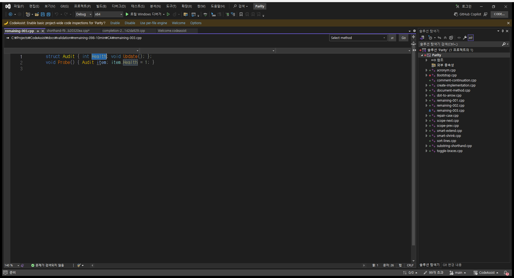](../assets/imports/docs/validation/remaining-098-10min/CA/remaining-003-before.png)

[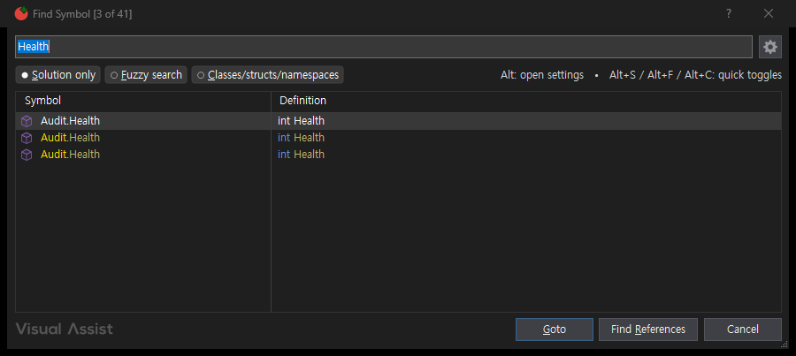](../assets/imports/docs/validation/remaining-098-10min/VA/remaining-003-dialog.png)[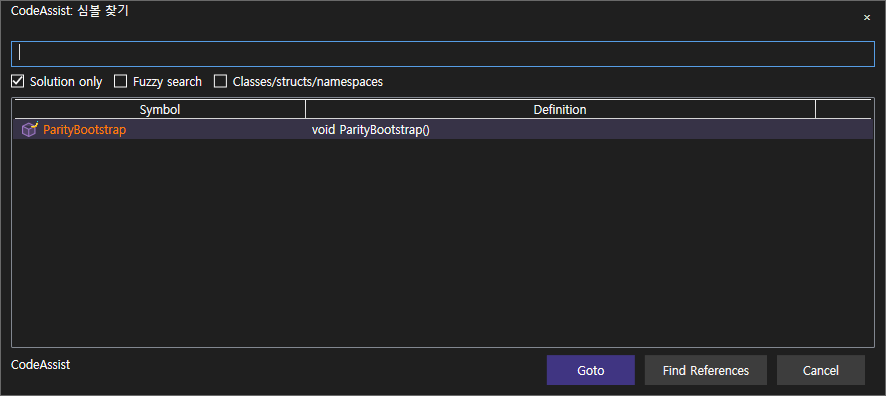](../assets/imports/docs/validation/remaining-098-10min/CA/remaining-003-dialog.png)

[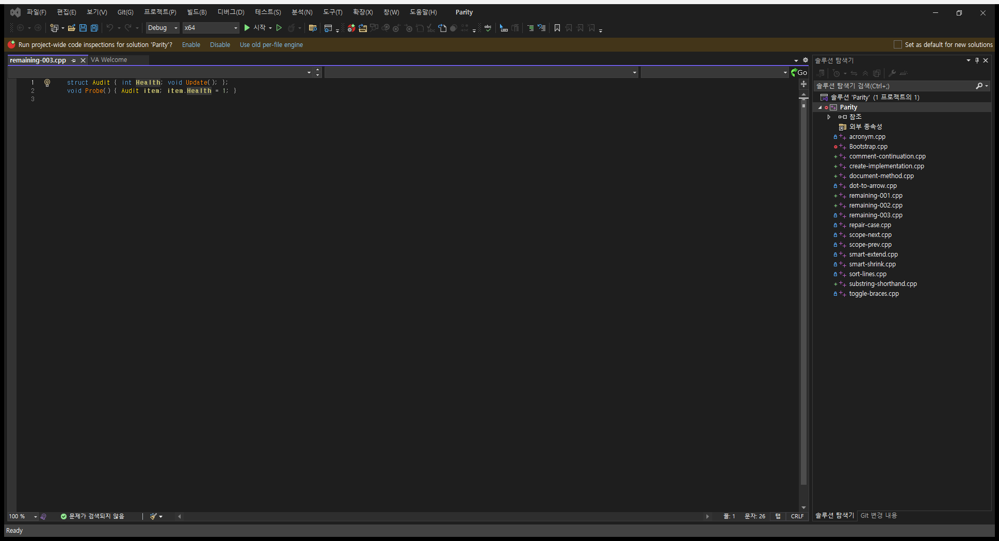](../assets/imports/docs/validation/remaining-098-10min/VA/remaining-003-after.png)[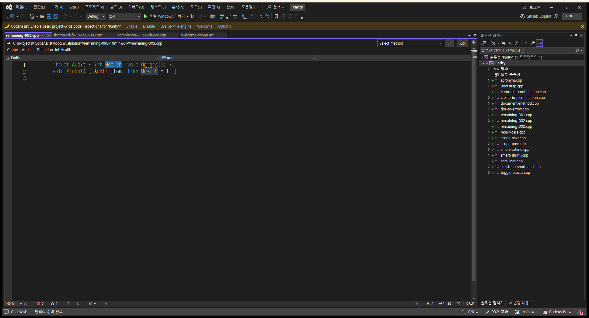](../assets/imports/docs/validation/remaining-098-10min/CA/remaining-003-after.png)

VA-F004 GoTo Implementation — unverified

검사 실행 오류; 제품 불일치로 계산하지 않음

```
{
  "id": "VA-F004",
  "name": "GoTo Implementation",
  "state": "unverified",
  "reason": "검사 실행 오류; 제품 불일치로 계산하지 않음",
  "VA": {
    "id": "remaining-004",
    "feature": 4,
    "action": "dialog-probe",
    "verificationScope": "options-page-only",
    "invoked": true,
    "before": {
      "zoom": 100,
      "text": "struct Audit { int Health; void Update(); };\r\nvoid Probe() { Audit item; item.Health = 1; }\r\n",
      "caret": 25,
      "selectionStart": 19,
      "selectionLength": 6,
      "selectedText": "Health"
    },
    "after": {
      "zoom": 100,
      "text": "struct Audit { int Health; void Update(); };\r\nvoid Probe() { Audit item; item.Health = 1; }\r\n",
      "caret": 25,
      "selectionStart": 19,
      "selectionLength": 6,
      "selectedText": "Health"
    },
    "probe": {
      "status": "dialog-closed-without-cancel-control",
      "title": "Visual Assist Options",
      "pageSelected": false,
      "controls": [
        {
          "name": "Visual Assist Options",
          "type": "ControlType.TitleBar",
          "value": null
        },
        {
          "name": "시스템 메뉴 모음",
          "type": "ControlType.MenuBar",
          "value": null
        },
        {
          "name": "시스템",
          "type": "ControlType.MenuItem",
          "value": null
        },
        {
          "name": "최소화",
          "type": "ControlType.Button",
          "value": null
        },
        {
          "name": "최대화",
          "type": "ControlType.Button",
          "value": null
        },
        {
          "name": "상황에 맞는 도움말",
          "type": "ControlType.Button",
          "value": null
        },
        {
          "name": "닫기",
          "type": "ControlType.Button",
          "value": null
        },
        {
          "name": "",
          "type": "ControlType.Custom",
          "value": null
        }
      ]
    },
    "error": null,
    "fullFunctionalPass": false
  },
  "CA": {
    "id": "remaining-004",
    "feature": 4,
    "action": "dialog-probe",
    "verificationScope": "options-page-only",
    "invoked": false,
    "before": null,
    "after": null,
    "probe": null,
    "error": "System.Runtime.InteropServices.COMException (0x800706BA): RPC 서버를 사용할 수 없습니다. (예외가 발생한 HRESULT: 0x800706BA)\r\n   위치: EnvDTE._DTE.get_Solution()\r\n   위치: ShortcutProbe.Remaining98(DTE d, Int32 pid, String role, String root, String planFile)",
    "fullFunctionalPass": false
  },
  "prefill": null,
  "fullFunctionalPass": false
}
```

[](../assets/imports/docs/validation/remaining-098-10min/VA/remaining-004-before.png)[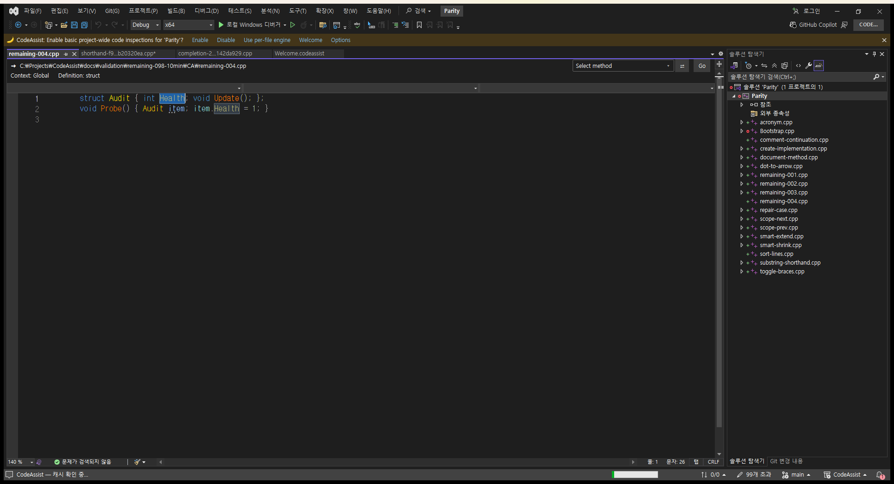](../assets/imports/docs/validation/remaining-098-10min/CA/remaining-004-before.png)

[](../assets/imports/docs/validation/remaining-098-10min/VA/remaining-004-dialog.png)

[](../assets/imports/docs/validation/remaining-098-10min/VA/remaining-004-after.png)

VA-F005 GoTo Member — unverified

창·설정 페이지 관찰 및 취소만 수행; 기능 통과 아님

```
{
  "id": "VA-F005",
  "name": "GoTo Member",
  "state": "unverified",
  "reason": "창·설정 페이지 관찰 및 취소만 수행; 기능 통과 아님",
  "VA": {
    "id": "remaining-005",
    "feature": 5,
    "action": "dialog-probe",
    "verificationScope": "dialog-cancel-or-direct-command",
    "invoked": true,
    "before": {
      "zoom": 100,
      "text": "struct Audit { int Health; void Update(); };\r\nvoid Probe() { Audit item; item.Health = 1; }\r\n",
      "caret": 12,
      "selectionStart": 7,
      "selectionLength": 5,
      "selectedText": "Audit"
    },
    "after": {
      "zoom": 100,
      "text": "struct Audit { int Health; void Update(); };\r\nvoid Probe() { Audit item; item.Health = 1; }\r\n",
      "caret": 12,
      "selectionStart": 7,
      "selectionLength": 5,
      "selectedText": "Audit"
    },
    "probe": {
      "status": "dialog-observed-and-cancelled",
      "title": "Members of Audit [11 of 11] -- Visual Assist",
      "pageSelected": true,
      "controls": [
        {
          "name": "",
          "type": "ControlType.Edit",
          "value": ""
        },
        {
          "name": "...",
          "type": "ControlType.Button",
          "value": null
        },
        {
          "name": "Alt: open settings   •   Alt+S / Alt+T / Alt+F: quick toggles",
          "type": "ControlType.Text",
          "value": null
        },
        {
          "name": "Alt: open settings   •   Alt+S / Alt+T / Alt+F: quick toggles",
          "type": "ControlType.Text",
          "value": null
        },
        {
          "name": "Goto",
          "type": "ControlType.Button",
          "value": null
        },
        {
          "name": "Find References",
          "type": "ControlType.Button",
          "value": null
        },
        {
          "name": "Cancel",
          "type": "ControlType.Button",
          "value": null
        },
        {
          "name": "Visual Assist",
          "type": "ControlType.Text",
          "value": null
        },
        {
          "name": "Visual Assist",
          "type": "ControlType.DataGrid",
          "value": null
        },
        {
          "name": "헤더",
          "type": "ControlType.Header",
          "value": null
        },
        {
          "name": "Symbol",
          "type": "ControlType.HeaderItem",
          "value": null
        },
        {
          "name": "Scope",
          "type": "ControlType.HeaderItem",
          "value": null
        },
        {
          "name": "Definition",
          "type": "ControlType.HeaderItem",
          "value": null
        },
        {
          "name": "Health",
          "type": "ControlType.DataItem",
          "value": null
        },
        {
          "name": "Health",
          "type": "ControlType.Text",
          "value": null
        },
        {
          "name": "Audit",
          "type": "ControlType.Text",
          "value": null
        },
        {
          "name": "int Health",
          "type": "ControlType.Text",
          "value": null
        },
        {
          "name": "Health",
          "type": "ControlType.DataItem",
          "value": null
        },
        {
          "name": "Health",
          "type": "ControlType.Text",
          "value": null
        },
        {
          "name": "Audit",
          "type": "ControlType.Text",
          "value": null
        },
        {
          "name": "int Health",
          "type": "ControlType.Text",
          "value": null
        },
        {
          "name": "Health",
          "type": "ControlType.DataItem",
          "value": null
        },
        {
          "name": "Health",
          "type": "ControlType.Text",
          "value": null
        },
        {
          "name": "Audit",
          "type": "ControlType.Text",
          "value": null
        },
        {
          "name": "int Health",
          "type": "ControlType.Text",
          "value": null
        },
        {
          "name": "Health",
          "type": "ControlType.DataItem",
          "value": null
        },
        {
          "name": "Health",
          "type": "ControlType.Text",
          "value": null
        },
        {
          "name": "Audit",
          "type": "ControlType.Text",
          "value": null
        },
        {
          "name": "int Health",
          "type": "ControlType.Text",
          "value": null
        },
        {
          "name": "Health",
          "type": "ControlType.DataItem",
          "value": null
        },
        {
          "name": "Health",
          "type": "ControlType.Text",
          "value": null
        },
        {
          "name": "Audit",
          "type": "ControlType.Text",
          "value": null
        },
        {
          "name": "int Health",
          "type": "ControlType.Text",
          "value": null
        },
        {
          "name": "Update",
          "type": "ControlType.DataItem",
          "value": null
        },
        {
          "name": "Update",
          "type": "ControlType.Text",
          "value": null
        },
        {
          "name": "Audit",
          "type": "ControlType.Text",
          "value": null
        },
        {
          "name": "void Update()",
          "type": "ControlType.Text",
          "value": null
        },
        {
          "name": "Update",
          "type": "ControlType.DataItem",
          "value": null
        },
        {
          "name": "Update",
          "type": "ControlType.Text",
          "value": null
        },
        {
          "name": "Audit",
          "type": "ControlType.Text",
          "value": null
        },
        {
          "name": "void Update()",
          "type": "ControlType.Text",
          "value": null
        },
        {
          "name": "Update",
          "type": "ControlType.DataItem",
          "value": null
        },
        {
          "name": "Update",
          "type": "ControlType.Text",
          "value": null
        },
        {
          "name": "Audit",
          "type": "ControlType.Text",
          "value": null
        },
        {
          "name": "void Update()",
          "type": "ControlType.Text",
          "value": null
        },
        {
          "name": "Update",
          "type": "ControlType.DataItem",
          "value": null
        },
        {
          "name": "Update",
          "type": "ControlType.Text",
          "value": null
        },
        {
          "name": "Audit",
          "type": "ControlType.Text",
          "value": null
        },
        {
          "name": "void Update()",
          "type": "ControlType.Text",
          "value": null
        },
        {
          "name": "Update",
          "type": "ControlType.DataItem",
          "value": null
        },
        {
          "name": "Update",
          "type": "ControlType.Text",
          "value": null
        },
        {
          "name": "Audit",
          "type": "ControlType.Text",
          "value": null
        },
        {
          "name": "void Update()",
          "type": "ControlType.Text",
          "value": null
        },
        {
          "name": "Update",
          "type": "ControlType.DataItem",
          "value": null
        },
        {
          "name": "Update",
          "type": "ControlType.Text",
          "value": null
        },
        {
          "name": "Audit",
          "type": "ControlType.Text",
          "value": null
        },
        {
          "name": "void Update()",
          "type": "ControlType.Text",
          "value": null
        },
        {
          "name": "Show base classes",
          "type": "ControlType.CheckBox",
          "value": "On"
        },
        {
          "name": "Sort by type",
          "type": "ControlType.CheckBox",
          "value": "On"
        },
        {
          "name": "Fuzzy search",
          "type": "ControlType.CheckBox",
          "value": "On"
        },
        {
          "name": "Members of Audit [11 of 11] -- Visual Assist",
          "type": "ControlType.TitleBar",
          "value": null
        },
        {
          "name": "시스템 메뉴 모음",
          "type": "ControlType.MenuBar",
          "value": null
        },
        {
          "name": "시스템",
          "type": "ControlType.MenuItem",
          "value": null
        },
        {
          "name": "상황에 맞는 도움말",
          "type": "ControlType.Button",
          "value": null
        },
        {
          "name": "닫기",
          "type": "ControlType.Button",
          "value": null
        }
      ]
    },
    "error": null,
    "fullFunctionalPass": false
  },
  "CA": {
    "id": "remaining-005",
    "feature": 5,
    "action": "dialog-probe",
    "verificationScope": "dialog-cancel-or-direct-command",
    "invoked": true,
    "before": {
      "zoom": 140,
      "text": "struct Audit { int Health; void Update(); };\r\nvoid Probe() { Audit item; item.Health = 1; }\r\n",
      "caret": 12,
      "selectionStart": 7,
      "selectionLength": 5,
      "selectedText": "Audit"
    },
    "after": {
      "zoom": 140,
      "text": "struct Audit { int Health; void Update(); };\r\nvoid Probe() { Audit item; item.Health = 1; }\r\n",
      "caret": 12,
      "selectionStart": 7,
      "selectionLength": 5,
      "selectedText": "Audit"
    },
    "probe": {
      "status": "dialog-observed-and-cancelled",
      "title": "CodeAssist: Go To Member [4]",
      "pageSelected": true,
      "controls": [
        {
          "name": "×",
          "type": "ControlType.Button",
          "value": null
        },
        {
          "name": "×",
          "type": "ControlType.Text",
          "value": null
        },
        {
          "name": "CodeAssist: Go To Member",
          "type": "ControlType.Text",
          "value": null
        },
        {
          "name": "Search",
          "type": "ControlType.Edit",
          "value": ""
        },
        {
          "name": "Fuzzy search",
          "type": "ControlType.CheckBox",
          "value": "Off"
        },
        {
          "name": "Fuzzy search",
          "type": "ControlType.Text",
          "value": null
        },
        {
          "name": "Goto",
          "type": "ControlType.Button",
          "value": null
        },
        {
          "name": "Goto",
          "type": "ControlType.Text",
          "value": null
        },
        {
          "name": "Cancel",
          "type": "ControlType.Button",
          "value": null
        },
        {
          "name": "Cancel",
          "type": "ControlType.Text",
          "value": null
        },
        {
          "name": "CodeAssist",
          "type": "ControlType.Text",
          "value": null
        },
        {
          "name": "",
          "type": "ControlType.DataGrid",
          "value": null
        },
        {
          "name": "",
          "type": "ControlType.Header",
          "value": null
        },
        {
          "name": "Symbol",
          "type": "ControlType.HeaderItem",
          "value": null
        },
        {
          "name": "Symbol",
          "type": "ControlType.Text",
          "value": null
        },
        {
          "name": "",
          "type": "ControlType.Thumb",
          "value": null
        },
        {
          "name": "Definition",
          "type": "ControlType.HeaderItem",
          "value": null
        },
        {
          "name": "Definition",
          "type": "ControlType.Text",
          "value": null
        },
        {
          "name": "",
          "type": "ControlType.Thumb",
          "value": null
        },
        {
          "name": "Audit::Health    C:\\Projects\\CodeAssist\\.local\\parity-runs\\20261018-015759-745\\VA\\epoch-18976\\feature-095.cpp",
          "type": "ControlType.DataItem",
          "value": null
        },
        {
          "name": "",
          "type": "ControlType.Custom",
          "value": null
        },
        {
          "name": "",
          "type": "ControlType.Image",
          "value": null
        },
        {
          "name": "Audit::Health",
          "type": "ControlType.Text",
          "value": null
        },
        {
          "name": "",
          "type": "ControlType.Text",
          "value": null
        },
        {
          "name": "Audit::Update(); }    C:\\Projects\\CodeAssist\\.local\\parity-runs\\20261018-015759-745\\VA\\epoch-18976\\feature-095.cpp",
          "type": "ControlType.DataItem",
          "value": null
        },
        {
          "name": "",
          "type": "ControlType.Custom",
          "value": null
        },
        {
          "name": "",
          "type": "ControlType.Image",
          "value": null
        },
        {
          "name": "Audit::Update(); }",
          "type": "ControlType.Text",
          "value": null
        },
        {
          "name": "Update(); }",
          "type": "ControlType.Text",
          "value": null
        },
        {
          "name": "Audit::Update()    C:\\Projects\\CodeAssist\\docs\\validation\\remaining-098-10min\\CA\\remaining-005.cpp",
          "type": "ControlType.DataItem",
          "value": null
        },
        {
          "name": "",
          "type": "ControlType.Custom",
          "value": null
        },
        {
          "name": "",
          "type": "ControlType.Image",
          "value": null
        },
        {
          "name": "Audit::Update()",
          "type": "ControlType.Text",
          "value": null
        },
        {
          "name": "Update()",
          "type": "ControlType.Text",
          "value": null
        },
        {
          "name": "Audit::Health    C:\\Projects\\CodeAssist\\docs\\validation\\remaining-098-10min\\CA\\remaining-005.cpp",
          "type": "ControlType.DataItem",
          "value": null
        },
        {
          "name": "",
          "type": "ControlType.Custom",
          "value": null
        },
        {
          "name": "",
          "type": "ControlType.Image",
          "value": null
        },
        {
          "name": "Audit::Health",
          "type": "ControlType.Text",
          "value": null
        },
        {
          "name": "",
          "type": "ControlType.Text",
          "value": null
        }
      ]
    },
    "error": null,
    "fullFunctionalPass": false
  },
  "prefill": null,
  "fullFunctionalPass": false
}
```

[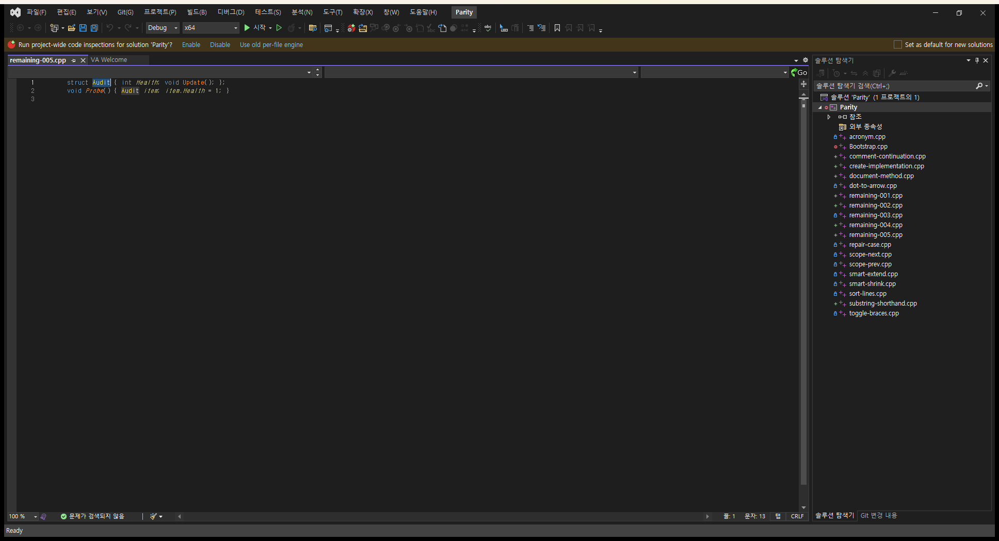](../assets/imports/docs/validation/remaining-098-10min/VA/remaining-005-before.png)[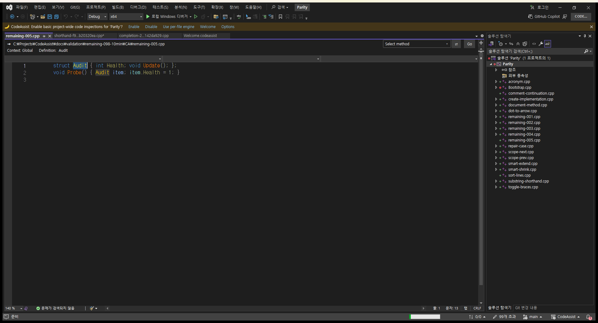](../assets/imports/docs/validation/remaining-098-10min/CA/remaining-005-before.png)

[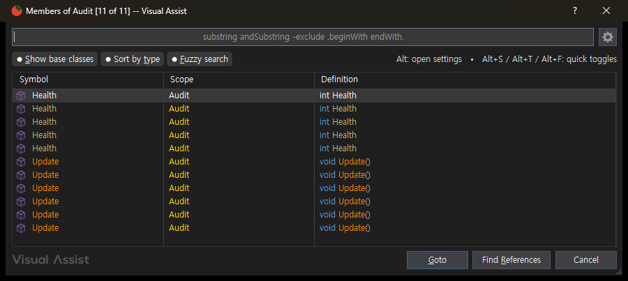](../assets/imports/docs/validation/remaining-098-10min/VA/remaining-005-dialog.png)[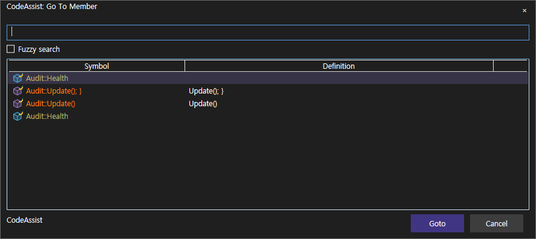](../assets/imports/docs/validation/remaining-098-10min/CA/remaining-005-dialog.png)

[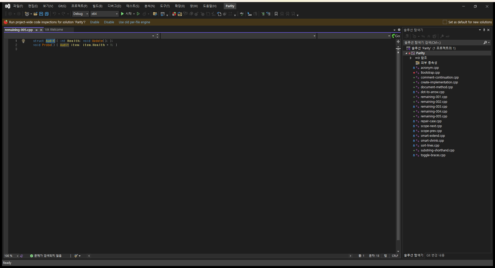](../assets/imports/docs/validation/remaining-098-10min/VA/remaining-005-after.png)[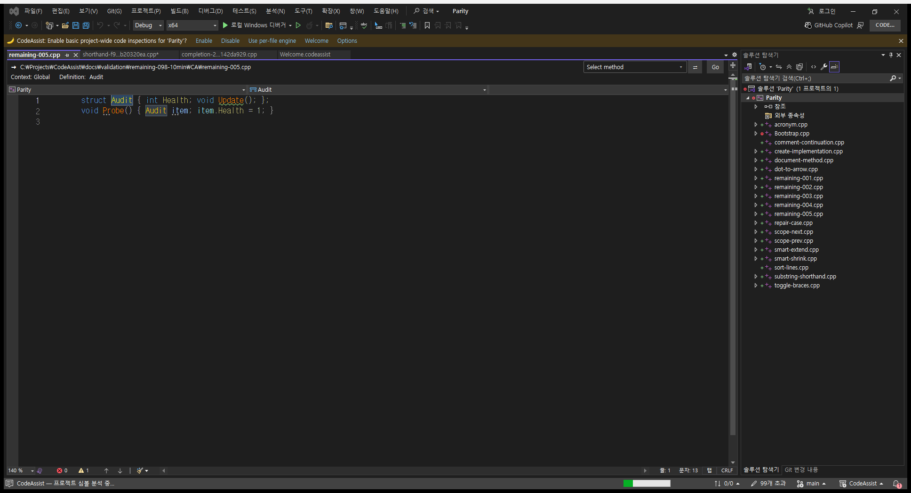](../assets/imports/docs/validation/remaining-098-10min/CA/remaining-005-after.png)

VA-F006 GoTo Related — unverified

창·설정 페이지 관찰 및 취소만 수행; 기능 통과 아님

```
{
  "id": "VA-F006",
  "name": "GoTo Related",
  "state": "unverified",
  "reason": "창·설정 페이지 관찰 및 취소만 수행; 기능 통과 아님",
  "VA": {
    "id": "remaining-006",
    "feature": 6,
    "action": "dialog-probe",
    "verificationScope": "dialog-cancel-or-direct-command",
    "invoked": true,
    "before": {
      "zoom": 100,
      "text": "struct Audit { int Health; void Update(); };\r\nvoid Probe() { Audit item; item.Health = 1; }\r\n",
      "caret": 25,
      "selectionStart": 19,
      "selectionLength": 6,
      "selectedText": "Health"
    },
    "after": {
      "zoom": 100,
      "text": "struct Audit { int Health; void Update(); };\r\nvoid Probe() { Audit item; item.Health = 1; }\r\n",
      "caret": 25,
      "selectionStart": 19,
      "selectionLength": 6,
      "selectedText": "Health"
    },
    "probe": {
      "status": "popup-menu-observed-and-cancelled",
      "title": "Native popup menu",
      "pageSelected": true,
      "controls": [
        "Declaration   \u0005winioctl.h:8556\u0002",
        "Type of Symbol",
        "Goto Member of SCM_PD_HEALTH_STATUS...",
        "Goto Member of _SCM_PD_MANAGEMENT_STATUS..."
      ]
    },
    "error": null,
    "fullFunctionalPass": false
  },
  "CA": {
    "id": "remaining-006",
    "feature": 6,
    "action": "dialog-probe",
    "verificationScope": "dialog-cancel-or-direct-command",
    "invoked": true,
    "before": {
      "zoom": 140,
      "text": "struct Audit { int Health; void Update(); };\r\nvoid Probe() { Audit item; item.Health = 1; }\r\n",
      "caret": 25,
      "selectionStart": 19,
      "selectionLength": 6,
      "selectedText": "Health"
    },
    "after": {
      "zoom": 140,
      "text": "struct Audit { int Health; void Update(); };\r\nvoid Probe() { Audit item; item.Health = 1; }\r\n",
      "caret": 25,
      "selectionStart": 19,
      "selectionLength": 6,
      "selectedText": "Health"
    },
    "probe": {
      "status": "no-modal-observed"
    },
    "error": null,
    "fullFunctionalPass": false
  },
  "prefill": null,
  "fullFunctionalPass": false
}
```

[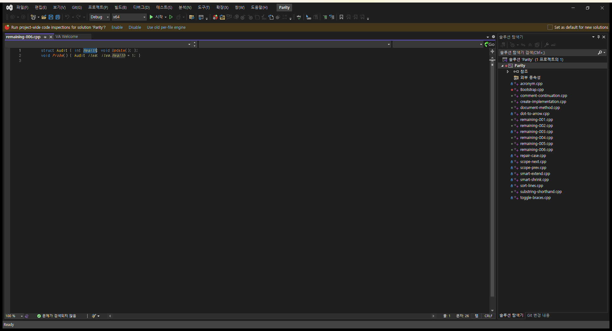](../assets/imports/docs/validation/remaining-098-10min/VA/remaining-006-before.png)[](../assets/imports/docs/validation/remaining-098-10min/CA/remaining-006-before.png)

[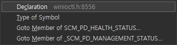](../assets/imports/docs/validation/remaining-098-10min/VA/remaining-006-dialog.png)

[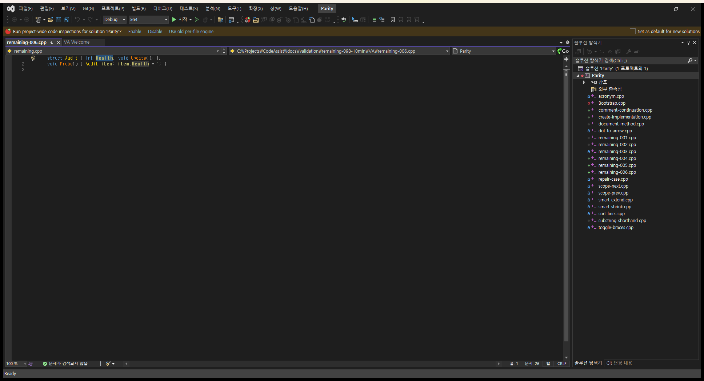](../assets/imports/docs/validation/remaining-098-10min/VA/remaining-006-after.png)[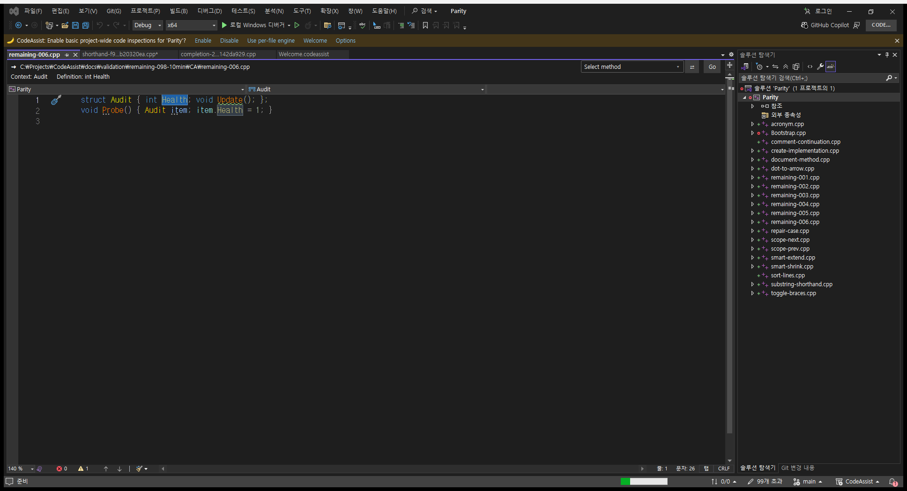](../assets/imports/docs/validation/remaining-098-10min/CA/remaining-006-after.png)

VA-F007 Highlight Current Line — unverified

검사 실행 오류; 제품 불일치로 계산하지 않음

```
{
  "id": "VA-F007",
  "name": "Highlight Current Line",
  "state": "unverified",
  "reason": "검사 실행 오류; 제품 불일치로 계산하지 않음",
  "VA": {
    "id": "remaining-007",
    "feature": 7,
    "action": "dialog-probe",
    "verificationScope": "options-page-only",
    "invoked": true,
    "before": {
      "zoom": 100,
      "text": "struct Audit { int Health; void Update(); };\r\nvoid Probe() { Audit item; item.Health = 1; }\r\n",
      "caret": 25,
      "selectionStart": 19,
      "selectionLength": 6,
      "selectedText": "Health"
    },
    "after": {
      "zoom": 100,
      "text": "struct Audit { int Health; void Update(); };\r\nvoid Probe() { Audit item; item.Health = 1; }\r\n",
      "caret": 25,
      "selectionStart": 19,
      "selectionLength": 6,
      "selectedText": "Health"
    },
    "probe": {
      "status": "dialog-closed-without-cancel-control",
      "title": "Visual Assist Options",
      "pageSelected": false,
      "controls": [
        {
          "name": "Visual Assist Options",
          "type": "ControlType.TitleBar",
          "value": null
        },
        {
          "name": "시스템 메뉴 모음",
          "type": "ControlType.MenuBar",
          "value": null
        },
        {
          "name": "시스템",
          "type": "ControlType.MenuItem",
          "value": null
        },
        {
          "name": "최소화",
          "type": "ControlType.Button",
          "value": null
        },
        {
          "name": "최대화",
          "type": "ControlType.Button",
          "value": null
        },
        {
          "name": "상황에 맞는 도움말",
          "type": "ControlType.Button",
          "value": null
        },
        {
          "name": "닫기",
          "type": "ControlType.Button",
          "value": null
        },
        {
          "name": "",
          "type": "ControlType.Custom",
          "value": null
        }
      ]
    },
    "error": null,
    "fullFunctionalPass": false
  },
  "CA": {
    "id": "remaining-007",
    "feature": 7,
    "action": "dialog-probe",
    "verificationScope": "options-page-only",
    "invoked": false,
    "before": null,
    "after": null,
    "probe": null,
    "error": "System.Runtime.InteropServices.COMException (0x800706BA): RPC 서버를 사용할 수 없습니다. (예외가 발생한 HRESULT: 0x800706BA)\r\n   위치: EnvDTE._DTE.get_Solution()\r\n   위치: ShortcutProbe.Remaining98(DTE d, Int32 pid, String role, String root, String planFile)",
    "fullFunctionalPass": false
  },
  "prefill": null,
  "fullFunctionalPass": false
}
```

[](../assets/imports/docs/validation/remaining-098-10min/VA/remaining-007-before.png)[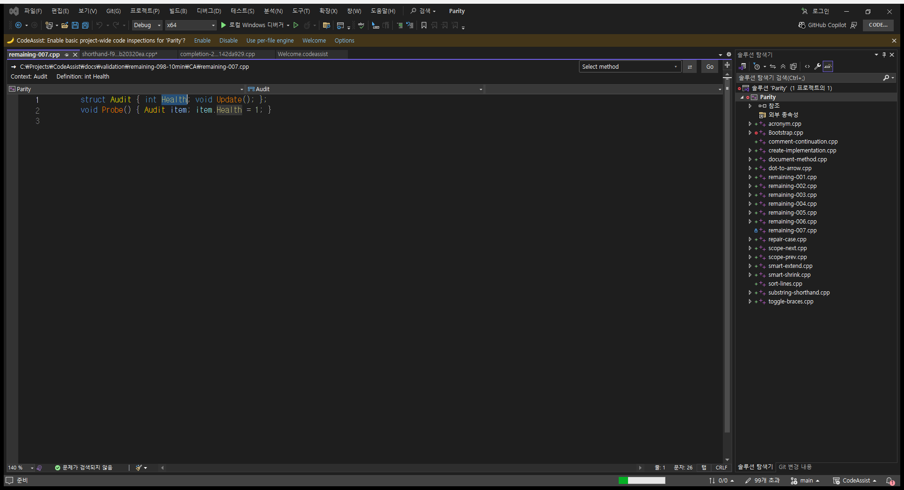](../assets/imports/docs/validation/remaining-098-10min/CA/remaining-007-before.png)

[](../assets/imports/docs/validation/remaining-098-10min/VA/remaining-007-dialog.png)

[](../assets/imports/docs/validation/remaining-098-10min/VA/remaining-007-after.png)

VA-F008 List Methods in File — unverified

검사 실행 오류; 제품 불일치로 계산하지 않음

```
{
  "id": "VA-F008",
  "name": "List Methods in File",
  "state": "unverified",
  "reason": "검사 실행 오류; 제품 불일치로 계산하지 않음",
  "VA": {
    "id": "remaining-008",
    "feature": 8,
    "action": "dialog-probe",
    "verificationScope": "options-page-only",
    "invoked": true,
    "before": {
      "zoom": 100,
      "text": "struct Audit { int Health; void Update(); };\r\nvoid Probe() { Audit item; item.Health = 1; }\r\n",
      "caret": 25,
      "selectionStart": 19,
      "selectionLength": 6,
      "selectedText": "Health"
    },
    "after": {
      "zoom": 100,
      "text": "struct Audit { int Health; void Update(); };\r\nvoid Probe() { Audit item; item.Health = 1; }\r\n",
      "caret": 25,
      "selectionStart": 19,
      "selectionLength": 6,
      "selectedText": "Health"
    },
    "probe": {
      "status": "dialog-closed-without-cancel-control",
      "title": "Visual Assist Options",
      "pageSelected": false,
      "controls": [
        {
          "name": "Visual Assist Options",
          "type": "ControlType.TitleBar",
          "value": null
        },
        {
          "name": "시스템 메뉴 모음",
          "type": "ControlType.MenuBar",
          "value": null
        },
        {
          "name": "시스템",
          "type": "ControlType.MenuItem",
          "value": null
        },
        {
          "name": "최소화",
          "type": "ControlType.Button",
          "value": null
        },
        {
          "name": "최대화",
          "type": "ControlType.Button",
          "value": null
        },
        {
          "name": "상황에 맞는 도움말",
          "type": "ControlType.Button",
          "value": null
        },
        {
          "name": "닫기",
          "type": "ControlType.Button",
          "value": null
        },
        {
          "name": "",
          "type": "ControlType.Custom",
          "value": null
        }
      ]
    },
    "error": null,
    "fullFunctionalPass": false
  },
  "CA": {
    "id": "remaining-008",
    "feature": 8,
    "action": "dialog-probe",
    "verificationScope": "options-page-only",
    "invoked": false,
    "before": null,
    "after": null,
    "probe": null,
    "error": "System.Runtime.InteropServices.COMException (0x800706BA): RPC 서버를 사용할 수 없습니다. (예외가 발생한 HRESULT: 0x800706BA)\r\n   위치: EnvDTE._DTE.get_Solution()\r\n   위치: ShortcutProbe.Remaining98(DTE d, Int32 pid, String role, String root, String planFile)",
    "fullFunctionalPass": false
  },
  "prefill": null,
  "fullFunctionalPass": false
}
```

[](../assets/imports/docs/validation/remaining-098-10min/VA/remaining-008-before.png)[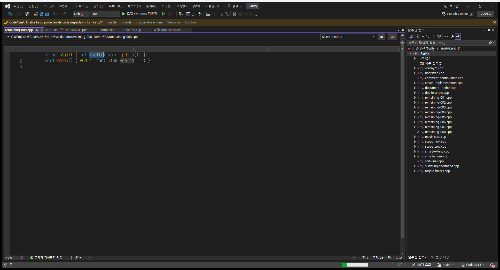](../assets/imports/docs/validation/remaining-098-10min/CA/remaining-008-before.png)

[](../assets/imports/docs/validation/remaining-098-10min/VA/remaining-008-dialog.png)

[](../assets/imports/docs/validation/remaining-098-10min/VA/remaining-008-after.png)

VA-F010 Navigate Back and Forward — unverified

검사 실행 오류; 제품 불일치로 계산하지 않음

```
{
  "id": "VA-F010",
  "name": "Navigate Back and Forward",
  "state": "unverified",
  "reason": "검사 실행 오류; 제품 불일치로 계산하지 않음",
  "VA": {
    "id": "remaining-010",
    "feature": 10,
    "action": "dialog-probe",
    "verificationScope": "options-page-only",
    "invoked": true,
    "before": {
      "zoom": 100,
      "text": "struct Audit { int Health; void Update(); };\r\nvoid Probe() { Audit item; item.Health = 1; }\r\n",
      "caret": 25,
      "selectionStart": 19,
      "selectionLength": 6,
      "selectedText": "Health"
    },
    "after": {
      "zoom": 100,
      "text": "struct Audit { int Health; void Update(); };\r\nvoid Probe() { Audit item; item.Health = 1; }\r\n",
      "caret": 25,
      "selectionStart": 19,
      "selectionLength": 6,
      "selectedText": "Health"
    },
    "probe": {
      "status": "dialog-closed-without-cancel-control",
      "title": "Visual Assist Options",
      "pageSelected": false,
      "controls": [
        {
          "name": "Visual Assist Options",
          "type": "ControlType.TitleBar",
          "value": null
        },
        {
          "name": "시스템 메뉴 모음",
          "type": "ControlType.MenuBar",
          "value": null
        },
        {
          "name": "시스템",
          "type": "ControlType.MenuItem",
          "value": null
        },
        {
          "name": "최소화",
          "type": "ControlType.Button",
          "value": null
        },
        {
          "name": "최대화",
          "type": "ControlType.Button",
          "value": null
        },
        {
          "name": "상황에 맞는 도움말",
          "type": "ControlType.Button",
          "value": null
        },
        {
          "name": "닫기",
          "type": "ControlType.Button",
          "value": null
        },
        {
          "name": "",
          "type": "ControlType.Custom",
          "value": null
        }
      ]
    },
    "error": null,
    "fullFunctionalPass": false
  },
  "CA": {
    "id": "remaining-010",
    "feature": 10,
    "action": "dialog-probe",
    "verificationScope": "options-page-only",
    "invoked": false,
    "before": null,
    "after": null,
    "probe": null,
    "error": "System.Runtime.InteropServices.COMException (0x800706BA): RPC 서버를 사용할 수 없습니다. (예외가 발생한 HRESULT: 0x800706BA)\r\n   위치: EnvDTE._DTE.get_Solution()\r\n   위치: ShortcutProbe.Remaining98(DTE d, Int32 pid, String role, String root, String planFile)",
    "fullFunctionalPass": false
  },
  "prefill": null,
  "fullFunctionalPass": false
}
```

[](../assets/imports/docs/validation/remaining-098-10min/VA/remaining-010-before.png)[](../assets/imports/docs/validation/remaining-098-10min/CA/remaining-010-before.png)

[](../assets/imports/docs/validation/remaining-098-10min/VA/remaining-010-dialog.png)

[](../assets/imports/docs/validation/remaining-098-10min/VA/remaining-010-after.png)

VA-F011 Open Corresponding File — unverified

검사 실행 오류; 제품 불일치로 계산하지 않음

```
{
  "id": "VA-F011",
  "name": "Open Corresponding File",
  "state": "unverified",
  "reason": "검사 실행 오류; 제품 불일치로 계산하지 않음",
  "VA": {
    "id": "remaining-011",
    "feature": 11,
    "action": "dialog-probe",
    "verificationScope": "options-page-only",
    "invoked": true,
    "before": {
      "zoom": 100,
      "text": "struct Audit { int Health; void Update(); };\r\nvoid Probe() { Audit item; item.Health = 1; }\r\n",
      "caret": 25,
      "selectionStart": 19,
      "selectionLength": 6,
      "selectedText": "Health"
    },
    "after": {
      "zoom": 100,
      "text": "struct Audit { int Health; void Update(); };\r\nvoid Probe() { Audit item; item.Health = 1; }\r\n",
      "caret": 25,
      "selectionStart": 19,
      "selectionLength": 6,
      "selectedText": "Health"
    },
    "probe": {
      "status": "dialog-closed-without-cancel-control",
      "title": "Visual Assist Options",
      "pageSelected": false,
      "controls": [
        {
          "name": "Visual Assist Options",
          "type": "ControlType.TitleBar",
          "value": null
        },
        {
          "name": "시스템 메뉴 모음",
          "type": "ControlType.MenuBar",
          "value": null
        },
        {
          "name": "시스템",
          "type": "ControlType.MenuItem",
          "value": null
        },
        {
          "name": "최소화",
          "type": "ControlType.Button",
          "value": null
        },
        {
          "name": "최대화",
          "type": "ControlType.Button",
          "value": null
        },
        {
          "name": "상황에 맞는 도움말",
          "type": "ControlType.Button",
          "value": null
        },
        {
          "name": "닫기",
          "type": "ControlType.Button",
          "value": null
        },
        {
          "name": "",
          "type": "ControlType.Custom",
          "value": null
        }
      ]
    },
    "error": null,
    "fullFunctionalPass": false
  },
  "CA": {
    "id": "remaining-011",
    "feature": 11,
    "action": "dialog-probe",
    "verificationScope": "options-page-only",
    "invoked": false,
    "before": null,
    "after": null,
    "probe": null,
    "error": "System.Runtime.InteropServices.COMException (0x800706BA): RPC 서버를 사용할 수 없습니다. (예외가 발생한 HRESULT: 0x800706BA)\r\n   위치: EnvDTE._DTE.get_Solution()\r\n   위치: ShortcutProbe.Remaining98(DTE d, Int32 pid, String role, String root, String planFile)",
    "fullFunctionalPass": false
  },
  "prefill": null,
  "fullFunctionalPass": false
}
```

[](../assets/imports/docs/validation/remaining-098-10min/VA/remaining-011-before.png)[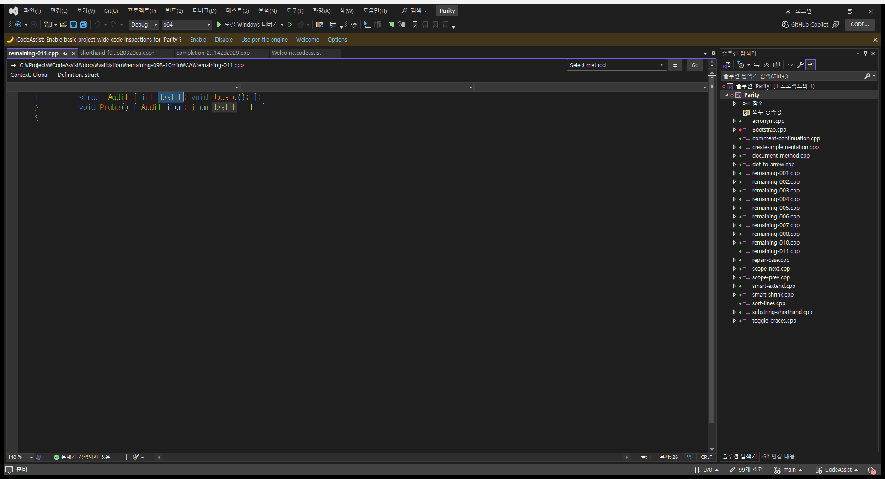](../assets/imports/docs/validation/remaining-098-10min/CA/remaining-011-before.png)

[](../assets/imports/docs/validation/remaining-098-10min/VA/remaining-011-dialog.png)

[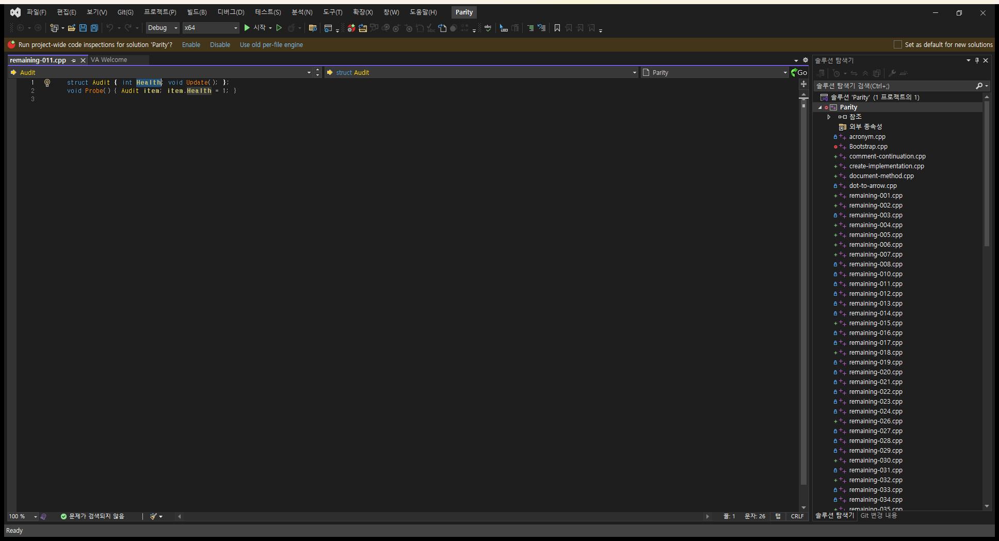](../assets/imports/docs/validation/remaining-098-10min/VA/remaining-011-after.png)

VA-F012 Open File in Solution — unverified

창·설정 페이지 관찰 및 취소만 수행; 기능 통과 아님

```
{
  "id": "VA-F012",
  "name": "Open File in Solution",
  "state": "unverified",
  "reason": "창·설정 페이지 관찰 및 취소만 수행; 기능 통과 아님",
  "VA": {
    "id": "remaining-012",
    "feature": 12,
    "action": "dialog-probe",
    "verificationScope": "dialog-cancel-or-direct-command",
    "invoked": true,
    "before": {
      "zoom": 100,
      "text": "struct Audit { int Health; void Update(); };\r\nvoid Probe() { Audit item; item.Health = 1; }\r\n",
      "caret": 25,
      "selectionStart": 19,
      "selectionLength": 6,
      "selectedText": "Health"
    },
    "after": {
      "zoom": 100,
      "text": "struct Audit { int Health; void Update(); };\r\nvoid Probe() { Audit item; item.Health = 1; }\r\n",
      "caret": 25,
      "selectionStart": 19,
      "selectionLength": 6,
      "selectedText": "Health"
    },
    "probe": {
      "status": "dialog-observed-and-cancelled",
      "title": "Open File in Solution [25 of 25]",
      "pageSelected": true,
      "controls": [
        {
          "name": "",
          "type": "ControlType.Edit",
          "value": ""
        },
        {
          "name": "...",
          "type": "ControlType.Button",
          "value": null
        },
        {
          "name": "Alt: open settings   •   Alt+S / Alt+F: quick toggles",
          "type": "ControlType.Text",
          "value": null
        },
        {
          "name": "Alt: open settings   •   Alt+S / Alt+F: quick toggles",
          "type": "ControlType.Text",
          "value": null
        },
        {
          "name": "Open",
          "type": "ControlType.Button",
          "value": null
        },
        {
          "name": "Cancel",
          "type": "ControlType.Button",
          "value": null
        },
        {
          "name": "Visual Assist",
          "type": "ControlType.Text",
          "value": null
        },
        {
          "name": "List1",
          "type": "ControlType.DataGrid",
          "value": null
        },
        {
          "name": "헤더",
          "type": "ControlType.Header",
          "value": null
        },
        {
          "name": "File",
          "type": "ControlType.HeaderItem",
          "value": null
        },
        {
          "name": "Project",
          "type": "ControlType.HeaderItem",
          "value": null
        },
        {
          "name": "Path",
          "type": "ControlType.HeaderItem",
          "value": null
        },
        {
          "name": "Modified",
          "type": "ControlType.HeaderItem",
          "value": null
        },
        {
          "name": "세로 스크롤 막대",
          "type": "ControlType.ScrollBar",
          "value": null
        },
        {
          "name": "조금 뒤로",
          "type": "ControlType.Button",
          "value": null
        },
        {
          "name": "조금 앞으로",
          "type": "ControlType.Button",
          "value": null
        },
        {
          "name": "acronym.cpp",
          "type": "ControlType.DataItem",
          "value": null
        },
        {
          "name": "acronym.cpp",
          "type": "ControlType.Text",
          "value": null
        },
        {
          "name": "Parity",
          "type": "ControlType.Text",
          "value": null
        },
        {
          "name": "C:\\Projects\\CodeAssist\\docs\\validation\\paired-098\\VA-project2\\acronym.cpp",
          "type": "ControlType.Text",
          "value": null
        },
        {
          "name": "2026-10-18 오후 21:34",
          "type": "ControlType.Text",
          "value": null
        },
        {
          "name": "Bootstrap.cpp",
          "type": "ControlType.DataItem",
          "value": null
        },
        {
          "name": "Bootstrap.cpp",
          "type": "ControlType.Text",
          "value": null
        },
        {
          "name": "Parity",
          "type": "ControlType.Text",
          "value": null
        },
        {
          "name": "C:\\Projects\\CodeAssist\\.local\\parity-runs\\20261018-015759-745\\VA\\Bootstrap.cpp",
          "type": "ControlType.Text",
          "value": null
        },
        {
          "name": "2026-10-18 오전 1:58",
          "type": "ControlType.Text",
          "value": null
        },
        {
          "name": "comment-continuation.cpp",
          "type": "ControlType.DataItem",
          "value": null
        },
        {
          "name": "comment-continuation.cpp",
          "type": "ControlType.Text",
          "value": null
        },
        {
          "name": "Parity",
          "type": "ControlType.Text",
          "value": null
        },
        {
          "name": "C:\\Projects\\CodeAssist\\docs\\validation\\paired-098\\VA-project2\\comment-continuation.cpp",
          "type": "ControlType.Text",
          "value": null
        },
        {
          "name": "2026-10-18 오후 21:34",
          "type": "ControlType.Text",
          "value": null
        },
        {
          "name": "create-implementation.cpp",
          "type": "ControlType.DataItem",
          "value": null
        },
        {
          "name": "create-implementation.cpp",
          "type": "ControlType.Text",
          "value": null
        },
        {
          "name": "Parity",
          "type": "ControlType.Text",
          "value": null
        },
        {
          "name": "C:\\Projects\\CodeAssist\\docs\\validation\\paired-098\\VA-project2\\create-implementation.cpp",
          "type": "ControlType.Text",
          "value": null
        },
        {
          "name": "2026-10-18 오후 21:34",
          "type": "ControlType.Text",
          "value": null
        },
        {
          "name": "document-method.cpp",
          "type": "ControlType.DataItem",
          "value": null
        },
        {
          "name": "document-method.cpp",
          "type": "ControlType.Text",
          "value": null
        },
        {
          "name": "Parity",
          "type": "ControlType.Text",
          "value": null
        },
        {
          "name": "C:\\Projects\\CodeAssist\\docs\\validation\\paired-098\\VA-project2\\document-method.cpp",
          "type": "ControlType.Text",
          "value": null
        },
        {
          "name": "2026-10-18 오후 21:34",
          "type": "ControlType.Text",
          "value": null
        },
        {
          "name": "dot-to-arrow.cpp",
          "type": "ControlType.DataItem",
          "value": null
        },
        {
          "name": "dot-to-arrow.cpp",
          "type": "ControlType.Text",
          "value": null
        },
        {
          "name": "Parity",
          "type": "ControlType.Text",
          "value": null
        },
        {
          "name": "C:\\Projects\\CodeAssist\\docs\\validation\\paired-098\\VA-project2\\dot-to-arrow.cpp",
          "type": "ControlType.Text",
          "value": null
        },
        {
          "name": "2026-10-18 오후 21:34",
          "type": "ControlType.Text",
          "value": null
        },
        {
          "name": "remaining-001.cpp",
          "type": "ControlType.DataItem",
          "value": null
        },
        {
          "name": "remaining-001.cpp",
          "type": "ControlType.Text",
          "value": null
        },
        {
          "name": "Parity",
          "type": "ControlType.Text",
          "value": null
        },
        {
          "name": "C:\\Projects\\CodeAssist\\docs\\validation\\remaining-098-10min\\VA\\remaining-001.cpp",
          "type": "ControlType.Text",
          "value": null
        },
        {
          "name": "2026-10-18 오후 21:45",
          "type": "ControlType.Text",
          "value": null
        },
        {
          "name": "remaining-002.cpp",
          "type": "ControlType.DataItem",
          "value": null
        },
        {
          "name": "remaining-002.cpp",
          "type": "ControlType.Text",
          "value": null
        },
        {
          "name": "Parity",
          "type": "ControlType.Text",
          "value": null
        },
        {
          "name": "C:\\Projects\\CodeAssist\\docs\\validation\\remaining-098-10min\\VA\\remaining-002.cpp",
          "type": "ControlType.Text",
          "value": null
        },
        {
          "name": "2026-10-18 오후 21:45",
          "type": "ControlType.Text",
          "value": null
        },
        {
          "name": "remaining-003.cpp",
          "type": "ControlType.DataItem",
          "value": null
        },
        {
          "name": "remaining-003.cpp",
          "type": "ControlType.Text",
          "value": null
        },
        {
          "name": "Parity",
          "type": "ControlType.Text",
          "value": null
        },
        {
          "name": "C:\\Projects\\CodeAssist\\docs\\validation\\remaining-098-10min\\VA\\remaining-003.cpp",
          "type": "ControlType.Text",
          "value": null
        },
        {
          "name": "2026-10-18 오후 21:46",
          "type": "ControlType.Text",
          "value": null
        },
        {
          "name": "remaining-004.cpp",
          "type": "ControlType.DataItem",
          "value": null
        },
        {
          "name": "remaining-004.cpp",
          "type": "ControlType.Text",
          "value": null
        },
        {
          "name": "Parity",
          "type": "ControlType.Text",
          "value": null
        },
        {
          "name": "C:\\Projects\\CodeAssist\\docs\\validation\\remaining-098-10min\\VA\\remaining-004.cpp",
          "type": "ControlType.Text",
          "value": null
        },
        {
          "name": "2026-10-18 오후 21:46",
          "type": "ControlType.Text",
          "value": null
        },
        {
          "name": "remaining-005.cpp",
          "type": "ControlType.DataItem",
          "value": null
        },
        {
          "name": "remaining-005.cpp",
          "type": "ControlType.Text",
          "value": null
        },
        {
          "name": "Parity",
          "type": "ControlType.Text",
          "value": null
        },
        {
          "name": "C:\\Projects\\CodeAssist\\docs\\validation\\remaining-098-10min\\VA\\remaining-005.cpp",
          "type": "ControlType.Text",
          "value": null
        },
        {
          "name": "2026-10-18 오후 21:46",
          "type": "ControlType.Text",
          "value": null
        },
        {
          "name": "remaining-006.cpp",
          "type": "ControlType.DataItem",
          "value": null
        },
        {
          "name": "remaining-006.cpp",
          "type": "ControlType.Text",
          "value": null
        },
        {
          "name": "Parity",
          "type": "ControlType.Text",
          "value": null
        },
        {
          "name": "C:\\Projects\\CodeAssist\\docs\\validation\\remaining-098-10min\\VA\\remaining-006.cpp",
          "type": "ControlType.Text",
          "value": null
        },
        {
          "name": "2026-10-18 오후 21:46",
          "type": "ControlType.Text",
          "value": null
        },
        {
          "name": "remaining-007.cpp",
          "type": "ControlType.DataItem",
          "value": null
        },
        {
          "name": "remaining-007.cpp",
          "type": "ControlType.Text",
          "value": null
        },
        {
          "name": "Parity",
          "type": "ControlType.Text",
          "value": null
        },
        {
          "name": "C:\\Projects\\CodeAssist\\docs\\validation\\remaining-098-10min\\VA\\remaining-007.cpp",
          "type": "ControlType.Text",
          "value": null
        },
        {
          "name": "2026-10-18 오후 21:46",
          "type": "ControlType.Text",
          "value": null
        },
        {
          "name": "remaining-008.cpp",
          "type": "ControlType.DataItem",
          "value": null
        },
        {
          "name": "remaining-008.cpp",
          "type": "ControlType.Text",
          "value": null
        },
        {
          "name": "Parity",
          "type": "ControlType.Text",
          "value": null
        },
        {
          "name": "C:\\Projects\\CodeAssist\\docs\\validation\\remaining-098-10min\\VA\\remaining-008.cpp",
          "type": "ControlType.Text",
          "value": null
        },
        {
          "name": "2026-10-18 오후 21:46",
          "type": "ControlType.Text",
          "value": null
        },
        {
          "name": "remaining-010.cpp",
          "type": "ControlType.DataItem",
          "value": null
        },
        {
          "name": "remaining-010.cpp",
          "type": "ControlType.Text",
          "value": null
        },
        {
          "name": "Parity",
          "type": "ControlType.Text",
          "value": null
        },
        {
          "name": "C:\\Projects\\CodeAssist\\docs\\validation\\remaining-098-10min\\VA\\remaining-010.cpp",
          "type": "ControlType.Text",
          "value": null
        },
        {
          "name": "2026-10-18 오후 21:46",
          "type": "ControlType.Text",
          "value": null
        },
        {
          "name": "remaining-011.cpp",
          "type": "ControlType.DataItem",
          "value": null
        },
        {
          "name": "remaining-011.cpp",
          "type": "ControlType.Text",
          "value": null
        },
        {
          "name": "Parity",
          "type": "ControlType.Text",
          "value": null
        },
        {
          "name": "C:\\Projects\\CodeAssist\\docs\\validation\\remaining-098-10min\\VA\\remaining-011.cpp",
          "type": "ControlType.Text",
          "value": null
        },
        {
          "name": "2026-10-18 오후 21:46",
          "type": "ControlType.Text",
          "value": null
        },
        {
          "name": "remaining-012.cpp",
          "type": "ControlType.DataItem",
          "value": null
        },
        {
          "name": "remaining-012.cpp",
          "type": "ControlType.Text",
          "value": null
        },
        {
          "name": "Parity",
          "type": "ControlType.Text",
          "value": null
        },
        {
          "name": "C:\\Projects\\CodeAssist\\docs\\validation\\remaining-098-10min\\VA\\remaining-012.cpp",
          "type": "ControlType.Text",
          "value": null
        },
        {
          "name": "2026-10-18 오후 21:46",
          "type": "ControlType.Text",
          "value": null
        },
        {
          "name": "repair-case.cpp",
          "type": "ControlType.DataItem",
          "value": null
        },
        {
          "name": "repair-case.cpp",
          "type": "ControlType.Text",
          "value": null
        },
        {
          "name": "Parity",
          "type": "ControlType.Text",
          "value": null
        },
        {
          "name": "C:\\Projects\\CodeAssist\\docs\\validation\\paired-098\\VA-project2\\repair-case.cpp",
          "type": "ControlType.Text",
          "value": null
        },
        {
          "name": "2026-10-18 오후 21:34",
          "type": "ControlType.Text",
          "value": null
        },
        {
          "name": "scope-next.cpp",
          "type": "ControlType.DataItem",
          "value": null
        },
        {
          "name": "scope-next.cpp",
          "type": "ControlType.Text",
          "value": null
        },
        {
          "name": "Parity",
          "type": "ControlType.Text",
          "value": null
        },
        {
          "name": "C:\\Projects\\CodeAssist\\docs\\validation\\paired-098\\VA-project2\\scope-next.cpp",
          "type": "ControlType.Text",
          "value": null
        },
        {
          "name": "2026-10-18 오후 21:34",
          "type": "ControlType.Text",
          "value": null
        },
        {
          "name": "scope-prev.cpp",
          "type": "ControlType.DataItem",
          "value": null
        },
        {
          "name": "scope-prev.cpp",
          "type": "ControlType.Text",
          "value": null
        },
        {
          "name": "Parity",
          "type": "ControlType.Text",
          "value": null
        },
        {
          "name": "C:\\Projects\\CodeAssist\\docs\\validation\\paired-098\\VA-project2\\scope-prev.cpp",
          "type": "ControlType.Text",
          "value": null
        },
        {
          "name": "2026-10-18 오후 21:34",
          "type": "ControlType.Text",
          "value": null
        },
        {
          "name": "smart-extend.cpp",
          "type": "ControlType.DataItem",
          "value": null
        },
        {
          "name": "smart-extend.cpp",
          "type": "ControlType.Text",
          "value": null
        },
        {
          "name": "Parity",
          "type": "ControlType.Text",
          "value": null
        },
        {
          "name": "C:\\Projects\\CodeAssist\\docs\\validation\\paired-098\\VA-project2\\smart-extend.cpp",
          "type": "ControlType.Text",
          "value": null
        },
        {
          "name": "2026-10-18 오후 21:34",
          "type": "ControlType.Text",
          "value": null
        },
        {
          "name": "smart-shrink.cpp",
          "type": "ControlType.DataItem",
          "value": null
        },
        {
          "name": "smart-shrink.cpp",
          "type": "ControlType.Text",
          "value": null
        },
        {
          "name": "Parity",
          "type": "ControlType.Text",
          "value": null
        },
        {
          "name": "C:\\Projects\\CodeAssist\\docs\\validation\\paired-098\\VA-project2\\smart-shrink.cpp",
          "type": "ControlType.Text",
          "value": null
        },
        {
          "name": "2026-10-18 오후 21:34",
          "type": "ControlType.Text",
          "value": null
        },
        {
          "name": "sort-lines.cpp",
          "type": "ControlType.DataItem",
          "value": null
        },
        {
          "name": "sort-lines.cpp",
          "type": "ControlType.Text",
          "value": null
        },
        {
          "name": "Parity",
          "type": "ControlType.Text",
          "value": null
        },
        {
          "name": "C:\\Projects\\CodeAssist\\docs\\validation\\paired-098\\VA-project2\\sort-lines.cpp",
          "type": "ControlType.Text",
          "value": null
        },
        {
          "name": "2026-10-18 오후 21:34",
          "type": "ControlType.Text",
          "value": null
        },
        {
          "name": "substring-shorthand.cpp",
          "type": "ControlType.DataItem",
          "value": null
        },
        {
          "name": "substring-shorthand.cpp",
          "type": "ControlType.Text",
          "value": null
        },
        {
          "name": "Parity",
          "type": "ControlType.Text",
          "value": null
        },
        {
          "name": "C:\\Projects\\CodeAssist\\docs\\validation\\paired-098\\VA-project2\\substring-shorthand.cpp",
          "type": "ControlType.Text",
          "value": null
        },
        {
          "name": "2026-10-18 오후 21:34",
          "type": "ControlType.Text",
          "value": null
        },
        {
          "name": "toggle-braces.cpp",
          "type": "ControlType.DataItem",
          "value": null
        },
        {
          "name": "toggle-braces.cpp",
          "type": "ControlType.Text",
          "value": null
        },
        {
          "name": "Parity",
          "type": "ControlType.Text",
          "value": null
        },
        {
          "name": "C:\\Projects\\CodeAssist\\docs\\validation\\paired-098\\VA-project2\\toggle-braces.cpp",
          "type": "ControlType.Text",
          "value": null
        },
        {
          "name": "2026-10-18 오후 21:34",
          "type": "ControlType.Text",
          "value": null
        },
        {
          "name": "Solution only",
          "type": "ControlType.CheckBox",
          "value": "On"
        },
        {
          "name": "Fuzzy search",
          "type": "ControlType.CheckBox",
          "value": "On"
        },
        {
          "name": "Open File in Solution [25 of 25]",
          "type": "ControlType.TitleBar",
          "value": null
        },
        {
          "name": "시스템 메뉴 모음",
          "type": "ControlType.MenuBar",
          "value": null
        },
        {
          "name": "시스템",
          "type": "ControlType.MenuItem",
          "value": null
        },
        {
          "name": "상황에 맞는 도움말",
          "type": "ControlType.Button",
          "value": null
        },
        {
          "name": "닫기",
          "type": "ControlType.Button",
          "value": null
        }
      ]
    },
    "error": null,
    "fullFunctionalPass": false
  },
  "CA": {
    "id": "remaining-012",
    "feature": 12,
    "action": "dialog-probe",
    "verificationScope": "dialog-cancel-or-direct-command",
    "invoked": true,
    "before": {
      "zoom": 140,
      "text": "struct Audit { int Health; void Update(); };\r\nvoid Probe() { Audit item; item.Health = 1; }\r\n",
      "caret": 25,
      "selectionStart": 19,
      "selectionLength": 6,
      "selectedText": "Health"
    },
    "after": {
      "zoom": 140,
      "text": "struct Audit { int Health; void Update(); };\r\nvoid Probe() { Audit item; item.Health = 1; }\r\n",
      "caret": 25,
      "selectionStart": 19,
      "selectionLength": 6,
      "selectedText": "Health"
    },
    "probe": {
      "status": "dialog-observed-and-cancelled",
      "title": "CodeAssist: 파일 찾기 [1]",
      "pageSelected": true,
      "controls": [
        {
          "name": "×",
          "type": "ControlType.Button",
          "value": null
        },
        {
          "name": "×",
          "type": "ControlType.Text",
          "value": null
        },
        {
          "name": "CodeAssist: 파일 찾기",
          "type": "ControlType.Text",
          "value": null
        },
        {
          "name": "Search",
          "type": "ControlType.Edit",
          "value": ""
        },
        {
          "name": "Fuzzy search",
          "type": "ControlType.CheckBox",
          "value": "Off"
        },
        {
          "name": "Fuzzy search",
          "type": "ControlType.Text",
          "value": null
        },
        {
          "name": "Goto",
          "type": "ControlType.Button",
          "value": null
        },
        {
          "name": "Goto",
          "type": "ControlType.Text",
          "value": null
        },
        {
          "name": "Cancel",
          "type": "ControlType.Button",
          "value": null
        },
        {
          "name": "Cancel",
          "type": "ControlType.Text",
          "value": null
        },
        {
          "name": "CodeAssist",
          "type": "ControlType.Text",
          "value": null
        },
        {
          "name": "",
          "type": "ControlType.DataGrid",
          "value": null
        },
        {
          "name": "",
          "type": "ControlType.Header",
          "value": null
        },
        {
          "name": "File",
          "type": "ControlType.HeaderItem",
          "value": null
        },
        {
          "name": "File",
          "type": "ControlType.Text",
          "value": null
        },
        {
          "name": "",
          "type": "ControlType.Thumb",
          "value": null
        },
        {
          "name": "Path",
          "type": "ControlType.HeaderItem",
          "value": null
        },
        {
          "name": "Path",
          "type": "ControlType.Text",
          "value": null
        },
        {
          "name": "",
          "type": "ControlType.Thumb",
          "value": null
        },
        {
          "name": "Bootstrap.cpp    C:\\Projects\\CodeAssist\\.local\\parity-runs\\20261018-2105-functional-097\\CA\\Bootstrap.cpp",
          "type": "ControlType.DataItem",
          "value": null
        },
        {
          "name": "",
          "type": "ControlType.Custom",
          "value": null
        },
        {
          "name": "",
          "type": "ControlType.Image",
          "value": null
        },
        {
          "name": "Bootstrap.cpp",
          "type": "ControlType.Text",
          "value": null
        },
        {
          "name": "C:\\Projects\\CodeAssist\\.local\\parity-runs\\20261018-2105-functional-097\\CA\\Bootstrap.cpp",
          "type": "ControlType.Text",
          "value": null
        }
      ]
    },
    "error": null,
    "fullFunctionalPass": false
  },
  "prefill": null,
  "fullFunctionalPass": false
}
```

[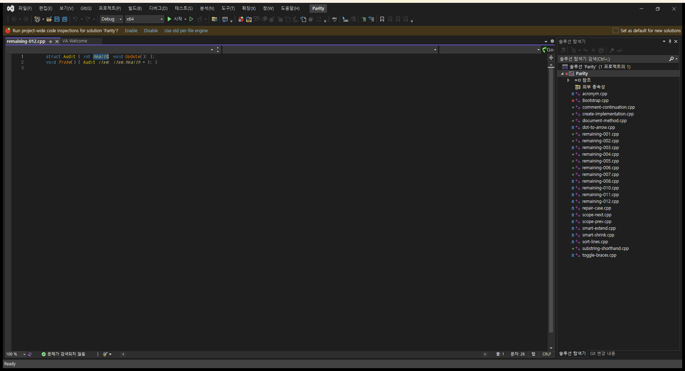](../assets/imports/docs/validation/remaining-098-10min/VA/remaining-012-before.png)[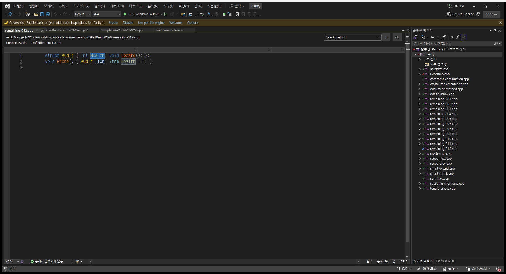](../assets/imports/docs/validation/remaining-098-10min/CA/remaining-012-before.png)

[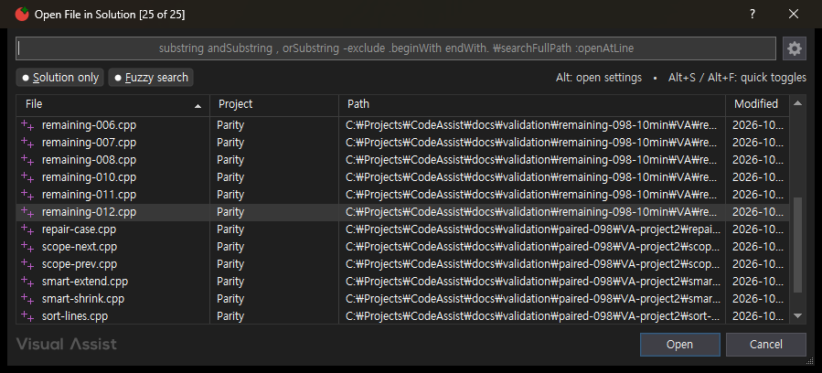](../assets/imports/docs/validation/remaining-098-10min/VA/remaining-012-dialog.png)[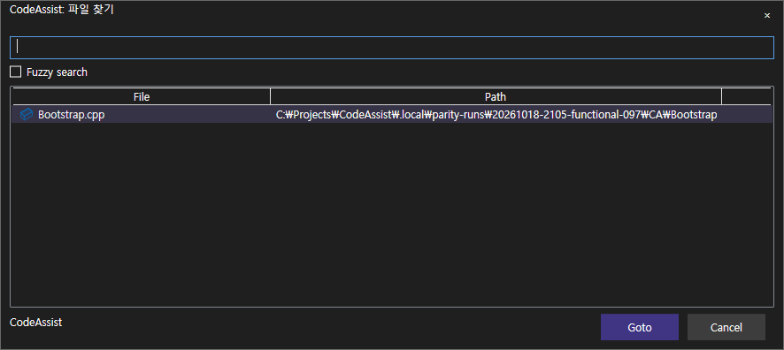](../assets/imports/docs/validation/remaining-098-10min/CA/remaining-012-dialog.png)

[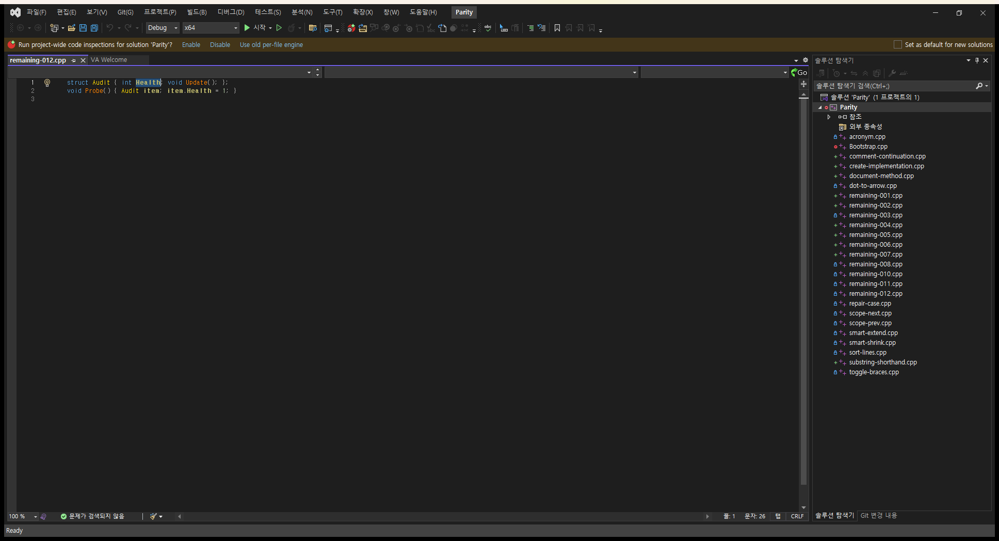](../assets/imports/docs/validation/remaining-098-10min/VA/remaining-012-after.png)[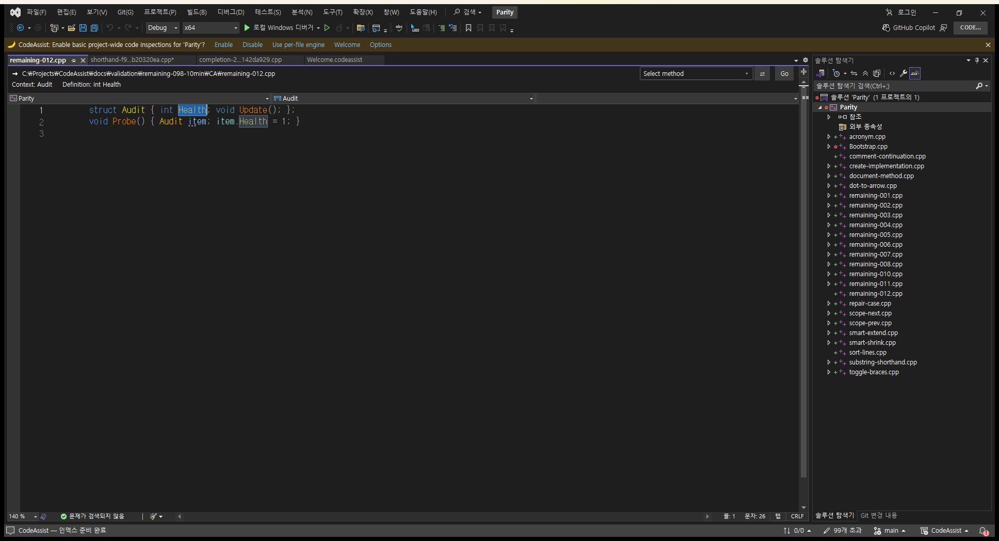](../assets/imports/docs/validation/remaining-098-10min/CA/remaining-012-after.png)

VA-F013 VA Hashtags — unverified

검사 실행 오류; 제품 불일치로 계산하지 않음

```
{
  "id": "VA-F013",
  "name": "VA Hashtags",
  "state": "unverified",
  "reason": "검사 실행 오류; 제품 불일치로 계산하지 않음",
  "VA": {
    "id": "remaining-013",
    "feature": 13,
    "action": "dialog-probe",
    "verificationScope": "options-page-only",
    "invoked": true,
    "before": {
      "zoom": 100,
      "text": "struct Audit { int Health; void Update(); };\r\nvoid Probe() { Audit item; item.Health = 1; }\r\n",
      "caret": 25,
      "selectionStart": 19,
      "selectionLength": 6,
      "selectedText": "Health"
    },
    "after": {
      "zoom": 100,
      "text": "struct Audit { int Health; void Update(); };\r\nvoid Probe() { Audit item; item.Health = 1; }\r\n",
      "caret": 25,
      "selectionStart": 19,
      "selectionLength": 6,
      "selectedText": "Health"
    },
    "probe": {
      "status": "dialog-closed-without-cancel-control",
      "title": "Visual Assist Options",
      "pageSelected": false,
      "controls": [
        {
          "name": "Visual Assist Options",
          "type": "ControlType.TitleBar",
          "value": null
        },
        {
          "name": "시스템 메뉴 모음",
          "type": "ControlType.MenuBar",
          "value": null
        },
        {
          "name": "시스템",
          "type": "ControlType.MenuItem",
          "value": null
        },
        {
          "name": "최소화",
          "type": "ControlType.Button",
          "value": null
        },
        {
          "name": "최대화",
          "type": "ControlType.Button",
          "value": null
        },
        {
          "name": "상황에 맞는 도움말",
          "type": "ControlType.Button",
          "value": null
        },
        {
          "name": "닫기",
          "type": "ControlType.Button",
          "value": null
        },
        {
          "name": "",
          "type": "ControlType.Custom",
          "value": null
        }
      ]
    },
    "error": null,
    "fullFunctionalPass": false
  },
  "CA": {
    "id": "remaining-013",
    "feature": 13,
    "action": "dialog-probe",
    "verificationScope": "options-page-only",
    "invoked": false,
    "before": null,
    "after": null,
    "probe": null,
    "error": "System.Runtime.InteropServices.COMException (0x800706BA): RPC 서버를 사용할 수 없습니다. (예외가 발생한 HRESULT: 0x800706BA)\r\n   위치: EnvDTE._DTE.get_Solution()\r\n   위치: ShortcutProbe.Remaining98(DTE d, Int32 pid, String role, String root, String planFile)",
    "fullFunctionalPass": false
  },
  "prefill": null,
  "fullFunctionalPass": false
}
```

[](../assets/imports/docs/validation/remaining-098-10min/VA/remaining-013-before.png)[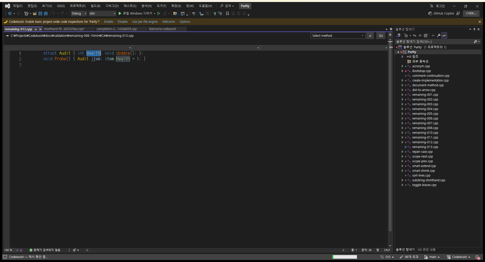](../assets/imports/docs/validation/remaining-098-10min/CA/remaining-013-before.png)

[](../assets/imports/docs/validation/remaining-098-10min/VA/remaining-013-dialog.png)

[](../assets/imports/docs/validation/remaining-098-10min/VA/remaining-013-after.png)

VA-F014 VA Navigation Bar — unverified

검사 실행 오류; 제품 불일치로 계산하지 않음

```
{
  "id": "VA-F014",
  "name": "VA Navigation Bar",
  "state": "unverified",
  "reason": "검사 실행 오류; 제품 불일치로 계산하지 않음",
  "VA": {
    "id": "remaining-014",
    "feature": 14,
    "action": "dialog-probe",
    "verificationScope": "options-page-only",
    "invoked": true,
    "before": {
      "zoom": 100,
      "text": "struct Audit { int Health; void Update(); };\r\nvoid Probe() { Audit item; item.Health = 1; }\r\n",
      "caret": 25,
      "selectionStart": 19,
      "selectionLength": 6,
      "selectedText": "Health"
    },
    "after": {
      "zoom": 100,
      "text": "struct Audit { int Health; void Update(); };\r\nvoid Probe() { Audit item; item.Health = 1; }\r\n",
      "caret": 25,
      "selectionStart": 19,
      "selectionLength": 6,
      "selectedText": "Health"
    },
    "probe": {
      "status": "dialog-closed-without-cancel-control",
      "title": "Visual Assist Options",
      "pageSelected": false,
      "controls": [
        {
          "name": "Visual Assist Options",
          "type": "ControlType.TitleBar",
          "value": null
        },
        {
          "name": "시스템 메뉴 모음",
          "type": "ControlType.MenuBar",
          "value": null
        },
        {
          "name": "시스템",
          "type": "ControlType.MenuItem",
          "value": null
        },
        {
          "name": "최소화",
          "type": "ControlType.Button",
          "value": null
        },
        {
          "name": "최대화",
          "type": "ControlType.Button",
          "value": null
        },
        {
          "name": "상황에 맞는 도움말",
          "type": "ControlType.Button",
          "value": null
        },
        {
          "name": "닫기",
          "type": "ControlType.Button",
          "value": null
        },
        {
          "name": "",
          "type": "ControlType.Custom",
          "value": null
        }
      ]
    },
    "error": null,
    "fullFunctionalPass": false
  },
  "CA": {
    "id": "remaining-014",
    "feature": 14,
    "action": "dialog-probe",
    "verificationScope": "options-page-only",
    "invoked": false,
    "before": null,
    "after": null,
    "probe": null,
    "error": "System.Runtime.InteropServices.COMException (0x800706BA): RPC 서버를 사용할 수 없습니다. (예외가 발생한 HRESULT: 0x800706BA)\r\n   위치: EnvDTE._DTE.get_Solution()\r\n   위치: ShortcutProbe.Remaining98(DTE d, Int32 pid, String role, String root, String planFile)",
    "fullFunctionalPass": false
  },
  "prefill": null,
  "fullFunctionalPass": false
}
```

[](../assets/imports/docs/validation/remaining-098-10min/VA/remaining-014-before.png)[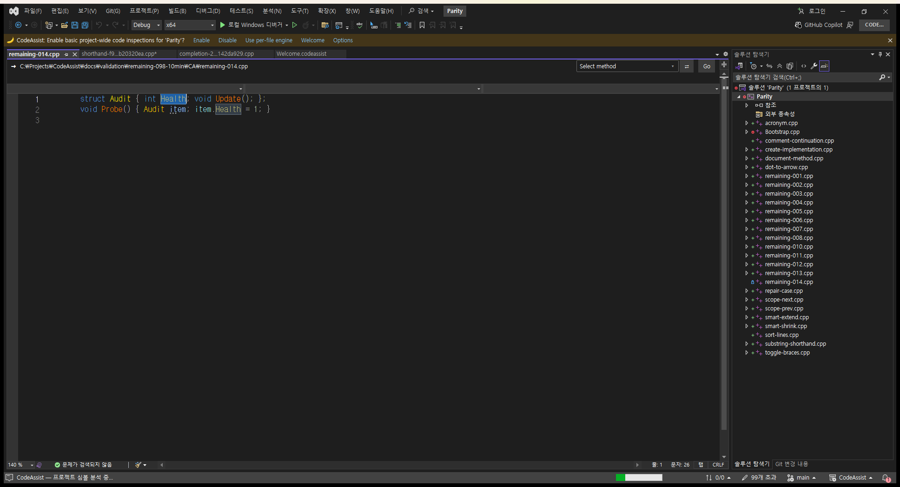](../assets/imports/docs/validation/remaining-098-10min/CA/remaining-014-before.png)

[](../assets/imports/docs/validation/remaining-098-10min/VA/remaining-014-dialog.png)

[](../assets/imports/docs/validation/remaining-098-10min/VA/remaining-014-after.png)

VA-F015 Access to Refactoring Commands — unverified

검사 실행 오류; 제품 불일치로 계산하지 않음

```
{
  "id": "VA-F015",
  "name": "Access to Refactoring Commands",
  "state": "unverified",
  "reason": "검사 실행 오류; 제품 불일치로 계산하지 않음",
  "VA": {
    "id": "remaining-015",
    "feature": 15,
    "action": "dialog-probe",
    "verificationScope": "options-page-only",
    "invoked": true,
    "before": {
      "zoom": 100,
      "text": "struct Audit { int Health; void Update(); };\r\nvoid Probe() { Audit item; item.Health = 1; }\r\n",
      "caret": 25,
      "selectionStart": 19,
      "selectionLength": 6,
      "selectedText": "Health"
    },
    "after": {
      "zoom": 100,
      "text": "struct Audit { int Health; void Update(); };\r\nvoid Probe() { Audit item; item.Health = 1; }\r\n",
      "caret": 25,
      "selectionStart": 19,
      "selectionLength": 6,
      "selectedText": "Health"
    },
    "probe": {
      "status": "dialog-closed-without-cancel-control",
      "title": "Visual Assist Options",
      "pageSelected": false,
      "controls": [
        {
          "name": "Visual Assist Options",
          "type": "ControlType.TitleBar",
          "value": null
        },
        {
          "name": "시스템 메뉴 모음",
          "type": "ControlType.MenuBar",
          "value": null
        },
        {
          "name": "시스템",
          "type": "ControlType.MenuItem",
          "value": null
        },
        {
          "name": "최소화",
          "type": "ControlType.Button",
          "value": null
        },
        {
          "name": "최대화",
          "type": "ControlType.Button",
          "value": null
        },
        {
          "name": "상황에 맞는 도움말",
          "type": "ControlType.Button",
          "value": null
        },
        {
          "name": "닫기",
          "type": "ControlType.Button",
          "value": null
        },
        {
          "name": "",
          "type": "ControlType.Custom",
          "value": null
        }
      ]
    },
    "error": null,
    "fullFunctionalPass": false
  },
  "CA": {
    "id": "remaining-015",
    "feature": 15,
    "action": "dialog-probe",
    "verificationScope": "options-page-only",
    "invoked": false,
    "before": null,
    "after": null,
    "probe": null,
    "error": "System.Runtime.InteropServices.COMException (0x800706BA): RPC 서버를 사용할 수 없습니다. (예외가 발생한 HRESULT: 0x800706BA)\r\n   위치: EnvDTE._DTE.get_Solution()\r\n   위치: ShortcutProbe.Remaining98(DTE d, Int32 pid, String role, String root, String planFile)",
    "fullFunctionalPass": false
  },
  "prefill": null,
  "fullFunctionalPass": false
}
```

[](../assets/imports/docs/validation/remaining-098-10min/VA/remaining-015-before.png)[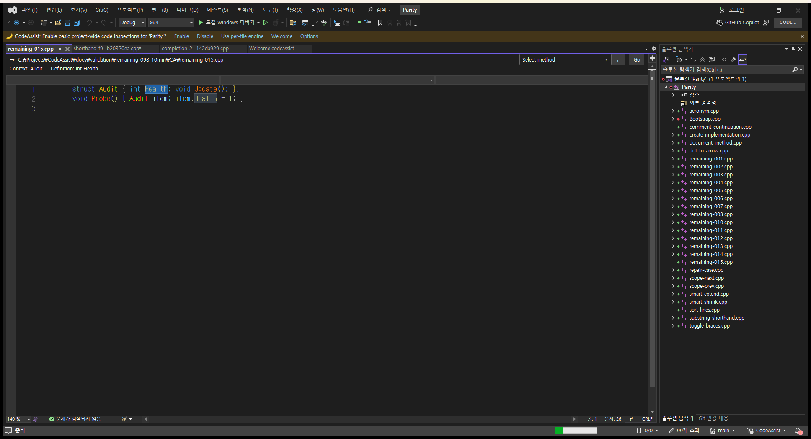](../assets/imports/docs/validation/remaining-098-10min/CA/remaining-015-before.png)

[](../assets/imports/docs/validation/remaining-098-10min/VA/remaining-015-dialog.png)

[](../assets/imports/docs/validation/remaining-098-10min/VA/remaining-015-after.png)

VA-F016 Change Signature — unverified

검사 실행 오류; 제품 불일치로 계산하지 않음

```
{
  "id": "VA-F016",
  "name": "Change Signature",
  "state": "unverified",
  "reason": "검사 실행 오류; 제품 불일치로 계산하지 않음",
  "VA": {
    "id": "remaining-016",
    "feature": 16,
    "action": "dialog-probe",
    "verificationScope": "dialog-cancel-or-direct-command",
    "invoked": false,
    "before": {
      "zoom": 100,
      "text": "int Sum(int left, int right) { return left + right; }\r\n",
      "caret": 7,
      "selectionStart": 4,
      "selectionLength": 3,
      "selectedText": "Sum"
    },
    "after": null,
    "probe": {
      "status": "no-modal-observed"
    },
    "error": "System.Runtime.InteropServices.COMException (0x80004005): \"VAssistX.RefactorChangeSignature\" 명령은 사용할 수 없습니다.\r\n   위치: EnvDTE._DTE.ExecuteCommand(String CommandName, String CommandArgs)\r\n   위치: ShortcutProbe.Remaining98(DTE d, Int32 pid, String role, String root, String planFile)",
    "fullFunctionalPass": false
  },
  "CA": {
    "id": "remaining-016",
    "feature": 16,
    "action": "dialog-probe",
    "verificationScope": "dialog-cancel-or-direct-command",
    "invoked": true,
    "before": {
      "zoom": 140,
      "text": "int Sum(int left, int right) { return left + right; }\r\n",
      "caret": 7,
      "selectionStart": 4,
      "selectionLength": 3,
      "selectedText": "Sum"
    },
    "after": {
      "zoom": 140,
      "text": "int Sum(int left, int right) { return left + right; }\r\n",
      "caret": 7,
      "selectionStart": 4,
      "selectionLength": 3,
      "selectedText": "Sum"
    },
    "probe": {
      "status": "product-error-dialog",
      "title": "CodeAssist Refactoring",
      "pageSelected": true,
      "controls": [
        {
          "name": "확인",
          "type": "ControlType.Button",
          "value": null
        },
        {
          "name": "Configure compile_commands.json or compile_flags.txt before semantic refactoring.",
          "type": "ControlType.Text",
          "value": null
        },
        {
          "name": "CodeAssist Refactoring",
          "type": "ControlType.TitleBar",
          "value": null
        },
        {
          "name": "시스템 메뉴 모음",
          "type": "ControlType.MenuBar",
          "value": null
        },
        {
          "name": "시스템",
          "type": "ControlType.MenuItem",
          "value": null
        },
        {
          "name": "닫기",
          "type": "ControlType.Button",
          "value": null
        }
      ]
    },
    "error": null,
    "fullFunctionalPass": false
  },
  "prefill": null,
  "fullFunctionalPass": false
}
```

[](../assets/imports/docs/validation/remaining-098-10min/VA/remaining-016-before.png)[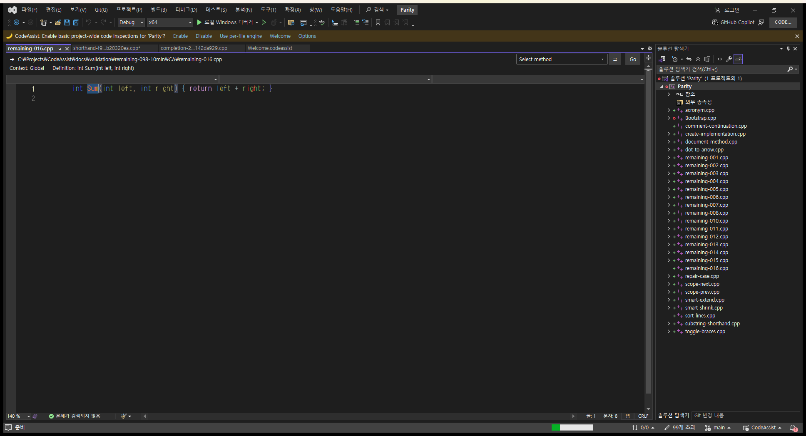](../assets/imports/docs/validation/remaining-098-10min/CA/remaining-016-before.png)

[](../assets/imports/docs/validation/remaining-098-10min/CA/remaining-016-dialog.png)

[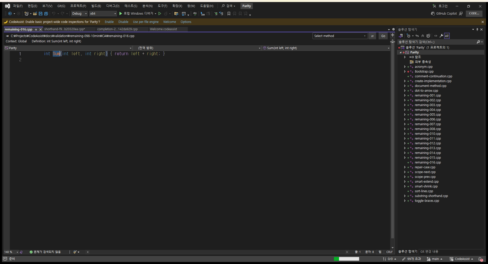](../assets/imports/docs/validation/remaining-098-10min/CA/remaining-016-after.png)

VA-F017 Convert Between Pointer and Instance — unverified

검사 실행 오류; 제품 불일치로 계산하지 않음

```
{
  "id": "VA-F017",
  "name": "Convert Between Pointer and Instance",
  "state": "unverified",
  "reason": "검사 실행 오류; 제품 불일치로 계산하지 않음",
  "VA": {
    "id": "remaining-017",
    "feature": 17,
    "action": "dialog-probe",
    "verificationScope": "dialog-cancel-or-direct-command",
    "invoked": false,
    "before": {
      "zoom": 100,
      "text": "struct Audit { int Health; void Update(); };\r\nvoid Probe() { Audit item; item.Health = 1; }\r\n",
      "caret": 25,
      "selectionStart": 19,
      "selectionLength": 6,
      "selectedText": "Health"
    },
    "after": null,
    "probe": {
      "status": "no-modal-observed"
    },
    "error": "System.Runtime.InteropServices.COMException (0x80004005): \"VAssistX.RefactorConvertBetweenPointerAndInstance\" 명령은 사용할 수 없습니다.\r\n   위치: EnvDTE._DTE.ExecuteCommand(String CommandName, String CommandArgs)\r\n   위치: ShortcutProbe.Remaining98(DTE d, Int32 pid, String role, String root, String planFile)",
    "fullFunctionalPass": false
  },
  "CA": {
    "id": "remaining-017",
    "feature": 17,
    "action": "dialog-probe",
    "verificationScope": "dialog-cancel-or-direct-command",
    "invoked": true,
    "before": {
      "zoom": 140,
      "text": "struct Audit { int Health; void Update(); };\r\nvoid Probe() { Audit item; item.Health = 1; }\r\n",
      "caret": 25,
      "selectionStart": 19,
      "selectionLength": 6,
      "selectedText": "Health"
    },
    "after": {
      "zoom": 140,
      "text": "struct Audit { int Health; void Update(); };\r\nvoid Probe() { Audit item; item.Health = 1; }\r\n",
      "caret": 25,
      "selectionStart": 19,
      "selectionLength": 6,
      "selectedText": "Health"
    },
    "probe": {
      "status": "product-error-dialog",
      "title": "CodeAssist",
      "pageSelected": true,
      "controls": [
        {
          "name": "확인",
          "type": "ControlType.Button",
          "value": null
        },
        {
          "name": "",
          "type": "ControlType.Image",
          "value": null
        },
        {
          "name": "Select a simple non-template local object or owning new-expression pointer declaration.",
          "type": "ControlType.Text",
          "value": null
        },
        {
          "name": "CodeAssist",
          "type": "ControlType.TitleBar",
          "value": null
        },
        {
          "name": "시스템 메뉴 모음",
          "type": "ControlType.MenuBar",
          "value": null
        },
        {
          "name": "시스템",
          "type": "ControlType.MenuItem",
          "value": null
        },
        {
          "name": "닫기",
          "type": "ControlType.Button",
          "value": null
        }
      ]
    },
    "error": null,
    "fullFunctionalPass": false
  },
  "prefill": null,
  "fullFunctionalPass": false
}
```

[](../assets/imports/docs/validation/remaining-098-10min/VA/remaining-017-before.png)[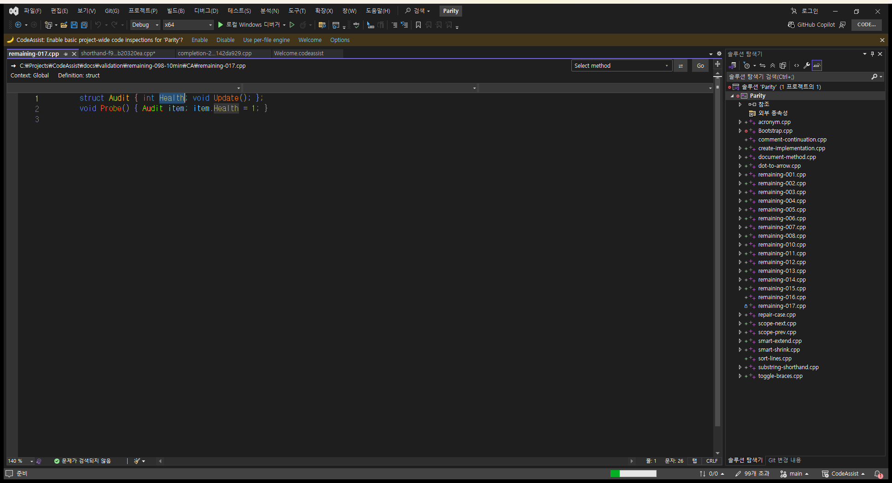](../assets/imports/docs/validation/remaining-098-10min/CA/remaining-017-before.png)

[](../assets/imports/docs/validation/remaining-098-10min/CA/remaining-017-dialog.png)

[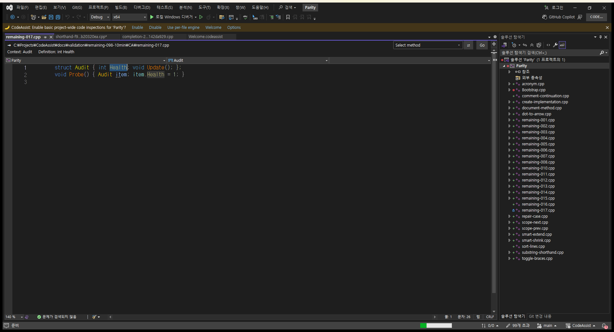](../assets/imports/docs/validation/remaining-098-10min/CA/remaining-017-after.png)

VA-F018 Encapsulate Field — unverified

검사 실행 오류; 제품 불일치로 계산하지 않음

```
{
  "id": "VA-F018",
  "name": "Encapsulate Field",
  "state": "unverified",
  "reason": "검사 실행 오류; 제품 불일치로 계산하지 않음",
  "VA": {
    "id": "remaining-018",
    "feature": 18,
    "action": "dialog-probe",
    "verificationScope": "dialog-cancel-or-direct-command",
    "invoked": false,
    "before": {
      "zoom": 100,
      "text": "class Audit { public: int Health; };\r\n",
      "caret": 32,
      "selectionStart": 26,
      "selectionLength": 6,
      "selectedText": "Health"
    },
    "after": null,
    "probe": {
      "status": "no-modal-observed"
    },
    "error": "System.Runtime.InteropServices.COMException (0x80004005): \"VAssistX.RefactorEncapsulateField\" 명령은 사용할 수 없습니다.\r\n   위치: EnvDTE._DTE.ExecuteCommand(String CommandName, String CommandArgs)\r\n   위치: ShortcutProbe.Remaining98(DTE d, Int32 pid, String role, String root, String planFile)",
    "fullFunctionalPass": false
  },
  "CA": {
    "id": "remaining-018",
    "feature": 18,
    "action": "dialog-probe",
    "verificationScope": "dialog-cancel-or-direct-command",
    "invoked": true,
    "before": {
      "zoom": 140,
      "text": "class Audit { public: int Health; };\r\n",
      "caret": 32,
      "selectionStart": 26,
      "selectionLength": 6,
      "selectedText": "Health"
    },
    "after": {
      "zoom": 140,
      "text": "class Audit { public: int Health; };\r\n",
      "caret": 32,
      "selectionStart": 26,
      "selectionLength": 6,
      "selectedText": "Health"
    },
    "probe": {
      "status": "dialog-closed-without-cancel-control",
      "title": "CodeAssist",
      "pageSelected": true,
      "controls": [
        {
          "name": "×",
          "type": "ControlType.Button",
          "value": null
        },
        {
          "name": "×",
          "type": "ControlType.Text",
          "value": null
        },
        {
          "name": "CodeAssist",
          "type": "ControlType.Text",
          "value": null
        },
        {
          "name": "Accessor name suffix",
          "type": "ControlType.Text",
          "value": null
        },
        {
          "name": "",
          "type": "ControlType.Edit",
          "value": "Value"
        },
        {
          "name": "Save",
          "type": "ControlType.Button",
          "value": null
        },
        {
          "name": "Save",
          "type": "ControlType.Text",
          "value": null
        }
      ]
    },
    "error": null,
    "fullFunctionalPass": false
  },
  "prefill": null,
  "fullFunctionalPass": false
}
```

[](../assets/imports/docs/validation/remaining-098-10min/VA/remaining-018-before.png)[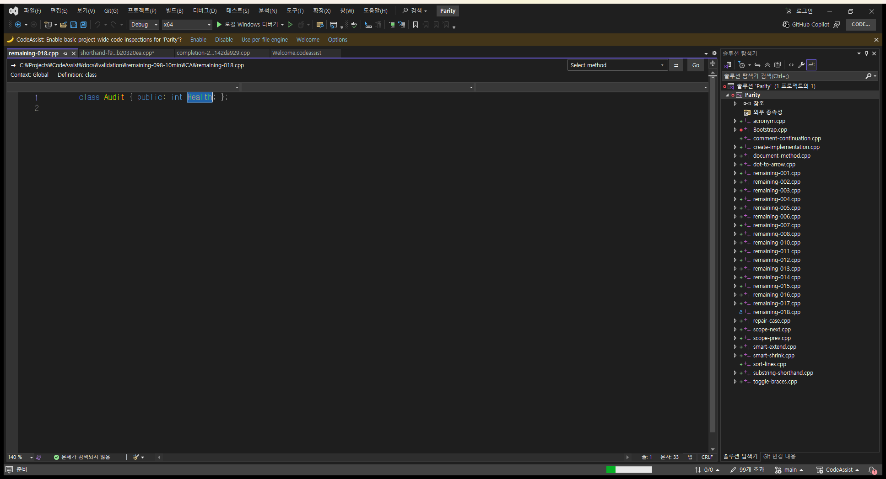](../assets/imports/docs/validation/remaining-098-10min/CA/remaining-018-before.png)

[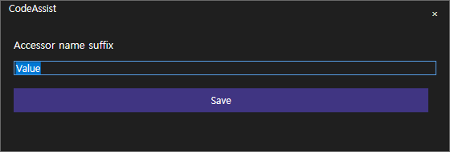](../assets/imports/docs/validation/remaining-098-10min/CA/remaining-018-dialog.png)

[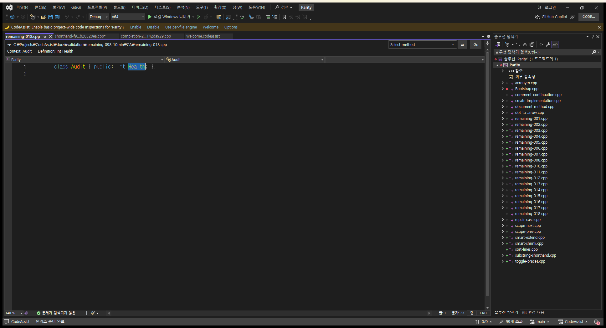](../assets/imports/docs/validation/remaining-098-10min/CA/remaining-018-after.png)

VA-F019 Extract Method — unverified

창·설정 페이지 관찰 및 취소만 수행; 기능 통과 아님

```
{
  "id": "VA-F019",
  "name": "Extract Method",
  "state": "unverified",
  "reason": "창·설정 페이지 관찰 및 취소만 수행; 기능 통과 아님",
  "VA": {
    "id": "remaining-019",
    "feature": 19,
    "action": "dialog-probe",
    "verificationScope": "dialog-cancel-or-direct-command",
    "invoked": true,
    "before": {
      "zoom": 100,
      "text": "void Probe() { int value = 1; value += 2; }\r\n",
      "caret": 40,
      "selectionStart": 15,
      "selectionLength": 25,
      "selectedText": "int value = 1; value += 2"
    },
    "after": {
      "zoom": 100,
      "text": "void Probe() { int value = 1; value += 2; }\r\n",
      "caret": 40,
      "selectionStart": 15,
      "selectionLength": 25,
      "selectedText": "int value = 1; value += 2"
    },
    "probe": {
      "status": "dialog-observed-and-cancelled",
      "title": "Extract Method",
      "pageSelected": true,
      "controls": [
        {
          "name": "Change signature: edit name and remove, add, rename or move parameters",
          "type": "ControlType.Text",
          "value": null
        },
        {
          "name": "Change signature: edit name and remove, add, rename or move parameters",
          "type": "ControlType.Document",
          "value": null
        },
        {
          "name": "Extract",
          "type": "ControlType.Button",
          "value": null
        },
        {
          "name": "Cancel",
          "type": "ControlType.Button",
          "value": null
        },
        {
          "name": "Visual Assist",
          "type": "ControlType.Text",
          "value": null
        },
        {
          "name": "Extract Method",
          "type": "ControlType.TitleBar",
          "value": null
        },
        {
          "name": "시스템 메뉴 모음",
          "type": "ControlType.MenuBar",
          "value": null
        },
        {
          "name": "시스템",
          "type": "ControlType.MenuItem",
          "value": null
        },
        {
          "name": "상황에 맞는 도움말",
          "type": "ControlType.Button",
          "value": null
        },
        {
          "name": "닫기",
          "type": "ControlType.Button",
          "value": null
        }
      ]
    },
    "error": null,
    "fullFunctionalPass": false
  },
  "CA": {
    "id": "remaining-019",
    "feature": 19,
    "action": "dialog-probe",
    "verificationScope": "dialog-cancel-or-direct-command",
    "invoked": true,
    "before": {
      "zoom": 140,
      "text": "void Probe() { int value = 1; value += 2; }\r\n",
      "caret": 40,
      "selectionStart": 15,
      "selectionLength": 25,
      "selectedText": "int value = 1; value += 2"
    },
    "after": {
      "zoom": 140,
      "text": "void Probe() { int value = 1; value += 2; }\r\n",
      "caret": 40,
      "selectionStart": 15,
      "selectionLength": 25,
      "selectedText": "int value = 1; value += 2"
    },
    "probe": {
      "status": "dialog-closed-without-cancel-control",
      "title": "CodeAssist",
      "pageSelected": true,
      "controls": [
        {
          "name": "×",
          "type": "ControlType.Button",
          "value": null
        },
        {
          "name": "×",
          "type": "ControlType.Text",
          "value": null
        },
        {
          "name": "CodeAssist",
          "type": "ControlType.Text",
          "value": null
        },
        {
          "name": "New free-function signature (use reference parameters for outputs)",
          "type": "ControlType.Text",
          "value": null
        },
        {
          "name": "",
          "type": "ControlType.Edit",
          "value": "void Extracted()"
        },
        {
          "name": "Save",
          "type": "ControlType.Button",
          "value": null
        },
        {
          "name": "Save",
          "type": "ControlType.Text",
          "value": null
        }
      ]
    },
    "error": null,
    "fullFunctionalPass": false
  },
  "prefill": null,
  "fullFunctionalPass": false
}
```

[](../assets/imports/docs/validation/remaining-098-10min/VA/remaining-019-before.png)[](../assets/imports/docs/validation/remaining-098-10min/CA/remaining-019-before.png)

[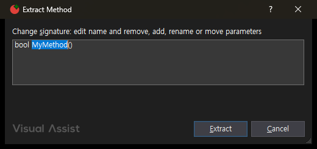](../assets/imports/docs/validation/remaining-098-10min/VA/remaining-019-dialog.png)[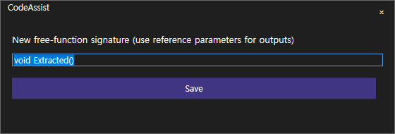](../assets/imports/docs/validation/remaining-098-10min/CA/remaining-019-dialog.png)

[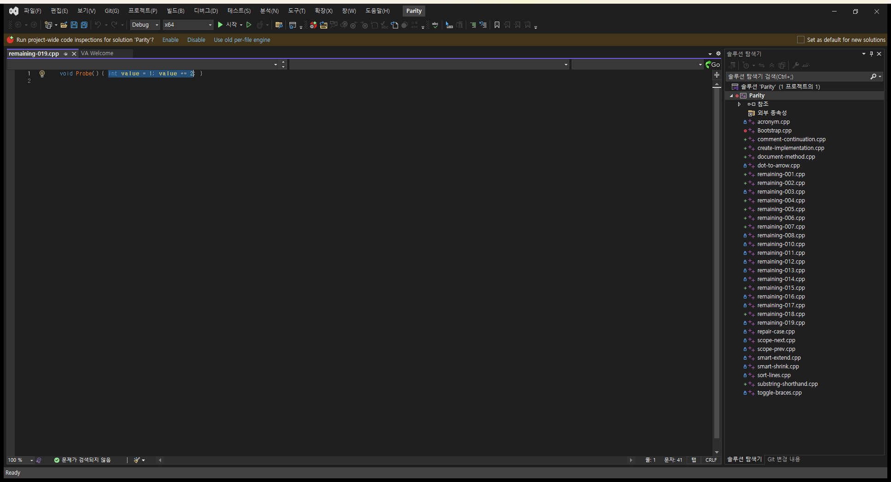](../assets/imports/docs/validation/remaining-098-10min/VA/remaining-019-after.png)[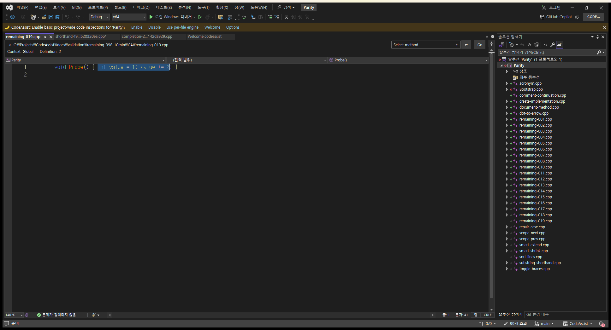](../assets/imports/docs/validation/remaining-098-10min/CA/remaining-019-after.png)

VA-F020 Introduce Variable — unverified

검사 실행 오류; 제품 불일치로 계산하지 않음

```
{
  "id": "VA-F020",
  "name": "Introduce Variable",
  "state": "unverified",
  "reason": "검사 실행 오류; 제품 불일치로 계산하지 않음",
  "VA": {
    "id": "remaining-020",
    "feature": 20,
    "action": "dialog-probe",
    "verificationScope": "dialog-cancel-or-direct-command",
    "invoked": false,
    "before": {
      "zoom": 100,
      "text": "struct Audit { int Health; void Update(); };\r\nvoid Probe() { Audit item; item.Health = 1; }\r\n",
      "caret": 25,
      "selectionStart": 19,
      "selectionLength": 6,
      "selectedText": "Health"
    },
    "after": null,
    "probe": {
      "status": "no-modal-observed"
    },
    "error": "System.Runtime.InteropServices.COMException (0x80004005): \"VAssistX.RefactorIntroduceVariable\" 명령은 사용할 수 없습니다.\r\n   위치: EnvDTE._DTE.ExecuteCommand(String CommandName, String CommandArgs)\r\n   위치: ShortcutProbe.Remaining98(DTE d, Int32 pid, String role, String root, String planFile)",
    "fullFunctionalPass": false
  },
  "CA": {
    "id": "remaining-020",
    "feature": 20,
    "action": "dialog-probe",
    "verificationScope": "dialog-cancel-or-direct-command",
    "invoked": true,
    "before": {
      "zoom": 140,
      "text": "struct Audit { int Health; void Update(); };\r\nvoid Probe() { Audit item; item.Health = 1; }\r\n",
      "caret": 25,
      "selectionStart": 19,
      "selectionLength": 6,
      "selectedText": "Health"
    },
    "after": {
      "zoom": 140,
      "text": "struct Audit { int Health; void Update(); };\r\nvoid Probe() { Audit item; item.Health = 1; }\r\n",
      "caret": 25,
      "selectionStart": 19,
      "selectionLength": 6,
      "selectedText": "Health"
    },
    "probe": {
      "status": "no-modal-observed"
    },
    "error": null,
    "fullFunctionalPass": false
  },
  "prefill": null,
  "fullFunctionalPass": false
}
```

[](../assets/imports/docs/validation/remaining-098-10min/VA/remaining-020-before.png)[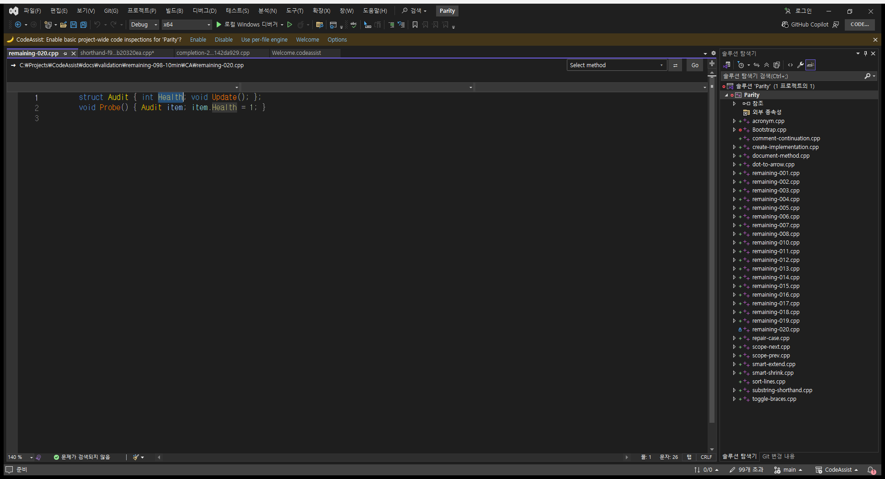](../assets/imports/docs/validation/remaining-098-10min/CA/remaining-020-before.png)

[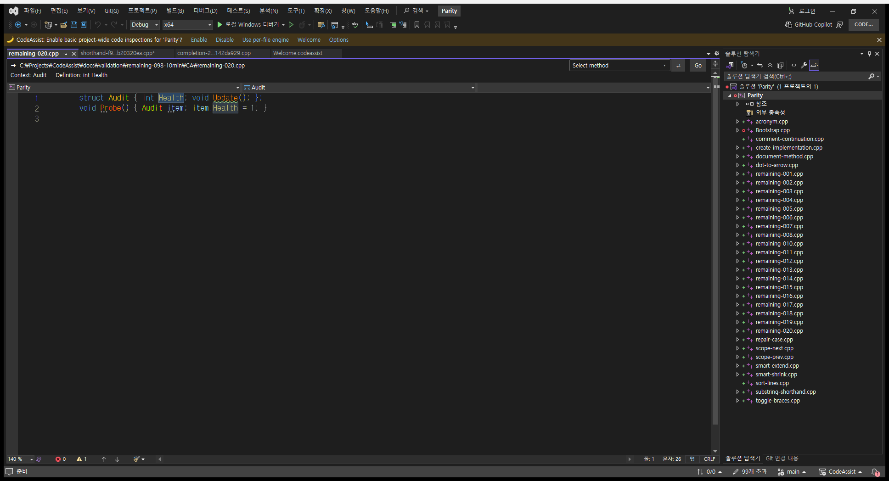](../assets/imports/docs/validation/remaining-098-10min/CA/remaining-020-after.png)

VA-F021 Move Implementation to Header File — unverified

검사 실행 오류; 제품 불일치로 계산하지 않음

```
{
  "id": "VA-F021",
  "name": "Move Implementation to Header File",
  "state": "unverified",
  "reason": "검사 실행 오류; 제품 불일치로 계산하지 않음",
  "VA": {
    "id": "remaining-021",
    "feature": 21,
    "action": "dialog-probe",
    "verificationScope": "dialog-cancel-or-direct-command",
    "invoked": false,
    "before": {
      "zoom": 100,
      "text": "struct Audit { int Health; void Update(); };\r\nvoid Probe() { Audit item; item.Health = 1; }\r\n",
      "caret": 25,
      "selectionStart": 19,
      "selectionLength": 6,
      "selectedText": "Health"
    },
    "after": null,
    "probe": {
      "status": "no-modal-observed"
    },
    "error": "System.Runtime.InteropServices.COMException (0x80004005): \"VAssistX.RefactorMoveImplementationToHeaderFile\" 명령은 사용할 수 없습니다.\r\n   위치: EnvDTE._DTE.ExecuteCommand(String CommandName, String CommandArgs)\r\n   위치: ShortcutProbe.Remaining98(DTE d, Int32 pid, String role, String root, String planFile)",
    "fullFunctionalPass": false
  },
  "CA": {
    "id": "remaining-021",
    "feature": 21,
    "action": "dialog-probe",
    "verificationScope": "dialog-cancel-or-direct-command",
    "invoked": true,
    "before": {
      "zoom": 140,
      "text": "struct Audit { int Health; void Update(); };\r\nvoid Probe() { Audit item; item.Health = 1; }\r\n",
      "caret": 25,
      "selectionStart": 19,
      "selectionLength": 6,
      "selectedText": "Health"
    },
    "after": {
      "zoom": 140,
      "text": "struct Audit { int Health; void Update(); };\r\nvoid Probe() { Audit item; item.Health = 1; }\r\n",
      "caret": 25,
      "selectionStart": 19,
      "selectionLength": 6,
      "selectedText": "Health"
    },
    "probe": {
      "status": "no-modal-observed"
    },
    "error": null,
    "fullFunctionalPass": false
  },
  "prefill": null,
  "fullFunctionalPass": false
}
```

[](../assets/imports/docs/validation/remaining-098-10min/VA/remaining-021-before.png)[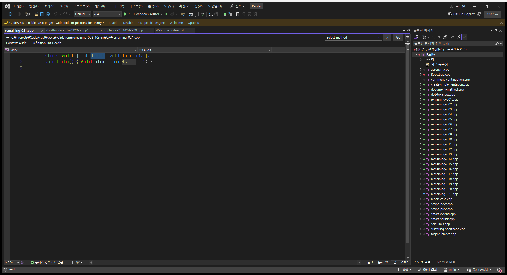](../assets/imports/docs/validation/remaining-098-10min/CA/remaining-021-before.png)

[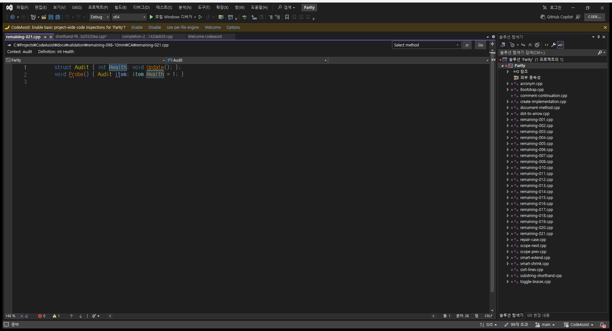](../assets/imports/docs/validation/remaining-098-10min/CA/remaining-021-after.png)

VA-F022 Move Implementation to Source File — unverified

검사 실행 오류; 제품 불일치로 계산하지 않음

```
{
  "id": "VA-F022",
  "name": "Move Implementation to Source File",
  "state": "unverified",
  "reason": "검사 실행 오류; 제품 불일치로 계산하지 않음",
  "VA": {
    "id": "remaining-022",
    "feature": 22,
    "action": "dialog-probe",
    "verificationScope": "dialog-cancel-or-direct-command",
    "invoked": false,
    "before": {
      "zoom": 100,
      "text": "struct Audit { int Health; void Update(); };\r\nvoid Probe() { Audit item; item.Health = 1; }\r\n",
      "caret": 25,
      "selectionStart": 19,
      "selectionLength": 6,
      "selectedText": "Health"
    },
    "after": null,
    "probe": {
      "status": "no-modal-observed"
    },
    "error": "System.Runtime.InteropServices.COMException (0x80004005): \"VAssistX.RefactorMoveImplementationToSourceFile\" 명령은 사용할 수 없습니다.\r\n   위치: EnvDTE._DTE.ExecuteCommand(String CommandName, String CommandArgs)\r\n   위치: ShortcutProbe.Remaining98(DTE d, Int32 pid, String role, String root, String planFile)",
    "fullFunctionalPass": false
  },
  "CA": {
    "id": "remaining-022",
    "feature": 22,
    "action": "dialog-probe",
    "verificationScope": "dialog-cancel-or-direct-command",
    "invoked": true,
    "before": {
      "zoom": 140,
      "text": "struct Audit { int Health; void Update(); };\r\nvoid Probe() { Audit item; item.Health = 1; }\r\n",
      "caret": 25,
      "selectionStart": 19,
      "selectionLength": 6,
      "selectedText": "Health"
    },
    "after": {
      "zoom": 140,
      "text": "struct Audit { int Health; void Update(); };\r\nvoid Probe() { Audit item; item.Health = 1; }\r\n",
      "caret": 25,
      "selectionStart": 19,
      "selectionLength": 6,
      "selectedText": "Health"
    },
    "probe": {
      "status": "no-modal-observed"
    },
    "error": null,
    "fullFunctionalPass": false
  },
  "prefill": null,
  "fullFunctionalPass": false
}
```

[](../assets/imports/docs/validation/remaining-098-10min/VA/remaining-022-before.png)[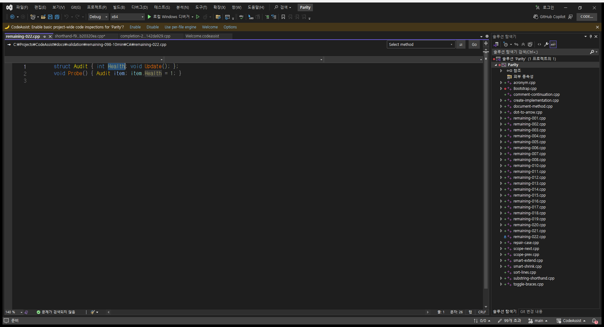](../assets/imports/docs/validation/remaining-098-10min/CA/remaining-022-before.png)

[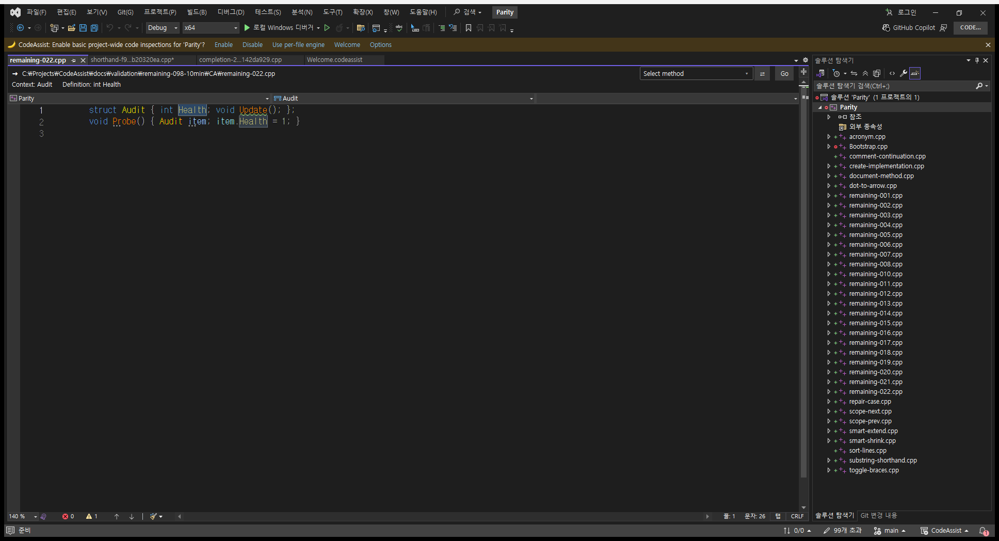](../assets/imports/docs/validation/remaining-098-10min/CA/remaining-022-after.png)

VA-F023 Move Method Implementations to Source File — unverified

검사 실행 오류; 제품 불일치로 계산하지 않음

```
{
  "id": "VA-F023",
  "name": "Move Method Implementations to Source File",
  "state": "unverified",
  "reason": "검사 실행 오류; 제품 불일치로 계산하지 않음",
  "VA": {
    "id": "remaining-023",
    "feature": 23,
    "action": "dialog-probe",
    "verificationScope": "dialog-cancel-or-direct-command",
    "invoked": false,
    "before": {
      "zoom": 100,
      "text": "struct Audit { int Health; void Update(); };\r\nvoid Probe() { Audit item; item.Health = 1; }\r\n",
      "caret": 25,
      "selectionStart": 19,
      "selectionLength": 6,
      "selectedText": "Health"
    },
    "after": null,
    "probe": {
      "status": "no-modal-observed"
    },
    "error": "System.Runtime.InteropServices.COMException (0x80004005): \"VAssistX.RefactorMoveMethodImplementationsToSourceFile\" 명령이 잘못되었습니다.\r\n   위치: EnvDTE._DTE.ExecuteCommand(String CommandName, String CommandArgs)\r\n   위치: ShortcutProbe.Remaining98(DTE d, Int32 pid, String role, String root, String planFile)",
    "fullFunctionalPass": false
  },
  "CA": {
    "id": "remaining-023",
    "feature": 23,
    "action": "dialog-probe",
    "verificationScope": "dialog-cancel-or-direct-command",
    "invoked": true,
    "before": {
      "zoom": 140,
      "text": "struct Audit { int Health; void Update(); };\r\nvoid Probe() { Audit item; item.Health = 1; }\r\n",
      "caret": 25,
      "selectionStart": 19,
      "selectionLength": 6,
      "selectedText": "Health"
    },
    "after": {
      "zoom": 140,
      "text": "struct Audit { int Health; void Update(); };\r\nvoid Probe() { Audit item; item.Health = 1; }\r\n",
      "caret": 25,
      "selectionStart": 19,
      "selectionLength": 6,
      "selectedText": "Health"
    },
    "probe": {
      "status": "product-error-dialog",
      "title": "CodeAssist Refactoring",
      "pageSelected": true,
      "controls": [
        {
          "name": "확인",
          "type": "ControlType.Button",
          "value": null
        },
        {
          "name": "Configure compile_commands.json or compile_flags.txt before semantic refactoring.",
          "type": "ControlType.Text",
          "value": null
        },
        {
          "name": "CodeAssist Refactoring",
          "type": "ControlType.TitleBar",
          "value": null
        },
        {
          "name": "시스템 메뉴 모음",
          "type": "ControlType.MenuBar",
          "value": null
        },
        {
          "name": "시스템",
          "type": "ControlType.MenuItem",
          "value": null
        },
        {
          "name": "닫기",
          "type": "ControlType.Button",
          "value": null
        }
      ]
    },
    "error": null,
    "fullFunctionalPass": false
  },
  "prefill": null,
  "fullFunctionalPass": false
}
```

[](../assets/imports/docs/validation/remaining-098-10min/VA/remaining-023-before.png)[](../assets/imports/docs/validation/remaining-098-10min/CA/remaining-023-before.png)

[](../assets/imports/docs/validation/remaining-098-10min/CA/remaining-023-dialog.png)

[](../assets/imports/docs/validation/remaining-098-10min/CA/remaining-023-after.png)

VA-F024 Move Selection to New File — unverified

검사 실행 오류; 제품 불일치로 계산하지 않음

```
{
  "id": "VA-F024",
  "name": "Move Selection to New File",
  "state": "unverified",
  "reason": "검사 실행 오류; 제품 불일치로 계산하지 않음",
  "VA": {
    "id": "remaining-024",
    "feature": 24,
    "action": "dialog-probe",
    "verificationScope": "dialog-cancel-or-direct-command",
    "invoked": false,
    "before": {
      "zoom": 100,
      "text": "struct Audit { int Health; void Update(); };\r\nvoid Probe() { Audit item; item.Health = 1; }\r\n",
      "caret": 25,
      "selectionStart": 19,
      "selectionLength": 6,
      "selectedText": "Health"
    },
    "after": null,
    "probe": {
      "status": "no-modal-observed"
    },
    "error": "System.Runtime.InteropServices.COMException (0x80004005): \"VAssistX.RefactorMoveSelectionToNewFile\" 명령은 사용할 수 없습니다.\r\n   위치: EnvDTE._DTE.ExecuteCommand(String CommandName, String CommandArgs)\r\n   위치: ShortcutProbe.Remaining98(DTE d, Int32 pid, String role, String root, String planFile)",
    "fullFunctionalPass": false
  },
  "CA": {
    "id": "remaining-024",
    "feature": 24,
    "action": "dialog-probe",
    "verificationScope": "dialog-cancel-or-direct-command",
    "invoked": true,
    "before": {
      "zoom": 140,
      "text": "struct Audit { int Health; void Update(); };\r\nvoid Probe() { Audit item; item.Health = 1; }\r\n",
      "caret": 25,
      "selectionStart": 19,
      "selectionLength": 6,
      "selectedText": "Health"
    },
    "after": {
      "zoom": 140,
      "text": "struct Audit { int Health; void Update(); };\r\nvoid Probe() { Audit item; item.Health = 1; }\r\n",
      "caret": 25,
      "selectionStart": 19,
      "selectionLength": 6,
      "selectedText": "Health"
    },
    "probe": {
      "status": "dialog-observed-and-cancelled",
      "title": "Create file",
      "pageSelected": true,
      "controls": [
        {
          "name": "",
          "type": "ControlType.Pane",
          "value": null
        },
        {
          "name": "명령 모듈",
          "type": "ControlType.ToolBar",
          "value": ""
        },
        {
          "name": "도움말(&H)",
          "type": "ControlType.Button",
          "value": ""
        },
        {
          "name": "자세히",
          "type": "ControlType.SplitButton",
          "value": ""
        },
        {
          "name": "슬라이더 보기",
          "type": "ControlType.Button",
          "value": ""
        },
        {
          "name": "구성",
          "type": "ControlType.Button",
          "value": ""
        },
        {
          "name": "새 폴더",
          "type": "ControlType.Button",
          "value": ""
        },
        {
          "name": "호스트 제어",
          "type": "ControlType.Pane",
          "value": null
        },
        {
          "name": "네임스페이스 트리 컨트롤",
          "type": "ControlType.Tree",
          "value": null
        },
        {
          "name": "세로 스크롤 막대",
          "type": "ControlType.ScrollBar",
          "value": null
        },
        {
          "name": "조금 뒤로",
          "type": "ControlType.Button",
          "value": null
        },
        {
          "name": "많이 뒤로",
          "type": "ControlType.Button",
          "value": null
        },
        {
          "name": "엄지",
          "type": "ControlType.Thumb",
          "value": null
        },
        {
          "name": "많이 앞으로",
          "type": "ControlType.Button",
          "value": null
        },
        {
          "name": "조금 앞으로",
          "type": "ControlType.Button",
          "value": null
        },
        {
          "name": "바탕 화면",
          "type": "ControlType.TreeItem",
          "value": "바탕 화면"
        },
        {
          "name": "홈",
          "type": "ControlType.TreeItem",
          "value": "홈"
        },
        {
          "name": "갤러리",
          "type": "ControlType.TreeItem",
          "value": "갤러리"
        },
        {
          "name": "바탕 화면",
          "type": "ControlType.TreeItem",
          "value": "바탕 화면"
        },
        {
          "name": "다운로드",
          "type": "ControlType.TreeItem",
          "value": "다운로드"
        },
        {
          "name": "Documents",
          "type": "ControlType.TreeItem",
          "value": "Documents"
        },
        {
          "name": "사진",
          "type": "ControlType.TreeItem",
          "value": "사진"
        },
        {
          "name": "카카오톡 받은 파일",
          "type": "ControlType.TreeItem",
          "value": "카카오톡 받은 파일"
        },
        {
          "name": "Projects",
          "type": "ControlType.TreeItem",
          "value": "Projects"
        },
        {
          "name": "내 PC",
          "type": "ControlType.TreeItem",
          "value": "내 PC"
        },
        {
          "name": "로컬 디스크 (C:)",
          "type": "ControlType.TreeItem",
          "value": "로컬 디스크 (C:)"
        },
        {
          "name": "새 볼륨 (D:)",
          "type": "ControlType.TreeItem",
          "value": "새 볼륨 (D:)"
        },
        {
          "name": "네트워크",
          "type": "ControlType.TreeItem",
          "value": "네트워크"
        },
        {
          "name": "셸 폴더 보기",
          "type": "ControlType.Pane",
          "value": null
        },
        {
          "name": "항목 보기",
          "type": "ControlType.List",
          "value": ""
        },
        {
          "name": "수직",
          "type": "ControlType.ScrollBar",
          "value": "0"
        },
        {
          "name": "위쪽 스크롤 화살표",
          "type": "ControlType.Button",
          "value": null
        },
        {
          "name": "위치",
          "type": "ControlType.Custom",
          "value": null
        },
        {
          "name": "페이지 아래로",
          "type": "ControlType.Button",
          "value": null
        },
        {
          "name": "아래쪽 스크롤 화살표",
          "type": "ControlType.Button",
          "value": null
        },
        {
          "name": "머리글",
          "type": "ControlType.Header",
          "value": ""
        },
        {
          "name": "이름",
          "type": "ControlType.SplitButton",
          "value": ""
        },
        {
          "name": "필터 드롭다운",
          "type": "ControlType.Button",
          "value": ""
        },
        {
          "name": "수정한 날짜",
          "type": "ControlType.SplitButton",
          "value": ""
        },
        {
          "name": "필터 드롭다운",
          "type": "ControlType.Button",
          "value": ""
        },
        {
          "name": "유형",
          "type": "ControlType.SplitButton",
          "value": ""
        },
        {
          "name": "필터 드롭다운",
          "type": "ControlType.Button",
          "value": ""
        },
        {
          "name": "크기",
          "type": "ControlType.SplitButton",
          "value": ""
        },
        {
          "name": "필터 드롭다운",
          "type": "ControlType.Button",
          "value": ""
        },
        {
          "name": "remaining-001.cpp",
          "type": "ControlType.ListItem",
          "value": "remaining-001.cpp"
        },
        {
          "name": "이름",
          "type": "ControlType.Edit",
          "value": "remaining-001.cpp"
        },
        {
          "name": "수정한 날짜",
          "type": "ControlType.Edit",
          "value": "‎2026-‎10-‎18 ‏‎오후 9:46"
        },
        {
          "name": "유형",
          "type": "ControlType.Edit",
          "value": "C++ Source"
        },
        {
          "name": "크기",
          "type": "ControlType.Edit",
          "value": "1KB"
        },
        {
          "name": "remaining-002.cpp",
          "type": "ControlType.ListItem",
          "value": "remaining-002.cpp"
        },
        {
          "name": "이름",
          "type": "ControlType.Edit",
          "value": "remaining-002.cpp"
        },
        {
          "name": "수정한 날짜",
          "type": "ControlType.Edit",
          "value": "‎2026-‎10-‎18 ‏‎오후 9:46"
        },
        {
          "name": "유형",
          "type": "ControlType.Edit",
          "value": "C++ Source"
        },
        {
          "name": "크기",
          "type": "ControlType.Edit",
          "value": "1KB"
        },
        {
          "name": "remaining-003.cpp",
          "type": "ControlType.ListItem",
          "value": "remaining-003.cpp"
        },
        {
          "name": "이름",
          "type": "ControlType.Edit",
          "value": "remaining-003.cpp"
        },
        {
          "name": "수정한 날짜",
          "type": "ControlType.Edit",
          "value": "‎2026-‎10-‎18 ‏‎오후 9:46"
        },
        {
          "name": "유형",
          "type": "ControlType.Edit",
          "value": "C++ Source"
        },
        {
          "name": "크기",
          "type": "ControlType.Edit",
          "value": "1KB"
        },
        {
          "name": "remaining-004.cpp",
          "type": "ControlType.ListItem",
          "value": "remaining-004.cpp"
        },
        {
          "name": "이름",
          "type": "ControlType.Edit",
          "value": "remaining-004.cpp"
        },
        {
          "name": "수정한 날짜",
          "type": "ControlType.Edit",
          "value": "‎2026-‎10-‎18 ‏‎오후 9:46"
        },
        {
          "name": "유형",
          "type": "ControlType.Edit",
          "value": "C++ Source"
        },
        {
          "name": "크기",
          "type": "ControlType.Edit",
          "value": "1KB"
        },
        {
          "name": "remaining-005.cpp",
          "type": "ControlType.ListItem",
          "value": "remaining-005.cpp"
        },
        {
          "name": "이름",
          "type": "ControlType.Edit",
          "value": "remaining-005.cpp"
        },
        {
          "name": "수정한 날짜",
          "type": "ControlType.Edit",
          "value": "‎2026-‎10-‎18 ‏‎오후 9:46"
        },
        {
          "name": "유형",
          "type": "ControlType.Edit",
          "value": "C++ Source"
        },
        {
          "name": "크기",
          "type": "ControlType.Edit",
          "value": "1KB"
        },
        {
          "name": "remaining-006.cpp",
          "type": "ControlType.ListItem",
          "value": "remaining-006.cpp"
        },
        {
          "name": "이름",
          "type": "ControlType.Edit",
          "value": "remaining-006.cpp"
        },
        {
          "name": "수정한 날짜",
          "type": "ControlType.Edit",
          "value": "‎2026-‎10-‎18 ‏‎오후 9:46"
        },
        {
          "name": "유형",
          "type": "ControlType.Edit",
          "value": "C++ Source"
        },
        {
          "name": "크기",
          "type": "ControlType.Edit",
          "value": "1KB"
        },
        {
          "name": "remaining-007.cpp",
          "type": "ControlType.ListItem",
          "value": "remaining-007.cpp"
        },
        {
          "name": "이름",
          "type": "ControlType.Edit",
          "value": "remaining-007.cpp"
        },
        {
          "name": "수정한 날짜",
          "type": "ControlType.Edit",
          "value": "‎2026-‎10-‎18 ‏‎오후 9:46"
        },
        {
          "name": "유형",
          "type": "ControlType.Edit",
          "value": "C++ Source"
        },
        {
          "name": "크기",
          "type": "ControlType.Edit",
          "value": "1KB"
        },
        {
          "name": "remaining-008.cpp",
          "type": "ControlType.ListItem",
          "value": "remaining-008.cpp"
        },
        {
          "name": "이름",
          "type": "ControlType.Edit",
          "value": "remaining-008.cpp"
        },
        {
          "name": "수정한 날짜",
          "type": "ControlType.Edit",
          "value": "‎2026-‎10-‎18 ‏‎오후 9:46"
        },
        {
          "name": "유형",
          "type": "ControlType.Edit",
          "value": "C++ Source"
        },
        {
          "name": "크기",
          "type": "ControlType.Edit",
          "value": "1KB"
        },
        {
          "name": "remaining-010.cpp",
          "type": "ControlType.ListItem",
          "value": "remaining-010.cpp"
        },
        {
          "name": "이름",
          "type": "ControlType.Edit",
          "value": "remaining-010.cpp"
        },
        {
          "name": "수정한 날짜",
          "type": "ControlType.Edit",
          "value": "‎2026-‎10-‎18 ‏‎오후 9:46"
        },
        {
          "name": "유형",
          "type": "ControlType.Edit",
          "value": "C++ Source"
        },
        {
          "name": "크기",
          "type": "ControlType.Edit",
          "value": "1KB"
        },
        {
          "name": "파일 이름:",
          "type": "ControlType.Text",
          "value": ""
        },
        {
          "name": "파일 이름:",
          "type": "ControlType.ComboBox",
          "value": "NewFile.cpp"
        },
        {
          "name": "파일 이름:",
          "type": "ControlType.Edit",
          "value": "NewFile.cpp"
        },
        {
          "name": "파일 이름:",
          "type": "ControlType.List",
          "value": null
        },
        {
          "name": "드롭다운 단추",
          "type": "ControlType.Button",
          "value": null
        },
        {
          "name": "파일 형식:",
          "type": "ControlType.Text",
          "value": ""
        },
        {
          "name": "파일 형식:",
          "type": "ControlType.ComboBox",
          "value": null
        },
        {
          "name": "파일 형식:",
          "type": "ControlType.List",
          "value": null
        },
        {
          "name": "C/C++ files (*.cpp;*.h;*.hpp;*.c)",
          "type": "ControlType.ListItem",
          "value": null
        },
        {
          "name": "All files (*.*)",
          "type": "ControlType.ListItem",
          "value": null
        },
        {
          "name": "드롭다운 단추",
          "type": "ControlType.Button",
          "value": null
        },
        {
          "name": "필드 저장",
          "type": "ControlType.Tree",
          "value": ""
        },
        {
          "name": "응용 프로그램 컨트롤",
          "type": "ControlType.Tree",
          "value": ""
        },
        {
          "name": "",
          "type": "ControlType.ToolBar",
          "value": null
        },
        {
          "name": "폴더 숨기기",
          "type": "ControlType.Button",
          "value": null
        },
        {
          "name": "저장(S)",
          "type": "ControlType.Button",
          "value": null
        },
        {
          "name": "취소",
          "type": "ControlType.Button",
          "value": null
        },
        {
          "name": "",
          "type": "ControlType.Pane",
          "value": null
        },
        {
          "name": "",
          "type": "ControlType.Pane",
          "value": null
        },
        {
          "name": "탐색 단추",
          "type": "ControlType.ToolBar",
          "value": null
        },
        {
          "name": "뒤로(Alt+왼쪽 화살표)",
          "type": "ControlType.Button",
          "value": null
        },
        {
          "name": "앞으로(Alt+오른쪽 화살표)",
          "type": "ControlType.Button",
          "value": null
        },
        {
          "name": "최근 위치",
          "type": "ControlType.Button",
          "value": null
        },
        {
          "name": "업밴드",
          "type": "ControlType.ToolBar",
          "value": null
        },
        {
          "name": "\"remaining-098-10min\"(으)로 이동(Alt+위쪽 화살표)",
          "type": "ControlType.Button",
          "value": null
        },
        {
          "name": "로드 중",
          "type": "ControlType.ProgressBar",
          "value": null
        },
        {
          "name": "",
          "type": "ControlType.Pane",
          "value": null
        },
        {
          "name": "주소: C:\\Projects\\CodeAssist\\docs\\validation\\remaining-098-10min\\CA",
          "type": "ControlType.ToolBar",
          "value": null
        },
        {
          "name": "모든 위치",
          "type": "ControlType.SplitButton",
          "value": null
        },
        {
          "name": "‎CodeAssist",
          "type": "ControlType.SplitButton",
          "value": null
        },
        {
          "name": "‎docs",
          "type": "ControlType.SplitButton",
          "value": null
        },
        {
          "name": "‎validation",
          "type": "ControlType.SplitButton",
          "value": null
        },
        {
          "name": "‎remaining-098-10min",
          "type": "ControlType.SplitButton",
          "value": null
        },
        {
          "name": "‎CA",
          "type": "ControlType.MenuItem",
          "value": null
        },
        {
          "name": "주소 대역",
          "type": "ControlType.ToolBar",
          "value": null
        },
        {
          "name": "이전 위치",
          "type": "ControlType.Button",
          "value": null
        },
        {
          "name": "\"CA\" 새로 고침(F5)",
          "type": "ControlType.Button",
          "value": null
        },
        {
          "name": "",
          "type": "ControlType.Pane",
          "value": null
        },
        {
          "name": "",
          "type": "ControlType.Pane",
          "value": null
        },
        {
          "name": "",
          "type": "ControlType.Pane",
          "value": null
        },
        {
          "name": "검색창",
          "type": "ControlType.Edit",
          "value": ""
        },
        {
          "name": "검색",
          "type": "ControlType.Button",
          "value": ""
        },
        {
          "name": "",
          "type": "ControlType.Pane",
          "value": null
        },
        {
          "name": "Create file",
          "type": "ControlType.TitleBar",
          "value": null
        },
        {
          "name": "시스템 메뉴 모음",
          "type": "ControlType.MenuBar",
          "value": null
        },
        {
          "name": "시스템",
          "type": "ControlType.MenuItem",
          "value": null
        },
        {
          "name": "닫기",
          "type": "ControlType.Button",
          "value": null
        }
      ]
    },
    "error": null,
    "fullFunctionalPass": false
  },
  "prefill": null,
  "fullFunctionalPass": false
}
```

[](../assets/imports/docs/validation/remaining-098-10min/VA/remaining-024-before.png)[](../assets/imports/docs/validation/remaining-098-10min/CA/remaining-024-before.png)

[](../assets/imports/docs/validation/remaining-098-10min/CA/remaining-024-dialog.png)

[](../assets/imports/docs/validation/remaining-098-10min/CA/remaining-024-after.png)

VA-F026 Rename Files — unverified

창·설정 페이지 관찰 및 취소만 수행; 기능 통과 아님

```
{
  "id": "VA-F026",
  "name": "Rename Files",
  "state": "unverified",
  "reason": "창·설정 페이지 관찰 및 취소만 수행; 기능 통과 아님",
  "VA": {
    "id": "remaining-026",
    "feature": 26,
    "action": "dialog-probe",
    "verificationScope": "dialog-cancel-or-direct-command",
    "invoked": true,
    "before": {
      "zoom": 100,
      "text": "struct Audit { int Health; void Update(); };\r\nvoid Probe() { Audit item; item.Health = 1; }\r\n",
      "caret": 25,
      "selectionStart": 19,
      "selectionLength": 6,
      "selectedText": "Health"
    },
    "after": {
      "zoom": 100,
      "text": "struct Audit { int Health; void Update(); };\r\nvoid Probe() { Audit item; item.Health = 1; }\r\n",
      "caret": 25,
      "selectionStart": 19,
      "selectionLength": 6,
      "selectedText": "Health"
    },
    "probe": {
      "status": "dialog-observed-and-cancelled",
      "title": "Rename Files -- Visual Assist",
      "pageSelected": true,
      "controls": [
        {
          "name": "remaining-026",
          "type": "ControlType.Edit",
          "value": "remaining-026"
        },
        {
          "name": "Rename",
          "type": "ControlType.Button",
          "value": null
        },
        {
          "name": "Cancel",
          "type": "ControlType.Button",
          "value": null
        },
        {
          "name": "Rename files to:",
          "type": "ControlType.Text",
          "value": null
        },
        {
          "name": "Visual Assist",
          "type": "ControlType.Text",
          "value": null
        },
        {
          "name": "",
          "type": "ControlType.Pane",
          "value": null
        },
        {
          "name": "",
          "type": "ControlType.Tree",
          "value": null
        },
        {
          "name": "Files to rename",
          "type": "ControlType.TreeItem",
          "value": "On"
        },
        {
          "name": "C:\\Projects\\CodeAssist\\docs\\validation\\remaining-098-10min\\VA\\remaining-026.cpp",
          "type": "ControlType.TreeItem",
          "value": "On"
        },
        {
          "name": "Rename Files -- Visual Assist",
          "type": "ControlType.TitleBar",
          "value": null
        },
        {
          "name": "시스템 메뉴 모음",
          "type": "ControlType.MenuBar",
          "value": null
        },
        {
          "name": "시스템",
          "type": "ControlType.MenuItem",
          "value": null
        },
        {
          "name": "상황에 맞는 도움말",
          "type": "ControlType.Button",
          "value": null
        },
        {
          "name": "닫기",
          "type": "ControlType.Button",
          "value": null
        }
      ]
    },
    "error": null,
    "fullFunctionalPass": false
  },
  "CA": {
    "id": "remaining-026",
    "feature": 26,
    "action": "dialog-probe",
    "verificationScope": "dialog-cancel-or-direct-command",
    "invoked": true,
    "before": {
      "zoom": 140,
      "text": "struct Audit { int Health; void Update(); };\r\nvoid Probe() { Audit item; item.Health = 1; }\r\n",
      "caret": 25,
      "selectionStart": 19,
      "selectionLength": 6,
      "selectedText": "Health"
    },
    "after": {
      "zoom": 140,
      "text": "struct Audit { int Health; void Update(); };\r\nvoid Probe() { Audit item; item.Health = 1; }\r\n",
      "caret": 25,
      "selectionStart": 19,
      "selectionLength": 6,
      "selectedText": "Health"
    },
    "probe": {
      "status": "dialog-closed-without-cancel-control",
      "title": "CodeAssist",
      "pageSelected": true,
      "controls": [
        {
          "name": "×",
          "type": "ControlType.Button",
          "value": null
        },
        {
          "name": "×",
          "type": "ControlType.Text",
          "value": null
        },
        {
          "name": "CodeAssist",
          "type": "ControlType.Text",
          "value": null
        },
        {
          "name": "New file name",
          "type": "ControlType.Text",
          "value": null
        },
        {
          "name": "",
          "type": "ControlType.Edit",
          "value": "remaining-026.cpp"
        },
        {
          "name": "Save",
          "type": "ControlType.Button",
          "value": null
        },
        {
          "name": "Save",
          "type": "ControlType.Text",
          "value": null
        }
      ]
    },
    "error": null,
    "fullFunctionalPass": false
  },
  "prefill": null,
  "fullFunctionalPass": false
}
```

[](../assets/imports/docs/validation/remaining-098-10min/VA/remaining-026-before.png)[](../assets/imports/docs/validation/remaining-098-10min/CA/remaining-026-before.png)

[](../assets/imports/docs/validation/remaining-098-10min/VA/remaining-026-dialog.png)[](../assets/imports/docs/validation/remaining-098-10min/CA/remaining-026-dialog.png)

[](../assets/imports/docs/validation/remaining-098-10min/VA/remaining-026-after.png)[](../assets/imports/docs/validation/remaining-098-10min/CA/remaining-026-after.png)

VA-F027 Simplify Instance Declaration — unverified

검사 실행 오류; 제품 불일치로 계산하지 않음

```
{
  "id": "VA-F027",
  "name": "Simplify Instance Declaration",
  "state": "unverified",
  "reason": "검사 실행 오류; 제품 불일치로 계산하지 않음",
  "VA": {
    "id": "remaining-027",
    "feature": 27,
    "action": "dialog-probe",
    "verificationScope": "dialog-cancel-or-direct-command",
    "invoked": false,
    "before": {
      "zoom": 100,
      "text": "struct Audit { int Health; void Update(); };\r\nvoid Probe() { Audit item; item.Health = 1; }\r\n",
      "caret": 25,
      "selectionStart": 19,
      "selectionLength": 6,
      "selectedText": "Health"
    },
    "after": null,
    "probe": {
      "status": "no-modal-observed"
    },
    "error": "System.Runtime.InteropServices.COMException (0x80004005): \"VAssistX.RefactorSimplifyInstanceDeclaration\" 명령이 잘못되었습니다.\r\n   위치: EnvDTE._DTE.ExecuteCommand(String CommandName, String CommandArgs)\r\n   위치: ShortcutProbe.Remaining98(DTE d, Int32 pid, String role, String root, String planFile)",
    "fullFunctionalPass": false
  },
  "CA": {
    "id": "remaining-027",
    "feature": 27,
    "action": "dialog-probe",
    "verificationScope": "dialog-cancel-or-direct-command",
    "invoked": true,
    "before": {
      "zoom": 140,
      "text": "struct Audit { int Health; void Update(); };\r\nvoid Probe() { Audit item; item.Health = 1; }\r\n",
      "caret": 25,
      "selectionStart": 19,
      "selectionLength": 6,
      "selectedText": "Health"
    },
    "after": {
      "zoom": 140,
      "text": "struct Audit { int Health; void Update(); };\r\nvoid Probe() { Audit item; item.Health = 1; }\r\n",
      "caret": 25,
      "selectionStart": 19,
      "selectionLength": 6,
      "selectedText": "Health"
    },
    "probe": {
      "status": "product-error-dialog",
      "title": "CodeAssist",
      "pageSelected": true,
      "controls": [
        {
          "name": "확인",
          "type": "ControlType.Button",
          "value": null
        },
        {
          "name": "",
          "type": "ControlType.Image",
          "value": null
        },
        {
          "name": "The selected syntax is unsupported. Select the complete declaration or expression.",
          "type": "ControlType.Text",
          "value": null
        },
        {
          "name": "CodeAssist",
          "type": "ControlType.TitleBar",
          "value": null
        },
        {
          "name": "시스템 메뉴 모음",
          "type": "ControlType.MenuBar",
          "value": null
        },
        {
          "name": "시스템",
          "type": "ControlType.MenuItem",
          "value": null
        },
        {
          "name": "닫기",
          "type": "ControlType.Button",
          "value": null
        }
      ]
    },
    "error": null,
    "fullFunctionalPass": false
  },
  "prefill": null,
  "fullFunctionalPass": false
}
```

[](../assets/imports/docs/validation/remaining-098-10min/VA/remaining-027-before.png)[](../assets/imports/docs/validation/remaining-098-10min/CA/remaining-027-before.png)

[](../assets/imports/docs/validation/remaining-098-10min/CA/remaining-027-dialog.png)

[](../assets/imports/docs/validation/remaining-098-10min/CA/remaining-027-after.png)

VA-F028 Add Forward Declaration — unverified

검사 실행 오류; 제품 불일치로 계산하지 않음

```
{
  "id": "VA-F028",
  "name": "Add Forward Declaration",
  "state": "unverified",
  "reason": "검사 실행 오류; 제품 불일치로 계산하지 않음",
  "VA": {
    "id": "remaining-028",
    "feature": 28,
    "action": "dialog-probe",
    "verificationScope": "dialog-cancel-or-direct-command",
    "invoked": false,
    "before": {
      "zoom": 100,
      "text": "struct Audit { int Health; void Update(); };\r\nvoid Probe() { Audit item; item.Health = 1; }\r\n",
      "caret": 25,
      "selectionStart": 19,
      "selectionLength": 6,
      "selectedText": "Health"
    },
    "after": null,
    "probe": {
      "status": "no-modal-observed"
    },
    "error": "System.Runtime.InteropServices.COMException (0x80004005): \"VAssistX.RefactorAddForwardDeclaration\" 명령은 사용할 수 없습니다.\r\n   위치: EnvDTE._DTE.ExecuteCommand(String CommandName, String CommandArgs)\r\n   위치: ShortcutProbe.Remaining98(DTE d, Int32 pid, String role, String root, String planFile)",
    "fullFunctionalPass": false
  },
  "CA": {
    "id": "remaining-028",
    "feature": 28,
    "action": "dialog-probe",
    "verificationScope": "dialog-cancel-or-direct-command",
    "invoked": true,
    "before": {
      "zoom": 140,
      "text": "struct Audit { int Health; void Update(); };\r\nvoid Probe() { Audit item; item.Health = 1; }\r\n",
      "caret": 25,
      "selectionStart": 19,
      "selectionLength": 6,
      "selectedText": "Health"
    },
    "after": {
      "zoom": 140,
      "text": "struct Audit { int Health; void Update(); };\r\nvoid Probe() { Audit item; item.Health = 1; }\r\n",
      "caret": 25,
      "selectionStart": 19,
      "selectionLength": 6,
      "selectedText": "Health"
    },
    "probe": {
      "status": "dialog-closed-without-cancel-control",
      "title": "CodeAssist",
      "pageSelected": true,
      "controls": [
        {
          "name": "×",
          "type": "ControlType.Button",
          "value": null
        },
        {
          "name": "×",
          "type": "ControlType.Text",
          "value": null
        },
        {
          "name": "CodeAssist",
          "type": "ControlType.Text",
          "value": null
        },
        {
          "name": "Qualified type name (class or struct)",
          "type": "ControlType.Text",
          "value": null
        },
        {
          "name": "",
          "type": "ControlType.Edit",
          "value": "Health"
        },
        {
          "name": "Save",
          "type": "ControlType.Button",
          "value": null
        },
        {
          "name": "Save",
          "type": "ControlType.Text",
          "value": null
        }
      ]
    },
    "error": null,
    "fullFunctionalPass": false
  },
  "prefill": null,
  "fullFunctionalPass": false
}
```

[](../assets/imports/docs/validation/remaining-098-10min/VA/remaining-028-before.png)[](../assets/imports/docs/validation/remaining-098-10min/CA/remaining-028-before.png)

[](../assets/imports/docs/validation/remaining-098-10min/CA/remaining-028-dialog.png)

[](../assets/imports/docs/validation/remaining-098-10min/CA/remaining-028-after.png)

VA-F029 Add Member — unverified

검사 실행 오류; 제품 불일치로 계산하지 않음

```
{
  "id": "VA-F029",
  "name": "Add Member",
  "state": "unverified",
  "reason": "검사 실행 오류; 제품 불일치로 계산하지 않음",
  "VA": {
    "id": "remaining-029",
    "feature": 29,
    "action": "dialog-probe",
    "verificationScope": "dialog-cancel-or-direct-command",
    "invoked": false,
    "before": {
      "zoom": 100,
      "text": "struct Audit { int Health; void Update(); };\r\nvoid Probe() { Audit item; item.Health = 1; }\r\n",
      "caret": 25,
      "selectionStart": 19,
      "selectionLength": 6,
      "selectedText": "Health"
    },
    "after": null,
    "probe": {
      "status": "no-modal-observed"
    },
    "error": "System.Runtime.InteropServices.COMException (0x80004005): \"VAssistX.RefactorAddMember\" 명령은 사용할 수 없습니다.\r\n   위치: EnvDTE._DTE.ExecuteCommand(String CommandName, String CommandArgs)\r\n   위치: ShortcutProbe.Remaining98(DTE d, Int32 pid, String role, String root, String planFile)",
    "fullFunctionalPass": false
  },
  "CA": {
    "id": "remaining-029",
    "feature": 29,
    "action": "dialog-probe",
    "verificationScope": "dialog-cancel-or-direct-command",
    "invoked": true,
    "before": {
      "zoom": 140,
      "text": "struct Audit { int Health; void Update(); };\r\nvoid Probe() { Audit item; item.Health = 1; }\r\n",
      "caret": 25,
      "selectionStart": 19,
      "selectionLength": 6,
      "selectedText": "Health"
    },
    "after": {
      "zoom": 140,
      "text": "struct Audit { int Health; void Update(); };\r\nvoid Probe() { Audit item; item.Health = 1; }\r\n",
      "caret": 25,
      "selectionStart": 19,
      "selectionLength": 6,
      "selectedText": "Health"
    },
    "probe": {
      "status": "dialog-closed-without-cancel-control",
      "title": "CodeAssist",
      "pageSelected": true,
      "controls": [
        {
          "name": "×",
          "type": "ControlType.Button",
          "value": null
        },
        {
          "name": "×",
          "type": "ControlType.Text",
          "value": null
        },
        {
          "name": "CodeAssist",
          "type": "ControlType.Text",
          "value": null
        },
        {
          "name": "Member declaration",
          "type": "ControlType.Text",
          "value": null
        },
        {
          "name": "",
          "type": "ControlType.Edit",
          "value": "void NewMethod();"
        },
        {
          "name": "Save",
          "type": "ControlType.Button",
          "value": null
        },
        {
          "name": "Save",
          "type": "ControlType.Text",
          "value": null
        }
      ]
    },
    "error": null,
    "fullFunctionalPass": false
  },
  "prefill": null,
  "fullFunctionalPass": false
}
```

[](../assets/imports/docs/validation/remaining-098-10min/VA/remaining-029-before.png)[](../assets/imports/docs/validation/remaining-098-10min/CA/remaining-029-before.png)

[](../assets/imports/docs/validation/remaining-098-10min/CA/remaining-029-dialog.png)

[](../assets/imports/docs/validation/remaining-098-10min/CA/remaining-029-after.png)

VA-F030 Add Missing Case Statements — unverified

검사 실행 오류; 제품 불일치로 계산하지 않음

```
{
  "id": "VA-F030",
  "name": "Add Missing Case Statements",
  "state": "unverified",
  "reason": "검사 실행 오류; 제품 불일치로 계산하지 않음",
  "VA": {
    "id": "remaining-030",
    "feature": 30,
    "action": "dialog-probe",
    "verificationScope": "dialog-cancel-or-direct-command",
    "invoked": false,
    "before": {
      "zoom": 100,
      "text": "struct Audit { int Health; void Update(); };\r\nvoid Probe() { Audit item; item.Health = 1; }\r\n",
      "caret": 25,
      "selectionStart": 19,
      "selectionLength": 6,
      "selectedText": "Health"
    },
    "after": null,
    "probe": {
      "status": "no-modal-observed"
    },
    "error": "System.Runtime.InteropServices.COMException (0x80004005): \"VAssistX.RefactorAddMissingCaseStatements\" 명령이 잘못되었습니다.\r\n   위치: EnvDTE._DTE.ExecuteCommand(String CommandName, String CommandArgs)\r\n   위치: ShortcutProbe.Remaining98(DTE d, Int32 pid, String role, String root, String planFile)",
    "fullFunctionalPass": false
  },
  "CA": {
    "id": "remaining-030",
    "feature": 30,
    "action": "dialog-probe",
    "verificationScope": "dialog-cancel-or-direct-command",
    "invoked": true,
    "before": {
      "zoom": 140,
      "text": "struct Audit { int Health; void Update(); };\r\nvoid Probe() { Audit item; item.Health = 1; }\r\n",
      "caret": 25,
      "selectionStart": 19,
      "selectionLength": 6,
      "selectedText": "Health"
    },
    "after": {
      "zoom": 140,
      "text": "struct Audit { int Health; void Update(); };\r\nvoid Probe() { Audit item; item.Health = 1; }\r\n",
      "caret": 25,
      "selectionStart": 19,
      "selectionLength": 6,
      "selectedText": "Health"
    },
    "probe": {
      "status": "dialog-closed-without-cancel-control",
      "title": "CodeAssist",
      "pageSelected": true,
      "controls": [
        {
          "name": "×",
          "type": "ControlType.Button",
          "value": null
        },
        {
          "name": "×",
          "type": "ControlType.Text",
          "value": null
        },
        {
          "name": "CodeAssist",
          "type": "ControlType.Text",
          "value": null
        },
        {
          "name": "Qualified scoped enum name",
          "type": "ControlType.Text",
          "value": null
        },
        {
          "name": "",
          "type": "ControlType.Edit",
          "value": "State"
        },
        {
          "name": "Save",
          "type": "ControlType.Button",
          "value": null
        },
        {
          "name": "Save",
          "type": "ControlType.Text",
          "value": null
        }
      ]
    },
    "error": null,
    "fullFunctionalPass": false
  },
  "prefill": null,
  "fullFunctionalPass": false
}
```

[](../assets/imports/docs/validation/remaining-098-10min/VA/remaining-030-before.png)[](../assets/imports/docs/validation/remaining-098-10min/CA/remaining-030-before.png)

[](../assets/imports/docs/validation/remaining-098-10min/CA/remaining-030-dialog.png)

[](../assets/imports/docs/validation/remaining-098-10min/CA/remaining-030-after.png)

VA-F031 Add Similar Member — unverified

검사 실행 오류; 제품 불일치로 계산하지 않음

```
{
  "id": "VA-F031",
  "name": "Add Similar Member",
  "state": "unverified",
  "reason": "검사 실행 오류; 제품 불일치로 계산하지 않음",
  "VA": {
    "id": "remaining-031",
    "feature": 31,
    "action": "dialog-probe",
    "verificationScope": "dialog-cancel-or-direct-command",
    "invoked": false,
    "before": {
      "zoom": 100,
      "text": "struct Audit { int Health; void Update(); };\r\nvoid Probe() { Audit item; item.Health = 1; }\r\n",
      "caret": 25,
      "selectionStart": 19,
      "selectionLength": 6,
      "selectedText": "Health"
    },
    "after": null,
    "probe": {
      "status": "no-modal-observed"
    },
    "error": "System.Runtime.InteropServices.COMException (0x80004005): \"VAssistX.RefactorAddSimilarMember\" 명령은 사용할 수 없습니다.\r\n   위치: EnvDTE._DTE.ExecuteCommand(String CommandName, String CommandArgs)\r\n   위치: ShortcutProbe.Remaining98(DTE d, Int32 pid, String role, String root, String planFile)",
    "fullFunctionalPass": false
  },
  "CA": {
    "id": "remaining-031",
    "feature": 31,
    "action": "dialog-probe",
    "verificationScope": "dialog-cancel-or-direct-command",
    "invoked": true,
    "before": {
      "zoom": 140,
      "text": "struct Audit { int Health; void Update(); };\r\nvoid Probe() { Audit item; item.Health = 1; }\r\n",
      "caret": 25,
      "selectionStart": 19,
      "selectionLength": 6,
      "selectedText": "Health"
    },
    "after": {
      "zoom": 140,
      "text": "struct Audit { int Health; void Update(); };\r\nvoid Probe() { Audit item; item.Health = 1; }\r\n",
      "caret": 25,
      "selectionStart": 19,
      "selectionLength": 6,
      "selectedText": "Health"
    },
    "probe": {
      "status": "dialog-closed-without-cancel-control",
      "title": "CodeAssist",
      "pageSelected": true,
      "controls": [
        {
          "name": "×",
          "type": "ControlType.Button",
          "value": null
        },
        {
          "name": "×",
          "type": "ControlType.Text",
          "value": null
        },
        {
          "name": "CodeAssist",
          "type": "ControlType.Text",
          "value": null
        },
        {
          "name": "New member name",
          "type": "ControlType.Text",
          "value": null
        },
        {
          "name": "",
          "type": "ControlType.Edit",
          "value": "NewMember"
        },
        {
          "name": "Save",
          "type": "ControlType.Button",
          "value": null
        },
        {
          "name": "Save",
          "type": "ControlType.Text",
          "value": null
        }
      ]
    },
    "error": null,
    "fullFunctionalPass": false
  },
  "prefill": null,
  "fullFunctionalPass": false
}
```

[](../assets/imports/docs/validation/remaining-098-10min/VA/remaining-031-before.png)[](../assets/imports/docs/validation/remaining-098-10min/CA/remaining-031-before.png)

[](../assets/imports/docs/validation/remaining-098-10min/CA/remaining-031-dialog.png)

[](../assets/imports/docs/validation/remaining-098-10min/CA/remaining-031-after.png)

VA-F032 Add Using Directive — unverified

검사 실행 오류; 제품 불일치로 계산하지 않음

```
{
  "id": "VA-F032",
  "name": "Add Using Directive",
  "state": "unverified",
  "reason": "검사 실행 오류; 제품 불일치로 계산하지 않음",
  "VA": {
    "id": "remaining-032",
    "feature": 32,
    "action": "dialog-probe",
    "verificationScope": "dialog-cancel-or-direct-command",
    "invoked": false,
    "before": {
      "zoom": 100,
      "text": "struct Audit { int Health; void Update(); };\r\nvoid Probe() { Audit item; item.Health = 1; }\r\n",
      "caret": 25,
      "selectionStart": 19,
      "selectionLength": 6,
      "selectedText": "Health"
    },
    "after": null,
    "probe": {
      "status": "no-modal-observed"
    },
    "error": "System.Runtime.InteropServices.COMException (0x80004005): \"VAssistX.RefactorAddUsingDirective\" 명령이 잘못되었습니다.\r\n   위치: EnvDTE._DTE.ExecuteCommand(String CommandName, String CommandArgs)\r\n   위치: ShortcutProbe.Remaining98(DTE d, Int32 pid, String role, String root, String planFile)",
    "fullFunctionalPass": false
  },
  "CA": {
    "id": "remaining-032",
    "feature": 32,
    "action": "dialog-probe",
    "verificationScope": "dialog-cancel-or-direct-command",
    "invoked": true,
    "before": {
      "zoom": 140,
      "text": "struct Audit { int Health; void Update(); };\r\nvoid Probe() { Audit item; item.Health = 1; }\r\n",
      "caret": 25,
      "selectionStart": 19,
      "selectionLength": 6,
      "selectedText": "Health"
    },
    "after": {
      "zoom": 140,
      "text": "struct Audit { int Health; void Update(); };\r\nvoid Probe() { Audit item; item.Health = 1; }\r\n",
      "caret": 25,
      "selectionStart": 19,
      "selectionLength": 6,
      "selectedText": "Health"
    },
    "probe": {
      "status": "dialog-closed-without-cancel-control",
      "title": "CodeAssist",
      "pageSelected": true,
      "controls": [
        {
          "name": "×",
          "type": "ControlType.Button",
          "value": null
        },
        {
          "name": "×",
          "type": "ControlType.Text",
          "value": null
        },
        {
          "name": "CodeAssist",
          "type": "ControlType.Text",
          "value": null
        },
        {
          "name": "Namespace",
          "type": "ControlType.Text",
          "value": null
        },
        {
          "name": "",
          "type": "ControlType.Edit",
          "value": "std"
        },
        {
          "name": "Save",
          "type": "ControlType.Button",
          "value": null
        },
        {
          "name": "Save",
          "type": "ControlType.Text",
          "value": null
        }
      ]
    },
    "error": null,
    "fullFunctionalPass": false
  },
  "prefill": null,
  "fullFunctionalPass": false
}
```

[](../assets/imports/docs/validation/remaining-098-10min/VA/remaining-032-before.png)[](../assets/imports/docs/validation/remaining-098-10min/CA/remaining-032-before.png)

[](../assets/imports/docs/validation/remaining-098-10min/CA/remaining-032-dialog.png)

[](../assets/imports/docs/validation/remaining-098-10min/CA/remaining-032-after.png)

VA-F033 Add include Directive — unverified

검사 실행 오류; 제품 불일치로 계산하지 않음

```
{
  "id": "VA-F033",
  "name": "Add include Directive",
  "state": "unverified",
  "reason": "검사 실행 오류; 제품 불일치로 계산하지 않음",
  "VA": {
    "id": "remaining-033",
    "feature": 33,
    "action": "dialog-probe",
    "verificationScope": "dialog-cancel-or-direct-command",
    "invoked": false,
    "before": {
      "zoom": 100,
      "text": "struct Audit { int Health; void Update(); };\r\nvoid Probe() { Audit item; item.Health = 1; }\r\n",
      "caret": 25,
      "selectionStart": 19,
      "selectionLength": 6,
      "selectedText": "Health"
    },
    "after": null,
    "probe": {
      "status": "no-modal-observed"
    },
    "error": "System.Runtime.InteropServices.COMException (0x80004005): \"VAssistX.RefactorAddIncludeDirective\" 명령이 잘못되었습니다.\r\n   위치: EnvDTE._DTE.ExecuteCommand(String CommandName, String CommandArgs)\r\n   위치: ShortcutProbe.Remaining98(DTE d, Int32 pid, String role, String root, String planFile)",
    "fullFunctionalPass": false
  },
  "CA": {
    "id": "remaining-033",
    "feature": 33,
    "action": "dialog-probe",
    "verificationScope": "dialog-cancel-or-direct-command",
    "invoked": true,
    "before": {
      "zoom": 140,
      "text": "struct Audit { int Health; void Update(); };\r\nvoid Probe() { Audit item; item.Health = 1; }\r\n",
      "caret": 25,
      "selectionStart": 19,
      "selectionLength": 6,
      "selectedText": "Health"
    },
    "after": {
      "zoom": 140,
      "text": "struct Audit { int Health; void Update(); };\r\nvoid Probe() { Audit item; item.Health = 1; }\r\n",
      "caret": 25,
      "selectionStart": 19,
      "selectionLength": 6,
      "selectedText": "Health"
    },
    "probe": {
      "status": "dialog-closed-without-cancel-control",
      "title": "CodeAssist",
      "pageSelected": true,
      "controls": [
        {
          "name": "×",
          "type": "ControlType.Button",
          "value": null
        },
        {
          "name": "×",
          "type": "ControlType.Text",
          "value": null
        },
        {
          "name": "CodeAssist",
          "type": "ControlType.Text",
          "value": null
        },
        {
          "name": "Header name (use <...> for system headers)",
          "type": "ControlType.Text",
          "value": null
        },
        {
          "name": "",
          "type": "ControlType.Edit",
          "value": ""
        },
        {
          "name": "Save",
          "type": "ControlType.Button",
          "value": null
        },
        {
          "name": "Save",
          "type": "ControlType.Text",
          "value": null
        }
      ]
    },
    "error": null,
    "fullFunctionalPass": false
  },
  "prefill": null,
  "fullFunctionalPass": false
}
```

[](../assets/imports/docs/validation/remaining-098-10min/VA/remaining-033-before.png)[](../assets/imports/docs/validation/remaining-098-10min/CA/remaining-033-before.png)

[](../assets/imports/docs/validation/remaining-098-10min/CA/remaining-033-dialog.png)

[](../assets/imports/docs/validation/remaining-098-10min/CA/remaining-033-after.png)

VA-F034 Add/Remove Braces — unverified

검사 실행 오류; 제품 불일치로 계산하지 않음

```
{
  "id": "VA-F034",
  "name": "Add/Remove Braces",
  "state": "unverified",
  "reason": "검사 실행 오류; 제품 불일치로 계산하지 않음",
  "VA": {
    "id": "remaining-034",
    "feature": 34,
    "action": "dialog-probe",
    "verificationScope": "dialog-cancel-or-direct-command",
    "invoked": false,
    "before": {
      "zoom": 100,
      "text": "void Probe() { if (true) Call(); }\r\n",
      "caret": 31,
      "selectionStart": 24,
      "selectionLength": 7,
      "selectedText": " Call()"
    },
    "after": null,
    "probe": {
      "status": "no-modal-observed"
    },
    "error": "System.Runtime.InteropServices.COMException (0x80004005): \"VAssistX.BracesToggle\" 명령은 사용할 수 없습니다.\r\n   위치: EnvDTE._DTE.ExecuteCommand(String CommandName, String CommandArgs)\r\n   위치: ShortcutProbe.Remaining98(DTE d, Int32 pid, String role, String root, String planFile)",
    "fullFunctionalPass": false
  },
  "CA": {
    "id": "remaining-034",
    "feature": 34,
    "action": "dialog-probe",
    "verificationScope": "dialog-cancel-or-direct-command",
    "invoked": true,
    "before": {
      "zoom": 140,
      "text": "void Probe() { if (true) Call(); }\r\n",
      "caret": 31,
      "selectionStart": 24,
      "selectionLength": 7,
      "selectedText": " Call()"
    },
    "after": {
      "zoom": 140,
      "text": "void Probe() { if (true) Call(); }\r\n",
      "caret": 31,
      "selectionStart": 24,
      "selectionLength": 7,
      "selectedText": " Call()"
    },
    "probe": {
      "status": "product-error-dialog",
      "title": "CodeAssist",
      "pageSelected": true,
      "controls": [
        {
          "name": "확인",
          "type": "ControlType.Button",
          "value": null
        },
        {
          "name": "",
          "type": "ControlType.Image",
          "value": null
        },
        {
          "name": "The selected syntax is unsupported. Select the complete declaration or expression.",
          "type": "ControlType.Text",
          "value": null
        },
        {
          "name": "CodeAssist",
          "type": "ControlType.TitleBar",
          "value": null
        },
        {
          "name": "시스템 메뉴 모음",
          "type": "ControlType.MenuBar",
          "value": null
        },
        {
          "name": "시스템",
          "type": "ControlType.MenuItem",
          "value": null
        },
        {
          "name": "닫기",
          "type": "ControlType.Button",
          "value": null
        }
      ]
    },
    "error": null,
    "fullFunctionalPass": false
  },
  "prefill": null,
  "fullFunctionalPass": false
}
```

[](../assets/imports/docs/validation/remaining-098-10min/VA/remaining-034-before.png)[](../assets/imports/docs/validation/remaining-098-10min/CA/remaining-034-before.png)

[](../assets/imports/docs/validation/remaining-098-10min/CA/remaining-034-dialog.png)

[](../assets/imports/docs/validation/remaining-098-10min/CA/remaining-034-after.png)

VA-F035 Create Declaration — unverified

검사 실행 오류; 제품 불일치로 계산하지 않음

```
{
  "id": "VA-F035",
  "name": "Create Declaration",
  "state": "unverified",
  "reason": "검사 실행 오류; 제품 불일치로 계산하지 않음",
  "VA": {
    "id": "remaining-035",
    "feature": 35,
    "action": "dialog-probe",
    "verificationScope": "dialog-cancel-or-direct-command",
    "invoked": false,
    "before": {
      "zoom": 100,
      "text": "int Sum(int left, int right) { return left + right; }\r\n",
      "caret": 51,
      "selectionStart": 0,
      "selectionLength": 51,
      "selectedText": "int Sum(int left, int right) { return left + right;"
    },
    "after": null,
    "probe": {
      "status": "no-modal-observed"
    },
    "error": "System.Runtime.InteropServices.COMException (0x80004005): \"VAssistX.RefactorCreateDeclaration\" 명령은 사용할 수 없습니다.\r\n   위치: EnvDTE._DTE.ExecuteCommand(String CommandName, String CommandArgs)\r\n   위치: ShortcutProbe.Remaining98(DTE d, Int32 pid, String role, String root, String planFile)",
    "fullFunctionalPass": false
  },
  "CA": {
    "id": "remaining-035",
    "feature": 35,
    "action": "dialog-probe",
    "verificationScope": "dialog-cancel-or-direct-command",
    "invoked": true,
    "before": {
      "zoom": 140,
      "text": "int Sum(int left, int right) { return left + right; }\r\n",
      "caret": 51,
      "selectionStart": 0,
      "selectionLength": 51,
      "selectedText": "int Sum(int left, int right) { return left + right;"
    },
    "after": {
      "zoom": 140,
      "text": "int Sum(int left, int right) { return left + right; }\r\n",
      "caret": 51,
      "selectionStart": 0,
      "selectionLength": 51,
      "selectedText": "int Sum(int left, int right) { return left + right;"
    },
    "probe": {
      "status": "dialog-closed-without-cancel-control",
      "title": "Create Declaration before Selection",
      "pageSelected": true,
      "controls": [
        {
          "name": "Create Declaration before Selection",
          "type": "ControlType.TitleBar",
          "value": null
        },
        {
          "name": "시스템 메뉴 모음",
          "type": "ControlType.MenuBar",
          "value": null
        },
        {
          "name": "시스템",
          "type": "ControlType.MenuItem",
          "value": null
        },
        {
          "name": "최소화",
          "type": "ControlType.Button",
          "value": null
        },
        {
          "name": "최대화",
          "type": "ControlType.Button",
          "value": null
        },
        {
          "name": "닫기",
          "type": "ControlType.Button",
          "value": null
        },
        {
          "name": "Apply changes",
          "type": "ControlType.Button",
          "value": null
        },
        {
          "name": "Apply changes",
          "type": "ControlType.Text",
          "value": null
        },
        {
          "name": "",
          "type": "ControlType.Tab",
          "value": null
        },
        {
          "name": "Before",
          "type": "ControlType.TabItem",
          "value": null
        },
        {
          "name": "Before",
          "type": "ControlType.Text",
          "value": null
        },
        {
          "name": "After",
          "type": "ControlType.TabItem",
          "value": null
        },
        {
          "name": "After",
          "type": "ControlType.Text",
          "value": null
        },
        {
          "name": "",
          "type": "ControlType.Edit",
          "value": "int Sum(int left, int right);\r\nint Sum(int left, int right) { return left + right; }\r\n"
        }
      ]
    },
    "error": null,
    "fullFunctionalPass": false
  },
  "prefill": null,
  "fullFunctionalPass": false
}
```

[](../assets/imports/docs/validation/remaining-098-10min/VA/remaining-035-before.png)[](../assets/imports/docs/validation/remaining-098-10min/CA/remaining-035-before.png)

[](../assets/imports/docs/validation/remaining-098-10min/CA/remaining-035-dialog.png)

[](../assets/imports/docs/validation/remaining-098-10min/CA/remaining-035-after.png)

VA-F036 Create File — unverified

창·설정 페이지 관찰 및 취소만 수행; 기능 통과 아님

```
{
  "id": "VA-F036",
  "name": "Create File",
  "state": "unverified",
  "reason": "창·설정 페이지 관찰 및 취소만 수행; 기능 통과 아님",
  "VA": {
    "id": "remaining-036",
    "feature": 36,
    "action": "dialog-probe",
    "verificationScope": "dialog-cancel-or-direct-command",
    "invoked": true,
    "before": {
      "zoom": 100,
      "text": "struct Audit { int Health; void Update(); };\r\nvoid Probe() { Audit item; item.Health = 1; }\r\n",
      "caret": 25,
      "selectionStart": 19,
      "selectionLength": 6,
      "selectedText": "Health"
    },
    "after": {
      "zoom": 100,
      "text": "struct Audit { int Health; void Update(); };\r\nvoid Probe() { Audit item; item.Health = 1; }\r\n",
      "caret": 25,
      "selectionStart": 19,
      "selectionLength": 6,
      "selectedText": "Health"
    },
    "probe": {
      "status": "dialog-observed-and-cancelled",
      "title": "Create File",
      "pageSelected": true,
      "controls": [
        {
          "name": "Name:",
          "type": "ControlType.Text",
          "value": null
        },
        {
          "name": "Name:",
          "type": "ControlType.Edit",
          "value": "remaining-036.h"
        },
        {
          "name": "Location:",
          "type": "ControlType.Text",
          "value": null
        },
        {
          "name": "C:\\Projects\\CodeAssist\\docs\\validation\\remaining-098-10min\\VA\\",
          "type": "ControlType.Text",
          "value": null
        },
        {
          "name": "#include new file",
          "type": "ControlType.CheckBox",
          "value": "Off"
        },
        {
          "name": "Create",
          "type": "ControlType.Button",
          "value": null
        },
        {
          "name": "Cancel",
          "type": "ControlType.Button",
          "value": null
        },
        {
          "name": "Visual Assist",
          "type": "ControlType.Text",
          "value": null
        },
        {
          "name": "Create File",
          "type": "ControlType.TitleBar",
          "value": null
        },
        {
          "name": "시스템 메뉴 모음",
          "type": "ControlType.MenuBar",
          "value": null
        },
        {
          "name": "시스템",
          "type": "ControlType.MenuItem",
          "value": null
        },
        {
          "name": "상황에 맞는 도움말",
          "type": "ControlType.Button",
          "value": null
        },
        {
          "name": "닫기",
          "type": "ControlType.Button",
          "value": null
        }
      ]
    },
    "error": null,
    "fullFunctionalPass": false
  },
  "CA": {
    "id": "remaining-036",
    "feature": 36,
    "action": "dialog-probe",
    "verificationScope": "dialog-cancel-or-direct-command",
    "invoked": true,
    "before": {
      "zoom": 140,
      "text": "struct Audit { int Health; void Update(); };\r\nvoid Probe() { Audit item; item.Health = 1; }\r\n",
      "caret": 25,
      "selectionStart": 19,
      "selectionLength": 6,
      "selectedText": "Health"
    },
    "after": {
      "zoom": 140,
      "text": "struct Audit { int Health; void Update(); };\r\nvoid Probe() { Audit item; item.Health = 1; }\r\n",
      "caret": 25,
      "selectionStart": 19,
      "selectionLength": 6,
      "selectedText": "Health"
    },
    "probe": {
      "status": "dialog-observed-and-cancelled",
      "title": "Create file",
      "pageSelected": true,
      "controls": [
        {
          "name": "",
          "type": "ControlType.Pane",
          "value": null
        },
        {
          "name": "명령 모듈",
          "type": "ControlType.ToolBar",
          "value": ""
        },
        {
          "name": "도움말(&H)",
          "type": "ControlType.Button",
          "value": ""
        },
        {
          "name": "자세히",
          "type": "ControlType.SplitButton",
          "value": ""
        },
        {
          "name": "슬라이더 보기",
          "type": "ControlType.Button",
          "value": ""
        },
        {
          "name": "구성",
          "type": "ControlType.Button",
          "value": ""
        },
        {
          "name": "새 폴더",
          "type": "ControlType.Button",
          "value": ""
        },
        {
          "name": "호스트 제어",
          "type": "ControlType.Pane",
          "value": null
        },
        {
          "name": "네임스페이스 트리 컨트롤",
          "type": "ControlType.Tree",
          "value": null
        },
        {
          "name": "세로 스크롤 막대",
          "type": "ControlType.ScrollBar",
          "value": null
        },
        {
          "name": "조금 뒤로",
          "type": "ControlType.Button",
          "value": null
        },
        {
          "name": "많이 뒤로",
          "type": "ControlType.Button",
          "value": null
        },
        {
          "name": "엄지",
          "type": "ControlType.Thumb",
          "value": null
        },
        {
          "name": "많이 앞으로",
          "type": "ControlType.Button",
          "value": null
        },
        {
          "name": "조금 앞으로",
          "type": "ControlType.Button",
          "value": null
        },
        {
          "name": "바탕 화면",
          "type": "ControlType.TreeItem",
          "value": "바탕 화면"
        },
        {
          "name": "홈",
          "type": "ControlType.TreeItem",
          "value": "홈"
        },
        {
          "name": "갤러리",
          "type": "ControlType.TreeItem",
          "value": "갤러리"
        },
        {
          "name": "바탕 화면",
          "type": "ControlType.TreeItem",
          "value": "바탕 화면"
        },
        {
          "name": "다운로드",
          "type": "ControlType.TreeItem",
          "value": "다운로드"
        },
        {
          "name": "Documents",
          "type": "ControlType.TreeItem",
          "value": "Documents"
        },
        {
          "name": "사진",
          "type": "ControlType.TreeItem",
          "value": "사진"
        },
        {
          "name": "카카오톡 받은 파일",
          "type": "ControlType.TreeItem",
          "value": "카카오톡 받은 파일"
        },
        {
          "name": "Projects",
          "type": "ControlType.TreeItem",
          "value": "Projects"
        },
        {
          "name": "내 PC",
          "type": "ControlType.TreeItem",
          "value": "내 PC"
        },
        {
          "name": "로컬 디스크 (C:)",
          "type": "ControlType.TreeItem",
          "value": "로컬 디스크 (C:)"
        },
        {
          "name": "새 볼륨 (D:)",
          "type": "ControlType.TreeItem",
          "value": "새 볼륨 (D:)"
        },
        {
          "name": "네트워크",
          "type": "ControlType.TreeItem",
          "value": "네트워크"
        },
        {
          "name": "셸 폴더 보기",
          "type": "ControlType.Pane",
          "value": null
        },
        {
          "name": "항목 보기",
          "type": "ControlType.List",
          "value": ""
        },
        {
          "name": "수직",
          "type": "ControlType.ScrollBar",
          "value": "0"
        },
        {
          "name": "위쪽 스크롤 화살표",
          "type": "ControlType.Button",
          "value": null
        },
        {
          "name": "위치",
          "type": "ControlType.Custom",
          "value": null
        },
        {
          "name": "페이지 아래로",
          "type": "ControlType.Button",
          "value": null
        },
        {
          "name": "아래쪽 스크롤 화살표",
          "type": "ControlType.Button",
          "value": null
        },
        {
          "name": "머리글",
          "type": "ControlType.Header",
          "value": ""
        },
        {
          "name": "이름",
          "type": "ControlType.SplitButton",
          "value": ""
        },
        {
          "name": "필터 드롭다운",
          "type": "ControlType.Button",
          "value": ""
        },
        {
          "name": "수정한 날짜",
          "type": "ControlType.SplitButton",
          "value": ""
        },
        {
          "name": "필터 드롭다운",
          "type": "ControlType.Button",
          "value": ""
        },
        {
          "name": "유형",
          "type": "ControlType.SplitButton",
          "value": ""
        },
        {
          "name": "필터 드롭다운",
          "type": "ControlType.Button",
          "value": ""
        },
        {
          "name": "크기",
          "type": "ControlType.SplitButton",
          "value": ""
        },
        {
          "name": "필터 드롭다운",
          "type": "ControlType.Button",
          "value": ""
        },
        {
          "name": "remaining-001.cpp",
          "type": "ControlType.ListItem",
          "value": "remaining-001.cpp"
        },
        {
          "name": "이름",
          "type": "ControlType.Edit",
          "value": "remaining-001.cpp"
        },
        {
          "name": "수정한 날짜",
          "type": "ControlType.Edit",
          "value": "‎2026-‎10-‎18 ‏‎오후 9:46"
        },
        {
          "name": "유형",
          "type": "ControlType.Edit",
          "value": "C++ Source"
        },
        {
          "name": "크기",
          "type": "ControlType.Edit",
          "value": "1KB"
        },
        {
          "name": "remaining-002.cpp",
          "type": "ControlType.ListItem",
          "value": "remaining-002.cpp"
        },
        {
          "name": "이름",
          "type": "ControlType.Edit",
          "value": "remaining-002.cpp"
        },
        {
          "name": "수정한 날짜",
          "type": "ControlType.Edit",
          "value": "‎2026-‎10-‎18 ‏‎오후 9:46"
        },
        {
          "name": "유형",
          "type": "ControlType.Edit",
          "value": "C++ Source"
        },
        {
          "name": "크기",
          "type": "ControlType.Edit",
          "value": "1KB"
        },
        {
          "name": "remaining-003.cpp",
          "type": "ControlType.ListItem",
          "value": "remaining-003.cpp"
        },
        {
          "name": "이름",
          "type": "ControlType.Edit",
          "value": "remaining-003.cpp"
        },
        {
          "name": "수정한 날짜",
          "type": "ControlType.Edit",
          "value": "‎2026-‎10-‎18 ‏‎오후 9:46"
        },
        {
          "name": "유형",
          "type": "ControlType.Edit",
          "value": "C++ Source"
        },
        {
          "name": "크기",
          "type": "ControlType.Edit",
          "value": "1KB"
        },
        {
          "name": "remaining-004.cpp",
          "type": "ControlType.ListItem",
          "value": "remaining-004.cpp"
        },
        {
          "name": "이름",
          "type": "ControlType.Edit",
          "value": "remaining-004.cpp"
        },
        {
          "name": "수정한 날짜",
          "type": "ControlType.Edit",
          "value": "‎2026-‎10-‎18 ‏‎오후 9:46"
        },
        {
          "name": "유형",
          "type": "ControlType.Edit",
          "value": "C++ Source"
        },
        {
          "name": "크기",
          "type": "ControlType.Edit",
          "value": "1KB"
        },
        {
          "name": "remaining-005.cpp",
          "type": "ControlType.ListItem",
          "value": "remaining-005.cpp"
        },
        {
          "name": "이름",
          "type": "ControlType.Edit",
          "value": "remaining-005.cpp"
        },
        {
          "name": "수정한 날짜",
          "type": "ControlType.Edit",
          "value": "‎2026-‎10-‎18 ‏‎오후 9:46"
        },
        {
          "name": "유형",
          "type": "ControlType.Edit",
          "value": "C++ Source"
        },
        {
          "name": "크기",
          "type": "ControlType.Edit",
          "value": "1KB"
        },
        {
          "name": "remaining-006.cpp",
          "type": "ControlType.ListItem",
          "value": "remaining-006.cpp"
        },
        {
          "name": "이름",
          "type": "ControlType.Edit",
          "value": "remaining-006.cpp"
        },
        {
          "name": "수정한 날짜",
          "type": "ControlType.Edit",
          "value": "‎2026-‎10-‎18 ‏‎오후 9:46"
        },
        {
          "name": "유형",
          "type": "ControlType.Edit",
          "value": "C++ Source"
        },
        {
          "name": "크기",
          "type": "ControlType.Edit",
          "value": "1KB"
        },
        {
          "name": "remaining-007.cpp",
          "type": "ControlType.ListItem",
          "value": "remaining-007.cpp"
        },
        {
          "name": "이름",
          "type": "ControlType.Edit",
          "value": "remaining-007.cpp"
        },
        {
          "name": "수정한 날짜",
          "type": "ControlType.Edit",
          "value": "‎2026-‎10-‎18 ‏‎오후 9:46"
        },
        {
          "name": "유형",
          "type": "ControlType.Edit",
          "value": "C++ Source"
        },
        {
          "name": "크기",
          "type": "ControlType.Edit",
          "value": "1KB"
        },
        {
          "name": "remaining-008.cpp",
          "type": "ControlType.ListItem",
          "value": "remaining-008.cpp"
        },
        {
          "name": "이름",
          "type": "ControlType.Edit",
          "value": "remaining-008.cpp"
        },
        {
          "name": "수정한 날짜",
          "type": "ControlType.Edit",
          "value": "‎2026-‎10-‎18 ‏‎오후 9:46"
        },
        {
          "name": "유형",
          "type": "ControlType.Edit",
          "value": "C++ Source"
        },
        {
          "name": "크기",
          "type": "ControlType.Edit",
          "value": "1KB"
        },
        {
          "name": "remaining-010.cpp",
          "type": "ControlType.ListItem",
          "value": "remaining-010.cpp"
        },
        {
          "name": "이름",
          "type": "ControlType.Edit",
          "value": "remaining-010.cpp"
        },
        {
          "name": "수정한 날짜",
          "type": "ControlType.Edit",
          "value": "‎2026-‎10-‎18 ‏‎오후 9:46"
        },
        {
          "name": "유형",
          "type": "ControlType.Edit",
          "value": "C++ Source"
        },
        {
          "name": "크기",
          "type": "ControlType.Edit",
          "value": "1KB"
        },
        {
          "name": "파일 이름:",
          "type": "ControlType.Text",
          "value": ""
        },
        {
          "name": "파일 이름:",
          "type": "ControlType.ComboBox",
          "value": "NewFile.cpp"
        },
        {
          "name": "파일 이름:",
          "type": "ControlType.Edit",
          "value": "NewFile.cpp"
        },
        {
          "name": "파일 이름:",
          "type": "ControlType.List",
          "value": null
        },
        {
          "name": "드롭다운 단추",
          "type": "ControlType.Button",
          "value": null
        },
        {
          "name": "파일 형식:",
          "type": "ControlType.Text",
          "value": ""
        },
        {
          "name": "파일 형식:",
          "type": "ControlType.ComboBox",
          "value": null
        },
        {
          "name": "파일 형식:",
          "type": "ControlType.List",
          "value": null
        },
        {
          "name": "C/C++ files (*.cpp;*.h;*.hpp;*.c)",
          "type": "ControlType.ListItem",
          "value": null
        },
        {
          "name": "All files (*.*)",
          "type": "ControlType.ListItem",
          "value": null
        },
        {
          "name": "드롭다운 단추",
          "type": "ControlType.Button",
          "value": null
        },
        {
          "name": "필드 저장",
          "type": "ControlType.Tree",
          "value": ""
        },
        {
          "name": "응용 프로그램 컨트롤",
          "type": "ControlType.Tree",
          "value": ""
        },
        {
          "name": "",
          "type": "ControlType.ToolBar",
          "value": null
        },
        {
          "name": "폴더 숨기기",
          "type": "ControlType.Button",
          "value": null
        },
        {
          "name": "저장(S)",
          "type": "ControlType.Button",
          "value": null
        },
        {
          "name": "취소",
          "type": "ControlType.Button",
          "value": null
        },
        {
          "name": "",
          "type": "ControlType.Pane",
          "value": null
        },
        {
          "name": "",
          "type": "ControlType.Pane",
          "value": null
        },
        {
          "name": "탐색 단추",
          "type": "ControlType.ToolBar",
          "value": null
        },
        {
          "name": "뒤로(Alt+왼쪽 화살표)",
          "type": "ControlType.Button",
          "value": null
        },
        {
          "name": "앞으로(Alt+오른쪽 화살표)",
          "type": "ControlType.Button",
          "value": null
        },
        {
          "name": "최근 위치",
          "type": "ControlType.Button",
          "value": null
        },
        {
          "name": "업밴드",
          "type": "ControlType.ToolBar",
          "value": null
        },
        {
          "name": "\"remaining-098-10min\"(으)로 이동(Alt+위쪽 화살표)",
          "type": "ControlType.Button",
          "value": null
        },
        {
          "name": "로드 중",
          "type": "ControlType.ProgressBar",
          "value": null
        },
        {
          "name": "",
          "type": "ControlType.Pane",
          "value": null
        },
        {
          "name": "주소: C:\\Projects\\CodeAssist\\docs\\validation\\remaining-098-10min\\CA",
          "type": "ControlType.ToolBar",
          "value": null
        },
        {
          "name": "모든 위치",
          "type": "ControlType.SplitButton",
          "value": null
        },
        {
          "name": "‎CodeAssist",
          "type": "ControlType.SplitButton",
          "value": null
        },
        {
          "name": "‎docs",
          "type": "ControlType.SplitButton",
          "value": null
        },
        {
          "name": "‎validation",
          "type": "ControlType.SplitButton",
          "value": null
        },
        {
          "name": "‎remaining-098-10min",
          "type": "ControlType.SplitButton",
          "value": null
        },
        {
          "name": "‎CA",
          "type": "ControlType.MenuItem",
          "value": null
        },
        {
          "name": "주소 대역",
          "type": "ControlType.ToolBar",
          "value": null
        },
        {
          "name": "이전 위치",
          "type": "ControlType.Button",
          "value": null
        },
        {
          "name": "\"CA\" 새로 고침(F5)",
          "type": "ControlType.Button",
          "value": null
        },
        {
          "name": "",
          "type": "ControlType.Pane",
          "value": null
        },
        {
          "name": "",
          "type": "ControlType.Pane",
          "value": null
        },
        {
          "name": "",
          "type": "ControlType.Pane",
          "value": null
        },
        {
          "name": "검색창",
          "type": "ControlType.Edit",
          "value": ""
        },
        {
          "name": "검색",
          "type": "ControlType.Button",
          "value": ""
        },
        {
          "name": "",
          "type": "ControlType.Pane",
          "value": null
        },
        {
          "name": "Create file",
          "type": "ControlType.TitleBar",
          "value": null
        },
        {
          "name": "시스템 메뉴 모음",
          "type": "ControlType.MenuBar",
          "value": null
        },
        {
          "name": "시스템",
          "type": "ControlType.MenuItem",
          "value": null
        },
        {
          "name": "닫기",
          "type": "ControlType.Button",
          "value": null
        }
      ]
    },
    "error": null,
    "fullFunctionalPass": false
  },
  "prefill": null,
  "fullFunctionalPass": false
}
```

[](../assets/imports/docs/validation/remaining-098-10min/VA/remaining-036-before.png)[](../assets/imports/docs/validation/remaining-098-10min/CA/remaining-036-before.png)

[](../assets/imports/docs/validation/remaining-098-10min/VA/remaining-036-dialog.png)[](../assets/imports/docs/validation/remaining-098-10min/CA/remaining-036-dialog.png)

[](../assets/imports/docs/validation/remaining-098-10min/VA/remaining-036-after.png)[](../assets/imports/docs/validation/remaining-098-10min/CA/remaining-036-after.png)

VA-F037 Create from Usage — unverified

검사 실행 오류; 제품 불일치로 계산하지 않음

```
{
  "id": "VA-F037",
  "name": "Create from Usage",
  "state": "unverified",
  "reason": "검사 실행 오류; 제품 불일치로 계산하지 않음",
  "VA": {
    "id": "remaining-037",
    "feature": 37,
    "action": "dialog-probe",
    "verificationScope": "dialog-cancel-or-direct-command",
    "invoked": false,
    "before": {
      "zoom": 100,
      "text": "struct Audit { int Health; void Update(); };\r\nvoid Probe() { Audit item; item.Health = 1; }\r\n",
      "caret": 25,
      "selectionStart": 19,
      "selectionLength": 6,
      "selectedText": "Health"
    },
    "after": null,
    "probe": {
      "status": "no-modal-observed"
    },
    "error": "System.Runtime.InteropServices.COMException (0x80004005): \"VAssistX.RefactorCreateFromUsage\" 명령은 사용할 수 없습니다.\r\n   위치: EnvDTE._DTE.ExecuteCommand(String CommandName, String CommandArgs)\r\n   위치: ShortcutProbe.Remaining98(DTE d, Int32 pid, String role, String root, String planFile)",
    "fullFunctionalPass": false
  },
  "CA": {
    "id": "remaining-037",
    "feature": 37,
    "action": "dialog-probe",
    "verificationScope": "dialog-cancel-or-direct-command",
    "invoked": true,
    "before": {
      "zoom": 140,
      "text": "struct Audit { int Health; void Update(); };\r\nvoid Probe() { Audit item; item.Health = 1; }\r\n",
      "caret": 25,
      "selectionStart": 19,
      "selectionLength": 6,
      "selectedText": "Health"
    },
    "after": {
      "zoom": 140,
      "text": "struct Audit { int Health; void Update(); };\r\nvoid Probe() { Audit item; item.Health = 1; }\r\n",
      "caret": 25,
      "selectionStart": 19,
      "selectionLength": 6,
      "selectedText": "Health"
    },
    "probe": {
      "status": "no-modal-observed"
    },
    "error": null,
    "fullFunctionalPass": false
  },
  "prefill": null,
  "fullFunctionalPass": false
}
```

[](../assets/imports/docs/validation/remaining-098-10min/VA/remaining-037-before.png)[](../assets/imports/docs/validation/remaining-098-10min/CA/remaining-037-before.png)

[](../assets/imports/docs/validation/remaining-098-10min/CA/remaining-037-after.png)

VA-F038 Create Implementation — unverified

검사 실행 오류; 제품 불일치로 계산하지 않음

```
{
  "id": "VA-F038",
  "name": "Create Implementation",
  "state": "unverified",
  "reason": "검사 실행 오류; 제품 불일치로 계산하지 않음",
  "VA": {
    "id": "remaining-038",
    "feature": 38,
    "action": "dialog-probe",
    "verificationScope": "dialog-cancel-or-direct-command",
    "invoked": false,
    "before": {
      "zoom": 100,
      "text": "class Audit { public: void Update(); };\r\n",
      "caret": 36,
      "selectionStart": 22,
      "selectionLength": 14,
      "selectedText": "void Update();"
    },
    "after": null,
    "probe": {
      "status": "no-modal-observed"
    },
    "error": "System.Runtime.InteropServices.COMException (0x80004005): \"VAssistX.RefactorCreateImplementation\" 명령은 사용할 수 없습니다.\r\n   위치: EnvDTE._DTE.ExecuteCommand(String CommandName, String CommandArgs)\r\n   위치: ShortcutProbe.Remaining98(DTE d, Int32 pid, String role, String root, String planFile)",
    "fullFunctionalPass": false
  },
  "CA": {
    "id": "remaining-038",
    "feature": 38,
    "action": "dialog-probe",
    "verificationScope": "dialog-cancel-or-direct-command",
    "invoked": true,
    "before": {
      "zoom": 140,
      "text": "class Audit { public: void Update(); };\r\n",
      "caret": 36,
      "selectionStart": 22,
      "selectionLength": 14,
      "selectedText": "void Update();"
    },
    "after": {
      "zoom": 140,
      "text": "class Audit { public: void Update(); };\r\n",
      "caret": 36,
      "selectionStart": 22,
      "selectionLength": 14,
      "selectedText": "void Update();"
    },
    "probe": {
      "status": "dialog-closed-without-cancel-control",
      "title": "CodeAssist",
      "pageSelected": true,
      "controls": [
        {
          "name": "×",
          "type": "ControlType.Button",
          "value": null
        },
        {
          "name": "×",
          "type": "ControlType.Text",
          "value": null
        },
        {
          "name": "CodeAssist",
          "type": "ControlType.Text",
          "value": null
        },
        {
          "name": "Qualified owner type (empty for free function)",
          "type": "ControlType.Text",
          "value": null
        },
        {
          "name": "",
          "type": "ControlType.Edit",
          "value": "Audit"
        },
        {
          "name": "Save",
          "type": "ControlType.Button",
          "value": null
        },
        {
          "name": "Save",
          "type": "ControlType.Text",
          "value": null
        }
      ]
    },
    "error": null,
    "fullFunctionalPass": false
  },
  "prefill": null,
  "fullFunctionalPass": false
}
```

[](../assets/imports/docs/validation/remaining-098-10min/VA/remaining-038-before.png)[](../assets/imports/docs/validation/remaining-098-10min/CA/remaining-038-before.png)

[](../assets/imports/docs/validation/remaining-098-10min/CA/remaining-038-dialog.png)

[](../assets/imports/docs/validation/remaining-098-10min/CA/remaining-038-after.png)

VA-F039 Create Method Implementations — unverified

검사 실행 오류; 제품 불일치로 계산하지 않음

```
{
  "id": "VA-F039",
  "name": "Create Method Implementations",
  "state": "unverified",
  "reason": "검사 실행 오류; 제품 불일치로 계산하지 않음",
  "VA": {
    "id": "remaining-039",
    "feature": 39,
    "action": "dialog-probe",
    "verificationScope": "dialog-cancel-or-direct-command",
    "invoked": false,
    "before": {
      "zoom": 100,
      "text": "void First();\r\nvoid Second();\r\n",
      "caret": 29,
      "selectionStart": 0,
      "selectionLength": 29,
      "selectedText": "void First();\r\nvoid Second();"
    },
    "after": null,
    "probe": {
      "status": "no-modal-observed"
    },
    "error": "System.Runtime.InteropServices.COMException (0x80004005): \"VAssistX.RefactorCreateMethodImplementations\" 명령이 잘못되었습니다.\r\n   위치: EnvDTE._DTE.ExecuteCommand(String CommandName, String CommandArgs)\r\n   위치: ShortcutProbe.Remaining98(DTE d, Int32 pid, String role, String root, String planFile)",
    "fullFunctionalPass": false
  },
  "CA": {
    "id": "remaining-039",
    "feature": 39,
    "action": "dialog-probe",
    "verificationScope": "dialog-cancel-or-direct-command",
    "invoked": true,
    "before": {
      "zoom": 140,
      "text": "void First();\r\nvoid Second();\r\n",
      "caret": 29,
      "selectionStart": 0,
      "selectionLength": 29,
      "selectedText": "void First();\r\nvoid Second();"
    },
    "after": {
      "zoom": 140,
      "text": "void First();\r\nvoid Second();\r\n",
      "caret": 29,
      "selectionStart": 0,
      "selectionLength": 29,
      "selectedText": "void First();\r\nvoid Second();"
    },
    "probe": {
      "status": "dialog-closed-without-cancel-control",
      "title": "CodeAssist",
      "pageSelected": true,
      "controls": [
        {
          "name": "×",
          "type": "ControlType.Button",
          "value": null
        },
        {
          "name": "×",
          "type": "ControlType.Text",
          "value": null
        },
        {
          "name": "CodeAssist",
          "type": "ControlType.Text",
          "value": null
        },
        {
          "name": "Qualified owner type (empty for free function)",
          "type": "ControlType.Text",
          "value": null
        },
        {
          "name": "",
          "type": "ControlType.Edit",
          "value": ""
        },
        {
          "name": "Save",
          "type": "ControlType.Button",
          "value": null
        },
        {
          "name": "Save",
          "type": "ControlType.Text",
          "value": null
        }
      ]
    },
    "error": null,
    "fullFunctionalPass": false
  },
  "prefill": null,
  "fullFunctionalPass": false
}
```

[](../assets/imports/docs/validation/remaining-098-10min/VA/remaining-039-before.png)[](../assets/imports/docs/validation/remaining-098-10min/CA/remaining-039-before.png)

[](../assets/imports/docs/validation/remaining-098-10min/CA/remaining-039-dialog.png)

[](../assets/imports/docs/validation/remaining-098-10min/CA/remaining-039-after.png)

VA-F040 Document Method — unverified

검사 실행 오류; 제품 불일치로 계산하지 않음

```
{
  "id": "VA-F040",
  "name": "Document Method",
  "state": "unverified",
  "reason": "검사 실행 오류; 제품 불일치로 계산하지 않음",
  "VA": {
    "id": "remaining-040",
    "feature": 40,
    "action": "dialog-probe",
    "verificationScope": "dialog-cancel-or-direct-command",
    "invoked": false,
    "before": {
      "zoom": 100,
      "text": "int Sum(int left, int right);\r\n",
      "caret": 28,
      "selectionStart": 0,
      "selectionLength": 28,
      "selectedText": "int Sum(int left, int right)"
    },
    "after": null,
    "probe": {
      "status": "no-modal-observed"
    },
    "error": "System.Runtime.InteropServices.COMException (0x80004005): \"VAssistX.RefactorDocumentMethod\" 명령은 사용할 수 없습니다.\r\n   위치: EnvDTE._DTE.ExecuteCommand(String CommandName, String CommandArgs)\r\n   위치: ShortcutProbe.Remaining98(DTE d, Int32 pid, String role, String root, String planFile)",
    "fullFunctionalPass": false
  },
  "CA": {
    "id": "remaining-040",
    "feature": 40,
    "action": "dialog-probe",
    "verificationScope": "dialog-cancel-or-direct-command",
    "invoked": true,
    "before": {
      "zoom": 140,
      "text": "int Sum(int left, int right);\r\n",
      "caret": 28,
      "selectionStart": 0,
      "selectionLength": 28,
      "selectedText": "int Sum(int left, int right)"
    },
    "after": {
      "zoom": 140,
      "text": "/**\r\n * @brief \r\n * @param left \r\n * @param right \r\n * @return \r\n */\r\nint Sum(int left, int right);\r\n",
      "caret": 70,
      "selectionStart": 70,
      "selectionLength": 0,
      "selectedText": ""
    },
    "probe": {
      "status": "no-modal-observed"
    },
    "error": null,
    "fullFunctionalPass": false
  },
  "prefill": null,
  "fullFunctionalPass": false
}
```

[](../assets/imports/docs/validation/remaining-098-10min/VA/remaining-040-before.png)[](../assets/imports/docs/validation/remaining-098-10min/CA/remaining-040-before.png)

[](../assets/imports/docs/validation/remaining-098-10min/CA/remaining-040-after.png)

VA-F041 Implement Interface / Virtual Methods — unverified

검사 실행 오류; 제품 불일치로 계산하지 않음

```
{
  "id": "VA-F041",
  "name": "Implement Interface / Virtual Methods",
  "state": "unverified",
  "reason": "검사 실행 오류; 제품 불일치로 계산하지 않음",
  "VA": {
    "id": "remaining-041",
    "feature": 41,
    "action": "dialog-probe",
    "verificationScope": "dialog-cancel-or-direct-command",
    "invoked": false,
    "before": {
      "zoom": 100,
      "text": "struct Audit { int Health; void Update(); };\r\nvoid Probe() { Audit item; item.Health = 1; }\r\n",
      "caret": 25,
      "selectionStart": 19,
      "selectionLength": 6,
      "selectedText": "Health"
    },
    "after": null,
    "probe": {
      "status": "no-modal-observed"
    },
    "error": "System.Runtime.InteropServices.COMException (0x80004005): \"VAssistX.RefactorImplementInterface\" 명령은 사용할 수 없습니다.\r\n   위치: EnvDTE._DTE.ExecuteCommand(String CommandName, String CommandArgs)\r\n   위치: ShortcutProbe.Remaining98(DTE d, Int32 pid, String role, String root, String planFile)",
    "fullFunctionalPass": false
  },
  "CA": {
    "id": "remaining-041",
    "feature": 41,
    "action": "dialog-probe",
    "verificationScope": "dialog-cancel-or-direct-command",
    "invoked": true,
    "before": {
      "zoom": 140,
      "text": "struct Audit { int Health; void Update(); };\r\nvoid Probe() { Audit item; item.Health = 1; }\r\n",
      "caret": 25,
      "selectionStart": 19,
      "selectionLength": 6,
      "selectedText": "Health"
    },
    "after": {
      "zoom": 140,
      "text": "struct Audit { int Health; void Update(); };\r\nvoid Probe() { Audit item; item.Health = 1; }\r\n",
      "caret": 25,
      "selectionStart": 19,
      "selectionLength": 6,
      "selectedText": "Health"
    },
    "probe": {
      "status": "dialog-closed-without-cancel-control",
      "title": "CodeAssist",
      "pageSelected": true,
      "controls": [
        {
          "name": "×",
          "type": "ControlType.Button",
          "value": null
        },
        {
          "name": "×",
          "type": "ControlType.Text",
          "value": null
        },
        {
          "name": "CodeAssist",
          "type": "ControlType.Text",
          "value": null
        },
        {
          "name": "Virtual declarations to implement in the derived class",
          "type": "ControlType.Text",
          "value": null
        },
        {
          "name": "",
          "type": "ControlType.Edit",
          "value": "virtual void Update() = 0;"
        },
        {
          "name": "Save",
          "type": "ControlType.Button",
          "value": null
        },
        {
          "name": "Save",
          "type": "ControlType.Text",
          "value": null
        }
      ]
    },
    "error": null,
    "fullFunctionalPass": false
  },
  "prefill": null,
  "fullFunctionalPass": false
}
```

[](../assets/imports/docs/validation/remaining-098-10min/VA/remaining-041-before.png)[](../assets/imports/docs/validation/remaining-098-10min/CA/remaining-041-before.png)

[](../assets/imports/docs/validation/remaining-098-10min/CA/remaining-041-dialog.png)

[](../assets/imports/docs/validation/remaining-098-10min/CA/remaining-041-after.png)

VA-F042 Acronyms — unverified

입력 결과 관찰; 기능 발동·물리 입력 간섭·전체 조건 미검증

```
{
  "id": "VA-F042",
  "name": "Acronyms",
  "state": "unverified",
  "reason": "입력 결과 관찰; 기능 발동·물리 입력 간섭·전체 조건 미검증",
  "VA": {
    "id": "remaining-042",
    "feature": 42,
    "action": "complete",
    "verificationScope": "editor-command-sample",
    "invoked": true,
    "before": {
      "zoom": 100,
      "text": "struct AuditLongTypeName {};\r\nvoid Probe() { ALTN }\r\n",
      "caret": 49,
      "selectionStart": 49,
      "selectionLength": 0,
      "selectedText": ""
    },
    "after": {
      "zoom": 100,
      "text": "struct AuditLongTypeName {};\r\nvoid Probe() { ALTN }\r\n",
      "caret": 49,
      "selectionStart": 49,
      "selectionLength": 0,
      "selectedText": ""
    },
    "probe": null,
    "error": null,
    "fullFunctionalPass": false
  },
  "CA": {
    "id": "remaining-042",
    "feature": 42,
    "action": "complete",
    "verificationScope": "editor-command-sample",
    "invoked": true,
    "before": {
      "zoom": 140,
      "text": "struct AuditLongTypeName {};\r\nvoid Probe() { ALTN }\r\n",
      "caret": 49,
      "selectionStart": 49,
      "selectionLength": 0,
      "selectedText": ""
    },
    "after": {
      "zoom": 140,
      "text": "struct AuditLongTypeName {};\r\nvoid Probe() { ALTN }\r\n",
      "caret": 49,
      "selectionStart": 49,
      "selectionLength": 0,
      "selectedText": ""
    },
    "probe": null,
    "error": null,
    "fullFunctionalPass": false
  },
  "prefill": null,
  "fullFunctionalPass": false
}
```

[](../assets/imports/docs/validation/remaining-098-10min/VA/remaining-042-before.png)[](../assets/imports/docs/validation/remaining-098-10min/CA/remaining-042-before.png)

[](../assets/imports/docs/validation/remaining-098-10min/VA/remaining-042-after.png)[](../assets/imports/docs/validation/remaining-098-10min/CA/remaining-042-after.png)

VA-F045 Format After Paste — unverified

검사 실행 오류; 제품 불일치로 계산하지 않음

```
{
  "id": "VA-F045",
  "name": "Format After Paste",
  "state": "unverified",
  "reason": "검사 실행 오류; 제품 불일치로 계산하지 않음",
  "VA": {
    "id": "remaining-045",
    "feature": 45,
    "action": "dialog-probe",
    "verificationScope": "options-page-only",
    "invoked": true,
    "before": {
      "zoom": 100,
      "text": "struct Audit { int Health; void Update(); };\r\nvoid Probe() { Audit item; item.Health = 1; }\r\n",
      "caret": 25,
      "selectionStart": 19,
      "selectionLength": 6,
      "selectedText": "Health"
    },
    "after": {
      "zoom": 100,
      "text": "struct Audit { int Health; void Update(); };\r\nvoid Probe() { Audit item; item.Health = 1; }\r\n",
      "caret": 25,
      "selectionStart": 19,
      "selectionLength": 6,
      "selectedText": "Health"
    },
    "probe": {
      "status": "dialog-closed-without-cancel-control",
      "title": "Visual Assist Options",
      "pageSelected": false,
      "controls": [
        {
          "name": "Visual Assist Options",
          "type": "ControlType.TitleBar",
          "value": null
        },
        {
          "name": "시스템 메뉴 모음",
          "type": "ControlType.MenuBar",
          "value": null
        },
        {
          "name": "시스템",
          "type": "ControlType.MenuItem",
          "value": null
        },
        {
          "name": "최소화",
          "type": "ControlType.Button",
          "value": null
        },
        {
          "name": "최대화",
          "type": "ControlType.Button",
          "value": null
        },
        {
          "name": "상황에 맞는 도움말",
          "type": "ControlType.Button",
          "value": null
        },
        {
          "name": "닫기",
          "type": "ControlType.Button",
          "value": null
        },
        {
          "name": "",
          "type": "ControlType.Custom",
          "value": null
        }
      ]
    },
    "error": null,
    "fullFunctionalPass": false
  },
  "CA": {
    "id": "remaining-045",
    "feature": 45,
    "action": "dialog-probe",
    "verificationScope": "options-page-only",
    "invoked": false,
    "before": null,
    "after": null,
    "probe": null,
    "error": "System.Runtime.InteropServices.COMException (0x800706BA): RPC 서버를 사용할 수 없습니다. (예외가 발생한 HRESULT: 0x800706BA)\r\n   위치: EnvDTE._DTE.get_Solution()\r\n   위치: ShortcutProbe.Remaining98(DTE d, Int32 pid, String role, String root, String planFile)",
    "fullFunctionalPass": false
  },
  "prefill": null,
  "fullFunctionalPass": false
}
```

[](../assets/imports/docs/validation/remaining-098-10min/VA/remaining-045-before.png)[](../assets/imports/docs/validation/remaining-098-10min/CA/remaining-045-before.png)

[](../assets/imports/docs/validation/remaining-098-10min/VA/remaining-045-dialog.png)

[](../assets/imports/docs/validation/remaining-098-10min/VA/remaining-045-after.png)

VA-F047 Insert _ After m and Shift — unverified

검사 실행 오류; 제품 불일치로 계산하지 않음

```
{
  "id": "VA-F047",
  "name": "Insert _ After m and Shift",
  "state": "unverified",
  "reason": "검사 실행 오류; 제품 불일치로 계산하지 않음",
  "VA": {
    "id": "remaining-047",
    "feature": 47,
    "action": "dialog-probe",
    "verificationScope": "options-page-only",
    "invoked": true,
    "before": {
      "zoom": 100,
      "text": "struct Audit { int Health; void Update(); };\r\nvoid Probe() { Audit item; item.Health = 1; }\r\n",
      "caret": 25,
      "selectionStart": 19,
      "selectionLength": 6,
      "selectedText": "Health"
    },
    "after": {
      "zoom": 100,
      "text": "struct Audit { int Health; void Update(); };\r\nvoid Probe() { Audit item; item.Health = 1; }\r\n",
      "caret": 25,
      "selectionStart": 19,
      "selectionLength": 6,
      "selectedText": "Health"
    },
    "probe": {
      "status": "dialog-closed-without-cancel-control",
      "title": "Visual Assist Options",
      "pageSelected": false,
      "controls": [
        {
          "name": "Visual Assist Options",
          "type": "ControlType.TitleBar",
          "value": null
        },
        {
          "name": "시스템 메뉴 모음",
          "type": "ControlType.MenuBar",
          "value": null
        },
        {
          "name": "시스템",
          "type": "ControlType.MenuItem",
          "value": null
        },
        {
          "name": "최소화",
          "type": "ControlType.Button",
          "value": null
        },
        {
          "name": "최대화",
          "type": "ControlType.Button",
          "value": null
        },
        {
          "name": "상황에 맞는 도움말",
          "type": "ControlType.Button",
          "value": null
        },
        {
          "name": "닫기",
          "type": "ControlType.Button",
          "value": null
        },
        {
          "name": "",
          "type": "ControlType.Custom",
          "value": null
        }
      ]
    },
    "error": null,
    "fullFunctionalPass": false
  },
  "CA": {
    "id": "remaining-047",
    "feature": 47,
    "action": "dialog-probe",
    "verificationScope": "options-page-only",
    "invoked": false,
    "before": null,
    "after": null,
    "probe": null,
    "error": "System.Runtime.InteropServices.COMException (0x800706BA): RPC 서버를 사용할 수 없습니다. (예외가 발생한 HRESULT: 0x800706BA)\r\n   위치: EnvDTE._DTE.get_Solution()\r\n   위치: ShortcutProbe.Remaining98(DTE d, Int32 pid, String role, String root, String planFile)",
    "fullFunctionalPass": false
  },
  "prefill": null,
  "fullFunctionalPass": false
}
```

[](../assets/imports/docs/validation/remaining-098-10min/VA/remaining-047-before.png)[](../assets/imports/docs/validation/remaining-098-10min/CA/remaining-047-before.png)

[](../assets/imports/docs/validation/remaining-098-10min/VA/remaining-047-dialog.png)

[](../assets/imports/docs/validation/remaining-098-10min/VA/remaining-047-after.png)

VA-F048 Multiple Clipboards — unverified

창·설정 페이지 관찰 및 취소만 수행; 기능 통과 아님

```
{
  "id": "VA-F048",
  "name": "Multiple Clipboards",
  "state": "unverified",
  "reason": "창·설정 페이지 관찰 및 취소만 수행; 기능 통과 아님",
  "VA": {
    "id": "remaining-048",
    "feature": 48,
    "action": "dialog-probe",
    "verificationScope": "dialog-cancel-or-direct-command",
    "invoked": true,
    "before": {
      "zoom": 100,
      "text": "struct Audit { int Health; void Update(); };\r\nvoid Probe() { Audit item; item.Health = 1; }\r\n",
      "caret": 25,
      "selectionStart": 19,
      "selectionLength": 6,
      "selectedText": "Health"
    },
    "after": {
      "zoom": 100,
      "text": "struct Audit { int Health; void Update(); };\r\nvoid Probe() { Audit item; item.Health = 1; }\r\n",
      "caret": 25,
      "selectionStart": 19,
      "selectionLength": 6,
      "selectedText": "Health"
    },
    "probe": {
      "status": "no-modal-observed"
    },
    "error": null,
    "fullFunctionalPass": false
  },
  "CA": {
    "id": "remaining-048",
    "feature": 48,
    "action": "dialog-probe",
    "verificationScope": "dialog-cancel-or-direct-command",
    "invoked": true,
    "before": {
      "zoom": 140,
      "text": "struct Audit { int Health; void Update(); };\r\nvoid Probe() { Audit item; item.Health = 1; }\r\n",
      "caret": 25,
      "selectionStart": 19,
      "selectionLength": 6,
      "selectedText": "Health"
    },
    "after": {
      "zoom": 140,
      "text": "struct Audit { int Health; void Update(); };\r\nvoid Probe() { Audit item; item.Health = 1; }\r\n",
      "caret": 25,
      "selectionStart": 19,
      "selectionLength": 6,
      "selectedText": "Health"
    },
    "probe": {
      "status": "dialog-closed-without-cancel-control",
      "title": "CodeAssist: Multiple Clipboards",
      "pageSelected": true,
      "controls": [
        {
          "name": "CodeAssist: Multiple Clipboards",
          "type": "ControlType.TitleBar",
          "value": null
        },
        {
          "name": "시스템 메뉴 모음",
          "type": "ControlType.MenuBar",
          "value": null
        },
        {
          "name": "시스템",
          "type": "ControlType.MenuItem",
          "value": null
        },
        {
          "name": "최소화",
          "type": "ControlType.Button",
          "value": null
        },
        {
          "name": "최대화",
          "type": "ControlType.Button",
          "value": null
        },
        {
          "name": "닫기",
          "type": "ControlType.Button",
          "value": null
        },
        {
          "name": "",
          "type": "ControlType.List",
          "value": null
        }
      ]
    },
    "error": null,
    "fullFunctionalPass": false
  },
  "prefill": null,
  "fullFunctionalPass": false
}
```

[](../assets/imports/docs/validation/remaining-098-10min/VA/remaining-048-before.png)[](../assets/imports/docs/validation/remaining-098-10min/CA/remaining-048-before.png)

[](../assets/imports/docs/validation/remaining-098-10min/CA/remaining-048-dialog.png)

[](../assets/imports/docs/validation/remaining-098-10min/VA/remaining-048-after.png)[](../assets/imports/docs/validation/remaining-098-10min/CA/remaining-048-after.png)

VA-F050 Shorthand — unverified

입력 결과 관찰; 기능 발동·물리 입력 간섭·전체 조건 미검증

```
{
  "id": "VA-F050",
  "name": "Shorthand",
  "state": "unverified",
  "reason": "입력 결과 관찰; 기능 발동·물리 입력 간섭·전체 조건 미검증",
  "VA": {
    "id": "remaining-050",
    "feature": 50,
    "action": "complete",
    "verificationScope": "editor-command-sample",
    "invoked": true,
    "before": {
      "zoom": 100,
      "text": "struct AuditLongTypeName {};\r\nvoid Probe() { AuditLong }\r\n",
      "caret": 54,
      "selectionStart": 54,
      "selectionLength": 0,
      "selectedText": ""
    },
    "after": {
      "zoom": 100,
      "text": "struct AuditLongTypeName {};\r\nvoid Probe() { AuditLong }\r\n",
      "caret": 54,
      "selectionStart": 54,
      "selectionLength": 0,
      "selectedText": ""
    },
    "probe": null,
    "error": null,
    "fullFunctionalPass": false
  },
  "CA": {
    "id": "remaining-050",
    "feature": 50,
    "action": "complete",
    "verificationScope": "editor-command-sample",
    "invoked": true,
    "before": {
      "zoom": 140,
      "text": "struct AuditLongTypeName {};\r\nvoid Probe() { AuditLong }\r\n",
      "caret": 54,
      "selectionStart": 54,
      "selectionLength": 0,
      "selectedText": ""
    },
    "after": {
      "zoom": 140,
      "text": "struct AuditLongTypeName {};\r\nvoid Probe() { AuditLongTypeName }\r\n",
      "caret": 62,
      "selectionStart": 62,
      "selectionLength": 0,
      "selectedText": ""
    },
    "probe": null,
    "error": null,
    "fullFunctionalPass": false
  },
  "prefill": null,
  "fullFunctionalPass": false
}
```

[](../assets/imports/docs/validation/remaining-098-10min/VA/remaining-050-before.png)[](../assets/imports/docs/validation/remaining-098-10min/CA/remaining-050-before.png)

[](../assets/imports/docs/validation/remaining-098-10min/VA/remaining-050-after.png)[](../assets/imports/docs/validation/remaining-098-10min/CA/remaining-050-after.png)

VA-F052 Smart Suggestions — unverified

검사 실행 오류; 제품 불일치로 계산하지 않음

```
{
  "id": "VA-F052",
  "name": "Smart Suggestions",
  "state": "unverified",
  "reason": "검사 실행 오류; 제품 불일치로 계산하지 않음",
  "VA": {
    "id": "remaining-052",
    "feature": 52,
    "action": "dialog-probe",
    "verificationScope": "options-page-only",
    "invoked": true,
    "before": {
      "zoom": 100,
      "text": "struct Audit { int Health; void Update(); };\r\nvoid Probe() { Audit item; item.Health = 1; }\r\n",
      "caret": 25,
      "selectionStart": 19,
      "selectionLength": 6,
      "selectedText": "Health"
    },
    "after": {
      "zoom": 100,
      "text": "struct Audit { int Health; void Update(); };\r\nvoid Probe() { Audit item; item.Health = 1; }\r\n",
      "caret": 25,
      "selectionStart": 19,
      "selectionLength": 6,
      "selectedText": "Health"
    },
    "probe": {
      "status": "dialog-closed-without-cancel-control",
      "title": "Visual Assist Options",
      "pageSelected": false,
      "controls": [
        {
          "name": "Visual Assist Options",
          "type": "ControlType.TitleBar",
          "value": null
        },
        {
          "name": "시스템 메뉴 모음",
          "type": "ControlType.MenuBar",
          "value": null
        },
        {
          "name": "시스템",
          "type": "ControlType.MenuItem",
          "value": null
        },
        {
          "name": "최소화",
          "type": "ControlType.Button",
          "value": null
        },
        {
          "name": "최대화",
          "type": "ControlType.Button",
          "value": null
        },
        {
          "name": "상황에 맞는 도움말",
          "type": "ControlType.Button",
          "value": null
        },
        {
          "name": "닫기",
          "type": "ControlType.Button",
          "value": null
        },
        {
          "name": "",
          "type": "ControlType.Custom",
          "value": null
        }
      ]
    },
    "error": null,
    "fullFunctionalPass": false
  },
  "CA": {
    "id": "remaining-052",
    "feature": 52,
    "action": "dialog-probe",
    "verificationScope": "options-page-only",
    "invoked": false,
    "before": null,
    "after": null,
    "probe": null,
    "error": "System.Runtime.InteropServices.COMException (0x800706BA): RPC 서버를 사용할 수 없습니다. (예외가 발생한 HRESULT: 0x800706BA)\r\n   위치: EnvDTE._DTE.get_Solution()\r\n   위치: ShortcutProbe.Remaining98(DTE d, Int32 pid, String role, String root, String planFile)",
    "fullFunctionalPass": false
  },
  "prefill": null,
  "fullFunctionalPass": false
}
```

[](../assets/imports/docs/validation/remaining-098-10min/VA/remaining-052-before.png)[](../assets/imports/docs/validation/remaining-098-10min/CA/remaining-052-before.png)

[](../assets/imports/docs/validation/remaining-098-10min/VA/remaining-052-dialog.png)

[](../assets/imports/docs/validation/remaining-098-10min/VA/remaining-052-after.png)

VA-F054 Suggestion Lists — unverified

검사 실행 오류; 제품 불일치로 계산하지 않음

```
{
  "id": "VA-F054",
  "name": "Suggestion Lists",
  "state": "unverified",
  "reason": "검사 실행 오류; 제품 불일치로 계산하지 않음",
  "VA": {
    "id": "remaining-054",
    "feature": 54,
    "action": "dialog-probe",
    "verificationScope": "options-page-only",
    "invoked": true,
    "before": {
      "zoom": 100,
      "text": "struct Audit { int Health; void Update(); };\r\nvoid Probe() { Audit item; item.Health = 1; }\r\n",
      "caret": 25,
      "selectionStart": 19,
      "selectionLength": 6,
      "selectedText": "Health"
    },
    "after": {
      "zoom": 100,
      "text": "struct Audit { int Health; void Update(); };\r\nvoid Probe() { Audit item; item.Health = 1; }\r\n",
      "caret": 25,
      "selectionStart": 19,
      "selectionLength": 6,
      "selectedText": "Health"
    },
    "probe": {
      "status": "dialog-closed-without-cancel-control",
      "title": "Visual Assist Options",
      "pageSelected": false,
      "controls": [
        {
          "name": "Visual Assist Options",
          "type": "ControlType.TitleBar",
          "value": null
        },
        {
          "name": "시스템 메뉴 모음",
          "type": "ControlType.MenuBar",
          "value": null
        },
        {
          "name": "시스템",
          "type": "ControlType.MenuItem",
          "value": null
        },
        {
          "name": "최소화",
          "type": "ControlType.Button",
          "value": null
        },
        {
          "name": "최대화",
          "type": "ControlType.Button",
          "value": null
        },
        {
          "name": "상황에 맞는 도움말",
          "type": "ControlType.Button",
          "value": null
        },
        {
          "name": "닫기",
          "type": "ControlType.Button",
          "value": null
        },
        {
          "name": "",
          "type": "ControlType.Custom",
          "value": null
        }
      ]
    },
    "error": null,
    "fullFunctionalPass": false
  },
  "CA": {
    "id": "remaining-054",
    "feature": 54,
    "action": "dialog-probe",
    "verificationScope": "options-page-only",
    "invoked": false,
    "before": null,
    "after": null,
    "probe": null,
    "error": "System.Runtime.InteropServices.COMException (0x800706BA): RPC 서버를 사용할 수 없습니다. (예외가 발생한 HRESULT: 0x800706BA)\r\n   위치: EnvDTE._DTE.get_Solution()\r\n   위치: ShortcutProbe.Remaining98(DTE d, Int32 pid, String role, String root, String planFile)",
    "fullFunctionalPass": false
  },
  "prefill": null,
  "fullFunctionalPass": false
}
```

[](../assets/imports/docs/validation/remaining-098-10min/VA/remaining-054-before.png)[](../assets/imports/docs/validation/remaining-098-10min/CA/remaining-054-before.png)

[](../assets/imports/docs/validation/remaining-098-10min/VA/remaining-054-dialog.png)

[](../assets/imports/docs/validation/remaining-098-10min/VA/remaining-054-after.png)

VA-F056 Surround With — unverified

창·설정 페이지 관찰 및 취소만 수행; 기능 통과 아님

```
{
  "id": "VA-F056",
  "name": "Surround With",
  "state": "unverified",
  "reason": "창·설정 페이지 관찰 및 취소만 수행; 기능 통과 아님",
  "VA": {
    "id": "remaining-056",
    "feature": 56,
    "action": "dialog-probe",
    "verificationScope": "dialog-cancel-or-direct-command",
    "invoked": true,
    "before": {
      "zoom": 100,
      "text": "struct Audit { int Health; void Update(); };\r\nvoid Probe() { Audit item; item.Health = 1; }\r\n",
      "caret": 25,
      "selectionStart": 19,
      "selectionLength": 6,
      "selectedText": "Health"
    },
    "after": {
      "zoom": 100,
      "text": "struct Audit { int Health; void Update(); };\r\nvoid Probe() { Audit item; item.Health = 1; }\r\n",
      "caret": 25,
      "selectionStart": 19,
      "selectionLength": 6,
      "selectedText": "Health"
    },
    "probe": {
      "status": "popup-menu-observed-and-cancelled",
      "title": "Native popup menu",
      "pageSelected": true,
      "controls": [
        "#if 0 ... #endif",
        "#ifdef ... #endif",
        "#ifdef guard in a header",
        "#ifndef ... #endif",
        "_T(...)",
        "do { ... } while ()",
        "for () { ... }",
        "if () { ... }",
        "if () { ... } else { }",
        "if () { } else { ... }",
        "switch ( ) { $selected$ } ",
        "TRY { ... } CATCH {}",
        "try { ... } catch {} catch {} catch {}",
        "while () { ... }",
        "namespace (VA)",
        "#ifdef (VA)",
        "#region (VA)",
        "{...}",
        "(...)",
        "More VA Snippets",
        "Create VA Snippet from selection...",
        "Edit VA Snippets..."
      ]
    },
    "error": null,
    "fullFunctionalPass": false
  },
  "CA": {
    "id": "remaining-056",
    "feature": 56,
    "action": "dialog-probe",
    "verificationScope": "dialog-cancel-or-direct-command",
    "invoked": true,
    "before": {
      "zoom": 140,
      "text": "struct Audit { int Health; void Update(); };\r\nvoid Probe() { Audit item; item.Health = 1; }\r\n",
      "caret": 25,
      "selectionStart": 19,
      "selectionLength": 6,
      "selectedText": "Health"
    },
    "after": {
      "zoom": 140,
      "text": "struct Audit { int Health; void Update(); };\r\nvoid Probe() { Audit item; item.Health = 1; }\r\n",
      "caret": 25,
      "selectionStart": 19,
      "selectionLength": 6,
      "selectedText": "Health"
    },
    "probe": {
      "status": "dialog-closed-without-cancel-control",
      "title": "CodeAssist: Snippets",
      "pageSelected": true,
      "controls": [
        {
          "name": "×",
          "type": "ControlType.Button",
          "value": null
        },
        {
          "name": "×",
          "type": "ControlType.Text",
          "value": null
        },
        {
          "name": "CodeAssist: Snippets",
          "type": "ControlType.Text",
          "value": null
        },
        {
          "name": "",
          "type": "ControlType.ComboBox",
          "value": null
        },
        {
          "name": "",
          "type": "ControlType.Pane",
          "value": null
        },
        {
          "name": "Condition",
          "type": "ControlType.Text",
          "value": null
        },
        {
          "name": "",
          "type": "ControlType.Edit",
          "value": ""
        },
        {
          "name": "삽입",
          "type": "ControlType.Button",
          "value": null
        },
        {
          "name": "삽입",
          "type": "ControlType.Text",
          "value": null
        },
        {
          "name": "",
          "type": "ControlType.Edit",
          "value": "if ()\r\n{\r\n    Health\r\n}"
        }
      ]
    },
    "error": null,
    "fullFunctionalPass": false
  },
  "prefill": null,
  "fullFunctionalPass": false
}
```

[](../assets/imports/docs/validation/remaining-098-10min/VA/remaining-056-before.png)[](../assets/imports/docs/validation/remaining-098-10min/CA/remaining-056-before.png)

[](../assets/imports/docs/validation/remaining-098-10min/VA/remaining-056-dialog.png)[](../assets/imports/docs/validation/remaining-098-10min/CA/remaining-056-dialog.png)

[](../assets/imports/docs/validation/remaining-098-10min/VA/remaining-056-after.png)[](../assets/imports/docs/validation/remaining-098-10min/CA/remaining-056-after.png)

VA-F057 Column Indicator — unverified

검사 실행 오류; 제품 불일치로 계산하지 않음

```
{
  "id": "VA-F057",
  "name": "Column Indicator",
  "state": "unverified",
  "reason": "검사 실행 오류; 제품 불일치로 계산하지 않음",
  "VA": {
    "id": "remaining-057",
    "feature": 57,
    "action": "dialog-probe",
    "verificationScope": "options-page-only",
    "invoked": true,
    "before": {
      "zoom": 100,
      "text": "struct Audit { int Health; void Update(); };\r\nvoid Probe() { Audit item; item.Health = 1; }\r\n",
      "caret": 25,
      "selectionStart": 19,
      "selectionLength": 6,
      "selectedText": "Health"
    },
    "after": {
      "zoom": 100,
      "text": "struct Audit { int Health; void Update(); };\r\nvoid Probe() { Audit item; item.Health = 1; }\r\n",
      "caret": 25,
      "selectionStart": 19,
      "selectionLength": 6,
      "selectedText": "Health"
    },
    "probe": {
      "status": "dialog-closed-without-cancel-control",
      "title": "Visual Assist Options",
      "pageSelected": false,
      "controls": [
        {
          "name": "Visual Assist Options",
          "type": "ControlType.TitleBar",
          "value": null
        },
        {
          "name": "시스템 메뉴 모음",
          "type": "ControlType.MenuBar",
          "value": null
        },
        {
          "name": "시스템",
          "type": "ControlType.MenuItem",
          "value": null
        },
        {
          "name": "최소화",
          "type": "ControlType.Button",
          "value": null
        },
        {
          "name": "최대화",
          "type": "ControlType.Button",
          "value": null
        },
        {
          "name": "상황에 맞는 도움말",
          "type": "ControlType.Button",
          "value": null
        },
        {
          "name": "닫기",
          "type": "ControlType.Button",
          "value": null
        },
        {
          "name": "",
          "type": "ControlType.Custom",
          "value": null
        }
      ]
    },
    "error": null,
    "fullFunctionalPass": false
  },
  "CA": {
    "id": "remaining-057",
    "feature": 57,
    "action": "dialog-probe",
    "verificationScope": "options-page-only",
    "invoked": false,
    "before": null,
    "after": null,
    "probe": null,
    "error": "System.Runtime.InteropServices.COMException (0x800706BA): RPC 서버를 사용할 수 없습니다. (예외가 발생한 HRESULT: 0x800706BA)\r\n   위치: EnvDTE._DTE.get_Solution()\r\n   위치: ShortcutProbe.Remaining98(DTE d, Int32 pid, String role, String root, String planFile)",
    "fullFunctionalPass": false
  },
  "prefill": null,
  "fullFunctionalPass": false
}
```

[](../assets/imports/docs/validation/remaining-098-10min/VA/remaining-057-before.png)[](../assets/imports/docs/validation/remaining-098-10min/CA/remaining-057-before.png)

[](../assets/imports/docs/validation/remaining-098-10min/VA/remaining-057-dialog.png)

[](../assets/imports/docs/validation/remaining-098-10min/VA/remaining-057-after.png)

VA-F058 Context Field — unverified

검사 실행 오류; 제품 불일치로 계산하지 않음

```
{
  "id": "VA-F058",
  "name": "Context Field",
  "state": "unverified",
  "reason": "검사 실행 오류; 제품 불일치로 계산하지 않음",
  "VA": {
    "id": "remaining-058",
    "feature": 58,
    "action": "dialog-probe",
    "verificationScope": "options-page-only",
    "invoked": true,
    "before": {
      "zoom": 100,
      "text": "struct Audit { int Health; void Update(); };\r\nvoid Probe() { Audit item; item.Health = 1; }\r\n",
      "caret": 25,
      "selectionStart": 19,
      "selectionLength": 6,
      "selectedText": "Health"
    },
    "after": {
      "zoom": 100,
      "text": "struct Audit { int Health; void Update(); };\r\nvoid Probe() { Audit item; item.Health = 1; }\r\n",
      "caret": 25,
      "selectionStart": 19,
      "selectionLength": 6,
      "selectedText": "Health"
    },
    "probe": {
      "status": "dialog-closed-without-cancel-control",
      "title": "Visual Assist Options",
      "pageSelected": false,
      "controls": [
        {
          "name": "Visual Assist Options",
          "type": "ControlType.TitleBar",
          "value": null
        },
        {
          "name": "시스템 메뉴 모음",
          "type": "ControlType.MenuBar",
          "value": null
        },
        {
          "name": "시스템",
          "type": "ControlType.MenuItem",
          "value": null
        },
        {
          "name": "최소화",
          "type": "ControlType.Button",
          "value": null
        },
        {
          "name": "최대화",
          "type": "ControlType.Button",
          "value": null
        },
        {
          "name": "상황에 맞는 도움말",
          "type": "ControlType.Button",
          "value": null
        },
        {
          "name": "닫기",
          "type": "ControlType.Button",
          "value": null
        },
        {
          "name": "",
          "type": "ControlType.Custom",
          "value": null
        }
      ]
    },
    "error": null,
    "fullFunctionalPass": false
  },
  "CA": {
    "id": "remaining-058",
    "feature": 58,
    "action": "dialog-probe",
    "verificationScope": "options-page-only",
    "invoked": false,
    "before": null,
    "after": null,
    "probe": null,
    "error": "System.Runtime.InteropServices.COMException (0x800706BA): RPC 서버를 사용할 수 없습니다. (예외가 발생한 HRESULT: 0x800706BA)\r\n   위치: EnvDTE._DTE.get_Solution()\r\n   위치: ShortcutProbe.Remaining98(DTE d, Int32 pid, String role, String root, String planFile)",
    "fullFunctionalPass": false
  },
  "prefill": null,
  "fullFunctionalPass": false
}
```

[](../assets/imports/docs/validation/remaining-098-10min/VA/remaining-058-before.png)[](../assets/imports/docs/validation/remaining-098-10min/CA/remaining-058-before.png)

[](../assets/imports/docs/validation/remaining-098-10min/VA/remaining-058-dialog.png)

[](../assets/imports/docs/validation/remaining-098-10min/VA/remaining-058-after.png)

VA-F059 Definition Field — unverified

검사 실행 오류; 제품 불일치로 계산하지 않음

```
{
  "id": "VA-F059",
  "name": "Definition Field",
  "state": "unverified",
  "reason": "검사 실행 오류; 제품 불일치로 계산하지 않음",
  "VA": {
    "id": "remaining-059",
    "feature": 59,
    "action": "dialog-probe",
    "verificationScope": "options-page-only",
    "invoked": true,
    "before": {
      "zoom": 100,
      "text": "struct Audit { int Health; void Update(); };\r\nvoid Probe() { Audit item; item.Health = 1; }\r\n",
      "caret": 25,
      "selectionStart": 19,
      "selectionLength": 6,
      "selectedText": "Health"
    },
    "after": {
      "zoom": 100,
      "text": "struct Audit { int Health; void Update(); };\r\nvoid Probe() { Audit item; item.Health = 1; }\r\n",
      "caret": 25,
      "selectionStart": 19,
      "selectionLength": 6,
      "selectedText": "Health"
    },
    "probe": {
      "status": "dialog-closed-without-cancel-control",
      "title": "Visual Assist Options",
      "pageSelected": false,
      "controls": [
        {
          "name": "Visual Assist Options",
          "type": "ControlType.TitleBar",
          "value": null
        },
        {
          "name": "시스템 메뉴 모음",
          "type": "ControlType.MenuBar",
          "value": null
        },
        {
          "name": "시스템",
          "type": "ControlType.MenuItem",
          "value": null
        },
        {
          "name": "최소화",
          "type": "ControlType.Button",
          "value": null
        },
        {
          "name": "최대화",
          "type": "ControlType.Button",
          "value": null
        },
        {
          "name": "상황에 맞는 도움말",
          "type": "ControlType.Button",
          "value": null
        },
        {
          "name": "닫기",
          "type": "ControlType.Button",
          "value": null
        },
        {
          "name": "",
          "type": "ControlType.Custom",
          "value": null
        }
      ]
    },
    "error": null,
    "fullFunctionalPass": false
  },
  "CA": {
    "id": "remaining-059",
    "feature": 59,
    "action": "dialog-probe",
    "verificationScope": "options-page-only",
    "invoked": false,
    "before": null,
    "after": null,
    "probe": null,
    "error": "System.Runtime.InteropServices.COMException (0x800706BA): RPC 서버를 사용할 수 없습니다. (예외가 발생한 HRESULT: 0x800706BA)\r\n   위치: EnvDTE._DTE.get_Solution()\r\n   위치: ShortcutProbe.Remaining98(DTE d, Int32 pid, String role, String root, String planFile)",
    "fullFunctionalPass": false
  },
  "prefill": null,
  "fullFunctionalPass": false
}
```

[](../assets/imports/docs/validation/remaining-098-10min/VA/remaining-059-before.png)[](../assets/imports/docs/validation/remaining-098-10min/CA/remaining-059-before.png)

[](../assets/imports/docs/validation/remaining-098-10min/VA/remaining-059-dialog.png)

[](../assets/imports/docs/validation/remaining-098-10min/VA/remaining-059-after.png)

VA-F060 Enhanced Syntax Coloring — unverified

검사 실행 오류; 제품 불일치로 계산하지 않음

```
{
  "id": "VA-F060",
  "name": "Enhanced Syntax Coloring",
  "state": "unverified",
  "reason": "검사 실행 오류; 제품 불일치로 계산하지 않음",
  "VA": {
    "id": "remaining-060",
    "feature": 60,
    "action": "dialog-probe",
    "verificationScope": "options-page-only",
    "invoked": true,
    "before": {
      "zoom": 100,
      "text": "struct Audit { int Health; void Update(); };\r\nvoid Probe() { Audit item; item.Health = 1; }\r\n",
      "caret": 25,
      "selectionStart": 19,
      "selectionLength": 6,
      "selectedText": "Health"
    },
    "after": {
      "zoom": 100,
      "text": "struct Audit { int Health; void Update(); };\r\nvoid Probe() { Audit item; item.Health = 1; }\r\n",
      "caret": 25,
      "selectionStart": 19,
      "selectionLength": 6,
      "selectedText": "Health"
    },
    "probe": {
      "status": "dialog-closed-without-cancel-control",
      "title": "Visual Assist Options",
      "pageSelected": false,
      "controls": [
        {
          "name": "Visual Assist Options",
          "type": "ControlType.TitleBar",
          "value": null
        },
        {
          "name": "시스템 메뉴 모음",
          "type": "ControlType.MenuBar",
          "value": null
        },
        {
          "name": "시스템",
          "type": "ControlType.MenuItem",
          "value": null
        },
        {
          "name": "최소화",
          "type": "ControlType.Button",
          "value": null
        },
        {
          "name": "최대화",
          "type": "ControlType.Button",
          "value": null
        },
        {
          "name": "상황에 맞는 도움말",
          "type": "ControlType.Button",
          "value": null
        },
        {
          "name": "닫기",
          "type": "ControlType.Button",
          "value": null
        },
        {
          "name": "",
          "type": "ControlType.Custom",
          "value": null
        }
      ]
    },
    "error": null,
    "fullFunctionalPass": false
  },
  "CA": {
    "id": "remaining-060",
    "feature": 60,
    "action": "dialog-probe",
    "verificationScope": "options-page-only",
    "invoked": false,
    "before": null,
    "after": null,
    "probe": null,
    "error": "System.Runtime.InteropServices.COMException (0x800706BA): RPC 서버를 사용할 수 없습니다. (예외가 발생한 HRESULT: 0x800706BA)\r\n   위치: EnvDTE._DTE.get_Solution()\r\n   위치: ShortcutProbe.Remaining98(DTE d, Int32 pid, String role, String root, String planFile)",
    "fullFunctionalPass": false
  },
  "prefill": null,
  "fullFunctionalPass": false
}
```

[](../assets/imports/docs/validation/remaining-098-10min/VA/remaining-060-before.png)[](../assets/imports/docs/validation/remaining-098-10min/CA/remaining-060-before.png)

[](../assets/imports/docs/validation/remaining-098-10min/VA/remaining-060-dialog.png)

[](../assets/imports/docs/validation/remaining-098-10min/VA/remaining-060-after.png)

VA-F061 Local Symbols in Bold — unverified

검사 실행 오류; 제품 불일치로 계산하지 않음

```
{
  "id": "VA-F061",
  "name": "Local Symbols in Bold",
  "state": "unverified",
  "reason": "검사 실행 오류; 제품 불일치로 계산하지 않음",
  "VA": {
    "id": "remaining-061",
    "feature": 61,
    "action": "dialog-probe",
    "verificationScope": "options-page-only",
    "invoked": true,
    "before": {
      "zoom": 100,
      "text": "struct Audit { int Health; void Update(); };\r\nvoid Probe() { Audit item; item.Health = 1; }\r\n",
      "caret": 25,
      "selectionStart": 19,
      "selectionLength": 6,
      "selectedText": "Health"
    },
    "after": {
      "zoom": 100,
      "text": "struct Audit { int Health; void Update(); };\r\nvoid Probe() { Audit item; item.Health = 1; }\r\n",
      "caret": 25,
      "selectionStart": 19,
      "selectionLength": 6,
      "selectedText": "Health"
    },
    "probe": {
      "status": "dialog-closed-without-cancel-control",
      "title": "Visual Assist Options",
      "pageSelected": false,
      "controls": [
        {
          "name": "Visual Assist Options",
          "type": "ControlType.TitleBar",
          "value": null
        },
        {
          "name": "시스템 메뉴 모음",
          "type": "ControlType.MenuBar",
          "value": null
        },
        {
          "name": "시스템",
          "type": "ControlType.MenuItem",
          "value": null
        },
        {
          "name": "최소화",
          "type": "ControlType.Button",
          "value": null
        },
        {
          "name": "최대화",
          "type": "ControlType.Button",
          "value": null
        },
        {
          "name": "상황에 맞는 도움말",
          "type": "ControlType.Button",
          "value": null
        },
        {
          "name": "닫기",
          "type": "ControlType.Button",
          "value": null
        },
        {
          "name": "",
          "type": "ControlType.Custom",
          "value": null
        }
      ]
    },
    "error": null,
    "fullFunctionalPass": false
  },
  "CA": {
    "id": "remaining-061",
    "feature": 61,
    "action": "dialog-probe",
    "verificationScope": "options-page-only",
    "invoked": false,
    "before": null,
    "after": null,
    "probe": null,
    "error": "System.Runtime.InteropServices.COMException (0x800706BA): RPC 서버를 사용할 수 없습니다. (예외가 발생한 HRESULT: 0x800706BA)\r\n   위치: EnvDTE._DTE.get_Solution()\r\n   위치: ShortcutProbe.Remaining98(DTE d, Int32 pid, String role, String root, String planFile)",
    "fullFunctionalPass": false
  },
  "prefill": null,
  "fullFunctionalPass": false
}
```

[](../assets/imports/docs/validation/remaining-098-10min/VA/remaining-061-before.png)[](../assets/imports/docs/validation/remaining-098-10min/CA/remaining-061-before.png)

[](../assets/imports/docs/validation/remaining-098-10min/VA/remaining-061-dialog.png)

[](../assets/imports/docs/validation/remaining-098-10min/VA/remaining-061-after.png)

VA-F062 Highlight Find Results — unverified

검사 실행 오류; 제품 불일치로 계산하지 않음

```
{
  "id": "VA-F062",
  "name": "Highlight Find Results",
  "state": "unverified",
  "reason": "검사 실행 오류; 제품 불일치로 계산하지 않음",
  "VA": {
    "id": "remaining-062",
    "feature": 62,
    "action": "dialog-probe",
    "verificationScope": "options-page-only",
    "invoked": true,
    "before": {
      "zoom": 100,
      "text": "struct Audit { int Health; void Update(); };\r\nvoid Probe() { Audit item; item.Health = 1; }\r\n",
      "caret": 25,
      "selectionStart": 19,
      "selectionLength": 6,
      "selectedText": "Health"
    },
    "after": {
      "zoom": 100,
      "text": "struct Audit { int Health; void Update(); };\r\nvoid Probe() { Audit item; item.Health = 1; }\r\n",
      "caret": 25,
      "selectionStart": 19,
      "selectionLength": 6,
      "selectedText": "Health"
    },
    "probe": {
      "status": "dialog-closed-without-cancel-control",
      "title": "Visual Assist Options",
      "pageSelected": false,
      "controls": [
        {
          "name": "Visual Assist Options",
          "type": "ControlType.TitleBar",
          "value": null
        },
        {
          "name": "시스템 메뉴 모음",
          "type": "ControlType.MenuBar",
          "value": null
        },
        {
          "name": "시스템",
          "type": "ControlType.MenuItem",
          "value": null
        },
        {
          "name": "최소화",
          "type": "ControlType.Button",
          "value": null
        },
        {
          "name": "최대화",
          "type": "ControlType.Button",
          "value": null
        },
        {
          "name": "상황에 맞는 도움말",
          "type": "ControlType.Button",
          "value": null
        },
        {
          "name": "닫기",
          "type": "ControlType.Button",
          "value": null
        },
        {
          "name": "",
          "type": "ControlType.Custom",
          "value": null
        }
      ]
    },
    "error": null,
    "fullFunctionalPass": false
  },
  "CA": {
    "id": "remaining-062",
    "feature": 62,
    "action": "dialog-probe",
    "verificationScope": "options-page-only",
    "invoked": false,
    "before": null,
    "after": null,
    "probe": null,
    "error": "System.Runtime.InteropServices.COMException (0x800706BA): RPC 서버를 사용할 수 없습니다. (예외가 발생한 HRESULT: 0x800706BA)\r\n   위치: EnvDTE._DTE.get_Solution()\r\n   위치: ShortcutProbe.Remaining98(DTE d, Int32 pid, String role, String root, String planFile)",
    "fullFunctionalPass": false
  },
  "prefill": null,
  "fullFunctionalPass": false
}
```

[](../assets/imports/docs/validation/remaining-098-10min/VA/remaining-062-before.png)[](../assets/imports/docs/validation/remaining-098-10min/CA/remaining-062-before.png)

[](../assets/imports/docs/validation/remaining-098-10min/VA/remaining-062-dialog.png)

[](../assets/imports/docs/validation/remaining-098-10min/VA/remaining-062-after.png)

VA-F063 Highlight Matching Words — unverified

검사 실행 오류; 제품 불일치로 계산하지 않음

```
{
  "id": "VA-F063",
  "name": "Highlight Matching Words",
  "state": "unverified",
  "reason": "검사 실행 오류; 제품 불일치로 계산하지 않음",
  "VA": {
    "id": "remaining-063",
    "feature": 63,
    "action": "dialog-probe",
    "verificationScope": "options-page-only",
    "invoked": true,
    "before": {
      "zoom": 100,
      "text": "struct Audit { int Health; void Update(); };\r\nvoid Probe() { Audit item; item.Health = 1; }\r\n",
      "caret": 25,
      "selectionStart": 19,
      "selectionLength": 6,
      "selectedText": "Health"
    },
    "after": {
      "zoom": 100,
      "text": "struct Audit { int Health; void Update(); };\r\nvoid Probe() { Audit item; item.Health = 1; }\r\n",
      "caret": 25,
      "selectionStart": 19,
      "selectionLength": 6,
      "selectedText": "Health"
    },
    "probe": {
      "status": "dialog-closed-without-cancel-control",
      "title": "Visual Assist Options",
      "pageSelected": false,
      "controls": [
        {
          "name": "Visual Assist Options",
          "type": "ControlType.TitleBar",
          "value": null
        },
        {
          "name": "시스템 메뉴 모음",
          "type": "ControlType.MenuBar",
          "value": null
        },
        {
          "name": "시스템",
          "type": "ControlType.MenuItem",
          "value": null
        },
        {
          "name": "최소화",
          "type": "ControlType.Button",
          "value": null
        },
        {
          "name": "최대화",
          "type": "ControlType.Button",
          "value": null
        },
        {
          "name": "상황에 맞는 도움말",
          "type": "ControlType.Button",
          "value": null
        },
        {
          "name": "닫기",
          "type": "ControlType.Button",
          "value": null
        },
        {
          "name": "",
          "type": "ControlType.Custom",
          "value": null
        }
      ]
    },
    "error": null,
    "fullFunctionalPass": false
  },
  "CA": {
    "id": "remaining-063",
    "feature": 63,
    "action": "dialog-probe",
    "verificationScope": "options-page-only",
    "invoked": false,
    "before": null,
    "after": null,
    "probe": null,
    "error": "System.Runtime.InteropServices.COMException (0x800706BA): RPC 서버를 사용할 수 없습니다. (예외가 발생한 HRESULT: 0x800706BA)\r\n   위치: EnvDTE._DTE.get_Solution()\r\n   위치: ShortcutProbe.Remaining98(DTE d, Int32 pid, String role, String root, String planFile)",
    "fullFunctionalPass": false
  },
  "prefill": null,
  "fullFunctionalPass": false
}
```

[](../assets/imports/docs/validation/remaining-098-10min/VA/remaining-063-before.png)[](../assets/imports/docs/validation/remaining-098-10min/CA/remaining-063-before.png)

[](../assets/imports/docs/validation/remaining-098-10min/VA/remaining-063-dialog.png)

[](../assets/imports/docs/validation/remaining-098-10min/VA/remaining-063-after.png)

VA-F064 Highlight References to Symbol Under Cursor — unverified

검사 실행 오류; 제품 불일치로 계산하지 않음

```
{
  "id": "VA-F064",
  "name": "Highlight References to Symbol Under Cursor",
  "state": "unverified",
  "reason": "검사 실행 오류; 제품 불일치로 계산하지 않음",
  "VA": {
    "id": "remaining-064",
    "feature": 64,
    "action": "dialog-probe",
    "verificationScope": "options-page-only",
    "invoked": true,
    "before": {
      "zoom": 100,
      "text": "struct Audit { int Health; void Update(); };\r\nvoid Probe() { Audit item; item.Health = 1; }\r\n",
      "caret": 25,
      "selectionStart": 19,
      "selectionLength": 6,
      "selectedText": "Health"
    },
    "after": {
      "zoom": 100,
      "text": "struct Audit { int Health; void Update(); };\r\nvoid Probe() { Audit item; item.Health = 1; }\r\n",
      "caret": 25,
      "selectionStart": 19,
      "selectionLength": 6,
      "selectedText": "Health"
    },
    "probe": {
      "status": "dialog-closed-without-cancel-control",
      "title": "Visual Assist Options",
      "pageSelected": false,
      "controls": [
        {
          "name": "Visual Assist Options",
          "type": "ControlType.TitleBar",
          "value": null
        },
        {
          "name": "시스템 메뉴 모음",
          "type": "ControlType.MenuBar",
          "value": null
        },
        {
          "name": "시스템",
          "type": "ControlType.MenuItem",
          "value": null
        },
        {
          "name": "최소화",
          "type": "ControlType.Button",
          "value": null
        },
        {
          "name": "최대화",
          "type": "ControlType.Button",
          "value": null
        },
        {
          "name": "상황에 맞는 도움말",
          "type": "ControlType.Button",
          "value": null
        },
        {
          "name": "닫기",
          "type": "ControlType.Button",
          "value": null
        },
        {
          "name": "",
          "type": "ControlType.Custom",
          "value": null
        }
      ]
    },
    "error": null,
    "fullFunctionalPass": false
  },
  "CA": {
    "id": "remaining-064",
    "feature": 64,
    "action": "dialog-probe",
    "verificationScope": "options-page-only",
    "invoked": false,
    "before": null,
    "after": null,
    "probe": null,
    "error": "System.Runtime.InteropServices.COMException (0x800706BA): RPC 서버를 사용할 수 없습니다. (예외가 발생한 HRESULT: 0x800706BA)\r\n   위치: EnvDTE._DTE.get_Solution()\r\n   위치: ShortcutProbe.Remaining98(DTE d, Int32 pid, String role, String root, String planFile)",
    "fullFunctionalPass": false
  },
  "prefill": null,
  "fullFunctionalPass": false
}
```

[](../assets/imports/docs/validation/remaining-098-10min/VA/remaining-064-before.png)[](../assets/imports/docs/validation/remaining-098-10min/CA/remaining-064-before.png)

[](../assets/imports/docs/validation/remaining-098-10min/VA/remaining-064-dialog.png)

[](../assets/imports/docs/validation/remaining-098-10min/VA/remaining-064-after.png)

VA-F065 Parameter Info — unverified

검사 실행 오류; 제품 불일치로 계산하지 않음

```
{
  "id": "VA-F065",
  "name": "Parameter Info",
  "state": "unverified",
  "reason": "검사 실행 오류; 제품 불일치로 계산하지 않음",
  "VA": {
    "id": "remaining-065",
    "feature": 65,
    "action": "dialog-probe",
    "verificationScope": "options-page-only",
    "invoked": true,
    "before": {
      "zoom": 100,
      "text": "struct Audit { int Health; void Update(); };\r\nvoid Probe() { Audit item; item.Health = 1; }\r\n",
      "caret": 25,
      "selectionStart": 19,
      "selectionLength": 6,
      "selectedText": "Health"
    },
    "after": {
      "zoom": 100,
      "text": "struct Audit { int Health; void Update(); };\r\nvoid Probe() { Audit item; item.Health = 1; }\r\n",
      "caret": 25,
      "selectionStart": 19,
      "selectionLength": 6,
      "selectedText": "Health"
    },
    "probe": {
      "status": "dialog-closed-without-cancel-control",
      "title": "Visual Assist Options",
      "pageSelected": false,
      "controls": [
        {
          "name": "Visual Assist Options",
          "type": "ControlType.TitleBar",
          "value": null
        },
        {
          "name": "시스템 메뉴 모음",
          "type": "ControlType.MenuBar",
          "value": null
        },
        {
          "name": "시스템",
          "type": "ControlType.MenuItem",
          "value": null
        },
        {
          "name": "최소화",
          "type": "ControlType.Button",
          "value": null
        },
        {
          "name": "최대화",
          "type": "ControlType.Button",
          "value": null
        },
        {
          "name": "상황에 맞는 도움말",
          "type": "ControlType.Button",
          "value": null
        },
        {
          "name": "닫기",
          "type": "ControlType.Button",
          "value": null
        },
        {
          "name": "",
          "type": "ControlType.Custom",
          "value": null
        }
      ]
    },
    "error": null,
    "fullFunctionalPass": false
  },
  "CA": {
    "id": "remaining-065",
    "feature": 65,
    "action": "dialog-probe",
    "verificationScope": "options-page-only",
    "invoked": false,
    "before": null,
    "after": null,
    "probe": null,
    "error": "System.Runtime.InteropServices.COMException (0x800706BA): RPC 서버를 사용할 수 없습니다. (예외가 발생한 HRESULT: 0x800706BA)\r\n   위치: EnvDTE._DTE.get_Solution()\r\n   위치: ShortcutProbe.Remaining98(DTE d, Int32 pid, String role, String root, String planFile)",
    "fullFunctionalPass": false
  },
  "prefill": null,
  "fullFunctionalPass": false
}
```

[](../assets/imports/docs/validation/remaining-098-10min/VA/remaining-065-before.png)[](../assets/imports/docs/validation/remaining-098-10min/CA/remaining-065-before.png)

[](../assets/imports/docs/validation/remaining-098-10min/VA/remaining-065-dialog.png)

[](../assets/imports/docs/validation/remaining-098-10min/VA/remaining-065-after.png)

VA-F066 Print in Color — unverified

검사 실행 오류; 제품 불일치로 계산하지 않음

```
{
  "id": "VA-F066",
  "name": "Print in Color",
  "state": "unverified",
  "reason": "검사 실행 오류; 제품 불일치로 계산하지 않음",
  "VA": {
    "id": "remaining-066",
    "feature": 66,
    "action": "dialog-probe",
    "verificationScope": "dialog-cancel-or-direct-command",
    "invoked": false,
    "before": {
      "zoom": 100,
      "text": "struct Audit { int Health; void Update(); };\r\nvoid Probe() { Audit item; item.Health = 1; }\r\n",
      "caret": 25,
      "selectionStart": 19,
      "selectionLength": 6,
      "selectedText": "Health"
    },
    "after": null,
    "probe": {
      "status": "dialog-observed-and-cancelled",
      "title": "인쇄",
      "pageSelected": true,
      "controls": [
        {
          "name": "인쇄(P)",
          "type": "ControlType.Button",
          "value": null
        },
        {
          "name": "취소",
          "type": "ControlType.Button",
          "value": null
        },
        {
          "name": "적용(A)",
          "type": "ControlType.Button",
          "value": null
        },
        {
          "name": "",
          "type": "ControlType.Tab",
          "value": null
        },
        {
          "name": "일반",
          "type": "ControlType.TabItem",
          "value": null
        },
        {
          "name": "프린터 선택",
          "type": "ControlType.List",
          "value": null
        },
        {
          "name": "Microsoft Print to PDF",
          "type": "ControlType.ListItem",
          "value": "Microsoft Print to PDF"
        },
        {
          "name": "프린터 선택",
          "type": "ControlType.Group",
          "value": null
        },
        {
          "name": "상태:",
          "type": "ControlType.Text",
          "value": null
        },
        {
          "name": "상태:",
          "type": "ControlType.Edit",
          "value": "준비됨"
        },
        {
          "name": "위치:",
          "type": "ControlType.Text",
          "value": null
        },
        {
          "name": "위치:",
          "type": "ControlType.Edit",
          "value": ""
        },
        {
          "name": "설명:",
          "type": "ControlType.Text",
          "value": null
        },
        {
          "name": "설명:",
          "type": "ControlType.Edit",
          "value": ""
        },
        {
          "name": "기본 설정(R)",
          "type": "ControlType.Button",
          "value": null
        },
        {
          "name": "프린터 찾기(D)...",
          "type": "ControlType.Button",
          "value": null
        },
        {
          "name": "페이지 범위",
          "type": "ControlType.Group",
          "value": null
        },
        {
          "name": "모두(L)",
          "type": "ControlType.RadioButton",
          "value": null
        },
        {
          "name": "선택 영역(T)",
          "type": "ControlType.RadioButton",
          "value": null
        },
        {
          "name": "현재 페이지(U)",
          "type": "ControlType.RadioButton",
          "value": null
        },
        {
          "name": "페이지 지정(G):",
          "type": "ControlType.RadioButton",
          "value": null
        },
        {
          "name": "Page range",
          "type": "ControlType.Edit",
          "value": ""
        },
        {
          "name": "페이지 번호 또는 5-12와 같이 페이지 범위를 입력하십시오.",
          "type": "ControlType.Text",
          "value": null
        },
        {
          "name": "페이지 번호 또는 5-12와 같이 페이지 범위를 입력하십시오.",
          "type": "ControlType.Group",
          "value": null
        },
        {
          "name": "매수(C):",
          "type": "ControlType.Text",
          "value": null
        },
        {
          "name": "한 부씩 인쇄(O)",
          "type": "ControlType.CheckBox",
          "value": "Off"
        },
        {
          "name": "매수(C):",
          "type": "ControlType.Image",
          "value": null
        },
        {
          "name": "",
          "type": "ControlType.Spinner",
          "value": null
        },
        {
          "name": "앞으로",
          "type": "ControlType.Button",
          "value": null
        },
        {
          "name": "뒤로",
          "type": "ControlType.Button",
          "value": null
        },
        {
          "name": "인쇄",
          "type": "ControlType.TitleBar",
          "value": null
        },
        {
          "name": "시스템 메뉴 모음",
          "type": "ControlType.MenuBar",
          "value": null
        },
        {
          "name": "시스템",
          "type": "ControlType.MenuItem",
          "value": null
        },
        {
          "name": "닫기",
          "type": "ControlType.Button",
          "value": null
        }
      ]
    },
    "error": "System.Runtime.InteropServices.COMException (0x80004004): 작업이 중단되었습니다. (예외가 발생한 HRESULT: 0x80004004 (E_ABORT))\r\n   위치: EnvDTE._DTE.ExecuteCommand(String CommandName, String CommandArgs)\r\n   위치: ShortcutProbe.Remaining98(DTE d, Int32 pid, String role, String root, String planFile)",
    "fullFunctionalPass": false
  },
  "CA": {
    "id": "remaining-066",
    "feature": 66,
    "action": "dialog-probe",
    "verificationScope": "dialog-cancel-or-direct-command",
    "invoked": true,
    "before": {
      "zoom": 140,
      "text": "struct Audit { int Health; void Update(); };\r\nvoid Probe() { Audit item; item.Health = 1; }\r\n",
      "caret": 25,
      "selectionStart": 19,
      "selectionLength": 6,
      "selectedText": "Health"
    },
    "after": {
      "zoom": 140,
      "text": "struct Audit { int Health; void Update(); };\r\nvoid Probe() { Audit item; item.Health = 1; }\r\n",
      "caret": 25,
      "selectionStart": 19,
      "selectionLength": 6,
      "selectedText": "Health"
    },
    "probe": {
      "status": "dialog-observed-and-cancelled",
      "title": "인쇄",
      "pageSelected": true,
      "controls": [
        {
          "name": "인쇄(P)",
          "type": "ControlType.Button",
          "value": null
        },
        {
          "name": "취소",
          "type": "ControlType.Button",
          "value": null
        },
        {
          "name": "적용(A)",
          "type": "ControlType.Button",
          "value": null
        },
        {
          "name": "",
          "type": "ControlType.Tab",
          "value": null
        },
        {
          "name": "일반",
          "type": "ControlType.TabItem",
          "value": null
        },
        {
          "name": "프린터 선택",
          "type": "ControlType.List",
          "value": null
        },
        {
          "name": "Microsoft Print to PDF",
          "type": "ControlType.ListItem",
          "value": "Microsoft Print to PDF"
        },
        {
          "name": "프린터 선택",
          "type": "ControlType.Group",
          "value": null
        },
        {
          "name": "상태:",
          "type": "ControlType.Text",
          "value": null
        },
        {
          "name": "상태:",
          "type": "ControlType.Edit",
          "value": "준비됨"
        },
        {
          "name": "위치:",
          "type": "ControlType.Text",
          "value": null
        },
        {
          "name": "위치:",
          "type": "ControlType.Edit",
          "value": ""
        },
        {
          "name": "설명:",
          "type": "ControlType.Text",
          "value": null
        },
        {
          "name": "설명:",
          "type": "ControlType.Edit",
          "value": ""
        },
        {
          "name": "기본 설정(R)",
          "type": "ControlType.Button",
          "value": null
        },
        {
          "name": "프린터 찾기(D)...",
          "type": "ControlType.Button",
          "value": null
        },
        {
          "name": "페이지 범위",
          "type": "ControlType.Group",
          "value": null
        },
        {
          "name": "모두(L)",
          "type": "ControlType.RadioButton",
          "value": null
        },
        {
          "name": "선택 영역(T)",
          "type": "ControlType.RadioButton",
          "value": null
        },
        {
          "name": "현재 페이지(U)",
          "type": "ControlType.RadioButton",
          "value": null
        },
        {
          "name": "페이지 지정(G):",
          "type": "ControlType.RadioButton",
          "value": null
        },
        {
          "name": "Page range",
          "type": "ControlType.Edit",
          "value": ""
        },
        {
          "name": "페이지 번호 또는 5-12와 같이 페이지 범위를 입력하십시오.",
          "type": "ControlType.Group",
          "value": null
        },
        {
          "name": "매수(C):",
          "type": "ControlType.Text",
          "value": null
        },
        {
          "name": "한 부씩 인쇄(O)",
          "type": "ControlType.CheckBox",
          "value": "Off"
        },
        {
          "name": "매수(C):",
          "type": "ControlType.Image",
          "value": null
        },
        {
          "name": "",
          "type": "ControlType.Spinner",
          "value": null
        },
        {
          "name": "앞으로",
          "type": "ControlType.Button",
          "value": null
        },
        {
          "name": "뒤로",
          "type": "ControlType.Button",
          "value": null
        },
        {
          "name": "인쇄",
          "type": "ControlType.TitleBar",
          "value": null
        },
        {
          "name": "시스템 메뉴 모음",
          "type": "ControlType.MenuBar",
          "value": null
        },
        {
          "name": "시스템",
          "type": "ControlType.MenuItem",
          "value": null
        },
        {
          "name": "닫기",
          "type": "ControlType.Button",
          "value": null
        }
      ]
    },
    "error": null,
    "fullFunctionalPass": false
  },
  "prefill": null,
  "fullFunctionalPass": false
}
```

[](../assets/imports/docs/validation/remaining-098-10min/VA/remaining-066-before.png)[](../assets/imports/docs/validation/remaining-098-10min/CA/remaining-066-before.png)

[](../assets/imports/docs/validation/remaining-098-10min/VA/remaining-066-dialog.png)[](../assets/imports/docs/validation/remaining-098-10min/CA/remaining-066-dialog.png)

[](../assets/imports/docs/validation/remaining-098-10min/CA/remaining-066-after.png)

VA-F067 Quick Info — unverified

검사 실행 오류; 제품 불일치로 계산하지 않음

```
{
  "id": "VA-F067",
  "name": "Quick Info",
  "state": "unverified",
  "reason": "검사 실행 오류; 제품 불일치로 계산하지 않음",
  "VA": {
    "id": "remaining-067",
    "feature": 67,
    "action": "dialog-probe",
    "verificationScope": "options-page-only",
    "invoked": true,
    "before": {
      "zoom": 100,
      "text": "struct Audit { int Health; void Update(); };\r\nvoid Probe() { Audit item; item.Health = 1; }\r\n",
      "caret": 25,
      "selectionStart": 19,
      "selectionLength": 6,
      "selectedText": "Health"
    },
    "after": {
      "zoom": 100,
      "text": "struct Audit { int Health; void Update(); };\r\nvoid Probe() { Audit item; item.Health = 1; }\r\n",
      "caret": 25,
      "selectionStart": 19,
      "selectionLength": 6,
      "selectedText": "Health"
    },
    "probe": {
      "status": "dialog-closed-without-cancel-control",
      "title": "Visual Assist Options",
      "pageSelected": false,
      "controls": [
        {
          "name": "Visual Assist Options",
          "type": "ControlType.TitleBar",
          "value": null
        },
        {
          "name": "시스템 메뉴 모음",
          "type": "ControlType.MenuBar",
          "value": null
        },
        {
          "name": "시스템",
          "type": "ControlType.MenuItem",
          "value": null
        },
        {
          "name": "최소화",
          "type": "ControlType.Button",
          "value": null
        },
        {
          "name": "최대화",
          "type": "ControlType.Button",
          "value": null
        },
        {
          "name": "상황에 맞는 도움말",
          "type": "ControlType.Button",
          "value": null
        },
        {
          "name": "닫기",
          "type": "ControlType.Button",
          "value": null
        },
        {
          "name": "",
          "type": "ControlType.Custom",
          "value": null
        }
      ]
    },
    "error": null,
    "fullFunctionalPass": false
  },
  "CA": {
    "id": "remaining-067",
    "feature": 67,
    "action": "dialog-probe",
    "verificationScope": "options-page-only",
    "invoked": false,
    "before": null,
    "after": null,
    "probe": null,
    "error": "System.Runtime.InteropServices.COMException (0x800706BA): RPC 서버를 사용할 수 없습니다. (예외가 발생한 HRESULT: 0x800706BA)\r\n   위치: EnvDTE._DTE.get_Solution()\r\n   위치: ShortcutProbe.Remaining98(DTE d, Int32 pid, String role, String root, String planFile)",
    "fullFunctionalPass": false
  },
  "prefill": null,
  "fullFunctionalPass": false
}
```

[](../assets/imports/docs/validation/remaining-098-10min/VA/remaining-067-before.png)[](../assets/imports/docs/validation/remaining-098-10min/CA/remaining-067-before.png)

[](../assets/imports/docs/validation/remaining-098-10min/VA/remaining-067-dialog.png)

[](../assets/imports/docs/validation/remaining-098-10min/VA/remaining-067-after.png)

VA-F068 System Symbols in Italics — unverified

검사 실행 오류; 제품 불일치로 계산하지 않음

```
{
  "id": "VA-F068",
  "name": "System Symbols in Italics",
  "state": "unverified",
  "reason": "검사 실행 오류; 제품 불일치로 계산하지 않음",
  "VA": {
    "id": "remaining-068",
    "feature": 68,
    "action": "dialog-probe",
    "verificationScope": "options-page-only",
    "invoked": true,
    "before": {
      "zoom": 100,
      "text": "struct Audit { int Health; void Update(); };\r\nvoid Probe() { Audit item; item.Health = 1; }\r\n",
      "caret": 25,
      "selectionStart": 19,
      "selectionLength": 6,
      "selectedText": "Health"
    },
    "after": {
      "zoom": 100,
      "text": "struct Audit { int Health; void Update(); };\r\nvoid Probe() { Audit item; item.Health = 1; }\r\n",
      "caret": 25,
      "selectionStart": 19,
      "selectionLength": 6,
      "selectedText": "Health"
    },
    "probe": {
      "status": "dialog-closed-without-cancel-control",
      "title": "Visual Assist Options",
      "pageSelected": false,
      "controls": [
        {
          "name": "Visual Assist Options",
          "type": "ControlType.TitleBar",
          "value": null
        },
        {
          "name": "시스템 메뉴 모음",
          "type": "ControlType.MenuBar",
          "value": null
        },
        {
          "name": "시스템",
          "type": "ControlType.MenuItem",
          "value": null
        },
        {
          "name": "최소화",
          "type": "ControlType.Button",
          "value": null
        },
        {
          "name": "최대화",
          "type": "ControlType.Button",
          "value": null
        },
        {
          "name": "상황에 맞는 도움말",
          "type": "ControlType.Button",
          "value": null
        },
        {
          "name": "닫기",
          "type": "ControlType.Button",
          "value": null
        },
        {
          "name": "",
          "type": "ControlType.Custom",
          "value": null
        }
      ]
    },
    "error": null,
    "fullFunctionalPass": false
  },
  "CA": {
    "id": "remaining-068",
    "feature": 68,
    "action": "dialog-probe",
    "verificationScope": "options-page-only",
    "invoked": false,
    "before": null,
    "after": null,
    "probe": null,
    "error": "System.Runtime.InteropServices.COMException (0x800706BA): RPC 서버를 사용할 수 없습니다. (예외가 발생한 HRESULT: 0x800706BA)\r\n   위치: EnvDTE._DTE.get_Solution()\r\n   위치: ShortcutProbe.Remaining98(DTE d, Int32 pid, String role, String root, String planFile)",
    "fullFunctionalPass": false
  },
  "prefill": null,
  "fullFunctionalPass": false
}
```

[](../assets/imports/docs/validation/remaining-098-10min/VA/remaining-068-before.png)[](../assets/imports/docs/validation/remaining-098-10min/CA/remaining-068-before.png)

[](../assets/imports/docs/validation/remaining-098-10min/VA/remaining-068-dialog.png)

[](../assets/imports/docs/validation/remaining-098-10min/VA/remaining-068-after.png)

VA-F070 Highlight Files in Output Window — unverified

검사 실행 오류; 제품 불일치로 계산하지 않음

```
{
  "id": "VA-F070",
  "name": "Highlight Files in Output Window",
  "state": "unverified",
  "reason": "검사 실행 오류; 제품 불일치로 계산하지 않음",
  "VA": {
    "id": "remaining-070",
    "feature": 70,
    "action": "dialog-probe",
    "verificationScope": "options-page-only",
    "invoked": true,
    "before": {
      "zoom": 100,
      "text": "struct Audit { int Health; void Update(); };\r\nvoid Probe() { Audit item; item.Health = 1; }\r\n",
      "caret": 25,
      "selectionStart": 19,
      "selectionLength": 6,
      "selectedText": "Health"
    },
    "after": {
      "zoom": 100,
      "text": "struct Audit { int Health; void Update(); };\r\nvoid Probe() { Audit item; item.Health = 1; }\r\n",
      "caret": 25,
      "selectionStart": 19,
      "selectionLength": 6,
      "selectedText": "Health"
    },
    "probe": {
      "status": "dialog-closed-without-cancel-control",
      "title": "Visual Assist Options",
      "pageSelected": false,
      "controls": [
        {
          "name": "Visual Assist Options",
          "type": "ControlType.TitleBar",
          "value": null
        },
        {
          "name": "시스템 메뉴 모음",
          "type": "ControlType.MenuBar",
          "value": null
        },
        {
          "name": "시스템",
          "type": "ControlType.MenuItem",
          "value": null
        },
        {
          "name": "최소화",
          "type": "ControlType.Button",
          "value": null
        },
        {
          "name": "최대화",
          "type": "ControlType.Button",
          "value": null
        },
        {
          "name": "상황에 맞는 도움말",
          "type": "ControlType.Button",
          "value": null
        },
        {
          "name": "닫기",
          "type": "ControlType.Button",
          "value": null
        },
        {
          "name": "",
          "type": "ControlType.Custom",
          "value": null
        }
      ]
    },
    "error": null,
    "fullFunctionalPass": false
  },
  "CA": {
    "id": "remaining-070",
    "feature": 70,
    "action": "dialog-probe",
    "verificationScope": "options-page-only",
    "invoked": false,
    "before": null,
    "after": null,
    "probe": null,
    "error": "System.Runtime.InteropServices.COMException (0x800706BA): RPC 서버를 사용할 수 없습니다. (예외가 발생한 HRESULT: 0x800706BA)\r\n   위치: EnvDTE._DTE.get_Solution()\r\n   위치: ShortcutProbe.Remaining98(DTE d, Int32 pid, String role, String root, String planFile)",
    "fullFunctionalPass": false
  },
  "prefill": null,
  "fullFunctionalPass": false
}
```

[](../assets/imports/docs/validation/remaining-098-10min/VA/remaining-070-before.png)[](../assets/imports/docs/validation/remaining-098-10min/CA/remaining-070-before.png)

[](../assets/imports/docs/validation/remaining-098-10min/VA/remaining-070-dialog.png)

[](../assets/imports/docs/validation/remaining-098-10min/VA/remaining-070-after.png)

VA-F071 Highlight Matching Braces and Parentheses — unverified

검사 실행 오류; 제품 불일치로 계산하지 않음

```
{
  "id": "VA-F071",
  "name": "Highlight Matching Braces and Parentheses",
  "state": "unverified",
  "reason": "검사 실행 오류; 제품 불일치로 계산하지 않음",
  "VA": {
    "id": "remaining-071",
    "feature": 71,
    "action": "dialog-probe",
    "verificationScope": "options-page-only",
    "invoked": true,
    "before": {
      "zoom": 100,
      "text": "struct Audit { int Health; void Update(); };\r\nvoid Probe() { Audit item; item.Health = 1; }\r\n",
      "caret": 25,
      "selectionStart": 19,
      "selectionLength": 6,
      "selectedText": "Health"
    },
    "after": {
      "zoom": 100,
      "text": "struct Audit { int Health; void Update(); };\r\nvoid Probe() { Audit item; item.Health = 1; }\r\n",
      "caret": 25,
      "selectionStart": 19,
      "selectionLength": 6,
      "selectedText": "Health"
    },
    "probe": {
      "status": "dialog-closed-without-cancel-control",
      "title": "Visual Assist Options",
      "pageSelected": false,
      "controls": [
        {
          "name": "Visual Assist Options",
          "type": "ControlType.TitleBar",
          "value": null
        },
        {
          "name": "시스템 메뉴 모음",
          "type": "ControlType.MenuBar",
          "value": null
        },
        {
          "name": "시스템",
          "type": "ControlType.MenuItem",
          "value": null
        },
        {
          "name": "최소화",
          "type": "ControlType.Button",
          "value": null
        },
        {
          "name": "최대화",
          "type": "ControlType.Button",
          "value": null
        },
        {
          "name": "상황에 맞는 도움말",
          "type": "ControlType.Button",
          "value": null
        },
        {
          "name": "닫기",
          "type": "ControlType.Button",
          "value": null
        },
        {
          "name": "",
          "type": "ControlType.Custom",
          "value": null
        }
      ]
    },
    "error": null,
    "fullFunctionalPass": false
  },
  "CA": {
    "id": "remaining-071",
    "feature": 71,
    "action": "dialog-probe",
    "verificationScope": "options-page-only",
    "invoked": false,
    "before": null,
    "after": null,
    "probe": null,
    "error": "System.Runtime.InteropServices.COMException (0x800706BA): RPC 서버를 사용할 수 없습니다. (예외가 발생한 HRESULT: 0x800706BA)\r\n   위치: EnvDTE._DTE.get_Solution()\r\n   위치: ShortcutProbe.Remaining98(DTE d, Int32 pid, String role, String root, String planFile)",
    "fullFunctionalPass": false
  },
  "prefill": null,
  "fullFunctionalPass": false
}
```

[](../assets/imports/docs/validation/remaining-098-10min/VA/remaining-071-before.png)[](../assets/imports/docs/validation/remaining-098-10min/CA/remaining-071-before.png)

[](../assets/imports/docs/validation/remaining-098-10min/VA/remaining-071-dialog.png)

[](../assets/imports/docs/validation/remaining-098-10min/VA/remaining-071-after.png)

VA-F072 Highlight Mismatching Braces and Parentheses — unverified

검사 실행 오류; 제품 불일치로 계산하지 않음

```
{
  "id": "VA-F072",
  "name": "Highlight Mismatching Braces and Parentheses",
  "state": "unverified",
  "reason": "검사 실행 오류; 제품 불일치로 계산하지 않음",
  "VA": {
    "id": "remaining-072",
    "feature": 72,
    "action": "dialog-probe",
    "verificationScope": "options-page-only",
    "invoked": true,
    "before": {
      "zoom": 100,
      "text": "struct Audit { int Health; void Update(); };\r\nvoid Probe() { Audit item; item.Health = 1; }\r\n",
      "caret": 25,
      "selectionStart": 19,
      "selectionLength": 6,
      "selectedText": "Health"
    },
    "after": {
      "zoom": 100,
      "text": "struct Audit { int Health; void Update(); };\r\nvoid Probe() { Audit item; item.Health = 1; }\r\n",
      "caret": 25,
      "selectionStart": 19,
      "selectionLength": 6,
      "selectedText": "Health"
    },
    "probe": {
      "status": "dialog-closed-without-cancel-control",
      "title": "Visual Assist Options",
      "pageSelected": false,
      "controls": [
        {
          "name": "Visual Assist Options",
          "type": "ControlType.TitleBar",
          "value": null
        },
        {
          "name": "시스템 메뉴 모음",
          "type": "ControlType.MenuBar",
          "value": null
        },
        {
          "name": "시스템",
          "type": "ControlType.MenuItem",
          "value": null
        },
        {
          "name": "최소화",
          "type": "ControlType.Button",
          "value": null
        },
        {
          "name": "최대화",
          "type": "ControlType.Button",
          "value": null
        },
        {
          "name": "상황에 맞는 도움말",
          "type": "ControlType.Button",
          "value": null
        },
        {
          "name": "닫기",
          "type": "ControlType.Button",
          "value": null
        },
        {
          "name": "",
          "type": "ControlType.Custom",
          "value": null
        }
      ]
    },
    "error": null,
    "fullFunctionalPass": false
  },
  "CA": {
    "id": "remaining-072",
    "feature": 72,
    "action": "dialog-probe",
    "verificationScope": "options-page-only",
    "invoked": false,
    "before": null,
    "after": null,
    "probe": null,
    "error": "System.Runtime.InteropServices.COMException (0x800706BA): RPC 서버를 사용할 수 없습니다. (예외가 발생한 HRESULT: 0x800706BA)\r\n   위치: EnvDTE._DTE.get_Solution()\r\n   위치: ShortcutProbe.Remaining98(DTE d, Int32 pid, String role, String root, String planFile)",
    "fullFunctionalPass": false
  },
  "prefill": null,
  "fullFunctionalPass": false
}
```

[](../assets/imports/docs/validation/remaining-098-10min/VA/remaining-072-before.png)[](../assets/imports/docs/validation/remaining-098-10min/CA/remaining-072-before.png)

[](../assets/imports/docs/validation/remaining-098-10min/VA/remaining-072-dialog.png)

[](../assets/imports/docs/validation/remaining-098-10min/VA/remaining-072-after.png)

VA-F073 Repair Case — unverified

입력 결과 관찰; 기능 발동·물리 입력 간섭·전체 조건 미검증

```
{
  "id": "VA-F073",
  "name": "Repair Case",
  "state": "unverified",
  "reason": "입력 결과 관찰; 기능 발동·물리 입력 간섭·전체 조건 미검증",
  "VA": {
    "id": "remaining-073",
    "feature": 73,
    "action": "typechar",
    "verificationScope": "editor-command-sample",
    "invoked": true,
    "before": {
      "zoom": 100,
      "text": "struct AuditWidget {};\r\nvoid Probe() { auditwidget }\r\n",
      "caret": 50,
      "selectionStart": 50,
      "selectionLength": 0,
      "selectedText": ""
    },
    "after": {
      "zoom": 100,
      "text": "struct AuditWidget {};\r\nvoid Probe() { auditwidget  }\r\n",
      "caret": 51,
      "selectionStart": 51,
      "selectionLength": 0,
      "selectedText": ""
    },
    "probe": null,
    "error": null,
    "fullFunctionalPass": false
  },
  "CA": {
    "id": "remaining-073",
    "feature": 73,
    "action": "typechar",
    "verificationScope": "editor-command-sample",
    "invoked": true,
    "before": {
      "zoom": 140,
      "text": "struct AuditWidget {};\r\nvoid Probe() { auditwidget }\r\n",
      "caret": 50,
      "selectionStart": 50,
      "selectionLength": 0,
      "selectedText": ""
    },
    "after": {
      "zoom": 140,
      "text": "struct AuditWidget {};\r\nvoid Probe() { auditwidget  }\r\n",
      "caret": 51,
      "selectionStart": 51,
      "selectionLength": 0,
      "selectedText": ""
    },
    "probe": null,
    "error": null,
    "fullFunctionalPass": false
  },
  "prefill": null,
  "fullFunctionalPass": false
}
```

[](../assets/imports/docs/validation/remaining-098-10min/VA/remaining-073-before.png)[](../assets/imports/docs/validation/remaining-098-10min/CA/remaining-073-before.png)

[](../assets/imports/docs/validation/remaining-098-10min/VA/remaining-073-after.png)[](../assets/imports/docs/validation/remaining-098-10min/CA/remaining-073-after.png)

VA-F074 Underline Spelling Errors — unverified

검사 실행 오류; 제품 불일치로 계산하지 않음

```
{
  "id": "VA-F074",
  "name": "Underline Spelling Errors",
  "state": "unverified",
  "reason": "검사 실행 오류; 제품 불일치로 계산하지 않음",
  "VA": {
    "id": "remaining-074",
    "feature": 74,
    "action": "dialog-probe",
    "verificationScope": "options-page-only",
    "invoked": true,
    "before": {
      "zoom": 100,
      "text": "struct Audit { int Health; void Update(); };\r\nvoid Probe() { Audit item; item.Health = 1; }\r\n",
      "caret": 25,
      "selectionStart": 19,
      "selectionLength": 6,
      "selectedText": "Health"
    },
    "after": {
      "zoom": 100,
      "text": "struct Audit { int Health; void Update(); };\r\nvoid Probe() { Audit item; item.Health = 1; }\r\n",
      "caret": 25,
      "selectionStart": 19,
      "selectionLength": 6,
      "selectedText": "Health"
    },
    "probe": {
      "status": "dialog-closed-without-cancel-control",
      "title": "Visual Assist Options",
      "pageSelected": false,
      "controls": [
        {
          "name": "Visual Assist Options",
          "type": "ControlType.TitleBar",
          "value": null
        },
        {
          "name": "시스템 메뉴 모음",
          "type": "ControlType.MenuBar",
          "value": null
        },
        {
          "name": "시스템",
          "type": "ControlType.MenuItem",
          "value": null
        },
        {
          "name": "최소화",
          "type": "ControlType.Button",
          "value": null
        },
        {
          "name": "최대화",
          "type": "ControlType.Button",
          "value": null
        },
        {
          "name": "상황에 맞는 도움말",
          "type": "ControlType.Button",
          "value": null
        },
        {
          "name": "닫기",
          "type": "ControlType.Button",
          "value": null
        },
        {
          "name": "",
          "type": "ControlType.Custom",
          "value": null
        }
      ]
    },
    "error": null,
    "fullFunctionalPass": false
  },
  "CA": {
    "id": "remaining-074",
    "feature": 74,
    "action": "dialog-probe",
    "verificationScope": "options-page-only",
    "invoked": false,
    "before": null,
    "after": null,
    "probe": null,
    "error": "System.Runtime.InteropServices.COMException (0x800706BA): RPC 서버를 사용할 수 없습니다. (예외가 발생한 HRESULT: 0x800706BA)\r\n   위치: EnvDTE._DTE.get_Solution()\r\n   위치: ShortcutProbe.Remaining98(DTE d, Int32 pid, String role, String root, String planFile)",
    "fullFunctionalPass": false
  },
  "prefill": null,
  "fullFunctionalPass": false
}
```

[](../assets/imports/docs/validation/remaining-098-10min/VA/remaining-074-before.png)[](../assets/imports/docs/validation/remaining-098-10min/CA/remaining-074-before.png)

[](../assets/imports/docs/validation/remaining-098-10min/VA/remaining-074-dialog.png)

[](../assets/imports/docs/validation/remaining-098-10min/VA/remaining-074-after.png)

VA-F075 Underline Unknown Symbols — unverified

검사 실행 오류; 제품 불일치로 계산하지 않음

```
{
  "id": "VA-F075",
  "name": "Underline Unknown Symbols",
  "state": "unverified",
  "reason": "검사 실행 오류; 제품 불일치로 계산하지 않음",
  "VA": {
    "id": "remaining-075",
    "feature": 75,
    "action": "dialog-probe",
    "verificationScope": "options-page-only",
    "invoked": true,
    "before": {
      "zoom": 100,
      "text": "struct Audit { int Health; void Update(); };\r\nvoid Probe() { Audit item; item.Health = 1; }\r\n",
      "caret": 25,
      "selectionStart": 19,
      "selectionLength": 6,
      "selectedText": "Health"
    },
    "after": {
      "zoom": 100,
      "text": "struct Audit { int Health; void Update(); };\r\nvoid Probe() { Audit item; item.Health = 1; }\r\n",
      "caret": 25,
      "selectionStart": 19,
      "selectionLength": 6,
      "selectedText": "Health"
    },
    "probe": {
      "status": "dialog-closed-without-cancel-control",
      "title": "Visual Assist Options",
      "pageSelected": false,
      "controls": [
        {
          "name": "Visual Assist Options",
          "type": "ControlType.TitleBar",
          "value": null
        },
        {
          "name": "시스템 메뉴 모음",
          "type": "ControlType.MenuBar",
          "value": null
        },
        {
          "name": "시스템",
          "type": "ControlType.MenuItem",
          "value": null
        },
        {
          "name": "최소화",
          "type": "ControlType.Button",
          "value": null
        },
        {
          "name": "최대화",
          "type": "ControlType.Button",
          "value": null
        },
        {
          "name": "상황에 맞는 도움말",
          "type": "ControlType.Button",
          "value": null
        },
        {
          "name": "닫기",
          "type": "ControlType.Button",
          "value": null
        },
        {
          "name": "",
          "type": "ControlType.Custom",
          "value": null
        }
      ]
    },
    "error": null,
    "fullFunctionalPass": false
  },
  "CA": {
    "id": "remaining-075",
    "feature": 75,
    "action": "dialog-probe",
    "verificationScope": "options-page-only",
    "invoked": false,
    "before": null,
    "after": null,
    "probe": null,
    "error": "System.Runtime.InteropServices.COMException (0x800706BA): RPC 서버를 사용할 수 없습니다. (예외가 발생한 HRESULT: 0x800706BA)\r\n   위치: EnvDTE._DTE.get_Solution()\r\n   위치: ShortcutProbe.Remaining98(DTE d, Int32 pid, String role, String root, String planFile)",
    "fullFunctionalPass": false
  },
  "prefill": null,
  "fullFunctionalPass": false
}
```

[](../assets/imports/docs/validation/remaining-098-10min/VA/remaining-075-before.png)[](../assets/imports/docs/validation/remaining-098-10min/CA/remaining-075-before.png)

[](../assets/imports/docs/validation/remaining-098-10min/VA/remaining-075-dialog.png)

[](../assets/imports/docs/validation/remaining-098-10min/VA/remaining-075-after.png)

VA-F076 Code Inspection Settings — unverified

검사 실행 오류; 제품 불일치로 계산하지 않음

```
{
  "id": "VA-F076",
  "name": "Code Inspection Settings",
  "state": "unverified",
  "reason": "검사 실행 오류; 제품 불일치로 계산하지 않음",
  "VA": {
    "id": "remaining-076",
    "feature": 76,
    "action": "dialog-probe",
    "verificationScope": "options-page-only",
    "invoked": true,
    "before": {
      "zoom": 100,
      "text": "struct Audit { int Health; void Update(); };\r\nvoid Probe() { Audit item; item.Health = 1; }\r\n",
      "caret": 25,
      "selectionStart": 19,
      "selectionLength": 6,
      "selectedText": "Health"
    },
    "after": {
      "zoom": 100,
      "text": "struct Audit { int Health; void Update(); };\r\nvoid Probe() { Audit item; item.Health = 1; }\r\n",
      "caret": 25,
      "selectionStart": 19,
      "selectionLength": 6,
      "selectedText": "Health"
    },
    "probe": {
      "status": "dialog-closed-without-cancel-control",
      "title": "Visual Assist Options",
      "pageSelected": false,
      "controls": [
        {
          "name": "Visual Assist Options",
          "type": "ControlType.TitleBar",
          "value": null
        },
        {
          "name": "시스템 메뉴 모음",
          "type": "ControlType.MenuBar",
          "value": null
        },
        {
          "name": "시스템",
          "type": "ControlType.MenuItem",
          "value": null
        },
        {
          "name": "최소화",
          "type": "ControlType.Button",
          "value": null
        },
        {
          "name": "최대화",
          "type": "ControlType.Button",
          "value": null
        },
        {
          "name": "상황에 맞는 도움말",
          "type": "ControlType.Button",
          "value": null
        },
        {
          "name": "닫기",
          "type": "ControlType.Button",
          "value": null
        },
        {
          "name": "",
          "type": "ControlType.Custom",
          "value": null
        }
      ]
    },
    "error": null,
    "fullFunctionalPass": false
  },
  "CA": {
    "id": "remaining-076",
    "feature": 76,
    "action": "dialog-probe",
    "verificationScope": "options-page-only",
    "invoked": false,
    "before": null,
    "after": null,
    "probe": null,
    "error": "System.Runtime.InteropServices.COMException (0x800706BA): RPC 서버를 사용할 수 없습니다. (예외가 발생한 HRESULT: 0x800706BA)\r\n   위치: EnvDTE._DTE.get_Solution()\r\n   위치: ShortcutProbe.Remaining98(DTE d, Int32 pid, String role, String root, String planFile)",
    "fullFunctionalPass": false
  },
  "prefill": null,
  "fullFunctionalPass": false
}
```

[](../assets/imports/docs/validation/remaining-098-10min/VA/remaining-076-before.png)[](../assets/imports/docs/validation/remaining-098-10min/CA/remaining-076-before.png)

[](../assets/imports/docs/validation/remaining-098-10min/VA/remaining-076-dialog.png)

[](../assets/imports/docs/validation/remaining-098-10min/VA/remaining-076-after.png)

VA-F077 Code Issues in the Editor — unverified

검사 실행 오류; 제품 불일치로 계산하지 않음

```
{
  "id": "VA-F077",
  "name": "Code Issues in the Editor",
  "state": "unverified",
  "reason": "검사 실행 오류; 제품 불일치로 계산하지 않음",
  "VA": {
    "id": "remaining-077",
    "feature": 77,
    "action": "dialog-probe",
    "verificationScope": "options-page-only",
    "invoked": true,
    "before": {
      "zoom": 100,
      "text": "struct Audit { int Health; void Update(); };\r\nvoid Probe() { Audit item; item.Health = 1; }\r\n",
      "caret": 25,
      "selectionStart": 19,
      "selectionLength": 6,
      "selectedText": "Health"
    },
    "after": {
      "zoom": 100,
      "text": "struct Audit { int Health; void Update(); };\r\nvoid Probe() { Audit item; item.Health = 1; }\r\n",
      "caret": 25,
      "selectionStart": 19,
      "selectionLength": 6,
      "selectedText": "Health"
    },
    "probe": {
      "status": "dialog-closed-without-cancel-control",
      "title": "Visual Assist Options",
      "pageSelected": false,
      "controls": [
        {
          "name": "Visual Assist Options",
          "type": "ControlType.TitleBar",
          "value": null
        },
        {
          "name": "시스템 메뉴 모음",
          "type": "ControlType.MenuBar",
          "value": null
        },
        {
          "name": "시스템",
          "type": "ControlType.MenuItem",
          "value": null
        },
        {
          "name": "최소화",
          "type": "ControlType.Button",
          "value": null
        },
        {
          "name": "최대화",
          "type": "ControlType.Button",
          "value": null
        },
        {
          "name": "상황에 맞는 도움말",
          "type": "ControlType.Button",
          "value": null
        },
        {
          "name": "닫기",
          "type": "ControlType.Button",
          "value": null
        },
        {
          "name": "",
          "type": "ControlType.Custom",
          "value": null
        }
      ]
    },
    "error": null,
    "fullFunctionalPass": false
  },
  "CA": {
    "id": "remaining-077",
    "feature": 77,
    "action": "dialog-probe",
    "verificationScope": "options-page-only",
    "invoked": false,
    "before": null,
    "after": null,
    "probe": null,
    "error": "System.Runtime.InteropServices.COMException (0x800706BA): RPC 서버를 사용할 수 없습니다. (예외가 발생한 HRESULT: 0x800706BA)\r\n   위치: EnvDTE._DTE.get_Solution()\r\n   위치: ShortcutProbe.Remaining98(DTE d, Int32 pid, String role, String root, String planFile)",
    "fullFunctionalPass": false
  },
  "prefill": null,
  "fullFunctionalPass": false
}
```

[](../assets/imports/docs/validation/remaining-098-10min/VA/remaining-077-before.png)[](../assets/imports/docs/validation/remaining-098-10min/CA/remaining-077-before.png)

[](../assets/imports/docs/validation/remaining-098-10min/VA/remaining-077-dialog.png)

[](../assets/imports/docs/validation/remaining-098-10min/VA/remaining-077-after.png)

VA-F078 Quick Fixes in the Editor — unverified

검사 실행 오류; 제품 불일치로 계산하지 않음

```
{
  "id": "VA-F078",
  "name": "Quick Fixes in the Editor",
  "state": "unverified",
  "reason": "검사 실행 오류; 제품 불일치로 계산하지 않음",
  "VA": {
    "id": "remaining-078",
    "feature": 78,
    "action": "dialog-probe",
    "verificationScope": "options-page-only",
    "invoked": true,
    "before": {
      "zoom": 100,
      "text": "struct Audit { int Health; void Update(); };\r\nvoid Probe() { Audit item; item.Health = 1; }\r\n",
      "caret": 25,
      "selectionStart": 19,
      "selectionLength": 6,
      "selectedText": "Health"
    },
    "after": {
      "zoom": 100,
      "text": "struct Audit { int Health; void Update(); };\r\nvoid Probe() { Audit item; item.Health = 1; }\r\n",
      "caret": 25,
      "selectionStart": 19,
      "selectionLength": 6,
      "selectedText": "Health"
    },
    "probe": {
      "status": "dialog-closed-without-cancel-control",
      "title": "Visual Assist Options",
      "pageSelected": false,
      "controls": [
        {
          "name": "Visual Assist Options",
          "type": "ControlType.TitleBar",
          "value": null
        },
        {
          "name": "시스템 메뉴 모음",
          "type": "ControlType.MenuBar",
          "value": null
        },
        {
          "name": "시스템",
          "type": "ControlType.MenuItem",
          "value": null
        },
        {
          "name": "최소화",
          "type": "ControlType.Button",
          "value": null
        },
        {
          "name": "최대화",
          "type": "ControlType.Button",
          "value": null
        },
        {
          "name": "상황에 맞는 도움말",
          "type": "ControlType.Button",
          "value": null
        },
        {
          "name": "닫기",
          "type": "ControlType.Button",
          "value": null
        },
        {
          "name": "",
          "type": "ControlType.Custom",
          "value": null
        }
      ]
    },
    "error": null,
    "fullFunctionalPass": false
  },
  "CA": {
    "id": "remaining-078",
    "feature": 78,
    "action": "dialog-probe",
    "verificationScope": "options-page-only",
    "invoked": false,
    "before": null,
    "after": null,
    "probe": null,
    "error": "System.Runtime.InteropServices.COMException (0x800706BA): RPC 서버를 사용할 수 없습니다. (예외가 발생한 HRESULT: 0x800706BA)\r\n   위치: EnvDTE._DTE.get_Solution()\r\n   위치: ShortcutProbe.Remaining98(DTE d, Int32 pid, String role, String root, String planFile)",
    "fullFunctionalPass": false
  },
  "prefill": null,
  "fullFunctionalPass": false
}
```

[](../assets/imports/docs/validation/remaining-098-10min/VA/remaining-078-before.png)[](../assets/imports/docs/validation/remaining-098-10min/CA/remaining-078-before.png)

[](../assets/imports/docs/validation/remaining-098-10min/VA/remaining-078-dialog.png)

[](../assets/imports/docs/validation/remaining-098-10min/VA/remaining-078-after.png)

VA-F079 Quick Fixes in a Tool Window — unverified

검사 실행 오류; 제품 불일치로 계산하지 않음

```
{
  "id": "VA-F079",
  "name": "Quick Fixes in a Tool Window",
  "state": "unverified",
  "reason": "검사 실행 오류; 제품 불일치로 계산하지 않음",
  "VA": {
    "id": "remaining-079",
    "feature": 79,
    "action": "dialog-probe",
    "verificationScope": "options-page-only",
    "invoked": true,
    "before": {
      "zoom": 100,
      "text": "struct Audit { int Health; void Update(); };\r\nvoid Probe() { Audit item; item.Health = 1; }\r\n",
      "caret": 25,
      "selectionStart": 19,
      "selectionLength": 6,
      "selectedText": "Health"
    },
    "after": {
      "zoom": 100,
      "text": "struct Audit { int Health; void Update(); };\r\nvoid Probe() { Audit item; item.Health = 1; }\r\n",
      "caret": 25,
      "selectionStart": 19,
      "selectionLength": 6,
      "selectedText": "Health"
    },
    "probe": {
      "status": "dialog-closed-without-cancel-control",
      "title": "Visual Assist Options",
      "pageSelected": false,
      "controls": [
        {
          "name": "Visual Assist Options",
          "type": "ControlType.TitleBar",
          "value": null
        },
        {
          "name": "시스템 메뉴 모음",
          "type": "ControlType.MenuBar",
          "value": null
        },
        {
          "name": "시스템",
          "type": "ControlType.MenuItem",
          "value": null
        },
        {
          "name": "최소화",
          "type": "ControlType.Button",
          "value": null
        },
        {
          "name": "최대화",
          "type": "ControlType.Button",
          "value": null
        },
        {
          "name": "상황에 맞는 도움말",
          "type": "ControlType.Button",
          "value": null
        },
        {
          "name": "닫기",
          "type": "ControlType.Button",
          "value": null
        },
        {
          "name": "",
          "type": "ControlType.Custom",
          "value": null
        }
      ]
    },
    "error": null,
    "fullFunctionalPass": false
  },
  "CA": {
    "id": "remaining-079",
    "feature": 79,
    "action": "dialog-probe",
    "verificationScope": "options-page-only",
    "invoked": false,
    "before": null,
    "after": null,
    "probe": null,
    "error": "System.Runtime.InteropServices.COMException (0x800706BA): RPC 서버를 사용할 수 없습니다. (예외가 발생한 HRESULT: 0x800706BA)\r\n   위치: EnvDTE._DTE.get_Solution()\r\n   위치: ShortcutProbe.Remaining98(DTE d, Int32 pid, String role, String root, String planFile)",
    "fullFunctionalPass": false
  },
  "prefill": null,
  "fullFunctionalPass": false
}
```

[](../assets/imports/docs/validation/remaining-098-10min/VA/remaining-079-before.png)[](../assets/imports/docs/validation/remaining-098-10min/CA/remaining-079-before.png)

[](../assets/imports/docs/validation/remaining-098-10min/VA/remaining-079-dialog.png)

[](../assets/imports/docs/validation/remaining-098-10min/VA/remaining-079-after.png)

VA-F080 VA Snippets — unverified

창·설정 페이지 관찰 및 취소만 수행; 기능 통과 아님

```
{
  "id": "VA-F080",
  "name": "VA Snippets",
  "state": "unverified",
  "reason": "창·설정 페이지 관찰 및 취소만 수행; 기능 통과 아님",
  "VA": {
    "id": "remaining-080",
    "feature": 80,
    "action": "dialog-probe",
    "verificationScope": "dialog-cancel-or-direct-command",
    "invoked": true,
    "before": {
      "zoom": 100,
      "text": "struct Audit { int Health; void Update(); };\r\nvoid Probe() { Audit item; item.Health = 1; }\r\n",
      "caret": 25,
      "selectionStart": 19,
      "selectionLength": 6,
      "selectedText": "Health"
    },
    "after": {
      "zoom": 100,
      "text": "struct Audit { int Health; void Update(); };\r\nvoid Probe() { Audit item; item.Health = 1; }\r\n",
      "caret": 25,
      "selectionStart": 19,
      "selectionLength": 6,
      "selectedText": "Health"
    },
    "probe": {
      "status": "popup-menu-observed-and-cancelled",
      "title": "Native popup menu",
      "pageSelected": true,
      "controls": [
        "#if 0 ... #endif",
        "#ifdef ... #endif",
        "#ifdef guard in a header",
        "#ifndef ... #endif",
        "_T(...)",
        "do { ... } while ()",
        "for () { ... }",
        "if () { ... }",
        "if () { ... } else { }",
        "if () { } else { ... }",
        "switch ( ) { $selected$ } ",
        "TRY { ... } CATCH {}",
        "try { ... } catch {} catch {} catch {}",
        "while () { ... }",
        "namespace (VA)",
        "#ifdef (VA)",
        "#region (VA)",
        "{...}",
        "(...)",
        "More VA Snippets",
        "Create VA Snippet from selection...",
        "Edit VA Snippets..."
      ]
    },
    "error": null,
    "fullFunctionalPass": false
  },
  "CA": {
    "id": "remaining-080",
    "feature": 80,
    "action": "dialog-probe",
    "verificationScope": "dialog-cancel-or-direct-command",
    "invoked": true,
    "before": {
      "zoom": 140,
      "text": "struct Audit { int Health; void Update(); };\r\nvoid Probe() { Audit item; item.Health = 1; }\r\n",
      "caret": 25,
      "selectionStart": 19,
      "selectionLength": 6,
      "selectedText": "Health"
    },
    "after": {
      "zoom": 140,
      "text": "struct Audit { int Health; void Update(); };\r\nvoid Probe() { Audit item; item.Health = 1; }\r\n",
      "caret": 25,
      "selectionStart": 19,
      "selectionLength": 6,
      "selectedText": "Health"
    },
    "probe": {
      "status": "dialog-closed-without-cancel-control",
      "title": "CodeAssist: Snippets",
      "pageSelected": true,
      "controls": [
        {
          "name": "×",
          "type": "ControlType.Button",
          "value": null
        },
        {
          "name": "×",
          "type": "ControlType.Text",
          "value": null
        },
        {
          "name": "CodeAssist: Snippets",
          "type": "ControlType.Text",
          "value": null
        },
        {
          "name": "",
          "type": "ControlType.ComboBox",
          "value": null
        },
        {
          "name": "",
          "type": "ControlType.Pane",
          "value": null
        },
        {
          "name": "Header",
          "type": "ControlType.Text",
          "value": null
        },
        {
          "name": "",
          "type": "ControlType.Edit",
          "value": ""
        },
        {
          "name": "삽입",
          "type": "ControlType.Button",
          "value": null
        },
        {
          "name": "삽입",
          "type": "ControlType.Text",
          "value": null
        },
        {
          "name": "",
          "type": "ControlType.Edit",
          "value": "#include \"\""
        }
      ]
    },
    "error": null,
    "fullFunctionalPass": false
  },
  "prefill": null,
  "fullFunctionalPass": false
}
```

[](../assets/imports/docs/validation/remaining-098-10min/VA/remaining-080-before.png)[](../assets/imports/docs/validation/remaining-098-10min/CA/remaining-080-before.png)

[](../assets/imports/docs/validation/remaining-098-10min/VA/remaining-080-dialog.png)[](../assets/imports/docs/validation/remaining-098-10min/CA/remaining-080-dialog.png)

[](../assets/imports/docs/validation/remaining-098-10min/VA/remaining-080-after.png)[](../assets/imports/docs/validation/remaining-098-10min/CA/remaining-080-after.png)

VA-F081 for Refactoring — unverified

검사 실행 오류; 제품 불일치로 계산하지 않음

```
{
  "id": "VA-F081",
  "name": "for Refactoring",
  "state": "unverified",
  "reason": "검사 실행 오류; 제품 불일치로 계산하지 않음",
  "VA": {
    "id": "remaining-081",
    "feature": 81,
    "action": "dialog-probe",
    "verificationScope": "options-page-only",
    "invoked": true,
    "before": {
      "zoom": 100,
      "text": "struct Audit { int Health; void Update(); };\r\nvoid Probe() { Audit item; item.Health = 1; }\r\n",
      "caret": 25,
      "selectionStart": 19,
      "selectionLength": 6,
      "selectedText": "Health"
    },
    "after": {
      "zoom": 100,
      "text": "struct Audit { int Health; void Update(); };\r\nvoid Probe() { Audit item; item.Health = 1; }\r\n",
      "caret": 25,
      "selectionStart": 19,
      "selectionLength": 6,
      "selectedText": "Health"
    },
    "probe": {
      "status": "dialog-closed-without-cancel-control",
      "title": "Visual Assist Options",
      "pageSelected": false,
      "controls": [
        {
          "name": "Visual Assist Options",
          "type": "ControlType.TitleBar",
          "value": null
        },
        {
          "name": "시스템 메뉴 모음",
          "type": "ControlType.MenuBar",
          "value": null
        },
        {
          "name": "시스템",
          "type": "ControlType.MenuItem",
          "value": null
        },
        {
          "name": "최소화",
          "type": "ControlType.Button",
          "value": null
        },
        {
          "name": "최대화",
          "type": "ControlType.Button",
          "value": null
        },
        {
          "name": "상황에 맞는 도움말",
          "type": "ControlType.Button",
          "value": null
        },
        {
          "name": "닫기",
          "type": "ControlType.Button",
          "value": null
        },
        {
          "name": "",
          "type": "ControlType.Custom",
          "value": null
        }
      ]
    },
    "error": null,
    "fullFunctionalPass": false
  },
  "CA": {
    "id": "remaining-081",
    "feature": 81,
    "action": "dialog-probe",
    "verificationScope": "options-page-only",
    "invoked": false,
    "before": null,
    "after": null,
    "probe": null,
    "error": "System.Runtime.InteropServices.COMException (0x800706BA): RPC 서버를 사용할 수 없습니다. (예외가 발생한 HRESULT: 0x800706BA)\r\n   위치: EnvDTE._DTE.get_Solution()\r\n   위치: ShortcutProbe.Remaining98(DTE d, Int32 pid, String role, String root, String planFile)",
    "fullFunctionalPass": false
  },
  "prefill": null,
  "fullFunctionalPass": false
}
```

[](../assets/imports/docs/validation/remaining-098-10min/VA/remaining-081-before.png)[](../assets/imports/docs/validation/remaining-098-10min/CA/remaining-081-before.png)

[](../assets/imports/docs/validation/remaining-098-10min/VA/remaining-081-dialog.png)

[](../assets/imports/docs/validation/remaining-098-10min/VA/remaining-081-after.png)

VA-F082 for Smart Suggestions — unverified

검사 실행 오류; 제품 불일치로 계산하지 않음

```
{
  "id": "VA-F082",
  "name": "for Smart Suggestions",
  "state": "unverified",
  "reason": "검사 실행 오류; 제품 불일치로 계산하지 않음",
  "VA": {
    "id": "remaining-082",
    "feature": 82,
    "action": "dialog-probe",
    "verificationScope": "options-page-only",
    "invoked": true,
    "before": {
      "zoom": 100,
      "text": "struct Audit { int Health; void Update(); };\r\nvoid Probe() { Audit item; item.Health = 1; }\r\n",
      "caret": 25,
      "selectionStart": 19,
      "selectionLength": 6,
      "selectedText": "Health"
    },
    "after": {
      "zoom": 100,
      "text": "struct Audit { int Health; void Update(); };\r\nvoid Probe() { Audit item; item.Health = 1; }\r\n",
      "caret": 25,
      "selectionStart": 19,
      "selectionLength": 6,
      "selectedText": "Health"
    },
    "probe": {
      "status": "dialog-closed-without-cancel-control",
      "title": "Visual Assist Options",
      "pageSelected": false,
      "controls": [
        {
          "name": "Visual Assist Options",
          "type": "ControlType.TitleBar",
          "value": null
        },
        {
          "name": "시스템 메뉴 모음",
          "type": "ControlType.MenuBar",
          "value": null
        },
        {
          "name": "시스템",
          "type": "ControlType.MenuItem",
          "value": null
        },
        {
          "name": "최소화",
          "type": "ControlType.Button",
          "value": null
        },
        {
          "name": "최대화",
          "type": "ControlType.Button",
          "value": null
        },
        {
          "name": "상황에 맞는 도움말",
          "type": "ControlType.Button",
          "value": null
        },
        {
          "name": "닫기",
          "type": "ControlType.Button",
          "value": null
        },
        {
          "name": "",
          "type": "ControlType.Custom",
          "value": null
        }
      ]
    },
    "error": null,
    "fullFunctionalPass": false
  },
  "CA": {
    "id": "remaining-082",
    "feature": 82,
    "action": "dialog-probe",
    "verificationScope": "options-page-only",
    "invoked": false,
    "before": null,
    "after": null,
    "probe": null,
    "error": "System.Runtime.InteropServices.COMException (0x800706BA): RPC 서버를 사용할 수 없습니다. (예외가 발생한 HRESULT: 0x800706BA)\r\n   위치: EnvDTE._DTE.get_Solution()\r\n   위치: ShortcutProbe.Remaining98(DTE d, Int32 pid, String role, String root, String planFile)",
    "fullFunctionalPass": false
  },
  "prefill": null,
  "fullFunctionalPass": false
}
```

[](../assets/imports/docs/validation/remaining-098-10min/VA/remaining-082-before.png)[](../assets/imports/docs/validation/remaining-098-10min/CA/remaining-082-before.png)

[](../assets/imports/docs/validation/remaining-098-10min/VA/remaining-082-dialog.png)

[](../assets/imports/docs/validation/remaining-098-10min/VA/remaining-082-after.png)

VA-F083 for Surround With — unverified

창·설정 페이지 관찰 및 취소만 수행; 기능 통과 아님

```
{
  "id": "VA-F083",
  "name": "for Surround With",
  "state": "unverified",
  "reason": "창·설정 페이지 관찰 및 취소만 수행; 기능 통과 아님",
  "VA": {
    "id": "remaining-083",
    "feature": 83,
    "action": "dialog-probe",
    "verificationScope": "dialog-cancel-or-direct-command",
    "invoked": true,
    "before": {
      "zoom": 100,
      "text": "struct Audit { int Health; void Update(); };\r\nvoid Probe() { Audit item; item.Health = 1; }\r\n",
      "caret": 25,
      "selectionStart": 19,
      "selectionLength": 6,
      "selectedText": "Health"
    },
    "after": {
      "zoom": 100,
      "text": "struct Audit { int Health; void Update(); };\r\nvoid Probe() { Audit item; item.Health = 1; }\r\n",
      "caret": 25,
      "selectionStart": 19,
      "selectionLength": 6,
      "selectedText": "Health"
    },
    "probe": {
      "status": "popup-menu-observed-and-cancelled",
      "title": "Native popup menu",
      "pageSelected": true,
      "controls": [
        "#if 0 ... #endif",
        "#ifdef ... #endif",
        "#ifdef guard in a header",
        "#ifndef ... #endif",
        "_T(...)",
        "do { ... } while ()",
        "for () { ... }",
        "if () { ... }",
        "if () { ... } else { }",
        "if () { } else { ... }",
        "switch ( ) { $selected$ } ",
        "TRY { ... } CATCH {}",
        "try { ... } catch {} catch {} catch {}",
        "while () { ... }",
        "namespace (VA)",
        "#ifdef (VA)",
        "#region (VA)",
        "{...}",
        "(...)",
        "More VA Snippets",
        "Create VA Snippet from selection...",
        "Edit VA Snippets..."
      ]
    },
    "error": null,
    "fullFunctionalPass": false
  },
  "CA": {
    "id": "remaining-083",
    "feature": 83,
    "action": "dialog-probe",
    "verificationScope": "dialog-cancel-or-direct-command",
    "invoked": true,
    "before": {
      "zoom": 140,
      "text": "struct Audit { int Health; void Update(); };\r\nvoid Probe() { Audit item; item.Health = 1; }\r\n",
      "caret": 25,
      "selectionStart": 19,
      "selectionLength": 6,
      "selectedText": "Health"
    },
    "after": {
      "zoom": 140,
      "text": "struct Audit { int Health; void Update(); };\r\nvoid Probe() { Audit item; item.Health = 1; }\r\n",
      "caret": 25,
      "selectionStart": 19,
      "selectionLength": 6,
      "selectedText": "Health"
    },
    "probe": {
      "status": "dialog-closed-without-cancel-control",
      "title": "CodeAssist: Snippets",
      "pageSelected": true,
      "controls": [
        {
          "name": "×",
          "type": "ControlType.Button",
          "value": null
        },
        {
          "name": "×",
          "type": "ControlType.Text",
          "value": null
        },
        {
          "name": "CodeAssist: Snippets",
          "type": "ControlType.Text",
          "value": null
        },
        {
          "name": "",
          "type": "ControlType.ComboBox",
          "value": null
        },
        {
          "name": "",
          "type": "ControlType.Pane",
          "value": null
        },
        {
          "name": "Condition",
          "type": "ControlType.Text",
          "value": null
        },
        {
          "name": "",
          "type": "ControlType.Edit",
          "value": ""
        },
        {
          "name": "삽입",
          "type": "ControlType.Button",
          "value": null
        },
        {
          "name": "삽입",
          "type": "ControlType.Text",
          "value": null
        },
        {
          "name": "",
          "type": "ControlType.Edit",
          "value": "if ()\r\n{\r\n    Health\r\n}"
        }
      ]
    },
    "error": null,
    "fullFunctionalPass": false
  },
  "prefill": null,
  "fullFunctionalPass": false
}
```

[](../assets/imports/docs/validation/remaining-098-10min/VA/remaining-083-before.png)[](../assets/imports/docs/validation/remaining-098-10min/CA/remaining-083-before.png)

[](../assets/imports/docs/validation/remaining-098-10min/VA/remaining-083-dialog.png)[](../assets/imports/docs/validation/remaining-098-10min/CA/remaining-083-dialog.png)

[](../assets/imports/docs/validation/remaining-098-10min/VA/remaining-083-after.png)[](../assets/imports/docs/validation/remaining-098-10min/CA/remaining-083-after.png)

VA-F084 with Shortcuts — unverified

검사 실행 오류; 제품 불일치로 계산하지 않음

```
{
  "id": "VA-F084",
  "name": "with Shortcuts",
  "state": "unverified",
  "reason": "검사 실행 오류; 제품 불일치로 계산하지 않음",
  "VA": {
    "id": "remaining-084",
    "feature": 84,
    "action": "dialog-probe",
    "verificationScope": "options-page-only",
    "invoked": true,
    "before": {
      "zoom": 100,
      "text": "struct Audit { int Health; void Update(); };\r\nvoid Probe() { Audit item; item.Health = 1; }\r\n",
      "caret": 25,
      "selectionStart": 19,
      "selectionLength": 6,
      "selectedText": "Health"
    },
    "after": {
      "zoom": 100,
      "text": "struct Audit { int Health; void Update(); };\r\nvoid Probe() { Audit item; item.Health = 1; }\r\n",
      "caret": 25,
      "selectionStart": 19,
      "selectionLength": 6,
      "selectedText": "Health"
    },
    "probe": {
      "status": "dialog-closed-without-cancel-control",
      "title": "Visual Assist Options",
      "pageSelected": false,
      "controls": [
        {
          "name": "Visual Assist Options",
          "type": "ControlType.TitleBar",
          "value": null
        },
        {
          "name": "시스템 메뉴 모음",
          "type": "ControlType.MenuBar",
          "value": null
        },
        {
          "name": "시스템",
          "type": "ControlType.MenuItem",
          "value": null
        },
        {
          "name": "최소화",
          "type": "ControlType.Button",
          "value": null
        },
        {
          "name": "최대화",
          "type": "ControlType.Button",
          "value": null
        },
        {
          "name": "상황에 맞는 도움말",
          "type": "ControlType.Button",
          "value": null
        },
        {
          "name": "닫기",
          "type": "ControlType.Button",
          "value": null
        },
        {
          "name": "",
          "type": "ControlType.Custom",
          "value": null
        }
      ]
    },
    "error": null,
    "fullFunctionalPass": false
  },
  "CA": {
    "id": "remaining-084",
    "feature": 84,
    "action": "dialog-probe",
    "verificationScope": "options-page-only",
    "invoked": false,
    "before": null,
    "after": null,
    "probe": null,
    "error": "System.Runtime.InteropServices.COMException (0x800706BA): RPC 서버를 사용할 수 없습니다. (예외가 발생한 HRESULT: 0x800706BA)\r\n   위치: EnvDTE._DTE.get_Solution()\r\n   위치: ShortcutProbe.Remaining98(DTE d, Int32 pid, String role, String root, String planFile)",
    "fullFunctionalPass": false
  },
  "prefill": null,
  "fullFunctionalPass": false
}
```

[](../assets/imports/docs/validation/remaining-098-10min/VA/remaining-084-before.png)[](../assets/imports/docs/validation/remaining-098-10min/CA/remaining-084-before.png)

[](../assets/imports/docs/validation/remaining-098-10min/VA/remaining-084-dialog.png)

[](../assets/imports/docs/validation/remaining-098-10min/VA/remaining-084-after.png)

VA-F085 Create from Selection — unverified

검사 실행 오류; 제품 불일치로 계산하지 않음

```
{
  "id": "VA-F085",
  "name": "Create from Selection",
  "state": "unverified",
  "reason": "검사 실행 오류; 제품 불일치로 계산하지 않음",
  "VA": {
    "id": "remaining-085",
    "feature": 85,
    "action": "dialog-probe",
    "verificationScope": "dialog-cancel-or-direct-command",
    "invoked": false,
    "before": {
      "zoom": 100,
      "text": "struct Audit { int Health; void Update(); };\r\nvoid Probe() { Audit item; item.Health = 1; }\r\n",
      "caret": 25,
      "selectionStart": 19,
      "selectionLength": 6,
      "selectedText": "Health"
    },
    "after": null,
    "probe": {
      "status": "no-modal-observed"
    },
    "error": "System.Runtime.InteropServices.COMException (0x80004005): \"VAssistX.CreateVASnippetFromSelection\" 명령이 잘못되었습니다.\r\n   위치: EnvDTE._DTE.ExecuteCommand(String CommandName, String CommandArgs)\r\n   위치: ShortcutProbe.Remaining98(DTE d, Int32 pid, String role, String root, String planFile)",
    "fullFunctionalPass": false
  },
  "CA": {
    "id": "remaining-085",
    "feature": 85,
    "action": "dialog-probe",
    "verificationScope": "dialog-cancel-or-direct-command",
    "invoked": true,
    "before": {
      "zoom": 140,
      "text": "struct Audit { int Health; void Update(); };\r\nvoid Probe() { Audit item; item.Health = 1; }\r\n",
      "caret": 25,
      "selectionStart": 19,
      "selectionLength": 6,
      "selectedText": "Health"
    },
    "after": {
      "zoom": 140,
      "text": "struct Audit { int Health; void Update(); };\r\nvoid Probe() { Audit item; item.Health = 1; }\r\n",
      "caret": 25,
      "selectionStart": 19,
      "selectionLength": 6,
      "selectedText": "Health"
    },
    "probe": {
      "status": "dialog-closed-without-cancel-control",
      "title": "CodeAssist",
      "pageSelected": true,
      "controls": [
        {
          "name": "×",
          "type": "ControlType.Button",
          "value": null
        },
        {
          "name": "×",
          "type": "ControlType.Text",
          "value": null
        },
        {
          "name": "CodeAssist",
          "type": "ControlType.Text",
          "value": null
        },
        {
          "name": "Snippet title",
          "type": "ControlType.Text",
          "value": null
        },
        {
          "name": "",
          "type": "ControlType.Edit",
          "value": "Selection"
        },
        {
          "name": "Save",
          "type": "ControlType.Button",
          "value": null
        },
        {
          "name": "Save",
          "type": "ControlType.Text",
          "value": null
        }
      ]
    },
    "error": null,
    "fullFunctionalPass": false
  },
  "prefill": null,
  "fullFunctionalPass": false
}
```

[](../assets/imports/docs/validation/remaining-098-10min/VA/remaining-085-before.png)[](../assets/imports/docs/validation/remaining-098-10min/CA/remaining-085-before.png)

[](../assets/imports/docs/validation/remaining-098-10min/CA/remaining-085-dialog.png)

[](../assets/imports/docs/validation/remaining-098-10min/CA/remaining-085-after.png)

VA-F086 Environment Placeholders — unverified

검사 실행 오류; 제품 불일치로 계산하지 않음

```
{
  "id": "VA-F086",
  "name": "Environment Placeholders",
  "state": "unverified",
  "reason": "검사 실행 오류; 제품 불일치로 계산하지 않음",
  "VA": {
    "id": "remaining-086",
    "feature": 86,
    "action": "dialog-probe",
    "verificationScope": "options-page-only",
    "invoked": true,
    "before": {
      "zoom": 100,
      "text": "struct Audit { int Health; void Update(); };\r\nvoid Probe() { Audit item; item.Health = 1; }\r\n",
      "caret": 25,
      "selectionStart": 19,
      "selectionLength": 6,
      "selectedText": "Health"
    },
    "after": {
      "zoom": 100,
      "text": "struct Audit { int Health; void Update(); };\r\nvoid Probe() { Audit item; item.Health = 1; }\r\n",
      "caret": 25,
      "selectionStart": 19,
      "selectionLength": 6,
      "selectedText": "Health"
    },
    "probe": {
      "status": "dialog-closed-without-cancel-control",
      "title": "Visual Assist Options",
      "pageSelected": false,
      "controls": [
        {
          "name": "Visual Assist Options",
          "type": "ControlType.TitleBar",
          "value": null
        },
        {
          "name": "시스템 메뉴 모음",
          "type": "ControlType.MenuBar",
          "value": null
        },
        {
          "name": "시스템",
          "type": "ControlType.MenuItem",
          "value": null
        },
        {
          "name": "최소화",
          "type": "ControlType.Button",
          "value": null
        },
        {
          "name": "최대화",
          "type": "ControlType.Button",
          "value": null
        },
        {
          "name": "상황에 맞는 도움말",
          "type": "ControlType.Button",
          "value": null
        },
        {
          "name": "닫기",
          "type": "ControlType.Button",
          "value": null
        },
        {
          "name": "",
          "type": "ControlType.Custom",
          "value": null
        }
      ]
    },
    "error": null,
    "fullFunctionalPass": false
  },
  "CA": {
    "id": "remaining-086",
    "feature": 86,
    "action": "dialog-probe",
    "verificationScope": "options-page-only",
    "invoked": false,
    "before": null,
    "after": null,
    "probe": null,
    "error": "System.Runtime.InteropServices.COMException (0x800706BA): RPC 서버를 사용할 수 없습니다. (예외가 발생한 HRESULT: 0x800706BA)\r\n   위치: EnvDTE._DTE.get_Solution()\r\n   위치: ShortcutProbe.Remaining98(DTE d, Int32 pid, String role, String root, String planFile)",
    "fullFunctionalPass": false
  },
  "prefill": null,
  "fullFunctionalPass": false
}
```

[](../assets/imports/docs/validation/remaining-098-10min/VA/remaining-086-before.png)[](../assets/imports/docs/validation/remaining-098-10min/CA/remaining-086-before.png)

[](../assets/imports/docs/validation/remaining-098-10min/VA/remaining-086-dialog.png)

[](../assets/imports/docs/validation/remaining-098-10min/VA/remaining-086-after.png)

VA-F087 Input Placeholders — unverified

검사 실행 오류; 제품 불일치로 계산하지 않음

```
{
  "id": "VA-F087",
  "name": "Input Placeholders",
  "state": "unverified",
  "reason": "검사 실행 오류; 제품 불일치로 계산하지 않음",
  "VA": {
    "id": "remaining-087",
    "feature": 87,
    "action": "dialog-probe",
    "verificationScope": "options-page-only",
    "invoked": true,
    "before": {
      "zoom": 100,
      "text": "struct Audit { int Health; void Update(); };\r\nvoid Probe() { Audit item; item.Health = 1; }\r\n",
      "caret": 25,
      "selectionStart": 19,
      "selectionLength": 6,
      "selectedText": "Health"
    },
    "after": {
      "zoom": 100,
      "text": "struct Audit { int Health; void Update(); };\r\nvoid Probe() { Audit item; item.Health = 1; }\r\n",
      "caret": 25,
      "selectionStart": 19,
      "selectionLength": 6,
      "selectedText": "Health"
    },
    "probe": {
      "status": "dialog-closed-without-cancel-control",
      "title": "Visual Assist Options",
      "pageSelected": false,
      "controls": [
        {
          "name": "Visual Assist Options",
          "type": "ControlType.TitleBar",
          "value": null
        },
        {
          "name": "시스템 메뉴 모음",
          "type": "ControlType.MenuBar",
          "value": null
        },
        {
          "name": "시스템",
          "type": "ControlType.MenuItem",
          "value": null
        },
        {
          "name": "최소화",
          "type": "ControlType.Button",
          "value": null
        },
        {
          "name": "최대화",
          "type": "ControlType.Button",
          "value": null
        },
        {
          "name": "상황에 맞는 도움말",
          "type": "ControlType.Button",
          "value": null
        },
        {
          "name": "닫기",
          "type": "ControlType.Button",
          "value": null
        },
        {
          "name": "",
          "type": "ControlType.Custom",
          "value": null
        }
      ]
    },
    "error": null,
    "fullFunctionalPass": false
  },
  "CA": {
    "id": "remaining-087",
    "feature": 87,
    "action": "dialog-probe",
    "verificationScope": "options-page-only",
    "invoked": false,
    "before": null,
    "after": null,
    "probe": null,
    "error": "System.Runtime.InteropServices.COMException (0x800706BA): RPC 서버를 사용할 수 없습니다. (예외가 발생한 HRESULT: 0x800706BA)\r\n   위치: EnvDTE._DTE.get_Solution()\r\n   위치: ShortcutProbe.Remaining98(DTE d, Int32 pid, String role, String root, String planFile)",
    "fullFunctionalPass": false
  },
  "prefill": null,
  "fullFunctionalPass": false
}
```

[](../assets/imports/docs/validation/remaining-098-10min/VA/remaining-087-before.png)[](../assets/imports/docs/validation/remaining-098-10min/CA/remaining-087-before.png)

[](../assets/imports/docs/validation/remaining-098-10min/VA/remaining-087-dialog.png)

[](../assets/imports/docs/validation/remaining-098-10min/VA/remaining-087-after.png)

VA-F088 Reserved Strings — unverified

검사 실행 오류; 제품 불일치로 계산하지 않음

```
{
  "id": "VA-F088",
  "name": "Reserved Strings",
  "state": "unverified",
  "reason": "검사 실행 오류; 제품 불일치로 계산하지 않음",
  "VA": {
    "id": "remaining-088",
    "feature": 88,
    "action": "dialog-probe",
    "verificationScope": "options-page-only",
    "invoked": true,
    "before": {
      "zoom": 100,
      "text": "struct Audit { int Health; void Update(); };\r\nvoid Probe() { Audit item; item.Health = 1; }\r\n",
      "caret": 25,
      "selectionStart": 19,
      "selectionLength": 6,
      "selectedText": "Health"
    },
    "after": {
      "zoom": 100,
      "text": "struct Audit { int Health; void Update(); };\r\nvoid Probe() { Audit item; item.Health = 1; }\r\n",
      "caret": 25,
      "selectionStart": 19,
      "selectionLength": 6,
      "selectedText": "Health"
    },
    "probe": {
      "status": "dialog-closed-without-cancel-control",
      "title": "Visual Assist Options",
      "pageSelected": false,
      "controls": [
        {
          "name": "Visual Assist Options",
          "type": "ControlType.TitleBar",
          "value": null
        },
        {
          "name": "시스템 메뉴 모음",
          "type": "ControlType.MenuBar",
          "value": null
        },
        {
          "name": "시스템",
          "type": "ControlType.MenuItem",
          "value": null
        },
        {
          "name": "최소화",
          "type": "ControlType.Button",
          "value": null
        },
        {
          "name": "최대화",
          "type": "ControlType.Button",
          "value": null
        },
        {
          "name": "상황에 맞는 도움말",
          "type": "ControlType.Button",
          "value": null
        },
        {
          "name": "닫기",
          "type": "ControlType.Button",
          "value": null
        },
        {
          "name": "",
          "type": "ControlType.Custom",
          "value": null
        }
      ]
    },
    "error": null,
    "fullFunctionalPass": false
  },
  "CA": {
    "id": "remaining-088",
    "feature": 88,
    "action": "dialog-probe",
    "verificationScope": "options-page-only",
    "invoked": false,
    "before": null,
    "after": null,
    "probe": null,
    "error": "System.Runtime.InteropServices.COMException (0x800706BA): RPC 서버를 사용할 수 없습니다. (예외가 발생한 HRESULT: 0x800706BA)\r\n   위치: EnvDTE._DTE.get_Solution()\r\n   위치: ShortcutProbe.Remaining98(DTE d, Int32 pid, String role, String root, String planFile)",
    "fullFunctionalPass": false
  },
  "prefill": null,
  "fullFunctionalPass": false
}
```

[](../assets/imports/docs/validation/remaining-098-10min/VA/remaining-088-before.png)[](../assets/imports/docs/validation/remaining-098-10min/CA/remaining-088-before.png)

[](../assets/imports/docs/validation/remaining-098-10min/VA/remaining-088-dialog.png)

[](../assets/imports/docs/validation/remaining-098-10min/VA/remaining-088-after.png)

VA-F089 Address Resolver — unverified

창·설정 페이지 관찰 및 취소만 수행; 기능 통과 아님

```
{
  "id": "VA-F089",
  "name": "Address Resolver",
  "state": "unverified",
  "reason": "창·설정 페이지 관찰 및 취소만 수행; 기능 통과 아님",
  "VA": {
    "id": "remaining-089",
    "feature": 89,
    "action": "dialog-probe",
    "verificationScope": "dialog-cancel-or-direct-command",
    "invoked": true,
    "before": {
      "zoom": 100,
      "text": "struct Audit { int Health; void Update(); };\r\nvoid Probe() { Audit item; item.Health = 1; }\r\n",
      "caret": 25,
      "selectionStart": 19,
      "selectionLength": 6,
      "selectedText": "Health"
    },
    "after": {
      "zoom": 100,
      "text": "struct Audit { int Health; void Update(); };\r\nvoid Probe() { Audit item; item.Health = 1; }\r\n",
      "caret": 25,
      "selectionStart": 19,
      "selectionLength": 6,
      "selectedText": "Health"
    },
    "probe": {
      "status": "dialog-closed-without-cancel-control",
      "title": "VA Address Resolver",
      "pageSelected": true,
      "controls": [
        {
          "name": "Parity",
          "type": "ControlType.TitleBar",
          "value": null
        },
        {
          "name": "시스템 메뉴 모음",
          "type": "ControlType.MenuBar",
          "value": null
        },
        {
          "name": "시스템",
          "type": "ControlType.MenuItem",
          "value": null
        },
        {
          "name": "최소화",
          "type": "ControlType.Button",
          "value": null
        },
        {
          "name": "최대화",
          "type": "ControlType.Button",
          "value": null
        },
        {
          "name": "닫기",
          "type": "ControlType.Button",
          "value": null
        },
        {
          "name": "VA Address Resolver",
          "type": "ControlType.Pane",
          "value": null
        },
        {
          "name": "VA Address Resolver",
          "type": "ControlType.TitleBar",
          "value": null
        },
        {
          "name": "Parity",
          "type": "ControlType.TitleBar",
          "value": null
        },
        {
          "name": "VA Address Resolver",
          "type": "ControlType.Text",
          "value": null
        },
        {
          "name": "창 메뉴",
          "type": "ControlType.Button",
          "value": null
        },
        {
          "name": "MaximizeRestore",
          "type": "ControlType.Button",
          "value": null
        },
        {
          "name": "닫기",
          "type": "ControlType.Button",
          "value": null
        },
        {
          "name": "VA Address Resolver",
          "type": "ControlType.Pane",
          "value": null
        },
        {
          "name": "",
          "type": "ControlType.Custom",
          "value": null
        },
        {
          "name": "",
          "type": "ControlType.Group",
          "value": null
        },
        {
          "name": "",
          "type": "ControlType.Button",
          "value": "On"
        },
        {
          "name": "_Modules",
          "type": "ControlType.Text",
          "value": null
        },
        {
          "name": "Add",
          "type": "ControlType.Button",
          "value": null
        },
        {
          "name": "_Add",
          "type": "ControlType.Text",
          "value": null
        },
        {
          "name": "Remove",
          "type": "ControlType.Button",
          "value": null
        },
        {
          "name": "Rem_ove",
          "type": "ControlType.Text",
          "value": null
        },
        {
          "name": "Remove All",
          "type": "ControlType.Button",
          "value": null
        },
        {
          "name": "Remo_ve All",
          "type": "ControlType.Text",
          "value": null
        },
        {
          "name": "",
          "type": "ControlType.DataGrid",
          "value": null
        },
        {
          "name": "",
          "type": "ControlType.Header",
          "value": null
        },
        {
          "name": "Base Address",
          "type": "ControlType.HeaderItem",
          "value": null
        },
        {
          "name": "Base Address",
          "type": "ControlType.Text",
          "value": null
        },
        {
          "name": "",
          "type": "ControlType.Thumb",
          "value": null
        },
        {
          "name": "Use .pdb",
          "type": "ControlType.HeaderItem",
          "value": null
        },
        {
          "name": "Use .pdb",
          "type": "ControlType.Text",
          "value": null
        },
        {
          "name": "",
          "type": "ControlType.Thumb",
          "value": null
        },
        {
          "name": "Path",
          "type": "ControlType.HeaderItem",
          "value": null
        },
        {
          "name": "Path",
          "type": "ControlType.Text",
          "value": null
        },
        {
          "name": "",
          "type": "ControlType.Thumb",
          "value": null
        },
        {
          "name": "",
          "type": "ControlType.Thumb",
          "value": null
        },
        {
          "name": "A_ddress Input",
          "type": "ControlType.Group",
          "value": null
        },
        {
          "name": "Address Input",
          "type": "ControlType.Text",
          "value": null
        },
        {
          "name": "A_ddress Input",
          "type": "ControlType.Text",
          "value": null
        },
        {
          "name": "",
          "type": "ControlType.Edit",
          "value": ""
        },
        {
          "name": "",
          "type": "ControlType.Thumb",
          "value": null
        },
        {
          "name": "Resolved Outpu_t",
          "type": "ControlType.Group",
          "value": null
        },
        {
          "name": "Resolved Output",
          "type": "ControlType.Text",
          "value": null
        },
        {
          "name": "Resolved Outpu_t",
          "type": "ControlType.Text",
          "value": null
        },
        {
          "name": "",
          "type": "ControlType.Edit",
          "value": ""
        },
        {
          "name": "New Session",
          "type": "ControlType.Button",
          "value": null
        },
        {
          "name": "_New Session",
          "type": "ControlType.Text",
          "value": null
        },
        {
          "name": "Import Session",
          "type": "ControlType.Button",
          "value": null
        },
        {
          "name": "_Import Session",
          "type": "ControlType.Text",
          "value": null
        },
        {
          "name": "Export Session",
          "type": "ControlType.Button",
          "value": null
        },
        {
          "name": "_Export Session",
          "type": "ControlType.Text",
          "value": null
        },
        {
          "name": "Resolve",
          "type": "ControlType.Button",
          "value": null
        },
        {
          "name": "_Resolve",
          "type": "ControlType.Text",
          "value": null
        }
      ]
    },
    "error": null,
    "fullFunctionalPass": false
  },
  "CA": {
    "id": "remaining-089",
    "feature": 89,
    "action": "dialog-probe",
    "verificationScope": "dialog-cancel-or-direct-command",
    "invoked": true,
    "before": {
      "zoom": 140,
      "text": "struct Audit { int Health; void Update(); };\r\nvoid Probe() { Audit item; item.Health = 1; }\r\n",
      "caret": 25,
      "selectionStart": 19,
      "selectionLength": 6,
      "selectedText": "Health"
    },
    "after": {
      "zoom": 140,
      "text": "struct Audit { int Health; void Update(); };\r\nvoid Probe() { Audit item; item.Health = 1; }\r\n",
      "caret": 25,
      "selectionStart": 19,
      "selectionLength": 6,
      "selectedText": "Health"
    },
    "probe": {
      "status": "dialog-observed-and-cancelled",
      "title": "CodeAssist: Address Resolver",
      "pageSelected": true,
      "controls": [
        {
          "name": "",
          "type": "ControlType.Pane",
          "value": null
        },
        {
          "name": "명령 모듈",
          "type": "ControlType.ToolBar",
          "value": ""
        },
        {
          "name": "도움말(&H)",
          "type": "ControlType.Button",
          "value": ""
        },
        {
          "name": "미리 보기 창",
          "type": "ControlType.CheckBox",
          "value": "Off"
        },
        {
          "name": "자세히",
          "type": "ControlType.SplitButton",
          "value": ""
        },
        {
          "name": "슬라이더 보기",
          "type": "ControlType.Button",
          "value": ""
        },
        {
          "name": "구성",
          "type": "ControlType.Button",
          "value": ""
        },
        {
          "name": "새 폴더",
          "type": "ControlType.Button",
          "value": ""
        },
        {
          "name": "호스트 제어",
          "type": "ControlType.Pane",
          "value": null
        },
        {
          "name": "네임스페이스 트리 컨트롤",
          "type": "ControlType.Tree",
          "value": null
        },
        {
          "name": "세로 스크롤 막대",
          "type": "ControlType.ScrollBar",
          "value": null
        },
        {
          "name": "조금 뒤로",
          "type": "ControlType.Button",
          "value": null
        },
        {
          "name": "많이 뒤로",
          "type": "ControlType.Button",
          "value": null
        },
        {
          "name": "엄지",
          "type": "ControlType.Thumb",
          "value": null
        },
        {
          "name": "많이 앞으로",
          "type": "ControlType.Button",
          "value": null
        },
        {
          "name": "조금 앞으로",
          "type": "ControlType.Button",
          "value": null
        },
        {
          "name": "바탕 화면",
          "type": "ControlType.TreeItem",
          "value": "바탕 화면"
        },
        {
          "name": "홈",
          "type": "ControlType.TreeItem",
          "value": "홈"
        },
        {
          "name": "갤러리",
          "type": "ControlType.TreeItem",
          "value": "갤러리"
        },
        {
          "name": "바탕 화면",
          "type": "ControlType.TreeItem",
          "value": "바탕 화면"
        },
        {
          "name": "다운로드",
          "type": "ControlType.TreeItem",
          "value": "다운로드"
        },
        {
          "name": "Documents",
          "type": "ControlType.TreeItem",
          "value": "Documents"
        },
        {
          "name": "사진",
          "type": "ControlType.TreeItem",
          "value": "사진"
        },
        {
          "name": "카카오톡 받은 파일",
          "type": "ControlType.TreeItem",
          "value": "카카오톡 받은 파일"
        },
        {
          "name": "Projects",
          "type": "ControlType.TreeItem",
          "value": "Projects"
        },
        {
          "name": "내 PC",
          "type": "ControlType.TreeItem",
          "value": "내 PC"
        },
        {
          "name": "로컬 디스크 (C:)",
          "type": "ControlType.TreeItem",
          "value": "로컬 디스크 (C:)"
        },
        {
          "name": "새 볼륨 (D:)",
          "type": "ControlType.TreeItem",
          "value": "새 볼륨 (D:)"
        },
        {
          "name": "네트워크",
          "type": "ControlType.TreeItem",
          "value": "네트워크"
        },
        {
          "name": "셸 폴더 보기",
          "type": "ControlType.Pane",
          "value": null
        },
        {
          "name": "항목 보기",
          "type": "ControlType.List",
          "value": ""
        },
        {
          "name": "머리글",
          "type": "ControlType.Header",
          "value": ""
        },
        {
          "name": "이름",
          "type": "ControlType.SplitButton",
          "value": ""
        },
        {
          "name": "필터 드롭다운",
          "type": "ControlType.Button",
          "value": ""
        },
        {
          "name": "수정한 날짜",
          "type": "ControlType.SplitButton",
          "value": ""
        },
        {
          "name": "필터 드롭다운",
          "type": "ControlType.Button",
          "value": ""
        },
        {
          "name": "유형",
          "type": "ControlType.SplitButton",
          "value": ""
        },
        {
          "name": "필터 드롭다운",
          "type": "ControlType.Button",
          "value": ""
        },
        {
          "name": "크기",
          "type": "ControlType.SplitButton",
          "value": ""
        },
        {
          "name": "필터 드롭다운",
          "type": "ControlType.Button",
          "value": ""
        },
        {
          "name": ".vs",
          "type": "ControlType.ListItem",
          "value": ".vs"
        },
        {
          "name": "이름",
          "type": "ControlType.Edit",
          "value": ".vs"
        },
        {
          "name": "수정한 날짜",
          "type": "ControlType.Edit",
          "value": "‎2026-‎10-‎18 ‏‎오전 1:21"
        },
        {
          "name": "유형",
          "type": "ControlType.Edit",
          "value": "파일 폴더"
        },
        {
          "name": "크기",
          "type": "ControlType.Edit",
          "value": ""
        },
        {
          "name": "epoch-1224",
          "type": "ControlType.ListItem",
          "value": "epoch-1224"
        },
        {
          "name": "이름",
          "type": "ControlType.Edit",
          "value": "epoch-1224"
        },
        {
          "name": "수정한 날짜",
          "type": "ControlType.Edit",
          "value": "‎2026-‎10-‎18 ‏‎오전 1:49"
        },
        {
          "name": "유형",
          "type": "ControlType.Edit",
          "value": "파일 폴더"
        },
        {
          "name": "크기",
          "type": "ControlType.Edit",
          "value": ""
        },
        {
          "name": "응용 프로그램 컨트롤",
          "type": "ControlType.Tree",
          "value": ""
        },
        {
          "name": "파일 이름(N):",
          "type": "ControlType.Text",
          "value": null
        },
        {
          "name": "파일 이름(N):",
          "type": "ControlType.ComboBox",
          "value": ""
        },
        {
          "name": "파일 이름(N):",
          "type": "ControlType.Edit",
          "value": ""
        },
        {
          "name": "파일 이름(N):",
          "type": "ControlType.List",
          "value": null
        },
        {
          "name": "드롭다운 단추",
          "type": "ControlType.Button",
          "value": null
        },
        {
          "name": "파일 형식(T):",
          "type": "ControlType.ComboBox",
          "value": null
        },
        {
          "name": "파일 형식(T):",
          "type": "ControlType.List",
          "value": null
        },
        {
          "name": "Binary images (*.exe;*.dll)",
          "type": "ControlType.ListItem",
          "value": null
        },
        {
          "name": "All files (*.*)",
          "type": "ControlType.ListItem",
          "value": null
        },
        {
          "name": "드롭다운 단추",
          "type": "ControlType.Button",
          "value": null
        },
        {
          "name": "열기(O)",
          "type": "ControlType.Pane",
          "value": null
        },
        {
          "name": "취소",
          "type": "ControlType.Button",
          "value": null
        },
        {
          "name": "",
          "type": "ControlType.Pane",
          "value": null
        },
        {
          "name": "",
          "type": "ControlType.Pane",
          "value": null
        },
        {
          "name": "탐색 단추",
          "type": "ControlType.ToolBar",
          "value": null
        },
        {
          "name": "뒤로(Alt+왼쪽 화살표)",
          "type": "ControlType.Button",
          "value": null
        },
        {
          "name": "앞으로(Alt+오른쪽 화살표)",
          "type": "ControlType.Button",
          "value": null
        },
        {
          "name": "최근 위치",
          "type": "ControlType.Button",
          "value": null
        },
        {
          "name": "업밴드",
          "type": "ControlType.ToolBar",
          "value": null
        },
        {
          "name": "\"20261018-010935-872\"(으)로 이동(Alt+위쪽 화살표)",
          "type": "ControlType.Button",
          "value": null
        },
        {
          "name": "로드 중",
          "type": "ControlType.ProgressBar",
          "value": null
        },
        {
          "name": "",
          "type": "ControlType.Pane",
          "value": null
        },
        {
          "name": "주소: C:\\Projects\\CodeAssist\\.local\\parity-runs\\20261018-010935-872\\CA",
          "type": "ControlType.ToolBar",
          "value": null
        },
        {
          "name": "모든 위치",
          "type": "ControlType.SplitButton",
          "value": null
        },
        {
          "name": "‎CodeAssist",
          "type": "ControlType.SplitButton",
          "value": null
        },
        {
          "name": "‎.local",
          "type": "ControlType.SplitButton",
          "value": null
        },
        {
          "name": "‎parity-runs",
          "type": "ControlType.SplitButton",
          "value": null
        },
        {
          "name": "‎20261018-010935-872",
          "type": "ControlType.SplitButton",
          "value": null
        },
        {
          "name": "‎CA",
          "type": "ControlType.SplitButton",
          "value": null
        },
        {
          "name": "주소 대역",
          "type": "ControlType.ToolBar",
          "value": null
        },
        {
          "name": "이전 위치",
          "type": "ControlType.Button",
          "value": null
        },
        {
          "name": "\"CA\" 새로 고침(F5)",
          "type": "ControlType.Button",
          "value": null
        },
        {
          "name": "",
          "type": "ControlType.Pane",
          "value": null
        },
        {
          "name": "",
          "type": "ControlType.Pane",
          "value": null
        },
        {
          "name": "",
          "type": "ControlType.Pane",
          "value": null
        },
        {
          "name": "검색창",
          "type": "ControlType.Edit",
          "value": ""
        },
        {
          "name": "검색",
          "type": "ControlType.Button",
          "value": ""
        },
        {
          "name": "",
          "type": "ControlType.Pane",
          "value": null
        },
        {
          "name": "CodeAssist: Address Resolver",
          "type": "ControlType.TitleBar",
          "value": null
        },
        {
          "name": "시스템 메뉴 모음",
          "type": "ControlType.MenuBar",
          "value": null
        },
        {
          "name": "시스템",
          "type": "ControlType.MenuItem",
          "value": null
        },
        {
          "name": "닫기",
          "type": "ControlType.Button",
          "value": null
        }
      ]
    },
    "error": null,
    "fullFunctionalPass": false
  },
  "prefill": null,
  "fullFunctionalPass": false
}
```

[](../assets/imports/docs/validation/remaining-098-10min/VA/remaining-089-before.png)[](../assets/imports/docs/validation/remaining-098-10min/CA/remaining-089-before.png)

[](../assets/imports/docs/validation/remaining-098-10min/VA/remaining-089-dialog.png)[](../assets/imports/docs/validation/remaining-098-10min/CA/remaining-089-dialog.png)

[](../assets/imports/docs/validation/remaining-098-10min/VA/remaining-089-after.png)[](../assets/imports/docs/validation/remaining-098-10min/CA/remaining-089-after.png)

VA-F090 PDB Explorer — unverified

창·설정 페이지 관찰 및 취소만 수행; 기능 통과 아님

```
{
  "id": "VA-F090",
  "name": "PDB Explorer",
  "state": "unverified",
  "reason": "창·설정 페이지 관찰 및 취소만 수행; 기능 통과 아님",
  "VA": {
    "id": "remaining-090",
    "feature": 90,
    "action": "dialog-probe",
    "verificationScope": "dialog-cancel-or-direct-command",
    "invoked": true,
    "before": {
      "zoom": 100,
      "text": "struct Audit { int Health; void Update(); };\r\nvoid Probe() { Audit item; item.Health = 1; }\r\n",
      "caret": 25,
      "selectionStart": 19,
      "selectionLength": 6,
      "selectedText": "Health"
    },
    "after": {
      "zoom": 100,
      "text": "struct Audit { int Health; void Update(); };\r\nvoid Probe() { Audit item; item.Health = 1; }\r\n",
      "caret": 25,
      "selectionStart": 19,
      "selectionLength": 6,
      "selectedText": "Health"
    },
    "probe": {
      "status": "dialog-closed-without-cancel-control",
      "title": "VA PDB Explorer",
      "pageSelected": true,
      "controls": [
        {
          "name": "Parity",
          "type": "ControlType.TitleBar",
          "value": null
        },
        {
          "name": "시스템 메뉴 모음",
          "type": "ControlType.MenuBar",
          "value": null
        },
        {
          "name": "시스템",
          "type": "ControlType.MenuItem",
          "value": null
        },
        {
          "name": "최소화",
          "type": "ControlType.Button",
          "value": null
        },
        {
          "name": "최대화",
          "type": "ControlType.Button",
          "value": null
        },
        {
          "name": "닫기",
          "type": "ControlType.Button",
          "value": null
        },
        {
          "name": "VA PDB Explorer",
          "type": "ControlType.Pane",
          "value": null
        },
        {
          "name": "VA PDB Explorer",
          "type": "ControlType.TitleBar",
          "value": null
        },
        {
          "name": "Parity",
          "type": "ControlType.TitleBar",
          "value": null
        },
        {
          "name": "VA PDB Explorer",
          "type": "ControlType.Text",
          "value": null
        },
        {
          "name": "창 메뉴",
          "type": "ControlType.Button",
          "value": null
        },
        {
          "name": "MaximizeRestore",
          "type": "ControlType.Button",
          "value": null
        },
        {
          "name": "닫기",
          "type": "ControlType.Button",
          "value": null
        },
        {
          "name": "VA PDB Explorer",
          "type": "ControlType.Pane",
          "value": null
        },
        {
          "name": "",
          "type": "ControlType.Custom",
          "value": null
        },
        {
          "name": "Path:",
          "type": "ControlType.Text",
          "value": null
        },
        {
          "name": "_Path:",
          "type": "ControlType.Text",
          "value": null
        },
        {
          "name": "",
          "type": "ControlType.Edit",
          "value": ""
        },
        {
          "name": "...",
          "type": "ControlType.Button",
          "value": null
        },
        {
          "name": "_...",
          "type": "ControlType.Text",
          "value": null
        },
        {
          "name": "Refresh",
          "type": "ControlType.Button",
          "value": null
        },
        {
          "name": "_Refresh",
          "type": "ControlType.Text",
          "value": null
        },
        {
          "name": "Base address:",
          "type": "ControlType.Text",
          "value": null
        },
        {
          "name": "_Base address:",
          "type": "ControlType.Text",
          "value": null
        },
        {
          "name": "",
          "type": "ControlType.Edit",
          "value": ""
        },
        {
          "name": "",
          "type": "ControlType.Group",
          "value": null
        },
        {
          "name": "",
          "type": "ControlType.Button",
          "value": "On"
        },
        {
          "name": "_Filter by unit and type",
          "type": "ControlType.Text",
          "value": null
        },
        {
          "name": "Select All",
          "type": "ControlType.Button",
          "value": null
        },
        {
          "name": "Select _All",
          "type": "ControlType.Text",
          "value": null
        },
        {
          "name": "Unselect All",
          "type": "ControlType.Button",
          "value": null
        },
        {
          "name": "_Unselect All",
          "type": "ControlType.Text",
          "value": null
        },
        {
          "name": "",
          "type": "ControlType.DataGrid",
          "value": null
        },
        {
          "name": "",
          "type": "ControlType.Header",
          "value": null
        },
        {
          "name": "",
          "type": "ControlType.Thumb",
          "value": null
        },
        {
          "name": "",
          "type": "ControlType.DataGrid",
          "value": null
        },
        {
          "name": "",
          "type": "ControlType.Header",
          "value": null
        },
        {
          "name": "Address",
          "type": "ControlType.HeaderItem",
          "value": null
        },
        {
          "name": "Address",
          "type": "ControlType.Text",
          "value": null
        },
        {
          "name": "",
          "type": "ControlType.Thumb",
          "value": null
        },
        {
          "name": "Name",
          "type": "ControlType.HeaderItem",
          "value": null
        },
        {
          "name": "Name",
          "type": "ControlType.Text",
          "value": null
        },
        {
          "name": "",
          "type": "ControlType.Thumb",
          "value": null
        },
        {
          "name": "Length",
          "type": "ControlType.HeaderItem",
          "value": null
        },
        {
          "name": "Length",
          "type": "ControlType.Text",
          "value": null
        },
        {
          "name": "",
          "type": "ControlType.Thumb",
          "value": null
        },
        {
          "name": "Type",
          "type": "ControlType.HeaderItem",
          "value": null
        },
        {
          "name": "Type",
          "type": "ControlType.Text",
          "value": null
        },
        {
          "name": "",
          "type": "ControlType.Thumb",
          "value": null
        },
        {
          "name": "Unit",
          "type": "ControlType.HeaderItem",
          "value": null
        },
        {
          "name": "Unit",
          "type": "ControlType.Text",
          "value": null
        },
        {
          "name": "",
          "type": "ControlType.Thumb",
          "value": null
        },
        {
          "name": "Filter:",
          "type": "ControlType.Text",
          "value": null
        },
        {
          "name": "F_ilter:",
          "type": "ControlType.Text",
          "value": null
        },
        {
          "name": "",
          "type": "ControlType.Edit",
          "value": ""
        },
        {
          "name": "",
          "type": "ControlType.Button",
          "value": null
        },
        {
          "name": "Simplify name",
          "type": "ControlType.CheckBox",
          "value": "Off"
        },
        {
          "name": "_Simplify name",
          "type": "ControlType.Text",
          "value": null
        }
      ]
    },
    "error": null,
    "fullFunctionalPass": false
  },
  "CA": {
    "id": "remaining-090",
    "feature": 90,
    "action": "dialog-probe",
    "verificationScope": "dialog-cancel-or-direct-command",
    "invoked": true,
    "before": {
      "zoom": 140,
      "text": "struct Audit { int Health; void Update(); };\r\nvoid Probe() { Audit item; item.Health = 1; }\r\n",
      "caret": 25,
      "selectionStart": 19,
      "selectionLength": 6,
      "selectedText": "Health"
    },
    "after": {
      "zoom": 140,
      "text": "struct Audit { int Health; void Update(); };\r\nvoid Probe() { Audit item; item.Health = 1; }\r\n",
      "caret": 25,
      "selectionStart": 19,
      "selectionLength": 6,
      "selectedText": "Health"
    },
    "probe": {
      "status": "dialog-observed-and-cancelled",
      "title": "CodeAssist: PDB Explorer",
      "pageSelected": true,
      "controls": [
        {
          "name": "",
          "type": "ControlType.Pane",
          "value": null
        },
        {
          "name": "명령 모듈",
          "type": "ControlType.ToolBar",
          "value": ""
        },
        {
          "name": "도움말(&H)",
          "type": "ControlType.Button",
          "value": ""
        },
        {
          "name": "미리 보기 창",
          "type": "ControlType.CheckBox",
          "value": "Off"
        },
        {
          "name": "자세히",
          "type": "ControlType.SplitButton",
          "value": ""
        },
        {
          "name": "슬라이더 보기",
          "type": "ControlType.Button",
          "value": ""
        },
        {
          "name": "구성",
          "type": "ControlType.Button",
          "value": ""
        },
        {
          "name": "새 폴더",
          "type": "ControlType.Button",
          "value": ""
        },
        {
          "name": "호스트 제어",
          "type": "ControlType.Pane",
          "value": null
        },
        {
          "name": "네임스페이스 트리 컨트롤",
          "type": "ControlType.Tree",
          "value": null
        },
        {
          "name": "세로 스크롤 막대",
          "type": "ControlType.ScrollBar",
          "value": null
        },
        {
          "name": "조금 뒤로",
          "type": "ControlType.Button",
          "value": null
        },
        {
          "name": "많이 뒤로",
          "type": "ControlType.Button",
          "value": null
        },
        {
          "name": "엄지",
          "type": "ControlType.Thumb",
          "value": null
        },
        {
          "name": "많이 앞으로",
          "type": "ControlType.Button",
          "value": null
        },
        {
          "name": "조금 앞으로",
          "type": "ControlType.Button",
          "value": null
        },
        {
          "name": "바탕 화면",
          "type": "ControlType.TreeItem",
          "value": "바탕 화면"
        },
        {
          "name": "홈",
          "type": "ControlType.TreeItem",
          "value": "홈"
        },
        {
          "name": "갤러리",
          "type": "ControlType.TreeItem",
          "value": "갤러리"
        },
        {
          "name": "바탕 화면",
          "type": "ControlType.TreeItem",
          "value": "바탕 화면"
        },
        {
          "name": "다운로드",
          "type": "ControlType.TreeItem",
          "value": "다운로드"
        },
        {
          "name": "Documents",
          "type": "ControlType.TreeItem",
          "value": "Documents"
        },
        {
          "name": "사진",
          "type": "ControlType.TreeItem",
          "value": "사진"
        },
        {
          "name": "카카오톡 받은 파일",
          "type": "ControlType.TreeItem",
          "value": "카카오톡 받은 파일"
        },
        {
          "name": "Projects",
          "type": "ControlType.TreeItem",
          "value": "Projects"
        },
        {
          "name": "내 PC",
          "type": "ControlType.TreeItem",
          "value": "내 PC"
        },
        {
          "name": "로컬 디스크 (C:)",
          "type": "ControlType.TreeItem",
          "value": "로컬 디스크 (C:)"
        },
        {
          "name": "새 볼륨 (D:)",
          "type": "ControlType.TreeItem",
          "value": "새 볼륨 (D:)"
        },
        {
          "name": "네트워크",
          "type": "ControlType.TreeItem",
          "value": "네트워크"
        },
        {
          "name": "셸 폴더 보기",
          "type": "ControlType.Pane",
          "value": null
        },
        {
          "name": "항목 보기",
          "type": "ControlType.List",
          "value": ""
        },
        {
          "name": "머리글",
          "type": "ControlType.Header",
          "value": ""
        },
        {
          "name": "이름",
          "type": "ControlType.SplitButton",
          "value": ""
        },
        {
          "name": "필터 드롭다운",
          "type": "ControlType.Button",
          "value": ""
        },
        {
          "name": "수정한 날짜",
          "type": "ControlType.SplitButton",
          "value": ""
        },
        {
          "name": "필터 드롭다운",
          "type": "ControlType.Button",
          "value": ""
        },
        {
          "name": "유형",
          "type": "ControlType.SplitButton",
          "value": ""
        },
        {
          "name": "필터 드롭다운",
          "type": "ControlType.Button",
          "value": ""
        },
        {
          "name": "크기",
          "type": "ControlType.SplitButton",
          "value": ""
        },
        {
          "name": "필터 드롭다운",
          "type": "ControlType.Button",
          "value": ""
        },
        {
          "name": ".vs",
          "type": "ControlType.ListItem",
          "value": ".vs"
        },
        {
          "name": "이름",
          "type": "ControlType.Edit",
          "value": ".vs"
        },
        {
          "name": "수정한 날짜",
          "type": "ControlType.Edit",
          "value": "‎2026-‎10-‎18 ‏‎오전 1:21"
        },
        {
          "name": "유형",
          "type": "ControlType.Edit",
          "value": "파일 폴더"
        },
        {
          "name": "크기",
          "type": "ControlType.Edit",
          "value": ""
        },
        {
          "name": "epoch-1224",
          "type": "ControlType.ListItem",
          "value": "epoch-1224"
        },
        {
          "name": "이름",
          "type": "ControlType.Edit",
          "value": "epoch-1224"
        },
        {
          "name": "수정한 날짜",
          "type": "ControlType.Edit",
          "value": "‎2026-‎10-‎18 ‏‎오전 1:49"
        },
        {
          "name": "유형",
          "type": "ControlType.Edit",
          "value": "파일 폴더"
        },
        {
          "name": "크기",
          "type": "ControlType.Edit",
          "value": ""
        },
        {
          "name": "응용 프로그램 컨트롤",
          "type": "ControlType.Tree",
          "value": ""
        },
        {
          "name": "파일 이름(N):",
          "type": "ControlType.Text",
          "value": null
        },
        {
          "name": "파일 이름(N):",
          "type": "ControlType.ComboBox",
          "value": ""
        },
        {
          "name": "파일 이름(N):",
          "type": "ControlType.Edit",
          "value": ""
        },
        {
          "name": "파일 이름(N):",
          "type": "ControlType.List",
          "value": null
        },
        {
          "name": "드롭다운 단추",
          "type": "ControlType.Button",
          "value": null
        },
        {
          "name": "파일 형식(T):",
          "type": "ControlType.ComboBox",
          "value": null
        },
        {
          "name": "파일 형식(T):",
          "type": "ControlType.List",
          "value": null
        },
        {
          "name": "PDB files (*.pdb)",
          "type": "ControlType.ListItem",
          "value": null
        },
        {
          "name": "드롭다운 단추",
          "type": "ControlType.Button",
          "value": null
        },
        {
          "name": "열기(O)",
          "type": "ControlType.Pane",
          "value": null
        },
        {
          "name": "취소",
          "type": "ControlType.Button",
          "value": null
        },
        {
          "name": "",
          "type": "ControlType.Pane",
          "value": null
        },
        {
          "name": "",
          "type": "ControlType.Pane",
          "value": null
        },
        {
          "name": "탐색 단추",
          "type": "ControlType.ToolBar",
          "value": null
        },
        {
          "name": "뒤로(Alt+왼쪽 화살표)",
          "type": "ControlType.Button",
          "value": null
        },
        {
          "name": "앞으로(Alt+오른쪽 화살표)",
          "type": "ControlType.Button",
          "value": null
        },
        {
          "name": "최근 위치",
          "type": "ControlType.Button",
          "value": null
        },
        {
          "name": "업밴드",
          "type": "ControlType.ToolBar",
          "value": null
        },
        {
          "name": "\"20261018-010935-872\"(으)로 이동(Alt+위쪽 화살표)",
          "type": "ControlType.Button",
          "value": null
        },
        {
          "name": "로드 중",
          "type": "ControlType.ProgressBar",
          "value": null
        },
        {
          "name": "",
          "type": "ControlType.Pane",
          "value": null
        },
        {
          "name": "주소: C:\\Projects\\CodeAssist\\.local\\parity-runs\\20261018-010935-872\\CA",
          "type": "ControlType.ToolBar",
          "value": null
        },
        {
          "name": "모든 위치",
          "type": "ControlType.SplitButton",
          "value": null
        },
        {
          "name": "‎CodeAssist",
          "type": "ControlType.SplitButton",
          "value": null
        },
        {
          "name": "‎.local",
          "type": "ControlType.SplitButton",
          "value": null
        },
        {
          "name": "‎parity-runs",
          "type": "ControlType.SplitButton",
          "value": null
        },
        {
          "name": "‎20261018-010935-872",
          "type": "ControlType.SplitButton",
          "value": null
        },
        {
          "name": "‎CA",
          "type": "ControlType.MenuItem",
          "value": null
        },
        {
          "name": "주소 대역",
          "type": "ControlType.ToolBar",
          "value": null
        },
        {
          "name": "이전 위치",
          "type": "ControlType.Button",
          "value": null
        },
        {
          "name": "\"CA\" 새로 고침(F5)",
          "type": "ControlType.Button",
          "value": null
        },
        {
          "name": "",
          "type": "ControlType.Pane",
          "value": null
        },
        {
          "name": "",
          "type": "ControlType.Pane",
          "value": null
        },
        {
          "name": "",
          "type": "ControlType.Pane",
          "value": null
        },
        {
          "name": "검색창",
          "type": "ControlType.Edit",
          "value": ""
        },
        {
          "name": "검색",
          "type": "ControlType.Button",
          "value": ""
        },
        {
          "name": "",
          "type": "ControlType.Pane",
          "value": null
        },
        {
          "name": "CodeAssist: PDB Explorer",
          "type": "ControlType.TitleBar",
          "value": null
        },
        {
          "name": "시스템 메뉴 모음",
          "type": "ControlType.MenuBar",
          "value": null
        },
        {
          "name": "시스템",
          "type": "ControlType.MenuItem",
          "value": null
        },
        {
          "name": "닫기",
          "type": "ControlType.Button",
          "value": null
        }
      ]
    },
    "error": null,
    "fullFunctionalPass": false
  },
  "prefill": null,
  "fullFunctionalPass": false
}
```

[](../assets/imports/docs/validation/remaining-098-10min/VA/remaining-090-before.png)[](../assets/imports/docs/validation/remaining-098-10min/CA/remaining-090-before.png)

[](../assets/imports/docs/validation/remaining-098-10min/VA/remaining-090-dialog.png)[](../assets/imports/docs/validation/remaining-098-10min/CA/remaining-090-dialog.png)

[](../assets/imports/docs/validation/remaining-098-10min/VA/remaining-090-after.png)[](../assets/imports/docs/validation/remaining-098-10min/CA/remaining-090-after.png)

VA-F091 VA Memory View — unverified

검사 실행 오류; 제품 불일치로 계산하지 않음

```
{
  "id": "VA-F091",
  "name": "VA Memory View",
  "state": "unverified",
  "reason": "검사 실행 오류; 제품 불일치로 계산하지 않음",
  "VA": {
    "id": "remaining-091",
    "feature": 91,
    "action": "dialog-probe",
    "verificationScope": "dialog-cancel-or-direct-command",
    "invoked": false,
    "before": {
      "zoom": 100,
      "text": "struct Audit { int Health; void Update(); };\r\nvoid Probe() { Audit item; item.Health = 1; }\r\n",
      "caret": 25,
      "selectionStart": 19,
      "selectionLength": 6,
      "selectedText": "Health"
    },
    "after": null,
    "probe": {
      "status": "no-modal-observed"
    },
    "error": "System.Runtime.InteropServices.COMException (0x80004005): \"VAssistX.VAMemoryView\" 명령은 사용할 수 없습니다.\r\n   위치: EnvDTE._DTE.ExecuteCommand(String CommandName, String CommandArgs)\r\n   위치: ShortcutProbe.Remaining98(DTE d, Int32 pid, String role, String root, String planFile)",
    "fullFunctionalPass": false
  },
  "CA": {
    "id": "remaining-091",
    "feature": 91,
    "action": "dialog-probe",
    "verificationScope": "dialog-cancel-or-direct-command",
    "invoked": true,
    "before": {
      "zoom": 140,
      "text": "struct Audit { int Health; void Update(); };\r\nvoid Probe() { Audit item; item.Health = 1; }\r\n",
      "caret": 25,
      "selectionStart": 19,
      "selectionLength": 6,
      "selectedText": "Health"
    },
    "after": {
      "zoom": 140,
      "text": "struct Audit { int Health; void Update(); };\r\nvoid Probe() { Audit item; item.Health = 1; }\r\n",
      "caret": 25,
      "selectionStart": 19,
      "selectionLength": 6,
      "selectedText": "Health"
    },
    "probe": {
      "status": "product-error-dialog",
      "title": "CodeAssist",
      "pageSelected": true,
      "controls": [
        {
          "name": "확인",
          "type": "ControlType.Button",
          "value": null
        },
        {
          "name": "",
          "type": "ControlType.Image",
          "value": null
        },
        {
          "name": "Pause at a breakpoint before reading memory.",
          "type": "ControlType.Text",
          "value": null
        },
        {
          "name": "CodeAssist",
          "type": "ControlType.TitleBar",
          "value": null
        },
        {
          "name": "시스템 메뉴 모음",
          "type": "ControlType.MenuBar",
          "value": null
        },
        {
          "name": "시스템",
          "type": "ControlType.MenuItem",
          "value": null
        },
        {
          "name": "닫기",
          "type": "ControlType.Button",
          "value": null
        }
      ]
    },
    "error": null,
    "fullFunctionalPass": false
  },
  "prefill": null,
  "fullFunctionalPass": false
}
```

[](../assets/imports/docs/validation/remaining-098-10min/VA/remaining-091-before.png)[](../assets/imports/docs/validation/remaining-098-10min/CA/remaining-091-before.png)

[](../assets/imports/docs/validation/remaining-098-10min/CA/remaining-091-dialog.png)

[](../assets/imports/docs/validation/remaining-098-10min/CA/remaining-091-after.png)

VA-F092 VA Step Filter — unverified

검사 실행 오류; 제품 불일치로 계산하지 않음

```
{
  "id": "VA-F092",
  "name": "VA Step Filter",
  "state": "unverified",
  "reason": "검사 실행 오류; 제품 불일치로 계산하지 않음",
  "VA": {
    "id": "remaining-092",
    "feature": 92,
    "action": "dialog-probe",
    "verificationScope": "options-page-only",
    "invoked": true,
    "before": {
      "zoom": 100,
      "text": "struct Audit { int Health; void Update(); };\r\nvoid Probe() { Audit item; item.Health = 1; }\r\n",
      "caret": 25,
      "selectionStart": 19,
      "selectionLength": 6,
      "selectedText": "Health"
    },
    "after": {
      "zoom": 100,
      "text": "struct Audit { int Health; void Update(); };\r\nvoid Probe() { Audit item; item.Health = 1; }\r\n",
      "caret": 25,
      "selectionStart": 19,
      "selectionLength": 6,
      "selectedText": "Health"
    },
    "probe": {
      "status": "dialog-closed-without-cancel-control",
      "title": "Visual Assist Options",
      "pageSelected": false,
      "controls": [
        {
          "name": "Visual Assist Options",
          "type": "ControlType.TitleBar",
          "value": null
        },
        {
          "name": "시스템 메뉴 모음",
          "type": "ControlType.MenuBar",
          "value": null
        },
        {
          "name": "시스템",
          "type": "ControlType.MenuItem",
          "value": null
        },
        {
          "name": "최소화",
          "type": "ControlType.Button",
          "value": null
        },
        {
          "name": "최대화",
          "type": "ControlType.Button",
          "value": null
        },
        {
          "name": "상황에 맞는 도움말",
          "type": "ControlType.Button",
          "value": null
        },
        {
          "name": "닫기",
          "type": "ControlType.Button",
          "value": null
        },
        {
          "name": "",
          "type": "ControlType.Custom",
          "value": null
        }
      ]
    },
    "error": null,
    "fullFunctionalPass": false
  },
  "CA": {
    "id": "remaining-092",
    "feature": 92,
    "action": "dialog-probe",
    "verificationScope": "options-page-only",
    "invoked": false,
    "before": null,
    "after": null,
    "probe": null,
    "error": "System.Runtime.InteropServices.COMException (0x800706BA): RPC 서버를 사용할 수 없습니다. (예외가 발생한 HRESULT: 0x800706BA)\r\n   위치: EnvDTE._DTE.get_Solution()\r\n   위치: ShortcutProbe.Remaining98(DTE d, Int32 pid, String role, String root, String planFile)",
    "fullFunctionalPass": false
  },
  "prefill": null,
  "fullFunctionalPass": false
}
```

[](../assets/imports/docs/validation/remaining-098-10min/VA/remaining-092-before.png)[](../assets/imports/docs/validation/remaining-098-10min/CA/remaining-092-before.png)

[](../assets/imports/docs/validation/remaining-098-10min/VA/remaining-092-dialog.png)

[](../assets/imports/docs/validation/remaining-098-10min/VA/remaining-092-after.png)

VA-F093 VA Outline — unverified

검사 실행 오류; 제품 불일치로 계산하지 않음

```
{
  "id": "VA-F093",
  "name": "VA Outline",
  "state": "unverified",
  "reason": "검사 실행 오류; 제품 불일치로 계산하지 않음",
  "VA": {
    "id": "remaining-093",
    "feature": 93,
    "action": "dialog-probe",
    "verificationScope": "options-page-only",
    "invoked": true,
    "before": {
      "zoom": 100,
      "text": "struct Audit { int Health; void Update(); };\r\nvoid Probe() { Audit item; item.Health = 1; }\r\n",
      "caret": 25,
      "selectionStart": 19,
      "selectionLength": 6,
      "selectedText": "Health"
    },
    "after": {
      "zoom": 100,
      "text": "struct Audit { int Health; void Update(); };\r\nvoid Probe() { Audit item; item.Health = 1; }\r\n",
      "caret": 25,
      "selectionStart": 19,
      "selectionLength": 6,
      "selectedText": "Health"
    },
    "probe": {
      "status": "dialog-closed-without-cancel-control",
      "title": "Visual Assist Options",
      "pageSelected": false,
      "controls": [
        {
          "name": "Visual Assist Options",
          "type": "ControlType.TitleBar",
          "value": null
        },
        {
          "name": "시스템 메뉴 모음",
          "type": "ControlType.MenuBar",
          "value": null
        },
        {
          "name": "시스템",
          "type": "ControlType.MenuItem",
          "value": null
        },
        {
          "name": "최소화",
          "type": "ControlType.Button",
          "value": null
        },
        {
          "name": "최대화",
          "type": "ControlType.Button",
          "value": null
        },
        {
          "name": "상황에 맞는 도움말",
          "type": "ControlType.Button",
          "value": null
        },
        {
          "name": "닫기",
          "type": "ControlType.Button",
          "value": null
        },
        {
          "name": "",
          "type": "ControlType.Custom",
          "value": null
        }
      ]
    },
    "error": null,
    "fullFunctionalPass": false
  },
  "CA": {
    "id": "remaining-093",
    "feature": 93,
    "action": "dialog-probe",
    "verificationScope": "options-page-only",
    "invoked": false,
    "before": null,
    "after": null,
    "probe": null,
    "error": "System.Runtime.InteropServices.COMException (0x800706BA): RPC 서버를 사용할 수 없습니다. (예외가 발생한 HRESULT: 0x800706BA)\r\n   위치: EnvDTE._DTE.get_Solution()\r\n   위치: ShortcutProbe.Remaining98(DTE d, Int32 pid, String role, String root, String planFile)",
    "fullFunctionalPass": false
  },
  "prefill": null,
  "fullFunctionalPass": false
}
```

[](../assets/imports/docs/validation/remaining-098-10min/VA/remaining-093-before.png)[](../assets/imports/docs/validation/remaining-098-10min/CA/remaining-093-before.png)

[](../assets/imports/docs/validation/remaining-098-10min/VA/remaining-093-dialog.png)

[](../assets/imports/docs/validation/remaining-098-10min/VA/remaining-093-after.png)

VA-F094 VA View — unverified

검사 실행 오류; 제품 불일치로 계산하지 않음

```
{
  "id": "VA-F094",
  "name": "VA View",
  "state": "unverified",
  "reason": "검사 실행 오류; 제품 불일치로 계산하지 않음",
  "VA": {
    "id": "remaining-094",
    "feature": 94,
    "action": "dialog-probe",
    "verificationScope": "options-page-only",
    "invoked": true,
    "before": {
      "zoom": 100,
      "text": "struct Audit { int Health; void Update(); };\r\nvoid Probe() { Audit item; item.Health = 1; }\r\n",
      "caret": 25,
      "selectionStart": 19,
      "selectionLength": 6,
      "selectedText": "Health"
    },
    "after": {
      "zoom": 100,
      "text": "struct Audit { int Health; void Update(); };\r\nvoid Probe() { Audit item; item.Health = 1; }\r\n",
      "caret": 25,
      "selectionStart": 19,
      "selectionLength": 6,
      "selectedText": "Health"
    },
    "probe": {
      "status": "dialog-closed-without-cancel-control",
      "title": "Visual Assist Options",
      "pageSelected": false,
      "controls": [
        {
          "name": "Visual Assist Options",
          "type": "ControlType.TitleBar",
          "value": null
        },
        {
          "name": "시스템 메뉴 모음",
          "type": "ControlType.MenuBar",
          "value": null
        },
        {
          "name": "시스템",
          "type": "ControlType.MenuItem",
          "value": null
        },
        {
          "name": "최소화",
          "type": "ControlType.Button",
          "value": null
        },
        {
          "name": "최대화",
          "type": "ControlType.Button",
          "value": null
        },
        {
          "name": "상황에 맞는 도움말",
          "type": "ControlType.Button",
          "value": null
        },
        {
          "name": "닫기",
          "type": "ControlType.Button",
          "value": null
        },
        {
          "name": "",
          "type": "ControlType.Custom",
          "value": null
        }
      ]
    },
    "error": null,
    "fullFunctionalPass": false
  },
  "CA": {
    "id": "remaining-094",
    "feature": 94,
    "action": "dialog-probe",
    "verificationScope": "options-page-only",
    "invoked": false,
    "before": null,
    "after": null,
    "probe": null,
    "error": "System.Runtime.InteropServices.COMException (0x800706BA): RPC 서버를 사용할 수 없습니다. (예외가 발생한 HRESULT: 0x800706BA)\r\n   위치: EnvDTE._DTE.get_Solution()\r\n   위치: ShortcutProbe.Remaining98(DTE d, Int32 pid, String role, String root, String planFile)",
    "fullFunctionalPass": false
  },
  "prefill": null,
  "fullFunctionalPass": false
}
```

[](../assets/imports/docs/validation/remaining-098-10min/VA/remaining-094-before.png)[](../assets/imports/docs/validation/remaining-098-10min/CA/remaining-094-before.png)

[](../assets/imports/docs/validation/remaining-098-10min/VA/remaining-094-dialog.png)

[](../assets/imports/docs/validation/remaining-098-10min/VA/remaining-094-after.png)

VA-F095 Simple Link Patterns — unverified

검사 실행 오류; 제품 불일치로 계산하지 않음

```
{
  "id": "VA-F095",
  "name": "Simple Link Patterns",
  "state": "unverified",
  "reason": "검사 실행 오류; 제품 불일치로 계산하지 않음",
  "VA": {
    "id": "remaining-095",
    "feature": 95,
    "action": "dialog-probe",
    "verificationScope": "options-page-only",
    "invoked": true,
    "before": {
      "zoom": 100,
      "text": "struct Audit { int Health; void Update(); };\r\nvoid Probe() { Audit item; item.Health = 1; }\r\n",
      "caret": 25,
      "selectionStart": 19,
      "selectionLength": 6,
      "selectedText": "Health"
    },
    "after": {
      "zoom": 100,
      "text": "struct Audit { int Health; void Update(); };\r\nvoid Probe() { Audit item; item.Health = 1; }\r\n",
      "caret": 25,
      "selectionStart": 19,
      "selectionLength": 6,
      "selectedText": "Health"
    },
    "probe": {
      "status": "dialog-closed-without-cancel-control",
      "title": "Visual Assist Options",
      "pageSelected": false,
      "controls": [
        {
          "name": "Visual Assist Options",
          "type": "ControlType.TitleBar",
          "value": null
        },
        {
          "name": "시스템 메뉴 모음",
          "type": "ControlType.MenuBar",
          "value": null
        },
        {
          "name": "시스템",
          "type": "ControlType.MenuItem",
          "value": null
        },
        {
          "name": "최소화",
          "type": "ControlType.Button",
          "value": null
        },
        {
          "name": "최대화",
          "type": "ControlType.Button",
          "value": null
        },
        {
          "name": "상황에 맞는 도움말",
          "type": "ControlType.Button",
          "value": null
        },
        {
          "name": "닫기",
          "type": "ControlType.Button",
          "value": null
        },
        {
          "name": "",
          "type": "ControlType.Custom",
          "value": null
        }
      ]
    },
    "error": null,
    "fullFunctionalPass": false
  },
  "CA": {
    "id": "remaining-095",
    "feature": 95,
    "action": "dialog-probe",
    "verificationScope": "options-page-only",
    "invoked": false,
    "before": null,
    "after": null,
    "probe": null,
    "error": "System.Runtime.InteropServices.COMException (0x800706BA): RPC 서버를 사용할 수 없습니다. (예외가 발생한 HRESULT: 0x800706BA)\r\n   위치: EnvDTE._DTE.get_Solution()\r\n   위치: ShortcutProbe.Remaining98(DTE d, Int32 pid, String role, String root, String planFile)",
    "fullFunctionalPass": false
  },
  "prefill": null,
  "fullFunctionalPass": false
}
```

[](../assets/imports/docs/validation/remaining-098-10min/VA/remaining-095-before.png)[](../assets/imports/docs/validation/remaining-098-10min/CA/remaining-095-before.png)

[](../assets/imports/docs/validation/remaining-098-10min/VA/remaining-095-dialog.png)

[](../assets/imports/docs/validation/remaining-098-10min/VA/remaining-095-after.png)

VA-F096 Complex Link Patterns — unverified

검사 실행 오류; 제품 불일치로 계산하지 않음

```
{
  "id": "VA-F096",
  "name": "Complex Link Patterns",
  "state": "unverified",
  "reason": "검사 실행 오류; 제품 불일치로 계산하지 않음",
  "VA": {
    "id": "remaining-096",
    "feature": 96,
    "action": "dialog-probe",
    "verificationScope": "options-page-only",
    "invoked": true,
    "before": {
      "zoom": 100,
      "text": "struct Audit { int Health; void Update(); };\r\nvoid Probe() { Audit item; item.Health = 1; }\r\n",
      "caret": 25,
      "selectionStart": 19,
      "selectionLength": 6,
      "selectedText": "Health"
    },
    "after": {
      "zoom": 100,
      "text": "struct Audit { int Health; void Update(); };\r\nvoid Probe() { Audit item; item.Health = 1; }\r\n",
      "caret": 25,
      "selectionStart": 19,
      "selectionLength": 6,
      "selectedText": "Health"
    },
    "probe": {
      "status": "dialog-closed-without-cancel-control",
      "title": "Visual Assist Options",
      "pageSelected": false,
      "controls": [
        {
          "name": "Visual Assist Options",
          "type": "ControlType.TitleBar",
          "value": null
        },
        {
          "name": "시스템 메뉴 모음",
          "type": "ControlType.MenuBar",
          "value": null
        },
        {
          "name": "시스템",
          "type": "ControlType.MenuItem",
          "value": null
        },
        {
          "name": "최소화",
          "type": "ControlType.Button",
          "value": null
        },
        {
          "name": "최대화",
          "type": "ControlType.Button",
          "value": null
        },
        {
          "name": "상황에 맞는 도움말",
          "type": "ControlType.Button",
          "value": null
        },
        {
          "name": "닫기",
          "type": "ControlType.Button",
          "value": null
        },
        {
          "name": "",
          "type": "ControlType.Custom",
          "value": null
        }
      ]
    },
    "error": null,
    "fullFunctionalPass": false
  },
  "CA": {
    "id": "remaining-096",
    "feature": 96,
    "action": "dialog-probe",
    "verificationScope": "options-page-only",
    "invoked": false,
    "before": null,
    "after": null,
    "probe": null,
    "error": "System.Runtime.InteropServices.COMException (0x800706BA): RPC 서버를 사용할 수 없습니다. (예외가 발생한 HRESULT: 0x800706BA)\r\n   위치: EnvDTE._DTE.get_Solution()\r\n   위치: ShortcutProbe.Remaining98(DTE d, Int32 pid, String role, String root, String planFile)",
    "fullFunctionalPass": false
  },
  "prefill": null,
  "fullFunctionalPass": false
}
```

[](../assets/imports/docs/validation/remaining-098-10min/VA/remaining-096-before.png)[](../assets/imports/docs/validation/remaining-098-10min/CA/remaining-096-before.png)

[](../assets/imports/docs/validation/remaining-098-10min/VA/remaining-096-dialog.png)

[](../assets/imports/docs/validation/remaining-098-10min/VA/remaining-096-after.png)

VA-F097 Connect to FogBugz and GitHub — unverified

검사 실행 오류; 제품 불일치로 계산하지 않음

```
{
  "id": "VA-F097",
  "name": "Connect to FogBugz and GitHub",
  "state": "unverified",
  "reason": "검사 실행 오류; 제품 불일치로 계산하지 않음",
  "VA": {
    "id": "remaining-097",
    "feature": 97,
    "action": "dialog-probe",
    "verificationScope": "options-page-only",
    "invoked": true,
    "before": {
      "zoom": 100,
      "text": "struct Audit { int Health; void Update(); };\r\nvoid Probe() { Audit item; item.Health = 1; }\r\n",
      "caret": 25,
      "selectionStart": 19,
      "selectionLength": 6,
      "selectedText": "Health"
    },
    "after": {
      "zoom": 100,
      "text": "struct Audit { int Health; void Update(); };\r\nvoid Probe() { Audit item; item.Health = 1; }\r\n",
      "caret": 25,
      "selectionStart": 19,
      "selectionLength": 6,
      "selectedText": "Health"
    },
    "probe": {
      "status": "dialog-closed-without-cancel-control",
      "title": "Visual Assist Options",
      "pageSelected": false,
      "controls": [
        {
          "name": "Visual Assist Options",
          "type": "ControlType.TitleBar",
          "value": null
        },
        {
          "name": "시스템 메뉴 모음",
          "type": "ControlType.MenuBar",
          "value": null
        },
        {
          "name": "시스템",
          "type": "ControlType.MenuItem",
          "value": null
        },
        {
          "name": "최소화",
          "type": "ControlType.Button",
          "value": null
        },
        {
          "name": "최대화",
          "type": "ControlType.Button",
          "value": null
        },
        {
          "name": "상황에 맞는 도움말",
          "type": "ControlType.Button",
          "value": null
        },
        {
          "name": "닫기",
          "type": "ControlType.Button",
          "value": null
        },
        {
          "name": "",
          "type": "ControlType.Custom",
          "value": null
        }
      ]
    },
    "error": null,
    "fullFunctionalPass": false
  },
  "CA": {
    "id": "remaining-097",
    "feature": 97,
    "action": "dialog-probe",
    "verificationScope": "options-page-only",
    "invoked": false,
    "before": null,
    "after": null,
    "probe": null,
    "error": "System.Runtime.InteropServices.COMException (0x800706BA): RPC 서버를 사용할 수 없습니다. (예외가 발생한 HRESULT: 0x800706BA)\r\n   위치: EnvDTE._DTE.get_Solution()\r\n   위치: ShortcutProbe.Remaining98(DTE d, Int32 pid, String role, String root, String planFile)",
    "fullFunctionalPass": false
  },
  "prefill": null,
  "fullFunctionalPass": false
}
```

[](../assets/imports/docs/validation/remaining-098-10min/VA/remaining-097-before.png)[](../assets/imports/docs/validation/remaining-098-10min/CA/remaining-097-before.png)

[](../assets/imports/docs/validation/remaining-098-10min/VA/remaining-097-dialog.png)

[](../assets/imports/docs/validation/remaining-098-10min/VA/remaining-097-after.png)

VA-F098 Preview Files — unverified

창·설정 페이지 관찰 및 취소만 수행; 기능 통과 아님

```
{
  "id": "VA-F098",
  "name": "Preview Files",
  "state": "unverified",
  "reason": "창·설정 페이지 관찰 및 취소만 수행; 기능 통과 아님",
  "VA": {
    "id": "remaining-098",
    "feature": 98,
    "action": "dialog-probe",
    "verificationScope": "dialog-cancel-or-direct-command",
    "invoked": true,
    "before": {
      "zoom": 100,
      "text": "struct Audit { int Health; void Update(); };\r\nvoid Probe() { Audit item; item.Health = 1; }\r\n",
      "caret": 25,
      "selectionStart": 19,
      "selectionLength": 6,
      "selectedText": "Health"
    },
    "after": {
      "zoom": 100,
      "text": "struct Audit { int Health; void Update(); };\r\nvoid Probe() { Audit item; item.Health = 1; }\r\n",
      "caret": 25,
      "selectionStart": 19,
      "selectionLength": 6,
      "selectedText": "Health"
    },
    "probe": {
      "status": "dialog-observed-and-cancelled",
      "title": "Open File in Solution [102 of 102]",
      "pageSelected": true,
      "controls": [
        {
          "name": "",
          "type": "ControlType.Edit",
          "value": ""
        },
        {
          "name": "...",
          "type": "ControlType.Button",
          "value": null
        },
        {
          "name": "Alt: open settings   •   Alt+S / Alt+F: quick toggles",
          "type": "ControlType.Text",
          "value": null
        },
        {
          "name": "Alt: open settings   •   Alt+S / Alt+F: quick toggles",
          "type": "ControlType.Text",
          "value": null
        },
        {
          "name": "Open",
          "type": "ControlType.Button",
          "value": null
        },
        {
          "name": "Cancel",
          "type": "ControlType.Button",
          "value": null
        },
        {
          "name": "Visual Assist",
          "type": "ControlType.Text",
          "value": null
        },
        {
          "name": "List1",
          "type": "ControlType.DataGrid",
          "value": null
        },
        {
          "name": "헤더",
          "type": "ControlType.Header",
          "value": null
        },
        {
          "name": "File",
          "type": "ControlType.HeaderItem",
          "value": null
        },
        {
          "name": "Project",
          "type": "ControlType.HeaderItem",
          "value": null
        },
        {
          "name": "Path",
          "type": "ControlType.HeaderItem",
          "value": null
        },
        {
          "name": "Modified",
          "type": "ControlType.HeaderItem",
          "value": null
        },
        {
          "name": "세로 스크롤 막대",
          "type": "ControlType.ScrollBar",
          "value": null
        },
        {
          "name": "조금 뒤로",
          "type": "ControlType.Button",
          "value": null
        },
        {
          "name": "조금 앞으로",
          "type": "ControlType.Button",
          "value": null
        },
        {
          "name": "acronym.cpp",
          "type": "ControlType.DataItem",
          "value": null
        },
        {
          "name": "acronym.cpp",
          "type": "ControlType.Text",
          "value": null
        },
        {
          "name": "Parity",
          "type": "ControlType.Text",
          "value": null
        },
        {
          "name": "C:\\Projects\\CodeAssist\\docs\\validation\\paired-098\\VA-project2\\acronym.cpp",
          "type": "ControlType.Text",
          "value": null
        },
        {
          "name": "2026-10-18 오후 21:34",
          "type": "ControlType.Text",
          "value": null
        },
        {
          "name": "Bootstrap.cpp",
          "type": "ControlType.DataItem",
          "value": null
        },
        {
          "name": "Bootstrap.cpp",
          "type": "ControlType.Text",
          "value": null
        },
        {
          "name": "Parity",
          "type": "ControlType.Text",
          "value": null
        },
        {
          "name": "C:\\Projects\\CodeAssist\\.local\\parity-runs\\20261018-015759-745\\VA\\Bootstrap.cpp",
          "type": "ControlType.Text",
          "value": null
        },
        {
          "name": "2026-10-18 오전 1:58",
          "type": "ControlType.Text",
          "value": null
        },
        {
          "name": "comment-continuation.cpp",
          "type": "ControlType.DataItem",
          "value": null
        },
        {
          "name": "comment-continuation.cpp",
          "type": "ControlType.Text",
          "value": null
        },
        {
          "name": "Parity",
          "type": "ControlType.Text",
          "value": null
        },
        {
          "name": "C:\\Projects\\CodeAssist\\docs\\validation\\paired-098\\VA-project2\\comment-continuation.cpp",
          "type": "ControlType.Text",
          "value": null
        },
        {
          "name": "2026-10-18 오후 21:34",
          "type": "ControlType.Text",
          "value": null
        },
        {
          "name": "create-implementation.cpp",
          "type": "ControlType.DataItem",
          "value": null
        },
        {
          "name": "create-implementation.cpp",
          "type": "ControlType.Text",
          "value": null
        },
        {
          "name": "Parity",
          "type": "ControlType.Text",
          "value": null
        },
        {
          "name": "C:\\Projects\\CodeAssist\\docs\\validation\\paired-098\\VA-project2\\create-implementation.cpp",
          "type": "ControlType.Text",
          "value": null
        },
        {
          "name": "2026-10-18 오후 21:34",
          "type": "ControlType.Text",
          "value": null
        },
        {
          "name": "document-method.cpp",
          "type": "ControlType.DataItem",
          "value": null
        },
        {
          "name": "document-method.cpp",
          "type": "ControlType.Text",
          "value": null
        },
        {
          "name": "Parity",
          "type": "ControlType.Text",
          "value": null
        },
        {
          "name": "C:\\Projects\\CodeAssist\\docs\\validation\\paired-098\\VA-project2\\document-method.cpp",
          "type": "ControlType.Text",
          "value": null
        },
        {
          "name": "2026-10-18 오후 21:34",
          "type": "ControlType.Text",
          "value": null
        },
        {
          "name": "dot-to-arrow.cpp",
          "type": "ControlType.DataItem",
          "value": null
        },
        {
          "name": "dot-to-arrow.cpp",
          "type": "ControlType.Text",
          "value": null
        },
        {
          "name": "Parity",
          "type": "ControlType.Text",
          "value": null
        },
        {
          "name": "C:\\Projects\\CodeAssist\\docs\\validation\\paired-098\\VA-project2\\dot-to-arrow.cpp",
          "type": "ControlType.Text",
          "value": null
        },
        {
          "name": "2026-10-18 오후 21:34",
          "type": "ControlType.Text",
          "value": null
        },
        {
          "name": "remaining-001.cpp",
          "type": "ControlType.DataItem",
          "value": null
        },
        {
          "name": "remaining-001.cpp",
          "type": "ControlType.Text",
          "value": null
        },
        {
          "name": "Parity",
          "type": "ControlType.Text",
          "value": null
        },
        {
          "name": "C:\\Projects\\CodeAssist\\docs\\validation\\remaining-098-10min\\VA\\remaining-001.cpp",
          "type": "ControlType.Text",
          "value": null
        },
        {
          "name": "2026-10-18 오후 21:45",
          "type": "ControlType.Text",
          "value": null
        },
        {
          "name": "remaining-002.cpp",
          "type": "ControlType.DataItem",
          "value": null
        },
        {
          "name": "remaining-002.cpp",
          "type": "ControlType.Text",
          "value": null
        },
        {
          "name": "Parity",
          "type": "ControlType.Text",
          "value": null
        },
        {
          "name": "C:\\Projects\\CodeAssist\\docs\\validation\\remaining-098-10min\\VA\\remaining-002.cpp",
          "type": "ControlType.Text",
          "value": null
        },
        {
          "name": "2026-10-18 오후 21:45",
          "type": "ControlType.Text",
          "value": null
        },
        {
          "name": "remaining-003.cpp",
          "type": "ControlType.DataItem",
          "value": null
        },
        {
          "name": "remaining-003.cpp",
          "type": "ControlType.Text",
          "value": null
        },
        {
          "name": "Parity",
          "type": "ControlType.Text",
          "value": null
        },
        {
          "name": "C:\\Projects\\CodeAssist\\docs\\validation\\remaining-098-10min\\VA\\remaining-003.cpp",
          "type": "ControlType.Text",
          "value": null
        },
        {
          "name": "2026-10-18 오후 21:46",
          "type": "ControlType.Text",
          "value": null
        },
        {
          "name": "remaining-004.cpp",
          "type": "ControlType.DataItem",
          "value": null
        },
        {
          "name": "remaining-004.cpp",
          "type": "ControlType.Text",
          "value": null
        },
        {
          "name": "Parity",
          "type": "ControlType.Text",
          "value": null
        },
        {
          "name": "C:\\Projects\\CodeAssist\\docs\\validation\\remaining-098-10min\\VA\\remaining-004.cpp",
          "type": "ControlType.Text",
          "value": null
        },
        {
          "name": "2026-10-18 오후 21:46",
          "type": "ControlType.Text",
          "value": null
        },
        {
          "name": "remaining-005.cpp",
          "type": "ControlType.DataItem",
          "value": null
        },
        {
          "name": "remaining-005.cpp",
          "type": "ControlType.Text",
          "value": null
        },
        {
          "name": "Parity",
          "type": "ControlType.Text",
          "value": null
        },
        {
          "name": "C:\\Projects\\CodeAssist\\docs\\validation\\remaining-098-10min\\VA\\remaining-005.cpp",
          "type": "ControlType.Text",
          "value": null
        },
        {
          "name": "2026-10-18 오후 21:46",
          "type": "ControlType.Text",
          "value": null
        },
        {
          "name": "remaining-006.cpp",
          "type": "ControlType.DataItem",
          "value": null
        },
        {
          "name": "remaining-006.cpp",
          "type": "ControlType.Text",
          "value": null
        },
        {
          "name": "Parity",
          "type": "ControlType.Text",
          "value": null
        },
        {
          "name": "C:\\Projects\\CodeAssist\\docs\\validation\\remaining-098-10min\\VA\\remaining-006.cpp",
          "type": "ControlType.Text",
          "value": null
        },
        {
          "name": "2026-10-18 오후 21:46",
          "type": "ControlType.Text",
          "value": null
        },
        {
          "name": "remaining-007.cpp",
          "type": "ControlType.DataItem",
          "value": null
        },
        {
          "name": "remaining-007.cpp",
          "type": "ControlType.Text",
          "value": null
        },
        {
          "name": "Parity",
          "type": "ControlType.Text",
          "value": null
        },
        {
          "name": "C:\\Projects\\CodeAssist\\docs\\validation\\remaining-098-10min\\VA\\remaining-007.cpp",
          "type": "ControlType.Text",
          "value": null
        },
        {
          "name": "2026-10-18 오후 21:46",
          "type": "ControlType.Text",
          "value": null
        },
        {
          "name": "remaining-008.cpp",
          "type": "ControlType.DataItem",
          "value": null
        },
        {
          "name": "remaining-008.cpp",
          "type": "ControlType.Text",
          "value": null
        },
        {
          "name": "Parity",
          "type": "ControlType.Text",
          "value": null
        },
        {
          "name": "C:\\Projects\\CodeAssist\\docs\\validation\\remaining-098-10min\\VA\\remaining-008.cpp",
          "type": "ControlType.Text",
          "value": null
        },
        {
          "name": "2026-10-18 오후 21:46",
          "type": "ControlType.Text",
          "value": null
        },
        {
          "name": "remaining-010.cpp",
          "type": "ControlType.DataItem",
          "value": null
        },
        {
          "name": "remaining-010.cpp",
          "type": "ControlType.Text",
          "value": null
        },
        {
          "name": "Parity",
          "type": "ControlType.Text",
          "value": null
        },
        {
          "name": "C:\\Projects\\CodeAssist\\docs\\validation\\remaining-098-10min\\VA\\remaining-010.cpp",
          "type": "ControlType.Text",
          "value": null
        },
        {
          "name": "2026-10-18 오후 21:46",
          "type": "ControlType.Text",
          "value": null
        },
        {
          "name": "remaining-011.cpp",
          "type": "ControlType.DataItem",
          "value": null
        },
        {
          "name": "remaining-011.cpp",
          "type": "ControlType.Text",
          "value": null
        },
        {
          "name": "Parity",
          "type": "ControlType.Text",
          "value": null
        },
        {
          "name": "C:\\Projects\\CodeAssist\\docs\\validation\\remaining-098-10min\\VA\\remaining-011.cpp",
          "type": "ControlType.Text",
          "value": null
        },
        {
          "name": "2026-10-18 오후 21:46",
          "type": "ControlType.Text",
          "value": null
        },
        {
          "name": "remaining-012.cpp",
          "type": "ControlType.DataItem",
          "value": null
        },
        {
          "name": "remaining-012.cpp",
          "type": "ControlType.Text",
          "value": null
        },
        {
          "name": "Parity",
          "type": "ControlType.Text",
          "value": null
        },
        {
          "name": "C:\\Projects\\CodeAssist\\docs\\validation\\remaining-098-10min\\VA\\remaining-012.cpp",
          "type": "ControlType.Text",
          "value": null
        },
        {
          "name": "2026-10-18 오후 21:46",
          "type": "ControlType.Text",
          "value": null
        },
        {
          "name": "remaining-013.cpp",
          "type": "ControlType.DataItem",
          "value": null
        },
        {
          "name": "remaining-013.cpp",
          "type": "ControlType.Text",
          "value": null
        },
        {
          "name": "Parity",
          "type": "ControlType.Text",
          "value": null
        },
        {
          "name": "C:\\Projects\\CodeAssist\\docs\\validation\\remaining-098-10min\\VA\\remaining-013.cpp",
          "type": "ControlType.Text",
          "value": null
        },
        {
          "name": "2026-10-18 오후 21:46",
          "type": "ControlType.Text",
          "value": null
        },
        {
          "name": "remaining-014.cpp",
          "type": "ControlType.DataItem",
          "value": null
        },
        {
          "name": "remaining-014.cpp",
          "type": "ControlType.Text",
          "value": null
        },
        {
          "name": "Parity",
          "type": "ControlType.Text",
          "value": null
        },
        {
          "name": "C:\\Projects\\CodeAssist\\docs\\validation\\remaining-098-10min\\VA\\remaining-014.cpp",
          "type": "ControlType.Text",
          "value": null
        },
        {
          "name": "2026-10-18 오후 21:46",
          "type": "ControlType.Text",
          "value": null
        },
        {
          "name": "remaining-015.cpp",
          "type": "ControlType.DataItem",
          "value": null
        },
        {
          "name": "remaining-015.cpp",
          "type": "ControlType.Text",
          "value": null
        },
        {
          "name": "Parity",
          "type": "ControlType.Text",
          "value": null
        },
        {
          "name": "C:\\Projects\\CodeAssist\\docs\\validation\\remaining-098-10min\\VA\\remaining-015.cpp",
          "type": "ControlType.Text",
          "value": null
        },
        {
          "name": "2026-10-18 오후 21:46",
          "type": "ControlType.Text",
          "value": null
        },
        {
          "name": "remaining-016.cpp",
          "type": "ControlType.DataItem",
          "value": null
        },
        {
          "name": "remaining-016.cpp",
          "type": "ControlType.Text",
          "value": null
        },
        {
          "name": "Parity",
          "type": "ControlType.Text",
          "value": null
        },
        {
          "name": "C:\\Projects\\CodeAssist\\docs\\validation\\remaining-098-10min\\VA\\remaining-016.cpp",
          "type": "ControlType.Text",
          "value": null
        },
        {
          "name": "2026-10-18 오후 21:46",
          "type": "ControlType.Text",
          "value": null
        },
        {
          "name": "remaining-017.cpp",
          "type": "ControlType.DataItem",
          "value": null
        },
        {
          "name": "remaining-017.cpp",
          "type": "ControlType.Text",
          "value": null
        },
        {
          "name": "Parity",
          "type": "ControlType.Text",
          "value": null
        },
        {
          "name": "C:\\Projects\\CodeAssist\\docs\\validation\\remaining-098-10min\\VA\\remaining-017.cpp",
          "type": "ControlType.Text",
          "value": null
        },
        {
          "name": "2026-10-18 오후 21:46",
          "type": "ControlType.Text",
          "value": null
        },
        {
          "name": "remaining-018.cpp",
          "type": "ControlType.DataItem",
          "value": null
        },
        {
          "name": "remaining-018.cpp",
          "type": "ControlType.Text",
          "value": null
        },
        {
          "name": "Parity",
          "type": "ControlType.Text",
          "value": null
        },
        {
          "name": "C:\\Projects\\CodeAssist\\docs\\validation\\remaining-098-10min\\VA\\remaining-018.cpp",
          "type": "ControlType.Text",
          "value": null
        },
        {
          "name": "2026-10-18 오후 21:46",
          "type": "ControlType.Text",
          "value": null
        },
        {
          "name": "remaining-019.cpp",
          "type": "ControlType.DataItem",
          "value": null
        },
        {
          "name": "remaining-019.cpp",
          "type": "ControlType.Text",
          "value": null
        },
        {
          "name": "Parity",
          "type": "ControlType.Text",
          "value": null
        },
        {
          "name": "C:\\Projects\\CodeAssist\\docs\\validation\\remaining-098-10min\\VA\\remaining-019.cpp",
          "type": "ControlType.Text",
          "value": null
        },
        {
          "name": "2026-10-18 오후 21:46",
          "type": "ControlType.Text",
          "value": null
        },
        {
          "name": "remaining-020.cpp",
          "type": "ControlType.DataItem",
          "value": null
        },
        {
          "name": "remaining-020.cpp",
          "type": "ControlType.Text",
          "value": null
        },
        {
          "name": "Parity",
          "type": "ControlType.Text",
          "value": null
        },
        {
          "name": "C:\\Projects\\CodeAssist\\docs\\validation\\remaining-098-10min\\VA\\remaining-020.cpp",
          "type": "ControlType.Text",
          "value": null
        },
        {
          "name": "2026-10-18 오후 21:46",
          "type": "ControlType.Text",
          "value": null
        },
        {
          "name": "remaining-021.cpp",
          "type": "ControlType.DataItem",
          "value": null
        },
        {
          "name": "remaining-021.cpp",
          "type": "ControlType.Text",
          "value": null
        },
        {
          "name": "Parity",
          "type": "ControlType.Text",
          "value": null
        },
        {
          "name": "C:\\Projects\\CodeAssist\\docs\\validation\\remaining-098-10min\\VA\\remaining-021.cpp",
          "type": "ControlType.Text",
          "value": null
        },
        {
          "name": "2026-10-18 오후 21:46",
          "type": "ControlType.Text",
          "value": null
        },
        {
          "name": "remaining-022.cpp",
          "type": "ControlType.DataItem",
          "value": null
        },
        {
          "name": "remaining-022.cpp",
          "type": "ControlType.Text",
          "value": null
        },
        {
          "name": "Parity",
          "type": "ControlType.Text",
          "value": null
        },
        {
          "name": "C:\\Projects\\CodeAssist\\docs\\validation\\remaining-098-10min\\VA\\remaining-022.cpp",
          "type": "ControlType.Text",
          "value": null
        },
        {
          "name": "2026-10-18 오후 21:46",
          "type": "ControlType.Text",
          "value": null
        },
        {
          "name": "remaining-023.cpp",
          "type": "ControlType.DataItem",
          "value": null
        },
        {
          "name": "remaining-023.cpp",
          "type": "ControlType.Text",
          "value": null
        },
        {
          "name": "Parity",
          "type": "ControlType.Text",
          "value": null
        },
        {
          "name": "C:\\Projects\\CodeAssist\\docs\\validation\\remaining-098-10min\\VA\\remaining-023.cpp",
          "type": "ControlType.Text",
          "value": null
        },
        {
          "name": "2026-10-18 오후 21:46",
          "type": "ControlType.Text",
          "value": null
        },
        {
          "name": "remaining-024.cpp",
          "type": "ControlType.DataItem",
          "value": null
        },
        {
          "name": "remaining-024.cpp",
          "type": "ControlType.Text",
          "value": null
        },
        {
          "name": "Parity",
          "type": "ControlType.Text",
          "value": null
        },
        {
          "name": "C:\\Projects\\CodeAssist\\docs\\validation\\remaining-098-10min\\VA\\remaining-024.cpp",
          "type": "ControlType.Text",
          "value": null
        },
        {
          "name": "2026-10-18 오후 21:46",
          "type": "ControlType.Text",
          "value": null
        },
        {
          "name": "remaining-026.cpp",
          "type": "ControlType.DataItem",
          "value": null
        },
        {
          "name": "remaining-026.cpp",
          "type": "ControlType.Text",
          "value": null
        },
        {
          "name": "Parity",
          "type": "ControlType.Text",
          "value": null
        },
        {
          "name": "C:\\Projects\\CodeAssist\\docs\\validation\\remaining-098-10min\\VA\\remaining-026.cpp",
          "type": "ControlType.Text",
          "value": null
        },
        {
          "name": "2026-10-18 오후 21:46",
          "type": "ControlType.Text",
          "value": null
        },
        {
          "name": "remaining-027.cpp",
          "type": "ControlType.DataItem",
          "value": null
        },
        {
          "name": "remaining-027.cpp",
          "type": "ControlType.Text",
          "value": null
        },
        {
          "name": "Parity",
          "type": "ControlType.Text",
          "value": null
        },
        {
          "name": "C:\\Projects\\CodeAssist\\docs\\validation\\remaining-098-10min\\VA\\remaining-027.cpp",
          "type": "ControlType.Text",
          "value": null
        },
        {
          "name": "2026-10-18 오후 21:46",
          "type": "ControlType.Text",
          "value": null
        },
        {
          "name": "remaining-028.cpp",
          "type": "ControlType.DataItem",
          "value": null
        },
        {
          "name": "remaining-028.cpp",
          "type": "ControlType.Text",
          "value": null
        },
        {
          "name": "Parity",
          "type": "ControlType.Text",
          "value": null
        },
        {
          "name": "C:\\Projects\\CodeAssist\\docs\\validation\\remaining-098-10min\\VA\\remaining-028.cpp",
          "type": "ControlType.Text",
          "value": null
        },
        {
          "name": "2026-10-18 오후 21:46",
          "type": "ControlType.Text",
          "value": null
        },
        {
          "name": "remaining-029.cpp",
          "type": "ControlType.DataItem",
          "value": null
        },
        {
          "name": "remaining-029.cpp",
          "type": "ControlType.Text",
          "value": null
        },
        {
          "name": "Parity",
          "type": "ControlType.Text",
          "value": null
        },
        {
          "name": "C:\\Projects\\CodeAssist\\docs\\validation\\remaining-098-10min\\VA\\remaining-029.cpp",
          "type": "ControlType.Text",
          "value": null
        },
        {
          "name": "2026-10-18 오후 21:46",
          "type": "ControlType.Text",
          "value": null
        },
        {
          "name": "remaining-030.cpp",
          "type": "ControlType.DataItem",
          "value": null
        },
        {
          "name": "remaining-030.cpp",
          "type": "ControlType.Text",
          "value": null
        },
        {
          "name": "Parity",
          "type": "ControlType.Text",
          "value": null
        },
        {
          "name": "C:\\Projects\\CodeAssist\\docs\\validation\\remaining-098-10min\\VA\\remaining-030.cpp",
          "type": "ControlType.Text",
          "value": null
        },
        {
          "name": "2026-10-18 오후 21:46",
          "type": "ControlType.Text",
          "value": null
        },
        {
          "name": "remaining-031.cpp",
          "type": "ControlType.DataItem",
          "value": null
        },
        {
          "name": "remaining-031.cpp",
          "type": "ControlType.Text",
          "value": null
        },
        {
          "name": "Parity",
          "type": "ControlType.Text",
          "value": null
        },
        {
          "name": "C:\\Projects\\CodeAssist\\docs\\validation\\remaining-098-10min\\VA\\remaining-031.cpp",
          "type": "ControlType.Text",
          "value": null
        },
        {
          "name": "2026-10-18 오후 21:46",
          "type": "ControlType.Text",
          "value": null
        },
        {
          "name": "remaining-032.cpp",
          "type": "ControlType.DataItem",
          "value": null
        },
        {
          "name": "remaining-032.cpp",
          "type": "ControlType.Text",
          "value": null
        },
        {
          "name": "Parity",
          "type": "ControlType.Text",
          "value": null
        },
        {
          "name": "C:\\Projects\\CodeAssist\\docs\\validation\\remaining-098-10min\\VA\\remaining-032.cpp",
          "type": "ControlType.Text",
          "value": null
        },
        {
          "name": "2026-10-18 오후 21:46",
          "type": "ControlType.Text",
          "value": null
        },
        {
          "name": "remaining-033.cpp",
          "type": "ControlType.DataItem",
          "value": null
        },
        {
          "name": "remaining-033.cpp",
          "type": "ControlType.Text",
          "value": null
        },
        {
          "name": "Parity",
          "type": "ControlType.Text",
          "value": null
        },
        {
          "name": "C:\\Projects\\CodeAssist\\docs\\validation\\remaining-098-10min\\VA\\remaining-033.cpp",
          "type": "ControlType.Text",
          "value": null
        },
        {
          "name": "2026-10-18 오후 21:46",
          "type": "ControlType.Text",
          "value": null
        },
        {
          "name": "remaining-034.cpp",
          "type": "ControlType.DataItem",
          "value": null
        },
        {
          "name": "remaining-034.cpp",
          "type": "ControlType.Text",
          "value": null
        },
        {
          "name": "Parity",
          "type": "ControlType.Text",
          "value": null
        },
        {
          "name": "C:\\Projects\\CodeAssist\\docs\\validation\\remaining-098-10min\\VA\\remaining-034.cpp",
          "type": "ControlType.Text",
          "value": null
        },
        {
          "name": "2026-10-18 오후 21:46",
          "type": "ControlType.Text",
          "value": null
        },
        {
          "name": "remaining-035.cpp",
          "type": "ControlType.DataItem",
          "value": null
        },
        {
          "name": "remaining-035.cpp",
          "type": "ControlType.Text",
          "value": null
        },
        {
          "name": "Parity",
          "type": "ControlType.Text",
          "value": null
        },
        {
          "name": "C:\\Projects\\CodeAssist\\docs\\validation\\remaining-098-10min\\VA\\remaining-035.cpp",
          "type": "ControlType.Text",
          "value": null
        },
        {
          "name": "2026-10-18 오후 21:46",
          "type": "ControlType.Text",
          "value": null
        },
        {
          "name": "remaining-036.cpp",
          "type": "ControlType.DataItem",
          "value": null
        },
        {
          "name": "remaining-036.cpp",
          "type": "ControlType.Text",
          "value": null
        },
        {
          "name": "Parity",
          "type": "ControlType.Text",
          "value": null
        },
        {
          "name": "C:\\Projects\\CodeAssist\\docs\\validation\\remaining-098-10min\\VA\\remaining-036.cpp",
          "type": "ControlType.Text",
          "value": null
        },
        {
          "name": "2026-10-18 오후 21:46",
          "type": "ControlType.Text",
          "value": null
        },
        {
          "name": "remaining-037.cpp",
          "type": "ControlType.DataItem",
          "value": null
        },
        {
          "name": "remaining-037.cpp",
          "type": "ControlType.Text",
          "value": null
        },
        {
          "name": "Parity",
          "type": "ControlType.Text",
          "value": null
        },
        {
          "name": "C:\\Projects\\CodeAssist\\docs\\validation\\remaining-098-10min\\VA\\remaining-037.cpp",
          "type": "ControlType.Text",
          "value": null
        },
        {
          "name": "2026-10-18 오후 21:46",
          "type": "ControlType.Text",
          "value": null
        },
        {
          "name": "remaining-038.cpp",
          "type": "ControlType.DataItem",
          "value": null
        },
        {
          "name": "remaining-038.cpp",
          "type": "ControlType.Text",
          "value": null
        },
        {
          "name": "Parity",
          "type": "ControlType.Text",
          "value": null
        },
        {
          "name": "C:\\Projects\\CodeAssist\\docs\\validation\\remaining-098-10min\\VA\\remaining-038.cpp",
          "type": "ControlType.Text",
          "value": null
        },
        {
          "name": "2026-10-18 오후 21:46",
          "type": "ControlType.Text",
          "value": null
        },
        {
          "name": "remaining-039.cpp",
          "type": "ControlType.DataItem",
          "value": null
        },
        {
          "name": "remaining-039.cpp",
          "type": "ControlType.Text",
          "value": null
        },
        {
          "name": "Parity",
          "type": "ControlType.Text",
          "value": null
        },
        {
          "name": "C:\\Projects\\CodeAssist\\docs\\validation\\remaining-098-10min\\VA\\remaining-039.cpp",
          "type": "ControlType.Text",
          "value": null
        },
        {
          "name": "2026-10-18 오후 21:46",
          "type": "ControlType.Text",
          "value": null
        },
        {
          "name": "remaining-040.cpp",
          "type": "ControlType.DataItem",
          "value": null
        },
        {
          "name": "remaining-040.cpp",
          "type": "ControlType.Text",
          "value": null
        },
        {
          "name": "Parity",
          "type": "ControlType.Text",
          "value": null
        },
        {
          "name": "C:\\Projects\\CodeAssist\\docs\\validation\\remaining-098-10min\\VA\\remaining-040.cpp",
          "type": "ControlType.Text",
          "value": null
        },
        {
          "name": "2026-10-18 오후 21:47",
          "type": "ControlType.Text",
          "value": null
        },
        {
          "name": "remaining-041.cpp",
          "type": "ControlType.DataItem",
          "value": null
        },
        {
          "name": "remaining-041.cpp",
          "type": "ControlType.Text",
          "value": null
        },
        {
          "name": "Parity",
          "type": "ControlType.Text",
          "value": null
        },
        {
          "name": "C:\\Projects\\CodeAssist\\docs\\validation\\remaining-098-10min\\VA\\remaining-041.cpp",
          "type": "ControlType.Text",
          "value": null
        },
        {
          "name": "2026-10-18 오후 21:47",
          "type": "ControlType.Text",
          "value": null
        },
        {
          "name": "remaining-042.cpp",
          "type": "ControlType.DataItem",
          "value": null
        },
        {
          "name": "remaining-042.cpp",
          "type": "ControlType.Text",
          "value": null
        },
        {
          "name": "Parity",
          "type": "ControlType.Text",
          "value": null
        },
        {
          "name": "C:\\Projects\\CodeAssist\\docs\\validation\\remaining-098-10min\\VA\\remaining-042.cpp",
          "type": "ControlType.Text",
          "value": null
        },
        {
          "name": "2026-10-18 오후 21:47",
          "type": "ControlType.Text",
          "value": null
        },
        {
          "name": "remaining-045.cpp",
          "type": "ControlType.DataItem",
          "value": null
        },
        {
          "name": "remaining-045.cpp",
          "type": "ControlType.Text",
          "value": null
        },
        {
          "name": "Parity",
          "type": "ControlType.Text",
          "value": null
        },
        {
          "name": "C:\\Projects\\CodeAssist\\docs\\validation\\remaining-098-10min\\VA\\remaining-045.cpp",
          "type": "ControlType.Text",
          "value": null
        },
        {
          "name": "2026-10-18 오후 21:47",
          "type": "ControlType.Text",
          "value": null
        },
        {
          "name": "remaining-047.cpp",
          "type": "ControlType.DataItem",
          "value": null
        },
        {
          "name": "remaining-047.cpp",
          "type": "ControlType.Text",
          "value": null
        },
        {
          "name": "Parity",
          "type": "ControlType.Text",
          "value": null
        },
        {
          "name": "C:\\Projects\\CodeAssist\\docs\\validation\\remaining-098-10min\\VA\\remaining-047.cpp",
          "type": "ControlType.Text",
          "value": null
        },
        {
          "name": "2026-10-18 오후 21:47",
          "type": "ControlType.Text",
          "value": null
        },
        {
          "name": "remaining-048.cpp",
          "type": "ControlType.DataItem",
          "value": null
        },
        {
          "name": "remaining-048.cpp",
          "type": "ControlType.Text",
          "value": null
        },
        {
          "name": "Parity",
          "type": "ControlType.Text",
          "value": null
        },
        {
          "name": "C:\\Projects\\CodeAssist\\docs\\validation\\remaining-098-10min\\VA\\remaining-048.cpp",
          "type": "ControlType.Text",
          "value": null
        },
        {
          "name": "2026-10-18 오후 21:47",
          "type": "ControlType.Text",
          "value": null
        },
        {
          "name": "remaining-050.cpp",
          "type": "ControlType.DataItem",
          "value": null
        },
        {
          "name": "remaining-050.cpp",
          "type": "ControlType.Text",
          "value": null
        },
        {
          "name": "Parity",
          "type": "ControlType.Text",
          "value": null
        },
        {
          "name": "C:\\Projects\\CodeAssist\\docs\\validation\\remaining-098-10min\\VA\\remaining-050.cpp",
          "type": "ControlType.Text",
          "value": null
        },
        {
          "name": "2026-10-18 오후 21:47",
          "type": "ControlType.Text",
          "value": null
        },
        {
          "name": "remaining-052.cpp",
          "type": "ControlType.DataItem",
          "value": null
        },
        {
          "name": "remaining-052.cpp",
          "type": "ControlType.Text",
          "value": null
        },
        {
          "name": "Parity",
          "type": "ControlType.Text",
          "value": null
        },
        {
          "name": "C:\\Projects\\CodeAssist\\docs\\validation\\remaining-098-10min\\VA\\remaining-052.cpp",
          "type": "ControlType.Text",
          "value": null
        },
        {
          "name": "2026-10-18 오후 21:47",
          "type": "ControlType.Text",
          "value": null
        },
        {
          "name": "remaining-054.cpp",
          "type": "ControlType.DataItem",
          "value": null
        },
        {
          "name": "remaining-054.cpp",
          "type": "ControlType.Text",
          "value": null
        },
        {
          "name": "Parity",
          "type": "ControlType.Text",
          "value": null
        },
        {
          "name": "C:\\Projects\\CodeAssist\\docs\\validation\\remaining-098-10min\\VA\\remaining-054.cpp",
          "type": "ControlType.Text",
          "value": null
        },
        {
          "name": "2026-10-18 오후 21:47",
          "type": "ControlType.Text",
          "value": null
        },
        {
          "name": "remaining-056.cpp",
          "type": "ControlType.DataItem",
          "value": null
        },
        {
          "name": "remaining-056.cpp",
          "type": "ControlType.Text",
          "value": null
        },
        {
          "name": "Parity",
          "type": "ControlType.Text",
          "value": null
        },
        {
          "name": "C:\\Projects\\CodeAssist\\docs\\validation\\remaining-098-10min\\VA\\remaining-056.cpp",
          "type": "ControlType.Text",
          "value": null
        },
        {
          "name": "2026-10-18 오후 21:47",
          "type": "ControlType.Text",
          "value": null
        },
        {
          "name": "remaining-057.cpp",
          "type": "ControlType.DataItem",
          "value": null
        },
        {
          "name": "remaining-057.cpp",
          "type": "ControlType.Text",
          "value": null
        },
        {
          "name": "Parity",
          "type": "ControlType.Text",
          "value": null
        },
        {
          "name": "C:\\Projects\\CodeAssist\\docs\\validation\\remaining-098-10min\\VA\\remaining-057.cpp",
          "type": "ControlType.Text",
          "value": null
        },
        {
          "name": "2026-10-18 오후 21:47",
          "type": "ControlType.Text",
          "value": null
        },
        {
          "name": "remaining-058.cpp",
          "type": "ControlType.DataItem",
          "value": null
        },
        {
          "name": "remaining-058.cpp",
          "type": "ControlType.Text",
          "value": null
        },
        {
          "name": "Parity",
          "type": "ControlType.Text",
          "value": null
        },
        {
          "name": "C:\\Projects\\CodeAssist\\docs\\validation\\remaining-098-10min\\VA\\remaining-058.cpp",
          "type": "ControlType.Text",
          "value": null
        },
        {
          "name": "2026-10-18 오후 21:47",
          "type": "ControlType.Text",
          "value": null
        },
        {
          "name": "remaining-059.cpp",
          "type": "ControlType.DataItem",
          "value": null
        },
        {
          "name": "remaining-059.cpp",
          "type": "ControlType.Text",
          "value": null
        },
        {
          "name": "Parity",
          "type": "ControlType.Text",
          "value": null
        },
        {
          "name": "C:\\Projects\\CodeAssist\\docs\\validation\\remaining-098-10min\\VA\\remaining-059.cpp",
          "type": "ControlType.Text",
          "value": null
        },
        {
          "name": "2026-10-18 오후 21:47",
          "type": "ControlType.Text",
          "value": null
        },
        {
          "name": "remaining-060.cpp",
          "type": "ControlType.DataItem",
          "value": null
        },
        {
          "name": "remaining-060.cpp",
          "type": "ControlType.Text",
          "value": null
        },
        {
          "name": "Parity",
          "type": "ControlType.Text",
          "value": null
        },
        {
          "name": "C:\\Projects\\CodeAssist\\docs\\validation\\remaining-098-10min\\VA\\remaining-060.cpp",
          "type": "ControlType.Text",
          "value": null
        },
        {
          "name": "2026-10-18 오후 21:47",
          "type": "ControlType.Text",
          "value": null
        },
        {
          "name": "remaining-061.cpp",
          "type": "ControlType.DataItem",
          "value": null
        },
        {
          "name": "remaining-061.cpp",
          "type": "ControlType.Text",
          "value": null
        },
        {
          "name": "Parity",
          "type": "ControlType.Text",
          "value": null
        },
        {
          "name": "C:\\Projects\\CodeAssist\\docs\\validation\\remaining-098-10min\\VA\\remaining-061.cpp",
          "type": "ControlType.Text",
          "value": null
        },
        {
          "name": "2026-10-18 오후 21:47",
          "type": "ControlType.Text",
          "value": null
        },
        {
          "name": "remaining-062.cpp",
          "type": "ControlType.DataItem",
          "value": null
        },
        {
          "name": "remaining-062.cpp",
          "type": "ControlType.Text",
          "value": null
        },
        {
          "name": "Parity",
          "type": "ControlType.Text",
          "value": null
        },
        {
          "name": "C:\\Projects\\CodeAssist\\docs\\validation\\remaining-098-10min\\VA\\remaining-062.cpp",
          "type": "ControlType.Text",
          "value": null
        },
        {
          "name": "2026-10-18 오후 21:47",
          "type": "ControlType.Text",
          "value": null
        },
        {
          "name": "remaining-063.cpp",
          "type": "ControlType.DataItem",
          "value": null
        },
        {
          "name": "remaining-063.cpp",
          "type": "ControlType.Text",
          "value": null
        },
        {
          "name": "Parity",
          "type": "ControlType.Text",
          "value": null
        },
        {
          "name": "C:\\Projects\\CodeAssist\\docs\\validation\\remaining-098-10min\\VA\\remaining-063.cpp",
          "type": "ControlType.Text",
          "value": null
        },
        {
          "name": "2026-10-18 오후 21:47",
          "type": "ControlType.Text",
          "value": null
        },
        {
          "name": "remaining-064.cpp",
          "type": "ControlType.DataItem",
          "value": null
        },
        {
          "name": "remaining-064.cpp",
          "type": "ControlType.Text",
          "value": null
        },
        {
          "name": "Parity",
          "type": "ControlType.Text",
          "value": null
        },
        {
          "name": "C:\\Projects\\CodeAssist\\docs\\validation\\remaining-098-10min\\VA\\remaining-064.cpp",
          "type": "ControlType.Text",
          "value": null
        },
        {
          "name": "2026-10-18 오후 21:47",
          "type": "ControlType.Text",
          "value": null
        },
        {
          "name": "remaining-065.cpp",
          "type": "ControlType.DataItem",
          "value": null
        },
        {
          "name": "remaining-065.cpp",
          "type": "ControlType.Text",
          "value": null
        },
        {
          "name": "Parity",
          "type": "ControlType.Text",
          "value": null
        },
        {
          "name": "C:\\Projects\\CodeAssist\\docs\\validation\\remaining-098-10min\\VA\\remaining-065.cpp",
          "type": "ControlType.Text",
          "value": null
        },
        {
          "name": "2026-10-18 오후 21:47",
          "type": "ControlType.Text",
          "value": null
        },
        {
          "name": "remaining-066.cpp",
          "type": "ControlType.DataItem",
          "value": null
        },
        {
          "name": "remaining-066.cpp",
          "type": "ControlType.Text",
          "value": null
        },
        {
          "name": "Parity",
          "type": "ControlType.Text",
          "value": null
        },
        {
          "name": "C:\\Projects\\CodeAssist\\docs\\validation\\remaining-098-10min\\VA\\remaining-066.cpp",
          "type": "ControlType.Text",
          "value": null
        },
        {
          "name": "2026-10-18 오후 21:47",
          "type": "ControlType.Text",
          "value": null
        },
        {
          "name": "remaining-067.cpp",
          "type": "ControlType.DataItem",
          "value": null
        },
        {
          "name": "remaining-067.cpp",
          "type": "ControlType.Text",
          "value": null
        },
        {
          "name": "Parity",
          "type": "ControlType.Text",
          "value": null
        },
        {
          "name": "C:\\Projects\\CodeAssist\\docs\\validation\\remaining-098-10min\\VA\\remaining-067.cpp",
          "type": "ControlType.Text",
          "value": null
        },
        {
          "name": "2026-10-18 오후 21:47",
          "type": "ControlType.Text",
          "value": null
        },
        {
          "name": "remaining-068.cpp",
          "type": "ControlType.DataItem",
          "value": null
        },
        {
          "name": "remaining-068.cpp",
          "type": "ControlType.Text",
          "value": null
        },
        {
          "name": "Parity",
          "type": "ControlType.Text",
          "value": null
        },
        {
          "name": "C:\\Projects\\CodeAssist\\docs\\validation\\remaining-098-10min\\VA\\remaining-068.cpp",
          "type": "ControlType.Text",
          "value": null
        },
        {
          "name": "2026-10-18 오후 21:47",
          "type": "ControlType.Text",
          "value": null
        },
        {
          "name": "remaining-070.cpp",
          "type": "ControlType.DataItem",
          "value": null
        },
        {
          "name": "remaining-070.cpp",
          "type": "ControlType.Text",
          "value": null
        },
        {
          "name": "Parity",
          "type": "ControlType.Text",
          "value": null
        },
        {
          "name": "C:\\Projects\\CodeAssist\\docs\\validation\\remaining-098-10min\\VA\\remaining-070.cpp",
          "type": "ControlType.Text",
          "value": null
        },
        {
          "name": "2026-10-18 오후 21:47",
          "type": "ControlType.Text",
          "value": null
        },
        {
          "name": "remaining-071.cpp",
          "type": "ControlType.DataItem",
          "value": null
        },
        {
          "name": "remaining-071.cpp",
          "type": "ControlType.Text",
          "value": null
        },
        {
          "name": "Parity",
          "type": "ControlType.Text",
          "value": null
        },
        {
          "name": "C:\\Projects\\CodeAssist\\docs\\validation\\remaining-098-10min\\VA\\remaining-071.cpp",
          "type": "ControlType.Text",
          "value": null
        },
        {
          "name": "2026-10-18 오후 21:47",
          "type": "ControlType.Text",
          "value": null
        },
        {
          "name": "remaining-072.cpp",
          "type": "ControlType.DataItem",
          "value": null
        },
        {
          "name": "remaining-072.cpp",
          "type": "ControlType.Text",
          "value": null
        },
        {
          "name": "Parity",
          "type": "ControlType.Text",
          "value": null
        },
        {
          "name": "C:\\Projects\\CodeAssist\\docs\\validation\\remaining-098-10min\\VA\\remaining-072.cpp",
          "type": "ControlType.Text",
          "value": null
        },
        {
          "name": "2026-10-18 오후 21:47",
          "type": "ControlType.Text",
          "value": null
        },
        {
          "name": "remaining-073.cpp",
          "type": "ControlType.DataItem",
          "value": null
        },
        {
          "name": "remaining-073.cpp",
          "type": "ControlType.Text",
          "value": null
        },
        {
          "name": "Parity",
          "type": "ControlType.Text",
          "value": null
        },
        {
          "name": "C:\\Projects\\CodeAssist\\docs\\validation\\remaining-098-10min\\VA\\remaining-073.cpp",
          "type": "ControlType.Text",
          "value": null
        },
        {
          "name": "2026-10-18 오후 21:47",
          "type": "ControlType.Text",
          "value": null
        },
        {
          "name": "remaining-074.cpp",
          "type": "ControlType.DataItem",
          "value": null
        },
        {
          "name": "remaining-074.cpp",
          "type": "ControlType.Text",
          "value": null
        },
        {
          "name": "Parity",
          "type": "ControlType.Text",
          "value": null
        },
        {
          "name": "C:\\Projects\\CodeAssist\\docs\\validation\\remaining-098-10min\\VA\\remaining-074.cpp",
          "type": "ControlType.Text",
          "value": null
        },
        {
          "name": "2026-10-18 오후 21:47",
          "type": "ControlType.Text",
          "value": null
        },
        {
          "name": "remaining-075.cpp",
          "type": "ControlType.DataItem",
          "value": null
        },
        {
          "name": "remaining-075.cpp",
          "type": "ControlType.Text",
          "value": null
        },
        {
          "name": "Parity",
          "type": "ControlType.Text",
          "value": null
        },
        {
          "name": "C:\\Projects\\CodeAssist\\docs\\validation\\remaining-098-10min\\VA\\remaining-075.cpp",
          "type": "ControlType.Text",
          "value": null
        },
        {
          "name": "2026-10-18 오후 21:47",
          "type": "ControlType.Text",
          "value": null
        },
        {
          "name": "remaining-076.cpp",
          "type": "ControlType.DataItem",
          "value": null
        },
        {
          "name": "remaining-076.cpp",
          "type": "ControlType.Text",
          "value": null
        },
        {
          "name": "Parity",
          "type": "ControlType.Text",
          "value": null
        },
        {
          "name": "C:\\Projects\\CodeAssist\\docs\\validation\\remaining-098-10min\\VA\\remaining-076.cpp",
          "type": "ControlType.Text",
          "value": null
        },
        {
          "name": "2026-10-18 오후 21:47",
          "type": "ControlType.Text",
          "value": null
        },
        {
          "name": "remaining-077.cpp",
          "type": "ControlType.DataItem",
          "value": null
        },
        {
          "name": "remaining-077.cpp",
          "type": "ControlType.Text",
          "value": null
        },
        {
          "name": "Parity",
          "type": "ControlType.Text",
          "value": null
        },
        {
          "name": "C:\\Projects\\CodeAssist\\docs\\validation\\remaining-098-10min\\VA\\remaining-077.cpp",
          "type": "ControlType.Text",
          "value": null
        },
        {
          "name": "2026-10-18 오후 21:48",
          "type": "ControlType.Text",
          "value": null
        },
        {
          "name": "remaining-078.cpp",
          "type": "ControlType.DataItem",
          "value": null
        },
        {
          "name": "remaining-078.cpp",
          "type": "ControlType.Text",
          "value": null
        },
        {
          "name": "Parity",
          "type": "ControlType.Text",
          "value": null
        },
        {
          "name": "C:\\Projects\\CodeAssist\\docs\\validation\\remaining-098-10min\\VA\\remaining-078.cpp",
          "type": "ControlType.Text",
          "value": null
        },
        {
          "name": "2026-10-18 오후 21:48",
          "type": "ControlType.Text",
          "value": null
        },
        {
          "name": "remaining-079.cpp",
          "type": "ControlType.DataItem",
          "value": null
        },
        {
          "name": "remaining-079.cpp",
          "type": "ControlType.Text",
          "value": null
        },
        {
          "name": "Parity",
          "type": "ControlType.Text",
          "value": null
        },
        {
          "name": "C:\\Projects\\CodeAssist\\docs\\validation\\remaining-098-10min\\VA\\remaining-079.cpp",
          "type": "ControlType.Text",
          "value": null
        },
        {
          "name": "2026-10-18 오후 21:48",
          "type": "ControlType.Text",
          "value": null
        },
        {
          "name": "remaining-080.cpp",
          "type": "ControlType.DataItem",
          "value": null
        },
        {
          "name": "remaining-080.cpp",
          "type": "ControlType.Text",
          "value": null
        },
        {
          "name": "Parity",
          "type": "ControlType.Text",
          "value": null
        },
        {
          "name": "C:\\Projects\\CodeAssist\\docs\\validation\\remaining-098-10min\\VA\\remaining-080.cpp",
          "type": "ControlType.Text",
          "value": null
        },
        {
          "name": "2026-10-18 오후 21:48",
          "type": "ControlType.Text",
          "value": null
        },
        {
          "name": "remaining-081.cpp",
          "type": "ControlType.DataItem",
          "value": null
        },
        {
          "name": "remaining-081.cpp",
          "type": "ControlType.Text",
          "value": null
        },
        {
          "name": "Parity",
          "type": "ControlType.Text",
          "value": null
        },
        {
          "name": "C:\\Projects\\CodeAssist\\docs\\validation\\remaining-098-10min\\VA\\remaining-081.cpp",
          "type": "ControlType.Text",
          "value": null
        },
        {
          "name": "2026-10-18 오후 21:48",
          "type": "ControlType.Text",
          "value": null
        },
        {
          "name": "remaining-082.cpp",
          "type": "ControlType.DataItem",
          "value": null
        },
        {
          "name": "remaining-082.cpp",
          "type": "ControlType.Text",
          "value": null
        },
        {
          "name": "Parity",
          "type": "ControlType.Text",
          "value": null
        },
        {
          "name": "C:\\Projects\\CodeAssist\\docs\\validation\\remaining-098-10min\\VA\\remaining-082.cpp",
          "type": "ControlType.Text",
          "value": null
        },
        {
          "name": "2026-10-18 오후 21:48",
          "type": "ControlType.Text",
          "value": null
        },
        {
          "name": "remaining-083.cpp",
          "type": "ControlType.DataItem",
          "value": null
        },
        {
          "name": "remaining-083.cpp",
          "type": "ControlType.Text",
          "value": null
        },
        {
          "name": "Parity",
          "type": "ControlType.Text",
          "value": null
        },
        {
          "name": "C:\\Projects\\CodeAssist\\docs\\validation\\remaining-098-10min\\VA\\remaining-083.cpp",
          "type": "ControlType.Text",
          "value": null
        },
        {
          "name": "2026-10-18 오후 21:48",
          "type": "ControlType.Text",
          "value": null
        },
        {
          "name": "remaining-084.cpp",
          "type": "ControlType.DataItem",
          "value": null
        },
        {
          "name": "remaining-084.cpp",
          "type": "ControlType.Text",
          "value": null
        },
        {
          "name": "Parity",
          "type": "ControlType.Text",
          "value": null
        },
        {
          "name": "C:\\Projects\\CodeAssist\\docs\\validation\\remaining-098-10min\\VA\\remaining-084.cpp",
          "type": "ControlType.Text",
          "value": null
        },
        {
          "name": "2026-10-18 오후 21:48",
          "type": "ControlType.Text",
          "value": null
        },
        {
          "name": "remaining-085.cpp",
          "type": "ControlType.DataItem",
          "value": null
        },
        {
          "name": "remaining-085.cpp",
          "type": "ControlType.Text",
          "value": null
        },
        {
          "name": "Parity",
          "type": "ControlType.Text",
          "value": null
        },
        {
          "name": "C:\\Projects\\CodeAssist\\docs\\validation\\remaining-098-10min\\VA\\remaining-085.cpp",
          "type": "ControlType.Text",
          "value": null
        },
        {
          "name": "2026-10-18 오후 21:48",
          "type": "ControlType.Text",
          "value": null
        },
        {
          "name": "remaining-086.cpp",
          "type": "ControlType.DataItem",
          "value": null
        },
        {
          "name": "remaining-086.cpp",
          "type": "ControlType.Text",
          "value": null
        },
        {
          "name": "Parity",
          "type": "ControlType.Text",
          "value": null
        },
        {
          "name": "C:\\Projects\\CodeAssist\\docs\\validation\\remaining-098-10min\\VA\\remaining-086.cpp",
          "type": "ControlType.Text",
          "value": null
        },
        {
          "name": "2026-10-18 오후 21:48",
          "type": "ControlType.Text",
          "value": null
        },
        {
          "name": "remaining-087.cpp",
          "type": "ControlType.DataItem",
          "value": null
        },
        {
          "name": "remaining-087.cpp",
          "type": "ControlType.Text",
          "value": null
        },
        {
          "name": "Parity",
          "type": "ControlType.Text",
          "value": null
        },
        {
          "name": "C:\\Projects\\CodeAssist\\docs\\validation\\remaining-098-10min\\VA\\remaining-087.cpp",
          "type": "ControlType.Text",
          "value": null
        },
        {
          "name": "2026-10-18 오후 21:48",
          "type": "ControlType.Text",
          "value": null
        },
        {
          "name": "remaining-088.cpp",
          "type": "ControlType.DataItem",
          "value": null
        },
        {
          "name": "remaining-088.cpp",
          "type": "ControlType.Text",
          "value": null
        },
        {
          "name": "Parity",
          "type": "ControlType.Text",
          "value": null
        },
        {
          "name": "C:\\Projects\\CodeAssist\\docs\\validation\\remaining-098-10min\\VA\\remaining-088.cpp",
          "type": "ControlType.Text",
          "value": null
        },
        {
          "name": "2026-10-18 오후 21:48",
          "type": "ControlType.Text",
          "value": null
        },
        {
          "name": "remaining-089.cpp",
          "type": "ControlType.DataItem",
          "value": null
        },
        {
          "name": "remaining-089.cpp",
          "type": "ControlType.Text",
          "value": null
        },
        {
          "name": "Parity",
          "type": "ControlType.Text",
          "value": null
        },
        {
          "name": "C:\\Projects\\CodeAssist\\docs\\validation\\remaining-098-10min\\VA\\remaining-089.cpp",
          "type": "ControlType.Text",
          "value": null
        },
        {
          "name": "2026-10-18 오후 21:48",
          "type": "ControlType.Text",
          "value": null
        },
        {
          "name": "remaining-090.cpp",
          "type": "ControlType.DataItem",
          "value": null
        },
        {
          "name": "remaining-090.cpp",
          "type": "ControlType.Text",
          "value": null
        },
        {
          "name": "Parity",
          "type": "ControlType.Text",
          "value": null
        },
        {
          "name": "C:\\Projects\\CodeAssist\\docs\\validation\\remaining-098-10min\\VA\\remaining-090.cpp",
          "type": "ControlType.Text",
          "value": null
        },
        {
          "name": "2026-10-18 오후 21:48",
          "type": "ControlType.Text",
          "value": null
        },
        {
          "name": "remaining-091.cpp",
          "type": "ControlType.DataItem",
          "value": null
        },
        {
          "name": "remaining-091.cpp",
          "type": "ControlType.Text",
          "value": null
        },
        {
          "name": "Parity",
          "type": "ControlType.Text",
          "value": null
        },
        {
          "name": "C:\\Projects\\CodeAssist\\docs\\validation\\remaining-098-10min\\VA\\remaining-091.cpp",
          "type": "ControlType.Text",
          "value": null
        },
        {
          "name": "2026-10-18 오후 21:48",
          "type": "ControlType.Text",
          "value": null
        },
        {
          "name": "remaining-092.cpp",
          "type": "ControlType.DataItem",
          "value": null
        },
        {
          "name": "remaining-092.cpp",
          "type": "ControlType.Text",
          "value": null
        },
        {
          "name": "Parity",
          "type": "ControlType.Text",
          "value": null
        },
        {
          "name": "C:\\Projects\\CodeAssist\\docs\\validation\\remaining-098-10min\\VA\\remaining-092.cpp",
          "type": "ControlType.Text",
          "value": null
        },
        {
          "name": "2026-10-18 오후 21:48",
          "type": "ControlType.Text",
          "value": null
        },
        {
          "name": "remaining-093.cpp",
          "type": "ControlType.DataItem",
          "value": null
        },
        {
          "name": "remaining-093.cpp",
          "type": "ControlType.Text",
          "value": null
        },
        {
          "name": "Parity",
          "type": "ControlType.Text",
          "value": null
        },
        {
          "name": "C:\\Projects\\CodeAssist\\docs\\validation\\remaining-098-10min\\VA\\remaining-093.cpp",
          "type": "ControlType.Text",
          "value": null
        },
        {
          "name": "2026-10-18 오후 21:48",
          "type": "ControlType.Text",
          "value": null
        },
        {
          "name": "remaining-094.cpp",
          "type": "ControlType.DataItem",
          "value": null
        },
        {
          "name": "remaining-094.cpp",
          "type": "ControlType.Text",
          "value": null
        },
        {
          "name": "Parity",
          "type": "ControlType.Text",
          "value": null
        },
        {
          "name": "C:\\Projects\\CodeAssist\\docs\\validation\\remaining-098-10min\\VA\\remaining-094.cpp",
          "type": "ControlType.Text",
          "value": null
        },
        {
          "name": "2026-10-18 오후 21:48",
          "type": "ControlType.Text",
          "value": null
        },
        {
          "name": "remaining-095.cpp",
          "type": "ControlType.DataItem",
          "value": null
        },
        {
          "name": "remaining-095.cpp",
          "type": "ControlType.Text",
          "value": null
        },
        {
          "name": "Parity",
          "type": "ControlType.Text",
          "value": null
        },
        {
          "name": "C:\\Projects\\CodeAssist\\docs\\validation\\remaining-098-10min\\VA\\remaining-095.cpp",
          "type": "ControlType.Text",
          "value": null
        },
        {
          "name": "2026-10-18 오후 21:48",
          "type": "ControlType.Text",
          "value": null
        },
        {
          "name": "remaining-096.cpp",
          "type": "ControlType.DataItem",
          "value": null
        },
        {
          "name": "remaining-096.cpp",
          "type": "ControlType.Text",
          "value": null
        },
        {
          "name": "Parity",
          "type": "ControlType.Text",
          "value": null
        },
        {
          "name": "C:\\Projects\\CodeAssist\\docs\\validation\\remaining-098-10min\\VA\\remaining-096.cpp",
          "type": "ControlType.Text",
          "value": null
        },
        {
          "name": "2026-10-18 오후 21:48",
          "type": "ControlType.Text",
          "value": null
        },
        {
          "name": "remaining-097.cpp",
          "type": "ControlType.DataItem",
          "value": null
        },
        {
          "name": "remaining-097.cpp",
          "type": "ControlType.Text",
          "value": null
        },
        {
          "name": "Parity",
          "type": "ControlType.Text",
          "value": null
        },
        {
          "name": "C:\\Projects\\CodeAssist\\docs\\validation\\remaining-098-10min\\VA\\remaining-097.cpp",
          "type": "ControlType.Text",
          "value": null
        },
        {
          "name": "2026-10-18 오후 21:48",
          "type": "ControlType.Text",
          "value": null
        },
        {
          "name": "remaining-098.cpp",
          "type": "ControlType.DataItem",
          "value": null
        },
        {
          "name": "remaining-098.cpp",
          "type": "ControlType.Text",
          "value": null
        },
        {
          "name": "Parity",
          "type": "ControlType.Text",
          "value": null
        },
        {
          "name": "C:\\Projects\\CodeAssist\\docs\\validation\\remaining-098-10min\\VA\\remaining-098.cpp",
          "type": "ControlType.Text",
          "value": null
        },
        {
          "name": "2026-10-18 오후 21:48",
          "type": "ControlType.Text",
          "value": null
        },
        {
          "name": "repair-case.cpp",
          "type": "ControlType.DataItem",
          "value": null
        },
        {
          "name": "repair-case.cpp",
          "type": "ControlType.Text",
          "value": null
        },
        {
          "name": "Parity",
          "type": "ControlType.Text",
          "value": null
        },
        {
          "name": "C:\\Projects\\CodeAssist\\docs\\validation\\paired-098\\VA-project2\\repair-case.cpp",
          "type": "ControlType.Text",
          "value": null
        },
        {
          "name": "2026-10-18 오후 21:34",
          "type": "ControlType.Text",
          "value": null
        },
        {
          "name": "scope-next.cpp",
          "type": "ControlType.DataItem",
          "value": null
        },
        {
          "name": "scope-next.cpp",
          "type": "ControlType.Text",
          "value": null
        },
        {
          "name": "Parity",
          "type": "ControlType.Text",
          "value": null
        },
        {
          "name": "C:\\Projects\\CodeAssist\\docs\\validation\\paired-098\\VA-project2\\scope-next.cpp",
          "type": "ControlType.Text",
          "value": null
        },
        {
          "name": "2026-10-18 오후 21:34",
          "type": "ControlType.Text",
          "value": null
        },
        {
          "name": "scope-prev.cpp",
          "type": "ControlType.DataItem",
          "value": null
        },
        {
          "name": "scope-prev.cpp",
          "type": "ControlType.Text",
          "value": null
        },
        {
          "name": "Parity",
          "type": "ControlType.Text",
          "value": null
        },
        {
          "name": "C:\\Projects\\CodeAssist\\docs\\validation\\paired-098\\VA-project2\\scope-prev.cpp",
          "type": "ControlType.Text",
          "value": null
        },
        {
          "name": "2026-10-18 오후 21:34",
          "type": "ControlType.Text",
          "value": null
        },
        {
          "name": "smart-extend.cpp",
          "type": "ControlType.DataItem",
          "value": null
        },
        {
          "name": "smart-extend.cpp",
          "type": "ControlType.Text",
          "value": null
        },
        {
          "name": "Parity",
          "type": "ControlType.Text",
          "value": null
        },
        {
          "name": "C:\\Projects\\CodeAssist\\docs\\validation\\paired-098\\VA-project2\\smart-extend.cpp",
          "type": "ControlType.Text",
          "value": null
        },
        {
          "name": "2026-10-18 오후 21:34",
          "type": "ControlType.Text",
          "value": null
        },
        {
          "name": "smart-shrink.cpp",
          "type": "ControlType.DataItem",
          "value": null
        },
        {
          "name": "smart-shrink.cpp",
          "type": "ControlType.Text",
          "value": null
        },
        {
          "name": "Parity",
          "type": "ControlType.Text",
          "value": null
        },
        {
          "name": "C:\\Projects\\CodeAssist\\docs\\validation\\paired-098\\VA-project2\\smart-shrink.cpp",
          "type": "ControlType.Text",
          "value": null
        },
        {
          "name": "2026-10-18 오후 21:34",
          "type": "ControlType.Text",
          "value": null
        },
        {
          "name": "sort-lines.cpp",
          "type": "ControlType.DataItem",
          "value": null
        },
        {
          "name": "sort-lines.cpp",
          "type": "ControlType.Text",
          "value": null
        },
        {
          "name": "Parity",
          "type": "ControlType.Text",
          "value": null
        },
        {
          "name": "C:\\Projects\\CodeAssist\\docs\\validation\\paired-098\\VA-project2\\sort-lines.cpp",
          "type": "ControlType.Text",
          "value": null
        },
        {
          "name": "2026-10-18 오후 21:34",
          "type": "ControlType.Text",
          "value": null
        },
        {
          "name": "substring-shorthand.cpp",
          "type": "ControlType.DataItem",
          "value": null
        },
        {
          "name": "substring-shorthand.cpp",
          "type": "ControlType.Text",
          "value": null
        },
        {
          "name": "Parity",
          "type": "ControlType.Text",
          "value": null
        },
        {
          "name": "C:\\Projects\\CodeAssist\\docs\\validation\\paired-098\\VA-project2\\substring-shorthand.cpp",
          "type": "ControlType.Text",
          "value": null
        },
        {
          "name": "2026-10-18 오후 21:34",
          "type": "ControlType.Text",
          "value": null
        },
        {
          "name": "toggle-braces.cpp",
          "type": "ControlType.DataItem",
          "value": null
        },
        {
          "name": "toggle-braces.cpp",
          "type": "ControlType.Text",
          "value": null
        },
        {
          "name": "Parity",
          "type": "ControlType.Text",
          "value": null
        },
        {
          "name": "C:\\Projects\\CodeAssist\\docs\\validation\\paired-098\\VA-project2\\toggle-braces.cpp",
          "type": "ControlType.Text",
          "value": null
        },
        {
          "name": "2026-10-18 오후 21:34",
          "type": "ControlType.Text",
          "value": null
        },
        {
          "name": "Solution only",
          "type": "ControlType.CheckBox",
          "value": "On"
        },
        {
          "name": "Fuzzy search",
          "type": "ControlType.CheckBox",
          "value": "On"
        },
        {
          "name": "Open File in Solution [102 of 102]",
          "type": "ControlType.TitleBar",
          "value": null
        },
        {
          "name": "시스템 메뉴 모음",
          "type": "ControlType.MenuBar",
          "value": null
        },
        {
          "name": "시스템",
          "type": "ControlType.MenuItem",
          "value": null
        },
        {
          "name": "상황에 맞는 도움말",
          "type": "ControlType.Button",
          "value": null
        },
        {
          "name": "닫기",
          "type": "ControlType.Button",
          "value": null
        }
      ]
    },
    "error": null,
    "fullFunctionalPass": false
  },
  "CA": {
    "id": "remaining-098",
    "feature": 98,
    "action": "dialog-probe",
    "verificationScope": "dialog-cancel-or-direct-command",
    "invoked": true,
    "before": {
      "zoom": 140,
      "text": "struct Audit { int Health; void Update(); };\r\nvoid Probe() { Audit item; item.Health = 1; }\r\n",
      "caret": 25,
      "selectionStart": 19,
      "selectionLength": 6,
      "selectedText": "Health"
    },
    "after": {
      "zoom": 140,
      "text": "struct Audit { int Health; void Update(); };\r\nvoid Probe() { Audit item; item.Health = 1; }\r\n",
      "caret": 25,
      "selectionStart": 19,
      "selectionLength": 6,
      "selectedText": "Health"
    },
    "probe": {
      "status": "dialog-observed-and-cancelled",
      "title": "CodeAssist: Preview File",
      "pageSelected": true,
      "controls": [
        {
          "name": "",
          "type": "ControlType.Pane",
          "value": null
        },
        {
          "name": "명령 모듈",
          "type": "ControlType.ToolBar",
          "value": ""
        },
        {
          "name": "도움말(&H)",
          "type": "ControlType.Button",
          "value": ""
        },
        {
          "name": "미리 보기 창",
          "type": "ControlType.CheckBox",
          "value": "Off"
        },
        {
          "name": "자세히",
          "type": "ControlType.SplitButton",
          "value": ""
        },
        {
          "name": "슬라이더 보기",
          "type": "ControlType.Button",
          "value": ""
        },
        {
          "name": "구성",
          "type": "ControlType.Button",
          "value": ""
        },
        {
          "name": "새 폴더",
          "type": "ControlType.Button",
          "value": ""
        },
        {
          "name": "호스트 제어",
          "type": "ControlType.Pane",
          "value": null
        },
        {
          "name": "네임스페이스 트리 컨트롤",
          "type": "ControlType.Tree",
          "value": null
        },
        {
          "name": "세로 스크롤 막대",
          "type": "ControlType.ScrollBar",
          "value": null
        },
        {
          "name": "조금 뒤로",
          "type": "ControlType.Button",
          "value": null
        },
        {
          "name": "많이 뒤로",
          "type": "ControlType.Button",
          "value": null
        },
        {
          "name": "엄지",
          "type": "ControlType.Thumb",
          "value": null
        },
        {
          "name": "많이 앞으로",
          "type": "ControlType.Button",
          "value": null
        },
        {
          "name": "조금 앞으로",
          "type": "ControlType.Button",
          "value": null
        },
        {
          "name": "바탕 화면",
          "type": "ControlType.TreeItem",
          "value": "바탕 화면"
        },
        {
          "name": "홈",
          "type": "ControlType.TreeItem",
          "value": "홈"
        },
        {
          "name": "갤러리",
          "type": "ControlType.TreeItem",
          "value": "갤러리"
        },
        {
          "name": "바탕 화면",
          "type": "ControlType.TreeItem",
          "value": "바탕 화면"
        },
        {
          "name": "다운로드",
          "type": "ControlType.TreeItem",
          "value": "다운로드"
        },
        {
          "name": "Documents",
          "type": "ControlType.TreeItem",
          "value": "Documents"
        },
        {
          "name": "사진",
          "type": "ControlType.TreeItem",
          "value": "사진"
        },
        {
          "name": "카카오톡 받은 파일",
          "type": "ControlType.TreeItem",
          "value": "카카오톡 받은 파일"
        },
        {
          "name": "Projects",
          "type": "ControlType.TreeItem",
          "value": "Projects"
        },
        {
          "name": "내 PC",
          "type": "ControlType.TreeItem",
          "value": "내 PC"
        },
        {
          "name": "로컬 디스크 (C:)",
          "type": "ControlType.TreeItem",
          "value": "로컬 디스크 (C:)"
        },
        {
          "name": "새 볼륨 (D:)",
          "type": "ControlType.TreeItem",
          "value": "새 볼륨 (D:)"
        },
        {
          "name": "네트워크",
          "type": "ControlType.TreeItem",
          "value": "네트워크"
        },
        {
          "name": "셸 폴더 보기",
          "type": "ControlType.Pane",
          "value": null
        },
        {
          "name": "항목 보기",
          "type": "ControlType.List",
          "value": ""
        },
        {
          "name": "수직",
          "type": "ControlType.ScrollBar",
          "value": "0"
        },
        {
          "name": "위쪽 스크롤 화살표",
          "type": "ControlType.Button",
          "value": null
        },
        {
          "name": "위치",
          "type": "ControlType.Custom",
          "value": null
        },
        {
          "name": "페이지 아래로",
          "type": "ControlType.Button",
          "value": null
        },
        {
          "name": "아래쪽 스크롤 화살표",
          "type": "ControlType.Button",
          "value": null
        },
        {
          "name": "머리글",
          "type": "ControlType.Header",
          "value": ""
        },
        {
          "name": "이름",
          "type": "ControlType.SplitButton",
          "value": ""
        },
        {
          "name": "필터 드롭다운",
          "type": "ControlType.Button",
          "value": ""
        },
        {
          "name": "수정한 날짜",
          "type": "ControlType.SplitButton",
          "value": ""
        },
        {
          "name": "필터 드롭다운",
          "type": "ControlType.Button",
          "value": ""
        },
        {
          "name": "유형",
          "type": "ControlType.SplitButton",
          "value": ""
        },
        {
          "name": "필터 드롭다운",
          "type": "ControlType.Button",
          "value": ""
        },
        {
          "name": "크기",
          "type": "ControlType.SplitButton",
          "value": ""
        },
        {
          "name": "필터 드롭다운",
          "type": "ControlType.Button",
          "value": ""
        },
        {
          "name": ".vs",
          "type": "ControlType.ListItem",
          "value": ".vs"
        },
        {
          "name": "이름",
          "type": "ControlType.Edit",
          "value": ".vs"
        },
        {
          "name": "수정한 날짜",
          "type": "ControlType.Edit",
          "value": "‎2026-‎10-‎18 ‏‎오전 1:21"
        },
        {
          "name": "유형",
          "type": "ControlType.Edit",
          "value": "파일 폴더"
        },
        {
          "name": "크기",
          "type": "ControlType.Edit",
          "value": ""
        },
        {
          "name": "epoch-1224",
          "type": "ControlType.ListItem",
          "value": "epoch-1224"
        },
        {
          "name": "이름",
          "type": "ControlType.Edit",
          "value": "epoch-1224"
        },
        {
          "name": "수정한 날짜",
          "type": "ControlType.Edit",
          "value": "‎2026-‎10-‎18 ‏‎오전 1:49"
        },
        {
          "name": "유형",
          "type": "ControlType.Edit",
          "value": "파일 폴더"
        },
        {
          "name": "크기",
          "type": "ControlType.Edit",
          "value": ""
        },
        {
          "name": "Bootstrap.cpp",
          "type": "ControlType.ListItem",
          "value": "Bootstrap.cpp"
        },
        {
          "name": "이름",
          "type": "ControlType.Edit",
          "value": "Bootstrap.cpp"
        },
        {
          "name": "수정한 날짜",
          "type": "ControlType.Edit",
          "value": "‎2026-‎10-‎18 ‏‎오전 1:09"
        },
        {
          "name": "유형",
          "type": "ControlType.Edit",
          "value": "C++ Source"
        },
        {
          "name": "크기",
          "type": "ControlType.Edit",
          "value": "1KB"
        },
        {
          "name": "feature-001.cpp",
          "type": "ControlType.ListItem",
          "value": "feature-001.cpp"
        },
        {
          "name": "이름",
          "type": "ControlType.Edit",
          "value": "feature-001.cpp"
        },
        {
          "name": "수정한 날짜",
          "type": "ControlType.Edit",
          "value": "‎2026-‎10-‎18 ‏‎오전 1:24"
        },
        {
          "name": "유형",
          "type": "ControlType.Edit",
          "value": "C++ Source"
        },
        {
          "name": "크기",
          "type": "ControlType.Edit",
          "value": "1KB"
        },
        {
          "name": "feature-002.cpp",
          "type": "ControlType.ListItem",
          "value": "feature-002.cpp"
        },
        {
          "name": "이름",
          "type": "ControlType.Edit",
          "value": "feature-002.cpp"
        },
        {
          "name": "수정한 날짜",
          "type": "ControlType.Edit",
          "value": "‎2026-‎10-‎18 ‏‎오전 1:27"
        },
        {
          "name": "유형",
          "type": "ControlType.Edit",
          "value": "C++ Source"
        },
        {
          "name": "크기",
          "type": "ControlType.Edit",
          "value": "1KB"
        },
        {
          "name": "feature-003.cpp",
          "type": "ControlType.ListItem",
          "value": "feature-003.cpp"
        },
        {
          "name": "이름",
          "type": "ControlType.Edit",
          "value": "feature-003.cpp"
        },
        {
          "name": "수정한 날짜",
          "type": "ControlType.Edit",
          "value": "‎2026-‎10-‎18 ‏‎오전 1:28"
        },
        {
          "name": "유형",
          "type": "ControlType.Edit",
          "value": "C++ Source"
        },
        {
          "name": "크기",
          "type": "ControlType.Edit",
          "value": "1KB"
        },
        {
          "name": "feature-004.cpp",
          "type": "ControlType.ListItem",
          "value": "feature-004.cpp"
        },
        {
          "name": "이름",
          "type": "ControlType.Edit",
          "value": "feature-004.cpp"
        },
        {
          "name": "수정한 날짜",
          "type": "ControlType.Edit",
          "value": "‎2026-‎10-‎18 ‏‎오전 1:28"
        },
        {
          "name": "유형",
          "type": "ControlType.Edit",
          "value": "C++ Source"
        },
        {
          "name": "크기",
          "type": "ControlType.Edit",
          "value": "1KB"
        },
        {
          "name": "feature-005.cpp",
          "type": "ControlType.ListItem",
          "value": "feature-005.cpp"
        },
        {
          "name": "이름",
          "type": "ControlType.Edit",
          "value": "feature-005.cpp"
        },
        {
          "name": "수정한 날짜",
          "type": "ControlType.Edit",
          "value": "‎2026-‎10-‎18 ‏‎오전 1:32"
        },
        {
          "name": "유형",
          "type": "ControlType.Edit",
          "value": "C++ Source"
        },
        {
          "name": "크기",
          "type": "ControlType.Edit",
          "value": "1KB"
        },
        {
          "name": "feature-006.cpp",
          "type": "ControlType.ListItem",
          "value": "feature-006.cpp"
        },
        {
          "name": "이름",
          "type": "ControlType.Edit",
          "value": "feature-006.cpp"
        },
        {
          "name": "수정한 날짜",
          "type": "ControlType.Edit",
          "value": "‎2026-‎10-‎18 ‏‎오전 1:35"
        },
        {
          "name": "유형",
          "type": "ControlType.Edit",
          "value": "C++ Source"
        },
        {
          "name": "크기",
          "type": "ControlType.Edit",
          "value": "1KB"
        },
        {
          "name": "feature-007.cpp",
          "type": "ControlType.ListItem",
          "value": "feature-007.cpp"
        },
        {
          "name": "이름",
          "type": "ControlType.Edit",
          "value": "feature-007.cpp"
        },
        {
          "name": "수정한 날짜",
          "type": "ControlType.Edit",
          "value": "‎2026-‎10-‎18 ‏‎오전 1:35"
        },
        {
          "name": "유형",
          "type": "ControlType.Edit",
          "value": "C++ Source"
        },
        {
          "name": "크기",
          "type": "ControlType.Edit",
          "value": "1KB"
        },
        {
          "name": "feature-008.cpp",
          "type": "ControlType.ListItem",
          "value": "feature-008.cpp"
        },
        {
          "name": "이름",
          "type": "ControlType.Edit",
          "value": "feature-008.cpp"
        },
        {
          "name": "수정한 날짜",
          "type": "ControlType.Edit",
          "value": "‎2026-‎10-‎18 ‏‎오전 1:37"
        },
        {
          "name": "유형",
          "type": "ControlType.Edit",
          "value": "C++ Source"
        },
        {
          "name": "크기",
          "type": "ControlType.Edit",
          "value": "1KB"
        },
        {
          "name": "응용 프로그램 컨트롤",
          "type": "ControlType.Tree",
          "value": ""
        },
        {
          "name": "파일 이름(N):",
          "type": "ControlType.Text",
          "value": null
        },
        {
          "name": "파일 이름(N):",
          "type": "ControlType.ComboBox",
          "value": ""
        },
        {
          "name": "파일 이름(N):",
          "type": "ControlType.Edit",
          "value": ""
        },
        {
          "name": "파일 이름(N):",
          "type": "ControlType.List",
          "value": null
        },
        {
          "name": "드롭다운 단추",
          "type": "ControlType.Button",
          "value": null
        },
        {
          "name": "파일 형식(T):",
          "type": "ControlType.ComboBox",
          "value": null
        },
        {
          "name": "파일 형식(T):",
          "type": "ControlType.List",
          "value": null
        },
        {
          "name": "C/C++ files (*.h;*.hpp;*.cpp;*.c;*.cc;*.inl)",
          "type": "ControlType.ListItem",
          "value": null
        },
        {
          "name": "All files (*.*)",
          "type": "ControlType.ListItem",
          "value": null
        },
        {
          "name": "드롭다운 단추",
          "type": "ControlType.Button",
          "value": null
        },
        {
          "name": "열기(O)",
          "type": "ControlType.Pane",
          "value": null
        },
        {
          "name": "취소",
          "type": "ControlType.Button",
          "value": null
        },
        {
          "name": "",
          "type": "ControlType.Pane",
          "value": null
        },
        {
          "name": "",
          "type": "ControlType.Pane",
          "value": null
        },
        {
          "name": "탐색 단추",
          "type": "ControlType.ToolBar",
          "value": null
        },
        {
          "name": "뒤로(Alt+왼쪽 화살표)",
          "type": "ControlType.Button",
          "value": null
        },
        {
          "name": "앞으로(Alt+오른쪽 화살표)",
          "type": "ControlType.Button",
          "value": null
        },
        {
          "name": "최근 위치",
          "type": "ControlType.Button",
          "value": null
        },
        {
          "name": "업밴드",
          "type": "ControlType.ToolBar",
          "value": null
        },
        {
          "name": "\"20261018-010935-872\"(으)로 이동(Alt+위쪽 화살표)",
          "type": "ControlType.Button",
          "value": null
        },
        {
          "name": "로드 중",
          "type": "ControlType.ProgressBar",
          "value": null
        },
        {
          "name": "",
          "type": "ControlType.Pane",
          "value": null
        },
        {
          "name": "주소: C:\\Projects\\CodeAssist\\.local\\parity-runs\\20261018-010935-872\\CA",
          "type": "ControlType.ToolBar",
          "value": null
        },
        {
          "name": "모든 위치",
          "type": "ControlType.SplitButton",
          "value": null
        },
        {
          "name": "‎CodeAssist",
          "type": "ControlType.SplitButton",
          "value": null
        },
        {
          "name": "‎.local",
          "type": "ControlType.SplitButton",
          "value": null
        },
        {
          "name": "‎parity-runs",
          "type": "ControlType.SplitButton",
          "value": null
        },
        {
          "name": "‎20261018-010935-872",
          "type": "ControlType.SplitButton",
          "value": null
        },
        {
          "name": "‎CA",
          "type": "ControlType.SplitButton",
          "value": null
        },
        {
          "name": "주소 대역",
          "type": "ControlType.ToolBar",
          "value": null
        },
        {
          "name": "이전 위치",
          "type": "ControlType.Button",
          "value": null
        },
        {
          "name": "\"CA\" 새로 고침(F5)",
          "type": "ControlType.Button",
          "value": null
        },
        {
          "name": "",
          "type": "ControlType.Pane",
          "value": null
        },
        {
          "name": "",
          "type": "ControlType.Pane",
          "value": null
        },
        {
          "name": "",
          "type": "ControlType.Pane",
          "value": null
        },
        {
          "name": "검색창",
          "type": "ControlType.Edit",
          "value": ""
        },
        {
          "name": "검색",
          "type": "ControlType.Button",
          "value": ""
        },
        {
          "name": "",
          "type": "ControlType.Pane",
          "value": null
        },
        {
          "name": "CodeAssist: Preview File",
          "type": "ControlType.TitleBar",
          "value": null
        },
        {
          "name": "시스템 메뉴 모음",
          "type": "ControlType.MenuBar",
          "value": null
        },
        {
          "name": "시스템",
          "type": "ControlType.MenuItem",
          "value": null
        },
        {
          "name": "닫기",
          "type": "ControlType.Button",
          "value": null
        }
      ]
    },
    "error": null,
    "fullFunctionalPass": false
  },
  "prefill": null,
  "fullFunctionalPass": false
}
```

[](../assets/imports/docs/validation/remaining-098-10min/VA/remaining-098-before.png)[](../assets/imports/docs/validation/remaining-098-10min/CA/remaining-098-before.png)

[](../assets/imports/docs/validation/remaining-098-10min/VA/remaining-098-dialog.png)[](../assets/imports/docs/validation/remaining-098-10min/CA/remaining-098-dialog.png)

[](../assets/imports/docs/validation/remaining-098-10min/VA/remaining-098-after.png)[](../assets/imports/docs/validation/remaining-098-10min/CA/remaining-098-after.png)

VA-F099 Open Hyperlinks in an External Browser — unverified

검사 실행 오류; 제품 불일치로 계산하지 않음

```
{
  "id": "VA-F099",
  "name": "Open Hyperlinks in an External Browser",
  "state": "unverified",
  "reason": "검사 실행 오류; 제품 불일치로 계산하지 않음",
  "VA": {
    "id": "remaining-099",
    "feature": 99,
    "action": "dialog-probe",
    "verificationScope": "options-page-only",
    "invoked": true,
    "before": {
      "zoom": 100,
      "text": "struct Audit { int Health; void Update(); };\r\nvoid Probe() { Audit item; item.Health = 1; }\r\n",
      "caret": 25,
      "selectionStart": 19,
      "selectionLength": 6,
      "selectedText": "Health"
    },
    "after": {
      "zoom": 100,
      "text": "struct Audit { int Health; void Update(); };\r\nvoid Probe() { Audit item; item.Health = 1; }\r\n",
      "caret": 25,
      "selectionStart": 19,
      "selectionLength": 6,
      "selectedText": "Health"
    },
    "probe": {
      "status": "dialog-closed-without-cancel-control",
      "title": "Visual Assist Options",
      "pageSelected": false,
      "controls": [
        {
          "name": "Visual Assist Options",
          "type": "ControlType.TitleBar",
          "value": null
        },
        {
          "name": "시스템 메뉴 모음",
          "type": "ControlType.MenuBar",
          "value": null
        },
        {
          "name": "시스템",
          "type": "ControlType.MenuItem",
          "value": null
        },
        {
          "name": "최소화",
          "type": "ControlType.Button",
          "value": null
        },
        {
          "name": "최대화",
          "type": "ControlType.Button",
          "value": null
        },
        {
          "name": "상황에 맞는 도움말",
          "type": "ControlType.Button",
          "value": null
        },
        {
          "name": "닫기",
          "type": "ControlType.Button",
          "value": null
        },
        {
          "name": "",
          "type": "ControlType.Custom",
          "value": null
        }
      ]
    },
    "error": null,
    "fullFunctionalPass": false
  },
  "CA": {
    "id": "remaining-099",
    "feature": 99,
    "action": "dialog-probe",
    "verificationScope": "options-page-only",
    "invoked": false,
    "before": null,
    "after": null,
    "probe": null,
    "error": "System.Runtime.InteropServices.COMException (0x800706BA): RPC 서버를 사용할 수 없습니다. (예외가 발생한 HRESULT: 0x800706BA)\r\n   위치: EnvDTE._DTE.get_Solution()\r\n   위치: ShortcutProbe.Remaining98(DTE d, Int32 pid, String role, String root, String planFile)",
    "fullFunctionalPass": false
  },
  "prefill": null,
  "fullFunctionalPass": false
}
```

[](../assets/imports/docs/validation/remaining-098-10min/VA/remaining-099-before.png)[](../assets/imports/docs/validation/remaining-098-10min/CA/remaining-099-before.png)

[](../assets/imports/docs/validation/remaining-098-10min/VA/remaining-099-dialog.png)

[](../assets/imports/docs/validation/remaining-098-10min/VA/remaining-099-after.png)

VA-F100 Custom Plug-ins — unverified

검사 실행 오류; 제품 불일치로 계산하지 않음

```
{
  "id": "VA-F100",
  "name": "Custom Plug-ins",
  "state": "unverified",
  "reason": "검사 실행 오류; 제품 불일치로 계산하지 않음",
  "VA": {
    "id": "remaining-100",
    "feature": 100,
    "action": "dialog-probe",
    "verificationScope": "options-page-only",
    "invoked": true,
    "before": {
      "zoom": 100,
      "text": "struct Audit { int Health; void Update(); };\r\nvoid Probe() { Audit item; item.Health = 1; }\r\n",
      "caret": 25,
      "selectionStart": 19,
      "selectionLength": 6,
      "selectedText": "Health"
    },
    "after": {
      "zoom": 100,
      "text": "struct Audit { int Health; void Update(); };\r\nvoid Probe() { Audit item; item.Health = 1; }\r\n",
      "caret": 25,
      "selectionStart": 19,
      "selectionLength": 6,
      "selectedText": "Health"
    },
    "probe": {
      "status": "dialog-closed-without-cancel-control",
      "title": "Visual Assist Options",
      "pageSelected": false,
      "controls": [
        {
          "name": "Visual Assist Options",
          "type": "ControlType.TitleBar",
          "value": null
        },
        {
          "name": "시스템 메뉴 모음",
          "type": "ControlType.MenuBar",
          "value": null
        },
        {
          "name": "시스템",
          "type": "ControlType.MenuItem",
          "value": null
        },
        {
          "name": "최소화",
          "type": "ControlType.Button",
          "value": null
        },
        {
          "name": "최대화",
          "type": "ControlType.Button",
          "value": null
        },
        {
          "name": "상황에 맞는 도움말",
          "type": "ControlType.Button",
          "value": null
        },
        {
          "name": "닫기",
          "type": "ControlType.Button",
          "value": null
        },
        {
          "name": "",
          "type": "ControlType.Custom",
          "value": null
        }
      ]
    },
    "error": null,
    "fullFunctionalPass": false
  },
  "CA": {
    "id": "remaining-100",
    "feature": 100,
    "action": "dialog-probe",
    "verificationScope": "options-page-only",
    "invoked": false,
    "before": null,
    "after": null,
    "probe": null,
    "error": "System.Runtime.InteropServices.COMException (0x800706BA): RPC 서버를 사용할 수 없습니다. (예외가 발생한 HRESULT: 0x800706BA)\r\n   위치: EnvDTE._DTE.get_Solution()\r\n   위치: ShortcutProbe.Remaining98(DTE d, Int32 pid, String role, String root, String planFile)",
    "fullFunctionalPass": false
  },
  "prefill": null,
  "fullFunctionalPass": false
}
```

[](../assets/imports/docs/validation/remaining-098-10min/VA/remaining-100-before.png)[](../assets/imports/docs/validation/remaining-098-10min/CA/remaining-100-before.png)

[](../assets/imports/docs/validation/remaining-098-10min/VA/remaining-100-dialog.png)

[](../assets/imports/docs/validation/remaining-098-10min/VA/remaining-100-after.png)

VA-F101 Context Menus — unverified

검사 실행 오류; 제품 불일치로 계산하지 않음

```
{
  "id": "VA-F101",
  "name": "Context Menus",
  "state": "unverified",
  "reason": "검사 실행 오류; 제품 불일치로 계산하지 않음",
  "VA": {
    "id": "remaining-101",
    "feature": 101,
    "action": "dialog-probe",
    "verificationScope": "options-page-only",
    "invoked": true,
    "before": {
      "zoom": 100,
      "text": "struct Audit { int Health; void Update(); };\r\nvoid Probe() { Audit item; item.Health = 1; }\r\n",
      "caret": 25,
      "selectionStart": 19,
      "selectionLength": 6,
      "selectedText": "Health"
    },
    "after": {
      "zoom": 100,
      "text": "struct Audit { int Health; void Update(); };\r\nvoid Probe() { Audit item; item.Health = 1; }\r\n",
      "caret": 25,
      "selectionStart": 19,
      "selectionLength": 6,
      "selectedText": "Health"
    },
    "probe": {
      "status": "dialog-closed-without-cancel-control",
      "title": "Visual Assist Options",
      "pageSelected": false,
      "controls": [
        {
          "name": "Visual Assist Options",
          "type": "ControlType.TitleBar",
          "value": null
        },
        {
          "name": "시스템 메뉴 모음",
          "type": "ControlType.MenuBar",
          "value": null
        },
        {
          "name": "시스템",
          "type": "ControlType.MenuItem",
          "value": null
        },
        {
          "name": "최소화",
          "type": "ControlType.Button",
          "value": null
        },
        {
          "name": "최대화",
          "type": "ControlType.Button",
          "value": null
        },
        {
          "name": "상황에 맞는 도움말",
          "type": "ControlType.Button",
          "value": null
        },
        {
          "name": "닫기",
          "type": "ControlType.Button",
          "value": null
        },
        {
          "name": "",
          "type": "ControlType.Custom",
          "value": null
        }
      ]
    },
    "error": null,
    "fullFunctionalPass": false
  },
  "CA": {
    "id": "remaining-101",
    "feature": 101,
    "action": "dialog-probe",
    "verificationScope": "options-page-only",
    "invoked": false,
    "before": null,
    "after": null,
    "probe": null,
    "error": "System.Runtime.InteropServices.COMException (0x800706BA): RPC 서버를 사용할 수 없습니다. (예외가 발생한 HRESULT: 0x800706BA)\r\n   위치: EnvDTE._DTE.get_Solution()\r\n   위치: ShortcutProbe.Remaining98(DTE d, Int32 pid, String role, String root, String planFile)",
    "fullFunctionalPass": false
  },
  "prefill": null,
  "fullFunctionalPass": false
}
```

[](../assets/imports/docs/validation/remaining-098-10min/VA/remaining-101-before.png)[](../assets/imports/docs/validation/remaining-098-10min/CA/remaining-101-before.png)

[](../assets/imports/docs/validation/remaining-098-10min/VA/remaining-101-dialog.png)

[](../assets/imports/docs/validation/remaining-098-10min/VA/remaining-101-after.png)

VA-F102 Custom File Extensions — unverified

검사 실행 오류; 제품 불일치로 계산하지 않음

```
{
  "id": "VA-F102",
  "name": "Custom File Extensions",
  "state": "unverified",
  "reason": "검사 실행 오류; 제품 불일치로 계산하지 않음",
  "VA": {
    "id": "remaining-102",
    "feature": 102,
    "action": "dialog-probe",
    "verificationScope": "options-page-only",
    "invoked": true,
    "before": {
      "zoom": 100,
      "text": "struct Audit { int Health; void Update(); };\r\nvoid Probe() { Audit item; item.Health = 1; }\r\n",
      "caret": 25,
      "selectionStart": 19,
      "selectionLength": 6,
      "selectedText": "Health"
    },
    "after": {
      "zoom": 100,
      "text": "struct Audit { int Health; void Update(); };\r\nvoid Probe() { Audit item; item.Health = 1; }\r\n",
      "caret": 25,
      "selectionStart": 19,
      "selectionLength": 6,
      "selectedText": "Health"
    },
    "probe": {
      "status": "dialog-closed-without-cancel-control",
      "title": "Visual Assist Options",
      "pageSelected": false,
      "controls": [
        {
          "name": "Visual Assist Options",
          "type": "ControlType.TitleBar",
          "value": null
        },
        {
          "name": "시스템 메뉴 모음",
          "type": "ControlType.MenuBar",
          "value": null
        },
        {
          "name": "시스템",
          "type": "ControlType.MenuItem",
          "value": null
        },
        {
          "name": "최소화",
          "type": "ControlType.Button",
          "value": null
        },
        {
          "name": "최대화",
          "type": "ControlType.Button",
          "value": null
        },
        {
          "name": "상황에 맞는 도움말",
          "type": "ControlType.Button",
          "value": null
        },
        {
          "name": "닫기",
          "type": "ControlType.Button",
          "value": null
        },
        {
          "name": "",
          "type": "ControlType.Custom",
          "value": null
        }
      ]
    },
    "error": null,
    "fullFunctionalPass": false
  },
  "CA": {
    "id": "remaining-102",
    "feature": 102,
    "action": "dialog-probe",
    "verificationScope": "options-page-only",
    "invoked": false,
    "before": null,
    "after": null,
    "probe": null,
    "error": "System.Runtime.InteropServices.COMException (0x800706BA): RPC 서버를 사용할 수 없습니다. (예외가 발생한 HRESULT: 0x800706BA)\r\n   위치: EnvDTE._DTE.get_Solution()\r\n   위치: ShortcutProbe.Remaining98(DTE d, Int32 pid, String role, String root, String planFile)",
    "fullFunctionalPass": false
  },
  "prefill": null,
  "fullFunctionalPass": false
}
```

[](../assets/imports/docs/validation/remaining-098-10min/VA/remaining-102-before.png)[](../assets/imports/docs/validation/remaining-098-10min/CA/remaining-102-before.png)

[](../assets/imports/docs/validation/remaining-098-10min/VA/remaining-102-dialog.png)

[](../assets/imports/docs/validation/remaining-098-10min/VA/remaining-102-after.png)

VA-F103 Keyboard Shortcuts — unverified

검사 실행 오류; 제품 불일치로 계산하지 않음

```
{
  "id": "VA-F103",
  "name": "Keyboard Shortcuts",
  "state": "unverified",
  "reason": "검사 실행 오류; 제품 불일치로 계산하지 않음",
  "VA": {
    "id": "remaining-103",
    "feature": 103,
    "action": "dialog-probe",
    "verificationScope": "options-page-only",
    "invoked": true,
    "before": {
      "zoom": 100,
      "text": "struct Audit { int Health; void Update(); };\r\nvoid Probe() { Audit item; item.Health = 1; }\r\n",
      "caret": 25,
      "selectionStart": 19,
      "selectionLength": 6,
      "selectedText": "Health"
    },
    "after": {
      "zoom": 100,
      "text": "struct Audit { int Health; void Update(); };\r\nvoid Probe() { Audit item; item.Health = 1; }\r\n",
      "caret": 25,
      "selectionStart": 19,
      "selectionLength": 6,
      "selectedText": "Health"
    },
    "probe": {
      "status": "dialog-closed-without-cancel-control",
      "title": "Visual Assist Options",
      "pageSelected": false,
      "controls": [
        {
          "name": "Visual Assist Options",
          "type": "ControlType.TitleBar",
          "value": null
        },
        {
          "name": "시스템 메뉴 모음",
          "type": "ControlType.MenuBar",
          "value": null
        },
        {
          "name": "시스템",
          "type": "ControlType.MenuItem",
          "value": null
        },
        {
          "name": "최소화",
          "type": "ControlType.Button",
          "value": null
        },
        {
          "name": "최대화",
          "type": "ControlType.Button",
          "value": null
        },
        {
          "name": "상황에 맞는 도움말",
          "type": "ControlType.Button",
          "value": null
        },
        {
          "name": "닫기",
          "type": "ControlType.Button",
          "value": null
        },
        {
          "name": "",
          "type": "ControlType.Custom",
          "value": null
        }
      ]
    },
    "error": null,
    "fullFunctionalPass": false
  },
  "CA": {
    "id": "remaining-103",
    "feature": 103,
    "action": "dialog-probe",
    "verificationScope": "options-page-only",
    "invoked": false,
    "before": null,
    "after": null,
    "probe": null,
    "error": "System.Runtime.InteropServices.COMException (0x800706BA): RPC 서버를 사용할 수 없습니다. (예외가 발생한 HRESULT: 0x800706BA)\r\n   위치: EnvDTE._DTE.get_Solution()\r\n   위치: ShortcutProbe.Remaining98(DTE d, Int32 pid, String role, String root, String planFile)",
    "fullFunctionalPass": false
  },
  "prefill": null,
  "fullFunctionalPass": false
}
```

[](../assets/imports/docs/validation/remaining-098-10min/VA/remaining-103-before.png)[](../assets/imports/docs/validation/remaining-098-10min/CA/remaining-103-before.png)

[](../assets/imports/docs/validation/remaining-098-10min/VA/remaining-103-dialog.png)

[](../assets/imports/docs/validation/remaining-098-10min/VA/remaining-103-after.png)

VA-F104 Mouse — unverified

검사 실행 오류; 제품 불일치로 계산하지 않음

```
{
  "id": "VA-F104",
  "name": "Mouse",
  "state": "unverified",
  "reason": "검사 실행 오류; 제품 불일치로 계산하지 않음",
  "VA": {
    "id": "remaining-104",
    "feature": 104,
    "action": "dialog-probe",
    "verificationScope": "options-page-only",
    "invoked": true,
    "before": {
      "zoom": 100,
      "text": "struct Audit { int Health; void Update(); };\r\nvoid Probe() { Audit item; item.Health = 1; }\r\n",
      "caret": 25,
      "selectionStart": 19,
      "selectionLength": 6,
      "selectedText": "Health"
    },
    "after": {
      "zoom": 100,
      "text": "struct Audit { int Health; void Update(); };\r\nvoid Probe() { Audit item; item.Health = 1; }\r\n",
      "caret": 25,
      "selectionStart": 19,
      "selectionLength": 6,
      "selectedText": "Health"
    },
    "probe": {
      "status": "dialog-closed-without-cancel-control",
      "title": "Visual Assist Options",
      "pageSelected": false,
      "controls": [
        {
          "name": "Visual Assist Options",
          "type": "ControlType.TitleBar",
          "value": null
        },
        {
          "name": "시스템 메뉴 모음",
          "type": "ControlType.MenuBar",
          "value": null
        },
        {
          "name": "시스템",
          "type": "ControlType.MenuItem",
          "value": null
        },
        {
          "name": "최소화",
          "type": "ControlType.Button",
          "value": null
        },
        {
          "name": "최대화",
          "type": "ControlType.Button",
          "value": null
        },
        {
          "name": "상황에 맞는 도움말",
          "type": "ControlType.Button",
          "value": null
        },
        {
          "name": "닫기",
          "type": "ControlType.Button",
          "value": null
        },
        {
          "name": "",
          "type": "ControlType.Custom",
          "value": null
        }
      ]
    },
    "error": null,
    "fullFunctionalPass": false
  },
  "CA": {
    "id": "remaining-104",
    "feature": 104,
    "action": "dialog-probe",
    "verificationScope": "options-page-only",
    "invoked": false,
    "before": null,
    "after": null,
    "probe": null,
    "error": "System.Runtime.InteropServices.COMException (0x800706BA): RPC 서버를 사용할 수 없습니다. (예외가 발생한 HRESULT: 0x800706BA)\r\n   위치: EnvDTE._DTE.get_Solution()\r\n   위치: ShortcutProbe.Remaining98(DTE d, Int32 pid, String role, String root, String planFile)",
    "fullFunctionalPass": false
  },
  "prefill": null,
  "fullFunctionalPass": false
}
```

[](../assets/imports/docs/validation/remaining-098-10min/VA/remaining-104-before.png)[](../assets/imports/docs/validation/remaining-098-10min/CA/remaining-104-before.png)

[](../assets/imports/docs/validation/remaining-098-10min/VA/remaining-104-dialog.png)

[](../assets/imports/docs/validation/remaining-098-10min/VA/remaining-104-after.png)

VA-F105 Multiple Platforms — unverified

검사 실행 오류; 제품 불일치로 계산하지 않음

```
{
  "id": "VA-F105",
  "name": "Multiple Platforms",
  "state": "unverified",
  "reason": "검사 실행 오류; 제품 불일치로 계산하지 않음",
  "VA": {
    "id": "remaining-105",
    "feature": 105,
    "action": "dialog-probe",
    "verificationScope": "options-page-only",
    "invoked": true,
    "before": {
      "zoom": 100,
      "text": "struct Audit { int Health; void Update(); };\r\nvoid Probe() { Audit item; item.Health = 1; }\r\n",
      "caret": 25,
      "selectionStart": 19,
      "selectionLength": 6,
      "selectedText": "Health"
    },
    "after": {
      "zoom": 100,
      "text": "struct Audit { int Health; void Update(); };\r\nvoid Probe() { Audit item; item.Health = 1; }\r\n",
      "caret": 25,
      "selectionStart": 19,
      "selectionLength": 6,
      "selectedText": "Health"
    },
    "probe": {
      "status": "dialog-closed-without-cancel-control",
      "title": "Visual Assist Options",
      "pageSelected": false,
      "controls": [
        {
          "name": "Visual Assist Options",
          "type": "ControlType.TitleBar",
          "value": null
        },
        {
          "name": "시스템 메뉴 모음",
          "type": "ControlType.MenuBar",
          "value": null
        },
        {
          "name": "시스템",
          "type": "ControlType.MenuItem",
          "value": null
        },
        {
          "name": "최소화",
          "type": "ControlType.Button",
          "value": null
        },
        {
          "name": "최대화",
          "type": "ControlType.Button",
          "value": null
        },
        {
          "name": "상황에 맞는 도움말",
          "type": "ControlType.Button",
          "value": null
        },
        {
          "name": "닫기",
          "type": "ControlType.Button",
          "value": null
        },
        {
          "name": "",
          "type": "ControlType.Custom",
          "value": null
        }
      ]
    },
    "error": null,
    "fullFunctionalPass": false
  },
  "CA": {
    "id": "remaining-105",
    "feature": 105,
    "action": "dialog-probe",
    "verificationScope": "options-page-only",
    "invoked": false,
    "before": null,
    "after": null,
    "probe": null,
    "error": "System.Runtime.InteropServices.COMException (0x800706BA): RPC 서버를 사용할 수 없습니다. (예외가 발생한 HRESULT: 0x800706BA)\r\n   위치: EnvDTE._DTE.get_Solution()\r\n   위치: ShortcutProbe.Remaining98(DTE d, Int32 pid, String role, String root, String planFile)",
    "fullFunctionalPass": false
  },
  "prefill": null,
  "fullFunctionalPass": false
}
```

[](../assets/imports/docs/validation/remaining-098-10min/VA/remaining-105-before.png)[](../assets/imports/docs/validation/remaining-098-10min/CA/remaining-105-before.png)

[](../assets/imports/docs/validation/remaining-098-10min/VA/remaining-105-dialog.png)

[](../assets/imports/docs/validation/remaining-098-10min/VA/remaining-105-after.png)

VA-F106 Non-Microsoft Build Processes — unverified

검사 실행 오류; 제품 불일치로 계산하지 않음

```
{
  "id": "VA-F106",
  "name": "Non-Microsoft Build Processes",
  "state": "unverified",
  "reason": "검사 실행 오류; 제품 불일치로 계산하지 않음",
  "VA": {
    "id": "remaining-106",
    "feature": 106,
    "action": "dialog-probe",
    "verificationScope": "options-page-only",
    "invoked": true,
    "before": {
      "zoom": 100,
      "text": "struct Audit { int Health; void Update(); };\r\nvoid Probe() { Audit item; item.Health = 1; }\r\n",
      "caret": 25,
      "selectionStart": 19,
      "selectionLength": 6,
      "selectedText": "Health"
    },
    "after": {
      "zoom": 100,
      "text": "struct Audit { int Health; void Update(); };\r\nvoid Probe() { Audit item; item.Health = 1; }\r\n",
      "caret": 25,
      "selectionStart": 19,
      "selectionLength": 6,
      "selectedText": "Health"
    },
    "probe": {
      "status": "dialog-closed-without-cancel-control",
      "title": "Visual Assist Options",
      "pageSelected": false,
      "controls": [
        {
          "name": "Visual Assist Options",
          "type": "ControlType.TitleBar",
          "value": null
        },
        {
          "name": "시스템 메뉴 모음",
          "type": "ControlType.MenuBar",
          "value": null
        },
        {
          "name": "시스템",
          "type": "ControlType.MenuItem",
          "value": null
        },
        {
          "name": "최소화",
          "type": "ControlType.Button",
          "value": null
        },
        {
          "name": "최대화",
          "type": "ControlType.Button",
          "value": null
        },
        {
          "name": "상황에 맞는 도움말",
          "type": "ControlType.Button",
          "value": null
        },
        {
          "name": "닫기",
          "type": "ControlType.Button",
          "value": null
        },
        {
          "name": "",
          "type": "ControlType.Custom",
          "value": null
        }
      ]
    },
    "error": null,
    "fullFunctionalPass": false
  },
  "CA": {
    "id": "remaining-106",
    "feature": 106,
    "action": "dialog-probe",
    "verificationScope": "options-page-only",
    "invoked": false,
    "before": null,
    "after": null,
    "probe": null,
    "error": "System.Runtime.InteropServices.COMException (0x800706BA): RPC 서버를 사용할 수 없습니다. (예외가 발생한 HRESULT: 0x800706BA)\r\n   위치: EnvDTE._DTE.get_Solution()\r\n   위치: ShortcutProbe.Remaining98(DTE d, Int32 pid, String role, String root, String planFile)",
    "fullFunctionalPass": false
  },
  "prefill": null,
  "fullFunctionalPass": false
}
```

[](../assets/imports/docs/validation/remaining-098-10min/VA/remaining-106-before.png)[](../assets/imports/docs/validation/remaining-098-10min/CA/remaining-106-before.png)

[](../assets/imports/docs/validation/remaining-098-10min/VA/remaining-106-dialog.png)

[](../assets/imports/docs/validation/remaining-098-10min/VA/remaining-106-after.png)

VA-F107 Parse Concurrency — unverified

검사 실행 오류; 제품 불일치로 계산하지 않음

```
{
  "id": "VA-F107",
  "name": "Parse Concurrency",
  "state": "unverified",
  "reason": "검사 실행 오류; 제품 불일치로 계산하지 않음",
  "VA": {
    "id": "remaining-107",
    "feature": 107,
    "action": "dialog-probe",
    "verificationScope": "options-page-only",
    "invoked": true,
    "before": {
      "zoom": 100,
      "text": "struct Audit { int Health; void Update(); };\r\nvoid Probe() { Audit item; item.Health = 1; }\r\n",
      "caret": 25,
      "selectionStart": 19,
      "selectionLength": 6,
      "selectedText": "Health"
    },
    "after": {
      "zoom": 100,
      "text": "struct Audit { int Health; void Update(); };\r\nvoid Probe() { Audit item; item.Health = 1; }\r\n",
      "caret": 25,
      "selectionStart": 19,
      "selectionLength": 6,
      "selectedText": "Health"
    },
    "probe": {
      "status": "dialog-closed-without-cancel-control",
      "title": "Visual Assist Options",
      "pageSelected": false,
      "controls": [
        {
          "name": "Visual Assist Options",
          "type": "ControlType.TitleBar",
          "value": null
        },
        {
          "name": "시스템 메뉴 모음",
          "type": "ControlType.MenuBar",
          "value": null
        },
        {
          "name": "시스템",
          "type": "ControlType.MenuItem",
          "value": null
        },
        {
          "name": "최소화",
          "type": "ControlType.Button",
          "value": null
        },
        {
          "name": "최대화",
          "type": "ControlType.Button",
          "value": null
        },
        {
          "name": "상황에 맞는 도움말",
          "type": "ControlType.Button",
          "value": null
        },
        {
          "name": "닫기",
          "type": "ControlType.Button",
          "value": null
        },
        {
          "name": "",
          "type": "ControlType.Custom",
          "value": null
        }
      ]
    },
    "error": null,
    "fullFunctionalPass": false
  },
  "CA": {
    "id": "remaining-107",
    "feature": 107,
    "action": "dialog-probe",
    "verificationScope": "options-page-only",
    "invoked": false,
    "before": null,
    "after": null,
    "probe": null,
    "error": "System.Runtime.InteropServices.COMException (0x800706BA): RPC 서버를 사용할 수 없습니다. (예외가 발생한 HRESULT: 0x800706BA)\r\n   위치: EnvDTE._DTE.get_Solution()\r\n   위치: ShortcutProbe.Remaining98(DTE d, Int32 pid, String role, String root, String planFile)",
    "fullFunctionalPass": false
  },
  "prefill": null,
  "fullFunctionalPass": false
}
```

[](../assets/imports/docs/validation/remaining-098-10min/VA/remaining-107-before.png)[](../assets/imports/docs/validation/remaining-098-10min/CA/remaining-107-before.png)

[](../assets/imports/docs/validation/remaining-098-10min/VA/remaining-107-dialog.png)

[](../assets/imports/docs/validation/remaining-098-10min/VA/remaining-107-after.png)

VA-F108 Options Dialog — unverified

검사 실행 오류; 제품 불일치로 계산하지 않음

```
{
  "id": "VA-F108",
  "name": "Options Dialog",
  "state": "unverified",
  "reason": "검사 실행 오류; 제품 불일치로 계산하지 않음",
  "VA": {
    "id": "remaining-108",
    "feature": 108,
    "action": "dialog-probe",
    "verificationScope": "options-page-only",
    "invoked": true,
    "before": {
      "zoom": 100,
      "text": "struct Audit { int Health; void Update(); };\r\nvoid Probe() { Audit item; item.Health = 1; }\r\n",
      "caret": 25,
      "selectionStart": 19,
      "selectionLength": 6,
      "selectedText": "Health"
    },
    "after": {
      "zoom": 100,
      "text": "struct Audit { int Health; void Update(); };\r\nvoid Probe() { Audit item; item.Health = 1; }\r\n",
      "caret": 25,
      "selectionStart": 19,
      "selectionLength": 6,
      "selectedText": "Health"
    },
    "probe": {
      "status": "dialog-closed-without-cancel-control",
      "title": "Visual Assist Options",
      "pageSelected": false,
      "controls": [
        {
          "name": "Visual Assist Options",
          "type": "ControlType.TitleBar",
          "value": null
        },
        {
          "name": "시스템 메뉴 모음",
          "type": "ControlType.MenuBar",
          "value": null
        },
        {
          "name": "시스템",
          "type": "ControlType.MenuItem",
          "value": null
        },
        {
          "name": "최소화",
          "type": "ControlType.Button",
          "value": null
        },
        {
          "name": "최대화",
          "type": "ControlType.Button",
          "value": null
        },
        {
          "name": "상황에 맞는 도움말",
          "type": "ControlType.Button",
          "value": null
        },
        {
          "name": "닫기",
          "type": "ControlType.Button",
          "value": null
        },
        {
          "name": "",
          "type": "ControlType.Custom",
          "value": null
        }
      ]
    },
    "error": null,
    "fullFunctionalPass": false
  },
  "CA": {
    "id": "remaining-108",
    "feature": 108,
    "action": "dialog-probe",
    "verificationScope": "options-page-only",
    "invoked": false,
    "before": null,
    "after": null,
    "probe": null,
    "error": "System.Runtime.InteropServices.COMException (0x800706BA): RPC 서버를 사용할 수 없습니다. (예외가 발생한 HRESULT: 0x800706BA)\r\n   위치: EnvDTE._DTE.get_Solution()\r\n   위치: ShortcutProbe.Remaining98(DTE d, Int32 pid, String role, String root, String planFile)",
    "fullFunctionalPass": false
  },
  "prefill": null,
  "fullFunctionalPass": false
}
```

[](../assets/imports/docs/validation/remaining-098-10min/VA/remaining-108-before.png)[](../assets/imports/docs/validation/remaining-098-10min/CA/remaining-108-before.png)

[](../assets/imports/docs/validation/remaining-098-10min/VA/remaining-108-dialog.png)

[](../assets/imports/docs/validation/remaining-098-10min/VA/remaining-108-after.png)

## 원문과 편집 이력

[보존된 원문 열기](../assets/imports/docs/remaining-98.html)

- 원문 SHA-256: `7d3782860e9086131593fe2dd9c186429f3149cd3fa29d01750a733c8f12110d`
- 표시 날짜는 원본 파일의 수정 시각입니다. 작업 완료 시각은 원문에 있는 값을 기준으로 확인합니다.
