> 보관 기록입니다. 아래 결과는 원문 작성 시점의 내용이며, 이번 편집에서 제품 테스트를 다시 실행하지 않았습니다.

CodeAssist 0.0.91 수정·재검증

## 0.0.91 수정·자동 재검증

전체 108개 기능 카탈로그와 추가 검사 포함 **126개 시나리오**를 자동 실행·촬영했습니다. 수정 도중 발견한 CRLF 위치 문제는 별도 최종 빌드에서 고친 뒤 7개 시나리오로 확인했습니다. 전체 배치와 최종 확인의 DLL SHA256을 각각 남겼으며, 최종 빌드로 전체 배치를 재실행한 것처럼 합치지 않았습니다.

| 항목 | 결과 |
| --- | --- |
| 타입 대소문자 교정 | 현재 문서 타입 선언을 후보로 추가하고 주석을 제외. 실제 AuditWidget 교정 결과는 아래 최종 확인표 참조. |
| Scope Next | 전역 메서드 시작 이동으로 수정. DTE/스냅샷 CRLF 좌표 차이도 제거. 최종 커서 17 / VA 기준17. |
| Smart Select | 공백 제외 옵션을 켠 통제 검사에서도 선택 길이16/기대14로 실패. 기본 사용자 설정은 바꾸지 않음. |
| 줄 정렬 UI | 흰색 창을 테마 리소스에 연결. 280×167, 두 라디오 그룹, 확인·취소 버튼으로 변경. |
| 옵션 언어 | 공통 Toggle·Number 생성 시 언어 테이블 적용. 실제 Goto 페이지 재촬영 포함. |
| 코드 테스트 | 276/276 통과(100%). 주석 속 타입을 잘못 잡던 최초 회귀 실패와 수정 후 TRX를 모두 보존. |
| 설정 통제 실제 편집 | 3/4 기대 결과 일치 |
| 레이아웃 체크 | 49.3% · 24/66종(36.36%) 평가. 옵션17종 실측 + 같은 단계 대화상자7종. 수정한 정렬 창의 크기·그룹·컨트롤 구성 체크 반영. |
| 디자인 체크 | 64.62% · 42/65 체크. 배경·버튼·컨트롤 구성 기준이며 전체 디자인의 객관적 수치가 아님. |
| VA 기능 표본 | 71.43% · 5/7 일치. 총11개 중4개 보류. Scope Next 최종 확인을 반영했으며 단일 표본의 일치이지 전체 기능 인증이 아님. |
| 단축키 | 기존 공식 키 조합22/22 일치. 물리 키 실행 검증은0/22이며 이번에는 수행하지 않음. |

## 최종 실제 편집 확인

| 시나리오 | 판정 | 최종 버퍼·커서·선택 |
| --- | --- | --- |
| scope-next | observed | ``` {"text": "void First() {}\r\nvoid Second() {}\r\n", "caret": 17, "selectionStart": 17, "selectionLength": 0, "selectedText": "", "zoom": 100} ``` |
| feature-053 | execution-error | ``` {} ``` |
| surround-word | observed | ``` {"text": "int (value);", "caret": 11, "selectionStart": 4, "selectionLength": 7, "selectedText": "(value)", "zoom": 100} ``` |
| controlled-comment-continuation | observed | ``` {"text": "// note\r\n// ", "caret": 12, "selectionStart": 12, "selectionLength": 0, "selectedText": "", "zoom": 100} ``` |
| controlled-dot-to-arrow | observed | ``` {"text": "struct AuditNode { int Value; };\r\nvoid Probe() { AuditNode* pointer = nullptr; pointer-> }\r\n", "caret": 88, "selectionStart": 88, "selectionLength": 0, "selectedText": "", "zoom": 100} ``` |
| controlled-repair-case | observed | ``` {"text": "struct AuditWidget {};\r\nvoid Probe() { AuditWidget  }\r\n", "caret": 51, "selectionStart": 51, "selectionLength": 0, "selectedText": "", "zoom": 100} ``` |
| controlled-smart-select | expectation-failed | ``` {"text": "void Sample() { int value = 1; }\r\n", "caret": 31, "selectionStart": 15, "selectionLength": 16, "selectedText": " int value = 1; ", "zoom": 100} ``` |

## 정렬 창 수정 전후 — 실제 VS 촬영

0.0.90 다크 IDE에서 흰색 창

[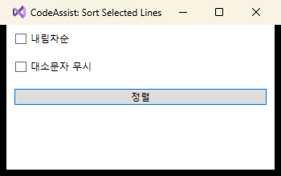](../assets/imports/docs/validation/debug-0.0.91/sort-before.png)

0.0.91 전체 배치의 테마·그룹·버튼 수정 후

[](../assets/imports/docs/validation/debug-0.0.91/CA-feature-053-dialog.png)

## 타입 교정·선택 재검사

설정 켠 타입 대소문자 교정 실제 결과

[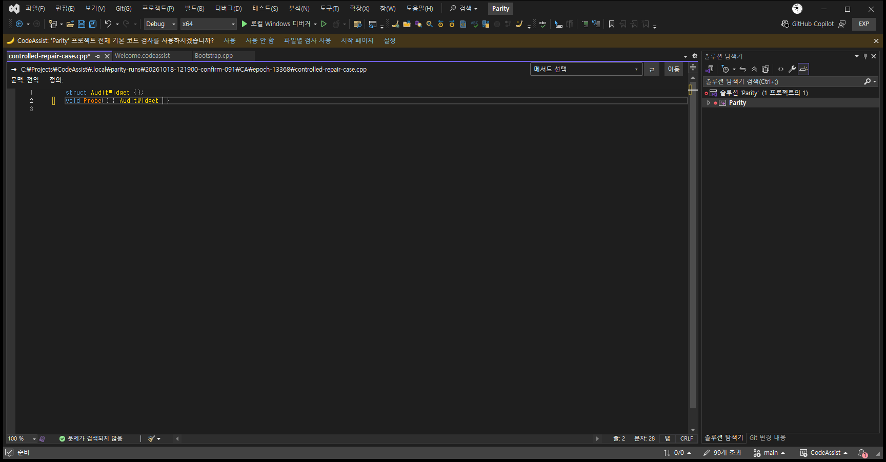](../assets/imports/docs/validation/debug-0.0.91/final-CA-controlled-repair-case-after.png)

공백 제외 설정 켠 선택 결과

[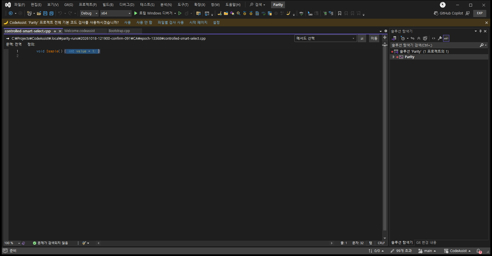](../assets/imports/docs/validation/debug-0.0.91/final-CA-controlled-smart-select-after.png)

최종 feature-053 재검사는 문서 포커스 보호 장치가 중단했습니다. 해당 항목을 통과 처리하지 않았으며 정렬 창 UI는 전체 배치에서 촬영한 화면으로 확인했습니다.

## 남은 작업

- Surround default whitespace/selection still differs

- Smart Select still differs even with whitespace trimming enabled

- Unimplemented option groups remain

- Address/PDB output-stage comparison remains

- 42/66 UI classifications lack scored corresponding screens

- Physical shortcut execution 0/22

전체 작업을 완수했다고 보고하지 않습니다. 이번에 고친 항목과 통과 근거를 제시하며, 옵션 누락과 미검증 화면은 계속 남아 있습니다.

## 전체 배치 촬영 갤러리

아래는 전체 배치의 화면입니다. Scope 좌표 최종 수정 전 빌드이며, 같은 버전 번호라도 별도 해시로 구분했습니다. 미촬영은 빈칸을 통과 처리하지 않고 표시합니다.

feature-001

전체 배치 before

[](../assets/imports/docs/validation/debug-0.0.91/CA-feature-001-before.png)

전체 배치 dialog

[](../assets/imports/docs/validation/debug-0.0.91/CA-feature-001-dialog.png)

전체 배치 after

[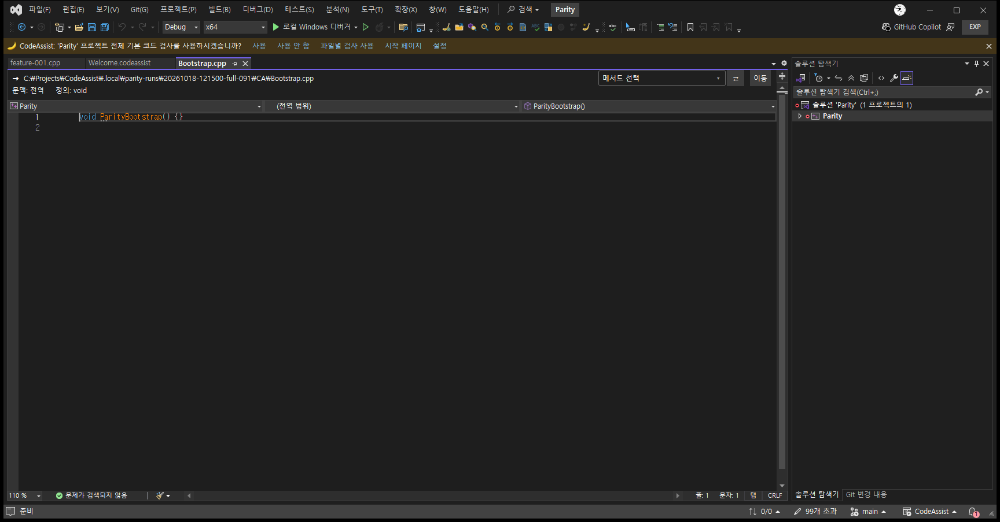](../assets/imports/docs/validation/debug-0.0.91/CA-feature-001-after.png)

feature-002

전체 배치 before

[](../assets/imports/docs/validation/debug-0.0.91/CA-feature-002-before.png)

전체 배치 dialog

[](../assets/imports/docs/validation/debug-0.0.91/CA-feature-002-dialog.png)

전체 배치 after

[](../assets/imports/docs/validation/debug-0.0.91/CA-feature-002-after.png)

feature-003

전체 배치 before

[](../assets/imports/docs/validation/debug-0.0.91/CA-feature-003-before.png)

전체 배치 dialog

[](../assets/imports/docs/validation/debug-0.0.91/CA-feature-003-dialog.png)

전체 배치 after

[](../assets/imports/docs/validation/debug-0.0.91/CA-feature-003-after.png)

feature-004

전체 배치 before

[](../assets/imports/docs/validation/debug-0.0.91/CA-feature-004-before.png)

전체 배치 dialog

[](../assets/imports/docs/validation/debug-0.0.91/CA-feature-004-dialog.png)

전체 배치 after

[](../assets/imports/docs/validation/debug-0.0.91/CA-feature-004-after.png)

feature-005

전체 배치 before

[](../assets/imports/docs/validation/debug-0.0.91/CA-feature-005-before.png)

전체 배치 dialog

[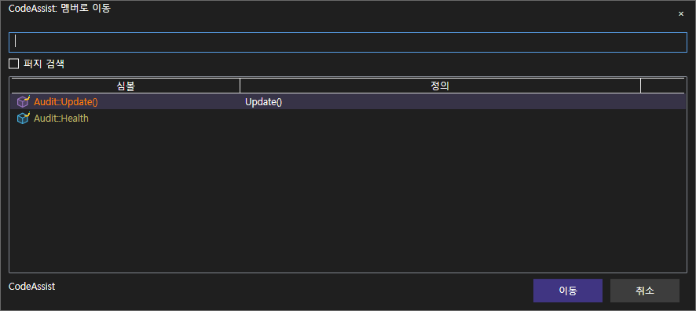](../assets/imports/docs/validation/debug-0.0.91/CA-feature-005-dialog.png)

전체 배치 after

[](../assets/imports/docs/validation/debug-0.0.91/CA-feature-005-after.png)

feature-006

전체 배치 before

[](../assets/imports/docs/validation/debug-0.0.91/CA-feature-006-before.png)

전체 배치 dialog

[](../assets/imports/docs/validation/debug-0.0.91/CA-feature-006-dialog.png)

전체 배치 after

[](../assets/imports/docs/validation/debug-0.0.91/CA-feature-006-after.png)

feature-007

전체 배치 before

[](../assets/imports/docs/validation/debug-0.0.91/CA-feature-007-before.png)

전체 배치 dialog

[](../assets/imports/docs/validation/debug-0.0.91/CA-feature-007-dialog.png)

전체 배치 after

[](../assets/imports/docs/validation/debug-0.0.91/CA-feature-007-after.png)

feature-008

전체 배치 before

[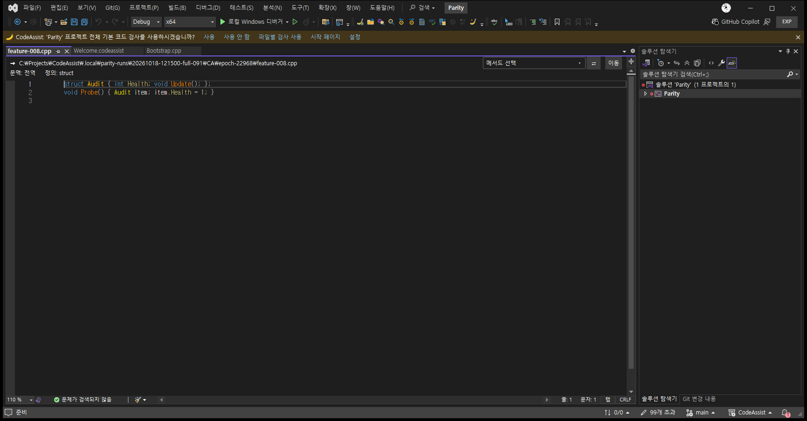](../assets/imports/docs/validation/debug-0.0.91/CA-feature-008-before.png)

전체 배치 dialog

[](../assets/imports/docs/validation/debug-0.0.91/CA-feature-008-dialog.png)

전체 배치 after

[](../assets/imports/docs/validation/debug-0.0.91/CA-feature-008-after.png)

scope-next

전체 배치 before

[](../assets/imports/docs/validation/debug-0.0.91/CA-scope-next-before.png)

전체 배치 after

[](../assets/imports/docs/validation/debug-0.0.91/CA-scope-next-after.png)

feature-010

전체 배치 before

[](../assets/imports/docs/validation/debug-0.0.91/CA-feature-010-before.png)

전체 배치 dialog

[](../assets/imports/docs/validation/debug-0.0.91/CA-feature-010-dialog.png)

전체 배치 after

[](../assets/imports/docs/validation/debug-0.0.91/CA-feature-010-after.png)

feature-011

전체 배치 before

[](../assets/imports/docs/validation/debug-0.0.91/CA-feature-011-before.png)

전체 배치 dialog

[](../assets/imports/docs/validation/debug-0.0.91/CA-feature-011-dialog.png)

전체 배치 after

[](../assets/imports/docs/validation/debug-0.0.91/CA-feature-011-after.png)

feature-012

전체 배치 before

[](../assets/imports/docs/validation/debug-0.0.91/CA-feature-012-before.png)

전체 배치 dialog

[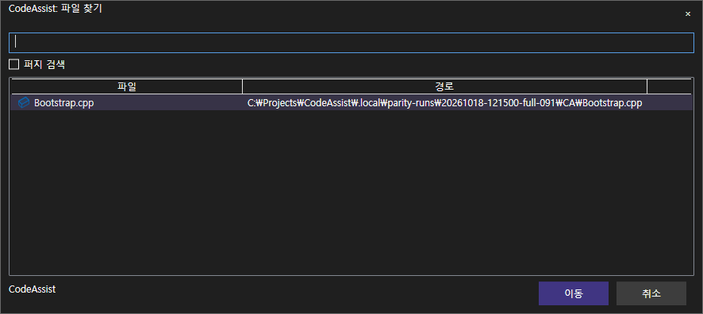](../assets/imports/docs/validation/debug-0.0.91/CA-feature-012-dialog.png)

전체 배치 after

[](../assets/imports/docs/validation/debug-0.0.91/CA-feature-012-after.png)

feature-013

전체 배치 before

[](../assets/imports/docs/validation/debug-0.0.91/CA-feature-013-before.png)

전체 배치 dialog

[](../assets/imports/docs/validation/debug-0.0.91/CA-feature-013-dialog.png)

전체 배치 after

[](../assets/imports/docs/validation/debug-0.0.91/CA-feature-013-after.png)

feature-014

전체 배치 before

[](../assets/imports/docs/validation/debug-0.0.91/CA-feature-014-before.png)

전체 배치 dialog

[](../assets/imports/docs/validation/debug-0.0.91/CA-feature-014-dialog.png)

전체 배치 after

[](../assets/imports/docs/validation/debug-0.0.91/CA-feature-014-after.png)

feature-015

전체 배치 before

[](../assets/imports/docs/validation/debug-0.0.91/CA-feature-015-before.png)

전체 배치 dialog

[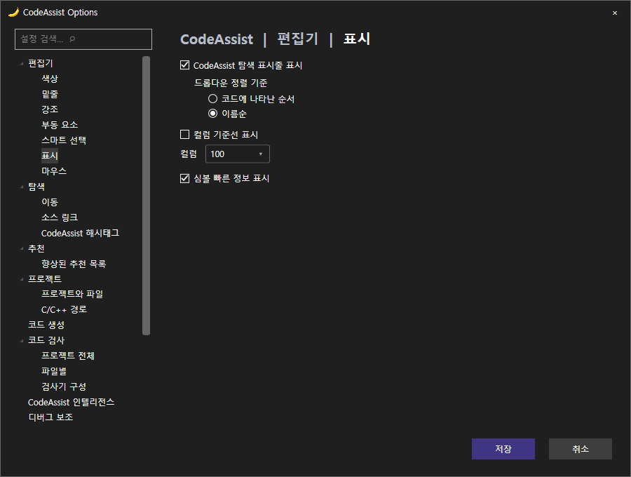](../assets/imports/docs/validation/debug-0.0.91/CA-feature-015-dialog.png)

전체 배치 after

[](../assets/imports/docs/validation/debug-0.0.91/CA-feature-015-after.png)

feature-016

전체 배치 before

[](../assets/imports/docs/validation/debug-0.0.91/CA-feature-016-before.png)

전체 배치 dialog

[](../assets/imports/docs/validation/debug-0.0.91/CA-feature-016-dialog.png)

전체 배치 after

[](../assets/imports/docs/validation/debug-0.0.91/CA-feature-016-after.png)

feature-017

전체 배치 before

[](../assets/imports/docs/validation/debug-0.0.91/CA-feature-017-before.png)

전체 배치 dialog

[](../assets/imports/docs/validation/debug-0.0.91/CA-feature-017-dialog.png)

전체 배치 after

[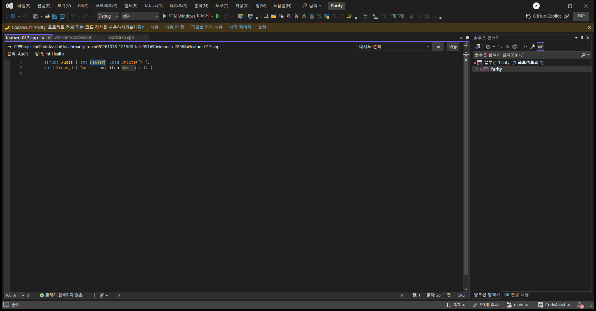](../assets/imports/docs/validation/debug-0.0.91/CA-feature-017-after.png)

feature-018

전체 배치 before

[](../assets/imports/docs/validation/debug-0.0.91/CA-feature-018-before.png)

전체 배치 dialog

[](../assets/imports/docs/validation/debug-0.0.91/CA-feature-018-dialog.png)

전체 배치 after

[](../assets/imports/docs/validation/debug-0.0.91/CA-feature-018-after.png)

feature-019

전체 배치 before

[](../assets/imports/docs/validation/debug-0.0.91/CA-feature-019-before.png)

전체 배치 dialog

[](../assets/imports/docs/validation/debug-0.0.91/CA-feature-019-dialog.png)

전체 배치 after

[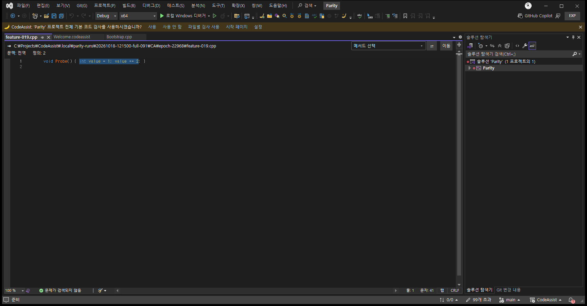](../assets/imports/docs/validation/debug-0.0.91/CA-feature-019-after.png)

feature-020

전체 배치 before

[](../assets/imports/docs/validation/debug-0.0.91/CA-feature-020-before.png)

전체 배치 after

[](../assets/imports/docs/validation/debug-0.0.91/CA-feature-020-after.png)

feature-021

전체 배치 before

[](../assets/imports/docs/validation/debug-0.0.91/CA-feature-021-before.png)

전체 배치 after

[](../assets/imports/docs/validation/debug-0.0.91/CA-feature-021-after.png)

feature-022

전체 배치 before

[](../assets/imports/docs/validation/debug-0.0.91/CA-feature-022-before.png)

전체 배치 after

[](../assets/imports/docs/validation/debug-0.0.91/CA-feature-022-after.png)

feature-023

전체 배치 before

[](../assets/imports/docs/validation/debug-0.0.91/CA-feature-023-before.png)

전체 배치 dialog

[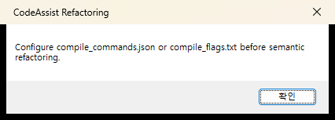](../assets/imports/docs/validation/debug-0.0.91/CA-feature-023-dialog.png)

전체 배치 after

[](../assets/imports/docs/validation/debug-0.0.91/CA-feature-023-after.png)

feature-024

전체 배치 before

[](../assets/imports/docs/validation/debug-0.0.91/CA-feature-024-before.png)

전체 배치 dialog

[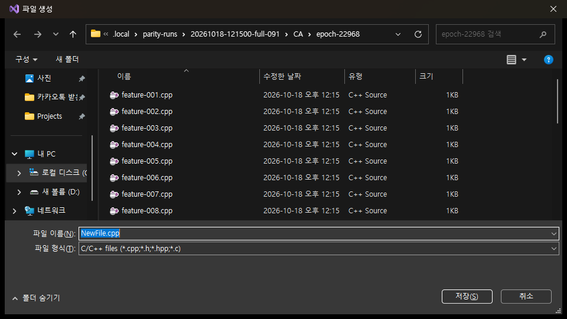](../assets/imports/docs/validation/debug-0.0.91/CA-feature-024-dialog.png)

전체 배치 after

[](../assets/imports/docs/validation/debug-0.0.91/CA-feature-024-after.png)

feature-025

전체 배치 before

[](../assets/imports/docs/validation/debug-0.0.91/CA-feature-025-before.png)

전체 배치 dialog

[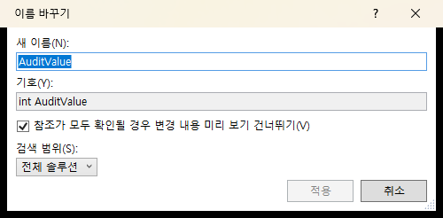](../assets/imports/docs/validation/debug-0.0.91/CA-feature-025-dialog.png)

전체 배치 after

[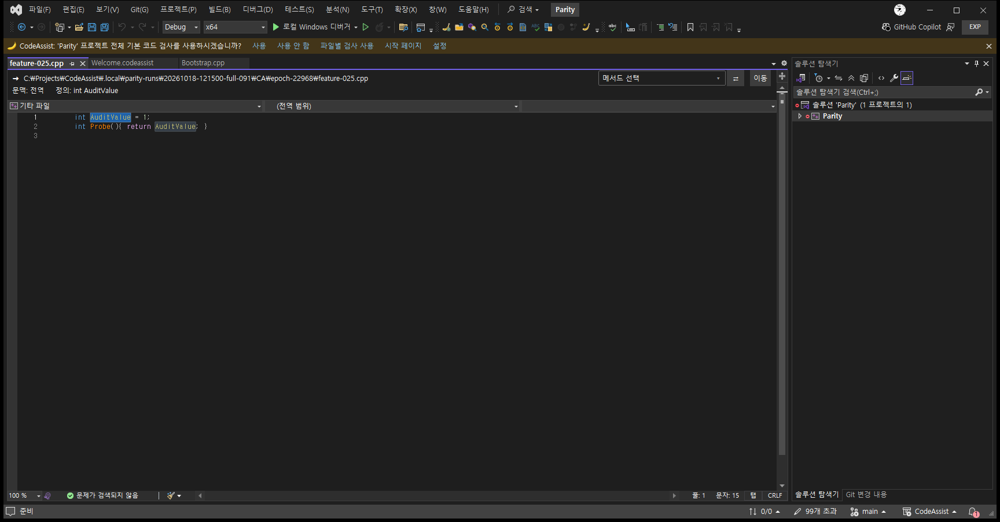](../assets/imports/docs/validation/debug-0.0.91/CA-feature-025-after.png)

feature-026

전체 배치 before

[](../assets/imports/docs/validation/debug-0.0.91/CA-feature-026-before.png)

전체 배치 dialog

[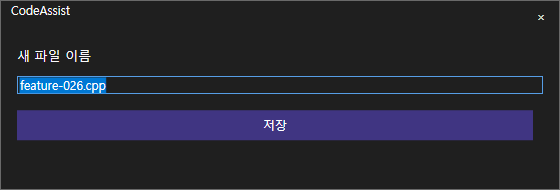](../assets/imports/docs/validation/debug-0.0.91/CA-feature-026-dialog.png)

전체 배치 after

[](../assets/imports/docs/validation/debug-0.0.91/CA-feature-026-after.png)

feature-027

전체 배치 before

[](../assets/imports/docs/validation/debug-0.0.91/CA-feature-027-before.png)

전체 배치 dialog

[](../assets/imports/docs/validation/debug-0.0.91/CA-feature-027-dialog.png)

전체 배치 after

[](../assets/imports/docs/validation/debug-0.0.91/CA-feature-027-after.png)

feature-028

전체 배치 before

[](../assets/imports/docs/validation/debug-0.0.91/CA-feature-028-before.png)

전체 배치 dialog

[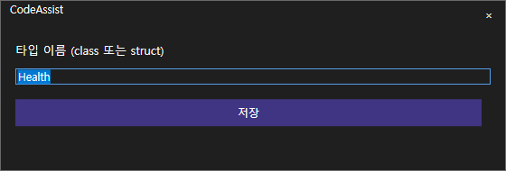](../assets/imports/docs/validation/debug-0.0.91/CA-feature-028-dialog.png)

전체 배치 after

[](../assets/imports/docs/validation/debug-0.0.91/CA-feature-028-after.png)

feature-029

전체 배치 before

[](../assets/imports/docs/validation/debug-0.0.91/CA-feature-029-before.png)

전체 배치 dialog

[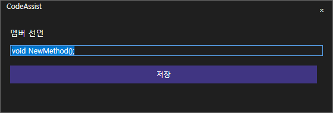](../assets/imports/docs/validation/debug-0.0.91/CA-feature-029-dialog.png)

전체 배치 after

[](../assets/imports/docs/validation/debug-0.0.91/CA-feature-029-after.png)

feature-030

전체 배치 before

[](../assets/imports/docs/validation/debug-0.0.91/CA-feature-030-before.png)

전체 배치 dialog

[](../assets/imports/docs/validation/debug-0.0.91/CA-feature-030-dialog.png)

전체 배치 after

[](../assets/imports/docs/validation/debug-0.0.91/CA-feature-030-after.png)

feature-031

전체 배치 before

[](../assets/imports/docs/validation/debug-0.0.91/CA-feature-031-before.png)

전체 배치 dialog

[](../assets/imports/docs/validation/debug-0.0.91/CA-feature-031-dialog.png)

전체 배치 after

[](../assets/imports/docs/validation/debug-0.0.91/CA-feature-031-after.png)

feature-032

전체 배치 before

[](../assets/imports/docs/validation/debug-0.0.91/CA-feature-032-before.png)

전체 배치 dialog

[](../assets/imports/docs/validation/debug-0.0.91/CA-feature-032-dialog.png)

전체 배치 after

[](../assets/imports/docs/validation/debug-0.0.91/CA-feature-032-after.png)

feature-033

전체 배치 before

[](../assets/imports/docs/validation/debug-0.0.91/CA-feature-033-before.png)

전체 배치 dialog

[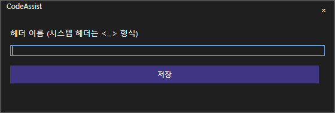](../assets/imports/docs/validation/debug-0.0.91/CA-feature-033-dialog.png)

전체 배치 after

[](../assets/imports/docs/validation/debug-0.0.91/CA-feature-033-after.png)

feature-034

전체 배치 before

[](../assets/imports/docs/validation/debug-0.0.91/CA-feature-034-before.png)

전체 배치 dialog

[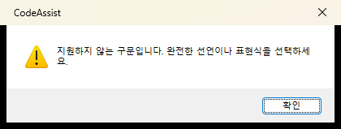](../assets/imports/docs/validation/debug-0.0.91/CA-feature-034-dialog.png)

전체 배치 after

[](../assets/imports/docs/validation/debug-0.0.91/CA-feature-034-after.png)

feature-035

전체 배치 before

[](../assets/imports/docs/validation/debug-0.0.91/CA-feature-035-before.png)

전체 배치 dialog

[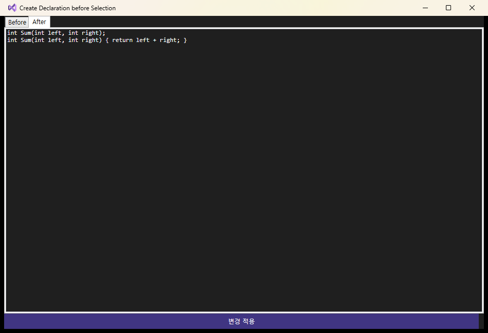](../assets/imports/docs/validation/debug-0.0.91/CA-feature-035-dialog.png)

전체 배치 after

[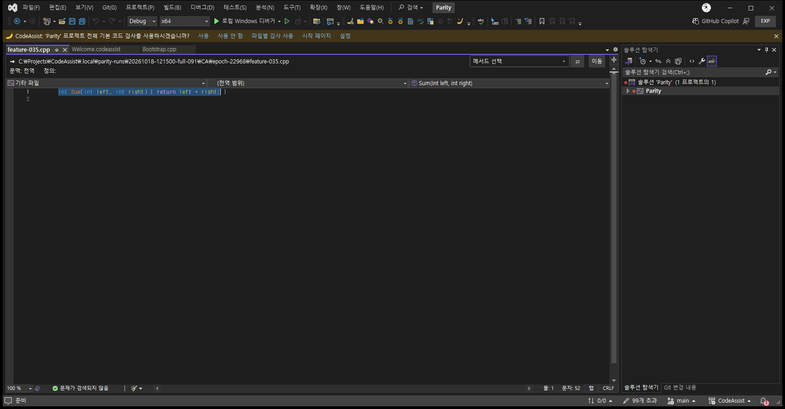](../assets/imports/docs/validation/debug-0.0.91/CA-feature-035-after.png)

feature-036

전체 배치 before

[](../assets/imports/docs/validation/debug-0.0.91/CA-feature-036-before.png)

전체 배치 dialog

[](../assets/imports/docs/validation/debug-0.0.91/CA-feature-036-dialog.png)

전체 배치 after

[](../assets/imports/docs/validation/debug-0.0.91/CA-feature-036-after.png)

feature-037

전체 배치 before

[](../assets/imports/docs/validation/debug-0.0.91/CA-feature-037-before.png)

전체 배치 after

[](../assets/imports/docs/validation/debug-0.0.91/CA-feature-037-after.png)

feature-038

전체 배치 before

[](../assets/imports/docs/validation/debug-0.0.91/CA-feature-038-before.png)

전체 배치 dialog

[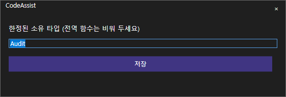](../assets/imports/docs/validation/debug-0.0.91/CA-feature-038-dialog.png)

전체 배치 after

[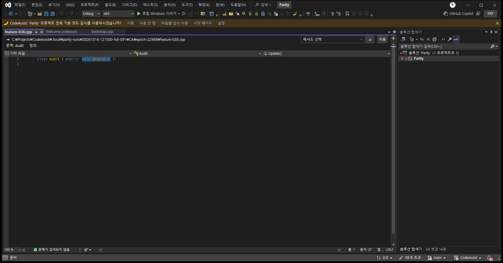](../assets/imports/docs/validation/debug-0.0.91/CA-feature-038-after.png)

feature-039

전체 배치 before

[](../assets/imports/docs/validation/debug-0.0.91/CA-feature-039-before.png)

전체 배치 dialog

[](../assets/imports/docs/validation/debug-0.0.91/CA-feature-039-dialog.png)

전체 배치 after

[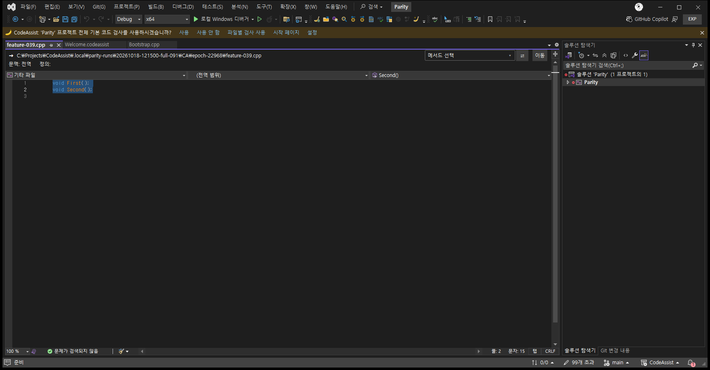](../assets/imports/docs/validation/debug-0.0.91/CA-feature-039-after.png)

feature-040

전체 배치 before

[](../assets/imports/docs/validation/debug-0.0.91/CA-feature-040-before.png)

전체 배치 after

[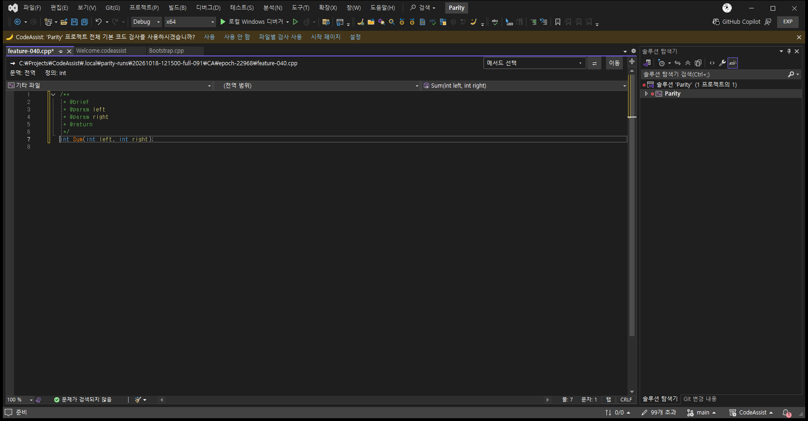](../assets/imports/docs/validation/debug-0.0.91/CA-feature-040-after.png)

feature-041

전체 배치 before

[](../assets/imports/docs/validation/debug-0.0.91/CA-feature-041-before.png)

전체 배치 dialog

[](../assets/imports/docs/validation/debug-0.0.91/CA-feature-041-dialog.png)

전체 배치 after

[](../assets/imports/docs/validation/debug-0.0.91/CA-feature-041-after.png)

acronym

전체 배치 before

[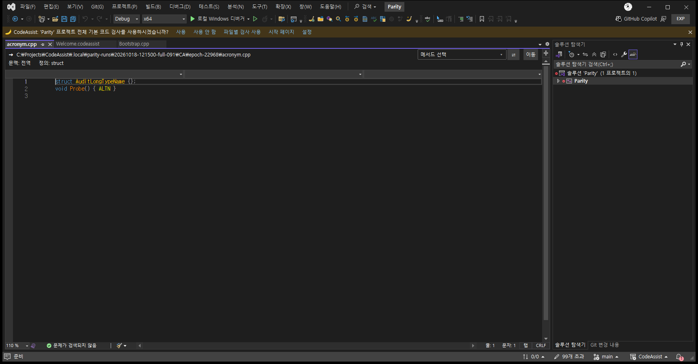](../assets/imports/docs/validation/debug-0.0.91/CA-acronym-before.png)

전체 배치 after

[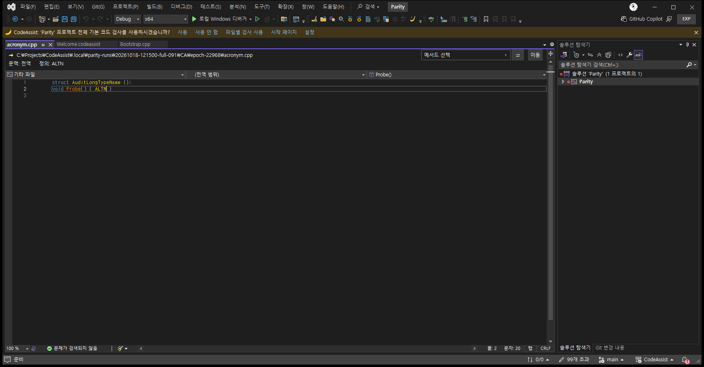](../assets/imports/docs/validation/debug-0.0.91/CA-acronym-after.png)

comment-continuation

전체 배치 before

[](../assets/imports/docs/validation/debug-0.0.91/CA-comment-continuation-before.png)

전체 배치 after

[](../assets/imports/docs/validation/debug-0.0.91/CA-comment-continuation-after.png)

completion

전체 배치 before

[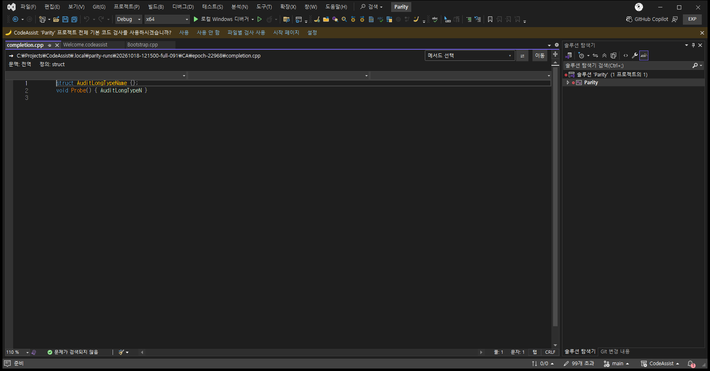](../assets/imports/docs/validation/debug-0.0.91/CA-completion-before.png)

전체 배치 after

[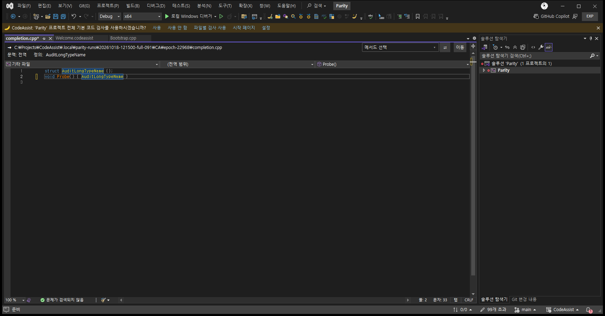](../assets/imports/docs/validation/debug-0.0.91/CA-completion-after.png)

feature-045

전체 배치 before

[](../assets/imports/docs/validation/debug-0.0.91/CA-feature-045-before.png)

전체 배치 dialog

[](../assets/imports/docs/validation/debug-0.0.91/CA-feature-045-dialog.png)

전체 배치 after

[](../assets/imports/docs/validation/debug-0.0.91/CA-feature-045-after.png)

pair-insert

전체 배치 before

[](../assets/imports/docs/validation/debug-0.0.91/CA-pair-insert-before.png)

전체 배치 after

[](../assets/imports/docs/validation/debug-0.0.91/CA-pair-insert-after.png)

feature-047

전체 배치 before

[](../assets/imports/docs/validation/debug-0.0.91/CA-feature-047-before.png)

전체 배치 dialog

[](../assets/imports/docs/validation/debug-0.0.91/CA-feature-047-dialog.png)

전체 배치 after

[](../assets/imports/docs/validation/debug-0.0.91/CA-feature-047-after.png)

feature-048

전체 배치 before

[](../assets/imports/docs/validation/debug-0.0.91/CA-feature-048-before.png)

전체 배치 dialog

[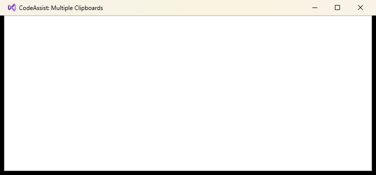](../assets/imports/docs/validation/debug-0.0.91/CA-feature-048-dialog.png)

전체 배치 after

[](../assets/imports/docs/validation/debug-0.0.91/CA-feature-048-after.png)

reset-zoom

전체 배치 before

[](../assets/imports/docs/validation/debug-0.0.91/CA-reset-zoom-before.png)

전체 배치 after

[](../assets/imports/docs/validation/debug-0.0.91/CA-reset-zoom-after.png)

shorthand

전체 배치 before

[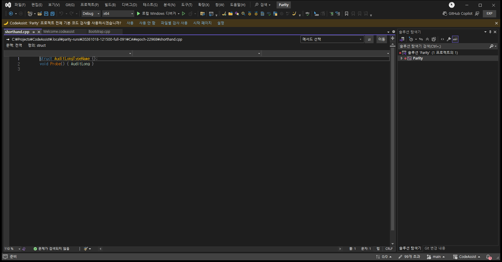](../assets/imports/docs/validation/debug-0.0.91/CA-shorthand-before.png)

전체 배치 after

[](../assets/imports/docs/validation/debug-0.0.91/CA-shorthand-after.png)

smart-select

전체 배치 before

[](../assets/imports/docs/validation/debug-0.0.91/CA-smart-select-before.png)

전체 배치 after

[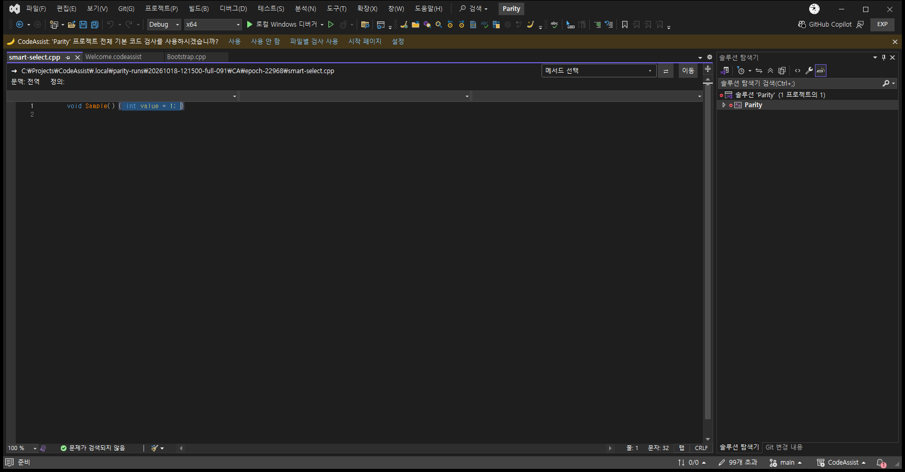](../assets/imports/docs/validation/debug-0.0.91/CA-smart-select-after.png)

feature-052

전체 배치 before

[](../assets/imports/docs/validation/debug-0.0.91/CA-feature-052-before.png)

전체 배치 dialog

[](../assets/imports/docs/validation/debug-0.0.91/CA-feature-052-dialog.png)

전체 배치 after

[](../assets/imports/docs/validation/debug-0.0.91/CA-feature-052-after.png)

feature-053

전체 배치 before

[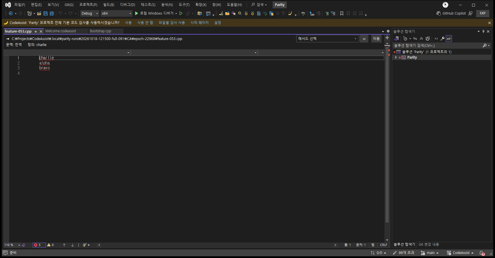](../assets/imports/docs/validation/debug-0.0.91/CA-feature-053-before.png)

전체 배치 dialog

[](../assets/imports/docs/validation/debug-0.0.91/CA-feature-053-dialog.png)

전체 배치 after

[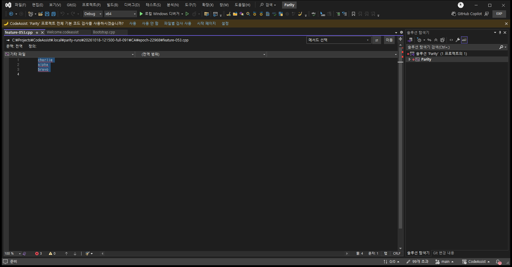](../assets/imports/docs/validation/debug-0.0.91/CA-feature-053-after.png)

feature-054

전체 배치 before

[](../assets/imports/docs/validation/debug-0.0.91/CA-feature-054-before.png)

전체 배치 dialog

[](../assets/imports/docs/validation/debug-0.0.91/CA-feature-054-dialog.png)

전체 배치 after

[](../assets/imports/docs/validation/debug-0.0.91/CA-feature-054-after.png)

surround-word

전체 배치 before

[](../assets/imports/docs/validation/debug-0.0.91/CA-surround-word-before.png)

전체 배치 after

[](../assets/imports/docs/validation/debug-0.0.91/CA-surround-word-after.png)

feature-056

전체 배치 before

[](../assets/imports/docs/validation/debug-0.0.91/CA-feature-056-before.png)

전체 배치 dialog

[](../assets/imports/docs/validation/debug-0.0.91/CA-feature-056-dialog.png)

전체 배치 after

[](../assets/imports/docs/validation/debug-0.0.91/CA-feature-056-after.png)

feature-057

전체 배치 before

[](../assets/imports/docs/validation/debug-0.0.91/CA-feature-057-before.png)

전체 배치 dialog

[](../assets/imports/docs/validation/debug-0.0.91/CA-feature-057-dialog.png)

전체 배치 after

[](../assets/imports/docs/validation/debug-0.0.91/CA-feature-057-after.png)

feature-058

전체 배치 before

[](../assets/imports/docs/validation/debug-0.0.91/CA-feature-058-before.png)

전체 배치 dialog

[](../assets/imports/docs/validation/debug-0.0.91/CA-feature-058-dialog.png)

전체 배치 after

[](../assets/imports/docs/validation/debug-0.0.91/CA-feature-058-after.png)

feature-059

전체 배치 before

[](../assets/imports/docs/validation/debug-0.0.91/CA-feature-059-before.png)

전체 배치 dialog

[](../assets/imports/docs/validation/debug-0.0.91/CA-feature-059-dialog.png)

전체 배치 after

[](../assets/imports/docs/validation/debug-0.0.91/CA-feature-059-after.png)

feature-060

전체 배치 before

[](../assets/imports/docs/validation/debug-0.0.91/CA-feature-060-before.png)

전체 배치 dialog

[](../assets/imports/docs/validation/debug-0.0.91/CA-feature-060-dialog.png)

전체 배치 after

[](../assets/imports/docs/validation/debug-0.0.91/CA-feature-060-after.png)

feature-061

전체 배치 before

[](../assets/imports/docs/validation/debug-0.0.91/CA-feature-061-before.png)

전체 배치 dialog

[](../assets/imports/docs/validation/debug-0.0.91/CA-feature-061-dialog.png)

전체 배치 after

[](../assets/imports/docs/validation/debug-0.0.91/CA-feature-061-after.png)

feature-062

전체 배치 before

[](../assets/imports/docs/validation/debug-0.0.91/CA-feature-062-before.png)

전체 배치 dialog

[](../assets/imports/docs/validation/debug-0.0.91/CA-feature-062-dialog.png)

전체 배치 after

[](../assets/imports/docs/validation/debug-0.0.91/CA-feature-062-after.png)

feature-063

전체 배치 before

[](../assets/imports/docs/validation/debug-0.0.91/CA-feature-063-before.png)

전체 배치 dialog

[](../assets/imports/docs/validation/debug-0.0.91/CA-feature-063-dialog.png)

전체 배치 after

[](../assets/imports/docs/validation/debug-0.0.91/CA-feature-063-after.png)

feature-064

전체 배치 before

[](../assets/imports/docs/validation/debug-0.0.91/CA-feature-064-before.png)

전체 배치 dialog

[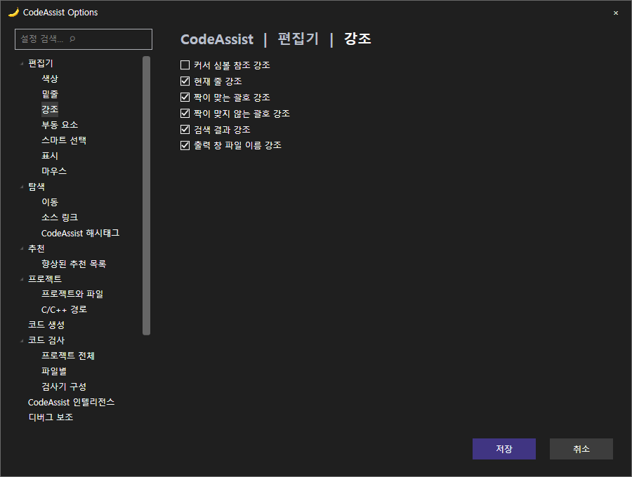](../assets/imports/docs/validation/debug-0.0.91/CA-feature-064-dialog.png)

전체 배치 after

[](../assets/imports/docs/validation/debug-0.0.91/CA-feature-064-after.png)

feature-065

전체 배치 before

[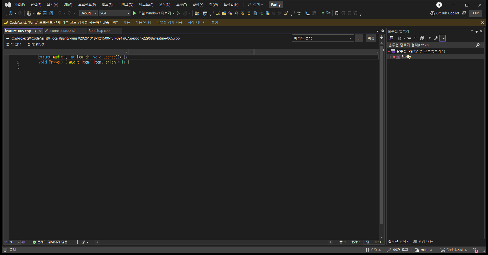](../assets/imports/docs/validation/debug-0.0.91/CA-feature-065-before.png)

전체 배치 dialog

[](../assets/imports/docs/validation/debug-0.0.91/CA-feature-065-dialog.png)

전체 배치 after

[](../assets/imports/docs/validation/debug-0.0.91/CA-feature-065-after.png)

feature-066

전체 배치 before

[](../assets/imports/docs/validation/debug-0.0.91/CA-feature-066-before.png)

전체 배치 dialog

[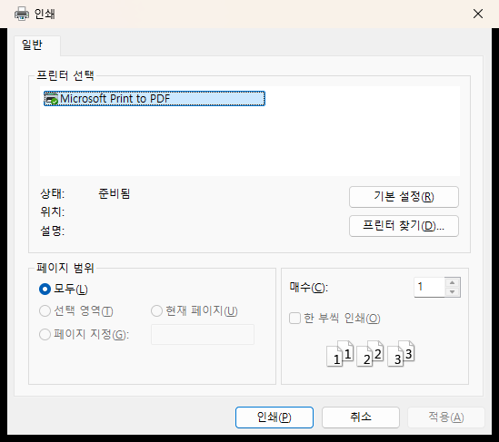](../assets/imports/docs/validation/debug-0.0.91/CA-feature-066-dialog.png)

전체 배치 after

[](../assets/imports/docs/validation/debug-0.0.91/CA-feature-066-after.png)

feature-067

전체 배치 before

[](../assets/imports/docs/validation/debug-0.0.91/CA-feature-067-before.png)

전체 배치 dialog

[](../assets/imports/docs/validation/debug-0.0.91/CA-feature-067-dialog.png)

전체 배치 after

[](../assets/imports/docs/validation/debug-0.0.91/CA-feature-067-after.png)

feature-068

전체 배치 before

[](../assets/imports/docs/validation/debug-0.0.91/CA-feature-068-before.png)

전체 배치 dialog

[](../assets/imports/docs/validation/debug-0.0.91/CA-feature-068-dialog.png)

전체 배치 after

[](../assets/imports/docs/validation/debug-0.0.91/CA-feature-068-after.png)

dot-to-arrow

전체 배치 before

[](../assets/imports/docs/validation/debug-0.0.91/CA-dot-to-arrow-before.png)

전체 배치 after

[](../assets/imports/docs/validation/debug-0.0.91/CA-dot-to-arrow-after.png)

feature-070

전체 배치 before

[](../assets/imports/docs/validation/debug-0.0.91/CA-feature-070-before.png)

전체 배치 dialog

[](../assets/imports/docs/validation/debug-0.0.91/CA-feature-070-dialog.png)

전체 배치 after

[](../assets/imports/docs/validation/debug-0.0.91/CA-feature-070-after.png)

feature-071

전체 배치 before

[](../assets/imports/docs/validation/debug-0.0.91/CA-feature-071-before.png)

전체 배치 dialog

[](../assets/imports/docs/validation/debug-0.0.91/CA-feature-071-dialog.png)

전체 배치 after

[](../assets/imports/docs/validation/debug-0.0.91/CA-feature-071-after.png)

feature-072

전체 배치 before

[](../assets/imports/docs/validation/debug-0.0.91/CA-feature-072-before.png)

전체 배치 dialog

[](../assets/imports/docs/validation/debug-0.0.91/CA-feature-072-dialog.png)

전체 배치 after

[](../assets/imports/docs/validation/debug-0.0.91/CA-feature-072-after.png)

repair-case

전체 배치 before

[](../assets/imports/docs/validation/debug-0.0.91/CA-repair-case-before.png)

전체 배치 after

[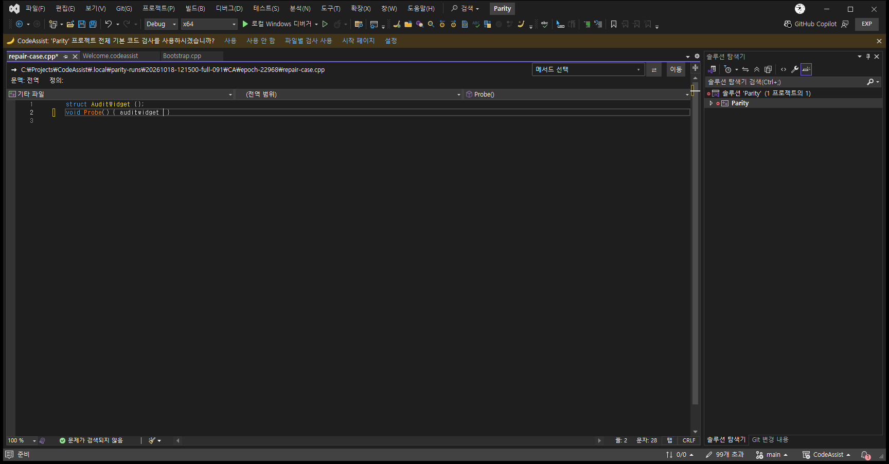](../assets/imports/docs/validation/debug-0.0.91/CA-repair-case-after.png)

feature-074

전체 배치 before

[](../assets/imports/docs/validation/debug-0.0.91/CA-feature-074-before.png)

전체 배치 dialog

[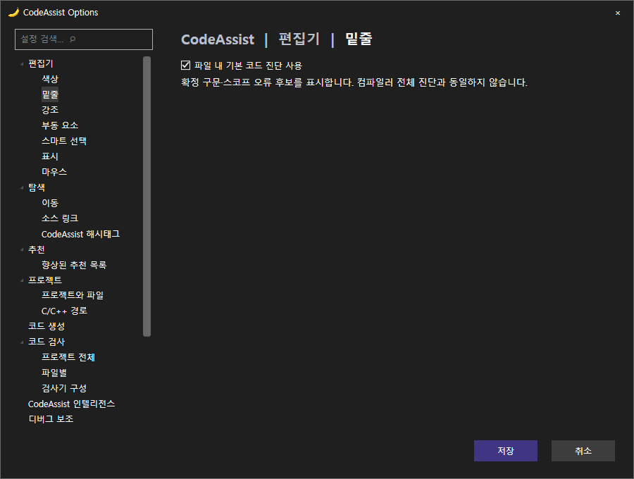](../assets/imports/docs/validation/debug-0.0.91/CA-feature-074-dialog.png)

전체 배치 after

[](../assets/imports/docs/validation/debug-0.0.91/CA-feature-074-after.png)

feature-075

전체 배치 before

[](../assets/imports/docs/validation/debug-0.0.91/CA-feature-075-before.png)

전체 배치 dialog

[](../assets/imports/docs/validation/debug-0.0.91/CA-feature-075-dialog.png)

전체 배치 after

[](../assets/imports/docs/validation/debug-0.0.91/CA-feature-075-after.png)

feature-076

전체 배치 before

[](../assets/imports/docs/validation/debug-0.0.91/CA-feature-076-before.png)

전체 배치 dialog

[](../assets/imports/docs/validation/debug-0.0.91/CA-feature-076-dialog.png)

전체 배치 after

[](../assets/imports/docs/validation/debug-0.0.91/CA-feature-076-after.png)

feature-077

전체 배치 before

[](../assets/imports/docs/validation/debug-0.0.91/CA-feature-077-before.png)

전체 배치 dialog

[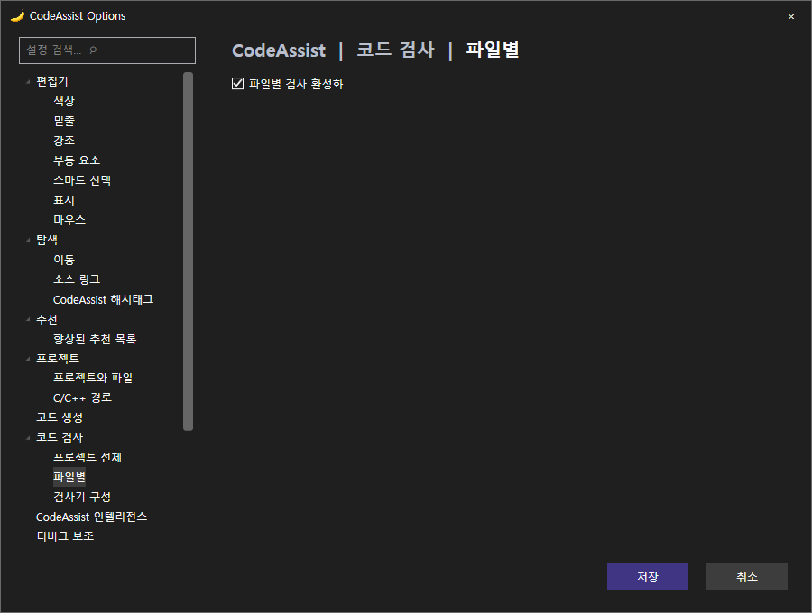](../assets/imports/docs/validation/debug-0.0.91/CA-feature-077-dialog.png)

전체 배치 after

[](../assets/imports/docs/validation/debug-0.0.91/CA-feature-077-after.png)

feature-078

전체 배치 before

[](../assets/imports/docs/validation/debug-0.0.91/CA-feature-078-before.png)

전체 배치 dialog

[](../assets/imports/docs/validation/debug-0.0.91/CA-feature-078-dialog.png)

전체 배치 after

[](../assets/imports/docs/validation/debug-0.0.91/CA-feature-078-after.png)

feature-079

전체 배치 before

[](../assets/imports/docs/validation/debug-0.0.91/CA-feature-079-before.png)

전체 배치 dialog

[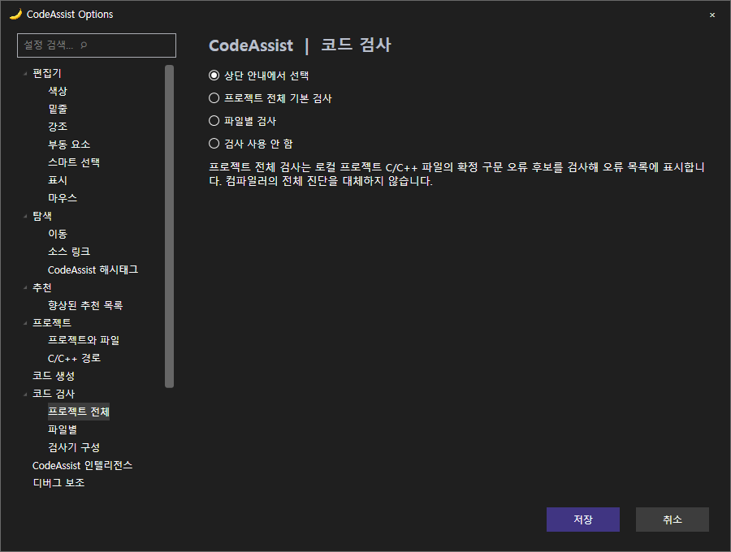](../assets/imports/docs/validation/debug-0.0.91/CA-feature-079-dialog.png)

전체 배치 after

[](../assets/imports/docs/validation/debug-0.0.91/CA-feature-079-after.png)

feature-080

전체 배치 before

[](../assets/imports/docs/validation/debug-0.0.91/CA-feature-080-before.png)

전체 배치 dialog

[](../assets/imports/docs/validation/debug-0.0.91/CA-feature-080-dialog.png)

전체 배치 after

[](../assets/imports/docs/validation/debug-0.0.91/CA-feature-080-after.png)

feature-081

전체 배치 before

[](../assets/imports/docs/validation/debug-0.0.91/CA-feature-081-before.png)

전체 배치 dialog

[](../assets/imports/docs/validation/debug-0.0.91/CA-feature-081-dialog.png)

전체 배치 after

[](../assets/imports/docs/validation/debug-0.0.91/CA-feature-081-after.png)

feature-082

전체 배치 before

[](../assets/imports/docs/validation/debug-0.0.91/CA-feature-082-before.png)

전체 배치 dialog

[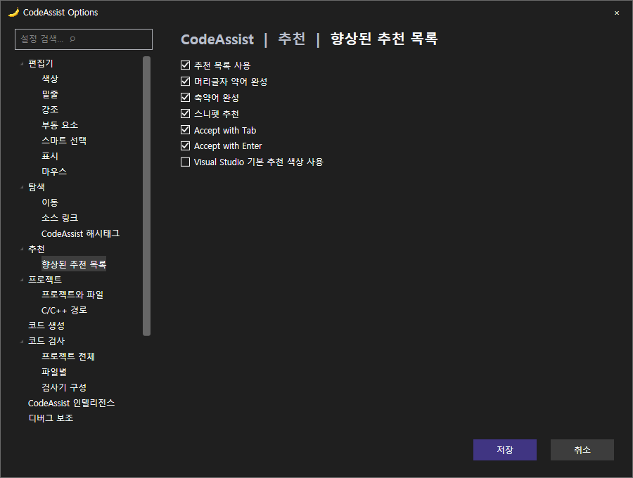](../assets/imports/docs/validation/debug-0.0.91/CA-feature-082-dialog.png)

전체 배치 after

[](../assets/imports/docs/validation/debug-0.0.91/CA-feature-082-after.png)

feature-083

전체 배치 before

[](../assets/imports/docs/validation/debug-0.0.91/CA-feature-083-before.png)

전체 배치 dialog

[](../assets/imports/docs/validation/debug-0.0.91/CA-feature-083-dialog.png)

전체 배치 after

[](../assets/imports/docs/validation/debug-0.0.91/CA-feature-083-after.png)

feature-084

전체 배치 before

[](../assets/imports/docs/validation/debug-0.0.91/CA-feature-084-before.png)

전체 배치 dialog

[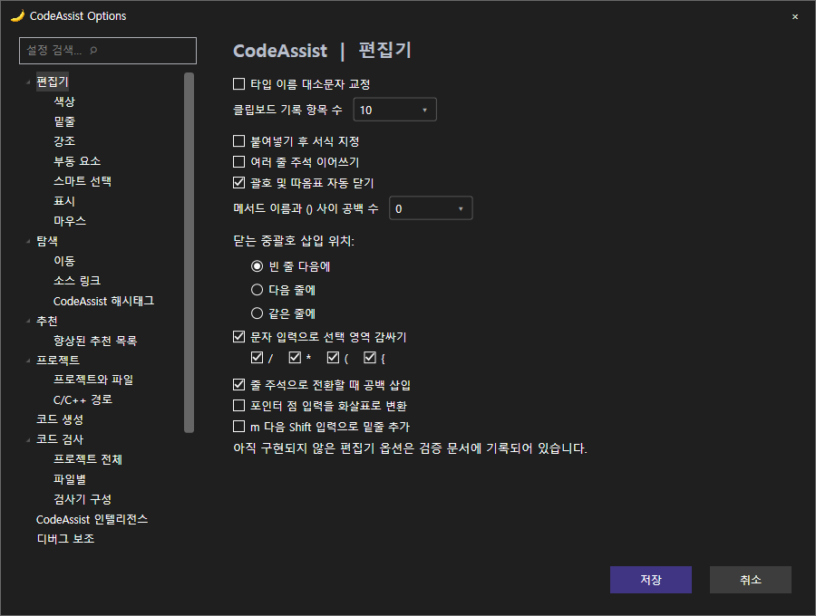](../assets/imports/docs/validation/debug-0.0.91/CA-feature-084-dialog.png)

전체 배치 after

[](../assets/imports/docs/validation/debug-0.0.91/CA-feature-084-after.png)

feature-085

전체 배치 before

[](../assets/imports/docs/validation/debug-0.0.91/CA-feature-085-before.png)

전체 배치 dialog

[](../assets/imports/docs/validation/debug-0.0.91/CA-feature-085-dialog.png)

전체 배치 after

[](../assets/imports/docs/validation/debug-0.0.91/CA-feature-085-after.png)

feature-086

전체 배치 before

[](../assets/imports/docs/validation/debug-0.0.91/CA-feature-086-before.png)

전체 배치 dialog

[](../assets/imports/docs/validation/debug-0.0.91/CA-feature-086-dialog.png)

전체 배치 after

[](../assets/imports/docs/validation/debug-0.0.91/CA-feature-086-after.png)

feature-087

전체 배치 before

[](../assets/imports/docs/validation/debug-0.0.91/CA-feature-087-before.png)

전체 배치 dialog

[](../assets/imports/docs/validation/debug-0.0.91/CA-feature-087-dialog.png)

전체 배치 after

[](../assets/imports/docs/validation/debug-0.0.91/CA-feature-087-after.png)

feature-088

전체 배치 before

[](../assets/imports/docs/validation/debug-0.0.91/CA-feature-088-before.png)

전체 배치 dialog

[](../assets/imports/docs/validation/debug-0.0.91/CA-feature-088-dialog.png)

전체 배치 after

[](../assets/imports/docs/validation/debug-0.0.91/CA-feature-088-after.png)

feature-089

전체 배치 before

[](../assets/imports/docs/validation/debug-0.0.91/CA-feature-089-before.png)

전체 배치 dialog

[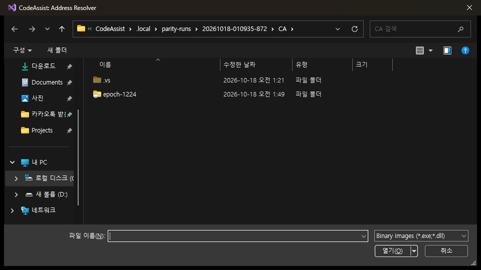](../assets/imports/docs/validation/debug-0.0.91/CA-feature-089-dialog.png)

전체 배치 after

[](../assets/imports/docs/validation/debug-0.0.91/CA-feature-089-after.png)

feature-090

전체 배치 before

[](../assets/imports/docs/validation/debug-0.0.91/CA-feature-090-before.png)

전체 배치 dialog

[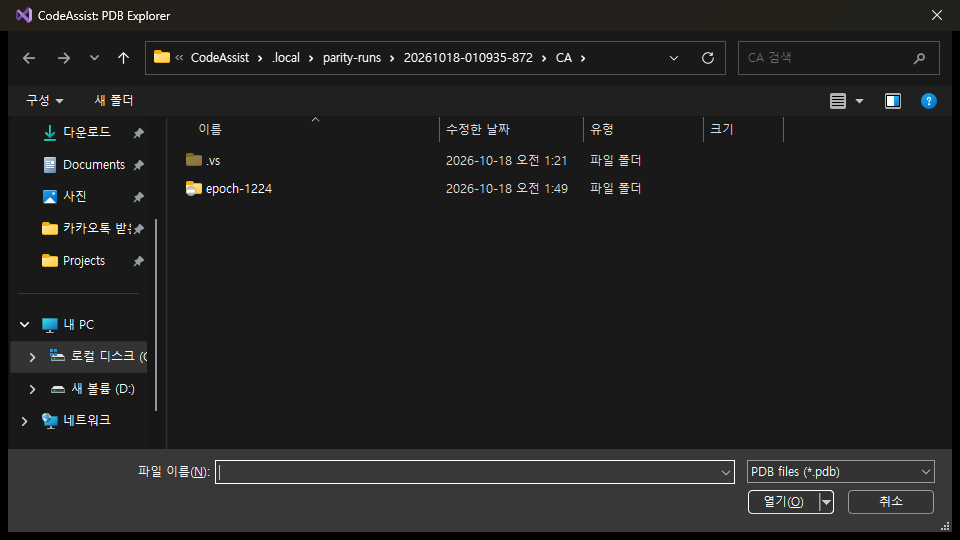](../assets/imports/docs/validation/debug-0.0.91/CA-feature-090-dialog.png)

전체 배치 after

[](../assets/imports/docs/validation/debug-0.0.91/CA-feature-090-after.png)

feature-091

전체 배치 before

[](../assets/imports/docs/validation/debug-0.0.91/CA-feature-091-before.png)

전체 배치 dialog

[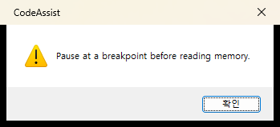](../assets/imports/docs/validation/debug-0.0.91/CA-feature-091-dialog.png)

전체 배치 after

[](../assets/imports/docs/validation/debug-0.0.91/CA-feature-091-after.png)

feature-092

전체 배치 before

[](../assets/imports/docs/validation/debug-0.0.91/CA-feature-092-before.png)

전체 배치 dialog

[](../assets/imports/docs/validation/debug-0.0.91/CA-feature-092-dialog.png)

전체 배치 after

[](../assets/imports/docs/validation/debug-0.0.91/CA-feature-092-after.png)

feature-093

전체 배치 before

[](../assets/imports/docs/validation/debug-0.0.91/CA-feature-093-before.png)

전체 배치 dialog

[](../assets/imports/docs/validation/debug-0.0.91/CA-feature-093-dialog.png)

전체 배치 after

[](../assets/imports/docs/validation/debug-0.0.91/CA-feature-093-after.png)

feature-094

전체 배치 before

[](../assets/imports/docs/validation/debug-0.0.91/CA-feature-094-before.png)

전체 배치 dialog

[](../assets/imports/docs/validation/debug-0.0.91/CA-feature-094-dialog.png)

전체 배치 after

[](../assets/imports/docs/validation/debug-0.0.91/CA-feature-094-after.png)

feature-095

전체 배치 before

[](../assets/imports/docs/validation/debug-0.0.91/CA-feature-095-before.png)

전체 배치 dialog

[](../assets/imports/docs/validation/debug-0.0.91/CA-feature-095-dialog.png)

전체 배치 after

[](../assets/imports/docs/validation/debug-0.0.91/CA-feature-095-after.png)

feature-096

전체 배치 before

[](../assets/imports/docs/validation/debug-0.0.91/CA-feature-096-before.png)

전체 배치 dialog

[](../assets/imports/docs/validation/debug-0.0.91/CA-feature-096-dialog.png)

전체 배치 after

[](../assets/imports/docs/validation/debug-0.0.91/CA-feature-096-after.png)

feature-097

전체 배치 before

[](../assets/imports/docs/validation/debug-0.0.91/CA-feature-097-before.png)

전체 배치 dialog

[](../assets/imports/docs/validation/debug-0.0.91/CA-feature-097-dialog.png)

전체 배치 after

[](../assets/imports/docs/validation/debug-0.0.91/CA-feature-097-after.png)

feature-098

전체 배치 before

[](../assets/imports/docs/validation/debug-0.0.91/CA-feature-098-before.png)

전체 배치 dialog

[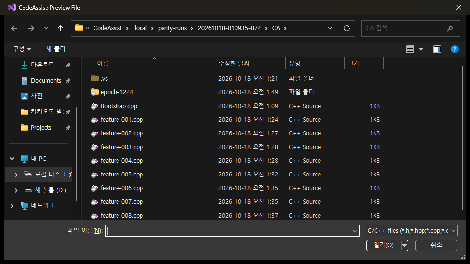](../assets/imports/docs/validation/debug-0.0.91/CA-feature-098-dialog.png)

전체 배치 after

[](../assets/imports/docs/validation/debug-0.0.91/CA-feature-098-after.png)

feature-099

전체 배치 before

[](../assets/imports/docs/validation/debug-0.0.91/CA-feature-099-before.png)

전체 배치 dialog

[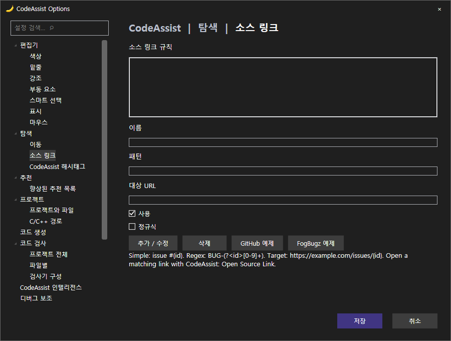](../assets/imports/docs/validation/debug-0.0.91/CA-feature-099-dialog.png)

전체 배치 after

[](../assets/imports/docs/validation/debug-0.0.91/CA-feature-099-after.png)

feature-100

전체 배치 before

[](../assets/imports/docs/validation/debug-0.0.91/CA-feature-100-before.png)

전체 배치 dialog

[](../assets/imports/docs/validation/debug-0.0.91/CA-feature-100-dialog.png)

전체 배치 after

[](../assets/imports/docs/validation/debug-0.0.91/CA-feature-100-after.png)

feature-101

전체 배치 before

[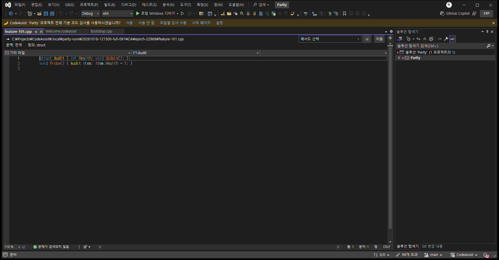](../assets/imports/docs/validation/debug-0.0.91/CA-feature-101-before.png)

전체 배치 dialog

[](../assets/imports/docs/validation/debug-0.0.91/CA-feature-101-dialog.png)

전체 배치 after

[](../assets/imports/docs/validation/debug-0.0.91/CA-feature-101-after.png)

feature-102

전체 배치 before

[](../assets/imports/docs/validation/debug-0.0.91/CA-feature-102-before.png)

전체 배치 dialog

[](../assets/imports/docs/validation/debug-0.0.91/CA-feature-102-dialog.png)

전체 배치 after

[](../assets/imports/docs/validation/debug-0.0.91/CA-feature-102-after.png)

feature-103

전체 배치 before

[](../assets/imports/docs/validation/debug-0.0.91/CA-feature-103-before.png)

전체 배치 dialog

[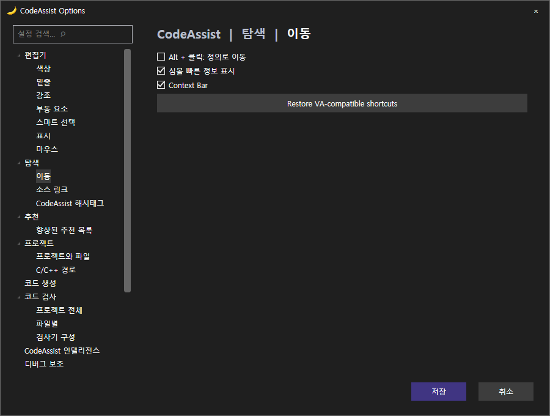](../assets/imports/docs/validation/debug-0.0.91/CA-feature-103-dialog.png)

전체 배치 after

[](../assets/imports/docs/validation/debug-0.0.91/CA-feature-103-after.png)

feature-104

전체 배치 before

[](../assets/imports/docs/validation/debug-0.0.91/CA-feature-104-before.png)

전체 배치 dialog

[](../assets/imports/docs/validation/debug-0.0.91/CA-feature-104-dialog.png)

전체 배치 after

[](../assets/imports/docs/validation/debug-0.0.91/CA-feature-104-after.png)

feature-105

전체 배치 before

[](../assets/imports/docs/validation/debug-0.0.91/CA-feature-105-before.png)

전체 배치 dialog

[](../assets/imports/docs/validation/debug-0.0.91/CA-feature-105-dialog.png)

전체 배치 after

[](../assets/imports/docs/validation/debug-0.0.91/CA-feature-105-after.png)

feature-106

전체 배치 before

[](../assets/imports/docs/validation/debug-0.0.91/CA-feature-106-before.png)

전체 배치 dialog

[](../assets/imports/docs/validation/debug-0.0.91/CA-feature-106-dialog.png)

전체 배치 after

[](../assets/imports/docs/validation/debug-0.0.91/CA-feature-106-after.png)

feature-107

전체 배치 before

[](../assets/imports/docs/validation/debug-0.0.91/CA-feature-107-before.png)

전체 배치 dialog

[](../assets/imports/docs/validation/debug-0.0.91/CA-feature-107-dialog.png)

전체 배치 after

[](../assets/imports/docs/validation/debug-0.0.91/CA-feature-107-after.png)

feature-108

전체 배치 before

[](../assets/imports/docs/validation/debug-0.0.91/CA-feature-108-before.png)

전체 배치 dialog

[](../assets/imports/docs/validation/debug-0.0.91/CA-feature-108-dialog.png)

전체 배치 after

[](../assets/imports/docs/validation/debug-0.0.91/CA-feature-108-after.png)

pair-delete

전체 배치 before

[](../assets/imports/docs/validation/debug-0.0.91/CA-pair-delete-before.png)

전체 배치 after

[](../assets/imports/docs/validation/debug-0.0.91/CA-pair-delete-after.png)

scope-previous

전체 배치 before

[](../assets/imports/docs/validation/debug-0.0.91/CA-scope-previous-before.png)

전체 배치 after

[](../assets/imports/docs/validation/debug-0.0.91/CA-scope-previous-after.png)

insert-bracket

전체 배치 before

[](../assets/imports/docs/validation/debug-0.0.91/CA-insert-bracket-before.png)

전체 배치 after

[](../assets/imports/docs/validation/debug-0.0.91/CA-insert-bracket-after.png)

surround-bracket

전체 배치 before

[](../assets/imports/docs/validation/debug-0.0.91/CA-surround-bracket-before.png)

전체 배치 after

[](../assets/imports/docs/validation/debug-0.0.91/CA-surround-bracket-after.png)

insert-brace

전체 배치 before

[](../assets/imports/docs/validation/debug-0.0.91/CA-insert-brace-before.png)

전체 배치 after

[](../assets/imports/docs/validation/debug-0.0.91/CA-insert-brace-after.png)

surround-brace

전체 배치 before

[](../assets/imports/docs/validation/debug-0.0.91/CA-surround-brace-before.png)

전체 배치 after

[](../assets/imports/docs/validation/debug-0.0.91/CA-surround-brace-after.png)

insert-quote

전체 배치 before

[](../assets/imports/docs/validation/debug-0.0.91/CA-insert-quote-before.png)

전체 배치 after

[](../assets/imports/docs/validation/debug-0.0.91/CA-insert-quote-after.png)

surround-quote

전체 배치 before

[](../assets/imports/docs/validation/debug-0.0.91/CA-surround-quote-before.png)

전체 배치 after

[](../assets/imports/docs/validation/debug-0.0.91/CA-surround-quote-after.png)

insert-apostrophe

전체 배치 before

[](../assets/imports/docs/validation/debug-0.0.91/CA-insert-apostrophe-before.png)

전체 배치 after

[](../assets/imports/docs/validation/debug-0.0.91/CA-insert-apostrophe-after.png)

surround-apostrophe

전체 배치 before

[](../assets/imports/docs/validation/debug-0.0.91/CA-surround-apostrophe-before.png)

전체 배치 after

[](../assets/imports/docs/validation/debug-0.0.91/CA-surround-apostrophe-after.png)

comment-indented

전체 배치 before

[](../assets/imports/docs/validation/debug-0.0.91/CA-comment-indented-before.png)

전체 배치 after

[](../assets/imports/docs/validation/debug-0.0.91/CA-comment-indented-after.png)

comment-multiline

전체 배치 before

[](../assets/imports/docs/validation/debug-0.0.91/CA-comment-multiline-before.png)

전체 배치 after

[](../assets/imports/docs/validation/debug-0.0.91/CA-comment-multiline-after.png)

comment-star

전체 배치 before

[](../assets/imports/docs/validation/debug-0.0.91/CA-comment-star-before.png)

전체 배치 after

[](../assets/imports/docs/validation/debug-0.0.91/CA-comment-star-after.png)

controlled-comment-continuation

전체 배치 before

[](../assets/imports/docs/validation/debug-0.0.91/CA-controlled-comment-continuation-before.png)

전체 배치 after

[](../assets/imports/docs/validation/debug-0.0.91/CA-controlled-comment-continuation-after.png)

controlled-dot-to-arrow

전체 배치 before

[](../assets/imports/docs/validation/debug-0.0.91/CA-controlled-dot-to-arrow-before.png)

전체 배치 after

[](../assets/imports/docs/validation/debug-0.0.91/CA-controlled-dot-to-arrow-after.png)

controlled-repair-case

전체 배치 before

[](../assets/imports/docs/validation/debug-0.0.91/CA-controlled-repair-case-before.png)

전체 배치 after

[](../assets/imports/docs/validation/debug-0.0.91/CA-controlled-repair-case-after.png)

controlled-smart-select

전체 배치 before

[](../assets/imports/docs/validation/debug-0.0.91/CA-controlled-smart-select-before.png)

전체 배치 after

[](../assets/imports/docs/validation/debug-0.0.91/CA-controlled-smart-select-after.png)

ui-welcome

전체 배치 before

[](../assets/imports/docs/validation/debug-0.0.91/CA-ui-welcome-before.png)

전체 배치 dialog

[](../assets/imports/docs/validation/debug-0.0.91/CA-ui-welcome-dialog.png)

전체 배치 after

[](../assets/imports/docs/validation/debug-0.0.91/CA-ui-welcome-after.png)

## 검증 기록·설치

결과·빌드별 해시 · 최종 확인 원본 · 전체 배치 원본 · 276개 테스트 · 최신 계열 설치 파일 · VS2019 설치 파일

0.0.91은 실험용 VS에만 적용했습니다. 일반 VS·Unreal 프로젝트는 건드리지 않았습니다. VA는 기존 검증 화면·실행 기록을 참조했습니다. [VA 공식 Move Scope 설명](https://www.wholetomato.com/documentation/navigation/move-scope)과 전역에서 메서드 간 이동하는 동작도 대조했습니다.

제안 시간10분 · 실제 소요 9분 22초 · 2026-10-18 12:21:05 KST · XERJ 사용, 현재 소스로 확인.

[0.0.92 실패 수정·90% 목표 재검증](../assets/imports/docs/debug-0.0.92.html)

## 원문과 편집 이력

[보존된 원문 열기](../assets/imports/docs/debug-0.0.91.html)

- 원문 SHA-256: `d556ff7bf92fd53d9dd3fdb0ed2cc3388e06e6a5b7e1fc3a58019d94550d843f`
- 표시 날짜는 원본 파일의 수정 시각입니다. 작업 완료 시각은 원문에 있는 값을 기준으로 확인합니다.
