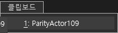
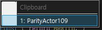
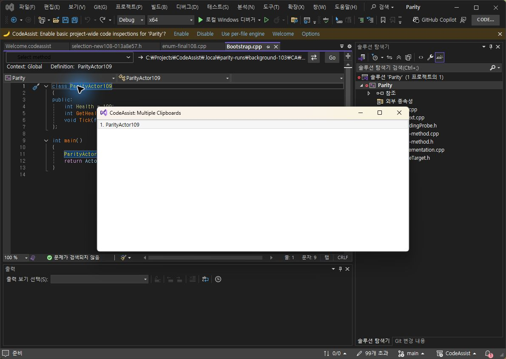
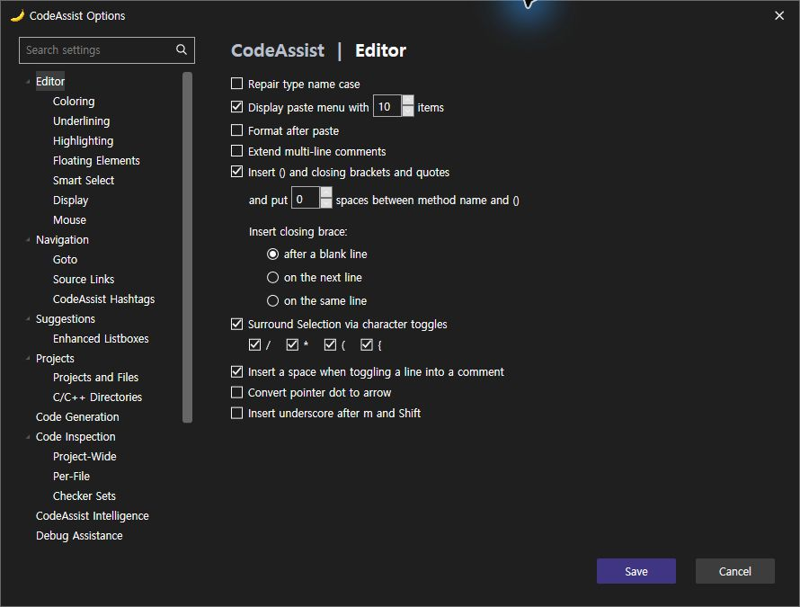
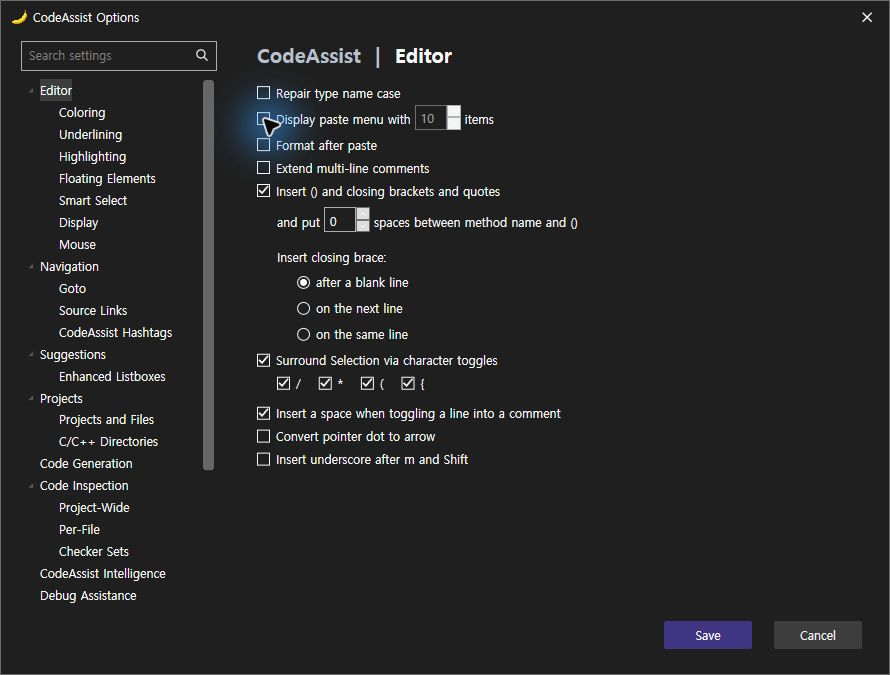
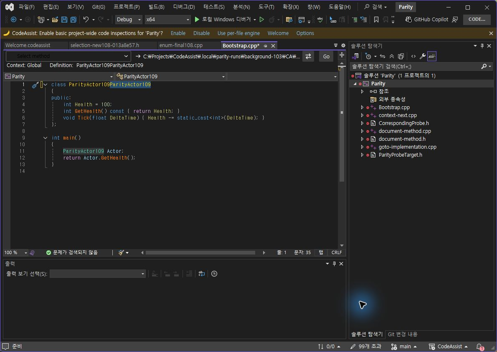

> 보관 기록입니다. 아래 결과는 원문 작성 시점의 내용이며, 이번 편집에서 제품 테스트를 다시 실행하지 않았습니다.

0.0.106 붙여넣기 메뉴 대조

## 0.0.106 붙여넣기 옵션·메뉴

누락된 Display paste menu with 체크박스를 실제 설정·명령 분기와 연결했습니다. 끄면 Ctrl+Shift+V가 Edit.CycleClipboardRing으로 전달되고, 켜면 CA 메뉴가 열립니다. [공식 과거 변경 기록](https://stage.wholetomato.com/en/kb/a/archive-and-release-notes-for-builds-released-in-2013)이 끄기 동작의 근거입니다. 현재 VA에서 끄기 분기를 직접 재실행한 것으로 계산하지 않습니다.

## VA / CA106 실제 메뉴

같은 문자열 복사와 Ctrl+Shift+V로 양쪽의 작은 메뉴를 촬영했습니다. CA는 커서 옆 표시·테마 배경으로 변경됐습니다. 아이콘 여백, 헤더 배치, 선택 테두리가 남아 있어 UI 완전 일치가 아닙니다.

## CA105 변경 전

## 추가한 설정과 실제 끄기

CA 단독 실행 점검 5/5(100%): 끄면 개수 입력 비활성화, 저장 false 반영 후 기본 붙여넣기 실행, 켜면 목록 열림, Enter 선택·닫힘, Escape 취소. 105/106의 실행 버전을 results.json에 구분했습니다. 이 100%는 제품 전체 동기화율이 아닙니다. 검사 편집은 실행 취소했으며 메뉴 표시 설정은 true로 복구했습니다.

Core 테스트 295/295 통과. VS2019·Modern 빌드 및 설치 바이너리 6/6 일치. 문서 부분 명세 108/108(100%)는 전체 역분석 완료율 아님.

미완료: 메뉴 세부 배치·색상, 다른 누락 옵션, 라이트 테마, 전체 108개 기능 현재 실행 대조. 결과·촬영 해시 · 설치 검증 · 테스트 · 빌드

XERJ: 사용 — 클립보드 옵션·호출 경로 검색 후 소스·실행 확인.

## 원문과 편집 이력

[보존된 원문 열기](../assets/imports/docs/validation/clipboard-106/index.html)

- 원문 SHA-256: `c641ccff5a4ccbf1457790c7ca608f094a1d92fcaa877b09c6582e1fecdb0041`
- 표시 날짜는 원본 파일의 수정 시각입니다. 작업 완료 시각은 원문에 있는 값을 기준으로 확인합니다.
