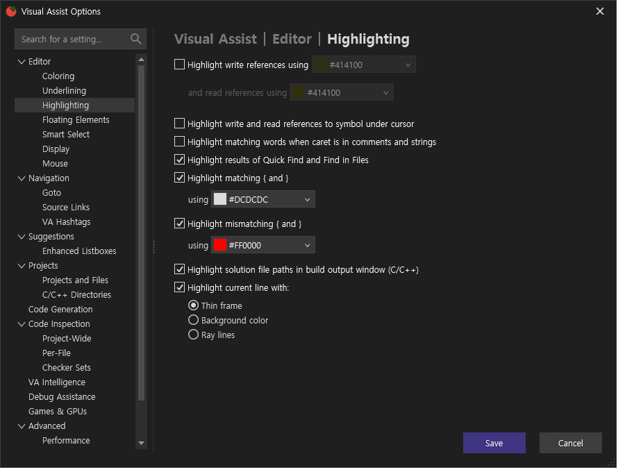
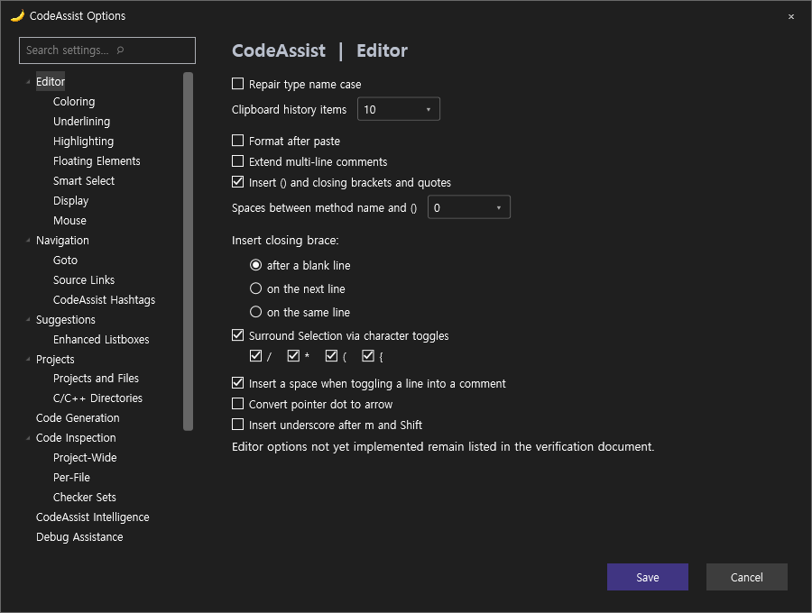

> 보관 기록입니다. 아래 결과는 원문 작성 시점의 내용이며, 이번 편집에서 제품 테스트를 다시 실행하지 않았습니다.

## initial

### VA

상태 JSON

### CA

상태 JSON

## 원문과 편집 이력

[보존된 원문 열기](../assets/imports/docs/validation/background-103/options-pages/index.html)

- 원문 SHA-256: `1bb6eaa891dfeaf4c0d8d7eb40d91731e1d224ee3d2ce6bba3b8a32c1b54383a`
- 표시 날짜는 원본 파일의 수정 시각입니다. 작업 완료 시각은 원문에 있는 값을 기준으로 확인합니다.
