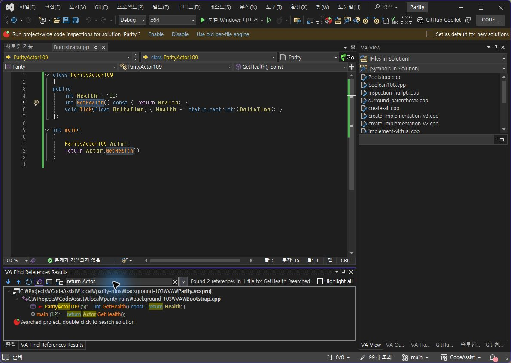
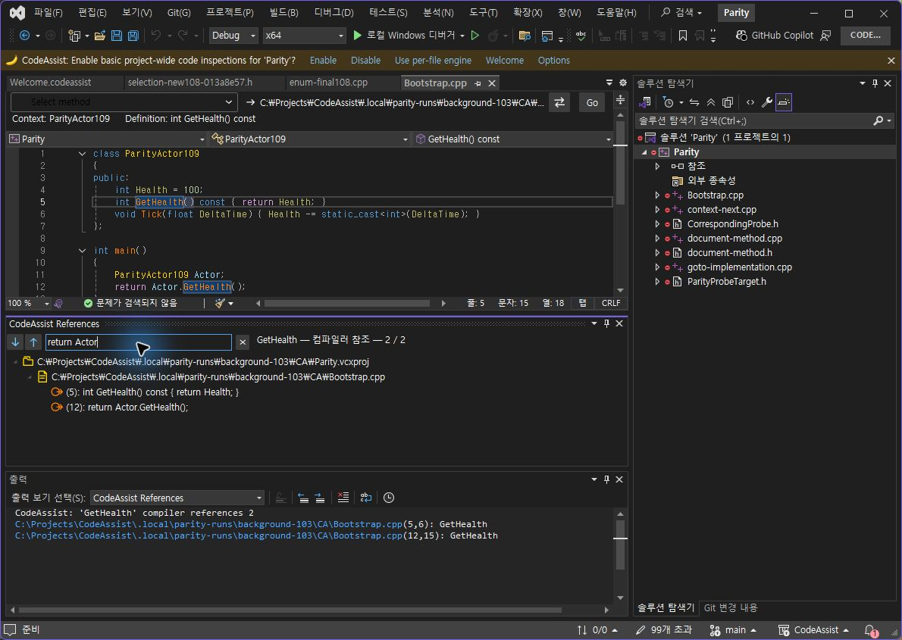

> 보관 기록입니다. 아래 결과는 원문 작성 시점의 내용이며, 이번 편집에서 제품 테스트를 다시 실행하지 않았습니다.

참조 필터·벡터 버튼 0.0.112

## 0.0.112 — 참조 창 벡터 버튼·복수 조건 필터

## 수정

이동 버튼을 직접 그린 파란 벡터 화살표로 변경했습니다. 검색 필드 옆에 벡터 지우기 버튼을 추가했습니다. 공백으로 연결하는 조건·쉼표 대안 조건을 지원하고 클래스 문맥 이름도 필터에 포함합니다. 새 참조 검색 시 필터를 초기화합니다. 하단 도킹 등록을 추가했으며 기존 부동 창은 검사 프로필에서 실제 도킹 메뉴로 배치했습니다.

## 실행 대조

양쪽 동일하게 저장된 Bootstrap.cpp, GetHealth 참조 두 행(5·12행). VA 10.9.2630.0 / CA 0.0.112 / VS 17.14.37531.7. 필터 입력 직후 접근성 트리에 이전 값이 남는 경우가 있어 아래 실제 촬영을 기준으로 판정했습니다.

| 동일 입력 | VA 표시 | CA 표시 |
| --- | --- | --- |
| return Actor | 2행 | 2행 |
| Actor,int | 2행 | 2행 |

VA 공백 조건 — 클래스 문맥 포함

CA 0.0.112 — 같은 2개 유지

VA 쉼표 대안

CA 쉼표 대안

## 발견·수정 과정

CA 0.0.111에서는 return Actor가 한 행만 표시되어 불일치했습니다. VA는 ParityActor109 문맥도 검사한다는 실행 결과를 확인하고 0.0.112에 클래스 문맥을 반영했습니다. 이 이전 실패를 새 통과로 계산하지 않습니다.

## 남은 차이

- 전역 함수 main 같은 문맥 이름은 현재 클래스 소유자 방식에 포함되지 않습니다.

- VA 숨겨진 참조 표시 및 전체 필터 도구 모음은 미완료입니다.

- CA 창은 하단으로 이동했지만 출력 창 위 별도 그룹입니다. VA의 같은 하단 탭 그룹 배치와 다릅니다.

- 검색어 강조 및 결과 문맥 캡션도 아직 동일하지 않습니다.

## 검증 근거

Core 테스트 310/310(100%), VS2019·Modern 빌드 성공. 검사 프로필 설치 바이너리 6/6 해시 일치. 시험 파일 원본 해시 양쪽 유지. 계산 데이터 · 테스트 로그 · 설치 근거 · 패키지 근거

XERJ: 사용 — 참조 창·공통 아이콘·문맥 구현 후보를 검색하고 현재 소스로 확인했습니다. 전체 목표는 진행 중입니다.

## 원문과 편집 이력

[보존된 원문 열기](../assets/imports/docs/validation/references-112/index.html)

- 원문 SHA-256: `069ac273490818860323f160eb9e52069999097c8daa70f6b8c13e0cf3c67019`
- 표시 날짜는 원본 파일의 수정 시각입니다. 작업 완료 시각은 원문에 있는 값을 기준으로 확인합니다.
