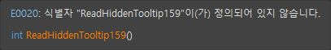
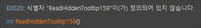
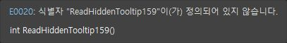
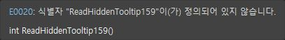

> 보관 기록입니다. 아래 결과는 원문 작성 시점의 내용이며, 이번 편집에서 제품 테스트를 다시 실행하지 않았습니다.

자체 툴팁 On/Off 실동작 대조159

## 0.0.159 — 자체 툴팁 색상 연결·원본 실행 대조

같은 호출 위치·명시적 QuickInfo 단축키에서 On/Off **2/2 상태(100%)**의 서명과 색상 모드가 일치했습니다. 전체 제품 동기화율이 아닙니다.

## Tooltips ON

VA — 동일 Ctrl+K, Ctrl+I

CA159 — 동일 Ctrl+K, Ctrl+I

## Tooltips OFF

VA — 동일 Ctrl+K, Ctrl+I

CA159 — 동일 Ctrl+K, Ctrl+I

## 실제 수정

기존 QuickInfo는 저장 인덱스만 조회해 열린 헤더의 선언이 누락됐습니다. 열린 문서의 최신 선언을 병합하고 저장본의 오래된 동일 파일 선언은 제외하도록 연결했습니다. 삭제·수정·오버로드·외부 지역 변수 배제 회귀를 추가했습니다. 수정 후 후보1개와 실제 자체 서명 표시를 확인했습니다.

프로젝트 등록 조건도 바뀌었으므로 후보0→1 화면 차이만으로 live 병합 단독 인과를 입증했다고 주장하지 않습니다. 병합 로직은 별도4개 회귀로 확인했고, 최종 프로젝트 조건에서 양쪽 On/Off 결과를 직접 비교했습니다.

## 검사 조건

동일 TooltipFallback159.h 선언을 열고, 헤더를 include하지 않는 TooltipFallback159.cpp의 ReadHiddenTooltip159 호출에서 Ctrl+K, Ctrl+I를 입력했습니다. 파일 바이트 일치: True. 기본 C++의 E0020 진단과 제품 자체 서명 행을 구분했습니다. On은 함수명 주황색·Off는 기본 흰색이며 서명도 일치했습니다.

VA 원본 프로세스에는 CA 확장 CLR 모듈이 없음을 읽기 전용으로 확인했습니다. 원본 입력 시각과 CA Query 로그도 대조해 잘못된 창 입력을 배제했습니다. VA 격리 · CA 실제 DLL

## 복원·검사 범위

현재 Tooltips 설정은 양쪽 모두 원래 On으로 복원했습니다. VA 복원값 · CA 복원값. VA 설정 저장 뒤 프로세스 종료가 관측되어 PID 소멸 확인 후 검사 프로필만 복구했습니다.

테스트2파일은 검사 전용 프로젝트에 등록했습니다. 원본 프로젝트를 각 -project-before.vcxproj로 보관했고 이 등록은 전체 검사 종료 시 변경 해시와 대조해 복원할 대상입니다. 실제 사용자 프로젝트는 변경하지 않았습니다.

| 지표 | 개수/백분율 | 한계 |
| --- | --- | --- |
| 이번 자체 툴팁 paired states | 2/2 ·100% | 이 함수·설정 표본 |
| 선택 옵션 표본 On/Off 일치 | 8/12 ·66.67% | 기존7개+이번1개 누적 표본 |
| 양쪽 근거 확보 | 10/12 ·83.33% | 모든 상태 인증 아님 |
| 공통 회귀 | 440/440 ·100% | CA 자체 회귀 |
| 문서 부분 명세 | 108/108 ·100% | 전체 역분석과 구분 |

전체 VA 동기화율은 여전히 확정되지 않았습니다. 스니펫·실제 키 유지 반복·팝업 키 입력·기존 Undo 및 전체108 현재 버전 대조가 남아 있습니다.

제안20–30분 / 기록2026-10-24T09:10:31.817327+09:00 / 경과2168초. 입력 캐시 오류와 VA 종료·복구로 예상30분을 초과했습니다. XERJ: 사용 — 검색 후 현재 소스로 확인.

원시 결과 · 440 회귀 · 현재 실행 로그 · 검사 프로젝트 변경 근거

## 원문과 편집 이력

[보존된 원문 열기](../assets/imports/docs/validation/options-159/index.html)

- 원문 SHA-256: `35137a30c628cede84de0f94b64780b64cc3ab71f8ab18f89705e7f71d5878ff`
- 표시 날짜는 원본 파일의 수정 시각입니다. 작업 완료 시각은 원문에 있는 값을 기준으로 확인합니다.
